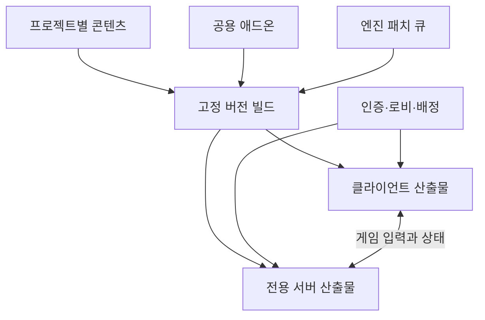
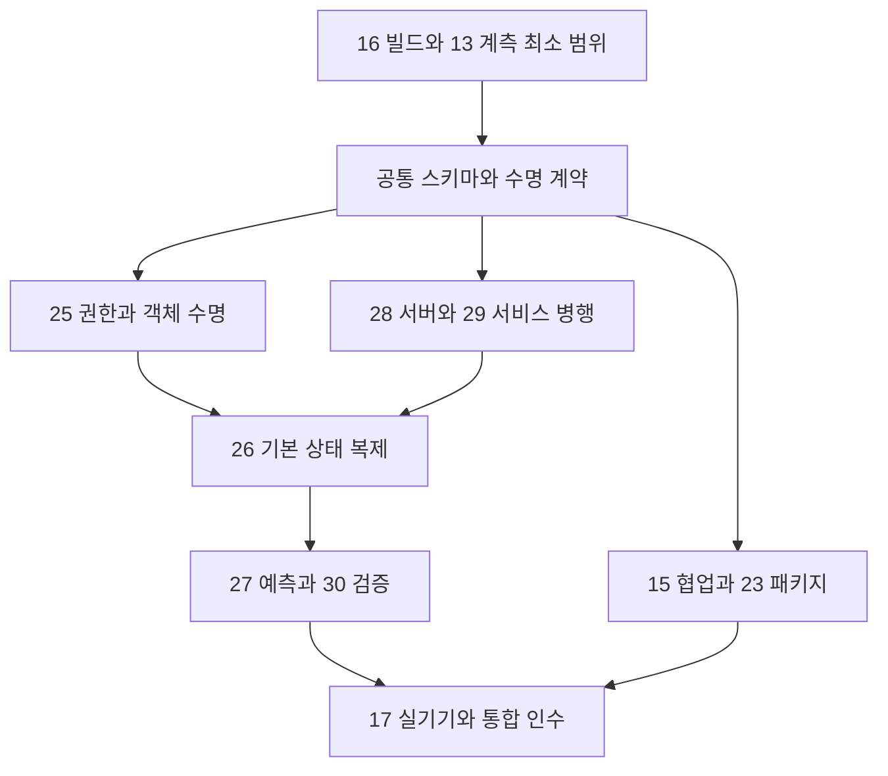

# Godot 엔진 개선 통합 개발 로드맵

**기준일: 2026-11-24 / 문서 상태: 개발 착수용 계획 / 구성: 개별 계획 30개 + 통합 로드맵 + 원문 대응·검증 기록**

첨부 「유니티 대비 고도 엔진 개선방안.pdf」의 기술·생태계 개선안을 구현 단위로 분해했다. 멀티플레이·네트워크·데디케이티드 서버·Iris는 사용자 요청에 따라 Unreal의 책임 분리와 서버 권한 모델을 기준으로 설계했다. 실제 엔진 개발·게임 실행·서버 배포를 수행한 결과 보고서는 아니다.

## 1. 가장 먼저 결정한 개발 방향

Godot의 기존 기능을 먼저 활용하고, 공통 addon/GDExtension으로 확장한다. 공개 API로 해결할 수 없는 문제가 재현될 때 최소 코어 패치를 만든다. 모든 개선을 한 번에 구현하는 엔진 교체 프로젝트로 묶지 않는다.

멀티플레이는 서버 권한 GameMode·복제 GameState/PlayerState·owner 전용 PlayerController·Pawn/Character를 기본으로 한다. Iris는 복제 아키텍처를 참고한 Godot용 독립 구현으로 계획한다. UE 소스 이식이나 UE 서버와의 wire compatibility는 가정하지 않는다.

게임 기본 언어는 GDScript로 두고 C# 통합·Web 지원은 선택 수요에 대응한다. 웹 플랫폼 UI는 별도 서비스 계층이다. 게임 프로젝트의 데이터·에셋·규칙은 독립 보관하고 분석·빌드·진단·애드온 도구를 재사용한다.

## 2. 문서 사용 방법

각 계획서에는 원문 대응 쪽, 우선순위, 담당 역할, 구현 위치, 확인한 기존 기능, 제안 API/데이터, 작업분해, 공수, 의존성, 도입 게이트, 완료 기준, 중단/대체 경로, 산출물, 공식 출처를 넣었다.

- 기능 개발을 착수할 때는 해당 계획의 첫 spike/WBS만 먼저 issue로 분해한다.
- API·스키마·공수와 정량 기준은 제안이다. 공식 현행 API와 구분해 표시했다.
- 본문에 번호만 참조한 과제는 아래 색인에서 찾는다. 모든 두 자리 번호는 고유하다.
- 원문의 주장 중 보정한 내용은 [90_Source_Coverage_and_Validation.md](90_Source_Coverage_and_Validation.md)에 모았다.
- 각 파일은 독립 검토가 가능하며, 계약 충돌이 생기면 이 통합 문서의 공통 계약을 기준으로 해당 문서 둘을 함께 갱신한다.

## 3. 전체 개발 계획 색인

P0는 공통 기반/초기 서비스 필수, P1은 상용화에 우선 필요한 확장, P2는 수요·측정 후 개발, P3/R&D는 선택 연구다. 하나의 문서 안에서도 MVP와 연구 단계의 우선순위가 다르다.

| 번호 | 개별 Markdown 계획서 | 우선순위 | 본체 공수(PW) |
| --- | --- | --- | --- |
| 01 | [GPU 주도 렌더링과 컬링 개발 계획](plans/01_GPU_Driven_Rendering.md) | P2 | 36-56 |
| 02 | [지형 제작·실행·서버 데이터 통합 개발 계획](plans/02_Terrain_Integration.md) | P1 | 16-26 |
| 03 | [텍스처 중심 자산 스트리밍 개발 계획](plans/03_Asset_Streaming.md) | P1/P2/P3 | 26-42 |
| 04 | [Compositor·렌더 패스·셰이더 확장 개발 계획](plans/04_Compositor_Render_Passes.md) | P2 | 26-42 |
| 05 | [GI 품질·Lightmap 제작·HDDAGI 검증 개발 계획](plans/05_GI_Lightmap_HDDAGI.md) | P1/P2/R&D | 26-41 |
| 06 | [하드웨어 레이트레이싱 통합·확장 개발 계획](plans/06_Hardware_Ray_Tracing.md) | R&D/P3 | 36-61 |
| 07 | [선택적 Deferred 렌더러 연구·개발 계획](plans/07_Deferred_Renderer.md) | R&D/P3 | 40-63 |
| 08 | [애니메이션 임포트·리타게팅·본 제어 개발 계획](plans/08_Animation_Import_Retargeting.md) | P1/P2 | 20-32 |
| 09 | [데이터 지향 연산·ECS·멀티스레딩 개발 계획](plans/09_DOD_ECS_Multithreading.md) | P1/P0 | 18-30 |
| 10 | [C# GDExtension·언어 간 상호운용 개발 계획](plans/10_CSharp_GDExtension_Interop.md) | P2/R&D | 30-52 |
| 11 | [C# 개발 경험·안전한 핫리로드·IDE 통합 개발 계획](plans/11_CSharp_DX_HotReload.md) | P2 | 14-24 |
| 12 | [물리 수동 스텝·상태 복구·조인트 안정성 개발 계획](plans/12_Physics_Step_Snapshot_Stability.md) | P1/P2/R&D | 32-56 |
| 13 | [GDScript·C#·GPU·메모리 진단 및 심볼 개발 계획](plans/13_Profiling_Memory_GPU_Symbols.md) | P0/P1 | 24-40 |
| 14 | [적응형 오디오 저작·FMOD/Wwise 연동 개발 계획](plans/14_Audio_Middleware_Authoring.md) | P1/P2 | 22-36 |
| 15 | [팀 협업·버전 관리·잠금·검수 개발 계획](plans/15_Collaboration_VCS_Review.md) | P0/P1 | 28-46 |
| 16 | [재현 가능한 빌드·헤드리스 익스포트·배포 용량 개선](plans/16_Build_Export_CI_Size.md) | P0 | 17-27 |
| 17 | [모바일 실기기 자동화·GPU 호환성·성능 회귀 체계](plans/17_Mobile_Device_QA.md) | P0 | 12-20 |
| 18 | [모바일 결제·광고·분석 SDK와 터치 입력 표준화](plans/18_Mobile_Live_SDK_Input.md) | P1/P0 | 18-30 |
| 19 | [RenderingDevice 기반 WebGPU 백엔드 개발](plans/19_WebGPU_Backend.md) | P2/R&D | 44-74 |
| 20 | [C#/.NET Web 익스포트 연구·제품화 계획](plans/20_CSharp_Web_Export.md) | P3/R&D | 30-54 |
| 21 | [콘솔 포팅 경계·출시 준비·총소유비용 검증](plans/21_Console_Portability_TCO.md) | P3 | 12-22 |
| 22 | [에셋 스토어 결제·정산·평가·탐색 개발](plans/22_Asset_Store_Commerce.md) | P1 | 26-42 |
| 23 | [애드온 패키지·Global Addons·CLI·서명 검증](plans/23_Addon_Package_Global_CLI.md) | P0 | 16-26 |
| 24 | [벤더 통합 인증·유지보수 파트너십·개발 재원 운영](plans/24_Partnership_Funding_Governance.md) | P1 | 10-16 |
| 25 | [Unreal 방식 게임 프레임워크·서버 권한·RPC 개발 계획](plans/25_Unreal_Gameplay_Authority_RPC.md) | P0 | 14-20 |
| 26 | [Iris 방식 상태 복제 시스템 개발 계획](plans/26_Iris_Style_Replication.md) | P0/P1 | 26-40 |
| 27 | [Unreal 방식 이동 예측·보정·네트워크 물리 개발 계획](plans/27_Movement_Prediction_Network_Physics.md) | P0/P1/P2 | 22-34 |
| 28 | [Unreal 방식 데디케이티드 서버·PIE·운영 개발 계획](plans/28_Dedicated_Server_Runtime_Operations.md) | P0/P1/P2 | 20-32 |
| 29 | [Unreal 방식 온라인 서비스·로비·매치메이킹·릴레이 개발 계획](plans/29_Online_Services_Sessions_Relay.md) | P0/P1 | 18-28 |
| 30 | [서버 권한 검증·안티치트·UGC 실행 격리 개발 계획](plans/30_AntiCheat_Server_Validation.md) | P0/P1 | 14-22 |

## 4. 구현 계층과 통제 가능한 범위

| 계층 | 구현 범위 | 대표 문서 | 원칙 |
| --- | --- | --- | --- |
| 프로젝트 제작 addon | 지형·리타게팅·오디오·입력·패키지 UI | 02/08/14/18/23 | 게임별 필요 기능만 설치 |
| native extension | 복제·hot loop·backend·진단 bridge | 09/10/12/13/25-27 | 버전·ABI·플랫폼별 검증 |
| 최소 엔진 patch | 렌더 경계·수동 physics snapshot/step·Web backend | 01/03-07/12/19/20 | 공개 API 한계 입증 후 patch queue |
| 플랫폼 서비스 | 협업·빌드·스토어·로비·배정 | 15-18/22-24/28-30 | project/tenant별 권한·데이터 경계 |
| 외부 의사결정 | upstream merge, 콘솔 SDK, vendor 유지보수, 결제 계약 | 10/19-24/30 | 외부 납기를 우리 완료일로 약속하지 않음 |

원문의 Track A는 엔진·재단 차원의 과제다. 이 패키지는 그중 우리가 구현·제안할 부분과 upstream/벤더의 승인에 달린 부분을 구분한다. 공식 Godot 스토어나 재단의 정책을 우리가 바꿀 수 있다고 전제하지 않는다.

## 5. Unreal 방식 네트워크 계획의 경계

| 계획 | Unreal에서 참고한 책임 | 이 계획에서 구현할 기능 |
| --- | --- | --- |
| 25 게임 프레임워크 | GameMode/GameState/PlayerState/Controller/Pawn, roles, RPC | 권한·스폰·수명·소유권·typed RPC |
| 26 Iris식 복제 | Bridge·Fragment·Descriptor·State·Filter·Prioritizer | dirty/quantize/delta/ACK, 관심 영역·dormancy·컬렉션 |
| 27 이동·네트워크 물리 | CMC 예측/보정, Predictive Interpolation/Resimulation | 입력 history·replay·smoothing·제한 physics rollback·hit rewind |
| 28 데디서버 | headless authoritative server, 독립 remote clients | 서버 preset·DS+2 clients 실행·lease·drain·fleet |
| 29 온라인 서비스 | provider 중립 Auth/Lobbies/Sessions 분리 | 계정·party·matchmaking·join ticket·native/Web 전송 |
| 30 안티치트 | 서버 규칙 검증 + 선택 client integrity | action validator·패킷 제한·UGC 격리·증거·선택 EAC |

Iris 공식 문서가 설명하는 상태 복제 분리 원칙을 참고한다. 예측·physics rewind·호스팅의 완성 여부는 각 계획의 별도 인수 기준으로 판단한다. [Epic Iris](https://dev.epicgames.com/documentation/unreal-engine/introduction-to-iris-in-unreal-engine), [Networked Physics](https://dev.epicgames.com/documentation/unreal-engine/networked-physics-overview)

기본 플레이 검증은 서버 1개 + 독립 클라이언트 2개다. 서버는 player slot을 차지하지 않는다. 각 client는 같은 session_id에 대해 별도 identity·slot·join ticket을 사용한다. 1프로세스 다중 세션은 신뢰된 동일 배포 코드에 한정한 후속 최적화이며 다른 불신 UGC의 OS 격리를 대체하지 않는다.

## 6. 버전·플랫폼 기준선

공식 다운로드에서 4.7.2를 확인했으므로 초기 후보로 삼는다. 실제 착수 시 engine tag뿐 아니라 commit·export template hash·GDExtension binding·compiler/SDK·패치 집합을 묶어 고정한다. 현재 문서 페이지와 master PR 상태가 production tag의 동작을 보장하지 않는다. [Godot 공식 다운로드](https://godotengine.org/download/)

| 대상 | 우선 지원 경로 | 승격 조건 |
| --- | --- | --- |
| Windows client | GDScript, 검증된 Forward+/Compatibility profile | 입력·렌더·network·설치 회귀 |
| Android client | Mali/Adreno 별도 profile, 필요한 native addon만 | 실기기·발열·resume·SDK·용량 |
| iOS client | 고정 Apple SDK/서명·device profile | macOS runner·실기기·스토어 SDK 검증 |
| Linux dedicated | headless release export template | 시각 리소스 없이 규칙·physics·network 재현 |
| Web client | 현재 검증된 Compatibility 경로 | browser·WebRTC·storage/audio/input 제약 시험 |
| WebGPU / C# Web | 각각 독립 R&D branch | 19와 20의 별도 완료 gate |
| 콘솔 | 계약된 provider와 인증된 조합 | SDK 접근·devkit·한 플랫폼 slice·TCO gate |

Godot의 현행 Web 문서는 C# Web export 제한을 명시한다. WebGPU backend를 개발한다고 C# 런타임 배포가 함께 해결되는 것으로 계획하지 않는다. [Godot Web export](https://docs.godotengine.org/en/stable/tutorials/export/exporting_for_web.html)

## 7. 공통 데이터와 API 계약

구현 전에 아래 계약을 versioned ADR/schema로 동결한다. 식별자는 제안 필드이며 실제 비밀키나 내부 값이 아니다.

| 계약 | 최소 필드 | 주관 문서 |
| --- | --- | --- |
| EngineLock | tag, commit, template_hash, toolchain, bindings, patch_set | 16/23 |
| CapabilityManifest | platform, renderer, ABI, native dependencies, fallback, server_required_assets | 02/06/18-23 |
| BuildManifest | project_id, revision, build_id, protocol_hash, content_hash, signatures | 16/23 |
| ProjectRevision | project_id, revision, operation_id, snapshot_hash | 15 |
| WorldKey | tenant_id, project_id, build_id, session_id, world_epoch | 25/28 |
| NetObjectId | index, generation; WorldKey 범위 | 25/26 |
| AuthoritySnapshot | server_tick, object_id, schema_hash, acked_input_seq, state_revision | 26/27 |
| SessionLease/JoinTicket | session, instance, lease_epoch, user, slot, expiry, nonce | 28/29 |
| TraceSample | build/device/driver, clock domain, frame/tick, duration, memory, bytes | 13/17/25-30 |

RenderingServer RID, Resource UID, 편집 Node stable ID, 네트워크 NetObjectId, 인증 user_id는 서로 다른 목적의 식별자다. 같은 정수나 경로를 우연히 공유한다는 이유로 대체하지 않는다.

통신 state와 게임 save/master data는 구분한다. Save는 versioned JSON/외부 스키마 또는 명시적 migration이 있는 형식을 사용하며 Resource 내부 구조 변경에 자동 호환을 기대하지 않는다. 게임별 master data는 개별 프로젝트에 남긴다.

## 8. 착수 순서와 순환 의존성 해소

28과 29는 서로 완성될 때까지 기다리는 선행 관계가 아니다. session/allocation/join 계약을 먼저 고정하고 로컬 fake provider로 양쪽을 병행한 뒤 접속 gate에서 합친다.

13과 16도 완제품 전체가 선행인 것은 아니다. 최초 측정·build identity·심볼 묶음만 먼저 제공하고 나머지 profiler와 최적화는 점진적으로 추가한다. 10의 신규 .NET 바인딩이나 11 hot reload 완성을 20의 모든 Web 연구에 강제하지 않는다.

렌더·지형·오디오·애니메이션은 같은 build/trace/package 계약에 붙지만 네트워크 전체 완성을 기다릴 필요가 없다. 서버가 사용하는 collision/nav/root-motion 데이터만 양쪽이 조기 합의한다.

## 9. 1차 출시의 최소 범위

### 9.1 기술 스파이크: 6-10 PW

소규모 팀 또는 1인 진행은 먼저 로컬 DS+2 clients, 하나의 작은 맵, 이동·스폰·체력·owner RPC, 단순 typed full snapshot, headless export를 묶은 시제품을 만든다. 기존 Godot 전송 기능을 재사용하며 완성형 Iris·상업 스토어·콘솔·새 렌더러를 이 단계의 완료 조건으로 넣지 않는다.

실제 목표 Android 기기 1종에서 같은 규칙·입력을 확인하고, RTT/손실과 late join 실패 원인을 찾는다. 결과는 엔진 채택·patch 범위·네트워크 공수 재추정의 자료가 된다. 이 6-10 PW는 아래 MVP의 일부이며 별도 가산하지 않는다.

### 9.2 제작·멀티플레이 MVP: 36-52 PW

| 묶음 | 선택 범위 | PW |
| --- | --- | --- |
| 기준선 | 16 고정 빌드, 13 최소 trace·symbols | 4-6 |
| 제작 안정성 | 15 snapshot/복원, 23 exact package lock | 4-6 |
| 권한·서버 | 25 기본 프레임워크, 28 로컬/단일 VM | 8-12 |
| 복제 | 26 typed full snapshot·수명·기초 owner/거리 필터 | 6-8 |
| 입력 품질 | 27 정적 월드 캐릭터 예측·원격 보간 | 5-7 |
| 서비스·검증 | 29 단일 provider ticket, 30 필수 validator | 3-5 |
| 통합 인수 | 17 최소 실기기, 회귀·재접속·운영 복구 | 6-8 |
| 합계 | 각 문서의 전체 WBS를 축소 선택한 subset | **36-52** |

이 MVP는 제한된 장르·하나의 기준 게임·8인 목표 프로파일에 대한 계획이다. 100인전, 전체 physics resimulation, WebGPU, C# Web, 모든 광고 SDK, 유료 스토어, 고급 동시 편집은 포함하지 않는다. Windows/Android client+Linux server를 먼저 인수하고 iOS는 macOS runner·실기기 준비 gate에 맞춰 합친다.

전담 엔지니어 3-4명과 QA 지원이 있는 경우 12-18주를 초기 일정 후보로 삼을 수 있다. 전문 인력 배치·실기기·외부 승인·기술 스파이크 결과에 따라 다시 산정한다. 1인 개발에서 동일 범위를 같은 달력 기간으로 약속하지 않는다.

## 10. 단계별 로드맵과 Go/No-Go

| 단계 | 상대 기간 | 수행 범위 | 다음 단계 조건 |
| --- | --- | --- | --- |
| R0 | 시작 후 2-4주 | 위험 spike, 기능 baseline, 문서의 가정 검증 | 핵심 플레이·기기·protocol의 구조적 blocker 판정 |
| R1 | 0-6개월 | 위 MVP, 기본 협업/패키지, 모바일 안정화 | 기본 서비스 회귀·복구·배포 통과 |
| R2 | 6-18개월 | 필요한 3D/streaming/animation/audio, Iris 최적화, SDK·스토어 | 유저/제작 수요와 측정 효과가 개발비 정당화 |
| R3 | 18-36개월 | 선택 WebGPU/C# Web/HWRT/Deferred/HDDAGI, 콘솔·vendor 확장 | 연구 gate·플랫폼·유지보수 인력·TCO 통과 |

이는 원문의 36개월 트랙을 우리 실행 단계로 옮긴 포트폴리오이며 공식 Godot release 일정이 아니다. R&D가 실패해도 검증된 기존 렌더러·GDScript·서버 기본 경로로 서비스를 유지한다.

No-Go가 나오면 원인에 따라 프로파일/장르 범위를 줄이거나 extension·기존 middleware·별도 기술 대안을 비교한다. 원문의 “기술 spike 실패 시 엔진 전환”을 자동 규칙으로 적용하지 않고 3년 TCO와 실제 미충족 요구를 기록한 뒤 선택한다.

## 11. 공수와 자원 해석

| 범주 | 본체 공수 합계 |
| --- | --- |
| 01-08 그래픽 | 226-363 PW |
| 09-15 런타임·도구 | 168-284 PW |
| 16-24 플랫폼·생태계 | 185-311 PW |
| 25-30 네트워크 | 114-176 PW |
| 단순 합계 | **693-1,134 PW** |

이 합계는 선택 연구·대안 경로까지 각 계획의 본체 추정을 더한 비교치다. 모두 실행하라는 예산이나 한 팀의 일정이 아니며, 통합 시 공용 작업·병행 가능한 작업·취소할 연구를 다시 정산해야 한다. 15의 선택 Perforce 8-14 PW·Unity VCS 6-10 PW는 본체 합계 외이고, 전체 콘솔 게임 포팅·인증·법무·라이선스·장비·서비스 이용료도 별도다.

공수 비용 모델은 선택한 PW × 5근무일 × 역할별 총원가/일 + 외부 비용이다. AI 보조로 코드 작성이 빨라져도 실기기 검증, backend 호환, 운영 수명과 외부 승인을 제거하지 않는다. 특히 rendering·network physics·.NET runtime은 전문 담당자를 대체 가능한 일반 작업량으로 보지 않는다.

## 12. 공통 검증 계약

| 종류 | 필수 기록 | 인수 원칙 |
| --- | --- | --- |
| 성능 | 장치/CPU/GPU/driver/OS, engine commit, build profile, seed, warmup, raw samples | p50/p95/p99와 반복 분산, 동일 조건 baseline |
| 메모리 | process/native/managed/VRAM 구분, shared resource, load/unload 횟수 | 단순 peak와 누수 추세를 구별 |
| 네트워크 | tick/snapshot rate, CCU·세션 수·객체 수, RTT/jitter/loss/reorder | 상태 정합성·권한·큐 상한·입력 품질 |
| 호환성 | platform/renderer/ABI/SDK/addon matrix | 동작한 조합만 지원 표시 |
| 콘텐츠 | 원본/import hash, collision/nav/root-motion 보존 | 서버와 client 규칙 데이터 일치 |
| 복구 | 실패 주입·old/new revision·rollback 경로 | 부분 실패·중복 실행·데이터 유실 방지 |

모든 자동 시험은 실패 시 재현 seed·입력·관련 trace를 산출한다. “테스트가 돌아감”과 “제품 기준 통과”를 구별하고 시험의 장르·기기·load 범위를 결과에 기록한다.

30Hz tick의 총 시간 예산은 약 33.3ms, 60Hz는 약 16.7ms다. 다른 기기나 장르의 CCU·FPS를 그대로 목표 달성 근거로 사용하지 않는다. 내부 부하 시험 결과로 다시 지원 등급을 정한다.

## 13. 코어 포크·업그레이드·backlog 운영

엔진 수정은 upstream-compatible 최소 commit으로 분리하고 각 patch에 이유·대체 불가 API·회귀 fixture·upstream 상태·제거 조건을 둔다. production pin과 실험 branch를 분리하고 release 변경은 patch 재적용, ABI, import, multiplayer protocol, mobile SDK를 함께 검사한다.

각 개별 문서의 WBS ID를 backlog의 추적 키로 사용한다. 작업 완료에는 코드/설계 산출물, 재현 시험, 지원 범위, rollback 경로가 필요하다. 의존성은 '계약 필요', '기능 완료 필요', '선택 연계', '외부 승인'으로 구분해 순환과 불필요한 대기를 줄인다.

서비스 저장소와 게임 프로젝트의 release를 독립시킨다. 게임마다 채택한 공용 package version을 고정하고 일괄 강제 업데이트하지 않는다. 운영 배포는 이번 문서 작성의 범위에 포함되지 않는다.

## 14. 이번 제공물의 검증 범위

첨부 PDF를 읽고 개선 항목을 분해했으며, 공식 Godot/Epic/벤더 자료로 현재 기능과 계획을 대조했다. 30개 문서의 범위·공수·연결 규칙을 교차 검토하고 Markdown 구조·파일 링크·ZIP 무결성을 확인한다. 실제 수행한 결과와 제외 범위는 90번 기록을 따른다.

엔진 checkout/build, Godot 실행, 실기기 QA, 서버 연결, CCU 부하, 결제·스토어·콘솔·안티치트 인증은 아직 수행하지 않았다. 본 문서의 완료 기준은 이후 개발팀이 실행할 시험 계획이다.
