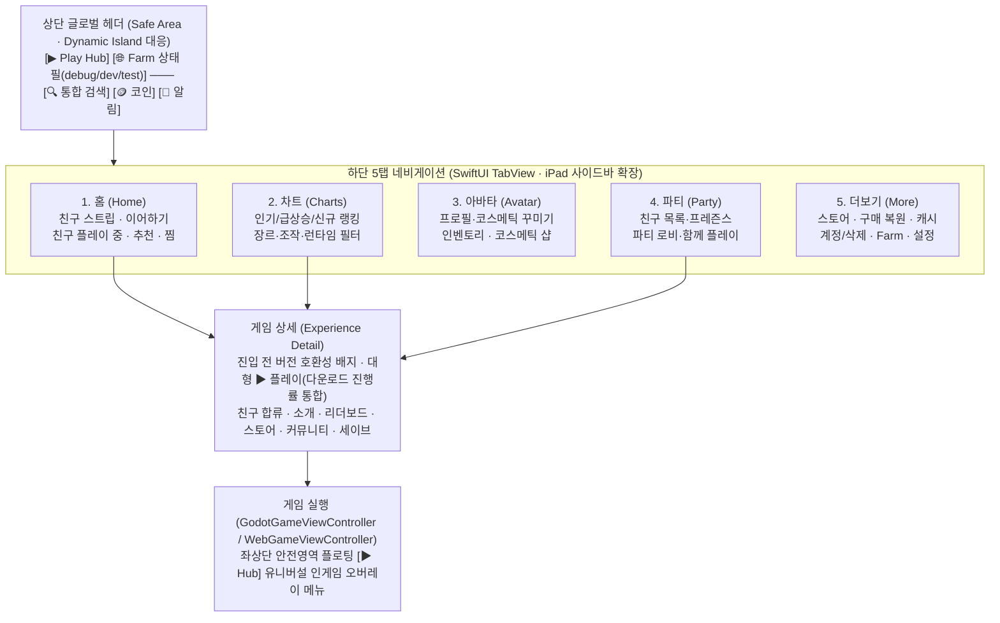
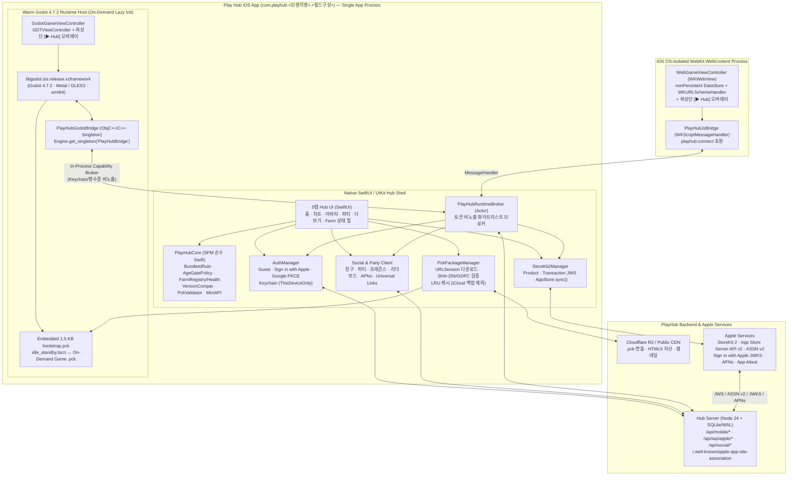
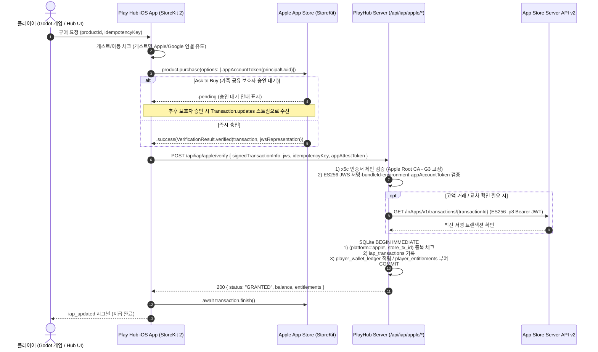
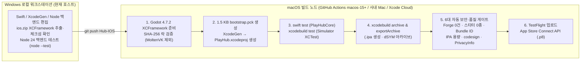

# Play Hub iOS (IOS) IPA · Godot 4.7.2 엔진 내장 번들링 구현 계획안

- **브랜치 / 워크트리**: `Hub-IOS` (`D:\Github\GoDotProjects-worktrees\Hub-IOS`, 기준 `PlayHub-Platform` `746e0c7`)
- **iOS Bundle ID 규칙 (`com.playhub.<브랜치명>.<빌드구성>`)**:
  - 4세그먼트 통일 구조이며, 마지막 세그먼트는 항상 **5종 빌드 구성(`debug` · `dev` · `test` · `release` · `live`)**으로 끝난다.
  - 공식 / 트렁크 빌드: `com.playhub.gamedev.<debug|dev|test|release|live>` (App Store 정식 출시: **`com.playhub.gamedev.live`**)
  - 브랜치 빌드: `com.playhub.<정규화_브랜치명>.<debug|dev|test|release>` (예: `Hub-IOS` → `com.playhub.hub-ios.debug`, `com.playhub.hub-ios.dev`, `com.playhub.hub-ios.test`, `com.playhub.hub-ios.release`)
  - **플랫폼 문자 규칙 차이**: Android `applicationId`는 밑줄(`_`)만 허용(`com.playhub.hub_aos.*`)하지만, Apple `CFBundleIdentifier`(UTI)는 **영숫자·하이픈(`-`)·마침표(`.`)만 허용하고 밑줄(`_`)을 금지**하므로 브랜치 세그먼트 구분자는 `-`로 정규화한다. 공식 트렁크 ID(`com.playhub.gamedev.*`)는 AOS/iOS 100% 동일하다.
- **문서 상태**: v1.0 (2026-11-21 — 초기 아키텍처·정책·빌드·로드맵 확정안, `Hub-AOS` v1.6 및 M1 실검증 교훈 반영)
- **대상 엔진**: `godot-engine` 포크 고정 커밋 `ed1daf0bf001b61586d9930840f2f1394092c079` (**Godot 4.7.2-stable**)
- **최소 지원 OS**: **iOS 16.0+ / iPadOS 16.0+** (arm64, Metal 3 / StoreKit 2 / SwiftUI `NavigationStack` / `DCAppAttestService` / `ASAuthorizationAppleIDProvider`)
- **핵심 범위**: iOS/iPadOS용 Play Hub **게임 플레이 런타임 전용 IPA**, **Roblox 스타일 5탭 + 유니버설 인게임 오버레이 메뉴**, Godot 4.7.2 네이티브 엔진 정적 내장 + On-Demand `.pck` + 기존 HTML5/JS(`WKWebView`) 호환, **Guest 즉시 플레이 + Sign in with Apple(필수) + Google 로그인 + 연령 확인 법령·App Store 4.7 준수**, **StoreKit 2 인앱구매(IAP)**, **소셜·파티**, **Farm 서버군 선택 및 4단계 실시간 상태 표시**, **배포 용량 최소화(스타터 0종 100% On-Demand)**
- **명시적 제외 (Non-Goals)**: **PlayForge 전면 제외** — 웹 에디터(`/forge/*`), 창작자 대시보드(`/?view=create`), 프로젝트 빌드/PIE, `@tool` 스크립트 실행, Godot 에디터 바이너리·개발 도구·코드 작성 UI는 IPA에 일절 포함하지 않는다. (이는 공격 표면·용량 축소뿐 아니라 **Apple App Store Guideline 2.5.2 심사 통과**를 위해서도 필수적이다.)

---

## 1. 배경 및 목표

현재 PlayHub 웹 포털(`hub/`)은 브라우저에서 HTML5/JS 게임(40종)과 Godot Web/WASM 게임(`survivor-arena-g2` 등)을 실행한다. 그러나 iOS Safari / `WKWebView` 환경에서의 웹 기반 Godot WASM 실행은 Android보다 훨씬 엄격한 플랫폼 제약을 받는다.

1. **WebKit 강제 및 메모리 Jetsam 한계**: iOS는 App Store 앱에서 제3자 브라우저 엔진을 허용하지 않으며(EU 외 전역 WebKit 강제), `WKWebView`의 WebContent 프로세스는 수십 MB의 Godot WASM(`survivor-arena-g2/Web/index.wasm` 35.95 MiB)과 WebGL 텍스처를 함께 적재할 때 iOS Jetsam에 의해 빈번하게 강제 리로드/종료된다.
2. **COOP/COEP · 오디오 · 게임패드 제약**: Godot 멀티스레드 WASM(`SharedArrayBuffer`)은 `COOP/COEP` 격리 헤더를 요구해 OAuth·결제·임베드 흐름과 충돌하며, iOS Safari에서는 AudioWorklet 자동재생·전체화면·Dynamic Island 회피·진동(Core Haptics) 지원이 제한적이다.
3. **Apple 생태계 네이티브 기능 필수**: **StoreKit 2 인앱결제**, **Sign in with Apple**, **APNs 푸시 알림**, **Universal Links**, **MFi/DualSense 게임패드(`GCController`)**, **App Attest**, **오프라인 `.pck` 캐싱**은 네이티브 iOS 앱에서만 완성도 있게 제공할 수 있다.

### 목표

- **단일 Play Hub IPA에 Godot 4.7.2 네이티브 런타임(`libgodot.ios.release.xcframework`)을 1회 정적 내장**하고, 개별 Godot 게임은 경량 `.pck` 리소스 팩(예: `survivor-arena-g2` 1.87 MiB) 단위로 온디맨드 다운로드·검증·캐싱해 **Metal / GLES3 네이티브 60fps**로 실행한다.
- **PlayForge 기능을 100% 배제한 게임 플레이 전용 앱**으로 구성해 App Store 심사 리스크(Guideline 2.5.2 / 4.7)와 IPA 다운로드 용량을 최소화한다.
- `Hub-AOS`와 **공통 PlayHub 모바일 백엔드(`/api/mobile/*`, `/api/iap/*`, `/api/social/*`) 및 통합 GDScript Runtime SDK(`PlayHubBridge`)**를 공유하여, 게임 개발자가 OS 분기 없이 Web·Android·iOS에서 동시에 동작하는 게임을 배포할 수 있게 한다.
- 기존 `games/*/Web/` HTML5/JS 게임 40종도 전용 `WKWebView` 런타임과 `PlayHubJsBridge`로 끊김 없이 실행한다.

---

## 2. 범위 정의 (포함 vs 제외) 및 `Hub-AOS` 대비 핵심 차이

### 2.1 포함 vs 제외 (Non-Goals)

| 영역 | 포함 (`Hub-IOS` IPA) | 제외 (Non-Goals) |
|---|---|---|
| **엔진 / 런타임** | Godot 4.7.2 `libgodot.ios.release.xcframework` 정적 내장, 1.5 KB 내장 부트스트랩 + On-Demand `.pck` 동적 마운트, 기존 HTML5/JS 게임용 격리 `WKWebView` 런타임 | PlayForge 웹 에디터, Godot 에디터/디버거 바이너리, 동적 네이티브 코드(`.dylib`/JIT) 다운로드, `@tool` 실행 |
| **포털 UI / 메뉴** | **Roblox 스타일 5탭 네비게이션**(`홈` · `차트` · `아바타` · `파티` · `더보기`), 상단 유틸리티 바(Farm 상태 필·검색·코인·알림), Experience 상세 화면, **유니버설 인게임 오버레이 메뉴** | `/forge/*`, `/?view=create`, 창작자 제출 콘솔, Admin 콘솔(`/api/admin/*`) |
| **인증 · 연령 · 계정** | **Guest 즉시 플레이** + **Sign in with Apple (Guideline 4.8 필수)** + **Google 로그인** + `merge_requests` 게스트 병합 + **인앱 계정 삭제 (Guideline 5.1.1(v) 필수)** + **Neutral Age Gate** + KR/COPPA/GDPR-K/Apple 4.7 준수 | Forge 세션 쿠키(`poc_forge_session`), 관리자 로그인, IDFA/ATT 크로스앱 광고 추적 |
| **결제 (IAP)** | **StoreKit 2** (`Product`/`Transaction` JWS) + **App Store Server API v2** + **ASSN v2 Webhook** + **구매 복원(`AppStore.sync()`)** + **Ask to Buy** 대응 + `Play Coin`/Play Pass/아바타 코스메틱/게임별 엔타이틀먼트 원장 | 외부 웹 결제 우회/링크(App Store Guideline 3.1.1 / 4.7.5 위반), 제작자 인프라 과금 UI(`Hub Point`) |
| **소셜 · 알림** | 프로필/핸들, 친구 요청·차단, 실시간 프레즌스, **파티 로비(함께 플레이)**, **Universal Links** 초대 딥링크, 리더보드/업적, 기존 커뮤니티(댓글·건의·투표·신고), **APNs 푸시** | 음성 채팅/스트리밍(Phase 2 이후 검토), 오픈 월드 길드 서버 |

### 2.2 `Hub-AOS` vs `Hub-IOS` 아키텍처·정책 핵심 차이 요약

| 비교 축 | `Hub-AOS` (Android) | `Hub-IOS` (iOS / iPadOS) | 공유 / 통합 전략 |
|---|---|---|---|
| **식별자 규칙** | `com.playhub.<branch_with_underscore>.<stage>` (`hub_aos`) | `com.playhub.<branch-with-hyphen>.<stage>` (`hub-ios`) | 공식 트렁크 `com.playhub.gamedev.<stage>` 완전 동일 |
| **게임 런타임 격리** | OS 다중 프로세스 (`:godot_runtime` + `Process.killProcess()`) | **단일 프로세스 제약** → Warm `GDTViewController` + `idle_standby.tscn` + 7단계 Clean Reset (`WKWebView`는 OS가 `WebContent` 프로세스 자동 분리) | `bootstrap.gd` + `PlayHubBridge` 싱글톤 계약 100% 동일 |
| **렌더링 드라이버** | `gl_compatibility` (GLES3) 기본 + Vulkan 선택 | `gl_compatibility` (GLES3) 기본 + **네이티브 `Metal`** (`MoltenVK` 제외로 6.6 MiB 절감; 시뮬레이터는 GLES3 강제) | `game.manifest.json`의 `ios.renderingMethod` 분기 |
| **UI 프레임워크** | 초경량 순수 AndroidX View (`DEX 0.26 MiB`) | 초경량 순수 **SwiftUI + UIKit** (Apple First-Party Only, 외부 대형 UI 라이브러리 0개) | 5탭·상단 헤더·상세·오버레이 UX 및 Farm 4색 규칙 통일 |
| **로그인 공급자** | Guest + Google Credential Manager | Guest + **Sign in with Apple (필수)** + Google (`ASWebAuthenticationSession` OIDC PKCE) | 동일 `users`/`identities`/`mobile_tokens`/`merge_requests` |
| **인앱결제 (IAP)** | Google Play Billing v7 + Developer API + Pub/Sub RTDN | **StoreKit 2 (JWS)** + **App Store Server API v2** + **ASSN v2** + Consumption API | 동일 `player_wallet_*` / `player_entitlements` 원장 공유, 검증 어댑터만 분리 |
| **푸시 / 딥링크** | FCM + Android App Links (`assetlinks.json`) | **APNs (HTTP/2 `.p8`)** + **Universal Links (`apple-app-site-association`)** | 동일 `mobile_push_tokens` 테이블(`platform='fcm'|'apns'`) |
| **무결성 / 보안 저장** | Play Integrity + Keystore `EncryptedSharedPreferences` | **App Attest (`DCAppAttestService`)** + **Keychain (`ThisDeviceOnly`)** | 서버 무결성 미들웨어 어댑터 패턴 |
| **스토어 심사 핵심** | Google Play 동적 코드 정책 · Families · 16 KB ELF 정렬 | **App Store 2.5.2 / 4.7 (Mini Apps) / 4.8 (Apple Login) / 5.1.1(v) (계정 삭제) / Privacy Manifest / iCloud 백업 제외** | 빌드·릴리스 자동 품질 게이트에 플랫폼별 규칙 반영 |
| **빌드 호스트** | Windows x64 로컬 직접 빌드 (`Gradle` + `AndroidSDK`) | **Windows(코드·백엔드·로직) + macOS(Xcode/`xcodebuild`/XCTest/TestFlight)** 하이브리드 파이프라인 | GitHub Actions `macos` 러너 / 사내 Mac 빌드 노드 자동화 |

---

## 3. 앱 메뉴 구성 및 UX 아키텍처 (Roblox 스타일 런타임 허브 · iOS HIG 대응)

`Hub-AOS`에서 확정한 **상단 유틸리티 바 + 하단 5탭 + Experience 상세 + 유니버설 인게임 오버레이** 구조를 iOS/iPadOS Human Interface Guidelines(Safe Area, Dynamic Island, Home Indicator, 다크 테마 고대비, iPad 와이드 레이아웃)에 맞춰 구현한다.



### 3.1 상단 글로벌 헤더 & 하단 5탭 핵심 요건

- **상단 글로벌 헤더**:
  - 좌측: `▶ Play Hub` 로고/타이틀 + **`debug`·`dev`·`test` 빌드 전용 Farm 서버군 상태 필**(`GREEN`/`YELLOW`/`ORANGE`/`RED` 도트 + `ms` 실시간 표시, `release`·`live`에서는 컴파일·런타임 이중 제거).
  - 우측: 통합 검색(`🔍`), Play Coin 잔액 Pill(`🪙` → 탭 시 StoreKit 2 코인·Play Pass 스토어 시트 오픈), 알림(`🔔`).
- **하단 5탭 (`홈` · `차트` · `아바타` · `파티` · `더보기`)**:
  - `홈`: 온라인/플레이 중 친구 원형 아바타 스트립, 이어하기(로컬 `.pck` 캐시 완료 배지 + 클라우드 세이브 동기화 시각), 친구들이 플레이 중(원탭 합류), 추천/찜 카드 + **진입 전 버전 호환성 경고 배지**(`⚠️ 엔진 업데이트 필요` / `⚠️ 앱 업데이트 필요`).
  - `차트`: 인기 급상승·최다 플레이·최고 추천·신규/업데이트 레일 + 장르/조작(`터치`/`게임패드`)/런타임(`Godot 3D`/`Web`) 필터 칩.
  - `아바타`: 프리셋 아바타·프레임·칭호·배지 장착 및 인벤토리·코스메틱 샵.
  - `파티`: 최대 4~8인 파티 로비, 퀵메시지/채팅(아동 모드 시 사전 정의 안전 퀵메시지만 허용), 친구 목록·프레즌스, 핸들 검색·QR·Universal Link 초대, 차단/신고.
  - `더보기`: 2열 타일 그리드 (**PlayForge 진입점 0건**)
    - **스토어 / 코인 충전 (`Play Coin & Pass`)** + **구매 복원 (`Restore Purchases` — Apple 필수)**
    - **저장소 / `.pck` 캐시 관리** (설치된 `.pck` 용량 확인·개별 삭제·일괄 정리)
    - **계정 & 클라우드 세이브** (Sign in with Apple / Google 연결, 게스트 병합 `merge_requests`, 로그아웃, **계정 삭제 — Apple 5.1.1(v) 필수**)
    - **Farm 서버군 상태·전환** (`debug`/`dev`/`test` 전용)
    - **설정** (8개 로케일, 그래픽 품질/절전 모드, 햅틱, 알림, 프라이버시, 연령 확인·보호자 동의 상태, 이용약관/개인정보처리방침)

### 3.2 게임 상세 화면 (Experience Detail) & 진입 전 버전 호환성 게이트

- `Hub-AOS` M1에서 실증한 **진입 전 버전 호환성 차단 UX**를 초기 버전(M1)부터 적용한다.
  - 카탈로그 API 응답(`compatibility.compatible == false`) 또는 로컬 `VersionCompatibilityChecker` 판정 시 카드에 경고 배지를 노출하고, `▶ 플레이` 탭 시 `.pck` 다운로드나 Godot 뷰 전환 **이전에** 요구 엔진(`4.8.0` 등) vs 앱 내장 엔진(`4.7.2`) 비교 다이얼로그를 표시한다.
- 호환성 및 연령 등급 통과 시 대형 `▶ 플레이` 버튼이 실시간 다운로드 진행률 바(`다운로드 중 64% · 1.2/1.9 MB`)로 전환되고 SHA-256·`GDPC` 헤더 검증 완료 즉시 게임 화면으로 진입한다.
- 상세 서브 탭 5종(`소개` · `리더보드` · `스토어` · `커뮤니티` · `세이브`)을 `Hub-AOS`와 동일 계약으로 제공한다.

### 3.3 유니버설 인게임 오버레이 메뉴 & iOS 입력·화면 제어

- `GodotGameViewController`와 `WebGameViewController` 모두 화면 좌상단 Safe Area(노치/Dynamic Island 자동 회피)에 반투명 플로팅 **`▶ Hub`** 버튼을 네이티브 오버레이로 배치한다.
- 오버레이 시트 구성:
  - **탭 1 — `People`**: 세션/파티 참여자, 온라인 친구 즉시 초대(`UIActivityViewController` / Universal Link), 신고/차단.
  - **탭 2 — `Store`**: 게임 종료 없이 현재 코인 확인 + 부족 시 StoreKit 2 즉시 결제 시트 호출 → 원장 적립 후 게임으로 `iap_updated` 이벤트 즉시 전달.
  - **탭 3 — `Settings`**: 마스터/BGM/SFX 볼륨, 터치 감도, Core Haptics On/Off, FPS/핑 표시, 절전(30/60fps 제한), 언어.
  - **하단 고정 액션**: `클라우드 즉시 저장`(`host_snapshot`), `다시 시작`, **`허브로 나가기 (Leave)`** (세이브 플러시 → `game_end` 전송 → 7단계 Clean Reset → Hub 복귀).
- **iOS 시스템 제스처 및 방향 전환**:
  - 인게임 시 `preferredScreenEdgesDeferringSystemGestures = .all` 및 `prefersHomeIndicatorAutoHidden = true`를 활성화해 하단 홈 바 오작동을 방지한다.
  - 게임 매니페스트의 `orientation`(`portrait` / `landscape` / `sensor`)에 따라 iOS 16+ `UIWindowScene.requestGeometryUpdate(.iOS(interfaceOrientations:))`로 즉시 화면 방향을 전환하고, Hub 복귀 시 기본 세로(iPhone) / 자유 회전(iPad)으로 복원한다.

---

## 4. 전체 시스템 아키텍처 (iOS 단일 프로세스 격리 · Godot 4.7.2 `apple_embedded` 실제 구조 반영)

### 4.1 iOS 단일 프로세스 제약 및 Godot 4.7.2 실제 소스 분석 결과

`godot-engine` 서브모듈(`ed1daf0bf001b61586d9930840f2f1394092c079`)의 iOS 플랫폼 구현(`platform/ios/`, `drivers/apple_embedded/`)을 직접 분석해 확인한 핵심 제약과 설계 근거는 다음과 같다.

1. **OS 다중 프로세스 불가**: Android와 달리 iOS 샌드박스는 앱이 임의의 게임 런타임 서브프로세스(`:godot_runtime`)를 생성·종료하는 것을 허용하지 않는다. 모든 Godot 게임 실행은 메인 앱 프로세스 내부에서 동작해야 한다. (반면 `WKWebView`는 iOS 시스템이 자동으로 별도 `WebKit.WebContent` 프로세스로 격리한다.)
2. **`LIBGODOT_ENABLED` 미지원 확인 (4.7.2 기준)**: `core/extension/libgodot.h`는 존재하지만 `platform/ios` / `drivers/apple_embedded`에는 아직 `libgodot_create_godot_instance()` 구현이 연결되어 있지 않다. 대신 `libgodot.ios.release.xcframework`는 `apple_embedded_main(argc, argv)`, `GDTApplicationDelegate`, `GDTAppDelegateService`, `GDTViewController`(`startRendering`/`stopRendering`) 구조를 제공한다.
3. **`drivers/apple_embedded/app.swift`의 `@main` 충돌 주의**: 공식 `libgodot.a`에는 `app.swift`(`@main struct SwiftUIApp: App`)가 포함되어 있다. Play Hub iOS 앱이 자체 `@main struct PlayHubApp: App`(또는 `main.m`)을 정의하고 `libgodot.a`에 `-force_load`를 걸지 않음으로써 앱 엔트리포인트 소유권을 Play Hub에 둔다(Stage 2 커스텀 SCons 빌드에서는 호스트 앱 전용 타겟으로 아예 `app.swift`를 제외해 링크 안정성을 보장한다).
4. **스톡 템플릿의 `disable_path_overrides=yes` 대응**: `Hub-AOS` M1 실검증에서 확인했듯, 공식 4.7.2 템플릿은 `disable_path_overrides=yes`로 컴파일되어 `--main-pack <외부경로>` 직접 기동이 차단된다. 따라서 iOS에서도 **`Hub-AOS`와 동일한 1.5 KB 내장 부트스트랩 `.pck`(`data.pck`: `project.godot` + `bootstrap.tscn` + `bootstrap.gd` + `idle_standby.tscn`)**를 앱 번들에 포함해 `ProjectSettings.load_resource_pack(pck_path, true)`로 검증된 `.pck`를 런타임 마운트한다.

### 4.2 하이브리드 런타임 아키텍처 다이어그램



### 4.3 단일 프로세스 게임 전환 안정성: 7단계 Clean Reset 프로토콜

iOS에서 게임 A → 허브 → 게임 B 연속 전환 시 크래시·메모리 누수·리소스 충돌을 방지하기 위해 다음 프로토콜을 강제한다.

1. **세이브 플러시 & 세션 종료**: 오버레이 `Leave` 또는 게임 종료 요청 시 `host_snapshot` 이벤트를 발행(최대 2초 대기)해 클라우드/로컬 세이브를 확정하고 `game_end` 텔레메트리를 전송한다.
2. **대기 씬 전환**: Godot 메인 스레드에서 `get_tree().change_scene_to_file("res://idle_standby.tscn")`를 실행해 현재 게임 씬 트리를 해제한다.
3. **동적 Autoload 및 루트 노드 청소**: `bootstrap.gd`가 게임 마운트 직전에 기록한 초기 루트 노드 스냅샷을 기준으로, 게임이 추가한 모든 Autoload·임시 노드를 `queue_free()`한다.
4. **엔진 서브시스템 초기화**: `AudioServer`의 게임 추가 버스·스트림을 정지하고, `InputMap`의 게임 커스텀 액션을 초기 스냅샷으로 복원하며, `Engine.time_scale = 1.0`, `get_tree().paused = false`로 되돌린다.
5. **렌더 루프 정지 및 UI 복귀**: `GDTViewController.godotView.stopRendering()`을 호출해 DisplayLink/GPU 프레임을 완전히 멈추고(`0 fps`), `AVAudioSession`을 비활성화한 뒤 `GodotGameViewController`를 dismiss해 SwiftUI Hub로 복귀한다. (앱 백그라운드 및 Hub 탐색 중 GPU·발열·배터리 소모 0 유지.)
6. **차기 게임 마운트 & 캐시 무효화**: 새 게임 실행 시 계정·게임별 격리 저장소(`<AppSupport>/playhub_userdata/<accountHash>/<gameId>`)를 브릿지에 바인딩하고, `ProjectSettings.load_resource_pack(next_pck, true)` + `ResourceLoader.load(main_scene, "", ResourceLoader.CACHE_MODE_REPLACE)`로 이전 게임의 동일 경로 리소스 잔존을 차단한다.
   - **경로 충돌 방어(Pack Isolation)**: PlayHub 배포 파이프라인(GamerQA 정적 규칙)에서 가능하면 게임별 고유 네임스페이스(`res://games/<gameId>/...`)를 권장하고, 레거시 `res://scenes/main.tscn` 구조 게임은 `replace_files=true` + `CACHE_MODE_REPLACE` + 20회 연속 교차 전환 XCUITest로 잔존 리소스 0건을 회귀 검증한다.
   - **Stage 2 엔진 개선 옵션**: 필요 시(`GD-Core` 명시적 승인 전제) `PackedData`에 `remove_pack(path)` 훅을 추가해 이전 게임 `.pck`를 가상 파일시스템에서 완전히 언마운트하는 고도화를 검토한다.
7. **Jetsam(메모리 압박) 대응**: `UIApplication.didReceiveMemoryWarningNotification` 수신 시 `OS_AppleEmbedded` 메모리 경고 알림 + Hub 이미지 캐시·오래된 `.pck` 메타 캐시 즉시 정리.

### 4.4 단일 프로세스 내 논리적 보안 경계 (App Store 4.7.2 준수)

- **최소 권한 브릿지**: `PlayHubGodotBridge`는 GDScript에 오직 사전 정의된 5개 도메인(`Lifecycle`, `Save`, `Auth/Profile`, `IAP`, `Social/Party`)의 화이트리스트 메서드만 노출한다. Keychain 액세스/리프레시 토큰, Apple ID 토큰, StoreKit 원본 영수증, 타 게임 세이브 경로는 브릿지 메모리 공간에 전달하지 않는다.
- **정적·동적 검수 게이트**: `OS.execute()`, `OS.shell_open()`(비허용 스킴), `GDExtension` 임의 동적 로드, 매니페스트 미선언 외부 도메인 통신은 PlayHub 제출 검수(GamerQA)에서 사전 차단한다.
- **`WKWebView` 레거시 게임 격리**: `WKWebsiteDataStore.nonPersistent()`를 사용해 게임 간 쿠키·IndexedDB 오염을 막고, 로컬 캐시 HTML5 자산은 커스텀 `WKURLSchemeHandler`(`playhub-game://<gameId>/...`)로만 서빙한다.

---

## 5. Godot 4.7.2 iOS 엔진 내장 · 렌더링 · 게임 번들링 · 용량 최소화 전략

### 5.1 로컬 Godot 4.7.2 `ios.zip` 실측 분석 및 IPA 용량 예산

현재 개발 호스트(`%APPDATA%\Godot\export_templates\4.7.2.stable\ios.zip`, 총 193.57 MiB)를 직접 분석한 실측 결과는 다음과 같다.

| 구성 요소 | `ios.zip` 내 실측 크기 | 비고 / 패키징 결정 |
|---|---|---|
| **`libgodot.ios.release.xcframework` (`ios-arm64/libgodot.a`)** | **180.14 MiB** 정적 아카이브 (ZIP 압축 **46.69 MiB**) | Xcode 링크 시 `-dead_strip` + `STRIP_STYLE=all`로 미사용 심볼 제거 후 최종 arm64 Mach-O 및 App Store 압축 IPA **약 20~26 MiB** 예상 (M0 macOS 빌드에서 실측 확정) |
| **`libgodot.ios.release.xcframework` (`ios-arm64_x86_64-simulator`)** | 166.61 MiB (압축 40.48 MiB) | Simulator 테스트 전용 — Archive(`.ipa`) 시 Xcode가 자동 제외 |
| **`libgodot.ios.debug.xcframework`** | 210.63 MiB (arm64) | **사용 제외** — `debug`/`dev` 구성에서도 `release` XCFramework 사용으로 링크 시간·IPA 크기 절감 |
| **`MoltenVK.xcframework` (`ios-arm64/libMoltenVK.a`)** | 6.60 MiB (압축 **1.77 MiB**) | **기본 제외** — iOS 실기기에서 Godot 4.7.2 네이티브 **Metal** + **GLES3** 사용 시 MoltenVK 불필요 |
| **`libgodot_camera.ios.release.xcframework`** | 82 KiB | **기본 제외** (QR 스캔은 네이티브 Swift `AVFoundation`으로 처리) |
| **`PrivacyInfo.xcprivacy`** | 277 B | Play Hub 앱 Privacy Manifest에 병합 필수 |

### 5.2 배포 용량 최소화 5대 원칙 (확정안)

`Hub-AOS`와 동일하게 M0 단계부터 최소 용량 원칙을 강제한다.

1. **스타터 게임 0종 내장 (100% On-Demand `.pck`)**: IPA 번들에는 1.5 KB `bootstrap.pck`만 포함하고 게임 `.pck`나 대형 미디어 자산은 0종으로 고정한다. 모든 게임은 R2/CDN에서 온디맨드 다운로드·SHA-256 검증·LRU 캐싱한다.
2. **단일 `libgodot.ios.release.xcframework` + `MoltenVK`/`libgodot_camera` 제외**: `debug`/`dev` 빌드에서도 디버그 심볼이 비대한 `libgodot.ios.debug.xcframework`를 쓰지 않고 `release` XCFramework 단일 의존을 유지한다.
3. **초경량 순수 SwiftUI/UIKit 네이티브 쉘 (Zero Heavy 3rd-Party SDK)**: `URLSession`, `CryptoKit`, `StoreKit`, `AuthenticationServices`, `Security`, `AVFoundation`, `GameController` 등 Apple 기본 프레임워크만 사용하여 앱 쉘 오버헤드를 **2 MiB 이하**로 억제한다. (Firebase SDK / Google Sign-In 대형 SDK 대신 경량 APNs 직접 연동 + `ASWebAuthenticationSession` OIDC PKCE 채택으로 바이너리·프라이버시 매니페스트 부담 동시 절감.)
4. **Xcode 크기 최적화 & 로케일 축소**: `DEAD_CODE_STRIPPING = YES`, `SWIFT_OPTIMIZATION_LEVEL = -Osize`, `COPY_PHASE_STRIP = YES`, `STRIP_STYLE = all`, `ENABLE_BITCODE = NO`, Asset Catalog 벡터 SF Symbols / WebP 우선, 지원 로케일 8종(`ko`, `en`, `ja`, `zh-Hans`, `fr`, `es`, `pt-BR`, `hi`)만 번들링.
5. **2단계 엔진 경량화**:
   - **Stage 1 (M0 즉시 적용)**: 고정 포크 4.7.2 `libgodot.ios.release.xcframework` (`MoltenVK`·`camera` 제외) → **목표 App Store 다운로드 IPA ≤ 30 MiB**.
   - **Stage 2 (커스텀 macOS SCons 빌드, `tools/ios/custom.py`)**: `godot-engine` 서브모듈에서 `platform=ios arch=arm64 target=template_release optimize=size lto=thin debug_symbols=no vulkan=no metal=yes opengl3=yes disable_path_overrides=no openxr=no module_mono_enabled=no` + 미사용 임포터/모듈 제거 → **목표 다운로드 IPA ≤ 20 MiB**. (포크 정책 [docs/migration/godot-submodule.md](../migration/godot-submodule.md) 준수)

### 5.3 렌더링 드라이버 전략 (iOS Metal / GLES3 · Simulator 분기)

- Godot 4.7.2 `platform/ios/detect.py` 기준 실기기(`arm64`)는 **네이티브 `Metal` (`Forward+`/`Mobile`)**과 **`OpenGL ES 3` (`gl_compatibility`)**를 모두 기본 지원한다.
- **게임별 드라이버 선택**:
  - 기존 PlayHub 게임(`survivor-arena-g2`, `forge/Samples/*`)은 `gl_compatibility` 기준이므로 기본값은 `opengl3`(`gl_compatibility`)로 실행한다.
  - 차세대 3D 게임이 `game.manifest.json`에 `"ios": { "renderingMethod": "mobile", "renderingDriver": "metal" }`를 선언한 경우 네이티브 **Metal**을 사용한다(MoltenVK 변환 레이어 제거).
  - **iOS Simulator 분기**: `detect.py`에 명시된 대로 iOS Simulator는 Metal/Vulkan을 지원하지 않으므로, 시뮬레이터 타겟(`#if targetEnvironment(simulator)`)에서는 자동으로 `opengl3`(`gl_compatibility`)로 폴백한다.

### 5.4 게임 패키지 번들링 · 캐시 · iCloud 백업 제외 정책

| 계층 | 대상 | iOS 저장 위치 | 용도 및 정책 |
|---|---|---|---|
| **Tier 0: 내장 부트스트랩 (1.5 KB)** | `bootstrap.pck` (`bootstrap.gd` + `idle_standby.tscn`) | `<AppBundle>/data.pck` | 엔진 초기화 및 On-Demand `.pck` 마운트 전용 (스타터 게임 0종) |
| **Tier 1: On-Demand Godot `.pck` 캐시** | PlayHub 카탈로그 Godot 4.7.2 게임 전체 | `Library/Application Support/PlayHub/games/<gameId>/<version>/game.pck` | 최초 플레이 시 R2/CDN 다운로드 → 크기·SHA-256·`GDPC`/4.7 헤더 검증 → 원자적 `FileManager.replaceItemAt` 확정 + **LRU 상한 2 GiB** |
| **Tier 2: HTML5/JS 레거시 번들** | 기존 `games/*/Web/` 40종 | 원격 HTTPS(기본) 또는 `Library/Caches/PlayHub/web/<gameId>/` | `WKWebView` + `PlayHubJsBridge` 실행 |

> [!IMPORTANT]
> **Apple iOS Data Storage Guidelines 준수 (리젝 방지 필수)**: `Application Support/PlayHub/games/` 및 `web/` 하위의 모든 다운로드 `.pck`/게임 자산 파일은 생성 즉시 `URLResourceValues.isExcludedFromBackup = true`를 설정해 **iCloud 백업에서 제외**해야 한다. 미설정 시 수백 MB 게임 캐시가 iCloud 백업에 포함되어 App Store 심사에서 거절된다.

#### `game.manifest.json` 확장 계약 (`ios` 블록 제안 — `android`와 대칭)

기존 `games/<id>/game.manifest.json`의 하위 호환성을 유지하며 선택적 `ios` 필드를 추가한다. (`ios` 블록이 비어 있고 `.pck`가 공용 포맷이면 기존 `android`/`Web/index.pck` 메타를 폴백으로 참조하되, iOS 전용 `minAppBuildNumber`·`renderingDriver`·`supportedOrientations`를 독립 오버라이드할 수 있다.)

```json
{
  "ios": {
    "runtime": "godot-pck",
    "engineVersion": "4.7.2",
    "pckFormatVersion": 2,
    "renderingMethod": "gl_compatibility",
    "renderingDriver": "opengl3",
    "orientation": "landscape",
    "bundle": {
      "url": "/cdn/games/survivor-arena-g2/2.1.0/game.pck",
      "sha256": "<64-hex>",
      "bytes": 1962056,
      "bundledInIpa": false
    },
    "touchOptimized": true,
    "gamepadSupported": true,
    "minAppBuildNumber": 100
  }
}
```

---

## 6. PlayHub Native ↔ Godot 통합 브릿지 SDK 설계 (`Web` · `Android` · `iOS` 단일 API)

게임 개발자가 플랫폼 분기 없이 단 하나의 GDScript 코드로 Web, Android, iOS를 모두 지원하도록 **`Hub-AOS`와 100% 동일한 싱글톤 이름(`PlayHubBridge`) 및 메서드·시그널 계약**을 iOS 네이티브로 구현한다.

### 6.1 iOS 네이티브 브릿지 구현 (`PlayHubGodotBridge`)

- Godot 4.7.2 `drivers/apple_embedded/os_apple_embedded.mm`의 공식 초기화 훅 `add_apple_embedded_platform_init_callback()` 또는 `godot_apple_embedded_plugins_initialize()` 진입점을 통해 C++/Objective-C++ `Object` 서브클래스 `PlayHubGodotBridge`를 `Engine::get_singleton()->add_singleton(Engine::Singleton("PlayHubBridge", bridge))`로 등록한다.
- 모든 비동기 호출은 요청 ID(`req_id`)를 반환하고, Swift `PlayHubRuntimeBroker` 처리 결과를 Godot 메인 스레드의 `call_deferred("emit_signal", ...)`로 안전하게 전달한다:
  - 시그널 `bridge_response(req_id: String, ok: bool, json_payload: String)`
  - 시그널 `bridge_event(event_type: String, json_payload: String)`

### 6.2 브릿지 API 계약 (AOS/iOS/Web 1:1 통일)

| 도메인 | 메서드 / 이벤트 | iOS 네이티브 구현 매핑 |
|---|---|---|
| **Bootstrap** | `get_launch_pck_path()`, `get_user_data_prefix()`, `notify_clean_reset_done()` | `PlayHubRuntimeCoordinator` ↔ `bootstrap.gd` 결정적 핸드오프 |
| **Lifecycle** | `ready()`, `pause()`, `resume()`, `activity_pulse()` / 이벤트 `host_pause`, `host_resume`, `host_snapshot` | `play_sessions`·`play_heartbeat`·`round_start`·`round_complete` + `UIApplication` 포그라운드/백그라운드 동기화 |
| **Save** | `save_load(slot)`, `save_write(slot, json)` | `PlayHubRuntimeBroker`가 `GET/PUT /api/mobile/saves/:gameId` 호출(ETag/`If-Match` 낙관적 잠금 + 로컬 SQLite 오프라인 캐시) |
| **Auth / Profile** | `get_profile()`, `request_sign_in(provider)` | `displayName`, `handle`, `avatarId`, `frameId`, `isGuest`, `ageTier`, `locale`, `runtime: "ios"` 반환 (Keychain 토큰 절대 미전달) |
| **IAP** | `iap_query_products(skus_json)`, `iap_purchase(sku, idempotency_key)`, `iap_get_entitlements()`, `iap_spend_coin(item_id, amount, key)` / 이벤트 `iap_updated` | Swift `StoreKit2Manager` + `/api/iap/apple/verify` + 인게임 오버레이 스토어 실시간 동기화 |
| **Social / Party** | `social_get_friends()`, `social_get_party()`, `social_invite_friend(friend_id, room_json)`, `social_submit_score(board_id, score)`, `social_get_leaderboard(board_id, scope)`, `social_open_overlay(tab)`, `social_share_link(room_json)` / 이벤트 `social_invite_received` | Hub 소셜/파티 API + iOS `UIActivityViewController` + Universal Links + 인게임 오버레이 |

### 6.3 `godot-sdk/playhub_runtime_sdk.gd` 통합 확장

- `Hub-AOS`에 도입된 `godot-sdk/playhub_runtime_sdk.gd`의 `ANDROID_SINGLETON = "PlayHubBridge"`를 플랫폼 중립 `NATIVE_SINGLETON = "PlayHubBridge"`로 일반화하고, `is_native_host()`, `is_ios_host()`, `is_android_host()` 헬퍼를 추가한다(기존 `is_android_host()` 하위 호환 유지).

---

## 7. 인앱구매 (IAP) 아키텍처 — StoreKit 2 · App Store Server API v2 · ASSN v2

### 7.1 App Store 정책 준수 및 멀티게임 SKU 전략

Apple App Store Guideline 3.1.1 및 4.7.5에 따라 iOS 앱 및 내장 미니게임 내부의 모든 디지털 재화·아이템·구독 결제는 **Apple In-App Purchase (StoreKit 2)**를 통해서만 처리해야 하며, 외부 웹 결제 유도 문구/링크를 노출하지 않는다.

> [!IMPORTANT]
> **코인지갑 정책 (Roblox Robux · UEFN Fortnite Shared Wallet 참조 확정안)**:
> - **사용자 경험 (단일 공유 지갑)**: Roblox(Robux)와 Epic Games UEFN/Fortnite Shared Wallet(V-Bucks — PC·Android·iOS·Xbox·PlayStation 통합) 모델을 채택해, 플레이어는 Web · Android · iOS 어디서나 **하나의 통합 `Play Coin` 잔액과 공용 인벤토리/코스메틱/엔타이틀먼트**를 사용한다. (제작자 인프라 과금용 `Hub Point`와는 완전 분리.)
> - **내부 원장 (Source-Bucket 회계 및 차감 추적)**: 통합 잔액 뒤의 DB 원장은 `player_wallet_buckets` 테이블로 충전 원천(`source_platform`: `'apple'|'google'|'web'|'bonus'`, `currency_kind`: `'paid'|'bonus'`, `wallet_scope`: `'shared'|'platform_locked'`, `source_tx_id`)별 잔여량을 추적한다. 소비 시 **보너스/무료 코인 우선 → 현재 플랫폼 유료 코인 → 타 플랫폼 공유 유료 코인** 순(FIFO)으로 차감하여 다음 3가지를 동시에 달성한다:
>   1. **Apple Consumption API / 환불 정밀 대응**: 특정 Apple `transactionId`의 실제 소비율을 원장에서 정확히 산출해 `CONSUMPTION_REQUEST`에 회신하고, `REFUND`/`REVOKE` 시 해당 버킷·통합 잔액을 원자적으로 회수한다.
>   2. **스토어 수수료 기반 제작자 정산 분리 (Roblox DevEx / UEFN Payout 대응)**: 플랫폼별 스토어 수수료(Apple/Google/Web)를 원천 버킷 기준으로 정확히 귀속한다.
>   3. **향후 폐쇄형 콘솔 확장성**: Nintendo Switch 등 플랫폼 종속 유료 재화 정책이 있는 기기 확장 시 `wallet_scope='platform_locked'`만으로 스키마 변경 없이 대응한다.

| 구매 계층 | App Store 상품 유형 | Product ID (SKU) 예시 | 동작 방식 |
|---|---|---|---|
| **1. 플랫폼 공용 코인 (핵심)** | Consumable | `com.playhub.coin.tier1` (100), `tier2` (500), `tier3` (1200), `tier4` (3000), `tier5` (6500) | StoreKit 2로 코인 충전 → Hub 서버 JWS 검증·원장 적립 → 모든 입점 게임·아바타 샵에서 즉시 소비 (신규 게임 입점 시 App Store Connect 개별 SKU 심사 불필요) |
| **2. Play Pass 구독** | Auto-Renewable Subscription | `com.playhub.pass.monthly`, `com.playhub.pass.yearly` | 광고 제거, 월간 보너스 코인, 클라우드 세이브 슬롯 확장, 프로필 배지 |
| **3. 피처드 게임 전용 상품 (선택)** | Non-Consumable / Consumable | `com.playhub.game.<gameId>.<productKey>` | 대표 타이틀 DLC·영구 해금 등 직접 결제가 유리한 상품 선별 등록 |

### 7.2 StoreKit 2 결제 및 서버 검증(JWS / App Store Server API v2) 시퀀스

구형 StoreKit 1 `verifyReceipt` 엔드포인트는 Apple에서 지원 종료(deprecated)되었으므로 처음부터 **StoreKit 2 JWS + App Store Server API v2**로 구현한다.



### 7.3 ASSN v2(실시간 서버 알림) · 환불 · 복원 · 어뷰징 방어

- **App Store Server Notifications v2 (`POST /api/iap/apple/notifications`)**:
  - Apple이 전송하는 `signedPayload` JWS를 Apple Root CA G3 체인으로 검증 후 `notificationType` / `subtype`을 멱등 처리한다(`notificationUUID` UNIQUE 기록).
  - 주요 이벤트: `SUBSCRIBED`, `DID_RENEW`, `EXPIRED`, `GRACE_PERIOD_EXPIRED`, `DID_FAIL_TO_RENEW`, `REFUND`, `REVOKE`, `REFUND_REVERSED`, `CONSUMPTION_REQUEST`.
- **환불·회수 및 Consumption API**:
  - `REFUND` / `REVOKE` 수신 시 `iap_transactions.state = 'VOIDED'` 전이, `player_entitlements.revoked_at` 기록, 코인 잔액 회수(음수 전환 시 계정 결제 제한 플래그 및 `audit` 로그 기록).
  - `CONSUMPTION_REQUEST` 수신 시 사용자의 소비 동의 범위 내에서 Apple **Send Consumption Information API**(`PUT /inApps/v1/transactions/consumption/{transactionId}`)로 소모율·계정 기간·플레이 시간 데이터를 회신해 악의적 소모품 환불 사기를 방어한다.
- **크래시 내성 & 미완료 트랜잭션 복구**:
  - 앱 기동 시 상시 `Task { for await result in Transaction.updates { ... } }` 리스너 및 `Transaction.unfinished` 스캔을 실행해 서버 미반영 트랜잭션을 자동으로 `/api/iap/apple/verify`에 재전송한 뒤 `transaction.finish()`를 호출한다.
- **구매 복원 (`Restore Purchases` — App Store 필수 UI)**:
  - `더보기 → 스토어` 화면에 명시적 `구매 복원` 버튼을 제공하고 `try await AppStore.sync()` + `Transaction.currentEntitlements` 동기화를 수행한다.
- **App Attest (`DCAppAttestService`)**:
  - 고액 코인 결제·리더보드 점수 제출·부정 의심 계정에 Apple App Attest 어설션 검증을 적용해 탈옥/리패키징 변조 바이너리를 차단한다.

### 7.4 IAP DB 스키마 호환성 (`hub/server/iap/schema.mjs` 멀티플랫폼 확장)

`Hub-AOS` 계획안(§7.4)의 6개 테이블 구조를 100% 공유하되, Apple StoreKit 2 필드를 수용할 수 있도록 플랫폼 중립 컬럼을 유지한다.

| 테이블 | 핵심 컬럼 (Apple 확장 포인트 강조) | 목적 |
|---|---|---|
| `iap_products` | `sku (PK)`, `platform ('google'\|'apple'\|'shared')`, `store_product_id`, `kind`, `game_id`, `coin_amount`, `entitlement_key`, `active` | Android/iOS 스토어 Product ID 매핑 마스터 |
| `iap_transactions` | `id (PK)`, `principal_id`, `platform`, `environment`, `sku`, `store_tx_id (UNIQUE with platform)`, `original_tx_id`, `order_id`, `state`, `raw_receipt_hash`, `created_at`, `updated_at` | 중복 검증 차단 및 환불/갱신 추적 |
| `iap_webhook_events` | `id (PK)`, `platform`, `event_uuid (UNIQUE)`, `event_type`, `payload_hash`, `processed_at` | ASSN v2 / RTDN 중복 수신 멱등성 보장 |
| `player_wallet_buckets` | `id (PK)`, `principal_id`, `source_platform ('apple'\|'google'\|'web'\|'bonus')`, `currency_kind ('paid'\|'bonus')`, `wallet_scope ('shared'\|'platform_locked')`, `source_tx_id`, `granted_amount`, `remaining_amount CHECK(>=0)`, `created_at` | Roblox·UEFN Shared Wallet 통합 잔액의 원천별 FIFO 소비 추적, Apple Consumption API 소비율 산출 및 정밀 환불 회수 |
| `player_wallet_accounts` / `player_wallet_ledger` / `player_entitlements` / `avatar_loadouts` | `Hub-AOS`와 100% 동일 (`ledger`에 `bucket_id` 참조 추가) | AOS/iOS 공통 지갑·인벤토리·아바타 원장 |

---

## 8. 인증 · 연령 확인 · App Store 정책 준수 · 소셜/파티 아키텍처

### 8.1 모바일 인증 확장 (`Guest` + `Sign in with Apple` + `Google` + 인앱 계정 삭제)

1. **Guest 즉시 플레이 (`POST /api/mobile/auth/guest`)**: `Hub-AOS`와 동일하게 로그인 강제 없이 즉시 게스트 JWT(15분) + 회전 Refresh Token(30일)을 발급하고 **iOS Keychain (`kSecAttrAccessibleAfterFirstUnlockThisDeviceOnly`)**에 저장한다.
2. **Sign in with Apple (`POST /api/mobile/auth/apple` — App Store Guideline 4.8 필수)**:
   - Play Hub가 제3자 로그인(Google)을 제공하므로 Sign in with Apple 버튼을 동등한 시각적 비중으로 필수 제공한다.
   - 클라이언트: `ASAuthorizationAppleIDProvider`로 SHA-256 `nonce`와 함께 요청 → `identityToken`(JWT) + `authorizationCode` + 최초 제공 `fullName` 획득.
   - 서버(`hub/server/mobile/apple-auth.mjs`):
     - Apple 공개키 JWKS(`https://appleid.apple.com/auth/keys`, 메모리 캐시 + `kid` 로테이션 대응)로 RS256 서명, `iss == "https://appleid.apple.com"`, `aud ∈ 허용 Bundle ID 목록`, `exp`, `nonce` 해시 일치 검증.
     - `identities(provider='apple', subject=claims.sub)` 조회/생성(Apple Private Relay 이메일 `*.privaterelay.appleid.com` 정상 수용).
     - 기존 Guest 세션 보유 시 `merge_requests` 자동 생성 및 `CHILD_PROTECTED` 연령 준수 상태 승계(`Hub-AOS` Google 로그인과 동일 트랜잭션 패턴).
     - `authorizationCode` 교환으로 획득한 Apple Refresh Token은 암호화 보관해 **계정 삭제 시 Apple `/auth/revoke` 호출(Apple 필수 의무)**에 사용한다.
3. **Google Sign-In (`POST /api/mobile/auth/google`)**:
   - 외부 대형 SDK 대신 `ASWebAuthenticationSession` 기반 OAuth 2.0 + PKCE(또는 경량 OIDC)로 Google ID Token을 획득해 기존 `/api/mobile/auth/google`의 `aud` 허용 목록에 iOS OAuth Client ID를 추가 검증한다.
4. **인앱 계정 삭제 (`DELETE /api/mobile/account` — App Store Guideline 5.1.1(v) 필수)**:
   - `더보기 → 계정 → 계정 삭제`에서 재인증(Sign in with Apple/Google 또는 확인 절차) 후 즉시 계정 삭제를 실행한다.
   - 처리 내용: Refresh Token 패밀리 전체 폐기, Apple `/auth/revoke` 호출, 개인식별정보(`display_name`, `identities`, `mobile_push_tokens`, `user_profiles`) 삭제/익명화, 법정 결제 보존 의무 기록은 분리 보관, 클라이언트는 로컬 Keychain·세이브 캐시 초기화 후 초기 화면 복귀.

### 8.2 연령 확인 · 법령 준수 · App Store 심사 체크리스트

- **중립적 연령 게이트 (Neutral Age Gate)**: `Hub-AOS`와 동일한 `POST /api/mobile/age-gate` 및 `user_age_compliance` 스키마를 공유한다(KR 만 14세/19세, 미국 COPPA 만 13세, EU/UK GDPR-K 만 13~16세). 아동(`CHILD_PROTECTED`) 판정 후 임의 상향 변경 잠금(`403 AGE_TIER_LOCKED`) 및 서버 `POST /api/mobile/play-sessions` 등급 Fail-Closed 차단 동일 적용.
- **iOS 특화 아동·프라이버시·심사 준수 항목**:
  1. **App Store Guideline 4.7 (Mini Apps & Mini Games) 6대 준수 요건**:
     - (4.7.1) 입점 게임 콘텐츠 모더레이션·신고·차단 파이프라인 (`PlayHub-Admin` 연동).
     - (4.7.2) `PlayHubGodotBridge` 및 `PlayHubJsBridge`의 엄격한 화이트리스트 API 제한(임의 네이티브 API 노출 금지).
     - (4.7.3) 게임 간 개인정보·권한 비공유(`user://` 계정·게임별 디렉터리 격리, `WKWebsiteDataStore.nonPersistent()`).
     - (4.7.4) 홈/차트 게임 카탈로그 인덱스 제공 + 호스트 앱 App Store 연령 등급 이하 게임만 노출 및 서버 등급 이중 검증.
     - (4.7.5) 모든 디지털 재화 StoreKit 2 결제 강제.
     - (2.5.2) PlayForge 에디터·동적 네이티브 코드 다운로드 0건.
  2. **Parental Gate (부모 게이트)**: `CHILD_PROTECTED` 세션에서 약관/개인정보처리방침 등 외부 웹 링크(`SFSafariViewController`)나 지원 페이지 진입 전 성인 전용 검증 질문(Parental Gate) 표시.
  3. **Apple Declared Age Range API (iOS 26+ 선택 연동)**: 지원 지역·OS에서 시스템 연령대 신호와 중립 연령 게이트를 보완 연동할 수 있는 어댑터 인터페이스를 예약한다.
  4. **ATT / IDFA 비수집 정책**: `NSPrivacyTracking = false`, `AdSupport`/`AppTrackingTransparency` 미링크로 개인화 추적 0건 유지 → 아동 법령 및 App Store 프라이버시 심사 단순화.
  5. **Privacy Manifest (`PrivacyInfo.xcprivacy`)**: 앱과 `libgodot`이 사용하는 Required Reason API(`NSPrivacyAccessedAPICategoryUserDefaults` — `CA92.1`, `NSPrivacyAccessedAPICategoryFileTimestamp` — `C617.1`, `NSPrivacyAccessedAPICategoryDiskSpace` — `E174.1`, `NSPrivacyAccessedAPICategorySystemBootTime` — `35F9.1`)를 정확히 선언하고 CI 게이트에서 누락 여부를 자동 검사한다.
  6. **대한민국 게임산업법 확률형 아이템 확률 고지**: 랜덤박스/가챠형 상품은 스토어 상세 및 인게임 오버레이 `Store` 탭에 개별 확률표(`dropRates`) 노출을 강제한다.

### 8.3 소셜 · 파티 · APNs · Universal Links

- **소셜·파티 백엔드 공유**: `Hub-AOS`와 동일한 `hub/server/social/` API(프로필·핸들·친구·차단·파티 로비·프레즌스·리더보드·커뮤니티)를 그대로 소비한다.
- **APNs 푸시 알림 (`hub/server/mobile/apns.mjs`)**:
  - Firebase SDK 의존 없이 Node 24 내장 `node:http2` + `node:crypto`(ES256 JWT, Apple `.p8` APNs Auth Key)로 Apple APNs(`api.push.apple.com` / `api.sandbox.push.apple.com`)에 직접 발송한다.
  - `mobile_push_tokens` 테이블에 `platform ('fcm' | 'apns')`, `environment ('production' | 'sandbox')`, `token`을 기록한다.
- **Universal Links (`/.well-known/apple-app-site-association`)**:
  - 표준 초대 URL: `https://playhub.<domain>/join/<gameId>?room=<roomCode>&inviter=<handle>`
  - Hub 서버가 `GET /.well-known/apple-app-site-association` (`Content-Type: application/json`, 리다이렉트 없음)을 응답해 `<TEAM_ID>.com.playhub.gamedev.live` / `release` / `test` 앱을 매핑한다.
  - 수신자 기기에 앱 설치됨 → 즉시 Play Hub 실행 → `.pck` 미보유 시 자동 다운로드 → 완료 즉시 `roomCode`로 합류. 미설치 시 모바일 웹 안내 페이지 + Apple Smart App Banner(`<meta name="apple-itunes-app" ...>`) 노출.

---

## 9. 프로젝트 디렉터리 구조 · 워크트리 소유권 · `Hub-AOS` 공존 전략

### 9.1 신규 디렉터리 구조 (`Hub-IOS`)

Xcode 프로젝트 파일(`.xcodeproj/project.pbxproj`)의 Git 머지 충돌을 원천 차단하기 위해 **XcodeGen (`ios/project.yml`)**으로 `.xcodeproj`를 선언적 생성하고 `.xcodeproj` 자체는 `.gitignore` 처리(또는 템플릿만 관리)한다.

```text
Hub-IOS/
├─ ios/                                   # [신규] iOS / iPadOS 네이티브 프로젝트 (XcodeGen + SPM)
│  ├─ .gitignore
│  ├─ project.yml                         # XcodeGen 선언 (5종 빌드 구성, Bundle ID 규칙, xcconfig, 스크립트 게이트)
│  ├─ Config/
│  │  ├─ Base.xcconfig                    # 공통 설정 (iOS 16.0, DEAD_CODE_STRIPPING, -Osize, 로케일 8종)
│  │  ├─ Debug.xcconfig                   # ALLOW_FARM_SELECTOR=1, ATS 로컬 허용
│  │  ├─ Dev.xcconfig                     # ALLOW_FARM_SELECTOR=1
│  │  ├─ Test.xcconfig                    # ALLOW_FARM_SELECTOR=1, R8/Osize 최적화
│  │  ├─ Release.xcconfig                 # ALLOW_FARM_SELECTOR=0, 엄격 ATS
│  │  └─ Live.xcconfig                    # ALLOW_FARM_SELECTOR=0, 엄격 ATS, 트렁크 전용 가드
│  ├─ Packages/
│  │  └─ PlayHubCore/                     # [순수 Swift SPM — Windows/macOS/Linux 크로스 테스트 가능]
│  │     ├─ Package.swift
│  │     ├─ Sources/PlayHubCore/
│  │     │  ├─ Config/BundleIdRule.swift            # com.playhub.<branch>.<stage> (- 정규화, live 가드)
│  │     │  ├─ Config/FarmServerRegistry.swift      # 5종 프리셋 + release/live 이중 잠금
│  │     │  ├─ Config/FarmHealthChecker.swift       # /api/health 병렬 프로브 (GREEN/YELLOW/ORANGE/RED)
│  │     │  ├─ Compliance/AgeGatePolicy.swift       # KR/COPPA/GDPR-K 연령 티어·등급 매트릭스
│  │     │  ├─ Runtime/PckHeaderValidator.swift     # GDPC 매직·4.7 버전·SHA-256·LRU 정책
│  │     │  ├─ Runtime/VersionCompatibilityChecker.swift # 진입 전 엔진/앱 버전 호환성 판정
│  │     │  └─ Network/PlayHubApiClient.swift       # URLSession 기반 무의존성 REST 클라이언트
│  │     └─ Tests/PlayHubCoreTests/                 # 순수 Swift 단위 테스트 (XCTest / swift test)
│  ├─ App/                                # Play Hub iOS 메인 앱 타겟
│  │  ├─ PlayHubApp.swift                 # @main SwiftUI 진입점 + Universal Links + Transaction.updates
│  │  ├─ Resources/
│  │  │  ├─ Info.plist                    # 8개 로케일, ATS 분기, 방향, URL 스킴
│  │  │  ├─ PlayHub.entitlements          # Sign in with Apple, Associated Domains, Push, App Attest
│  │  │  ├─ PrivacyInfo.xcprivacy         # Apple Required Reason API + NSPrivacyTracking=false
│  │  │  ├─ Assets.xcassets/              # 앱 아이콘, 다크 컬러 토큰
│  │  │  └─ Bootstrap/                    # 1.5 KB 내장 bootstrap.pck 생성 소스 (bootstrap.gd, idle_standby.tscn)
│  │  ├─ Auth/                            # AuthSessionStore (Keychain), AppleSignInCoordinator, GooglePkceAuth
│  │  ├─ Compliance/                      # NeutralAgeGateView, ParentalGateView
│  │  ├─ Billing/                         # StoreKit2Manager, StoreSheetView, RestorePurchases
│  │  ├─ Social/                          # PartyClient, PresenceClient, ApnsRegistrar, UniversalLinkRouter
│  │  ├─ UI/                              # MainTabView(5탭), TopUtilityBar, FarmSelectorSheet,
│  │  │                                   # ExperienceDetailView, UniversalOverlayView, AccountDeleteView
│  │  └─ StoreKit/PlayHub.storekit        # Xcode 로컬 StoreKit 2 테스트 설정 (결제·환불·Ask to Buy)
│  ├─ GodotRuntime/                       # Godot 4.7.2 호스팅 & ObjC++/C++ 브릿지
│  │  ├─ GodotRuntimeCoordinator.swift    # Lazy init, 7단계 Clean Reset, Safe Area/Orientation 제어
│  │  ├─ GodotGameViewController.swift    # GDTViewController 래핑 + 좌상단 [▶ Hub] 플로팅 오버레이
│  │  ├─ PlayHubGodotBridge.h/.mm         # C++/ObjC++ 'PlayHubBridge' Godot 싱글톤
│  │  └─ PlayHubRuntimeBroker.swift       # Actor 기반 화이트리스트 브로커 (토큰 비노출)
│  ├─ WebRuntime/                         # 기존 HTML5/JS 게임 격리 런타임
│  │  ├─ WebGameViewController.swift      # WKWebView + nonPersistent DataStore + 좌상단 오버레이
│  │  ├─ PlayHubSchemeHandler.swift       # playhub-game:// WKURLSchemeHandler
│  │  └─ PlayHubJsBridge.swift            # WKScriptMessageHandler (playhub:connect 100% 호환)
│  └─ Tests/
│     ├─ PlayHubAppTests/                 # Keychain, StoreKit2, Coordinator, Bridge 단위 테스트
│     └─ PlayHubAppUITests/               # 5탭·연령 게이트·Farm 상태·20회 게임 전환 스트레스 XCUITest
├─ tools/ios/                             # [신규] iOS 빌드·XCFramework 추출·품질 게이트 스크립트
│  ├─ extract-godot-xcframework.ps1       # Windows에서 4.7.2 ios.zip 추출·SHA-256 체크섬 검증
│  ├─ extract-godot-xcframework.sh        # macOS/CI용 4.7.2 ios.zip 추출·SHA-256 체크섬 검증
│  ├─ godot-xcframework.lock.json         # 고정 4.7.2 XCFramework 체크섬 락파일
│  ├─ build-ipa.sh                        # macOS: XcodeGen → xcodebuild archive/export → 6대 품질 게이트
│  ├─ verify-ipa.sh                       # Forge 비포함·스타터 0종·Bundle ID·용량·서명·PrivacyInfo 검증
│  └─ custom.py                           # Stage 2 경량 Godot iOS SCons 프로파일 (macOS)
├─ hub/server/
│  ├─ mobile/
│  │  ├─ apple-auth.mjs                   # [신규/iOS] Sign in with Apple JWKS 검증 + /auth/revoke
│  │  ├─ apns.mjs                         # [신규/iOS] Node 24 HTTP/2 APNs 직접 발송기
│  │  └─ aasa.mjs                         # [신규/iOS] /.well-known/apple-app-site-association 응답기
│  └─ iap/
│     └─ apple.mjs                        # [신규/iOS] StoreKit 2 JWS x5c 검증 · App Store Server API v2 · ASSN v2 · Consumption API
├─ hub/tests/
│  ├─ ios-apple-auth.test.mjs             # [신규/iOS] Sign in with Apple JWKS · nonce · 게스트 병합 · 계정 삭제 테스트
│  ├─ ios-aasa-apns.test.mjs              # [신규/iOS] Universal Links AASA · APNs JWT/토큰 라우팅 테스트
│  └─ iap-apple.test.mjs                  # [신규/iOS] StoreKit 2 JWS · 중복 차단 · ASSN v2 환불/갱신 · Consumption API 테스트
└─ docs/ios/
   └─ IOS_PLAYHUB_IPA_BUILD_PLAN.md       # 본 구현 계획안
```

### 9.2 워크트리 소유권 (`tools/worktree-ownership/owners.json`) 및 `Hub-AOS` 조율 규칙

`owners.json`은 `PlayHub-Platform` 트렁크 소유이므로 구현 착수 전 트렁크에 `Hub-IOS` 소유권 등록을 선행하고, `Hub-AOS`와의 병합 충돌을 원천 차단하기 위해 경계를 명확히 나눈다.

- **`Hub-IOS` 단독 소유 (`owns`)**:
  - `ios/**`, `tools/ios/**`, `docs/ios/**`
  - `hub/server/mobile/apple-*.mjs`, `hub/server/mobile/apns.mjs`, `hub/server/mobile/aasa.mjs`
  - `hub/server/iap/apple*.mjs`
  - `hub/tests/ios-*.mjs`, `hub/tests/iap-apple*.mjs`
- **`Hub-AOS` 선행 머지 후 공유/연동할 경로 (직접 중복 생성 금지)**:
  - `hub/server/mobile/{routes.mjs,schema.mjs,age-gate.mjs}` — `Hub-AOS`에 이미 M1이 구현되어 있으므로, `Hub-IOS`는 **트렁크(`PlayHub-Platform`)에 `Hub-AOS` 모바일 코어가 병합된 뒤 리베이스**하여 공통 `/api/mobile/*` 라우터에 `apple-auth.mjs`·`aasa.mjs`·`ios` 카탈로그 메타를 최소 플러그인 방식으로 연결한다. (병합 전 독립 검증이 필요하면 `hub/server/mobile/apple-auth.mjs` 등 독립 모듈 + 단위 테스트로 먼저 완성해 충돌을 0으로 유지한다.)
  - `godot-sdk/playhub_runtime_sdk.gd` — `Hub-AOS` 머지 후 `NATIVE_SINGLETON = "PlayHubBridge"` 확장 PR로 통합한다.
  - `hub/server/app.mjs` (`shared`) — `config.mobile.enabled` / `config.iap.enabled` 옵트인 플래그 하에 최소 라인만 연결한다.

---

## 10. Bundle ID 규칙 · 5종 빌드 구성 · Farm 서버군 · 하이브리드 CI/CD 파이프라인

### 10.1 Bundle ID 명명 규칙 (`com.playhub.<브랜치명>.<빌드구성>`) 및 서명 전략

- **4세그먼트 통일 구조**: `com.playhub.<브랜치명>.<debug|dev|test|release|live>`
- **공식 / 트렁크 빌드 (`<브랜치명> = gamedev`)**:
  - `com.playhub.gamedev.debug` / `dev` / `test` / `release` / **`com.playhub.gamedev.live`** (App Store 정식 출시)
- **브랜치 빌드 정규화 규칙 (`BundleIdRule.swift`, Apple UTI 스펙 준수)**:
  - 소문자 변환 → `_`, `/`, `.`, 공백 등 비영숫자를 **하이픈(`-`)**으로 치환 → 연속 `-` 축약 → 앞뒤 `-` 제거 → 시작이 숫자면 `b-` 접두 → 최대 32자 제한.
  - 예 (`Hub-IOS`): `com.playhub.hub-ios.debug`, `com.playhub.hub-ios.dev`, `com.playhub.hub-ios.test`, `com.playhub.hub-ios.release`.
- **Side-by-Side 동시 설치**: 기기 한 대에 `com.playhub.gamedev.live`, `com.playhub.gamedev.test`, `com.playhub.hub-ios.debug` 등을 충돌 없이 동시 설치해 비교 검증 가능 (`CFBundleDisplayName`: `Play Hub [Hub-IOS/debug]`).
- **`live` 트렁크 전용 가드**: `live` 빌드 구성은 공식 트렁크/릴리스 브랜치에서만 `com.playhub.gamedev.live`로 빌드 가능하며, 일반 작업 브랜치에서 `live` 빌드 시도 시 `build-ipa.sh` 및 Xcode Run Script가 즉시 실패한다.
- **Apple Provisioning Profile 매핑 전략**:
  - 브랜치 빌드(`com.playhub.hub-ios.debug/dev/test`): Apple Developer Portal의 **Wildcard App ID (`com.playhub.*`)** + Development/Ad-Hoc 프로파일로 브랜치마다 수동 등록 없이 즉시 빌드·설치 가능 (Sign in with Apple / APNs / StoreKit 실연동이 필요한 통합 검증 시 `-PpackageBranch=gamedev`에 해당하는 `PACKAGE_BRANCH=gamedev` 인자로 공식 Explicit App ID 빌드).
  - 공식 Explicit App ID (`com.playhub.gamedev.dev`, `test`, `release`, `live`): Sign in with Apple, Push Notifications, Associated Domains, In-App Purchase, App Attest 모든 Capability 활성화 + **App Store Connect API Key (`.p8`)** 자동 서명/배포.

| 빌드 구성 | 공식 / 트렁크 `CFBundleIdentifier` | 브랜치 빌드 예시 (`Hub-IOS`) | 아키텍처 / 최적화 | Farm 선택 · ATS | 배포 채널 / 용도 |
|---|---|---|---|---|---|
| **`debug`** | `com.playhub.gamedev.debug` | `com.playhub.hub-ios.debug` | `arm64` (실기기) / `arm64+x86_64` (시뮬레이터), `-Onone` | Farm **ON**, 로컬 HTTP 예외 | Xcode 로컬 디버깅, Simulator XCUITest |
| **`dev`** | `com.playhub.gamedev.dev` | `com.playhub.hub-ios.dev` | `arm64`, `-Osize`, Debug 기호 분리(dSYM) | Farm **ON**, 터널/개발 서버 | 일일 개발 빌드, Ad-Hoc / TestFlight 내부 배포 |
| **`test`** | `com.playhub.gamedev.test` | `com.playhub.hub-ios.test` | `arm64`, `-Osize`, `DEAD_CODE_STRIPPING` | Farm **ON**, QA/Staging Hub | 내부 QA, StoreKit Sandbox / TestFlight Internal |
| **`release`** | `com.playhub.gamedev.release` | `com.playhub.hub-ios.release` | `arm64`, `-Osize`, Strip 완료 | **Farm LOCKED (OFF)**, 엄격 HTTPS ATS | 릴리스 후보(RC), TestFlight External 사전 검증 |
| **`live`** | **`com.playhub.gamedev.live`** | *(브랜치 빌드 금지 — 공식 트렁크 전용)* | `arm64`, `-Osize`, Strip + App Attest 강제 | **Farm LOCKED (OFF)**, 엄격 HTTPS ATS | **Apple App Store 정식 프로덕션 출시** |

### 10.2 Farm 서버군 선택 및 4단계 실시간 상태 표시 (`Hub-AOS` 100% 기준 통일)

- **이중 잠금 (`ALLOW_FARM_SELECTOR`)**: `debug`·`dev`·`test` 빌드에서만 상단 Farm 상태 필과 `더보기` 탭의 Farm 서버군 선택 팝업이 활성화된다. `release`·`live`에서는 컴파일 플래그(`#if ALLOW_FARM_SELECTOR`) + 런타임 `FarmServerRegistry` 이중 차단으로 고정 프로덕션 서버만 사용한다.
- **프리셋 목록**: `Local / Simulator (http://127.0.0.1:18130)` (Android `10.0.2.2`와 달리 iOS Simulator는 호스트 루프백 `127.0.0.1` 직접 도달 가능), `Dev Farm 1`, `Dev Farm 2`, `QA Farm`, `Staging Farm`, `Custom / Cloudflare HTTPS Tunnel URL`.
- **실시간 4단계 상태 표시 (`FarmHealthChecker.swift`)**: `withTaskGroup`으로 모든 선택 가능 서버군의 `GET /api/health`를 병렬 프로브(타임아웃 `2500ms`)해 `Hub-AOS`와 완전히 동일한 임계값·색상으로 표시한다:
  - **GREEN** (`#22C55E`): HTTP 2xx 및 응답속도 `< 200ms` (원활)
  - **YELLOW** (`#EAB308`): HTTP 2xx 및 응답속도 `200ms ~ 599ms` (보통)
  - **ORANGE** (`#F97316`): HTTP 2xx 및 응답속도 `>= 600ms` (지연)
  - **RED** (`#EF4444`): 접속 불가 (타임아웃 · DNS/TLS/네트워크 오류 · 비2xx HTTP 응답)

### 10.3 Windows + macOS 하이브리드 빌드 및 6대 자동 품질 게이트 파이프라인

현재 주 개발 워크스테이션은 Windows x64이며, Xcode 컴파일·서명·Simulator 테스트·TestFlight 업로드는 macOS 환경이 필수이므로 **역할 분리형 하이브리드 CI/CD**를 구축한다.



#### 필수 6대 자동 검증 게이트 (`tools/ios/verify-ipa.sh`)

1. **Forge 비포함 검사**: `.app` 번들 파일 목록, `bootstrap.pck` 내부 엔트리, 메인 Mach-O 바이너리 문자열에서 `PlayForge`, `/forge/`, `editor_bridge`, `godot_editor` 부재 확인 (0건).
2. **스타터 게임 `.pck` 0종 검사**: `.app` 번들 내 `.pck` 파일은 오직 1.5 KB `data.pck`(부트스트랩) 1건만 허용 (`<= 64 KiB`), 사전 내장 게임 `.pck` 0건.
3. **Bundle ID 4세그먼트 & 보안 설정 검사**: `Info.plist`의 `CFBundleIdentifier`가 `com.playhub.<branch>.<stage>` 형식(밑줄 `_` 0건)인지 확인하고, `release`/`live` 빌드에서는 `ALLOW_FARM_SELECTOR` 부재 및 `NSAllowsArbitraryLoads` 미설정(엄격 ATS) 검증.
4. **IPA 크기 예산 검사**: Stage 1 `arm64` 다운로드 `.ipa` **≤ 30 MiB** (Stage 2 커스텀 SCons 적용 후 **≤ 20 MiB** 목표).
5. **서명 · Entitlements · Privacy Manifest 검사**: `codesign --verify --deep --strict`, `PrivacyInfo.xcprivacy` 존재 및 `NSPrivacyTracking = false`·필수 Required Reason API 키 검증.
6. **시크릿 보호**: Apple Distribution `.p12`, `.mobileprovision`, App Store Connect API `.p8`, APNs `.p8`, Sign in with Apple Private Key는 저장소 커밋 전면 금지(GitHub Secrets / macOS Keychain 임시 주입).

---

## 11. 테스트 및 검증 전략

`CLAUDE.md`의 자동화 테스트 우선 원칙에 따라 Windows 로컬과 macOS CI의 검증 계층을 분리해 빠짐없이 자동화한다.

| 계층 | 실행 환경 | 대상 및 도구 | 핵심 검증 시나리오 |
|---|---|---|---|
| **1. Node 24 백엔드 단위·통합** | **Windows / macOS 공통** (`node --test`) | `hub/tests/ios-apple-auth.test.mjs`, `ios-aasa-apns.test.mjs`, `iap-apple.test.mjs` | Sign in with Apple JWKS/nonce/만료/위조 차단, 게스트 병합, 인앱 계정 삭제 및 `/auth/revoke` 호출, AASA JSON 스키마, APNs ES256 JWT 서명, StoreKit 2 JWS x5c 검증, 중복 `store_tx_id` 멱등성, ASSN v2 `REFUND`/`DID_RENEW`/`CONSUMPTION_REQUEST` 원장 정합성 |
| **2. 순수 Swift 코어 단위 테스트** | **macOS CI** (선택: Windows Swift Toolchain) (`swift test`) | `ios/Packages/PlayHubCore/Tests/` | `BundleIdRule`(하이픈 정규화·`_` 금지·`live` 트렁크 가드), `FarmServerRegistry`(`release`/`live` 잠금·URL 검증), `FarmHealthChecker`(200ms/600ms 경계값·4단계 분류), `AgeGatePolicy`(KR/US/EU 연령 티어·등급 차단), `PckHeaderValidator`(`GDPC`/4.7/SHA-256/LRU), `VersionCompatibilityChecker` |
| **3. StoreKit 2 & 앱 통합 테스트** | **macOS CI** (`xcodebuild test` + `PlayHub.storekit`) | `ios/Tests/PlayHubAppTests/` | StoreKit Configuration 로컬 결제·구독 갱신·환불·**Ask to Buy(`.pending`)**·`AppStore.sync()` 복원, Keychain 저장/삭제, `PlayHubRuntimeBroker` 토큰 비노출 검증 |
| **4. UI · 단일 프로세스 전환 스트레스** | **macOS Simulator & 실기기** (`XCUITest`) | `ios/Tests/PlayHubAppUITests/` | 중립 연령 게이트 → Guest 홈 진입 → 진입 전 버전 비호환 다이얼로그 → Farm 4색 상태 팝업 → **`survivor-arena-g2.pck` ↔ 타 게임 `.pck` 20회 연속 전환** 시 메모리(`phys_footprint`) 누수 상한·Jetsam 크래시 0건·오버레이 `Leave` 세이브 저장, HTML5 `WKWebView` 세이브 왕복 |
| **5. 실기기 TestFlight E2E** | **iPhone / iPad 실기기** (TestFlight) | `com.playhub.gamedev.test` / `release` | Metal & GLES3 60fps 실측, Dynamic Island/Safe Area, Sign in with Apple 실로그인, Sandbox StoreKit 2 실결제/환불, APNs 푸시 수신, Universal Links 파티 초대 합류 |

---

## 12. 단계별 구현 로드맵 (M0 ~ M4)

Windows 로컬에서 즉시 착수 가능한 선행 작업과 macOS 빌드가 필요한 검증 단계를 명확히 구분해 병목 없이 진행한다.

| 마일스톤 | 예상 기간 | 핵심 산출물 (Windows 선행 + macOS 빌드) | 완료 기준 (Definition of Done) |
|---|---|---|---|
| **M0: 스캐폴딩 · `PlayHubCore` · Godot 4.7.2 부팅 PoC** | 1~1.5주 | **[Win]** `ios/project.yml`(XcodeGen), 5종 `.xcconfig`, `PlayHubCore` SPM 패키지(Bundle ID·Farm·Health·AgeGate·PckValidator·VersionCompat + 단위 테스트), `tools/ios/` 추출·검증 스크립트, 1.5 KB `bootstrap.pck`, `PlayHubGodotBridge` ObjC++/C++ 골격<br/>**[Mac]** `libgodot.ios.release.xcframework` 링크, `GodotGameViewController` + 좌상단 `[▶ Hub]` 오버레이, GitHub Actions `macos` 워크플로 구축 | `PlayHubCore` 단위 테스트 100% PASS, macOS CI에서 `com.playhub.hub-ios.debug` / `release` 빌드 + 6대 품질 게이트 PASS(`release` IPA ≤ 30 MiB), 실기기/시뮬레이터에서 `survivor-arena-g2.pck` 마운트 및 오버레이 `Leave` 후 7단계 Clean Reset 크래시 0건 |
| **M1: Roblox 스타일 5탭 · Guest · Apple/Google 로그인 · 연령 게이트 · Farm 상태** | 2주 | **[Win]** `hub/server/mobile/apple-auth.mjs` + `DELETE /api/mobile/account` + `Hub-AOS` 모바일 코어 통합(`ios` 카탈로그 호환 메타) + `node --test` E2E<br/>**[Mac]** SwiftUI 5탭 쉘(`홈`·`차트`·`아바타`·`파티`·`더보기`), 상단 Farm 4단계 상태 필/팝업, Neutral Age Gate + Parental Gate, 진입 전 버전 호환성 경고/차단, Sign in with Apple + Google PKCE + 게스트 병합 + 인앱 계정 삭제, CDN `.pck` 다운로드(iCloud 백업 제외)·LRU 캐시, 클라우드 세이브 브릿지, `WebGameViewController` (`WKWebView`) | Node 24 백엔드 E2E + `PlayHubCore`/App XCTest + Simulator XCUITest 전체 PASS, TestFlight 내부 빌드에서 Guest·Apple 로그인·연령 차단·Godot/HTML5 실행·클라우드 세이브 왕복·20회 게임 전환 스트레스 크래시 0건 리포트 확보 |
| **M2: StoreKit 2 IAP · ASSN v2 · 아바타 스토어** | 2주 | **[Win]** `hub/server/iap/apple.mjs` (JWS x5c 검증, App Store Server API v2, ASSN v2 Webhook, Consumption API) + `iap-apple.test.mjs` (`Hub-AOS` 공통 원장 연동)<br/>**[Mac]** `StoreKit2Manager`, `PlayHub.storekit` 로컬 테스트, 구매 복원(`AppStore.sync()`), Ask to Buy(`.pending`) 처리, 확률형 아이템 확률 표기 UI, 인게임 오버레이 `Store` 즉시 충전, `PlayHubGodotBridge` IAP + `godot-sdk` 통합 | `PlayHub.storekit` 자동 테스트 + `com.playhub.gamedev.test` TestFlight Sandbox 실결제 → 서버 JWS 검증 → 코인 적립·아바타/인게임 소비 → Sandbox 환불 ASSN v2 회수 E2E 통과 |
| **M3: 소셜 · 파티 허브 · APNs · Universal Links** | 2주 | **[Win]** `hub/server/mobile/apns.mjs` + `aasa.mjs` + `ios-aasa-apns.test.mjs`, `Hub-AOS`와 공통 `hub/server/social/` 연동<br/>**[Mac]** 홈 친구 스트립, 파티 로비(함께 플레이), 인게임 오버레이 `People` 초대, Universal Links(`join/<gameId>?room=...`) 라우터, 기존 커뮤니티 네이티브 탭, APNs 푸시, 아동 보호 모드(자유 채팅 차단/안전 퀵메시지) | 2대 iOS 기기(및 AOS↔iOS 크로스 플랫폼) 간 친구 추가 → 프레즌스 확인 → 파티 Universal Link 합류 → `.pck` 자동 다운로드 실행 → 아동 계정 채팅/초대 차단 검증 → 리더보드 반영 E2E 통과 |
| **M4: 경화 · Stage 2 경량화 · App Store 심사 제출** | 1~2주 | App Attest 검증 연동, (선택) macOS Stage 2 커스텀 SCons 경량 `libgodot` 빌드(`≤ 20 MiB`), `PrivacyInfo.xcprivacy`·App Privacy Nutrition Labels·Guideline 4.7/4.8/5.1.1(v) 최종 체크리스트, TestFlight External 베타 및 App Store Connect 심사 메타데이터 정비 | `com.playhub.gamedev.release` RC 검증 및 `com.playhub.gamedev.live` IPA 자동 빌드·6대 게이트·`altool --validate-app` 전체 PASS, App Store 심사 제출 준비 완료 |

---

## 13. 주요 리스크 및 착수 전 의사결정 필요 항목 (Open Decisions)

### 13.1 주요 기술 · 심사 리스크

| 리스크 | 영향 | 대응 전략 |
|---|---|---|
| **App Store Guideline 2.5.2 / 4.7 심사 질의 또는 거절** | `.pck` 온디맨드 다운로드를 "실행 코드 동적 다운로드"로 오인해 리젝될 위험 | (1) 네이티브 엔진(`libgodot.a`)은 정적 내장하고 `.pck`는 샌드박스된 미니게임 리소스/스크립트임을 심사 노트(App Review Notes)에 명시, (2) **PlayForge 전면 배제**, (3) Guideline 4.7 6대 요건(카탈로그 인덱스, 콘텐츠 모더레이션/신고/차단, 화이트리스트 브릿지, 연령 등급 일치, StoreKit 2 결제 강제) 완비 및 데모 심사 계정 제공 |
| **iOS 단일 프로세스 다중 게임 전환 시 리소스/메모리 누수** | Android처럼 프로세스를 `kill`할 수 없어, 여러 3D 게임을 연속 실행하면 `PackedData` 경로 충돌이나 Jetsam OOM 발생 가능 | M0부터 7단계 Clean Reset + `CACHE_MODE_REPLACE` + 20회 연속 교차 전환 XCUITest 메모리 게이트 도입; 필요 시 Stage 2에서 `GD-Core` 승인을 거쳐 `PackedData::remove_pack()` 추가 검토 |
| **Windows 주 개발 환경과 macOS 전용 Xcode 빌드 간 피드백 지연** | 로컬 Windows에서 SwiftUI/Xcode 컴파일·시뮬레이터 확인 불가 | 순수 로직을 `PlayHubCore` SPM 패키지로 분리해 단위 테스트 커버리지 극대화 + GitHub Actions `macos` 러너(또는 사내 Mac Mini 원격 SSH/Runner)로 PR 단위 자동 빌드·XCTest·TestFlight 배포 |
| **`libgodot.a`의 `app.swift` `@main` 심볼 충돌** | 스톡 4.7.2 `libgodot.ios.release.xcframework` 링크 시 호스트 `@main`과 중복 심볼 에러 가능 | M0 첫 macOS 빌드에서 링크 방식(`-ObjC` 없이 필요한 ObjC 심볼만 명시적 참조 또는 `ar -d` 검증 / Stage 2 커스텀 SCons에서 `app.swift` 분리)을 최우선 검증해 빌드 파이프라인에 고정 |
| **`Hub-AOS`와 공유 백엔드(`hub/server/mobile/`, `iap/`, `social/`) 병합 충돌** | 두 모바일 브랜치가 동시에 동일 서버 파일을 수정하면 리베이스 비용 증가 | `Hub-IOS`는 초기 단계에서 Apple 전용 독립 모듈(`apple-auth.mjs`, `apns.mjs`, `aasa.mjs`, `iap/apple.mjs`)로 분리 구현하고, `Hub-AOS` 코어가 `PlayHub-Platform`에 병합된 직후 리베이스하여 연결 |

### 13.2 착수 전 확정 필요 항목 (Open Decisions)

1. **macOS 빌드 및 TestFlight 인프라 주체**:
   - **안 A (권장)**: GitHub Actions `macos-15` / `macos-latest` 러너(CI 자동 빌드·XCTest·TestFlight) + 실기기 테스트용 개인/사내 iPhone.
   - **안 B**: 사내 Mac Mini / Mac Studio를 Self-hosted Runner + 원격 Xcode 빌드 노드로 연결(Stage 2 커스텀 Godot SCons 빌드 속도 및 캐시 유리).
2. **Apple Developer Program 계정 및 Team ID / Explicit App ID 등록**:
   - 공식 조직 Apple Developer Team ID 확정, Wildcard App ID(`com.playhub.*`) + 공식 Explicit App ID(`com.playhub.gamedev.test` / `release` / `live`), App Store Connect API Key(`.p8`), APNs Auth Key(`.p8`) 발급 주체 확정.
3. **크로스 플랫폼 코인 지갑 정책 (확정 — Roblox / UEFN Shared Wallet 모델)**:
   - Web · Android · iOS 간 **단일 통합 `Play Coin` 잔액 공유** + 내부 `player_wallet_buckets` 원천별 FIFO 회계(`bonus` 우선 → 현재 플랫폼 `paid` → 타 플랫폼 `shared` `paid`)로 확정. 향후 폐쇄형 콘솔 확장 시 `wallet_scope = 'platform_locked'` 옵션으로 즉시 대응.
4. **Google 로그인 구현 방식 (iOS)**:
   - 외부 의존성·IPA 크기 최소화를 위해 Apple 내장 `ASWebAuthenticationSession` 기반 경량 OIDC PKCE로 구현할지, 공식 `GoogleSignIn-iOS` SPM 패키지를 채택할지 결정.
5. **`Hub-AOS` 모바일 코어의 `PlayHub-Platform` 트렁크 병합 시점**:
   - `Hub-AOS`의 `hub/server/mobile/` M1 코드와 `godot-sdk/playhub_runtime_sdk.gd`를 먼저 트렁크에 통합한 뒤 `Hub-IOS`를 리베이스할지, `Hub-IOS`에서 독립 모듈부터 M0 선행 착수할지 일정 조율.
