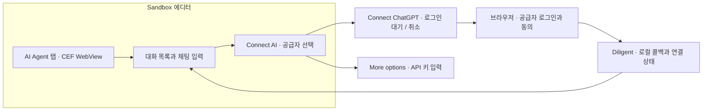
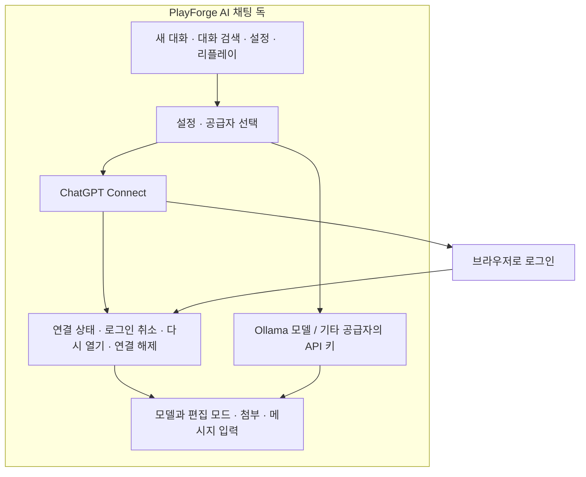
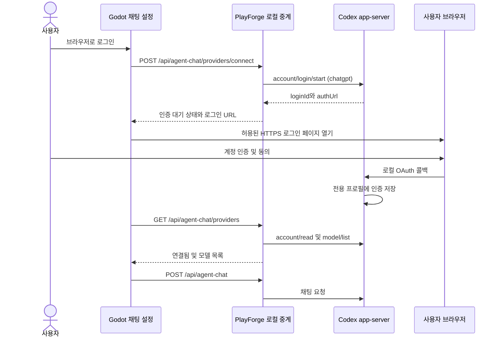
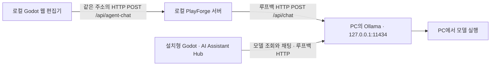

# Sandbox AI 채팅 인증 및 GUI 참고 스펙

2026-11-19 · 분석 대상 `master-sandbox/Sandbox`와 OVERDARE AI Agent v0.14.2 배포본 · 구현 대상 Forge-AgentReplay

## Sandbox에서 확인한 구현

| 위치 | 확인한 동작 |
| --- | --- |
| [SandboxWebViewTabManager.cpp](D:/Git_OVDR/master-sandbox/Sandbox/Source/Sandbox/Private/Editor/SandboxWebView/SandboxWebViewTabManager.cpp:20) | 에디터 안에서 도킹할 수 있는 OVERDARE AI Agent 탭을 등록한다. |
| [MCP.cpp](D:/Git_OVDR/master-sandbox/Sandbox/Source/Sandbox/Private/MCP/MCP.cpp:640) | 로컬 사이드카의 웹 서버 주소를 조합하고 AI Agent 탭에 로드한다. |
| [SandboxWebView.cpp](D:/Git_OVDR/master-sandbox/Sandbox/Source/Sandbox/Private/Editor/SandboxWebView/SandboxWebView.cpp:444) | 호스트가 특정 링크를 OS 브라우저로 전달한다. 그 외 웹 팝업은 WebView 쪽 팝업 처리 경로로 들어간다. 일반 링크 처리와 AI 공급자 인증은 별도다. |
| [SandboxWebBrowser.cpp](D:/Git_OVDR/master-sandbox/Sandbox/Source/Sandbox/Private/Editor/SandboxWebView/SandboxWebBrowser.cpp:190) | CEF 컨텍스트별 캐시와 세션 쿠키 저장을 구성한다. `InjectAuthCookie`는 Creator Hub의 UGC API 인증 호출에서 사용한다. |
| [MCreatorHubNetworkManager.cpp](D:/Git_OVDR/master-sandbox/Sandbox/Source/Sandbox/Private/Editor/CreatorHubNetwork/MCreatorHubNetworkManager.cpp:593) | UGC 플랫폼 주소에 Creator Hub `session` 쿠키를 전달한다. |
| [AIAgentContextSender.cpp](D:/Git_OVDR/master-sandbox/Sandbox/Source/Sandbox/Private/Editor/AIAgent/AIAgentContextSender.cpp:11) | 에디터에서 명시적으로 추가한 선택 객체의 식별자·이름·종류를 AI 채팅 문맥으로 보낸다. |

배포된 v0.14.2 GUI의 **Connect ChatGPT**는 로컬 런타임에 인증 시작을 요청하고 대기·취소·연결 상태를 표시한다. 공개 Diligent 구현은 브라우저에서 PKCE 기반 공급자 인증을 진행하고 로컬 콜백을 받는다. LLM 인증의 저장과 재사용은 이 런타임의 책임이다. Sandbox의 Creator Hub 쿠키는 UGC 로그인에 사용된다. [Diligent 인증 구현 문서](https://github.com/overdare/diligent/blob/main/docs/guide/provider-auth.md)

## GUI 구성

원본은 탭의 로컬 웹 화면, 공급자 연결 창, 외부 인증 창으로 이어진다.

PlayForge에서는 AI 채팅 독의 **설정**을 열어 인증한다. 연결이 끝나면 같은 독의 모델 선택과 채팅 입력을 사용한다.

## PlayForge 인증 및 저장

- 설치형은 기본 브라우저를 연다. 웹은 버튼 클릭 때 인증용 새 탭을 열고, 같은 브라우저 출처의 임시 채널로 공식 로그인 URL을 전달한다. 탭에서 직접 인증 주소로 이동한다. 요청이 실패하면 탭에 원인을 표시하며, 주소가 준비된 상태에서 이동이 차단되면 **로그인 페이지 열기** 또는 **로그인 주소 복사**로 이어갈 수 있다.
- 로컬 중계는 브라우저 로그인용 URL과 상태를 제공한다. Codex가 콜백, 토큰 갱신과 저장을 관리한다. 전용 프로필은 Windows 사용자별 `%LOCALAPPDATA%/PlayForge/agent-chat/codex-account`에 있다. 새 런처 세션은 기존 프로필을 확인하고 `account/read`로 연결 상태를 복원한다. [OpenAI Docs · Codex App Server](https://developers.openai.com/codex/app-server/)
- 대기 중 **로그인 취소**는 `account/login/cancel`, 로그인 뒤 **연결 해제**는 `account/logout`을 호출한다. Claude Console 등 API 키 공급자의 세션 키는 로컬 중계 메모리에서 관리한다.
- PlayForge 구현은 [chat_settings.gd](../Godot/addons/playforge_agent_chat/chat_settings.gd), [agent-chat-provider.cjs](../Tools/agent-chat-provider.cjs), [agent-chat-codex.cjs](../Tools/agent-chat-codex.cjs)에 있다. 대화와 씬 기록은 별도 저장한다.

## 로컬 모델 통신

웹의 PlayForge AI 채팅은 사용자 메시지, 이전 대화, 명시적으로 추가한 씬 문맥과 도구 정의를 로컬 중계에 JSON으로 보낸다. 중계는 Ollama 응답과 도구 호출을 돌려준다. Godot은 편집 모드에 따라 도구 제안의 승인과 실제 씬 변경을 처리한다. 설치형 **AI Assistant Hub**는 `GET /api/tags`로 모델을 조회하고 `POST /api/show`로 모델별 도구 지원을 확인한다.

### 연결 선택

- **자동 발견**은 설정을 열면 로컬 중계가 Ollama 목록을 불러온다. Ollama 설정이 열린 동안 8초마다 상태를 갱신한다. 사용자가 목록에서 모델을 고르고 **적용**을 누른다.
- **수동 연결**은 모델명과 루프백 주소를 입력한다. 포트를 바꿔 실행한 Ollama에도 연결할 수 있고, 주소를 적용한 다음 해당 서비스의 모델 목록을 다시 확인할 수 있다.
- **권장**은 이 PC에서 메모리 기준과 도구 지원을 충족한 `qwen3:4b`에 붙는다. **최저 사양 미달**은 다운로드된 모델 크기 × 1.2 + 2 GiB가 이 PC의 물리 RAM을 넘는 경우에 붙는 추정 표시다. GPU 메모리나 실시간 사용량과 구별한다. [Ollama 모델 목록 API](https://docs.ollama.com/api/tags)

### 클라우드 웹 통합 검토

| 구성 | 발견과 연결 | 적용 범위 |
| --- | --- | --- |
| 로컬 PlayForge 중계 | 브라우저가 같은 주소의 API를 사용하고 로컬 서버가 Ollama를 확인 | 이번 구현. 설치형과 로컬 웹에 같은 발견·모델 선택 동작을 제공한다. |
| 웹 페이지에서 로컬 동반 서비스 호출 | 사용자의 연결 동작에서 루프백 접근 권한을 받고, 승인된 웹 주소만 동반 서비스가 허용 | 브라우저별 루프백 권한 및 CORS 차이를 검증해야 한다. [Chrome Local Network Access](https://developer.chrome.com/docs/modern-web-guidance/guides/security/local-network-access) |
| 사용자 PC의 로컬 에이전트와 계정 페어링 | PC가 인증한 뒤 클라우드 중계로 HTTPS/WSS를 연결하고 등록된 모델 목록을 제공 | 클라우드 협업용 후속안. 장치별 권한과 연결 해제, 중계를 지나는 프롬프트·응답의 범위를 정의해야 한다. |

클라우드 협업을 지원할 때는 로컬 에이전트를 계정에 페어링하고 웹 설정에서 **클라우드 제공자 / 페어링된 PC / 수동 로컬 연결**을 고르는 구성이 적합하다. 모델 실행은 페어링된 PC의 Ollama가 맡고, 해당 에이전트가 모델 검색과 응답 전달을 처리한다.

## 채팅 아이콘 비교

[Sandbox와 Godot 후보를 나란히 표시한 비교 이미지](../Saved/Reports/PlayForge-Chat-Icon-Comparison.png)

| 채팅 동작 | Sandbox 기본 UI 후보 | Godot 4.7.2 대체 후보 | 비교 |
| --- | --- | --- | --- |
| 선택 문맥 추가 | `Plus.svg` | `Add.svg` | 두 후보가 같은 + 동작을 전달한다. Godot 후보의 선이 더 굵다. |
| 문맥 제거 / 창 닫기 | `XMark.svg` | `Close.svg` | 두 후보가 같은 × 동작을 전달한다. Godot 후보의 선이 더 굵다. |
| 설정 열기 | `Settings.svg` | `Tools.svg` | Sandbox 후보는 톱니바퀴이고 Godot 후보는 공구 모양이다. 톱니바퀴가 참고 화면의 설정 동작에 더 가깝다. |

Sandbox C++ 채팅 문맥 팝업은 추가, 닫기, 설정에 `AIAgent.Icon.AddButton`, `AIAgent.Icon.CloseIcon`, `AIAgent.Icon.Setting`을 참조한다. 위 이미지는 같은 저장소의 기본 UI SVG 후보를 사용했다. 전용 브러시의 정확한 SVG 매핑과 배포 웹 채팅의 아이콘 출처는 확인되지 않았다. [Sandbox 문맥 팝업 소스](D:/Git_OVDR/master-sandbox/Sandbox/Source/Sandbox/Private/Editor/AIAgent/SAIAgentContextPopup.cpp:421) · [Godot 4.7.2 아이콘 소스](https://github.com/godotengine/godot/tree/4.7.2-stable/editor/icons)

선택지에는 **Sandbox 후보**, **Godot 후보**, **추가·닫기는 Godot, 설정은 Sandbox**가 있다. 비교 이미지는 선택용이며, 적용은 사용자 승인 뒤 진행한다.
