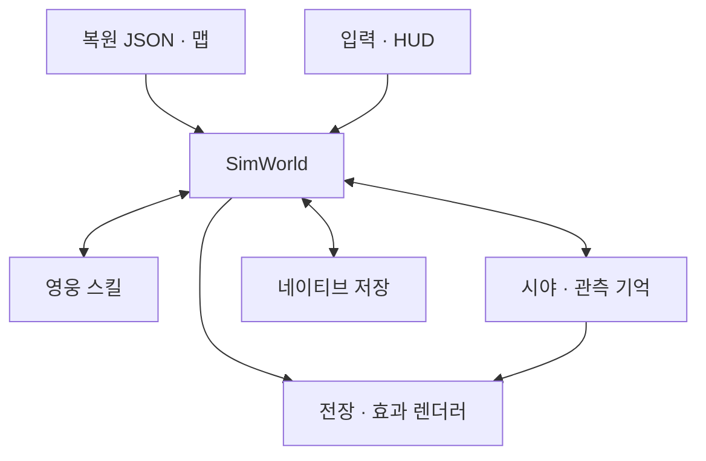

# Godot 포팅 설계

## 목표와 기준

웹 v10의 데이터를 보존하면서 게임 실행 책임을 Godot로 옮겼다. 구현 언어는 GDScript이고 화면은 CanvasItem·Control·SubViewport로 구성한다. JavaScript를 실행하는 플러그인, 웹 페이지 삽입, 브라우저 프로세스를 사용하지 않는다.

기준 커밋은 `d53d9e1df6525719f0d791010235090119451d45`, 엔진은 실제 검증한 Godot **4.6.3 Standard / Compatibility**다. 기존 웹 프로젝트와 배포 사이트는 변경하지 않았다. 새 프로젝트는 독립적인 Godot v11 산출물이다.

## 책임 분리

`SimWorld`·`AbilitySystem`·`VisionSystem`은 `RefCounted`다. 렌더 노드나 OS 입력에 의존하지 않으므로 헤드리스 테스트에서 실제 경기와 동일한 규칙을 실행한다. UI는 명령을 전달하고 월드의 결과를 읽는다. 렌더러는 체력·쿨다운·표식 등을 직접 변경하지 않는다.

개체는 안정적인 정수 ID와 Dictionary 상태로 표현한다. `Vector2`, `Color`, `PackedByteArray`를 네이티브 값으로 사용하고, 저장할 때 엔진 객체를 직렬화하지 않는다. 스킬 효과도 같은 원칙으로 처리하여 저장·검증·복원에서 별도 Node 트리를 만들 필요가 없다.

## 웹 모듈 대응

| 웹 v10 | Godot v11 | 판단 |
|---|---|---|
| `game.js` | `sim_world.gd` | 생성·전투·AI·성장·아이템·승패·저장을 순수 시뮬레이션으로 이식 |
| `restored-gameplay.js` | `ability_system.gd` | 10개 영웅의 판정·투사체·지속 효과·재시전과 주요 패시브 이식 |
| `restored-data.js` | `data/restored_data.json` | 공식 정적 데이터와 재구성 정의를 값 변경 없이 추출 |
| `vision.js` | `vision_system.gd` | 지형 LOS, 탐색 격자, 건물 기억, 공격 위치 힌트와 중립 관측 |
| `navigation.js` | `VisionSystem.safe_move/navigation_target` | 원형 지형 충돌·미끄러짐·지역 우회. 웹의 전역 A* 전체는 포함하지 않음 |
| `renderer.js` | `battle_view.gd`, `effects_canvas.gd`, `minimap.gd` | CanvasItem의 절차형 2D 그림과 GPU 시야 합성 |
| `app.js`, HTML/CSS | `main.gd`, `main.tscn` | Control 기반 로비·HUD·상점·도감·입력 |
| 브라우저 체크포인트 | `.nfs` 네이티브 저장 | 형식 독립. 기존 브라우저 JSON을 자동 변환하지 않음 |
| `coach.js`, `history.js` | 이번 포팅 범위 밖 | 학습 과제·전적 UI는 동봉 웹 v10에서 참고 가능 |

## 업데이트와 명령

Godot의 물리 콜백은 초당 60회다. 배속은 월드에 전달하는 게임 시간에 곱하며, 이동·스킬·시야·경제·사망·웨이브의 시간 기준이 함께 바뀐다. UI 일시 정지는 월드 `step()` 호출을 중단한다. 화면 카메라와 조준 표시는 별도 프레임으로 갱신한다.

입력은 `command_move`, `command_attack`, `cast`, `recall`, `place_ward`, `buy_item`, `sell_item`, `upgrade_skill`로 집중한다. 유효하지 않은 스킬 대상·자원·조건이면 자원을 먼저 차감하지 않는다. 소라카 W처럼 체력·마나를 함께 쓰는 스킬도 동일한 순서를 따른다.

공통 피해 파이프라인에서 물리/마법/고정 피해, 관통·감소, 보호막, 기여자, 처치, 시야 출처를 처리한다. 시전자 표식이 재귀 피해를 호출할 때 이미 소비한 표식을 다시 발동하지 않도록 효과를 먼저 제거한다. 기본 공격 탄약·치명타·강화 공격 소비는 한 경로에서만 수행한다.

## 렌더링 설계

맵·미니언·건물마다 독립적인 씬과 물리 노드를 만드는 대신, 전장 Control이 관측 가능한 상태를 모아서 그린다. 공식 Godot 문서에서도 CanvasItem 사용자 정의 그리기는 많은 단순 오브젝트에서 노드 오버헤드를 줄일 수 있는 방식으로 설명한다.[1]

전장 렌더링 순서는 지형, 시야 안개, 고정 건물 관측 복사본, 보이는 유닛, 공격 원점 힌트·조준 표시다. 이동 중인 적의 위치를 건물 기억처럼 저장하지 않는다.

스킬 영역·광선·투사체는 투명한 별도 SubViewport에 그린다. TextureRect의 `visibility_mask.gdshader`가 화면 UV를 월드 좌표로 역변환하여 현재 시야 마스크의 R 채널을 읽고 알파에 곱한다. 중심이 보이는 원이라도 시야 밖으로 걸친 부분은 투명해진다. 보이지 않는 대상의 표식·추적 정보는 그리기 전에 대상 가시성으로 한 번 더 제한한다.

안개와 효과용 마스크는 시야 revision이 변할 때만 ImageTexture를 갱신한다. 미니맵은 전장의 캐시 텍스처를 공유하므로 2배 맵의 모든 안개 셀을 매 프레임 도형으로 다시 그리지 않는다.

## 시야와 이동

시야는 40월드 단위 셀, 10Hz 갱신을 사용한다. 월드 1,600/2,400/3,200에서 40×40 / 60×60 / 80×80 셀이다. 적 Actor 선택은 정확한 LOS·수풀 조건을 별도 확인한다. 공격 위치 힌트는 현재 시야·탐색 상태·타깃 선택 가능성을 바꾸지 않는다.

위치 이동은 원형 벽의 선분 충돌, 접촉점 보정, 미끄러짐과 지역 경유점으로 처리한다. Godot PhysicsServer에 같은 충돌을 중복 등록하지 않는다. 벽을 통과할 수 있는 점멸·이즈리얼 E는 이동 경로 예외를 두되 도착점은 통행 가능한 곳으로 보정한다. 언덕은 이동을 막는 벽이 아니라 시야 높이 구역이다.

웹의 20단위 시야 격자와 전역 길 찾기, 일반 공격의 실제 비행 시간까지 바이트 단위 동일한 포트는 아니다. 이 차이는 [FOG.md](FOG.md), [WORLD.md](WORLD.md)에 구체적으로 기록했다.

## 저장과 수명

`.nfs`에는 월드·개체·스킬·투사체·효과·재시전·충전·시야·건물 기억·RNG와 게임 시간 정보를 담는다. UI 배속과 마지막 선택은 별도 설정 파일이다. 임시 파일 작성 후 이름을 바꿔 저장하고, 불러오기는 검증용 분리 월드에서 먼저 검사한다. 실패한 데이터는 현재 경기를 변경하지 않는다.

경기를 교체하거나 메뉴로 나갈 때 렌더러의 월드 참조를 먼저 끊고 `dispose()`를 호출한다. 월드와 두 하위 시스템의 상호 참조가 이전 경기를 메모리에 남기지 않도록 한다. 완료되지 않은 지연 효과의 ID 시퀀스도 저장하여 불러온 후 ID가 충돌하지 않는다.

## 데이터 이식과 범위

실행 중에는 JSON과 포함 PNG·폰트만 읽는다. `tools/import_v10_data.cjs`는 개발자가 기존 v10 폴더에서 다시 추출할 때 사용하는 선택적 도구다. 이 파일이 있다는 이유로 게임 런타임에 Node.js가 필요한 것은 아니다.

원작 정적 데이터는 16.22.1로 고정하고, 피해 계산·반경·AI는 기존 프로젝트의 재구성 근거를 유지한다. 도감의 173개 영웅은 참고 데이터이며 실제 전투 구현은 10개다. 원작의 온라인 권위 서버, 예측·롤백, 애니메이션 취소 전체, 계정 시스템은 이번 포팅에 포함되지 않는다.

## 빌드와 검증

에디터 프로젝트와 실행 패키지를 분리한다. 프로젝트는 수정·재현에 사용하고 PCK는 임포트된 리소스와 스크립트를 묶는다. 독립 실행 파일은 같은 버전의 공식 export template로 내보낸다. Godot 공식 내보내기 지침의 export preset 및 명령줄 흐름을 따른다.[2]

검증은 실제 Godot에서 실행한 순수 시뮬레이션 테스트, 세 맵의 지속 진행, 네이티브 GUI 입력 확인, 내보낸 Linux 실행본 시동, ZIP CRC와 원본·포팅 데이터 해시 비교로 나눈다. Windows는 이 Linux 환경에서 교차 내보내기·PE 형식·필수 파일을 확인했으며 Windows OS 실행 검증을 수행한 것으로 표시하지 않는다.

## 근거

1. Godot 4.6, Custom drawing in 2D: <https://docs.godotengine.org/en/4.6/tutorials/2d/custom_drawing_in_2d.html>
2. Godot 4.6, Exporting projects: <https://docs.godotengine.org/en/4.6/tutorials/export/exporting_projects.html>
3. Godot 4.6.3 공식 배포: <https://godotengine.org/download/archive/4.6.3-stable/>
4. 프로젝트 구현·검증: 이 폴더의 `scripts/`, `tests/`, `docs/validation_results.json`, `data/provenance.json`
