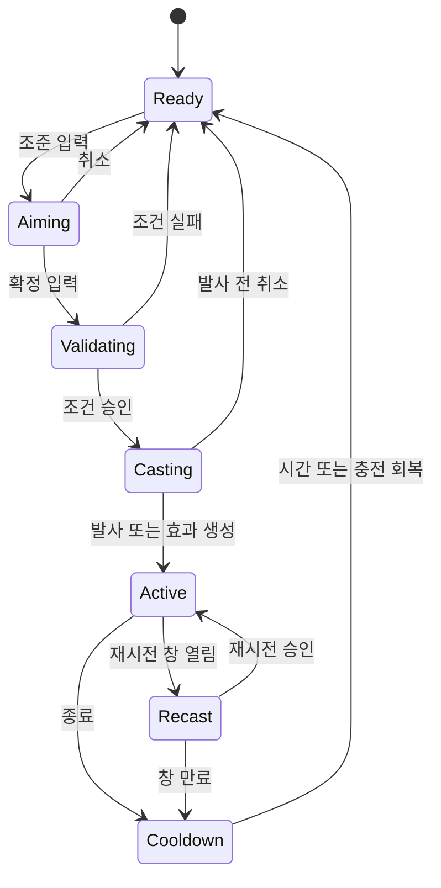

# 09. 챔피언·스킬을 실행 명세로 재구성하는 방법

**문서 성격:** 공개 데이터에 연결하는 독립 실행 설계. 내부 Riot 스크립트의 복원이나 기존 웹 게임에의 구현 완료를 뜻하지 않는다.

## 1. QWER 네 행과 완전한 스킬 세트의 차이

Data Dragon의 챔피언별 공개 자료는 대표 QWER와 패시브 정보를 제공한다.[S01] 여기서 얻은 쿨다운·비용·사거리 배열은 유용한 출발점이다. 그러나 변신, 충전, 재시전, 표식 소비, 강화 기본 공격, 반환 투사체, 소환물의 독립 공격은 대표 슬롯 하나 안에 여러 동작을 만든다.

따라서 `champion_spells.csv`의 행 수를 그대로 '완전히 구현 가능한 스킬 수'로 읽지 않는다. 공개 슬롯 카탈로그의 복원 수와 내부 상태·효과 그래프의 복원 수를 따로 센다.

## 2. 세 계층의 능력 데이터

| 계층 | 책임 | 예시 필드 |
|---|---|---|
| `AbilityDefinition` | 변하지 않는 능력 식별과 공개 수치 참조 | champion ID, slot, source spell ID, rank bindings, evidence |
| `AbilityRuntime` | 경기 안에서 변하는 상태 | rank, cooldown end, charges, recast deadline, cast ID, target ID |
| `EffectGraph` | 사건에 따라 일어나는 동작 | launch, hit, return, tick, shield, mark, consume, transform |

이름이 같다는 이유로 상태를 공유하지 않는다. 쿨다운을 공유하는 두 형태는 공통 쿨다운 키를 명시하고, 재시전만 열리는 동작은 별도 재시전 창을 사용한다. 툴팁 문장을 파싱해 효과 그래프를 자동 실행하는 방식은 승인된 명세를 대신하지 않는다.

### 제안 스키마

```json
{
  "ability_key": "ruleset:champion:slot:form",
  "source_binding": {
    "ddragon_build": "16.22.1",
    "champion_id": "numeric-key",
    "spell_id": "public-string-id",
    "rank_table": "spell_ranks"
  },
  "targeting": {
    "kind": "unresolved",
    "team_filter": "unresolved",
    "can_target_unseen": null,
    "range_basis": "unresolved"
  },
  "timing": {
    "cast_seconds": null,
    "cost_commit_event": "unresolved",
    "cooldown_start_event": "unresolved"
  },
  "effects": [],
  "implementation_approved": false
}
```

위 필드명은 제안이다. 원본에서 읽지 못한 필드를 임의의 일반값으로 채워 '복원'했다고 표시하지 않는다.

## 3. 시전 상태와 취소 계약



모든 스킬이 이 모든 상태를 사용하지는 않는다. 즉시 자기 자신 스킬, 유지 채널, 충전형, 탄약형, 토글형은 필요한 상태만 선택한다. 중요한 것은 '조건 실패', '발사 전 취소', '발사 후 결과'를 구별하는 것이다.

| 사건 | 반드시 결정할 질문 |
|---|---|
| 조준 시작 | 일반 이동이 계속되는가, 기존 공격 준비를 취소하는가? |
| 확정 입력 | 위치·대상 중 무엇을 고정하며 지면 사거리 밖 입력은 어떻게 보정하는가? |
| 비용 승인 | 자원·충전·재료를 언제 예약하고 언제 실제 소비하는가? |
| 발사 직전 대상 소멸 | 취소·빈 지점 발사·추적 유지 중 무엇인가? |
| 시전 중 제어 효과 | 기절·침묵·공중에 뜸·무적별로 중단 조건이 다른가? |
| 재시전 | 추가 비용·새 대상·시전 창·공유 쿨다운의 조건은 무엇인가? |
| 사망·부활·변신 | 투사체와 소환물은 남는가, 어느 상태가 초기화되는가? |

확인된 원작 동작이 없는 질문은 명세 공백이다. 독립 프로토타입에서 채택한 동작은 `custom`으로 저장하여 원작 검증 완료와 구분한다.

## 4. 사거리와 충돌은 서로 다른 값이다

공개 배열의 `range`를 복원하더라도 그 값이 대상 중심, 충돌체 외곽, 커서 제한, 탄환 수명, 시각 표시 중 무엇에 대응하는지 별도로 확인한다. '사거리 1000'과 '1000 동안 움직이는 탄환'을 같은 규칙으로 만들면 몸체 크기와 관통 순서에서 차이가 생긴다.

권장 실행 명세는 다음을 분리한다.

- 조준을 확정할 수 있는 거리와 거리의 기준점.
- 생성 위치, 진행 방향, 속도·가속, 최대 이동 거리·수명.
- 선분·원·부채꼴·캡슐 등 충돌 형태와 실제 반경.
- 지형 충돌, 유닛 분류 필터, 관통 수, 중복 적중 간격.
- 같은 프레임에 여러 대상과 충돌했을 때의 정렬·처리 정책.
- 렌더링용 궤적·이펙트와 게임 판정의 구분.

이 값은 공개 JSON에서 발견되었다는 이유만으로 임의 추론하지 않는다. 먼저 필드의 출처와 의미를 명시한 뒤, 원작 관측 자료로 대조한다.

## 5. 효과 그래프와 피해 사건

한 번의 스킬 사용을 하나의 피해 숫자로 축약하면 표식·보호막·체력 조건·반환 타격을 복원하기 어렵다. 실행 설계는 `CastId`, `EffectInstanceId`, `DamageEventId`를 구별하고 각 효과가 어떤 사건을 소비했는지 기록한다.

```text
CastApproved
  → 비용/충전 반영
  → 발사 또는 영역 생성
  → HitCandidate
  → 대상 생존·팀·무적·시야 정책 확인
  → 피해/보호막/상태 효과 적용
  → 적중 후 표식·재시전·쿨다운 분기
```

이 순서는 독립 엔진의 권장 기록 단위다. 원작의 모든 효과가 동일 순서로 정산된다는 뜻은 아니다. 효과 간 순서가 결과를 바꾸면 별도 규칙 ID와 관측 테스트를 만든다.

### 중복을 막는 필수 키

| 처리 | 중복 방지 키 예시 | 막는 오류 |
|---|---|---|
| 단발 투사체 적중 | effect + target | 같은 이동 선분을 다시 검사해 두 번 피해 |
| 주기 영역 | effect + tick index + target | 렌더 프레임 수에 따라 피해량 증가 |
| 처치 보상 | victim life sequence + kill event | 같은 사망으로 두 번 골드 지급 |
| 표식 소비 | mark instance + consume event | 두 공격이 동시에 같은 표식을 소비 |
| 재시전 | cast + recast sequence | 지연 입력·중복 패킷으로 추가 발동 |
| 소환물 | owner life sequence + summon instance | 소유자 부활 후 과거 소환물 상태를 잘못 연결 |

## 6. 랭크·성장·능력치 연동

랭크 배열은 슬롯별 `maxrank`와 함께 검증한다. QWE는 항상 5개, R은 항상 3개라는 가정을 전 챔피언에 일괄 적용하지 않는다. 이미 공개된 배열 길이를 보존하고, 특수 챔피언·비용 형식은 예외 분기로 관리한다.

성장 계수 역시 기본값과 성장량을 복원한 단계에서 멈출 수 있다. 원작의 레벨별 성장 곡선, 패시브 배율, 변신 보정, 역할 퀘스트 보상까지 확인하지 않은 상태에서 선형으로 18레벨 수치를 만들어 원작값으로 표기하지 않는다.

### 데이터 검토의 최소 결과물

능력 하나를 원작 일치 구현 대상으로 승인하려면 최소한 아래 항목에 답해야 한다.

1. 어느 빌드·슬롯·형태의 스킬인가?
2. 랭크별 비용·쿨다운·공개 사거리는 무엇이며 원문 포인터는 어디인가?
3. 피해·회복·보호막의 기본값과 계수는 모두 해결되었는가?
4. 입력→확정→소비→발사→적중→종료 중 어떤 시점이 관측되었는가?
5. 지형·몸체·팀·무적·시야·은신과 상호작용하는 조건은 무엇인가?
6. 취소·중복 적중·재시전 만료·사망·형태 전환이 검증되었는가?

## 7. 복원 우선순위

첫 구현 대상으로는 **데이터 공백이 적고 상호작용을 명확히 검증할 수 있는 대표 능력**을 고른다. 직선 단발, 관통, 지점 영역, 보호막, 돌진, 표식, 재시전, 변신을 서로 다른 검증 유형으로 나눈다. 챔피언 전체 수를 먼저 늘리면 구현 숫자에 비해 실제 검증 범위가 작아질 수 있다.

각 능력의 승인 상태는 `catalogued → numbers_bound → mechanics_specified → implemented → observed_match`로 기록한다. 이번 작업이 어디까지 갔는지 단계별로 표시하고, 공개 데이터의 카탈로그 수와 실제 구현 수를 한 지표로 합치지 않는다.

## 출처와 관련 문서

- [S01] Riot Developer Portal, [Champions / Interpreting Spell Text](https://developer.riotgames.com/docs/lol), 조회 2026-11-17.
- [복원 데이터 계약](08_data_restoration_contract.md)
- [원작 전투 명세](systems/01_combat_stats_damage.md)
- [검증·관측 계획](11_qa_and_measurement_plan.md)
