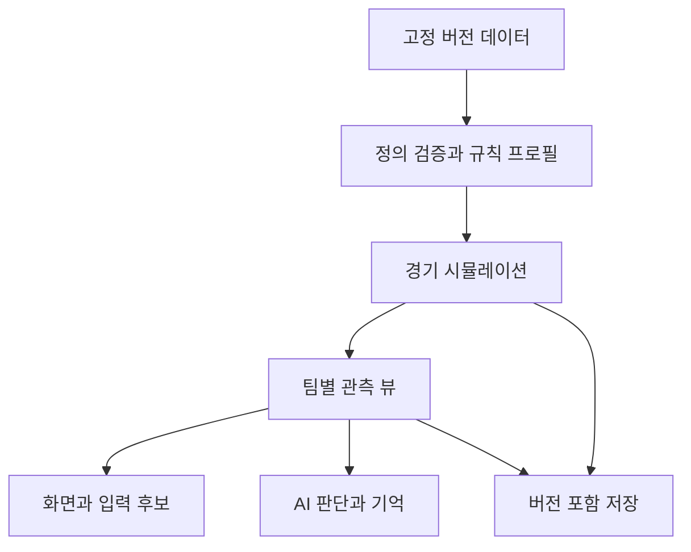

# 10. 기존 웹 게임과 원작 복원 목표의 차이, 구현 순서

**기준일: 2026-11-17 KST · 대상 코드: Nexus Front v7 · 문서 성격: 코드 확인 + 후속 구현 기획**

이 문서는 이미 실행되는 독자 MOBA와 이번에 재구축한 원작 공개 데이터를 연결한다. 기존 게임의 플레이 가능 여부와 원작의 규칙·콘텐츠 일치 여부는 서로 다른 완료 조건이다. 이번 산출물은 데이터와 설계를 보강하며, 기존 배포 게임의 코드를 변경하지 않는다.

## 1. 현재 제품의 출발점

현재 웹 게임은 JavaScript/Canvas 기반의 로컬 시뮬레이션이다. 독자 영웅 3종, 아이템 8종, 10인 AI 경기, 3개 공격로, 미니언·포탑·억제기·넥서스, 정글 목표물, 스킬 성장, 거래, 전장의 안개, 저장·이어하기를 제공한다. 이 사실은 기존 `nexus_front/README.md`, `IMPLEMENTATION.md`와 `dist/game.js`의 데이터·명령 API에서 확인했다.

원작 데이터 표를 연결하는 것만으로 원작 게임이 되는 것은 아니다. 현재 엔진의 랭크 성장 배율, 피해 계산, 아이템 효과, 목표물 보상, 시간 규칙은 독자 규칙이다. 원작 수치가 들어와도 실행 의미가 다르면 결과가 달라진다. 따라서 **데이터 호환 → 규칙 호환 → 대표 콘텐츠 검증 → 콘텐츠 확대** 순서로 추진한다.

### 이번 작업에서 유지하는 사용자 결정

| 결정 | 현재 구현 또는 설계 상태 | 다음 구현에서 지킬 계약 |
|---|---|---|
| 맵 크기 1 / 1.5 / 2배 | v7 로비 선택 구현 | 경기 시작 전에 결정하며 진행 중 변경 금지 |
| 진행 속도에 0.75배 추가, 2배 제외 | 0.5 / 0.75 / 1 / 1.5배 구현 | 설정·진행 중 변경·저장 복원에 같은 목록 적용 |
| 맵 확대 시 전투 수치 | 좌표·지형을 확대, 이동 속도·전투 사거리 유지 | 규칙 프로필에 공간 배율과 시간 배율을 별도 보관 |
| 벽·고지대 시야 차단 | 별도 Unreal 설계, 웹에는 미구현 | 이동 충돌과 시야 차단을 별도 판정 |
| 고지대 공격 시 위치 일시 공개 | 설계 요구사항 | 공격 당시 원점을 공개, 이동한 공격자를 자동 추적하지 않음 |
| 고정 건물의 마지막 관측 상태 기억 | 설계 요구사항, 현재 웹은 실제 구조물 상태 공개 | 팀별 마지막 관측 스냅샷만 표시 |
| 시야 밖 건물 변경의 갱신 지연 | 설계 요구사항 | 해당 건물 슬롯 재관측 때 갱신, 건물 파괴도 즉시 전달하지 않음 |

이 설정은 사용자 프로젝트의 규칙이다. 원작 소환사의 협곡에 동일한 맵 배율·배속·고저차 규칙이 있다고 설명하지 않는다. 시야 확장의 상세 모델은 [05 시야·정보·지형](systems/05_vision_information_terrain.md)을 따른다.

## 2. 시스템별 차이와 완료 조건

| 시스템 | 기존 웹의 확인된 상태 | 이번에 확보한 원작 근거 | 남은 작업 | 완료 판단 |
|---|---|---|---|---|
| 챔피언 | 독자 영웅 3종, 코드 내 `HEROES` | 173명 식별·이름·기본 및 성장 필드 | 원작 데이터 어댑터, 예외 성장, 패시브, 폼 | 선택한 대상의 모든 필드 출처와 적용 경로 확인 |
| 스킬 | 독자 QWER, 공통 랭크 배율 | 692개 최상위 QWER와 3,128개 랭크 행 | 스킬별 계산·시전·충돌·재시전·취소 규칙 | 대표 시나리오의 입력·비용·피해·상태·시각 일치 |
| 전투 | 준비·발사·재공격 단계, 투사체·일부 CC | 공식 패치의 변경값, 정적 능력치 | 방어 관통·피해 태그·효과 처리 순서·예외 | 같은 사건을 중복 처리하지 않고 검산 로그를 제공 |
| 성장 | 최대 18레벨, 공통 스킬 해금 | 역할 퀘스트 및 패치별 변경 | 역할 보상, 조건부 레벨 상한, 경험치 분배 | 역할·패치·완료 전후의 경계 사례 통과 |
| 아이템 | 8종, 6슬롯, 조합 2종, 판매 | 863개 전체 모드 항목, 726개 재료 간선 | 설명 전용 효과, 구매 제약, 전용 업그레이드 | 원자적 거래와 효과 중복·분리 정책 확인 |
| 룬·소환사 주문 | 원작 룬 미구현, 독자 점멸·회복 | 룬 62개/5경로, 주문 34개 전체 모드 메타데이터 | 룬 선택 검증, 효과 훅, 모드 사용 제한 | 유효 조합만 출전, 발동 조건·내부 쿨다운 확인 |
| 공격로 | 18초 웨이브, 독자 미니언 구성 | 공식 2026 웨이브·포탑 변경 이력 | 시간별 조성·성장·재생성·어그로 | 경계 시각 전후의 생성 로그 비교 |
| 구조물 | 선행 구조물 파괴 잠금 | 포탑 방패·Overgrowth 등 공식 설명 | 방패·보상·백도어 보호·현재값 충돌 해결 | 구조물별 상태 전이와 보상 수령자 확인 |
| 정글 | 일반 캠프 4개, 독자 드래곤·거인 | 현재 목표물 체계와 패치 변경 | 캠프 구성·리셋·레벨·버프·사망 귀속 | 리셋·동시 처치·교환·재생성 검증 |
| 시야 | 원형 팀 시야, 영웅 수풀 규칙, 와드 | Faelight·탐지·은신의 공식 규칙 | 벽 LOS, 탐지 구분, 팀 관측 데이터 경계 | 화면·미니맵·조준·AI에서 비공개 정보 미노출 |
| 길찾기 | 고정 벽·살아 있는 구조물의 A*와 슬라이드 | 원작 지형 역할에 관한 분석 | 원작 지형 수치 실측, 경로·반경 튜닝 | 좁은 길·벽 모서리·동적 장애물 통과 검증 |
| AI | 역할·후퇴·합류·구매·목표물 행동 | 시스템 관계 분석 | 관측 기반 기억·위험·목표 평가 | 보지 못한 적의 실제 좌표를 읽지 않음 |
| 저장 | 단일 경기, 전체 상태·난수·맵·배속 보관 | 기존 저장 계약 | 규칙 버전·관측 스냅샷·새 상태 이전 | 패치 불일치가 침묵한 오적용을 일으키지 않음 |
| 매치·계정 | 로컬 AI 경기·기록 | 드래프트·MMR·랭크·모드 공식 문헌 | 권한 서버·큐·계정·서비스 기능 | 오프라인 게임과 분리한 별도 제품 단계 |

데이터 확보량은 [coverage_report.json](../data/coverage_report.json)의 집계다. 수량은 실행 가능한 콘텐츠 수가 아니다. 각 데이터셋의 원천 URL과 포인터는 해당 CSV/JSON에 있다.

## 3. 규칙 프로필을 먼저 분리한다

**제안:** 엔진을 복사해 두 갈래로 수정하기보다, 매치 생성 시 규칙 프로필을 고정한다. 아래 필드는 새 스키마 제안이며 현재 게임의 API에 이미 존재하는 것으로 해석하지 않는다.

```json
{
  "rulesetId": "lol-pc-sr-reference-26.22",
  "rulesetSchema": 1,
  "publicPatch": "26.22",
  "dataBuild": "16.22.1",
  "mode": "summoners-rift",
  "contentManifestHash": "<build-time value>",
  "mapProfile": "reference-map-under-verification",
  "runtimeStatus": "planning-only"
}
```

현재 독자 게임은 별도의 `nexus-front-v7` 프로필로 유지한다. 사용자 고저차 시야 요구는 `visionPolicy`의 별도 확장 정책으로 구성한다. 원작 참고 프로필의 이름을 사용하더라도 현재 완성도를 `reference` 또는 `experimental`로 표시하며 검증되지 않은 영역을 숨기지 않는다.

### 프로필의 경계

- 정적 정의: 챔피언·아이템·스킬·미니언·목표물·성장 테이블.
- 규칙: 피해 계산, 태그 상호작용, 시전·취소 정책, 거래 제약, 보상 귀속.
- 공간: 좌표계, 통행 반경, 시야 반경, 지형 레이어.
- 관측: 팀 가시 상태, 식별·타깃 가능 여부, 공개 이벤트, 마지막 관측 정보.
- 시간: 시뮬레이션 시각과 실제 UI 시각. 배속은 시뮬레이션에만 한 번 적용한다.
- 보존: 정의 버전·스키마·난수 상태·예약 사건·팀별 기억의 저장.

기존 `Game.step(dt)`와 명령 API를 유지하면서 내부 정책을 교체할 수 있는 경계를 만든다. Renderer는 실시간 원본 객체 대신 관측용 뷰를 읽도록 점진적으로 전환한다. 이 전환이 선행되어야 화면만 안개로 덮고 조준·AI·미니맵에서 정보가 새는 문제를 막을 수 있다.



## 4. 구현 단계와 출구 조건

| 단계 | 작업 묶음 | 선행 조건 | 구체적 출구 조건 |
|---|---|---|---|
| P0 근거와 데이터 | 현재 자료 고정, 출처·포인터·차이·미해결 목록, 오프라인 재생성 | 공개 자료 접근 | 이번 패키지의 데이터 검증 통과. 현재 완료 범위 |
| P1 엔진 연결 | 데이터 로더, ID 매핑, null 검증, 프로필 선택, 전투 사건 로그 | P0 | 정의를 불러오는 것만으로 기존 독자 매치가 변하지 않음. 잘못된 정의는 명시적 오류 |
| P2 대표 전투 | 소수 챔피언, 기본 공격, 피해·보호막·회복·CC, 아이템 최소 집합 | P1 및 동작 근거 | 고정 입력 시나리오와 경계 사례가 검산 로그로 설명됨 |
| P3 경기 생태 | 웨이브·포탑·경제·역할 보상·정글 목표 | P2 | 한 매치가 성장→구매→목표→공성→종료로 진행되고 보상 귀속이 일관됨 |
| P4 관측과 지형 | 팀 뷰, 원작 참고 시야, 사용자 고저차 확장, 건물 기억 | P1; P2~P3와 병행 가능 | 비관측 변경 미노출, 재관측 갱신, 벽·언덕·공격 공개 사례 통과 |
| P5 콘텐츠 확대 | 스킬 유형별 템플릿, 룬·아이템 효과, 챔피언 증가 | P2~P4 | 새 콘텐츠마다 증거 상태와 검증 사례가 따라옴 |
| P6 서비스 | 권한 서버·매치·계정·드래프트·운영 | 제품 목표에 따른 별도 결정 | 네트워크 권한과 데이터 노출, 재접속, 운영 비용 검증 |

P2의 대표 챔피언은 유형을 기준으로 고른다. 예를 들어 직선 왕복 투사체, 강화 기본 공격, 지속 광역 효과, 타깃 돌진, 전역 투사체처럼 서로 다른 엔진 경계를 검증할 조합을 구성한다. 유명도만으로 여러 챔피언을 먼저 추가하면 공통 기반의 결함과 개별 규칙의 결함을 구분하기 어렵다.

일정은 인원·원작 클라이언트 관측 환경·온라인 범위가 확인되기 전까지 날짜로 확정하지 않는다. 각 단계의 완료 조건이 충족되면 다음 단계로 넘어간다. 병렬로 진행할 수 있는 작업은 출처 조사·테이블 정규화·관측 시나리오 작성이며, 동일한 핵심 계산기를 여러 담당자가 서로 다르게 구현하는 것은 피한다.

## 5. 대표 스킬 한 개의 복원 작업 단위

1. **식별 고정:** 챔피언 ID, 슬롯, 스킬 ID, 패치, 폼, 재시전 단계, 모드.
2. **정적 수치 연결:** 랭크별 비용·쿨다운·표시 사거리와 출처 포인터.
3. **미해결 분리:** 피해 계산, 투사체 속도, 충돌 폭, 온힛, 시전 시각 중 근거 없는 값.
4. **동작 계약:** 타깃 유형, 사전 조건, 비용 확정 시점, 취소 결과, 효과 적용 순서.
5. **구현:** 공통 Effect 연산으로 구성하고 필요한 예외만 독립 정책으로 추가.
6. **검증:** 정상 적중, 빗나감, 시야 상실, 대상 사망, 동시 사건, 저장·재개.
7. **판정:** `catalogued → numbers_bound → mechanics_specified → implemented → observed_match` 중 도달 상태 기록.

단계 2에서 곧바로 7의 마지막 상태로 올리지 않는다. 자세한 실행 계약은 [09 스킬 런타임 복원](09_skill_runtime_reconstruction.md)에 있다.

## 6. 저장과 패치 업데이트

기존 저장은 v4~v7의 독자 규칙 상태를 복원한다. 새 원작 참고 프로필을 추가할 때 기존 저장을 다른 규칙으로 자동 재해석하지 않는다. 저장에 `rulesetId`, 데이터 빌드, 콘텐츠 매니페스트 해시, 정의 스키마를 추가하고 다음 정책을 사용한다.

| 상황 | 제안 처리 |
|---|---|
| 같은 프로필·같은 정의 | 그대로 복원 후 일시정지 |
| 동일 의미의 스키마 변경 | 명시적 마이그레이션 실행 및 결과 검증 |
| 챔피언 스킬 동작 변경 | 이전 정의를 함께 유지하거나 새 경기로 안내; 임의로 새 효과에 대입하지 않음 |
| 미해결 정의·알 수 없는 ID | 이전 정상 저장 보존, 실패 이유 제공 |
| 시야 확장 도입 | 팀별 탐색·현재 시야·건물 기억·위치 공개 만료 시각을 모두 보관 |
| 맵 배율 변경 요구 | 진행 중 저장의 배율 유지, 새 경기에서만 변경 |

패치의 변경 목록은 구조화 비교와 공식 노트를 함께 읽는다. [patch_structured_diff.csv](../data/patch_structured_diff.csv)의 11건은 정적 비교 범위의 결과다. 26.22의 Mel W처럼 반사에서 투사체 파괴·반격으로 바뀐 동작은 별도 규칙 전환으로 다뤄야 한다.[R1]

## 7. 우선순위가 높은 실패 위험

| 위험 | 드러나는 증상 | 예방·확인 방법 |
|---|---|---|
| 미해결 수치를 0으로 변환 | 마나가 없어도 시전, 피해가 0인 스킬 | null 검증 실패와 미지원 표시; 임의 기본값 금지 |
| 여러 모드 데이터를 함께 적용 | 협곡에 없는 아이템·주문 노출 | 모드·맵·챔피언·시점 조건을 모두 검사 |
| 화면의 안개만 구현 | AI·조준·피해 숫자가 숨은 적 정보를 사용 | 팀 관측 뷰를 소비하는 공통 경계 |
| 마지막 건물 상태가 실제 객체 참조 | 시야 밖 파괴가 기억 표시에도 즉시 반영 | 깊은 값 복사, 구조물 슬롯 ID, 재관측 갱신 |
| 배속을 여러 곳에서 적용 | 쿨다운과 이동·시야 공개 시간이 불일치 | 단일 simulation clock에서 파생 |
| 맵 확대를 통째로 수치 확대 | 전투 사거리·모델·시야까지 부풀어 기존 요구 변경 | 공간 변환 대상 목록과 불변 항목 분리 |
| 패치 변경을 숫자 변경으로만 취급 | 새 메커니즘에도 이전 시전·히트 정책 사용 | 변경을 수치·상태·이벤트·모드로 분류 |

## 8. 다음 구현 작업의 완료 정의

첫 구현 묶음의 목표는 **버전이 고정된 소수 콘텐츠를 근거 있는 동작으로 플레이할 수 있는 매치**다. 챔피언 선택 화면에 173명을 모두 나열하는 것은 완료 조건이 아니다. 입력, 전투, 보상, 관측, 저장의 연결이 검증된 뒤 콘텐츠를 늘린다.

검증 시나리오와 수행 상태는 [11 QA·실측 계획](11_qa_and_measurement_plan.md) 및 [planned_acceptance_cases.csv](../analysis/planned_acceptance_cases.csv)에 정리한다. 이 문서에서 제시한 후속 작업은 현재 구현 완료로 집계하지 않는다.

## 근거

- [R1] Riot Games, [Patch 26.22](https://www.leagueoflegends.com/en-us/news/game-updates/league-of-legends-patch-26-22-notes/), 2026-11-03. Mel W 동작 변경. 열람 2026-11-17.
- [R2] [정적 데이터 사용 안내](../data/README.md), [원천 매니페스트](../raw/source_manifest.json), [검증 결과](../data/validation_report.json).
- [P1] 기존 코드 `nexus_front/dist/game.js`: `HEROES`, `ITEMS`, `MAP_SCALES`, `Game.start`, `Game.step`, `Game.isVisible`, `Game.exportState`, `Game.fromState`. 코드 확인일 2026-11-17.
- [P2] 기존 코드 `nexus_front/dist/checkpoint.js`: `SPEEDS`, `normalizeSpeed`; `nexus_front/IMPLEMENTATION.md`, `README.md`. 감사 메타데이터는 [prototype_audit.json](../analysis/prototype_audit.json)에 기록한다.
