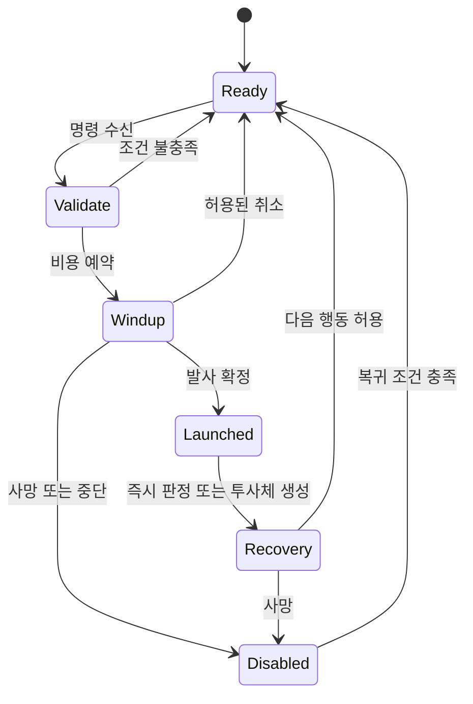

# 01. 전투·능력치·피해 정산 복원 명세

> 조사일: 2026-11-17 KST · 목표 관찰 범위: 현대 소환사의 협곡, 공개 패치 26.22 · 정적 데이터 기준: Data Dragon 16.22.1. 이 문서는 공개 자료에서 확인한 규칙과 외부에서 설계한 실행 계약을 구분한다. 실제 Riot 서버 소스나 내부 처리 순서를 복원했다고 주장하지 않는다.

## 1. 복원의 기준과 증거 등급

능력치 숫자를 모으는 작업과 실제 전투를 재현하는 작업은 다르다. 같은 피해량이라도 대상 판정, 발사체 제거, 시전 취소, 보호막, 사망 귀속을 잘못 처리하면 플레이 결과가 달라진다. 따라서 정적 값, 조건식, 이벤트 순서, 예외를 각각 저장한다.

| 표기 | 의미 | 실행 데이터 반영 방법 |
|---|---|---|
| `official_patch_value` | 특정 공식 패치 본문에서 확인한 당시 값 | 해당 패치의 근거와 함께 저장 |
| `official_patch_change` | 이후 패치가 명시적으로 바꾼 값 | 같은 의미·적용 범위의 이전 행을 대체 |
| `historical_design` | 과거 개발 예고의 설계 설명 | 현행 수치의 권위로 사용하지 않음 |
| `derived` | 공개 모델로부터 계산한 결과 | 입력과 식을 공개하고 원문 값과 구분 |
| `reconstruction_contract` | 재현성과 구현 편의를 위해 제안한 계약 | 원작 동작을 실측하기 전에는 호환성 미확정 |
| `unknown` / `source_conflict` | 확인 불가 또는 출처 내부 충돌 | 필수 규칙이면 원작 호환 프로필의 활성화를 차단 |

패치 26.1의 일반 치명타 기준은 대부분 챔피언의 기본 공격에 대해 200%로 제시된다. 이를 모든 스킬·특수 평타·챔피언에 일괄 적용해서는 안 된다. 출처는 [R001, Overview/Champions](https://www.leagueoflegends.com/en-us/news/game-updates/patch-26-1-notes/)이며, 그 뒤의 모든 챔피언별 예외를 전수 인증한 값은 아니다. 본 문서의 공식 수치 원장은 [규칙 CSV](../rules_verified_parameters.csv), 출처·검토 범위는 [출처 JSON](../rules_sources.json)이다.

## 2. 복원해야 하는 데이터 계층

### 2.1 정적 데이터는 실행 규칙의 입력이다

Data Dragon의 챔피언 상세 파일에 존재하는 `stats`, `spells`, `cooldown`, `cost`, `range`, `effect`, `vars`는 그대로 보존한다. 배열 순서, `null`, 빈 배열과 원문 문자열을 잃지 않는다. 수치 템플릿이 비어 있다고 피해가 없다는 뜻으로 해석하지 않는다. 표기용 사거리와 실제 충돌 반경, 설명의 총 피해와 단일 타격 피해를 같은 필드로 합치지 않는다.

이번 복원 데이터의 [범위 보고서](../../data/coverage_report.json)는 챔피언 173개, 최상위 Q/W/E/R 692행을 집계한다. 설명 템플릿 토큰은 3,308개 중 3,274개가 수치로 해석되지 않았다. 공통 후첨 토큰 한 종류를 제외해도 682개 스킬에 미해결 토큰이 남는다. 이것은 682개 스킬의 피해가 모두 미지수라는 뜻이나, 나머지 스킬이 완전히 실행 가능하다는 뜻이 아니다. 단순 정적 변수 해석만으로 실행 공식을 완성할 수 없다는 데이터 품질 지표다. 실제 필드는 [스킬 원장](../../data/champion_spells.csv), [랭크별 배열](../../data/spell_ranks.csv), [미해결 토큰](../../data/spell_template_tokens.csv)에서 추적한다.

게임에 넣을 때는 별도의 정규화 계층이 필요하다. 다음 스키마는 **복원 설계**다.

| 테이블 | 주요 필드 | 필요한 이유 |
|---|---|---|
| `StatDefinition` | `statId`, `unit`, `baseField`, `growthModelId`, `clampPolicyId` | 방어력·공격 속도·자원에 다른 합산 규칙 적용 |
| `StatModifier` | `sourceInstanceId`, `statId`, `operation`, `value`, `stackGroup`, `expiresAt` | 아이템 판매·버프 종료 때 정확한 역연산 |
| `AttackDefinition` | `windupModelId`, `projectileSpecId`, `rangeMetric`, `cancelPolicyId` | 공격속도 변화와 발사 전후 취소 구분 |
| `AbilityDefinition` | `championId`, `slot`, `formId`, `rank`, `castGraphId`, `costPolicyId` | 변신·재시전·충전형 스킬 분리 |
| `DamageComponent` | `damageType`, `formulaId`, `tags`, `targetCapId`, `snapshotPolicyId` | 기본 피해와 체력 비례 피해의 제한 구분 |
| `EffectDefinition` | `trigger`, `filter`, `priorityClass`, `actionGraphId`, `recursionGuard` | 적중 시 효과의 중복·무한 재귀 방지 |
| `RuleEvidence` | `sourceId`, `patch`, `section`, `mode`, `status`, `measuredReplayId` | 수치·조건의 근거를 해당 필드까지 추적 |

`growthModelId`가 없는 `hpperlevel`에 단순히 `(level - 1)`을 곱해 원작 성장식이라고 부르지 않는다. 원문에 나오는 `Growth` 역시 수치 증가율과 실제 레벨 보간식을 따로 요구한다. 현재 능력치, 기본 능력치, 추가 능력치와 임시 보정값은 저장 공간과 계산 단계를 구분한다.

### 2.2 시점과 단위

시간은 게임 시각으로 저장하고 UI 재생 속도와 분리한다. 원작 규칙을 담은 데이터에는 프로젝트의 사용자 지정 속도 선택값을 넣지 않는다. 실제 지원 속도 목록은 사용자 프로젝트 설정에 따른다. `gameTime`이 일정한 결과는 렌더링 속도와 무관하게 동일해야 한다.

`distanceUnit`은 원문에서 사용한 게임 거리 단위를 보존한다. Unreal의 cm나 웹 Canvas의 px로 옮길 때 변환 계수를 명시한다. 공개 자료에 없는 월드 좌표 스케일을 사실처럼 고정하지 않는다. 피해 계산은 충분한 내부 정밀도를 유지하고, 화면에 정수로 표시하는 단계와 분리한다. 원작의 반올림 위치는 실측 전에는 `unknown`이다.

## 3. 공격 및 시전 상태 전이

다음은 **실행을 위한 제안 모델**이며 Riot 내부 상태 머신을 설명하는 것이 아니다.



공격자 상태와 이미 생성된 투사체의 생명주기는 독립적이다. 발사 후 공격자가 사망했을 때 투사체를 지울지, 적중시키되 부가 효과를 제한할지는 `projectilePersistencePolicyId`로 결정한다. 모든 스킬을 일괄적으로 취소시키지 않는다. 발사 이전 이동 취소, 공격 리셋, 다음 공격 예약, 대상 사망 시 재타기팅도 각각 계약을 둔다.

| 단계 | 검사·확정 사항 | 아직 검증해야 할 원작 차이 |
|---|---|---|
| 명령 접수 | 명령 순번, 대상 핸들, 명령 종류 보존 | 클라이언트 예측과 서버 수락의 정확한 정책 |
| 검증 | 생존, 행동 금지, 자원, 사거리, 대상 적법성 | 시야가 사라진 대상에 대한 스킬별 허용 여부 |
| 비용 예약 | 동일 자원 이중 사용 방지 | 실제 차감이 시전 시작·완료 중 언제인지 |
| 선딜레이 | 취소 가능 구간, 방향·대상 갱신 범위 | 챔피언별 공격 선딜레이와 공격 속도 보정 |
| 발사 | `castId`/`missileId`, 스냅샷 생성 | 능력치·치명타 판정이 고정되는 시점 |
| 충돌 | 유효 대상, 회피·무적·보호 효과 판정 | 접촉 순서, 관통, 투사체 제거 예외 |
| 회복 | 다음 명령 허용, 공격 리셋 처리 | 실제 애니메이션과 행동 가능 시점의 차이 |

선딜레이를 모든 챔피언의 공격 주기 중 일정 비율로 고정하거나, 화면 애니메이션이 끝나야 다음 행동을 허용하는 방식은 프로젝트용 단순화일 수는 있다. 원작 동작으로 분류하려면 캐릭터별 관찰 근거가 필요하다.

## 4. 피해 패킷과 정산 순서

### 4.1 손실 없이 남길 이벤트 구조

```json
{
  "damageEventId": "match:tick:sequence",
  "castId": "caster:cast-sequence",
  "sourceOwnerId": "champion-id",
  "sourceEntityId": "missile-or-pet-id",
  "targetEntityId": "target-id",
  "damageType": "physical|magic|true",
  "componentId": "base|percent-health|on-hit",
  "tags": ["basic_attack", "projectile"],
  "formulaId": "verified-formula-or-pending-id",
  "snapshotPolicyId": "cast|launch|impact|component-specific",
  "sourcePatch": "26.22",
  "evidenceStatus": "reconstruction_contract"
}
```

원 소유자와 실제 피해 발생 개체를 분리해야 소환수·설치물·보복 공격의 킬 귀속을 유지할 수 있다. `castId`는 한 번의 시전과 여러 피해 인스턴스를 묶는다. 같은 투사체가 여러 공간 셀에서 검출되어도 `damageEventId`와 `targetEntityId` 조합으로 중복 적중을 막는다.

### 4.2 재구성한 정산 파이프라인

아래 순서는 일관된 구현을 위한 시작점이다. 원작의 모든 예외를 검증한 정답 순서는 아니다. 확인된 예외는 기존 단계 사이의 숨은 조건문으로 쌓지 말고 명시적인 정책으로 대체한다.

| 단계 | 입력 → 출력 | 불변 조건 |
|---|---|---|
| A. 충돌 수락 | 접촉 후보 → 유효 적중 | 같은 접촉을 중복 수락하지 않음 |
| B. 방어 판정 | 무적·대상 불가·투사체 제거·주문 차단 → 처리 분기 | 차단된 공격의 후속 효과는 정책별 판정 |
| C. 원 피해 | 랭크·능력치·대상 상태 → 성분별 원 피해 | 현재 체력·최대 체력·잃은 체력 혼용 금지 |
| D. 공격 보정 | 치명타·피해 증가·대상별 제한 → 보정 성분 | 적용 불가 태그는 치명타 등에 참여하지 않음 |
| E. 방어 보정 | 관통·저항·감소 효과 → 방어 후 피해 | 방어력과 마법 저항력 경로 분리 |
| F. 흡수·체력 | 보호막 소비 → 체력 감소 | 실제 감소량과 계산 피해량을 둘 다 보존 |
| G. 반응 이벤트 | 적중·피해·회복 트리거 → 파생 이벤트 | 재귀 깊이와 동일 출처 발동 횟수 제한 |
| H. 사망 판정 | 체력 상태 → 사망 후보 | 한 생명 주기에서 사망 확정은 한 번 |
| I. 보상 정산 | 확정된 사망 → 킬·어시스트·퀘스트 | 중복 메시지 재전송으로 보상이 증가하지 않음 |

백분율 관통과 고정 관통의 우선순위, 음수 저항 공식, 피해 감소의 합산 방식, 범용·물리·마법 보호막의 소비 우선순위는 이 조사에서 현행 공식 수식까지 확정하지 않았다. 익숙한 커뮤니티 공식을 아무 표시 없이 넣는 대신 `mitigationPolicy.status = unknown`으로 둔다. 교육용 모의 실행에 간소화 공식을 사용한다면 해당 프로필명을 표시하고 원작 일치 검증에서 제외한다.

### 4.3 가속 수식의 근거 수준

[R010, 2020년 스킬 가속 설계 설명](https://www.leagueoflegends.com/en-us/news/riot-games/preseason-2021-champion-class-item-goals/)은 가속이 시전 빈도를 선형적으로 늘리는 모델을 설명했다. 그 모델로부터 아래 식을 **유도**할 수 있다. 이 오래된 개발 예고 자체는 26.22의 모든 가속 예외를 인증하지 않는다.

\[
T_{effective}=\frac{T_{base}}{1+AH/100}
\]

검산 예시로 기본 재사용 대기시간을 임의로 10초라고 놓으면, 가속 0·25·50·100일 때 10·8·약 6.6667·5초가 된다. 이는 **설명용 계산값**이며 특정 챔피언 수치가 아니다. 스킬 가속, 소환사 주문 가속, 아이템 가속을 서로 다른 적용 범위로 정의하고, 이미 진행 중인 쿨다운의 갱신 방식은 별도 검증한다.

## 5. 최신 동작 변경 사례: 멜 W

[R009, 26.22의 Mel / W](https://www.leagueoflegends.com/en-us/news/game-updates/league-of-legends-patch-26-22-notes/)는 반사 중심 동작을 **영역 내 투사체 제거와 보복**으로 변경했다. 공식 범위는 반경 400u까지 0.75초에 확장, 동일 적 대상 최대 보복 7회다. 당시 피해 표와 상세 계수는 규칙 CSV에 보존한다. 이를 과거 스킬의 `reflect=true` 값만 유지한 채 피해량만 바꾸면 다른 스킬이 된다.

복원 시 필요한 실행 단계는 다음과 같다. 이 단계의 자료구조·정렬 방식은 제안이다.

1. 시전 시 `novaId`와 종료 시각을 만든다. 매 프레임 렌더 크기를 보고 충돌을 결정하지 않고 게임 시각에서 반경을 계산한다. 정확한 확장 곡선은 자료가 부족하므로 보간 정책을 분리한다.
2. 활성 영역과 교차한 적 투사체를 수집한다. 제거 가능한 투사체 태그, 지속 광선·장판·비투사체 공격 예외를 별도로 확인한다.
3. 제거 승인 전에 `missileId`를 한 번만 소비한다. 같은 투사체가 멜과 아군 보호 범위에 함께 들어와도 제거 이벤트는 하나다.
4. 원 시전자의 식별자를 기록하되 투사체의 기존 효과 그래프를 그대로 역방향 재생하지 않는다. 보복은 별도의 공식 W 피해 규칙을 사용한다.
5. 종료 시 대상별 보복 목록을 만들고 상한을 적용한다. 대상이 사망·대상 불가·시야 밖일 때의 보복 성립 조건은 아직 `unknown`이다.

툴팁, Data Dragon 배열, 패치 문장이 서로 다르면 하나를 임의로 선택하지 않는다. 예를 들어 영문 패치 문장의 `shields`를 적 보호막 파괴라는 동사로 자동 파싱하지 말고, 별도 보호막 수치 행과 실제 동작을 대조해야 한다. 자연어 설명에서 실행식을 추출한 결과는 사람이 검토하는 규칙 저장소에 둔다.

**실제로 확인한 버전 간 충돌:** 26.22 공식 패치는 멜의 이전 기본 HP를 640으로 표기하지만, 함께 확보한 Data Dragon 16.21.1의 `/data/Mel/stats/hp`는 630이다. 새 값은 패치와 Data Dragon 16.22.1 모두 590으로 일치한다. 따라서 현재 기본 HP와 이전 값 불일치를 분리한다. 이전 데이터의 기준 시점 차이인지 문서 오류인지는 미확정이며 `combat.mel.hp_previous_evidence`에 양쪽 값을 그대로 남긴다. 근거: [R009 / Mel Base Stats](https://www.leagueoflegends.com/en-us/news/game-updates/league-of-legends-patch-26-22-notes/), [R012 / 16.21.1](https://ddragon.leagueoflegends.com/cdn/16.21.1/data/en_US/champion.json), [R013 / 16.22.1](https://ddragon.leagueoflegends.com/cdn/16.22.1/data/en_US/champion.json).

## 6. 군중 제어와 상태 효과 계약

상태는 `stun=true` 같은 단일 변수 대신 복수 인스턴스로 관리한다. 같은 프레임에 하나의 기절이 끝나도 다른 기절이 남아 있으면 입력 제한을 풀지 않는다. 다음 분류는 **모델 구조 예시**이며 각 LoL 상태의 예외·강인함 적용률을 확정한 표가 아니다.

| 기능 축 | 예시 정책 필드 | 독립시키는 이유 |
|---|---|---|
| 이동 | `blockMoveInput`, `blockDash`, `forcedMotion` | 걷기와 돌진, 강제 이동의 차이 |
| 공격 | `blockBasicAttack`, `cancelWindup` | 새 공격 금지와 기존 공격 취소 구분 |
| 스킬 | `blockCastByTag`, `interruptChannel` | 특정 스킬 예외와 채널 중단 구분 |
| 대상 적법성 | `targetable`, `invulnerable`, `hidden` | 볼 수 없음·대상 지정 불가·피해 면역 구분 |
| 지속시간 | `tenacityPolicyId`, `minimumDuration`, `stackPolicyId` | 감소 가능 여부와 최소 시간 독립 |
| 해제 | `cleanseCategory`, `removeOnDeath` | 정화·수은·사망에 의한 해제 범위 분리 |

단순화 프로필이 필요하면 별도 `prototype` 규칙 세트에 넣는다. 이름이 같은 상태라고 동일한 내부 코드 경로를 쓰는 것은 구현 선택이며, 원작의 모든 상호작용을 보장하지 않는다.

## 7. 동시성·성능·디버깅

서버 권위 복원안에서는 `(simulationTick, priorityClass, sequenceId)`로 이벤트의 전체 순서를 고정한다. 같은 틱에 두 공격이 치명타를 내는 경우, 양쪽 사망이 허용되는지와 사망 후 발사체 유지는 서로 다른 정책이다. 프레임 배열의 우연한 순서나 객체 주소가 승패를 정하지 않게 한다. 이 정렬은 재현 가능한 프로젝트 계약이며 Riot의 실제 동률 해소법은 비공개다.

공간 질의는 주변 후보만 만들고 정확 충돌과 대상 적법성은 후단에서 수행한다. 능력치 캐시는 관련 수정자가 바뀔 때만 재계산한다. 피해 성분 배열은 풀링할 수 있지만 `sourceOwnerId`, 이벤트 순번, 스냅샷을 이전 인스턴스에서 상속하지 않도록 초기화한다. 로그에는 원 피해, 저항 전후 값, 보호막 소비량, 체력 감소량과 발동된 규칙 ID를 남긴다. 디버그 화면이 보여 주는 추정 피해와 서버 확정 피해를 구분한다.

## 8. 수용 시나리오

아래는 **실행 전 검증 설계**다. 이 문서 작성만으로 원작 플레이 테스트가 통과한 것은 아니다.

| ID | 조건·입력 | 기대되는 계약 결과 | 원작 대조 항목 |
|---|---|---|---|
| C01 | 발사 전 이동 취소 | 취소 정책에 맞게 비용·공격 타이머 복구 | 챔피언별 취소 창 |
| C02 | 발사 직후 공격자 사망 | 이미 생성한 투사체 정책으로 처리 | 사망 시 유지 여부 |
| C03 | 한 투사체가 여러 공간 셀에서 검출 | 유효 적중은 한 번 | 충돌 반경·관통 규칙 |
| C04 | 보호막보다 큰 피해 | 흡수량과 체력 감소량을 분리 기록 | 종류별 보호막 소비 순서 |
| C05 | 체력 비례 성분에 몬스터 상한 존재 | 해당 성분에만 상한 적용 | 스킬별 cap 범위 |
| C06 | 한 시전이 여러 번 적중 | `castId`는 같고 피해 인스턴스는 다름 | 시전당·적중당 발동 차이 |
| C07 | 치명타를 지원하지 않는 성분 | 공격 치명타와 독립 | 챔피언별 예외 |
| C08 | 가속 획득 중 재사용 대기시간 진행 | 지정된 갱신 정책으로 일관된 잔여 시간 | 실시간 재계산 여부 |
| C09 | 멜 W가 같은 투사체를 재검출 | 제거 및 보복 집계 한 번 | 제거 가능 투사체 범위 |
| C10 | 멜 W 대상별 보복 상한 초과 | 대상별 상한 적용, 다른 대상과 독립 | 26.22의 대상별 상한 |
| C11 | 두 군중 제어 중 하나만 만료 | 남아 있는 제한 유지 | 해제·중첩 규칙 |
| C12 | 같은 틱에 양쪽 치명 피해 | 이벤트 순서와 정책으로 재현 가능 | 원작 동시 사망 관찰 |
| C13 | 피해 패킷 재전송 | 체력·보상에 재적용하지 않음 | 네트워크 구현 계약 |
| C14 | 동일 시드·명령, 다른 화면 FPS | 같은 게임 시각의 결과 일치 | 프로젝트 결정성 |
| C15 | 필수 저항 공식이 `unknown` | 원작 호환 프로필 실행 검사 실패 | 근거 없는 기본값 방지 |

## 9. 남아 있는 복원 작업

공격 선딜레이, 이동 명령과 발사 확정의 경계, 타기팅 반경, 체력·저항 반올림, 치명타 난수 방식, 저항·관통 적용 순서, 보호막 우선순위, 스킬별 시야 상실 처리, 가속의 진행 중 쿨다운 반영, 투사체 예외 목록을 실제 버전이 기록된 관찰로 채워야 한다. 관찰은 게임 빌드·챔피언·랭크·능력치·대상 상태·입력 시각·결과 영상을 함께 남긴다. 한 번의 성공 장면만으로 보편 규칙을 인증하지 않는다.

## 10. 출처 및 조회 범위

모든 URL 조회일은 **2026-11-17 KST**다. 수치·조건의 본문 위치는 출처 JSON과 규칙 CSV의 `evidence_locator`를 따른다.

| ID | 공식 문서 | 사용 범위·한계 |
|---|---|---|
| R001 | [Patch 26.1 Notes](https://www.leagueoflegends.com/en-us/news/game-updates/patch-26-1-notes/) | Overview/Champions의 치명타 방향. 26.22 전체 예외 인증 아님 |
| R009 | [Patch 26.22 Notes](https://www.leagueoflegends.com/en-us/news/game-updates/league-of-legends-patch-26-22-notes/) | Mel/W의 재설계와 공개 수치. 서버 순서·충돌 곡선 미공개 |
| R010 | [Preseason 2021 Champion Class Item Goals](https://www.leagueoflegends.com/en-us/news/riot-games/preseason-2021-champion-class-item-goals/) | 스킬 가속의 과거 설계 모델. 현행 구현 증명과 구분 |

다음 문서: [경제·경험치·아이템](02_economy_experience_items.md), [라인·구조물·미니언](03_lanes_structures_minions.md), [정글·오브젝트·맵](04_jungle_epic_map.md).
