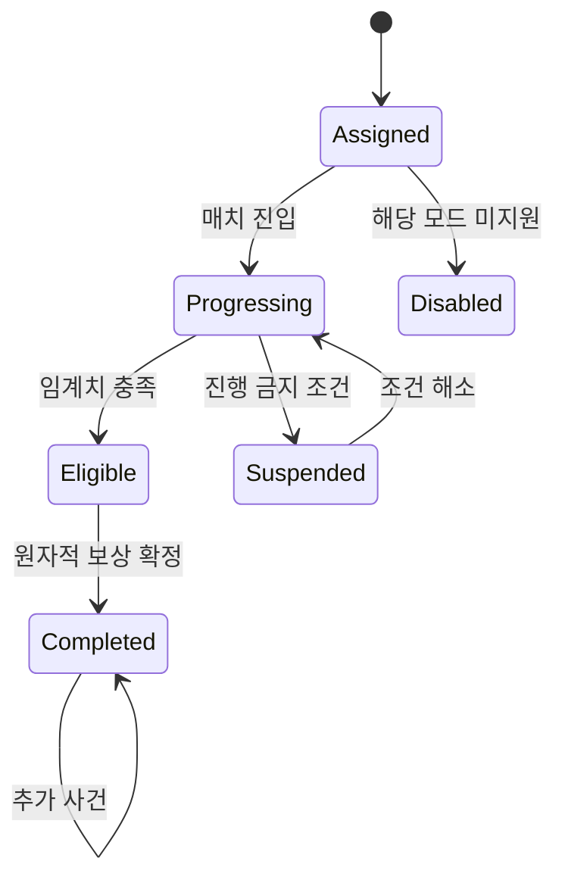

# 02. 경제·경험치·역할 퀘스트·아이템 복원 명세

> 조사일: 2026-11-17 KST · 대상: 현대 소환사의 협곡 · 목표 패치: 26.22. 정적 아이템 데이터와 특정 패치의 변경 이력은 확보했지만, 공개되지 않은 계산 순서 및 중간 패치 전수 검토가 필요한 규칙까지 현행 확정으로 표시하지 않는다.

## 1. 경제 상태를 분리하는 이유

골드, 경험치, 퀘스트 점수와 인벤토리 권한은 서로 다른 자원이다. 미니언 하나의 처치로 여러 자원이 동시에 변하더라도 하나의 숫자로 합치면 안 된다. 라인 밖 페널티가 퀘스트 점수에 적용되는 경우와 미니언 골드·경험치에 적용되는 경우도 별개의 조건이다.

| 상태 | 권위 데이터 | 주요 변경 사건 |
|---|---|---|
| 사용 가능 골드 | 원장 잔액 | 처치·공유·시간 수입·구매·판매 |
| 누적 획득 골드 | 수입 카테고리별 합 | 통계·현상금 입력에 사용할 수 있는 별도 집계 |
| 경험치·레벨 | XP 원장과 레벨 임계치표 | 지역 보상·전역 보상·역할 보정 |
| 역할 퀘스트 점수 | 포지션별 진행 원장 | 이벤트 점수·수동 시간 진행 |
| 퀘스트 완료 보상 | 멱등 지급 기록 | 임계치 도달 후 한 번만 지급 |
| 아이템 소유 | 개별 아이템 인스턴스 | 구매·조합·승급·판매·변환 |
| 슬롯 권한 | 타입별 인벤토리 규칙 | 봇 장화 슬롯·서포터 제어 와드 슬롯 |

위 분리는 **복원 설계**다. 실제 Riot 서버 테이블 구성을 뜻하지 않는다. 기본 킬 골드, 어시스트 공유식, 미니언 경험치 범위, 레벨별 XP 임계치, 자연 골드 증가율 등 이번 공식 조사에서 완결된 표를 확보하지 못한 항목은 `unknown`으로 둔다. 기존 웹 게임의 상수를 그 빈칸에 넣지 않는다.

## 역할 퀘스트 변경 이력

이 절과 [규칙 CSV](../rules_verified_parameters.csv)가 역할 퀘스트의 공용 수치 원장이다. 포지션 배정·교환·로비 정책은 별도 메타 시스템 문서에서 다루고, 여기는 **배정된 역할이 매치 내 보상에 미치는 영향**을 다룬다.

**검토 범위:** 26.1 도입 이후 26.3·26.9·26.11·26.12·26.16·26.19 및 26.22 관련 본문을 확인했다. 이 목록에 없는 모든 중간 패치와 모든 중간 수정 공지를 전수 검토했다는 뜻은 아니다. 아래의 “마지막 확인”은 확보한 공식 변경 중 가장 뒤의 근거이며, 26.22 전체 규칙의 무변경 인증과 구분한다.

### 2.1 도입 시점의 기준값

다음 표는 **26.1 당시**의 시작점이다. 이후 수정된 항목은 다음 표가 우선한다. 근거: [R001 / Role Quests](https://www.leagueoflegends.com/en-us/news/game-updates/patch-26-1-notes/).

| 역할 | 기준값·보상 | `rule_id` |
|---|---|---|
| 탑 | 완료 1,200점, 레벨 상한 20, 즉시 XP 600 | `rq.top.completion_points`, `rq.top.level_cap`, `rq.top.completion_xp` |
| 미드 | 완료 1,350점, 상위 장화 승급 | `rq.mid.completion_points`, `rq.mid.boot_upgrade` |
| 봇 | 완료 1,350점, 즉시 300골드, 미니언당 추가 2골드, 장화 전용 슬롯 이동 | `rq.bot.completion_points`, `rq.bot.completion_gold`, `rq.bot.minion_gold`, `rq.bot.boot_slot` |
| 정글 | 완료 카운터 35, 강타 단계 600/1,000/1,400 | `rq.jungle.completion_counters`, `jungle.smite.damage_stages` |
| 서포터 | 완료 후 제어 와드 40골드·역할 슬롯 보관 | `rq.support.control_ward_cost`, `rq.support.ward_slot_from_start` |

### 2.2 이후 확인된 변경

| 패치 | 항목 | 확인한 변경값 | 구현에서 주의할 적용 범위 |
|---|---|---|---|
| 26.3 | 서포터 제어 와드 슬롯 | 매치 시작부터 사용 | 슬롯 개방과 완료 후 구매 할인은 다른 조건 [R008] |
| 26.9 | 탑 XP | 챔피언 관여 처치 추가 80 XP, 다른 출처 +11% | 이전의 전체 출처 +12.5%와 동시 적용하지 않음 [R003] |
| 26.9 | 미드 완료 보상 | 강화 귀환 제거, 추가 AD/AP +6% | 귀환 보상 타이머를 남기지 않음 [R003] |
| 26.11 | 미드 완료 보상 | 추가 AD/AP +8% | 26.9의 6%를 대체 [R004] |
| 26.9 | 봇 관여 처치 추가 골드 | 50 → 40 | 미니언 보너스·즉시 완료 보상과 구분 [R003] |
| 26.9 | 수동 진행 | 라인 밖 0.333점/초, 라인 안 1.5점/초 | 문서 표기 정밀도와 실제 내부 누적 정밀도는 구분 [R003] |
| 26.9 | 귀환 후 수동 진행 | 12초 중단 | 귀환 시작·완료의 정확한 기준 사건은 추가 관찰 [R003] |
| 26.9 | 로밍 시간 저축 | 라인 체류 120초당 60초, 최대 60초 | 해제 조건의 원문은 레벨 3 이후, 정확한 경계 실측 필요 [R003] |
| 26.9 | 라인 밖 CS·포탑·방패 퀘스트 점수 | 감소율 75%에서 진행도에 따라 0%로 감소 | 보간 곡선 미공개, 선형으로 단정 금지 [R003] |
| 26.12 | 탑 순간이동 보호막 | 최대 체력 35%, 지속 10초 | 해당 탑 퀘스트 순간이동 조건에만 적용 [R005] |
| 26.16 | 서포터 다른 라인 미니언 XP·골드 | 33% 감소, 레벨 5까지 | “퀘스트 점수 33% 감소”로 오독하지 않음 [R006] |
| 26.19 | 탑 무료 순간이동 | 재사용 대기시간 390초 | 일반 포지션 순간이동과 분리 [R007] |
| 26.19 | 탑 강화 순간이동 | 재사용 대기시간 300–210초 | 범위의 레벨별 보간은 별도 검증 [R007] |

핵심 식별자는 `rq.top.xp_bonus`, `rq.top.takedown_xp`, `rq.mid.bonus_ad_ap`, `rq.mid.empowered_recall`, `rq.bot.takedown_gold`, `rq.roam.bank_cap_s`, `rq.recall.pause_s`, `rq.support.offlane_penalty`, `rq.support.offlane_until_level`, `rq.top.teleport.free_cd_s`, `rq.top.teleport.upgraded_cd_s`, `rq.top.teleport.shield_fraction`, `rq.top.teleport.shield_duration_s`다. 동일 ID라도 출처 범위가 바뀌는 경우 `parameter_scope`가 다른 행을 명시적으로 교체한다.

### 2.3 잘못 복원하기 쉬운 해석

탑의 완료 보상을 받았다는 사실, 추가 XP 규칙, 레벨 상한 변경은 별도 플래그다. 완료 직후 지급 XP에 그 순간 해제된 보너스를 적용하는지, 완료를 유발한 사건 자체에도 보너스를 적용하는지는 공식 문장만으로 확정하기 어렵다. 이벤트 원장에 `rewardEligibilitySnapshot`을 넣고 실측 결과로 결정한다.

미드의 추가 AD/AP 비율은 모든 최종 피해를 같은 비율로 늘리는 규칙이 아니다. 기본 AD와 추가 AD, 아이템·버프의 능력치, 다른 비율 증가의 합산 순서를 분리한다. 원문이 설명하는 보너스 능력치의 정확한 계산 단계는 추가 검증 대상이다.

봇의 슬롯 보상은 장화를 역할 슬롯에 보관하는 권한이다. 임의의 완성 아이템을 어디든 추가할 수 있는 범용 슬롯으로 구현하면 구매·판매·장화 미보유 상태에서 오류가 생긴다. 서포터 역시 슬롯 개방, 제어 와드 보관 수량, 할인, 설치 수 제한을 서로 다른 필드로 둔다.

## 3. 퀘스트 진행의 실행 계약

`Suspended`는 과거 획득 점수를 지우는 상태가 아니다. 시간 진행 중지와 처치 이벤트 점수 수락 여부를 분리한다. 완료 후에는 중복 지급을 막되 지속 보상 조건은 계속 평가한다. 이 상태 머신은 **재구성안**이다.

### 3.1 시간 계산

프레임마다 부동소수점을 더하는 대신, 마지막 정산 시각부터 현재까지의 구간을 조건 변경 시점으로 분할한다. 라인 진입, 라인 이탈, 귀환, 사망, 레벨 조건 해제, 로밍 저축 소진이 경계가 된다. 경계 안에서는 같은 진행률을 적용하고 구간 끝에서 누적한다.

예를 들어 구현용 테스트에서 라인 체류 자격이 이미 열린 상태로 20초를 보냈고 저축 배율을 공식 문장의 비율인 1/2로 해석한다면, 계산상 10초가 저축된다. 이는 **모델 검산값**이다. 실제 내부가 연속 증가인지 주기 지급인지, 귀환 중 저축도 멈추는지, 사망 중 은행이 소모되는지는 아직 공식 근거가 부족하다. `bankAccrualPolicy`, `bankSpendPolicy`, `recallGatePolicy`로 분리한다.

진행 수치의 원문 표기 `0.333`을 자동으로 정확한 `1/3`로 바꾸지 않는다. 원문 리터럴, 추정된 유리수, 실제 관찰값을 각각 저장한다. 장시간 누적 오차를 비교해야 퀘스트 완료 시점이 일치하는지 검증할 수 있다.

### 3.2 한 사건에 대한 처리 순서

제안하는 순서는 사건 중복 검사 → 역할·위치·완료 상태 스냅샷 → 기본 보상 후보 생성 → 해당 범위 보정 → 원장 반영 → 퀘스트 임계치 검사 → 완료 보상 트랜잭션이다. 원작에서 완료를 유발한 사건에 보너스가 바로 붙는지 확인하면 그 부분만 정책으로 바꾼다.

하나의 관여 처치가 팀 경험치, 개인 골드, 퀘스트 점수와 지속 보상을 만들더라도 원천 사건 ID는 동일하게 유지한다. 보상 종류별 자식 ID를 사용해 같은 사건의 골드만 재전송되어도 XP를 다시 지급하지 않게 한다.

## 4. 골드·XP 원장

| 필드 | 형식 | 제약 |
|---|---|---|
| `transactionId` | 고유 문자열 | 전체 매치에서 중복 금지 |
| `sourceEventId` | 사건 참조 | 원 피해·사망·판정 로그 추적 |
| `recipientId` | 플레이어 ID | 전역 지급도 수신자별 자식 행 생성 |
| `resourceType` | `gold` / `xp` / `quest_points` | 통화 혼용 금지 |
| `category` | kill / assist / minion / plate / camp / passive / purchase 등 | 페널티와 보너스 적용 범위 |
| `baseAmount` | 정밀 수치 | 원래 가치 |
| `modifierBreakdown` | 규칙 ID·보정값 목록 | 결과를 설명할 수 있음 |
| `finalAmount` | 정밀 수치 | 잔액 반영값 |
| `gameTime` | 시뮬레이션 시각 | 화면 속도와 분리 |
| `snapshotPatch` | 규칙 프로필 버전 | 진행 중 패치 변경 금지 |

전역 XP와 지역 XP는 수혜자 집합을 먼저 확정한다. 사망·연결 끊김·부활 중인 플레이어의 수혜 여부는 오브젝트별 정책이다. 탑 보너스 같은 개인 보정은 전역 보상 원본을 변형하지 않고 각 수신자 단계에서 적용한다. 부동소수점 합계의 마지막 나머지를 어느 수신자가 받는지도 미확정이면 기록한다.

현상금 감소와 복구는 처치 보상 원장과 분리된 상태 전이다. [R008 / Champion Bounties](https://www.leagueoflegends.com/en-us/news/game-updates/patch-26-3-notes/)에서 26.3의 사망 시 지급 골드 대비 감소율은 1/3.5, 파밍 골드 대비 복구율은 1/7로 변경되었다. 이는 현상금 시스템 전체 공식이 아니며 양의 현상금 누적, 바닥값, 리셋 조건까지 복원한 것은 아니다. 26.1 본문에는 감소율과 계산 예시가 맞지 않는 부분이 있으므로 그 예시를 계산기의 기준으로 사용하지 않는다.

## 5. 아이템 데이터에서 상점 실행 규칙으로

정적 데이터는 [아이템 원장](../../data/items.csv), [스탯](../../data/item_stats.csv), [조합 관계](../../data/item_recipes.csv), [맵 플래그](../../data/item_map_flags.csv)를 함께 본다. [협곡 상점 후보](../../data/items_sr_shop_candidates.csv)는 정적 필터 결과이며 실제 클라이언트 상점의 구매 가능 목록을 인증하지 않는다. 특수 승급, 특정 역할, 맵, 모드, 챔피언 전용 조건은 별도 심사가 필요하다.

### 5.1 구매 가능 여부

`maps[11] = true`와 `gold.purchasable = true`를 만족해도 모든 상황에서 구매할 수 있다는 뜻은 아니다. 상점 범위, 역할·챔피언 조건, 유일 구매 그룹, 보유 아이템, 승급 권한, 소비되는 재료, 재구매·되돌리기 제한을 함께 검증한다. 서로 다른 모드의 같은 이름 아이템을 이름으로 합치지 않는다.

### 5.2 조합은 다중 집합이다

조합 그래프에서 재료 ID가 두 번 등장하면 재료 인스턴스도 두 개 필요하다. `from_ids`를 집합으로 바꿔 중복을 지우면 안 된다. 재료 하나를 두 상위 아이템의 할인에 동시에 사용하는 것도 금지한다. 중간 재료와 하위 부품을 동시에 보유한 경우, 실제 선택한 소비 경로와 잔여 결제액을 먼저 계산한다.

`gold_base`는 조합 비용 의미를 보존하고 `gold_total`·`gold_sell`과 구분한다. 표시 가격, 보유 재료 차감, 특수 할인·무상 승급은 다른 계산 단계다. 미드 역할 장화 승급이나 챔피언의 특수 제작을 일반 상점 구매와 동일하게 처리하지 않는다.

구매 트랜잭션은 다음을 한 번에 확정한다. 골드 예약 → 재료 인스턴스 예약 → 조합 후 슬롯 검사 → 재료 삭제 → 골드 차감 → 완성품 생성 → 능력치 수정자 갱신 → 거래 기록. 도중 실패하면 전부 되돌린다. 현재 슬롯이 가득 찼더라도 재료 소비 후 자리가 생기는 조합은 조합 후 상태를 평가한다.

### 5.3 되돌리기

구매 되돌리기를 지원한다면 “직전 아이템 삭제 후 골드 추가”로 구현하지 않는다. 거래 전후 스냅샷, 소비 재료 인스턴스, 아이템의 쿨다운과 충전 상태, 능력치 수정자와 정보 획득 플래그를 기록한다. 실제 LoL의 되돌리기 금지 사건과 예외는 추가 관찰 대상이다. 프로젝트가 허용한 되돌리기와 원작 허용 범위를 혼동하지 않는다.

## 6. 데이터 변경과 마이그레이션

| 입력 변경 | 영향 | 필요한 재검사 |
|---|---|---|
| 아이템 가격 | 구매 시점·완성 타이밍 | 재료 조합별 실결제액 |
| 아이템 능력치 | 피해·회복·정글 펫 피해 | 기본/추가 능력치 구분 |
| 봇 장화 슬롯 | 인벤토리·단축키·판매 | 장화 미보유와 중복 구매 |
| 탑 XP | 레벨·죽음 보상·능력치 | 레벨 상한과 XP 곡선 |
| 미드 보너스 | 모든 보너스 능력치 평가 | 다른 비율 증가와의 중첩 |
| 서포터 페널티 | 초반 라인 이동 수익 | 골드·XP·퀘스트 점수의 분리 |

데이터 버전 교체는 신규 매치에 적용한다. 진행 중인 매치가 외부 JSON 갱신 때문에 보유 아이템 가격이나 퀘스트 목표를 바꾸지 않도록 매치 생성 시 규칙 스냅샷을 고정한다. 저장 게임을 새 버전으로 여는 경우 자동 보정 대신 마이그레이션 결과를 기록한다.

## 7. 수용 시나리오

다음은 설계된 검증 사례이며 원작 실험을 수행했다는 기록은 아니다.

| ID | 입력 | 기대되는 계약 결과 |
|---|---|---|
| E01 | 동일 처치 사건 두 번 수신 | 골드·XP·퀘스트 점수 각각 한 번 |
| E02 | 퀘스트 임계치를 한 사건으로 초과 | 완료 보상 한 번, 초과점수 정책 명시 |
| E03 | 완료를 유발한 처치 | 보상 자격 스냅샷 정책으로 일관된 결과 |
| E04 | 탑이 챔피언·비챔피언 XP를 같은 틱에 획득 | 다른 보정 경로 적용, 재귀 XP 증가 없음 |
| E05 | 서포터가 라인 밖에서 미니언 처치 | 골드·XP 페널티와 점수 페널티 구분 |
| E06 | 로밍 저축이 구간 도중 소진 | 구간을 나누어 정확한 진행률 적용 |
| E07 | 귀환 중 점수 이벤트 발생 | 시간 진행과 이벤트 진행 정책 독립 |
| E08 | 보유 재료 중 같은 ID가 여러 개 | 필요한 인스턴스만 정확히 소비 |
| E09 | 인벤토리 가득 찬 상태에서 조합 | 소비 후 슬롯 기준으로 판정 |
| E10 | 골드 차감 후 거래 저장 실패 | 아이템·재료·골드 모두 원상 복구 |
| E11 | 봇 퀘스트 완료 당시 장화 없음 | 범용 슬롯을 허용하지 않고 장화 권한만 저장 |
| E12 | 미드가 완료 후 장화 구매 | 해당 승급 자격을 단 한 번 적용 |
| E13 | 서포터가 매치 시작에 제어 와드 보유 | 역할 슬롯 가능, 할인 여부는 완료 상태 별도 |
| E14 | 구 버전 저장 상태 불러오기 | 패치 혼합 없이 명시적 마이그레이션 |
| E15 | 미확인 XP 임계치로 레벨 상승 요청 | 임의 선형식 사용 금지, 검증 오류 표시 |

## 8. 출처

조회일은 모두 **2026-11-17 KST**다. 별도 표시 없는 실행 순서·스키마·검증 시나리오는 본 문서의 재구성안이다.

| ID | 공식 문서 | 근거 위치 |
|---|---|---|
| R001 | [26.1](https://www.leagueoflegends.com/en-us/news/game-updates/patch-26-1-notes/) | Role Quests; Atakhan, Blood Roses, Feats, and Kills |
| R008 | [26.3](https://www.leagueoflegends.com/en-us/news/game-updates/patch-26-3-notes/) | Champion Bounties; Support Control Wards |
| R003 | [26.9](https://www.leagueoflegends.com/en-us/news/game-updates/league-of-legends-patch-26-9-notes/) | Role Quests / Quest Progression / Quest Rewards |
| R004 | [26.11](https://www.leagueoflegends.com/en-us/news/game-updates/league-of-legends-patch-26-11-notes/) | Role Quest Adjustments / Mid Role Quest |
| R005 | [26.12](https://www.leagueoflegends.com/en-us/news/game-updates/league-of-legends-patch-26-12-notes/) | Systems / Teleport |
| R006 | [26.16](https://www.leagueoflegends.com/en-us/news/game-updates/league-of-legends-patch-26-16-notes/) | Systems / Support Role Quest |
| R007 | [26.19](https://www.leagueoflegends.com/en-us/news/game-updates/league-of-legends-patch-26-19-notes/) | Systems / Teleport Cooldown |

다음 문서: [전투](01_combat_stats_damage.md), [라인·구조물·미니언](03_lanes_structures_minions.md), [정글·오브젝트·맵](04_jungle_epic_map.md).
