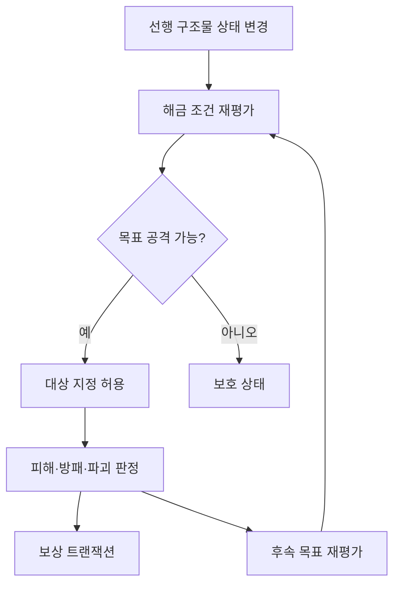

# 03. 공격로·구조물·미니언 복원 명세

> 조사일: 2026-11-17 KST · 대상: 현대 소환사의 협곡 · 목표 검토 패치: 26.22. 본 문서의 숫자는 해당 근거 패치에서 확인한 값이다. 26.1·26.3·26.9 이후 모든 중간 변경의 무변경 인증은 별도 작업이다.

## 1. 시스템의 목적과 의존 관계

공격로 시스템은 미니언 생성 → 교전선 이동 → 구조물 노출 → 부분 보상과 파괴 → 다음 목표 개방을 연결한다. 이 연결이 있어야 챔피언 전투가 지도상의 영구적인 진전으로 이어진다. 미니언을 단순히 가까운 적을 추적하는 유닛으로 만들거나, 포탑을 독립적인 체력 통으로 만들면 라인 유지와 공성의 의사결정이 약해진다.

[R011, 공식 플레이 안내](https://www.leagueoflegends.com/ko-kr/how-to-play/)는 공격로마다 포탑 3개와 억제기 1개, 넥서스를 지키는 포탑 2개를 설명한다. 억제기 파괴 후 해당 라인의 슈퍼 미니언이 발생하고 재생성 후 중단되는 관계도 확인된다. 다만 정확한 억제기 부활 시간과 모든 목표 보호 조건을 이 안내만으로 채울 수는 없다.

복원안은 `LaneDefinition`, `WaveSchedule`, `UnitTemplate`, `StructureGraph`, `RewardPolicy`를 분리한다. 전장의 안개에 표시할 건물 기억은 실제 구조물 상태의 별도 읽기 모델이다. 사용자가 요청한 “시야 밖 변경을 반영하지 않고 재관측 시 갱신”은 별도 프로젝트 정보 정책이며 여기서 원작 공식 규칙으로 인증하지 않는다.

## 2. 확인된 변경값

수치는 [공식 규칙 원장](../rules_verified_parameters.csv)의 `minion.*`, `structure.*` 행으로 관리한다. 아래 표는 구현에 영향을 주는 항목을 모은 것이다.

| 계통 | 확인값 | 근거 패치·위치 | 남은 검증 |
|---|---|---|---|
| 첫 미니언 | 게임 시각 30초 | 26.1 / Game Start Time [R001] | 이후 변경 및 최초 개체별 출현 간격 |
| 중반·후반 웨이브 | 14분부터 25초, 30분부터 20초 간격 | 26.1 / Minions [R001] | 전환 시 위상 유지 여부 |
| 첫 대포 웨이브 | 3번째 | 26.1 / Minions [R001] | 이후 대포 주기 전체 표 |
| 근접 미니언 체력 | 430, 90초마다 +35 | 26.9 / Minion Waves [R003] | 증가 시각 원점, 기존 생존 유닛 반영 여부 |
| 미니언 간 현재 체력 비례 추가 피해 | 근접 2%, 원거리 3.5%, 공성 5% | 26.9 / Minion Slayer [R003] | 효과별 정산 순서 |
| 외곽·내부·억제기·넥서스 포탑 기본 HP | 9,000 / 5,000 / 4,750 / 3,500 | 26.1 / Turrets [R001] | 후속 변경 전수 검토 |
| 공격로 포탑 방패 임계치 | 잃은 체력 10/25/45/70/100% | 26.1 / Outer, Inner and Inhibitor Turrets [R001] | 재생·부활과 지급 플래그 관계 |
| Bulwark 임시 저항 | 방패당 30–50 | 26.3 / Turret Plates [R008] | 주변 적 수에 따른 정확한 매핑 |
| 결정 성장 타이밍 | 준비 90초, 최소 상태 60초, 증가 구간 240초 | 26.1 / Crystalline Overgrowth [R001] | 첫 활성 시각, 상태 전환 경계 실측 |

표에서 빠진 능력치를 0으로 간주하지 않는다. 특히 포탑 공격력·공격 속도·재타기팅, 미니언 사거리·탐지 범위·밀집 충돌, 억제기·넥서스 수치와 XP 반경은 완전한 현행 테이블이 아직 없다.

### 반드시 보존할 출처 충돌

26.1 `Turrets` 도입 설명은 넥서스 포탑을 방패 적용 대상에서 제외하지만, 같은 페이지 `Nexus Turrets` 아래에는 방패 임계치 추가 항목이 있다. [R001의 두 위치](https://www.leagueoflegends.com/en-us/news/game-updates/patch-26-1-notes/)가 충돌하므로 `structure.nexus.plates_enabled = null`, `status = source_conflict`로 보존한다. 흔한 규칙이라는 이유나 문장 위치만으로 어느 쪽이 맞는지 결정하지 않는다. 26.1 실게임 관찰 또는 이후 공식 정정이 필요하다.

## 3. 웨이브 스케줄러

### 3.1 절대 게임 시각을 기준으로 예약한다

**복원 계약:** `nextSpawnAt`을 실제 시간으로 누적시키지 않고 게임 시각과 웨이브 순번으로 계산한다. 일시정지, 화면 FPS 하락, 플레이 속도 변경으로 웨이브가 누락되거나 중복되지 않도록 한다. 긴 프레임 동안 여러 생성 시각을 통과하면 놓친 웨이브를 모두 순서대로 처리하거나, 제품이 정한 최대 따라잡기 정책을 적용하고 로그를 남긴다.

```json
{
  "scheduleId": "sr-modern-reviewed-rules",
  "laneId": "top",
  "firstSpawnAt": 30,
  "phases": [
    {"startAt": 0, "interval": null, "status": "unknown"},
    {"startAt": 840, "interval": 25, "evidence": "R001"},
    {"startAt": 1800, "interval": 20, "evidence": "R001"}
  ],
  "phaseTransitionPolicy": null,
  "evidencePatch": "26.1",
  "currentPatchCertification": false
}
```

이 예시의 840초와 1,800초는 공식 분 단위의 단순 변환이다. 초반 웨이브 간격을 이번 조사에서 확보하지 않았으므로 익숙한 값을 자동 보충하지 않았다. 이 상태의 규칙은 **데이터 복원 중**이며 원작 호환 매치의 완성된 설정이 아니다.

### 3.2 전환 경계는 별도 규칙이다

14분을 넘는 순간 즉시 새 웨이브가 생성되는지, 마지막 웨이브 이후 새 간격을 적용하는지, 기준 시각에서 새 위상을 시작하는지는 서로 다른 결과를 낸다. `phaseTransitionPolicy` 후보로 `preserve_previous_due_time`, `restart_at_boundary`, `rebase_from_last_spawn`을 구분하고 관찰 결과로 하나를 선택한다. 어떤 방식이든 동일 `teamId/laneId/waveIndex` 조합은 한 번만 생성한다.

구성표도 시간과 분리한다. 공식 26.1의 중반 대포 웨이브는 근접 미니언 하나가 줄고, 후반에는 원거리 미니언 하나가 줄어드는 변경이 있다. 따라서 “항상 근접·원거리 고정 수량에 대포만 추가”하는 과거 단순화는 사용하지 않는다. 초기 기본 수량, 대포 주기, 슈퍼 미니언 대체 규칙을 검증한 `WaveCompositionRule`에서 평가한다.

## 4. 미니언 AI와 성장

### 4.1 이동과 전투를 분리한다

| 계층 | 역할 | 복원 데이터 |
|---|---|---|
| 공격로 경로 | 다음 이동 목표 제공 | 라인 중심 경로·구조물 접근점 |
| 지역 이동 | 유닛 충돌·우회 | 반경·충돌 그룹·밀어내기 정책 |
| 대상 탐색 | 주변 후보 질의 | 탐지 범위·대상 종류 필터 |
| 우선순위 | 공격할 대상 선택 | 적 공격 사건·거리·위협의 정책 |
| 전투 상태 | 이동/선딜레이/공격/추적 | [전투 계약](01_combat_stats_damage.md) |
| 복귀 | 대상 상실 후 라인 복귀 | 원래 경로 투영점·복귀 조건 |

“가장 가까운 적”은 구현 후보일 뿐 원작 미니언 AI의 정확한 우선순위를 인증하는 규칙이 아니다. 적 챔피언의 아군 공격에 반응하는 범위, 시야 영향, 대상 유지 시간, 더 먼 목표로의 변경 조건을 각각 관찰한다. 미니언끼리의 충돌로 라인이 정지하지 않도록 정체 감지와 지역 우회를 구현할 수 있지만, 교착 해소를 순간이동으로 처리하면 원작 재현성은 별도로 평가해야 한다.

### 4.2 생성 시 스탯과 동적 보정을 나눈다

미니언의 생성 웨이브·시각을 저장하고 `baseTemplateVersion`을 고정한다. 게임 시간 성장, 억제기 효과, 오브젝트 버프를 별도 수정자로 적용한다. 체력 성장 시 현재 체력을 같이 늘리는지, 비율 유지인지, 새로 생성된 개체만 적용되는지 공식 근거가 부족하면 정책을 비워 둔다.

26.9의 미니언 간 추가 피해는 **다른 미니언 대상의 현재 체력 기반 효과**다. 챔피언·포탑·중립 몬스터에까지 같은 성분을 전파하면 안 된다. 기본 공격 피해와 해당 성분을 별도 `DamageComponent`로 남겨 대상 필터와 적용 시점이 검증 가능하게 한다.

### 4.3 처치와 경험치

처치 보상은 마지막 타격자 확정, 주변 XP 수혜자 집합, 공유 비율, 역할 보정의 순서로 설계한다. 실제 원작의 수혜 범위·반올림·죽은 플레이어 포함 여부가 채워지기 전까지는 완전 복원으로 표시하지 않는다. 처치 골드를 받지 못했어도 XP를 받는 경우를 표현할 수 있어야 한다. 자세한 원장은 [경제 문서](02_economy_experience_items.md)를 따른다.

## 5. 구조물의 실제 상태와 해금 그래프

`StructureInstance`에는 고정 위치, 팀·공격로·계층, 현재 HP, 생명 주기 ID, 피격 가능 여부, 부활 예약과 보상 비트를 보관한다. “파괴됨”과 “영구 제거됨”을 구분한다. 넥서스 포탑 재생성처럼 파괴 이후 살아나는 구조물은 첫 파괴 보상과 재파괴 보상을 같은 플래그로 처리하면 안 된다. 구체적인 재보상 정책은 실측 대상이다.



이 도표는 실행 구조이며 원작 보호 조건의 완전한 진리표가 아니다. 넥서스와 그 포탑의 공격 가능 여부, 억제기 재생성 순간의 재보호 여부를 `allOf/anyOf` 조건식으로 기술하고 버전이 기록된 플레이 관찰로 채운다. 그래픽이 무너졌다는 이유로 보호 상태를 판정하지 않는다.

## 6. 포탑 방패와 보상

### 6.1 여러 임계치를 한 번에 넘는 경우

하나의 피해로 방패 여러 개를 넘으면 이번 공격 이전과 이후의 잃은 체력 비율 사이에 있는 **미지급 임계치 전체**를 찾는다. 임계치마다 `plateRewardId`를 발행하고 이전 지급 비트를 원자적으로 갱신한다. 남은 체력이 회복되어 같은 임계치를 다시 통과해도 중복 골드를 주지 않는다. 실제 원작에서 재생성으로 어떤 비트가 초기화되는지는 별도 정책이다.

포탑 파괴와 마지막 방패 지급은 같은 사건에서 일어날 수 있다. 로컬 보상, 전역 보상, 첫 포탑 보상, 역할 퀘스트 점수를 각각 만든 뒤 수혜자 집합별로 정산한다. 이미 방패에 분산된 금액에 예전 포탑 로컬 골드를 다시 더하지 않는다.

### 6.2 Bulwark는 만료 시각이 있는 인스턴스다

26.1은 방패 파괴 후 임시 저항의 지속시간을 개별 중첩 형태로 설명하고, 26.3은 그 수치 범위를 바꿨다. [R001 / Turrets](https://www.leagueoflegends.com/en-us/news/game-updates/patch-26-1-notes/), [R008 / Turret Plates](https://www.leagueoflegends.com/en-us/news/game-updates/patch-26-3-notes/). 복원 구조는 `bulwarkInstances[] = {plateId, resistance, expiresAt, nearbySnapshot}`가 적절하다. 하나의 `buffExpiresAt`만 연장하면 먼저 얻은 스택도 함께 연장되어 다른 결과가 나온다.

주변 적 챔피언 수를 방패 파괴 때 고정하는지, 매번 실시간으로 다시 계산하는지와 30–50 사이의 정확한 매핑은 공개 항목만으로 충분하지 않다. `nearbyEvaluationPolicy`와 구간표를 별도 필드로 둔다. 공식 최솟값·최댓값을 곧바로 선형식으로 바꾸지 않는다.

## 7. 결정 성장(Crystalline Overgrowth)

공식 26.1은 공격 가능한 라인 포탑에 축적되는 공성 보조 규칙을 도입했다. 적이 가까운 활성 시점의 억제, 떠난 뒤 경과 시간 반영, 백도어 보호 중 발동 금지가 함께 설명된다. 근거는 [R001 / Crystalline Overgrowth](https://www.leagueoflegends.com/en-us/news/game-updates/patch-26-1-notes/)다. 수치만 복사하면 이 조건을 놓치므로 아래와 같이 별도 상태로 관리한다.

| 상태 | 진입 조건 | 보관 데이터 | 다음 전이 |
|---|---|---|---|
| `Ineligible` | 보호·구조물 종류 등 자격 미충족 | 자격 이유 | 자격 획득 시 `Charging` |
| `Charging` | 활성 준비 또는 발동 후 재준비 | 기준 시각 | 준비 완료 후 주변 검사 |
| `Suppressed` | 활성 시점에 억제 조건 성립 | 원래 활성 예정 시각 | 조건 해소 후 경과 시간 계산 |
| `Ready` | 활성 및 공격 가능 | 성장 기준 시각·성장도 | 유효 챔피언 공격으로 소비 |
| `Consumed` | 발동 권한을 원자적으로 확보 | 소비 사건 ID | 추가 피해 후 새 준비 |
| `Destroyed` | 포탑 파괴 | 생명 주기 ID | 부활 정책에 따름 |

위 상태 이름과 원자적 소비 방식은 **복원 계약**이다. 성장 피해가 공격자의 AD/AP에 비례한다고 추정해서는 안 된다. 공식 설명의 공격 팀 평균 레벨과 축적 상태를 별도의 입력으로 쓴다. 평균에 포함하는 대상과 사망·연결 상태, 탑의 확장 레벨을 처리하는 방식은 관찰해야 한다. 공식이 제시한 끝점만으로 레벨 사이의 피해 보간을 확정하지 않는다.

같은 틱에 두 챔피언이 포탑을 공격하면 `generationId`가 일치하는 한 공격만 성장 보너스를 소비할 수 있다. 포탑이 파괴된 뒤 도착한 투사체는 파괴된 생명 주기에 더 이상 피해나 보상을 만들지 않는다. 백도어 보호 상태는 충돌/피해 확정 시점의 스냅샷으로 판정하는 제안을 두되 원작 동작과 대조한다.

## 8. 성능과 정보 노출

정적 구조물은 공간 인덱스에 고정 등록하고 상태 변경만 전파한다. 미니언 탐색은 유닛마다 전체 맵을 훑는 대신 주변 셀 후보로 제한한다. 장거리 라인 이동 경로는 공유할 수 있지만 지역 충돌과 교전 판단은 개별 상태로 유지한다. 전투 중요도가 낮은 미니언의 판단 갱신을 분산할 경우 발사·적중·스폰 시각 같은 규칙 이벤트까지 늦추지 않는다.

실제 서버 상태, 팀 시야에 따른 관측 상태, 화면 효과는 세 계층으로 분리한다. 서버가 알고 있는 포탑 파괴·재생성을 미니맵 색깔이나 체력바를 통해 시야 밖 사용자에게 즉시 누출하지 않도록 정보 정책을 마지막 출력 단계에 적용한다. 이 프로젝트의 건물 기억 규칙에 대한 세부 사항은 별도 시야 문서를 따른다.

## 9. 수용 시나리오

아래 사례는 검증 계획이다. 원작과 비교한 실제 실행 결과는 아직 첨부되지 않았다.

| ID | 조건 | 기대되는 계약 결과 |
|---|---|---|
| L01 | 최초 생성 시각 바로 전·정확한 시각·직후 | 같은 웨이브 한 번만 생성 |
| L02 | 긴 프레임으로 여러 생성 시각 통과 | 예약 누락·중복 없이 따라잡기 |
| L03 | 14분·30분 경계 통과 | 선택한 위상 정책과 동일한 결과 |
| L04 | 대포가 있는 중반 웨이브 | 해당 구성표의 근접 수량 적용 |
| L05 | 미니언의 공격 대상이 챔피언 | 미니언 전용 현재 HP 성분 배제 |
| L06 | 성장 경계에 이미 살아 있는 미니언 | 선택한 동적/생성 시 정책으로 일관된 HP |
| L07 | 한 공격으로 방패 여러 개 소모 | 각 미지급 임계치 한 번씩 보상 |
| L08 | 포탑 회복 후 같은 임계치 재통과 | 기존 생명 주기의 중복 보상 없음 |
| L09 | Bulwark 두 인스턴스 만료 시각이 다름 | 앞선 인스턴스만 먼저 제거 |
| L10 | 결정 활성 시점에 억제 조건 | 화면과 발동 자격 모두 억제 |
| L11 | 억제 해제 후 성장 표시 | 원래 시간 기준 경과분 적용 |
| L12 | 두 공격이 동시에 결정 소비 시도 | 한 건만 승인 |
| L13 | 포탑 파괴와 마지막 방패 | 로컬 보상 중복 합산 없음 |
| L14 | 파괴 포탑 부활 후 이전 투사체 도착 | 이전 생명 주기 공격으로 새 포탑 손상 금지 |
| L15 | 넥서스 방패 필드 미확정 | 자동 활성화 대신 충돌 경고 |
| L16 | 시야 밖 건물의 서버 상태 변경 | 프로젝트의 관측 정책에 따라 표시 갱신 통제 |

## 10. 출처

모두 **2026-11-17 KST**에 조회했다. 공개 근거에서 수치가 없는 곳의 구현 구조는 이 문서의 제안이다.

| ID | 공식 문서 | 근거 위치 |
|---|---|---|
| R001 | [Patch 26.1 Notes](https://www.leagueoflegends.com/en-us/news/game-updates/patch-26-1-notes/) | Game Start Time; Turrets; Minions; Crystalline Overgrowth |
| R003 | [Patch 26.9 Notes](https://www.leagueoflegends.com/en-us/news/game-updates/league-of-legends-patch-26-9-notes/) | Game Systems / Minion Waves |
| R008 | [Patch 26.3 Notes](https://www.leagueoflegends.com/en-us/news/game-updates/patch-26-3-notes/) | Turret Plates |
| R011 | [공식 게임 방법 안내](https://www.leagueoflegends.com/ko-kr/how-to-play/) | 공격로 장악하기 / 포탑 / 억제기. 개정일 미표시, 수치 상세 근거로 확장하지 않음 |

관련 문서: [전투](01_combat_stats_damage.md), [경제·아이템](02_economy_experience_items.md), [정글·오브젝트·맵](04_jungle_epic_map.md).
