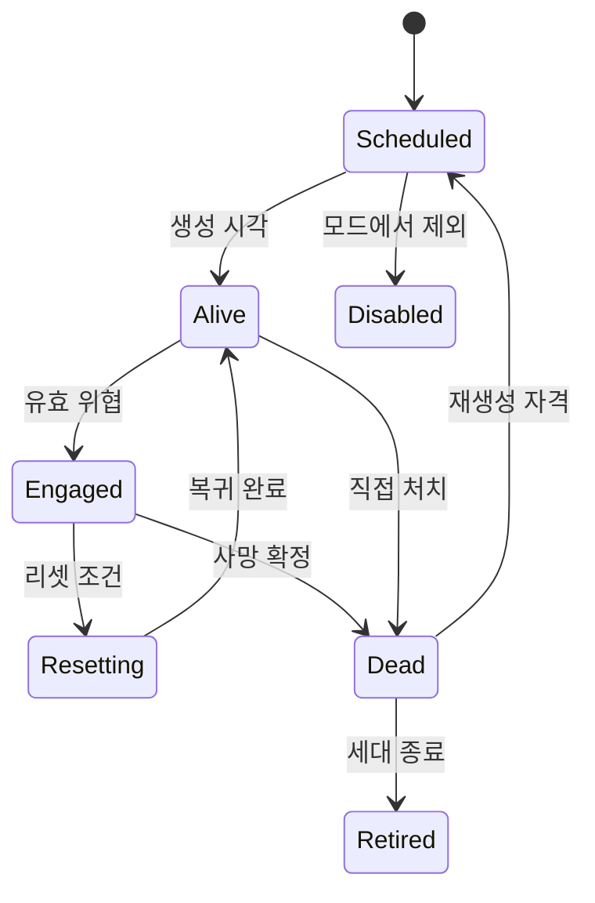
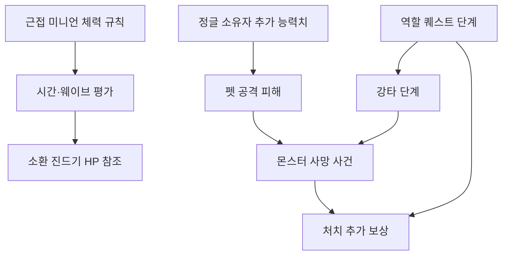

# 04. 정글·에픽 오브젝트·맵 복원 명세

> 조사일: 2026-11-17 KST · 대상: 현대 소환사의 협곡 · 목표 관찰 패치: 26.22. 이 문서는 2026 변경 근거를 반영한 데이터 복원 설계다. 공개되지 않은 캠프 좌표·리셋 조건·전체 능력치·오브젝트 내부 AI를 완성 데이터처럼 채우지 않는다.

## 1. 2025와 2026의 규칙을 섞지 않는다

[R001 / Atakhan, Blood Roses, Feats, and Kills](https://www.leagueoflegends.com/en-us/news/game-updates/patch-26-1-notes/)에서 아타칸, 핏빛 장미, 무력행사의 제거가 확인된다. 제거된 오브젝트는 `Dead`로 생성해 부활을 기다리게 하는 것이 아니라 해당 규칙 프로필에서 `Disabled`로 둔다. 이름·아이콘·이전 연도 데이터가 남아 있어도 활성화 근거가 되지 않는다.

2026 공식 패치에는 현대 협곡 이외의 Swiftplay, ARAM, Arena와 별도의 Classic 섹션이 함께 포함될 수 있다. [R006 / Classic](https://www.leagueoflegends.com/en-us/news/game-updates/league-of-legends-patch-26-16-notes/), [R007 / Classic](https://www.leagueoflegends.com/en-us/news/game-updates/league-of-legends-patch-26-19-notes/)의 옛 챔피언 동작을 같은 이름이라는 이유로 현대 챔피언에 적용하지 않는다. 모든 파라미터에 `mode`, `mapId`, `rulesetId`, `evidencePatch`를 둔다.

[R002, 2026 시즌 예고](https://www.leagueoflegends.com/en-us/news/dev/dev-2026-season-one-gameplay-preview/)는 공성·분할 압박 등 전략 폭을 넓히려는 설계 방향을 설명하는 자료다. 출시 전 예고는 변경 가능성이 명시되어 있으므로 실제 수치는 라이브 패치 본문으로 확인한다. 과거 예고를 현재 오브젝트 구성의 최종 근거로 사용하지 않는다.

## 2. 공식 수치와 복원 상태

아래 표의 “확인 패치”는 해당 값의 근거 시점이다. 26.22까지 모든 중간 패치와 수정 공지를 검토해 무변경을 인증했다는 뜻은 아니다. 원장은 [규칙 CSV](../rules_verified_parameters.csv)다.

| 항목 | 확인값 | 확인 패치·근거 | 주의점 |
|---|---|---|---|
| 바론 최초 등장 | 20:00 | 26.1 / Game Start Time [R001] | Swiftplay와 분리 |
| 늑대·블루·레드·칼날부리 최초 등장 | 0:55 | 26.1 / Game Start Time [R001] | 각 개체가 동시에 행동 가능해지는지 실측 |
| 돌거북·두꺼비 최초 등장 | 1:07 | 26.1 / Game Start Time [R001] | 재생성 주기와 혼동 금지 |
| 바위게 최초 등장 | 2:55 | 26.1 / Game Start Time [R001] | 초기·후속 생성 규칙 분리 |
| 강타 몬스터 피해 단계 | 600 / 1,000 / 1,400 | 26.1 / Role Quests / Jungle [R001] | 챔피언 대상 효과·단계 조건 별도 |
| 정글 퀘스트 완료 카운터 | 35 | 26.1 / Role Quests / Jungle [R001] | 모든 캠프 처치 수를 단순 합산하지 않음 |
| 정글 펫 추가 계수 | 추가 AD 10%, AP 16%, 추가 방어력·마저 각 25%, 추가 HP 4% | 26.16 / Jungle Pets [R006] | **공격 1회당** 수치; DPS와 구분 |
| 소환된 공허 진드기 HP | 근접 미니언 HP의 100% | 26.11 / Support Adjustments [R004] | 중립 캠프 안의 진드기와 구분 |

정글 펫의 기본 피해는 26.16에서 레벨 기반 20–150으로 제시된다. 범위 끝점만으로 실제 레벨 보간식을 확정하지 않는다. 다음 식은 공식 계수의 **구조화 표현**이며 `baseByLevel` 표는 추가 복원이 필요하다.

\[
D_{pet,attack}=B(level)+0.10\,bonusAD+0.16\,AP+0.25\,bonusArmor+0.25\,bonusMR+0.04\,bonusHP
\]

펫 공격 주기와 대상 수, 대상 종류별 보정이 없는 상태에서 이 값을 초당 피해로 표시하지 않는다. 원문이 달리 정의한 이전 패치 수치를 같은 단위로 비교하지 않는다.

## 3. 캠프와 개별 몬스터를 분리한다

| 객체 | 보관 정보 | 책임 |
|---|---|---|
| `CampDefinition` | 캠프 종류, 개체 구성, 위치, 스폰 정책 | 맵상의 캠프 정체성 |
| `CampInstance` | 현재 세대, 살아 있는 구성원, 재생성 예약 | 캠프 소진과 재등장 관리 |
| `MonsterDefinition` | 능력치·공격·저항·보상 템플릿 | 몬스터 종류별 규칙 |
| `MonsterInstance` | HP, 대상, 위치, 어그로·리셋 상태 | 실제 전투 개체 |
| `ObjectiveRewardDefinition` | 킬·지역·전역·버프·퀘스트 | 수혜 범위별 보상 |

작은 몬스터가 남아 있는 캠프의 재생성 타이머 시작점, 돌거북 분열 자식의 처치 인정 범위, 동시에 두 챔피언이 공격할 때의 어그로 유지, 몬스터가 원점으로 돌아갈 때 회복하는 방식은 정확한 관찰이 필요하다. “대형 몬스터가 죽으면 캠프 완전 종료”를 공통 규칙으로 고정하지 않는다.

### 3.1 생명 주기



이 도표는 **재구성 계약**이다. 리셋을 단순 거리 하나로 구현하지 않고 허용 영역, 대상 적법성, 캠프 인내·추적 조건 같은 정책 입력을 수용한다. 실제 LoL이 어떤 변수와 갱신 주기를 쓰는지 단정하지 않는다. 귀환·순간이동·은신·사망으로 공격 대상이 사라졌을 때의 재평가를 분리한다.

### 3.2 생명 주기 ID

매 재생성마다 `spawnGeneration`을 증가시킨다. 사망 직전 발사된 공격이 재생성한 같은 캠프에 도착해 새 개체를 맞히면 안 된다. 대상 핸들은 `campId`만 쓰지 않고 `entityId + spawnGeneration`을 포함한다. 캠프 이름을 키로 사용한 보상 중복 제거는 다음 세대 보상까지 막을 수 있다.

## 4. 에픽 오브젝트 보상 모델

에픽 처치는 하나의 이벤트이지만 보상은 여러 층이다. 직접 처치자 골드, 일정 범위의 XP, 팀 전역 골드·XP, 팀 영구 스택, 개인 임시 버프, 역할 퀘스트 점수를 독립적으로 기술한다. 모든 보상을 주변 챔피언에게 균등 분배하는 방식은 오브젝트별 규칙을 재현하지 못한다.

```json
{
  "objectiveId": "baron",
  "mode": "summoners_rift_modern",
  "spawnPolicy": {"firstAtSeconds": 1200, "evidence": "R001", "patch": "26.1"},
  "statsModelId": "pending_monster_growth_model",
  "rewardRules": [
    {"kind": "killer_gold", "amountRuleId": "pending"},
    {"kind": "team_xp", "amountRuleId": "pending", "eligibilityRuleId": "pending"},
    {"kind": "team_buff", "buffDefinitionId": "pending"}
  ],
  "respawnPolicyId": null,
  "currentPatchCertification": false
}
```

예시가 `pending`인 것은 보상이 없다는 뜻이 아니다. 공식 패치에는 일부 숫자가 있지만 그에 연결되는 수혜·생존·재생성 조건이 없으면 실행 규칙이 완성되지 않는다. 표의 현재 확보 범위 이상으로 런타임 상태를 만들어 내지 않는다.

### 4.1 마지막 타격과 동시 강타

서버 권위 복원안에서는 피해 확정 후 `DeathClaim`을 한 번만 발행한다. 같은 틱에 여러 피해가 치명적으로 들어와도 하나의 오브젝트 세대에 소유 팀이 둘이 되지 않아야 한다. 정렬 키와 마지막 유효 피해 귀속을 명시한다. 이 프로젝트의 결정적 이벤트 정렬은 구현 계약이며 실제 LoL 서버가 같은 시간 입력의 우선순위를 정하는 방법은 공개 자료로 확정하지 못했다.

클라이언트 UI가 표시한 몬스터 HP와 서버의 판정 HP를 구분한다. 강타 버튼을 누를 당시 화면 수치가 사망 귀속의 권위가 되어서는 안 된다. 반대로 서버가 최종 확정한 처치 정보가 도착하면 이전 예측 표시를 일관되게 교정해야 한다.

### 4.2 영구 스택과 임시 버프

팀 영구 스택은 팀 상태에, 죽으면 사라질 수 있는 버프는 개별 플레이어 상태에 저장한다. 사망·부활·연결 재진입 때 버프가 유지되는지 오브젝트와 모드별로 정의한다. Swiftplay에 명시된 사망 후 유지 규칙을 현대 협곡으로 전파하지 않는다.

드래곤 종류 선택, 원소 협곡 변환, 영혼과 장로의 해제 조건, 각 생성·재생성 시간, 버프의 전체 수치·대상은 별도의 오브젝트 상태표가 필요하다. 익숙한 과거 값을 완성된 26.22 규칙으로 넣지 않는다. 이 문서는 아직 전체 드래곤 연쇄표를 복원하지 않았다는 상태를 명시한다.

## 5. 정글 펫·강타·퀘스트

강타의 정적 주문 정보와 매치 내 진화 단계는 별도 상태다. [정적 주문 데이터](../../data/summoner_spells.csv)에 주문이 있다고 단계별 대상 제한과 진화 조건까지 복원된 것은 아니다. 정글 아이템 소유, 펫 카운터, 추가 간식·진행 보정, 단계 전환, 주문 슬롯 변환을 서로 구분한다.

펫 공격은 소유 챔피언과 펫 개체의 ID를 함께 갖는다. 피해는 펫이 발생시키더라도 처치 및 역할 보상의 주체가 누구인지 정책으로 확정한다. 펫의 같은 공격이 여러 몬스터에 적용될 때, 각 대상마다 보상 카운터를 올리는지 “대형 몬스터 처치 사건”으로 한정하는지 구분한다. 완료 직전에 동시에 여러 대상이 죽으면 완료 보상이 중복 발생하지 않게 한다.

펫 계수의 “추가” 능력치는 전체 능력치와 다르다. 탱커 챔피언의 기본 방어력까지 추가 방어력 계수에 넣거나, 미드 역할 보너스를 펫 계수에 직접 더하는 방식은 잘못된 단축이다. [전투 능력치 평가](01_combat_stats_damage.md)에서 최종 스냅샷을 받고 펫 공식에는 요구된 성분만 전달한다.

## 6. 서로 연결된 밸런스 데이터

26.11의 소환된 공허 진드기 HP는 근접 미니언 HP를 참조한다. 따라서 근접 미니언의 26.9 체력 변경을 독립 상수로 복사하면, 이후 미니언 체력 변경이 진드기에 반영되지 않는 문제가 생긴다. [R004 / Support Adjustments](https://www.leagueoflegends.com/en-us/news/game-updates/league-of-legends-patch-26-11-notes/), [R003 / Minion Waves](https://www.leagueoflegends.com/en-us/news/game-updates/league-of-legends-patch-26-9-notes/).



이는 데이터 의존 관계를 표현한 복원안이다. 참조 대상의 평가 시점은 여전히 규칙으로 둔다. 소환된 진드기가 생성 후 미니언의 시간 성장에 따라 즉시 HP를 다시 받는지는 이 참조 관계만으로 결정되지 않는다.

## 7. 맵 데이터 복원의 경계

Data Dragon의 맵 목록과 이미지는 이동 가능한 정확한 폴리곤, 벽 충돌, 수풀 영역, 높이, 카메라 경계, 캠프 좌표 전체를 제공하는 실행 맵이 아니다. [공식 맵 목록](../../data/official_maps.csv)과 [Data Dragon 맵](../../data/ddragon_maps.csv)을 이용해 모드 식별을 복원할 수 있지만, 좌표별 네비게이션까지 복원했다고 표시해서는 안 된다.

| 필요한 데이터 | 용도 | 복원 상태·절차 |
|---|---|---|
| 지면·통행 영역 | 경로 탐색 | 별도 공간 자료 또는 버전 명시 관찰 필요 |
| 벽·차단 폴리곤 | 이동·투사체·시야 차단 | 세 질의가 동일한 장애물 정의인지 확인 |
| 수풀·특수 시야 구역 | 시야 정책 | 시야 문서의 관측 규칙과 연결 |
| 라인·기지 경계 | 역할 진행·이동·귀환 | 화면상 라인과 판정 폴리곤 구분 |
| 캠프·스폰 위치 | AI·리셋·전투 | 월드 좌표 및 허용 영역 필요 |
| 지형 변환 상태 | 원소 협곡 | 버전별 충돌·시야·연결 갱신 |
| 팀별 관측 데이터 | 전장의 안개 출력 | 실제 상태와 마지막 관측 상태 분리 |

사용자 프로젝트의 맵 1배·1.5배·2배 선택은 **커스텀 기능**이다. 시작 전에 선택하여 매치의 `mapScaleProfile`로 고정하고, 원작 데이터와 별도 프로필로 보존한다. 단순히 모든 좌표만 늘리면 이동 시간, 사거리, 탐지, 포탑 간격, 몬스터 리셋 범위의 상대 관계가 바뀐다. 좌표 확대, 이동 속도, 사거리, 스폰 시간 중 무엇을 같이 바꾸는지 명시해야 의도한 플레이 시간을 만들 수 있다. 원작 호환 기본 프로필에 임의 스케일을 섞지 않는다.

사용자 요청의 언덕 시야·벽 차단·공격 위치 임시 공개는 전술 확장 규칙이다. 실제 LoL의 고저차를 같은 규칙이라고 단정하지 않는다. Unreal에서는 네비게이션, 충돌, 시야 차단과 관측 기억을 독립 컴포넌트로 구성할 수 있고, 원작 데이터와 커스텀 룰 선택을 설정으로 바꾸는 구조가 적합하다. 상세 엔진 구현은 별도 시야 문서에서 다룬다.

## 8. 성능과 결정성

캠프가 비전투 상태일 때 전체 전투 판단을 매 프레임 수행할 필요는 없다. 생성·재생성은 타이머 큐, 위협 감지는 주변 공간 질의, 교전 중 정산은 전투 틱으로 나눈다. UI용 남은 재생성 시간은 예약 시각에서 계산하되 팀에 공개할 수 있는 정보만 전달한다.

몬스터 위치와 체력은 서버의 권위 상태다. 클라이언트 애니메이션이 뒤늦게 원점으로 돌아와도 서버 리셋·회복 사건과 모순되지 않게 보정한다. 동시 강타, 리셋 직전의 체력 비례 피해, 펫 사망 후 마지막 공격처럼 결과가 갈리는 상황은 이벤트 로그로 재생할 수 있어야 한다. 데이터가 없는 리셋 거리 등을 임의로 설정했다면 프로필에 `prototype` 표시를 유지한다.

## 9. 관찰로 채울 항목

| 우선순위 | 미확정 규칙 | 관찰 방법 | 저장 결과 |
|---|---|---|---|
| 높음 | 캠프 재생성 기준 사건 | 대형·소형 처치 시점을 달리한 반복 관찰 | 개체 구성과 타이머 시작 사건 |
| 높음 | 리셋 영역·추적 조건 | 단일 대상, 대상 교체, 시야 상실을 나누어 측정 | 경계·회복·재교전 시간 |
| 높음 | 에픽 성장식 | 레벨과 게임 시각을 분리해 동일 조건 비교 | 레벨별 스탯 표·보간 여부 |
| 높음 | 강타·펫 단계 전환 | 카운터 경계에서 여러 처치 동시 발생 | 전환 전후 피해·보상 |
| 중간 | 영혼·장로·지형 연쇄 | 버전 고정 전체 시퀀스 기록 | 조건표·생성 시각·상태 전이 |
| 중간 | 버프 사망·재접속 유지 | 획득 후 사망·재접속을 분리 | 모드별 유지 정책 |
| 중간 | 진드기 성장 참조 시점 | 시간 성장 경계 전후 소환 비교 | 생성 시/동적 참조 정책 |

연습 도구 관찰도 실제 모드 차이, 시간 가속, 명령으로 부여한 레벨·버프의 부작용을 기록한다. 원작을 관찰한 영상이 없는 상태에서 검증 완료 플래그를 생성하지 않는다.

## 10. 수용 시나리오

아래는 구현 후 실행할 검증 계획이다.

| ID | 조건 | 기대되는 계약 결과 |
|---|---|---|
| J01 | 제거된 아타칸 설정이 과거 저장 데이터에 존재 | 신규 2026 프로필에서는 생성 예약하지 않음 |
| J02 | 최초 등장 직전·정각·직후 | 캠프 한 세대만 생성 |
| J03 | 작은 몬스터만 남음 | 선택한 캠프 종료 정책에 따라 예약 |
| J04 | 공격 대상이 사라진 교전 | 리셋/재탐색 정책으로 명확한 전이 |
| J05 | 이전 세대의 투사체가 새 세대에 도착 | 새 개체에 잘못된 피해를 주지 않음 |
| J06 | 두 강타가 같은 틱에 치명 피해 | 처치 소유자 한 명, 팀 보상 한 번 |
| J07 | 오브젝트 사망 사건 재전송 | 팀 스택·퀘스트 보상 재지급 없음 |
| J08 | 펫 소유자 능력치 변경 | 다음 평가 시점에 정확한 추가 능력치 사용 |
| J09 | 펫 공격 값 표시 | 공격 주기 미확정이면 DPS 표시하지 않음 |
| J10 | 진드기와 중립 캠프의 동명 개체 | 다른 템플릿과 보상 정책 사용 |
| J11 | Swiftplay 또는 Classic 항목 수집 | 현대 협곡 규칙에 병합하지 않음 |
| J12 | 매치 시작 후 맵 크기 변경 시도 | 고정된 매치 프로필 유지 |
| J13 | 시야 밖 캠프 상태·타이머 변경 | 해당 정보 공개 정책만 적용 |
| J14 | 미확정 드래곤 연쇄표 실행 | 임의 값 대체 없이 미완료 상태 표시 |

## 11. 출처

모든 URL 조회일은 **2026-11-17 KST**다. `official_patch_value`는 당시 패치 확인이며 26.22 현행 전체 인증과 다르다.

| ID | 공식 문서 | 사용 위치 |
|---|---|---|
| R001 | [26.1](https://www.leagueoflegends.com/en-us/news/game-updates/patch-26-1-notes/) | Role Quests / Jungle; Atakhan; Epic Objective Tuning; Game Start Time |
| R002 | [2026 Season One Gameplay Preview](https://www.leagueoflegends.com/en-us/news/dev/dev-2026-season-one-gameplay-preview/) | 전략 방향. 출시 전 자료로 분류 |
| R003 | [26.9](https://www.leagueoflegends.com/en-us/news/game-updates/league-of-legends-patch-26-9-notes/) | Minion Waves |
| R004 | [26.11](https://www.leagueoflegends.com/en-us/news/game-updates/league-of-legends-patch-26-11-notes/) | Support Adjustments / 소환된 진드기 |
| R006 | [26.16](https://www.leagueoflegends.com/en-us/news/game-updates/league-of-legends-patch-26-16-notes/) | Systems / Jungle Pets; Classic 구분 |
| R007 | [26.19](https://www.leagueoflegends.com/en-us/news/game-updates/league-of-legends-patch-26-19-notes/) | 현대 협곡과 Classic 섹션 구분 |

관련 문서: [전투](01_combat_stats_damage.md), [경제·아이템](02_economy_experience_items.md), [라인·구조물·미니언](03_lanes_structures_minions.md).
