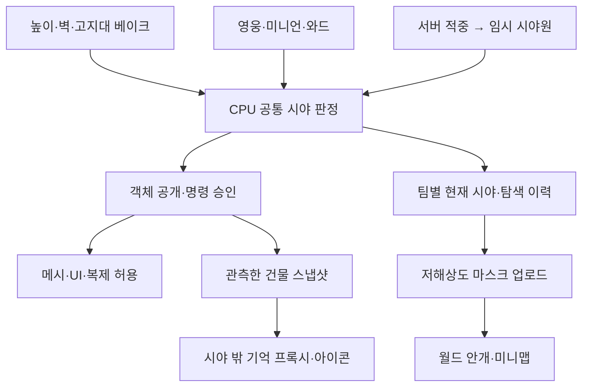

# 전장의 안개: 현재 웹 구현 분석과 Unreal Engine 구현 설계

**작성일:** 2026-11-16  
**문서 버전:** 1.0  
**분석 대상:** Nexus Front v6, 소스 커밋 `c24d8f42e4d2ddf81528b4463e296dcdf5e5bf43`  
**설계 대상:** UE 5 계열, 탑다운 MOBA, 2개 팀, 영웅·미니언·포탑·와드가 시야 제공  
**산출물 성격:** 기존 코드 분석, 구현 명세, 최적화·검증 계획. UE 프로젝트에서 컴파일하거나 성능을 실측한 결과는 아니다.

## 0. 권장안과 이번 문서의 요구사항

권장 구조는 **C++ 시야 관리 시스템 + 2.5D 높이 격자 + DDA 선분 검사 + 팀별 임시 시야원 + 저해상도 시야 텍스처**다. CPU가 유닛의 공개 여부와 공격 가능 여부를 결정하고, GPU는 이미 계산된 시야를 부드럽게 표현한다.

이번 설계는 다음 요구를 함께 만족하도록 구성한다.

1. 현재 웹 게임의 전장의 안개 동작을 설명한다.
2. 벽과 산등성이가 시야를 차단한다.
3. 높은 위치에서 낮은 담장 너머를 볼 수 있으며, 필요하면 높이와 무관하게 막는 절대 차폐벽을 지정한다.
4. 낮은 지형에서 높은 지형을 직접 볼 수 없도록 하는 MOBA식 고지대 규칙을 지원한다.
5. **언덕 위의 적에게 공격받으면 피격 팀이 공격 당시 위치를 일정 시간 확인한다.** 이 해석을 기본 규칙으로 삼는다.
6. 이전에 탐색한 고정 건물은 시야 밖에서도 마지막으로 관측한 상태를 표시한다.
7. **시야 밖의 건물 변화는 기억 데이터에 반영하지 않고, 다시 관측할 때 최신 상태로 갱신한다.**
8. 구현 초기에는 검증하기 쉬운 판정을 사용하고, 실제 병목이 확인되면 캐시·작업 병렬화·시야 계산 알고리즘을 확장한다.

### 권장 초기 구성

| 항목 | 초기 구성 | 선택 이유 |
|---|---|---|
| 게임 판정 | CPU, 공통 `CanTeamSeeActor` / `TraceHeightLOS` | AI·타기팅·서버 판정의 기준을 하나로 유지 |
| 차폐 데이터 | 지면 높이 + 불투명 차폐 높이 + 지형 단계 | 언덕·벽·고지대 규칙을 분리해 튜닝 |
| 정밀도 | 높이 격자는 약 50~100cm 셀부터 검토 | 얇은 벽·코너 오차에 맞춰 결정 |
| 지형 표시 마스크 | 팀별 128²부터 시작, 필요하면 256² | 높이 판정 격자와 표시 해상도를 독립적으로 선택 |
| 마스크 갱신 | 약 10Hz | 지면 표현 비용과 반응성의 초기 절충값 |
| 전투 대상 가시성 | 약 20Hz + 주요 사건 즉시 무효화 | 지면 표시보다 민감한 대상 공개를 우선 처리 |
| 지정 공격 승인 | 현재 상태에서 즉시 재판정 | 오래된 표시 마스크를 명령 승인에 사용하지 않음 |
| 언덕 공격 공개 | 피격 팀, 공격 원점 고정, 반경 250cm, 1.5초 | 위치 공개의 범위를 작고 명확하게 제한 |
| 고정 건물 기억 | 팀별 마지막 관측 스냅샷, 시간 만료 없음 | 안개 밖 건물 상태를 기억하되 숨은 변경은 반영하지 않음 |
| 렌더링 | CPU 마스크 업로드 + Post Process | 데스크톱 탑다운 화면에 적용하기 편함 |
| 모바일 HDR off | 공통 월드/지형 머티리얼에 마스크 적용 | 해당 렌더링 경로의 지원 범위에 맞춤 |

위 수치는 **제안하는 초기값**이다. 원작 LoL의 공식 수치나 현재 UE 성능 측정치가 아니다. 실제 시야 반경, 가장 얇은 벽, 이동 속도, 목표 장치에 따라 조정한다.

---

## 1. 현재 JavaScript 구현은 어떻게 동작하는가

### 1.1 게임 규칙과 화면 표현이 분리되어 있다

현재 구현의 핵심 함수는 다음 세 가지다.[W1][W2]

| 함수 | 역할 |
|---|---|
| `game.visibilityAt(x, y, team)` | 해당 월드 좌표가 팀의 원형 시야 안에 있는지 검사 |
| `game.isVisible(entity, team)` | 좌표 시야에 아군·구조물·수풀·노출 규칙을 더해 객체 공개 결정 |
| `renderer._updateFog(dt)` | 시야를 저해상도 이미지로 샘플링해 지형에 안개를 그림 |

80×80 안개 이미지가 공격 판정의 원본인 것은 아니다. 공격·AI·타기팅은 게임 규칙을 직접 조회하므로, 지면 안개 이미지가 다음 갱신을 기다리는 동안에도 타깃 판정은 현재 객체 위치로 수행될 수 있다.

### 1.2 기본 시야는 원의 합집합이다

살아 있는 아군 영웅, 미니언, 와드, 구조물이 시야를 제공한다. 중립 몬스터는 팀 시야 제공자에서 제외된다. 기지에는 별도의 고정 시야가 있다.[W1]

| 시야 제공자 | 반경: 웹 월드 단위 |
|---|---:|
| 팀 기지 위치 | 450, 개별 객체 생존 여부와 독립 |
| 와드 | 480 |
| 영웅 | 420 |
| 포탑 | 420 |
| 넥서스 | 450 |
| 억제기 | 270 |
| 미니언 등 일반 아군 객체 | 250 |

지도 크기는 1600×1600이다. 각 시야원에 대해 제곱거리 `dx² + dy² <= radius²`를 검사하고, 하나라도 만족하면 해당 지점이 보인다. **현재는 벽의 위치나 지형 높이를 이 함수에서 검사하지 않는다.** 이동을 막는 장애물이 있어도 그 뒤까지 원형 시야가 도달한다.[W1]

웹 단위를 UE의 cm로 그대로 옮기지 않는다. 예를 들어 웹 영웅 시야 420은 지도 폭의 약 26.25%다. 이를 새 지도에 그대로 비례 확대하면 격자 LOS 계산 범위도 매우 커질 수 있으므로, 실제 맵 크기와 교전 거리를 먼저 정해야 한다.

### 1.3 수풀과 공격 노출

적 영웅은 일반 시야 안에 있더라도 수풀에 있으면 숨는다. 아군 시야원 중 적에게 95 미만으로 접근한 객체가 있거나 같은 원형 수풀 안에 있는 객체가 있으면 공개한다. 이 수풀 규칙은 현재 적 영웅에게만 적용된다.[W1][W3]

공격·스킬은 공격자의 `revealedUntil`을 다음 값으로 재지정한다.

| 사건 | 지정하는 노출 종료 시각 |
|---|---|
| 실제 기본 공격 발사/근접 타격 | 현재 시각 + 1.5초 |
| 영웅이 피해를 가함 | 현재 시각 + 1.8초 |
| 와드 이외 스킬 시전 성공 | 현재 시각 + 1.2초 |

이 값은 현재 코드에서 `max`로 연장하는 방식이 아니라 직접 대입된다. 또한 `isVisible`은 **기본 팀 시야 검사 후** 노출 여부를 검사한다. 따라서 이 노출은 수풀 숨김을 건너뛰는 기능이다. 기본 시야 밖의 공격 위치를 새롭게 보여 주지는 않는다.

새 요구인 고지대 공격 위치 공개를 구현할 때는 이 필드만 늘려서는 부족하다. **팀별 공간 시야를 추가하는 별도 이벤트**가 필요하다.

### 1.4 안개 이미지, 탐색 이력, 미니맵

현재 정사각형 지도에서 80×80 이미지의 한 셀은 20×20 월드 단위다. 약 0.15초 간격으로 셀 중심의 `visibilityAt`을 검사한다. 이미지 갱신 시간은 렌더러 시간 누적에 따른 값이므로 엄밀한 고정 주파수 타이머로 표현하지 않는다.[W2]

| 셀 상태 | 안개 알파: 0~255 | 의미 |
|---|---:|---|
| 지금 보임 | 0 | 안개 제거 |
| 과거에 보았지만 지금 안 보임 | 134 | 탐색한 지형의 흔적 |
| 한 번도 탐색하지 않음 | 182 | 더 어둡게 표현 |

안개색은 RGB `(6,17,26)`이다. 미탐색 지역도 완전 불투명하지 않으므로 지형 윤곽은 일부 보인다. 적 유닛을 감추는 책임은 별도 객체 필터에 있다. 미니맵도 같은 안개 이미지를 쓰고, 유닛 아이콘은 `isVisible`로 다시 필터링한다.

현재 구조물은 적 소유라도 항상 공개된다. 구조물 기억 캐시가 있지만 정상 동작에서는 구조물 상태가 계속 최신값으로 갱신된다. 적 영웅의 마지막 위치를 일정 시간 남기는 기능은 구현되어 있지 않다.[W1][W2]

### 1.5 현재 구현에서 확장해야 할 부분

| 항목 | 현재 상태 | UE 설계에서의 처리 |
|---|---|---|
| 벽/언덕 차폐 | 없음 | 높이 격자와 LOS 추가 |
| 고지대 공격 위치 공개 | 없음 | 피격 팀의 임시 시야원 추가 |
| 수풀과 벽의 결합 | 벽 검사가 없음 | 동일 시야원이 거리·높이 LOS·수풀 조건을 함께 만족 |
| 탐색 이력 저장 | 새 경기·불러오기에서 `setGame()` 호출 시 초기화 | 게임 상태/저장 데이터로 이동 |
| 적 영웅 마지막 관측 | 없음 | 필요하면 관측 시점의 값 복사로 관리 |
| 고정 건물 상태 | 현재는 모든 구조물의 실시간 상태가 공개 | 관측 중 갱신, 시야 밖에서는 마지막 관측 상태 고정 |
| 일반 효과/피해 숫자 | 표시물 중심의 지면 시야 검사 | 객체 노출·피격 피드백·공개 이벤트 정책을 분리 |
| 관점 | 렌더러 팀 0 고정 | 관전자/로컬 플레이어의 팀별 Presenter |
| 숨은 정보의 서버 차단 | 로컬 게임이므로 없음 | 멀티 확장 시 연결별 복제 정책으로 제한 |

특히 현재 일반 피해 숫자는 수풀에서 숨은 영웅의 위치가 정상 지면 시야 안이면 표시될 조건을 충족할 수 있다. UE에서는 이런 피드백을 의도한 탐지 수단으로 허용할지, 피해를 준 사실만 알려 줄지 명시한다. 지면이 밝다는 이유만으로 모든 체력바·숫자·이펙트를 공개하지 않는다.[W1][W2]

---

## 2. 시야 시스템의 데이터와 판정 계약

### 2.1 최소한 분리해야 할 상태

| 상태 | 저장 내용 | 사용처 |
|---|---|---|
| `AreaVisibleNow[Team]` | 현재 영역 표본의 가시성 | 지형 안개·미니맵 바탕 |
| `Explored[Team]` | 과거 관측 여부 | 재방문 전 지형 기억 |
| `ActorVisibility[Team, Actor]` | 현재 객체 공개 여부와 판정 시점 | 메시·UI·AI 관측·복제 |
| `LastSeenSnapshot` | 마지막으로 본 위치·상태·서버 시각 | 선택적인 잔상/기억 UI |
| `FixedStructureKnowledge` | 고정 건물의 마지막 관측 상태 | 시야 밖 건물·체력·파괴 여부 표시 |
| `TemporaryVisionGrant` | 공개 팀·고정 원점·범위·종료 시각·정책 | 공격 위치 공개 및 스킬 시야 |

`Explored |= AreaVisibleNow`로 탐색 이력을 갱신한다. 탐색했다는 사실과 현재 적을 볼 수 있다는 사실은 서로 다른 값이다.

`LastSeenSnapshot`은 보이는 순간의 값을 복사한다. 숨겨진 Actor의 현재 Transform을 계속 참조하는 표식은 마지막 관측 정보가 아니다.

### 2.2 객체 공개와 공격 허용도 분리한다

`CanTeamSeeActor`는 관측 가능 여부다. `CanTargetActor`는 여기에 스킬 대상 유형, 공격 사거리, 아군/적군, 무적 등 해당 스킬의 조건을 더한다.

시야가 없는 지면에 논타깃 스킬을 발사하는 것은 별도 규칙으로 허용할 수 있다. 발사된 투사체의 충돌·피해 판정 역시 객체를 현재 볼 수 있는지와 분리한다. 유도 투사체가 시야 상실 후 계속 추적하는지는 스킬별 설정으로 둔다.

### 2.3 소스별 조건을 묶은 뒤 팀 전체로 합친다

일반 시야의 기준은 다음과 같다.

```text
NormalVisible(Team, Target) =
    any Source owned by Team where
        Source is active
        AND InRange(Source, Target)
        AND SameOrSupportedLayer(Source, Target)
        AND HighGroundPolicyAllows(Source, Target)
        AND HeightLOS(Source.SightPoint, Target.SightPoint)
        AND BrushPolicyAllows(Source, Target)
        AND DetectionPolicyAllows(Source, Target)
```

아군 A가 거리 조건을 만족하고, 멀리 떨어진 아군 B가 같은 수풀에 있다는 이유만으로 두 조건을 합쳐 공개하지 않는다. 같은 소스가 필요한 조건을 함께 만족하도록 만든다.

근거리 감지나 수풀 진입은 수풀 숨김을 완화할 수 있다. **이 예외가 벽까지 자동으로 무시하지 않도록 한다.**

---

## 3. 언덕과 벽을 표현하는 2.5D 높이 격자

### 3.1 셀 데이터

아래는 설계용 선언이며 완성된 UE 플러그인 코드는 아니다.

```cpp
struct FFogCell
{
    float GroundZ;       // 지면의 월드 Z
    float OpaqueTopZ;    // 지면/불투명 차폐물의 최대 높이
    uint16 BrushId;
    uint8 VisionTier;    // 0: 저지대, 1: 고지대 등 게임용 단계
    uint8 LayerId;       // 서로 겹치는 층을 지원할 경우 사용
    uint8 Flags;         // AbsoluteWall, AmbiguousBoundary 등
};
```

| 필드 | 의미 | 주의점 |
|---|---|---|
| `GroundZ` | 산등성이·절벽·경사면 높이 | 이동용 NavMesh 높이만으로 시야를 결정하지 않음 |
| `OpaqueTopZ` | 벽과 지형을 합친 불투명 기둥의 상단 | 아래쪽부터 이 높이까지 막힌다는 2.5D 근사 |
| `AbsoluteWall` | 어떤 눈높이에서도 시야 차단 | 일반적인 낮은 담장과 구분 |
| `VisionTier` | 고지대 관측 제한을 위한 논리 단계 | 카메라 높이나 점프 애니메이션으로 바뀌지 않음 |
| `BrushId` | 수풀 구역 | 벽과 별도 조건 |
| `LayerId` | 다리 위/아래 등의 구분 | ID만 추가한다고 다층 LOS가 완성되는 것은 아님 |
| `AmbiguousBoundary` | 한 셀 안의 얇은 벽·큰 높이 변화 | 세분화 또는 실제 충돌 검사 대상 |

첫 구현에서는 float 배열과 명시적 필드가 디버깅에 편하다. 메모리 병목이 확인된 뒤 높이 양자화, 배열 분리, 비트 패킹을 적용한다. 높이 양자화 단위와 허용 오차는 서버·클라이언트·베이크에서 일치시킨다.

### 3.2 에디터 제작 흐름

1. `AFogBoundsVolume`으로 월드 원점·지도 범위·격자 크기를 지정한다.
2. Landscape 또는 지정된 지면 충돌에서 `GroundZ`를 베이크한다.
3. 벽·바위에 `UFogOccluderComponent` 또는 `AFogOccluderVolume`을 배치한다.
4. 차폐물을 높이 격자에 보수적으로 래스터화하고 `OpaqueTopZ`를 갱신한다.
5. `AFogHighGroundVolume`으로 고지대 단계와 경계 정책을 지정한다.
6. 수풀 구역, 예외 통로, 다층 구역을 별도 데이터로 작성한다.
7. 베이크 결과와 `MapRevision`을 `UFogMapDataAsset`에 저장한다.

경사진 Landscape를 단순 셀 중심 한 점으로만 읽으면 셀 내부의 높은 부분을 놓칠 수 있다. 코너·중심 표본의 최대 높이를 쓰는 보수적 방식부터 시작하고, 오차가 큰 경계만 세분화하거나 실제 충돌로 보정한다. 이 방식은 틈새 노출을 줄이는 대신 벽 근처를 실제보다 더 가릴 수 있다.

실시간 문·파괴벽은 정적 베이크 위에 동적 차폐 데이터를 합성한다. 문이 열릴 때 해당 셀만 밝히는 방식은 부족하다. 문 뒤쪽의 시야도 바뀌므로 영향을 받는 시야원의 캐시를 무효화한다.

### 3.3 전용 충돌 채널

`VisionTrace`를 별도 Trace Channel로 만들고, 지형·시야 차폐물은 Block, 일반 유닛·장식·이펙트는 기본 Ignore로 설정한다. UE는 프로젝트 설정에서 사용자 정의 trace channel과 응답을 추가할 수 있다.[E1]

이동 충돌, 카메라 충돌, 공격 충돌, 시야 차폐는 같은 뜻이 아니다. 유리가 이동은 막되 시야는 통과시키거나, 마법 장벽이 보행은 허용하되 시야는 막는 경우를 설정으로 표현할 수 있어야 한다.

---

## 4. 높이 LOS: 언덕과 벽 차폐의 공통 판정

### 4.1 시선의 시작과 끝

관측점과 대상 표본을 다음과 같이 둔다.

\[
S=(S_x,S_y,S_z),\qquad T=(T_x,T_y,T_z)
\]

- `S.z`: 유닛의 안정적인 시야 기준점. 보통 지면/캡슐 기준 + `EyeHeight`.
- `T.z`: 대상의 `SightSampleHeight` 또는 지정된 감지 포인트.
- 지형 마스크: 셀의 지면 높이 + 해당 마스크가 대표하는 표본 높이.
- 초기 객체 판정: 애니메이션 뼈 대신 일정한 몸통 표본 하나로 시작한다.

지형 표본을 실제 바닥에 가깝게 두면 낮은 벽 뒤 캐릭터 상체만 보이는 상황이 생길 수 있다. MOBA식 단순화를 원하면 마스크도 기본 유닛의 대표 높이를 사용한다. 그 경우 마스크는 ‘그 셀의 대표적인 대상을 관측할 수 있는가’를 뜻한다. 어떤 표본 정책을 선택했는지 데이터에 고정한다.

표시 마스크와 캐릭터 표본 높이가 다를 수 있으므로, 마스크의 0을 모든 객체에 대한 최종 비가시 판정으로 쓰지 않는다.

### 4.2 DDA로 통과 셀만 방문한다

시선의 높이는 선분 매개변수로 계산한다.

\[
z(t)=S_z+t(T_z-S_z),\quad 0\le t\le1
\]

XY 평면에서 DDA로 선분이 지나가는 셀과 진입·이탈 구간을 구한다. 격자 경계를 차례로 통과하는 기본 아이디어는 Amanatides와 Woo의 격자 순회 알고리즘을 참고할 수 있다. 여기서 설명하는 높이·게임 규칙 결합은 본 프로젝트를 위한 설계다.[A1]

셀의 진입/이탈 시점이 `tEnter`, `tExit`일 때:

\[
z_{min}=\min(z(tEnter),z(tExit))
\]

아래 조건이면 해당 셀에서 시야가 막힌다.

```text
AbsoluteWall
OR zMin <= OpaqueTopZ + HeightEpsilon
```

이 검사는 셀 전체가 아래쪽부터 `OpaqueTopZ`까지 막힌 수직 기둥이라는 근사에서 성립한다. 수평 셀 안에서 높이가 크게 달라지는 곳은 세분화/정밀 보정 대상으로 다룬다. 소스와 대상이 실제 차폐물 내부에 있지 않도록 설치·이동 규칙도 검증한다.

### 4.3 예시

| 상황 | 수치 예 | 결과 |
|---|---|---|
| 평지의 벽 | 눈 Z=2m, 대상 Z=2m, 중간 벽 상단 3m | 벽에서 차단 |
| 언덕에서 낮은 담장 너머 | 눈 Z=6m, 대상 Z=2m, 중간 지점 t=0.5에서 선 높이 4m, 담장 3m | 그 셀은 통과, 나머지 셀도 검사 |
| 낮은 곳에서 산등성이 뒤쪽 | 눈/대상 Z=2m, 중간 지면 높이 4m | 지형 자체가 차단 |
| 고지대 앞의 절대 차폐벽 | 시선이 벽의 시각적 높이를 넘더라도 `AbsoluteWall` | 차단 |

높은 곳에 있다는 이유로 모든 벽을 무시하지 않는다. 시선이 각 차폐물의 상단을 실제로 통과하는지 확인한다.

### 4.4 고지대의 게임 규칙

물리적 LOS만으로는 ‘저지대에서는 고지대를 볼 수 없다’는 비대칭 규칙이 보장되지 않는다. 고지대 가장자리의 대상은 지형을 통과하지 않는 시선으로 보일 수 있다.

이번 설계의 기본 고지대 규칙은 다음과 같다.

```text
NormalSource:
    Source.VisionTier >= Target.VisionTier 이면 고지대 조건 통과
    낮은 단계에서 높은 단계로는 일반 시야를 제공하지 않음

SpecialSource:
    명시적으로 허용된 고지대 관측 스킬/임시 공개 원점만 예외
```

같은 팀이 고지대에 와드를 설치하면 그 와드가 정상 시야원이 된다. 언덕 위 영웅이 아래쪽을 볼 때에도 거리·벽·산등성이·수풀 검사를 통과해야 한다. 경사로에서는 지정한 단계 경계를 넘을 때 Tier를 갱신하며, 작은 높이 변화마다 단계가 튀지 않게 레벨 데이터로 작성한다.

`HeightEpsilon`은 수치 경계용이다. 보이지 않는 적을 일정 시간 계속 보여 주는 관측 유예시간과 혼동하지 않는다.

### 4.5 코너·얇은 벽·다층 구조

**대각선 코너:** 셀 모서리를 정확히 통과할 때 양쪽 접촉 셀을 함께 검사하는 supercover 정책을 사용한다. 단순히 대각선 셀로 건너뛰면 서로 맞닿은 두 벽 사이로 시야가 샐 수 있다. 코너를 열어 둘지 닫을지는 판정 함수 전체에서 통일한다.

**얇은 벽:** 높이 격자보다 얇은 벽은 보수적으로 셀을 막거나 별도의 선분/다각형 차폐 데이터를 둔다. 공격 대상처럼 중요한 판정은 `AmbiguousBoundary`에서 `VisionTrace`로 확인할 수 있다. 일반 Line Trace는 지정 채널에서 처음 만나는 blocking hit를 돌려주는 방식으로 사용할 수 있다.[E2]

**시작/끝 셀:** 시작 셀과 끝 셀을 무조건 통째로 생략하지 않는다. 그러면 같은 셀 안에 있는 얇은 벽을 건너뛸 수 있다. 자기 Actor는 trace에서 제외하되, 그 셀의 별도 벽은 유지한다. 셀 근사 때문에 시작점이 차폐 내부로 판단되는 경우 정밀 검사를 사용한다.

**다리/동굴:** 단일 XY 높이 기둥은 위층 바닥 아래의 빈 공간을 표현하지 못한다. 다층 맵은 층별 격자·층간 연결 규칙·층별 마스크, 또는 해당 구역의 실제 3D trace를 추가해야 한다. 첫 구현 범위는 단일 주행 표면의 언덕과 벽으로 잡으면 제작 부담이 낮다.

---

## 5. 언덕 위 공격자의 위치를 일시적으로 공개하는 규칙

### 5.1 확정한 기본 동작

> 고지대의 적이 저지대 아군 전투 대상에게 유효한 공격을 적중시키면, **피격 팀 전체에 공격 당시 위치 주변을 1.5초간 공개한다.** 공개 원점은 고정되며, 숨은 공격자의 이후 이동을 따라가지 않는다.

이는 사용자의 추가 요구에 맞춘 제안 규칙이다. 원작의 정확한 공개 시간·범위를 인용한 값은 아니다.

| 항목 | 기본 정책 |
|---|---|
| 공개받는 팀 | 피해를 받은 대상의 팀 |
| 피격 대상 범위 | 팀이 있는 영웅·미니언·건물. 특수 대상은 데이터로 지정 |
| 발생 조건 | 적의 고지대 공격이 HP 피해 또는 보호막 흡수를 실제 발생시킴 |
| 고지대 판단 | 공격 원점의 발사 당시 Tier가 피격 대상의 적중 당시 Tier보다 높음 |
| 공개 시작 | 서버가 유효 적중을 확정한 시각 |
| 공개 종료 | 시작 + 1.5초 |
| 공개 중심 | 공격/투사체 생성 시 기록한 유효 공격 원점 |
| 공개 반경 | 250cm |
| 공격자 이동 | 공개 중심은 움직이지 않음 |
| 벽 적용 | 원점에서 공개 영역 내부로 향하는 시선에는 벽·높이 차폐 적용 |
| 수풀 | 해당 공격자만 제한적으로 수풀 숨김 예외; 다른 적은 기존 규칙 |
| 강한 은신/투명 | 별도 탐지 정책 유지; 공격 위치 공개가 자동으로 모든 은신을 해제하지 않음 |
| 미탐색 지역 | 현재 공개와 함께 탐색 이력에 기록 |
| 종료 후 | 다른 시야원이 없으면 안개 복구, 현재 적 아이콘 제거 |

### 5.2 어디까지 예외로 여는가

피격 팀은 원래 저지대에 있기 때문에 공격 원점으로의 정상 LOS나 고지대 조건을 만족하지 못할 수 있다. 이 사건은 **그 원점에 한정된 임시 시야원에 대한 권한을 부여**한다.

이를 위해 피격자에서 원점까지 다시 정상 시야가 있어야 한다고 요구하지 않는다. 그러면 원하는 공개가 발생하지 않는다. 대신 원점에서 주변으로 퍼지는 시야에는 지역 차폐를 적용한다.

```text
피격팀 → 공개 원점: 서버 적중 사건으로 관측 권한 부여
공개 원점 → 주변 셀/객체: 반경 + 층 + 높이 LOS + 절대벽 검사
```

따라서 작은 공개 원이 언덕 위에 생기되, 바로 옆 벽 뒤나 다른 층까지 통째로 드러나지는 않는다. 공개 원점의 Tier보다 더 높은 다른 고지대에는 기본 Tier 규칙을 유지한다.

공격자가 공개 범위 안에 남아 있고 원점으로부터 LOS가 통과하면 볼 수 있다. 이미 범위 밖으로 이동했다면 공격 발생 위치만 보이고 공격자 현재 위치는 공개하지 않는다. 고지대에 있던 다른 적은 공개 영역과 해당 적의 수풀/은신 조건을 모두 만족할 때만 보인다.

### 5.3 공격 원점은 발사 시 기록한다

```cpp
struct FAttackVisionContext
{
    uint64 AttackId;
    uint32 SourceEntityId;
    uint8 SourceTeam;
    FVector RevealOrigin;   // 유효한 시야 원점, 발사 시 복사
    uint8 OriginTier;
    uint8 OriginLayer;
    double LaunchServerTime;
    bool bRevealOnHighGroundHit;
};

struct FTemporaryVisionGrant
{
    uint64 GrantId;
    uint8 BeneficiaryTeam;
    FVector FixedOrigin;
    float RadiusCm;
    double ExpireServerTime;
    uint32 BrushBypassSourceId; // 다른 적에게 수풀 예외를 전파하지 않음
    uint8 OriginTier;
    uint8 OriginLayer;
    uint32 PolicyId;
};
```

실제 공격이 함정·소환물에서 나왔다면 해당 발생원의 원점을 사용한다. 멀리 떨어진 소유 영웅의 현재 위치로 바꾸지 않는다. 투사체 적중점은 피격 위치이므로 공개 원점으로 사용하지 않는다.

긴 비행시간을 가진 투사체는 적중 시점에 과거 발사 위치를 공개한다. 공격자가 이미 떠났다면 빈 지형이 잠시 드러나는 것이 이 규칙의 의도된 결과다.

### 5.4 사건 처리 의사코드

```text
OnConfirmedHostileHit(Context, Victim, Outcome):
    if Victim has no beneficiary team or is not an eligible combat target: return
    if Context.SourceTeam == Victim.Team: return
    if not Outcome.HasHpDamageOrShieldAbsorption: return
    if not Outcome.bFirstEffectiveHitForVictim: return
    if not Context.bRevealOnHighGroundHit: return
    if Context.OriginTier <= Victim.CurrentVisionTier: return
    if SeenAttackTeamPair(Context.AttackId, Victim.Team): return

    MarkAttackTeamPairUntilAttackLifecycleEnds(...)
    Grant = MakeGrant(
        Team = Victim.Team,
        Origin = Context.RevealOrigin,
        Tier = Context.OriginTier,
        Layer = Context.OriginLayer,
        Radius = 250cm,
        Expire = ServerNow + 1.5sec,
        BrushBypassSource = Context.SourceEntityId)

    InsertOrMergeExactlyEquivalentGrant(Grant)
    InvalidateRelevantActorVisibilityImmediately()
    RequestUrgentAreaMaskRefresh(Grant.Bounds)
    ReplicateAuthorizedGrantToBeneficiaryTeam()
```

코드는 기본 최초 적중 정책을 설명하기 위한 의사코드다. 피해 처리 시스템의 실제 구조에 맞춰 서버 authority와 이벤트 순서를 연결한다. `bFirstEffectiveHitForVictim`은 피해 시스템이 공격 ID와 피격 대상 기준으로 판정하며, grant 생성 성공 여부로 유추하지 않는다. 최초 적중이 같은 높이에서 발생한 뒤 DoT 도중 저지대로 이동해도 후속 틱이 최초 적중으로 바뀌지 않는다.

### 5.5 반복 공격·광역 공격·지속 피해

- **새 공격:** 같은 원점·층·정책·공격자 예외가 정확히 일치하는 grant는 `Expire = max(기존 종료, 현재 + 지속시간)`으로 갱신할 수 있다.
- **같은 공격의 중복 통지:** 지속시간도 다시 늘리지 않는다.
- **광역 공격:** 같은 공격이 같은 팀의 여러 대상에게 맞아도 팀당 한 번만 공개한다.
- **지속 피해:** 기본은 최초 유효 적중 한 번이다. 틱마다 공개를 연장하려면 해당 스킬의 명시적 옵션과 틱별 공개 사건 ID를 사용한다. 이 경우 위 기본 의사코드의 최초 적중 제한과 중복 키를 해당 정책에 맞춰 바꾼다.
- **이동하며 재공격:** 원점이 달라지면 별도 사건으로 처리한다. 기존 grant를 새 위치로 이동시키지 않는다.
- **공격자 사망/투사체 소멸:** 이미 생성된 위치 공개는 정해진 종료 시각까지 유지한다.
- **피격자 사망:** 같은 팀이 계속 공개 정보를 공유하며, 사망 때문에 남은 시간이 사라지지 않는다.
- **빗나감·완전 무적·0 피해:** 기본 정책에서는 공개 사건이 생기지 않는다.

중복 제거 기록은 공개 시간보다 오래 살아야 한다. 같은 `AttackId`의 후속 타격이 1.5초 뒤 도착해도 다시 최초 적중으로 취급하지 않도록 공격/DoT 생명주기 동안 `AttackId + BeneficiaryTeam`을 유지한다.

같은 셀에 있다는 이유만으로 서로 다른 원점을 병합하지 않는다. 셀 중심으로 원점을 양자화한다면 그것이 실제 게임 규칙이 된다는 점을 명시해야 한다. 초기에는 정확히 같은 grant만 병합하는 편이 단순하다.

### 5.6 일반 공개와의 결합

```text
CanTeamSeeActor(Team, Target) =
    AlwaysKnownPolicy(Team, Target)
    OR NormalVisible(Team, Target)
    OR any unexpired TeamGrant where
        InGrantRadius(Target.CurrentPosition)
        AND GrantLayerAndTierPolicyAllows(Target)
        AND HeightLOS(Grant.FixedOrigin, Target.SightPoint)
        AND BrushPolicyWithScopedAttackerException(Target)
        AND DetectionPolicyAllows(Target)
```

유효한 일반 시야가 남아 있다면 grant가 끝나도 계속 보인다. 반대로 grant만으로 보이던 적은 종료 시 즉시 객체 공개를 제거한다. 화면 안개가 천천히 복구되는 효과를 사용해도 적 메시·체력바·미니맵 위치의 공개 시간을 함께 늘리지 않는다.

---

## 6. 고정 건물: 마지막 관측 상태를 보존하는 기억 시스템

### 6.1 확정 규칙

**고정 건물의 기억 데이터는 현재 팀 시야로 관측할 때만 갱신한다.** 시야 밖에서 피해·수리·업그레이드·파괴·재건이 발생해도 마지막으로 확인한 상태를 유지한다. 다시 현재 시야가 확보되면 최신 상태로 교체한다.

이 규칙에서 ‘탐색 시 갱신’은 그 지형의 `Explored` 값이 이미 1인 상태를 뜻하지 않는다. **해당 건물/건물 자리의 현재 관측이 성립하는 시점**을 뜻한다. 과거에 지형을 탐색했다는 이유로 숨은 건물을 계속 동기화하지 않는다.

| 상황 | 플레이어에게 표시할 상태 | 기억 데이터 변경 |
|---|---|---|
| 아직 한 번도 관측하지 않음 | 건물의 구체적인 상태 미표시 | 없음 |
| 현재 관측 중 | 현재 건물 모습·체력·상태 | 관측 가능한 현재 값으로 갱신 |
| 시야를 잃음 | 마지막 관측 모습·체력·상태 | 동결 |
| 시야 밖에서 피해/수리 | 이전 HP 그대로 | 없음 |
| 시야 밖에서 파괴 | 마지막으로 본 생존 건물 그대로 | 없음 |
| 시야 밖에서 업그레이드 | 마지막으로 본 단계 그대로 | 없음 |
| 시야 밖에서 재건 | 마지막으로 본 파괴/빈자리 상태 그대로 | 없음 |
| 해당 자리를 다시 관측 | 실제 현재 생존/파괴/재건 상태 | 즉시 최신 스냅샷으로 교체 |

파괴 알림·원격 피해 사건·서버의 실제 Actor 제거도 이 기억 데이터를 갱신하는 우회 경로로 사용하지 않는다. **유일한 갱신 조건은 현재 관측 가능 여부**다.

### 6.2 관측 상태와 생존 상태를 별도로 저장한다

`Unknown / Observed / Remembered`는 관측 상태다. `Alive / Destroyed / Empty / UnderConstruction` 등은 마지막으로 관측한 건물 상태다. 둘을 하나의 enum에 섞지 않는다.

```cpp
struct FKnownStructureSnapshot
{
    FGuid StructureSlotId;        // 맵에서 지속되는 고정 자리 ID
    uint32 ObservedIncarnation;  // 마지막으로 본 재건 세대
    uint32 BuildingTypeId;
    FTransform LastObservedTransform;
    float LastObservedHp;
    float LastObservedMaxHp;
    uint8 LastObservedLifeState;
    uint8 LastObservedUpgradeLevel;
    uint8 LastObservedTeam;
    double LastObservedServerTime;
    uint32 ObservationRevision;
    bool bEverObserved;
};
```

관측하지 않은 건물은 `Unknown`이고 상태 스냅샷이 없다. 한번 확인한 건물은 시야를 잃어도 시간만으로 기억이 사라지지 않는다. 정적 지형이 이미 알려진 지도라도 건물의 생존·체력·업그레이드 정보는 이 관측 규칙을 따른다.

### 6.3 마지막 관측값을 갱신하는 위치

```text
For each relevant StructureSlot:
    if CanTeamObserveStructureSlotNow(Team, Slot):
        Current = AuthoritativeStructureRegistry.ReadState(Slot.Id)
        Knowledge[Team, Slot.Id] = CopyPermittedObservedState(Current)
        Knowledge.LastObservedServerTime = ServerNow
        Knowledge.ObservationRevision += 1 when visible state changes
        PresentationState = Observed
    else if Knowledge[Team, Slot.Id].bEverObserved:
        PresentationState = Remembered
        // 실제 건물의 HP, 파괴 여부, 재건 상태를 읽어서 복사하지 않음
    else:
        PresentationState = Unknown
```

시야를 잃는 순간에 숨은 실제 객체를 한 번 더 읽어 ‘마지막 값’을 만드는 방식도 피한다. **마지막으로 관측이 유효했던 갱신에서 저장한 값**을 그대로 동결한다. 이벤트 순서가 엇갈려 시야 상실 직후 피해나 파괴가 기억에 섞이지 않도록 한다.

건물 상태를 복사하기 직전에 현재 논리 시점의 관측 여부를 확인한다. 이전 10Hz 마스크나 오래된 객체 공개 캐시만으로 갱신을 승인하지 않는다. 필요하면 해당 고정 관측점에만 즉시 LOS를 수행한다.

공개 원점의 임시 시야가 건물 자리까지 유효하게 도달하면 그것도 현재 관측이다. 그때 상태를 갱신하고, 임시 시야가 끝나면 그 상태를 다시 동결한다.

### 6.4 파괴된 건물도 재탐색으로 갱신되어야 한다

실제 건물이 파괴되어 Actor가 제거되었다면 살아 있는 Actor 목록만 검사해서는 재관측을 알아낼 수 없다. 그래서 맵에 지속되는 **`StructureSlotId`와 건물 자리 레지스트리**를 둔다.

레지스트리는 건물의 자리와 현재 `Alive/Destroyed/Empty` 상태를 유지한다. 해당 자리의 고정 관측점 또는 정의한 footprint 표본이 다시 보이면, 살아 있는 Actor가 없어도 파괴/빈자리 스냅샷으로 교체한다. 같은 자리에 재건되면 논리 자리 ID는 유지하고 실제 건물 세대만 증가시킨다.

건물 자체를 시야 차폐물로 사용할 경우 자기 벽이 자기 관측점을 가리는 문제를 별도로 처리한다. 건물 표면의 대표 표본이나 대상 자체의 첫 충돌을 관측 성공으로 인정하는 정밀 규칙을 사용하고, 중간의 다른 벽을 통째로 생략하지 않는다.

### 6.5 본 화면·체력 UI·미니맵은 같은 스냅샷을 읽는다

| 요소 | 현재 관측 중 | 기억 상태 |
|---|---|---|
| 월드 건물 | 현재 실제 표현 | 마지막 관측 스냅샷의 정적 프록시 |
| 체력 표시 | 현재 HP/MaxHP | 마지막 HP/MaxHP + 마지막 관측 표시 |
| 업그레이드/파괴 모습 | 현재 상태 | 마지막 관측 단계/잔해 상태 |
| 미니맵 | 현재 아이콘 | 기억 아이콘, 관측 당시 생존/파괴 상태 유지 |
| 툴팁 | 현재 정보 | 마지막 관측 시각과 관측 당시 정보 |

기억 프록시는 `LastObservedTransform`과 `BuildingTypeId`로 만들며, 숨은 실제 Actor·컴포넌트·체력 모델에 바인딩하지 않는다. 실제 건물이 시야 밖에서 파괴되어도 프록시가 자동으로 사라지지 않도록 소유 관계를 분리한다. 반대로 다시 관측하면 프록시와 실제 건물이 동시에 그려지지 않게 전환한다.

프록시는 충돌·공격·시야 제공·복제 Actor 기능을 갖지 않는 표현용 객체로 둔다. 관측 이후 맵 그림자·발광·동적 재질이 실제 숨은 건물의 변경을 따라오지 않게 캐시한 표시 상태만 사용한다.

UE의 Post Process 안개가 기억 프록시를 완전히 덮으면 요구사항을 만족하지 못한다. Post Process 경로에서는 기억 프록시의 실제 표면 픽셀에 한해 안개 합성 강도를 제한하거나, 정상적인 depth test를 갖는 별도 패스에서 안개 이후에 합성한다. 전용 머티리얼의 밝기나 Emissive만 높여서는 불투명한 최종 안개 합성을 통과할 수 없다.

Custom Stencil을 사용한다면 SceneDepth와 CustomDepth를 같은 깊이 공간에서 비교해 가림을 함께 검사한다. 프록시가 지형 뒤에 있어도 Stencil만으로 예외 처리하면 앞쪽 지형의 안개를 잘못 풀 수 있다. 이 예외는 **현재 화면에서 실제로 보이는 기억 프록시 표면에만 적용**하며 숨은 실제 건물/적 유닛이나 앞쪽 물체를 함께 통과시키지 않는다. 지형/월드 머티리얼 통합 경로에서는 프록시 전용 머티리얼로 기억 명도를 유지한다. 미니맵 기억 아이콘은 안개 바탕 위에 합성한다.

### 6.6 기억은 현재 타깃을 보았다는 증거가 아니다

기억 건물 클릭은 마지막 정보 확인이나 해당 위치 이동에 사용할 수 있다. 실제 Actor의 지정 공격은 현재 시야·존재·생존·사거리 등 정상 조건을 다시 검사한다. 스킬이 지면 공격을 허용한다면 기억 위치를 향해 발사할 수 있지만, 그것만으로 숨은 건물의 실제 HP나 파괴 상태를 UI에 갱신하지 않는다.

현재 웹의 `isStructure(entity) → true` 조기 반환은 이 요구를 만족하는 기준으로 사용할 수 없다. UE에서는 **현재 건물 관측 판정**과 **기억 프록시 표시 판정**을 분리한다. ‘과거에 보았다’는 사실을 `CanTeamSeeActor=true`로 표현하지 않는다.

### 6.7 저장·복원

팀별 `FixedStructureKnowledge`를 `MapId`, `MapRevision`, 스키마 버전과 함께 저장한다. 재개 시 먼저 마지막 스냅샷을 복원하고 현재 시야를 재계산한다. 현재 보이는 건물만 최신값으로 갱신하고, 시야 밖 건물은 저장된 마지막 상태를 유지한다. 저장 파일에 서버의 실제 건물 상태도 들어 있더라도 그것을 기억 데이터에 일괄 복사하지 않는다.

---

## 7. Unreal 클래스 구성과 책임

| 구성 요소 | 책임 | 구현 형태 권고 |
|---|---|---|
| `UFogOfWarSubsystem` | 시야원 등록, 판정, 팀 상태, 주기 관리 | `UWorldSubsystem` 기반 C++ |
| `UFogVisionSourceComponent` | 팀·반경·눈높이·활성 상태 제공 | Tick 없는 컴포넌트, 등록/해제 이벤트 |
| `UFogVisibilityTargetComponent` | 대상 표본·수풀·은신·공개 정책 | C++, Blueprint로 설정 가능 |
| `UFogMapDataAsset` | 베이크한 높이·차폐·Tier·수풀 정보 | 에디터 제작 데이터 |
| `AFogOccluderVolume` | 정적/동적 벽과 절대 차폐 작성 | 레벨 디자이너용 액터 |
| `AFogHighGroundVolume` | 고지대 단계·경계 지정 | 레벨 디자이너용 액터 |
| `DamageVisionBridge` | 유효 적중 → 팀별 임시 시야 사건 | 기존 피해 시스템의 이벤트 수신 |
| `FixedStructureKnowledge` | 팀별 마지막 건물 관측값과 표시 모드 | 실제 건물 상태와 분리한 값 데이터 |
| `StructureSlotRegistry` | 파괴·재건 후에도 지속되는 고정 자리 | 서버/로컬 권한 월드의 논리 레지스트리 |
| `FFogVisibilitySolver` | 순수 값 데이터로 높이 LOS와 영역 계산 | UObject 없는 C++ 계산 계층 |
| `UFogLocalPresenter` | 관측 팀의 텍스처·메시·UI 표시 | 로컬 플레이어 단위 구성 |
| `TeamVisionReplication` | 팀별 정보 공개와 복제 필터 연결 | 멀티플레이 확장 시 추가 |



Blueprint에는 시야 반경·고지대 예외·공개 지속시간·안개 색·디버그 옵션을 노출한다. 셀 순회·DDA·캐시·버퍼 업로드는 C++에 둔다. 이렇게 하면 디자이너가 튜닝하면서도 대량 반복문을 Blueprint에 작성하지 않아도 된다.

각 영웅이 별도 Tick에서 주변 전체를 검색하는 구조는 피한다. 컴포넌트의 등록/해제와 중요한 상태 변경을 관리자가 받아 일괄 처리한다.

## 8. 갱신 주기와 비동기 작업

### 8.1 갱신 순서

권장 순서는 이동·피해 확정 이후 시야 변경을 처리하고, 그 결과로 공개/복제 대상을 갱신하는 것이다. 지정 공격은 실제 발사 또는 승인 시점의 정책에 맞춰 현재 시야를 한 번 더 검사한다.

| 작업 | 시작 주기/사건 | 목적 |
|---|---|---|
| 지형 마스크 | 약 10Hz | 지면 안개 표현 |
| 전투 영웅 공개 | 약 20Hz + 위치/Tier/차폐 변경 | 전투 반응성 |
| 비전투 미니언 등 | 약 5~10Hz부터 측정 | 객체 수 증가 대응 |
| 지정 공격 승인 | 해당 명령 처리 시 | 최신 정보로 허용/거절 |
| 와드 생성/파괴·벽 개폐 | 즉시 관련 캐시 무효화 | 오래된 시야 방지 |
| 고지대 공격 공개 생성/만료 | 즉시 Actor 상태 갱신 요청 | 약속한 공개 시간 유지 |
| 고정 건물 상태 | 현재 관측이 유효할 때만 | 시야 밖 변경을 기억에 반영하지 않음 |
| 화면 보간 | 렌더 프레임마다 | 지면 경계의 거친 이동 완화 |

10Hz는 계산 시작 간격의 초기값이다. 실제 지연에는 작업 시간·프레임 적용·네트워크 지연도 더해지므로 ‘최대 100ms’라고 보장하지 않는다.

### 8.2 첫 구현은 동기, 병목을 확인한 뒤 작업 분리

단위 테스트 가능한 동기 C++ 판정부터 완성한다. 이후 영역 마스크 계산을 worker로 옮기되, 즉시 필요한 명령 판정은 별도 빠른 질의로 유지한다.

1. 게임 스레드가 현재 시야원·높이 데이터 revision·팀·grant를 값으로 복사한다.
2. worker는 불변 입력과 전용 출력 버퍼만 사용한다.
3. 완료 결과에 `SessionEpoch`, `MapRevision`, `Generation`, `SnapshotTime`을 함께 돌려준다.
4. 게임 스레드에서 유효성을 확인한 뒤 결과를 일괄 교체한다.
5. 작업이 밀리면 대기 요청을 무한히 쌓지 않고 가장 최신 요청으로 합친다.

게임 스레드가 소유한 Actor/UObject 상태를 다른 스레드가 직접 읽으면 race와 GC 수명 문제가 생길 수 있다는 점이 Epic의 스레드 렌더링 문서에 명시되어 있다. 같은 원칙에 따라 worker는 Actor 포인터 대신 복사한 수치 데이터를 사용한다.[E3]

### 8.3 오래된 결과가 시야를 되살리지 않게 한다

- 맵/세션이 바뀐 결과는 폐기한다.
- 이미 적용한 generation보다 오래된 결과는 적용하지 않는다.
- 벽 생성·와드 제거·grant 만료처럼 공개를 제거하는 사건은 해당 결과를 무효화한다.
- grant가 작업 시작 때는 유효했더라도 적용 시점에 만료되었다면 그 기여를 현재 시야에 다시 더하지 않는다.
- 간단한 구현에서는 중요한 revision이 달라진 결과를 버리고 우선 재계산한다.
- 이벤트가 매우 잦아 전체 결과가 계속 폐기된다면, 타일별 revision 또는 일반 시야/임시 시야의 별도 버퍼로 확장한다.

탐색 이력은 과거에 실제로 유효했던 관측을 남길 수 있지만, 현재 시야는 현재 정책을 따라야 한다. 두 상태의 적용 규칙을 하나로 섞지 않는다.

여러 worker가 같은 `uint8` 셀에 동시에 1을 쓰는 것도 C++에서는 동시 쓰기 문제다. 팀별 작업, 겹치지 않는 타일, 작업별 임시 마스크 후 OR 병합 중 하나로 쓰기 소유권을 정한다.

---

## 9. 시야 텍스처와 화면 표현

### 9.1 CPU 결과를 작은 텍스처로 전달한다

범용 초기 구현은 8비트 4채널 텍스처 한 장을 사용한다.

| 셰이더 채널 | 내용 |
|---|---|
| R | 현재 영역 시야: 일반 시야와 임시 시야의 합집합 |
| G | 탐색 이력 |
| B | 선택 사항: 임시 공개 영역 강조 또는 디버그 |
| A | 예약값, 초기에는 255 |

마스크는 색상 사진이 아닌 데이터이므로 `SRGB=false`, 주소 Clamp, 초기에는 자동 mip 없이 사용한다. 채널 수가 적은 포맷은 목표 RHI에서 생성·갱신·샘플링 지원을 확인한 뒤 선택한다. `PF_B8G8R8A8`를 선택했다면 CPU 메모리의 BGRA 순서와 셰이더의 RGBA 의미를 혼동하지 않는다.

현재 관측 팀의 마스크만 해당 클라이언트에 업로드한다. 서버가 양 팀 논리를 계산한다고 클라이언트 GPU에도 양 팀 마스크가 모두 필요하지는 않다. 관전자와 분할 화면은 별도 관점별 리소스로 처리한다.

### 9.2 `UpdateTextureRegions`의 수명 관리

`UTexture2D::UpdateTextureRegions`는 영역을 비동기로 갱신하며, `SrcPitch`는 행의 바이트 간격, `SrcBpp`는 픽셀당 바이트 수다. `DataCleanupFunc`는 갱신 후 소스 데이터와 영역 정보를 정리하는 콜백이다.[E4]

다음은 **리소스 생성·종료 처리가 완료되었다는 전제의 설명용 코드 단편**이다. 사용 UE 버전에서 실제 시그니처·포맷·리소스 수명을 확인해 통합해야 한다.

```cpp
// Game Thread. Texture는 유효하며 소유자가 UPROPERTY 등으로 수명을 보장한다.
// Pixels는 new uint8[W * H * 4]로 할당한 이 요청 전용 BGRA 복사본이다.
auto* Region = new FUpdateTextureRegion2D(0, 0, 0, 0, W, H);

Texture->UpdateTextureRegions(
    0,                  // Mip
    1,                  // Region count
    Region,
    W * 4,              // Source pitch in bytes
    4,                  // Bytes per pixel
    Pixels,
    [](uint8* Data, const FUpdateTextureRegion2D* R)
    {
        delete[] Data;
        delete R;
    });
```

실무 규칙은 다음과 같다.

- 스택의 영역 구조체나 곧 사라질 지역 배열의 포인터를 전달하지 않는다.
- 다음 계산에서 다시 쓰는 공용 배열을 업로드 완료 확인 없이 덮어쓰지 않는다.
- cleanup에서 Actor/UObject를 직접 수정하지 않는다. 데이터 해제 또는 안전한 슬롯 반환만 수행한다.
- 버퍼가 두 개라는 사실만으로 안전한 재사용이 보장되지는 않는다. 해당 업로드의 소스 사용 종료를 확인한다.
- 텍스처는 유지하고 픽셀만 갱신한다. 매 갱신마다 `UpdateResource`로 리소스를 재생성하지 않는다.
- 매 프레임 동기 대기나 `FlushRenderingCommands`로 업로드를 기다리는 구조를 만들지 않는다.
- cleanup 호출을 전체 GPU 작업 완료와 동일한 의미로 해석하지 않는다.

초기에는 요청별 작은 복사본이 수명 관리에 편하다. 복사/할당이 측정상 부담이 되면 완료 상태를 가진 제한된 슬롯 풀로 바꾼다.

텍스처는 MID의 `SetTextureParameterValue`로 전달한다. MPC는 scalar/vector 공통값에 사용하고, 텍스처 바인딩은 MID에서 처리한다. 지도 원점·역크기·안개 색은 공유할 수 있지만 서로 다른 팀의 관점을 하나의 전역 마스크로 덮어쓰지 않는다.[E5][E6]

### 9.3 월드 좌표에서 마스크 좌표로

```text
FogUV = (WorldPosition.xy - MapOrigin.xy) / MapExtent.xy
```

월드 좌표의 XY를 사용하면 카메라가 움직여도 안개가 지형에 붙어 있다. 언덕의 실제 표면 위치를 사용하므로 단순 화면 좌표 그라디언트보다 일관된 결과를 얻는다. 원점·월드 단위·Y축 방향을 미니맵과 동일하게 맞춘다.

UV가 지도 밖이면 별도로 비가시 값을 적용한다. 샘플러 Clamp만 쓰면 가장자리의 밝은 픽셀이 지도 바깥으로 늘어날 수 있다. 화면 깊이가 없는 하늘, 반투명 물체, 다른 층은 별도 합성 정책을 둔다.

### 9.4 안개 합성

현재 표시 시야 `V`, 탐색 이력 `E`, 탐색/미탐색 안개 농도를 각각 `aExplored`, `aUnknown`이라 하면 다음과 같이 표현할 수 있다.

\[
Alpha=(1-V)\{E\cdot aExplored+(1-E)\cdot aUnknown\}
\]

```text
FinalColor = lerp(SceneInput, FogColor, Alpha)
```

표시용 `V`에는 보간을 적용할 수 있지만 게임 판정은 이 실수값을 읽지 않는다. 건물 기억 프록시는 6.5절의 별도 표시 정책을 적용한다.

이전 마스크와 다음 마스크를 렌더 프레임에서 보간하면 10Hz 갱신의 거친 움직임을 줄일 수 있다. 공개가 사라질 때도 적 객체는 즉시 숨기고, 지형 안개의 복구만 부드럽게 처리한다. 이는 관측 허용 시간을 추가하는 hysteresis와 다르다.

### 9.5 Post Process 경로

Post Process Material은 `PostProcessInput0`을 입력으로 사용하고 Emissive Color로 출력한다. World Position을 사용하는 효과는 temporal upscaling 뒤에서 깊이 샘플링에 따른 aliasing이 생길 수 있으므로, 적용 위치는 선택한 UE 버전의 업스케일러 이전 패스를 우선 검토한다. Epic 문서는 World Position 기반 효과의 temporal upscaling 이전 적용을 권고한다.[E7]

검증 대상은 카메라 이동, TSR/TAAU/DLSS 사용 여부, 화면 비율·해상도 변경, 경계 흔들림, 반투명 스킬 이펙트다. ‘항상 After Tonemapping이 최적’이라고 고정하지 않는다. 버전마다 제공되는 Blendable Location 이름과 위치도 확인한다.

안개를 어둡게 합성하는 것만으로 적 유닛이 숨겨지는 것은 아니다. 메시·이름표·체력바·선택 외곽선·Niagara·음향·미니맵은 객체/사건 공개 정책을 함께 적용한다.

### 9.6 벽 경계의 블러

마스크를 무조건 블러하면 벽 반대편이 밝아 보일 수 있다. 처음에는 작은 범위의 보간만 사용하고, 문제가 보이면 다음 순서로 조정한다.

1. 논리 시야와 Actor 공개는 항상 원래의 이진 판정을 유지한다.
2. 높이/Tier/차폐 경계를 가로지르는 필터 기여를 제한한다.
3. 또는 hard mask로 비가시 쪽의 과도한 밝기 확장을 제한한다.
4. 미니맵도 같은 원본/표시 정책을 사용한다.

화면의 안개 경계가 부드럽다는 이유로 적 유닛의 좌표까지 부드럽게 공개하지 않는다.

### 9.7 플랫폼별 선택

| 방식 | 구현 편의 | 적합한 경우 | 고려할 비용/제약 |
|---|---|---|---|
| CPU 텍스처 + Post Process | 비교적 쉬움 | 데스크톱 탑다운, HDR 모바일 | 화면 전체 패스·깊이/업스케일러·투명물 |
| CPU 텍스처 + 공통 지형/월드 머티리얼 | 머티리얼 적용 작업 필요 | Mobile HDR off, 재질 체계가 통일된 맵 | 적용하지 않은 오브젝트·Emissive 누락 |
| Canvas Render Target | 빠른 시각 프로토타입 | 소규모 원형 시야 실험 | 벽·언덕 판정은 별도로 필요 |
| 유닛별 데칼/평면 | 첫 화면은 쉬움 | 짧은 시연 | 겹침·높이·투명도 정렬·다수 컴포넌트 관리 |
| RDG/Compute | 렌더러 작업량 큼 | 실제 CPU 마스크 병목이 확인된 경우 | 셰이더·플랫폼·동기화·디버깅 비용 |

Epic의 모바일 기능 표는 HDR이 꺼진 Mobile Forward에서 Post Process Material을 지원하지 않는 것으로 표시한다. 따라서 이 경로에서는 지형/월드 머티리얼 통합안을 사용한다.[E8]

Canvas RT 실험 시 같은 타깃에 여러 도형을 그린다면 Begin/End Canvas 호출로 묶는다. `DrawMaterialToRenderTarget`를 소스마다 호출하면 타깃을 반복 설정하는 비용이 있으며, 공식 API 문서도 동일 RT의 여러 프리미티브에는 Begin/End 경로를 안내한다.[E9]

이미 CPU에서 벽과 높이를 반영한 완성 마스크가 있다면 그것을 다시 수많은 원형 도형으로 RT에 재구성할 필요는 적다.

---

## 10. 성능을 어떻게 계산하고 최적화할 것인가

### 10.1 높이 격자와 표시 마스크를 분리한다

예를 들어 지도 크기가 128m×128m일 때:

| 데이터 | 해상도 | 셀 크기 | 역할 |
|---|---:|---:|---|
| 높이/차폐 격자 | 256×256 | 50cm | 벽과 높이 LOS의 순회 단위 |
| 영역 표시 마스크 | 128×128 | 1m | 팀 영역 시야를 샘플링하는 표본 |
| 선택적 고품질 표시 마스크 | 256×256 | 50cm | 지면 경계가 더 촘촘해야 할 때 |

높이 격자를 촘촘히 하면서 표시 표본은 적게 유지할 수 있다. 중요한 Actor는 표시 셀 중심이 아니라 실제 표본 좌표로 높이 격자를 순회한다. 이렇게 하면 화면 마스크 해상도가 객체 관측 정확도의 상한이 되지 않는다.

단, 높이 격자의 50cm도 모든 벽을 정확하게 나타낸다는 뜻은 아니다. 더 얇은 벽, 코너, 다층 구조는 보수적인 셀 표시나 정밀 보정이 필요하다.

### 10.2 현재 웹 구현의 계산량

시야원 수를 `S`, 전체 객체 수를 `N`, 안개 셀 수를 `C=6400`이라고 두면 현재 웹 구현의 주요 비용은 다음과 같다.[W1][W2]

| 작업 | 최악의 대략적 규모 |
|---|---|
| 한 지점의 `visibilityAt` | `O(S)` |
| 안개 전체 갱신 | `O(C × S)` |
| 객체 가시성 필터 | `O(N × S)` |
| 미니맵 | 객체 필터를 별도로 반복 |

`S=100`이면 안개 한 번 갱신 시 최대 약 64만 번의 원 포함 검사를 생각할 수 있다. 실제로는 원 안에 들어가는 순간 조기 반환하며, 이 수치는 실행시간 측정값이 아니다. 위험 표시의 지면 클리핑 등 추가 가시성 질의도 따로 존재한다.

### 10.3 높이 LOS를 추가하면 반경의 영향이 더 커진다

모든 표시 셀에서 모든 시야원을 검사하는 대신, **각 시야원의 반경 안 셀만 방문**한다.

- 단순 원판 영역 방문: 소스당 대략 `O(R²)`.
- 원판 안 각 셀에 독립 DDA: 같은 해상도를 기준으로 최악 `O(R³)`.
- 공간 검색 없는 모든 소스×모든 객체 LOS: `O(S × A × R)`.

다음은 계산 규모를 이해하기 위한 **산술 예시**다. 실제 CPU 시간·FPS 예측이 아니다.

가정: 양 팀 합계 100개 시야원, 높이 셀 0.5m, 표시 셀 1m, 초당 10회 전체 재계산. 각 반경의 평균 DDA 방문 수를 각각 17셀, 34셀로 가정한다.

| 시야 반경 | 표시 원판 표본 수: 전체 소스 | 가정한 평균 DDA 방문 | 한 갱신의 셀 검사 | 초당 셀 검사 |
|---|---:|---:|---:|---:|
| 10m | 약 31,416 | 17 | 약 53만 | 약 534만 |
| 20m | 약 125,664 | 34 | 약 427만 | 약 4,273만 |

반경을 두 배로 늘렸을 때 표본 수는 약 네 배, 선분 길이는 약 두 배가 되어 이 예시에서는 계산량이 약 여덟 배다. 벽에 의한 조기 종료와 캐시 적중은 비용을 줄일 수 있지만, 목표 장치에서 측정해야 한다.

이 이유로 높은 표시 해상도·넓은 시야·많은 소스를 처음부터 동시에 선택하지 않는다. 현재 웹의 큰 원형 시야를 그대로 옮긴다면 먼저 해당 반경으로 비용을 다시 산정한다.

### 10.4 텍스처 크기와 업로드 데이터량

8비트 4채널, mip 하나, 전체 업로드 10Hz 기준이다.

| 해상도 | 픽셀 데이터 한 장 | 한 팀, 10Hz 원시 업로드량 |
|---|---:|---:|
| 128×128 | 64KiB | 0.625MiB/s |
| 256×256 | 256KiB | 2.5MiB/s |
| 512×512 | 1MiB | 10MiB/s |

이는 payload의 산술값이다. CPU 복사본, 이전/현재 텍스처, RHI 메모리, 드라이버 패딩, 업로드 슬롯, 실제 시간 비용은 포함하지 않는다. 건물 스냅샷과 높이 격자도 별도 메모리다.

마스크 해상도를 낮춰도 최종 Post Process는 화면 전체를 처리할 수 있다. 따라서 GPU 최적화에서는 화면 해상도·텍스처 샘플 수·패스 수를 함께 본다.

### 10.5 가장 먼저 적용할 최적화

1. **등록된 시야원 목록 사용:** 매 프레임 `GetAllActorsOfClass`를 실행하지 않는다.
2. **제곱 거리로 후보 제거:** 비싼 LOS 전에 범위 밖 후보를 걸러낸다.
3. **공간 인덱스:** 대상 주변에 영향을 줄 수 있는 시야원만 찾는다. 최대 시야 반경 또는 소스 영향 영역을 고려해 검색한다.
4. **정적 시야원 캐시:** 포탑·와드는 위치·반경·눈높이·차폐 revision이 같으면 결과 재사용.
5. **팀별 공유:** 팀원이 다섯 명이라고 같은 팀 안개를 다섯 번 계산하지 않는다.
6. **C++ 연속 배열:** 셀마다 UObject/가상함수 접근을 수행하지 않는다.
7. **목록/버퍼 재사용:** 반복적인 할당을 줄인다.
8. **건물 기억은 변경 시 재구성:** 시야 밖 기억 프록시를 매 프레임 다시 만들지 않는다.

정적 소스의 캐시가 있어도 문 개폐·파괴벽·Tier 수정 등 영향 범위의 revision이 바뀌면 재계산한다. 위치를 셀 중심으로 양자화한 캐시는 실제 좌표와 결과가 달라질 수 있으므로 표시 근사인지 게임 판정 자체인지 구분한다.

### 10.6 전체 재계산, 참조 카운트, Dirty Tile

초기에는 `AreaVisibleNow`를 지운 뒤 각 소스의 결과를 OR하는 전체 합성을 권장한다. 작은 마스크에서 0으로 지우는 작업보다 LOS 자체가 더 큰 문제일 수 있으며, 전체 합성은 중첩과 삭제 규칙이 명확하다.

| 방식 | 이점 | 추가 관리 |
|---|---|---|
| 전체 합성 + 정적 소스 캐시 | 구현·검증 쉬움 | 이동 소스 LOS는 다시 계산 |
| 셀별 참조 카운트 | 변경된 소스 기여만 더하고 뺌 | 이전 footprint·삭제·중복 감산·오버플로 |
| Dirty Tile | 대부분 정지한 넓은 지도에서 유리할 수 있음 | 영향을 주는 모든 소스의 재합성 |

참조 카운트는 소스 이동 전 기여를 빼고 새 기여를 더해야 한다. 다른 아군의 겹치는 시야까지 지우면 안 된다. Dirty Tile도 이동한 소스만 다시 그리면 기존 정적 소스의 시야를 잃을 수 있다.

차폐물 하나가 바뀌면 그 뒤쪽까지 시야가 달라진다. 바뀐 벽의 셀만 dirty로 처리하는 최적화는 정확하지 않다. 해당 차폐물을 볼 수 있는 소스를 찾아 그 영향 영역을 무효화한다.

### 10.7 높이 기반 horizon sweep으로 확장하는 시점

각 셀로 독립 DDA를 수행하는 비용이 확인되면, 방향별로 앞선 차폐물의 최대 높이 기울기를 누적하는 방법을 검토한다.

\[
h_{max}=\max\left(\frac{z_{occluder}-z_{eye}}{d}\right)
\]

뒤쪽 표본의 높이 기울기를 이전 최대값과 비교하면 앞 지형의 차폐를 재사용할 수 있다. 그러나 적은 수의 방사형 ray만 쏘면 사이의 얇은 벽이나 코너를 놓칠 수 있다. 셀의 각도 구간, 보수적 덮임, 표본 높이를 처리해야 한다.

따라서 먼저 만든 DDA를 기준 판정으로 남기고, 자동 비교 맵에서 빠른 알고리즘의 불일치를 검사한다. 경계 셀·전투 대상은 DDA로 보정할 수 있다. 고정 각도 ray 수를 늘리는 것만으로 정확성이 보장된다고 설명하지 않는다.

### 10.8 GPU 계산 도입

RDG는 렌더 패스와 리소스 의존성·수명을 다루는 기반을 제공한다.[E10] 하지만 GPU 계산을 사용한다는 사실만으로 이 규모에서 더 빠르다고 결론내리지 않는다.

도입 순서는 CPU 판정 유지 → 표현용 blur/합성의 GPU 처리 → 측정된 경우에만 영역 마스크 계산 이동이 적절하다. 서버의 타기팅 판정까지 GPU 텍스처를 읽어 결정하는 구조는 지연과 동기화 관리 부담이 크다.

첫 구현에서는 SceneCapture를 시야원마다 배치하거나, 매 프레임 RT를 CPU로 읽거나, 셀마다 UE 물리 Line Trace를 수행하지 않는다. 대량 셀 검사는 CPU 값 배열에서 수행하고, 실제 trace는 경계·다층·중요 대상에 한정한다.

---

## 11. 언덕 공격 공개와 건물 기억의 비용 관리

임시 시야원은 반경이 작아 일반 영웅 시야보다 계산 영역이 작다. 생성/만료 사건을 목록으로 관리하고, 매 렌더 프레임 타이머 Actor를 생성하지 않는다.

중복 제거 키는 공격 ID와 공개 팀이다. grant 병합 키에는 원점·층·Tier·정책·수풀 예외 대상을 포함한다. 같은 셀이라는 이유로 병합하면 의도하지 않은 공개 영역 이동이나 다른 적의 수풀 해제가 생길 수 있다.

초기 메모리 풀은 예를 들어 팀당 64개로 예약할 수 있다. 이는 의미상 64개를 넘으면 오래된 공개를 조기 종료해도 된다는 뜻이 아니다. 실제 최악의 공격 빈도·지속시간·광역 사건을 기준으로 용량을 잡고, 넘치는 경우를 계측한다. 정확한 병합으로 해결되지 않으면 저장 공간/처리 예산을 늘리거나 별도의 명시적 게임 규칙을 정한다.

건물 기억은 수가 비교적 작고 고정 위치이므로 상태 스냅샷과 정적 프록시를 재사용하기 쉽다. 다음 작업을 매 프레임 반복하지 않는다.

- 모든 숨은 건물의 실제 HP 조회.
- 보이지 않는 건물의 파괴/업그레이드 상태 비교.
- 같은 기억 메시의 재생성.
- 변하지 않은 기억 아이콘/툴팁 데이터의 전체 교체.

건물 자리 주변 시야가 변할 때 관측 여부를 재평가하고, 현재 관측 중인 건물만 유효 상태 변화에 따라 스냅샷을 갱신한다. 마지막 관측 시간은 최근 유효 관측 시각으로 관리하되, 네트워크에서 모든 시간값을 매 프레임 전송할 필요는 없다.

---

## 12. 멀티플레이로 확장할 때

현재 웹 구현은 로컬 게임이므로 이 절은 UE 멀티플레이 확장 설계다.

### 12.1 서버가 시야를 결정한다

서버가 높이·벽·시야원·임시 공개·건물 기억을 결정하고, 각 팀에 허용된 정보만 보낸다. `SetActorHiddenInGame` 같은 화면 숨김만으로 이미 전송된 좌표·상태를 보호할 수는 없다.

UE의 Actor Relevancy는 연결별로 어떤 Actor를 복제할지 결정한다. 프로젝트가 사용하는 복제 방식에 맞춰 팀의 현재 객체 공개 결과를 연결한다.[E11]

| 복제 체계 | 연결 방식 |
|---|---|
| Generic Replication | 프로젝트의 `IsNetRelevantFor` 정책에 시야 조건 반영 |
| Replication Graph | 팀/연결별 공개 Actor 목록을 유지하는 노드 |
| Iris | 기존 프로젝트의 connection/group/dynamic filtering 정책과 결합 |

Iris와 Replication Graph를 같은 NetDriver에서 병용하는 설계는 사용하지 않는다. Epic 문서에서 서로 별개의 체계이며 둘 중 하나를 사용한다고 설명한다.[E12] 전장의 안개만을 이유로 기존 프로젝트의 복제 체계를 바꿀 필요는 없다.

### 12.2 공격 위치 공개는 제한된 사건을 전송한다

피격 팀에 `Origin`, `Radius`, `ExpireServerTime`, `PolicyId` 등 공개가 허용된 정보만 보낸다. grant가 만료되고 다른 유효 시야도 없다면 공격자 Actor의 현재 Transform 복제를 중단한다. 정상 아군 시야가 남아 있다면 그 시야에 따라 계속 공개한다.

공격자 Actor가 현재 보이지 않더라도 고정 원점 공개 사건은 표현할 수 있어야 한다. 클라이언트가 발사자 UObject를 찾아야만 위치를 그릴 수 있는 형태로 만들지 않는다.

### 12.3 건물은 실제 상태와 팀별 기억 상태를 별도로 전송한다

서버의 전체 건물 체력 배열을 always-relevant GameState에 실어 놓고 UI만 마지막 값으로 고정하는 구조는 피한다. 팀에 전달할 구조물 정보는 `FixedStructureKnowledge`의 허용된 스냅샷으로 구성한다.

- 현재 관측 중에는 유효한 최신 스냅샷을 보낸다.
- 시야 밖에서는 HP·파괴·재건·점유 팀 변경을 기억 데이터로 보내지 않는다.
- 실제 건물 Actor의 삭제가 클라이언트 기억 프록시 삭제로 연결되지 않게 한다.
- 숨은 건물 파괴를 알리는 별도 multicast나 전체 상태 동기화가 관측 규칙을 우회하지 않게 한다.
- 다시 그 자리를 관측하면 새로운 `ObservationRevision`의 스냅샷을 보낸다.
- 늦게 도착한 이전 revision이 최신 관측 상태를 덮어쓰지 않게 한다.

Actor 복제 관련성과 즉시 화면 숨김의 타이밍은 동일하지 않을 수 있다. 공개 여부의 변경을 담당하는 팀용 상태를 별도로 두고, 재공개 시 최신 상태를 적용한 뒤 표시한다.

소리·이펙트·피해 숫자·머리 위 UI·미니맵·관전자·리플레이도 같은 공개 정책을 참조한다. 숨겨진 객체의 현재 좌표를 디버그 UI에서 간접 노출하는 경로까지 검증한다.

---

## 13. 저장과 불러오기

### 13.1 저장할 데이터

| 항목 | 저장 방법 |
|---|---|
| 탐색 이력 | 팀별 비트셋 또는 byte 배열, 맵/격자 버전 포함 |
| 고정 건물 기억 | 팀별 `StructureSlotId` 스냅샷 전체 |
| 임시 공개 | 고정 원점·정책·수혜 팀·남은 시간 또는 경기 시각 |
| 시야원 | 기존 월드 저장의 위치·팀·생존·반경 등 |
| 공격 중복 기록 | 저장 시 진행 중인 공격/DoT 수명과 함께 유지 |
| 지도 데이터 | 자산 ID, MapRevision, 좌표 변환 정보 |

`AreaVisibleNow`는 복원 후 현재 월드 상태에서 다시 계산할 수 있다. GPU 텍스처 자체를 저장할 필요는 없다.

### 13.2 복원 순서

1. 지도/규칙 버전을 검사한다.
2. 실제 월드 상태와 시야원을 복원한다.
3. 팀별 탐색 이력과 마지막 건물 스냅샷을 복원한다.
4. 아직 유효한 임시 공개를 복원한다.
5. 현재 시야와 객체 공개를 재계산한다.
6. 현재 관측 중인 건물만 최신 상태로 갱신한다.
7. 마스크·기억 프록시·미니맵을 다시 구성한다.

실제 월드의 건물 상태가 저장된 기억과 다르더라도, 현재 시야 밖이라면 기억은 그대로 둔다. 이것이 이번 요구에서 중요한 복원 조건이다.

---

## 14. 검증 계획과 완료 기준

### 14.1 기능 시나리오

| 번호 | 시나리오 | 기대 결과 |
|---|---|---|
| F01 | 아군 두 시야가 겹친 뒤 한쪽 제거 | 남은 시야가 유지됨 |
| F02 | 평지에서 불투명 벽 뒤 적 | 보이지 않음 |
| F03 | 높은 곳에서 낮은 담장 너머 | 선분이 상단을 통과할 때 보임 |
| F04 | 높은 곳에서도 절대 차폐벽 뒤 | 계속 보이지 않음 |
| F05 | 낮은 곳에서 산등성이 뒤 | 지면 높이로 차단 |
| F06 | 저지대에서 고지대 가장자리 | 기본 Tier 규칙으로 비공개 |
| F07 | 고지대 아군 와드 설치 | 해당 와드가 정상 고지대 시야 제공 |
| F08 | 벽 반대편의 근접 수풀 적 | 근접 예외가 벽을 우회하지 않음 |
| F09 | 대각선으로 맞닿은 벽 | 정한 코너 정책에 따라 틈새 누출 없음 |
| F10 | 언덕 위 적의 유효 공격 피격 | 피해 팀에 발사 원점 주변 임시 공개 |
| F11 | 공격자가 적중 전에 이동 | 과거 원점만 공개, 현재 위치 추적 없음 |
| F12 | 공개 원 주변 벽/다른 수풀 적 | 지역 차폐·타인의 수풀 규칙 유지 |
| F13 | 동일 공격 중복/DoT 틱 | 기본 정책에서 재공개/연장 없음 |
| F14 | 새 공격으로 동일 원점 공개 | 유효 종료 시각을 max 규칙으로 갱신 |
| F15 | 임시 공개 종료 시 일반 시야 존재 | 계속 보임 |
| F16 | 임시 공개 종료 시 다른 시야 없음 | 객체 즉시 숨김, 탐색 이력만 유지 |
| F17 | 건물 최초 관측 후 시야 상실 | 마지막 상태 프록시·HP·미니맵 유지 |
| F18 | 숨은 건물 피해·수리·업그레이드 | 기억 값/모습 변화 없음 |
| F19 | 숨은 건물 파괴 | 기억상 생존 건물 유지 |
| F20 | 파괴 자리를 재탐색 | Actor가 없어도 파괴/빈자리 상태로 갱신 |
| F21 | 파괴를 본 뒤 시야 밖 재건 | 파괴 기억 유지, 재관측 때 재건 상태 반영 |
| F22 | 건물 기억만 클릭해 지정 공격 | 기억을 현재 시야로 오인하지 않음 |
| F23 | 저장/복원 시 실제 건물과 기억이 다름 | 시야 밖이면 저장된 기억 유지 |
| F24 | 임시 공개 종료 뒤 늦은 worker 결과 도착 | 만료된 공개가 부활하지 않음 |
| F25 | 문 닫힘/와드 파괴/텔레포트 | 이전 시야 캐시가 무효화됨 |
| F26 | 본화면·미니맵·체력 UI 비교 | 같은 현재/기억 상태 사용 |
| F27 | 팀/관전자/분할 화면 전환 | 다른 팀 마스크·기억이 섞이지 않음 |
| F28 | 다층 구역 | 층 규칙 또는 정밀 trace 적용, XY만으로 섞이지 않음 |
| F29 | 기억 프록시 앞에 언덕·벽·아군 유닛 | 프록시 때문에 앞 물체의 안개가 풀리지 않음 |
| F30 | 같은 높이에서 최초 피해 후 DoT 중 저지대로 이동 | 후속 틱이 최초 공개 사건으로 바뀌지 않음 |

### 14.2 진단 도구

에디터 디버그 모드는 최종 안개 효과보다 먼저 준비한다.

- 높이 격자와 `OpaqueTopZ` 표시.
- `VisionTier`, 절대벽, 수풀 ID 표시.
- 소스/대상 표본과 DDA 통과 셀 표시.
- 차단 사유: Range, Tier, Wall, Terrain, Brush, Stealth, Layer.
- 일반 시야와 임시 공개의 기여 분리 표시.
- 현재 건물 상태와 팀별 마지막 관측 상태를 개발자 화면에서 나란히 비교.
- grant 남은 시간·원점·수혜 팀·중복 처리 여부 표시.
- 작업 세대·입력 시각·적용 시각·폐기 원인 표시.

이 디버그 정보는 일반 플레이 화면과 네트워크 공개 정보에 포함하지 않는다.

### 14.3 성능 측정

Unreal Insights의 CPU 범위 타이머를 사용해 다음 단계를 따로 계측한다. Epic의 Trace Developer Guide는 CPU scope 계측 매크로 계열과 Timing Insights 분석 방법을 설명한다.[E13]

| 계측 구간 | 확인할 내용 |
|---|---|
| `Fog.GatherSnapshot` | 게임 스레드 복사·목록 구성 |
| `Fog.AreaLOS` | 높이 격자/DDA 계산 |
| `Fog.ActorVisibility` | 객체별 정밀 판정·캐시 적중 |
| `Fog.Merge` | 팀별 마스크 합성 |
| `Fog.StructureKnowledge` | 관측 갱신·프록시 전환 |
| `Fog.Upload` | 픽셀 복사·업로드 요청 |
| `Fog.Composite` | GPU 안개 합성 패스 |
| `Fog.Replication` | 관측 상태 변경과 전송량 |

측정표에는 CPU/GPU 모델, UE 버전, 빌드 설정, 화면 해상도, 높이/표시 격자, 소스 수, 반경 분포, 지형 복잡도, p50/p95/max, 작업 대기 수, 관측 적용 지연을 기록한다.

기능 비교는 같은 맵·카메라·소스 배치로 수행한다. 100개 시야원이라는 숫자만 같고 반경이 다르면 같은 부하가 아니다. 에디터 결과와 실제 패키지 결과를 구분한다.

‘게임 스레드 평균 0.5ms 이하’ 같은 값은 프로젝트가 선택할 수 있는 목표 예산이다. 이 문서는 특정 하드웨어에서 그 성능을 달성했다고 주장하지 않는다.

---

## 15. 권장 구현 순서

| 단계 | 구현 내용 | 완료 기준 |
|---|---|---|
| 1 | C++ Subsystem, 등록형 시야원, 팀 데이터, 디버그 화면 | 원형 시야와 팀 공유가 맞음 |
| 2 | 높이/벽 베이크, DDA, Tier, 수풀 조합 | F02~F09 통과 |
| 3 | 공격 원점 기록, 유효 적중 사건, 임시 시야원 | F10~F16 통과 |
| 4 | 고정 건물 자리, 마지막 관측 스냅샷, 기억 프록시 | F17~F23 통과 |
| 5 | 텍스처 업로드, Post Process/모바일 머티리얼, 미니맵 | 화면·대상 공개·기억 표시 일치 |
| 6 | 저장·재개, 작업 revision, 타기팅 현재 상태 검사 | 저장/비동기/경계 테스트 통과 |
| 7 | 정적 소스 캐시, 공간 검색, 필요한 worker 작업 | 목표 장치에서 측정값 확보 |
| 8 | 선택적 horizon/dirty tile/RDG, 멀티 복제 최적화 | 기준 판정과 일치하며 측정상 이득 확인 |

벽과 언덕, 공격 위치 공개, 건물 기억이 핵심 기능 완료 기준에 포함된다. 최적화 단계에 가서야 높이 차폐나 기억 상태를 추가하는 순서로 잡지 않는다. 그래야 캐시 키·저장 포맷·네트워크 정책을 다시 설계하는 비용을 줄일 수 있다.

실제 UE 구현을 시작한다면 **2.5D DDA 기준 판정 + 관측 중에만 갱신하는 건물 스냅샷**을 먼저 자동 검증 가능한 순수 C++ 계층으로 만드는 것이 가장 효과적이다. 화면 표현과 성능 개선은 그 결과를 기준으로 진행한다.

---

## 16. 근거와 참고 자료

### 현재 프로젝트 소스

아래는 분석한 v6 커밋의 코드 위치다. 문서는 이후 소스 변경에 따라 다시 비교해야 한다.

- **[W1]** `nexus_front/dist/game.js` — `_rebuildIndex`, `visibilityAt`, `isVisible`, `damage`, `_cast`, 기본 공격 발사, 저장/복원, `getSnapshot`.
- **[W2]** `nexus_front/dist/renderer.js` — `_visible`, `_pointVisible`, `_buildFog`, `_updateFog`, `_rememberStructures`, `render`, `drawMinimap`.
- **[W3]** `nexus_front/GAMEPLAY.md` — 13장 시야·수풀·공개 정보. 실제 동작은 위 소스와 함께 확인했다.
- **[W4]** `nexus_front/dist/app.js` — 논리 스텝, 렌더러 시간, 게임 재개와 `renderer.setGame` 연결.

### UE 공식 문서와 알고리즘 원문

자료 확인일은 2026-11-16이다. UE API/렌더링 패스는 사용하는 엔진 브랜치에서 최종 확인한다. 특정 버전이 고정된 링크는 그 버전을 명시했다.

- **[E1]** Epic, [Add a Custom Trace Type](https://dev.epicgames.com/documentation/en-us/unreal-engine/add-a-custom-trace-type-to-your-project-in-unreal-engine) — 전용 trace channel 제작.
- **[E2]** Epic, [Line Trace By Channel](https://dev.epicgames.com/documentation/en-us/unreal-engine/BlueprintAPI/Collision/LineTraceByChannel) — 선분의 첫 blocking hit 검사.
- **[E3]** Epic, [Threaded Rendering](https://dev.epicgames.com/documentation/en-us/unreal-engine/threaded-rendering-in-unreal-engine) — UObject/Actor 스레드 소유권과 수명.
- **[E4]** Epic, [UTexture2D::UpdateTextureRegions, UE 5.5](https://dev.epicgames.com/documentation/unreal-engine/API/Runtime/Engine/Engine/UTexture2D/UpdateTextureRegions?application_version=5.5) — 비동기 갱신과 cleanup.
- **[E5]** Epic, [UMaterialInstanceDynamic::SetTextureParameterValue, UE 5.5](https://dev.epicgames.com/documentation/en-us/unreal-engine/API/Runtime/Engine/Materials/UMaterialInstanceDynamic/SetTextureParameterValue?application_version=5.5) — MID 텍스처 바인딩.
- **[E6]** Epic, [Material Parameter Collections](https://dev.epicgames.com/documentation/en-us/unreal-engine/using-material-parameter-collections-in-unreal-engine) — scalar/vector 공통 파라미터.
- **[E7]** Epic, [Post Process Materials](https://dev.epicgames.com/documentation/unreal-engine/post-process-materials-in-unreal-engine) — 입력·출력·적용 위치와 World Position/upscaling 주의.
- **[E8]** Epic, [모바일 렌더링 기능](https://dev.epicgames.com/documentation/unreal-engine/mobile-rendering-features-in-unreal-engine?lang=ko) — 렌더링 경로별 Post Process Material 지원.
- **[E9]** Epic, [DrawMaterialToRenderTarget](https://dev.epicgames.com/documentation/unreal-engine/API/Runtime/Engine/UKismetRenderingLibrary/DrawMaterialToRenderTarget?lang=en-US) — RT 반복 바인딩 비용과 Begin/End Canvas 대안.
- **[E10]** Epic, [Render Dependency Graph](https://dev.epicgames.com/documentation/en-us/unreal-engine/render-dependency-graph-in-unreal-engine) — 패스·리소스 의존성 및 수명 관리.
- **[E11]** Epic, [Actor Relevancy](https://dev.epicgames.com/documentation/unreal-engine/actor-relevancy-in-unreal-engine?lang=en-US) — 연결별 복제 관련성.
- **[E12]** Epic, [Migrate to Iris](https://dev.epicgames.com/documentation/en-us/unreal-engine/migrate-to-iris-in-unreal-engine) — Replication Graph와 Iris 관계.
- **[E13]** Epic, [Trace Developer Guide](https://dev.epicgames.com/documentation/unreal-engine/developer-guide-to-tracing-in-unreal-engine?lang=en-US) — Unreal Insights CPU 계측.
- **[A1]** John Amanatides, Andrew Woo, [A Fast Voxel Traversal Algorithm for Ray Tracing](https://www.eecs.yorku.ca/~amana/research/grid.pdf) — 격자 선분 순회 원문.

API의 사실 관계는 위 공식 자료를 근거로 하고, 시야 반경·공개 시간·고지대 규칙·캐시 전략·스냅샷 계약은 이 프로젝트에 대한 설계 제안이다. Unreal 구현·패키지 빌드·하드웨어 벤치마크는 후속 구현 단계에서 수행해야 한다.
