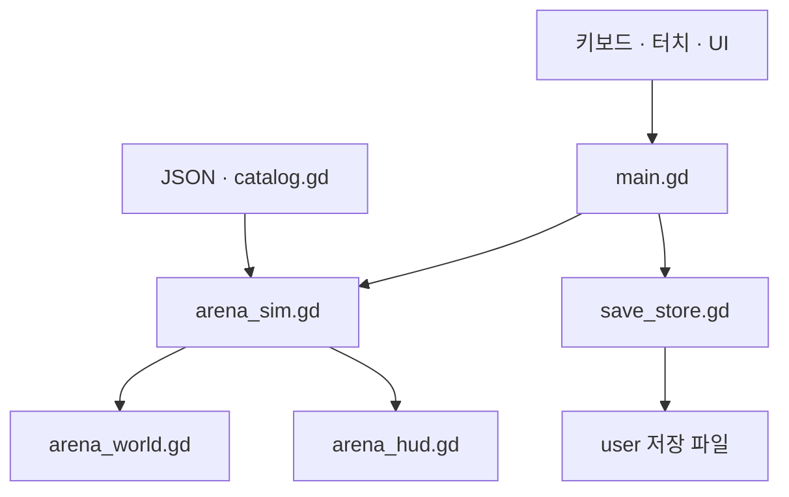

# Godot G2 기술 구조

## 모듈 경계

`main.gd`가 `ArenaSim`, `ArenaWorld`, `ArenaHUD`, `SaveStore`, 오디오와 입력을 연결합니다. 전투는 RefCounted 안에서 계산하므로 창이나 렌더러 없이 검사할 수 있습니다. 월드와 HUD·레이더는 상태를 읽고, UI는 명령 신호만 보냅니다. 렌더러가 HP·쿨다운·적 위치를 수정하지 않습니다. 스킬 아이콘은 `skill_icon.gd`, 레이더는 `arena_radar.gd`에서 코드로 그립니다.

## 시간과 상태

전투는 Godot의 60Hz physics tick에서 진행합니다. `_process`는 월드와 카메라 표시를 갱신합니다. HUD는 0.08초 주기로 표시 값을 갱신하고 카드·로비 패널은 상태 또는 내용이 바뀔 때 재구성합니다.

| 상태 | 전투 스텝 | 사용자 동작 |
|---|---|---|
| menu | 정지 | 설정, 출전, 이어하기, 도감 |
| playing | 진행 | 이동, 자동 공격, 수집, 정지 |
| choice | 정지 | 레벨업 카드, 다시 뽑기, 저장 후 로비 |
| chest | 정지 | 보급 보상 또는 진화 선택 |
| paused | 정지 | 계속하기, 빌드, 저장 후 로비 |
| won / lost | 정지 | 정산 표시, 재출전, 로비 |

선택 도중 여러 레벨이 누적되면 `pending_levels`를 소모하면서 다음 선택을 순서대로 제시합니다. 선택 창에서 전투를 흘려 보내지 않습니다. 부정한 카드 ID, 이미 최대인 카드, 다른 장착 주무기, 슬롯을 초과한 카드는 적용되지 않습니다.

G2의 보스 준비·패턴 안내·회복은 별도 최상위 상태를 추가하지 않고 `encounter`의 `active`, `boss_id`, `intro_left`, `recover_left`, `pattern`, `pattern_time`으로 관리합니다. 일반 디렉터는 이 값과 살아 있는 보스 여부를 확인합니다. 예정 이벤트는 실제 스폰할 때 소비하므로 중첩 시각에도 일정이 유실되지 않습니다. 플레이어의 유효한 피격만 `last_damage`에 기록합니다.

## 좌표·카메라·조작

시뮬레이션은 `(x,y)` 논리 좌표를 사용합니다. X 양수는 오른쪽, Y 양수는 화면 아래입니다. 월드는 `Vector3(x/40, elevation, y/40)`로 변환합니다. 카메라를 X축 방향으로 회전하지 않아 W의 음의 Y 이동이 화면 위로 투영됩니다.

이동 벡터는 최대 길이 1로 제한합니다. 방향성 무기는 마지막 유효 이동 방향을 `facing`에 저장해 사용합니다. 포커스 손실, 모달 전환, 전투 종료에서는 입력을 비웁니다. 세로 창은 논리 화면 폭을 390~600으로 조정해 데스크톱 UI가 단순 축소되는 문제를 방지했습니다.

## 전투 순서

한 스텝에서 시간·무적·재장전·회복을 진행하고 디렉터, 예고 공격, 적 이동, 공간 버킷, 무기, 투사체, 장판, 픽업, 수명 정리 순으로 처리합니다. 중간에 상태가 바뀌면 나머지 전투 처리를 중단합니다.

일반 적의 근접 판정은 원형입니다. 투사체는 이전 위치와 다음 위치 사이 선분으로 충돌을 검사해 빠른 탄환이 작은 적을 통과하는 문제를 줄입니다. 수호자와 적 탄환의 교차를 플레이어 피격보다 먼저 검사합니다. 광역 공격은 실제 남은 HP까지만 피해 통계에 합산합니다.

공간 버킷 셀 크기는 64 논리 단위입니다. 공격 범위나 이동 선분과 겹치는 버킷의 적을 조회합니다. 모든 공격이 모든 적을 매번 검사하도록 구성하지 않았으며, 즉시 낙뢰·일부 장판의 순회는 제한된 적 배열에서 수행합니다.

## 엔티티와 렌더링 예산

| 배열 | 상한 / 관리 |
|---|---|
| 적 | 260 |
| 플레이어 투사체 | 650 |
| 적 투사체 | 350 |
| 경험치·픽업 | 580, 가득 차면 경험치 병합 |
| 장판·공격 표시 | 170 |
| 순간 효과 | 120 |
| 떠오르는 글자 | 28개 Label3D 풀 |

적의 몸체·투사체·경험치·반복 이펙트는 MultiMesh 배치를 사용합니다. 플레이어와 소수 동반체는 별도 Node3D 메시로 구성합니다. 배경은 먼 곳으로 이동하면 주변 타일과 장식을 다시 구성합니다. 원본 게임 또는 Roblox의 에셋을 로딩하지 않습니다.

보스 경고는 피해 판정의 선분·폭·반경을 읽습니다. 충격파는 발동 후 경과 시간에 맞춰 링이 확장됩니다. 일반 장식물은 시뮬레이션 충돌 목록에 없습니다.

진화 장착 모델·반동·피격 카메라 흔들림은 표시 전용 상태입니다. 로비의 선택 전장·무기를 `set_preview()`로 보존하며 전투가 시작되면 실제 `sim.config`를 사용합니다. `apply_settings()`가 품질·흔들림·피해 숫자 옵션을 적용합니다. 정지 상태에서는 전투 피드백 시계를 진행하지 않습니다.

카드 비교용 `Catalog.preview_upgrade()`는 현재 패시브와 부품을 반영해 전후 값을 계산하고 설명을 반환합니다. 실제 무기 피해·간격 계산과 비교하는 회귀 검사를 포함하며, RNG 소비나 업그레이드 적용 없이 UI에서 호출합니다. 서로 다른 장착 주무기는 해당 전투의 진화 안내에서 제외합니다.

## 저장 형식과 정산

전투 스냅샷에는 `config`, `player`, 모든 엔티티 배열, 현재 카드 후보, 남은 다시 뽑기, 대기 레벨, 디렉터 이벤트, 가동·재장전·회복 타이머, 통계, 난수 상태, 무기 획득 순서를 기록합니다. Vector2는 `{"__vec2":[x,y]}`로 표현하고 64비트 난수 상태는 문자열로 보관합니다.

저장 읽기는 아래를 확인한 뒤 한 번에 상태를 교체합니다.

- 스키마, 게임 규칙 ID, 선택 가능한 전장/무기/모드.
- 유한한 숫자, 체력 범위, 정수 레벨, 슬롯 상한, 진화 관계.
- 엔티티 배열 한도, ID 중복, 좌표와 공격 필드.
- 선택 화면의 후보 자격과 상태 조합.
- 난수와 공격 갱신 순서. JSON 객체 키 정렬로 무기 처리 순서가 달라지지 않도록 별도 순서 배열을 복원합니다.

`SaveStore`는 JSON 본문 문자열과 SHA-256을 담은 봉투를 `.tmp`로 작성하고, 이전 파일을 `.bak`으로 이동한 다음 새 파일을 확정합니다. 체크섬은 파일 손상을 감지하기 위한 것이며 사용자 조작을 막는 서버 보안 기능은 아닙니다.

완료 전투 정산은 고유 `run_id`를 최근 정산 목록에 기록합니다. 프로필 쓰기가 성공한 뒤 전투 체크포인트를 삭제합니다. 저장 실패 시 로비로 넘어가기 전에 오류를 표시해 결과 파일을 잃지 않도록 합니다. 클라이언트 전용 게임이므로 계정·클라우드 동기화는 없습니다.

G2 프로필 스키마 2는 최근 12개 `history`, 전장별 `records`, 확장 `settings`를 추가합니다. G1 프로필을 읽을 때 기본값과 검증된 기존 값을 병합합니다. 설정은 즉시 적용 후 0.35초 동안 변경이 없으면 저장하며, 중복 정산·종료 경로에서도 dirty 상태를 먼저 확정합니다. 이 시간은 전투 시간이 아니라 루트의 UI 갱신 시간으로 진행합니다.

G1 전투 저장에 교전 메타데이터가 없으면 기존 살아 있는 보스를 채택합니다. 두 중간 보스가 동시에 저장된 경우도 보존하고, 추적 보스 처치와 같은 호출 안에 다른 보스로 소유권을 넘겨 즉시 다시 저장해도 복원할 수 있도록 합니다. 마지막 기존 보스 처치 후에만 회복 구간을 시작합니다. 실제 G1 코드로 생성한 픽스처와 출처 해시를 `tests/fixtures/`에 포함합니다.

## 확장 지점

새 공격은 카탈로그와 `fire`/업데이트 분기에 연결하고, 표현은 월드의 무기별 분기에서 추가합니다. 장비 경제를 붙이려면 기본 전투 데이터와 계정 성장 데이터를 분리한 상태로 최종 스탯 계산 경계를 도입하는 것이 적절합니다. 현재 씬은 런타임 절차 생성 방식이므로 아트 리소스 편집을 확대할 때는 플레이어·적·맵 장식을 PackedScene/Resource로 추출할 수 있습니다.
