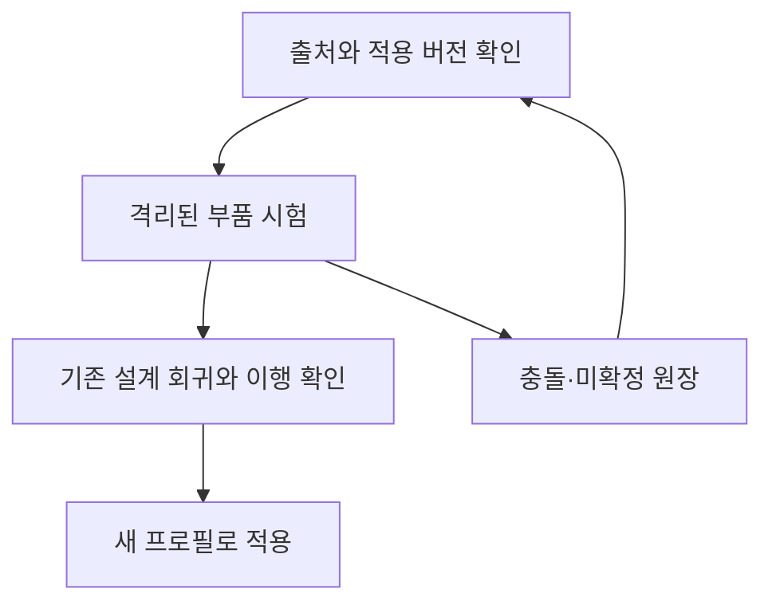

# 01. 원작 데이터 복원 기준과 버전 정책

> 조사 기준: 2026-11-18, Steam PC 자료. 이번 결과는 공개 자료를 구조화한 복원·개선 기획이다. 원작 설치본 실행, 메모리 덤프, 전 부품 수치 추출은 수행하지 않았다.

## 1. 무엇을 복원했는가

기존 문서는 시스템 설명을 중심으로 작성되어 있었다. R2는 설명을 **부품 레코드, 설정값 레코드, 콘텐츠 사실, 출처, 충돌, 실험, 구현 작업**으로 나눈다. 어떤 숫자를 보더라도 원작 문헌값인지, IRONWOOD 코드값인지, 앞으로 측정할 항목인지 추적할 수 있어야 한다.

복원의 단위는 ‘게임 전체가 얼마나 닮았는가’가 아니라 **각 필드의 출처와 적용 조건**이다. 같은 Piston 레코드에서도 존재와 편집 중 전개 기능은 문헌 근거가 있고, 모터의 실제 최대 힘은 모를 수 있다. 부품 이름이 공식 자료에 나온다는 사실만으로 질량·접점·구동식을 모두 확정하지 않는다.

## 2. 증거의 종류

| 구분 | 허용되는 결론 | 자동으로 결론 내릴 수 없는 것 |
|---|---|---|
| `official_documented` | 해당 공식 문서가 명시한 기능·값 | 모든 현행 저장본에서 동일하게 작동한다는 보증 |
| `official_historical` | 지정된 과거 버전의 설명 | 현재 기본값·솔버·플랫폼별 동작 |
| `prior_analysis_unverified` | 기존 분석에서 이어받은 후보 | 이번 조사에서 다시 확인했다는 주장 |
| `research_tool_proxy` | 연구 제작자가 공개한 데이터의 값 | 원작 collider·내부 ID·현재 게임의 실측값 |
| `local_implementation` | 특정 커밋의 IRONWOOD 코드 동작 | 비시즈 원본 수치 |
| `design_proposal` | 앞으로 만들 독립 구현 계약 | 이미 배포된 기능 |
| `not_run` | 계획된 실험과 판정 방법 | 실행·성공·오차 측정 결과 |

신뢰도를 임의의 90% 같은 수치로 표시하지 않는다. 출처 종류, 확인한 본문, 버전, 저장본 조건, 미확정 항목을 제공한다. 이름·기능·물리량의 증거가 다르면 별도 레코드로 나눈다.

## 3. 버전 고정

이번에 다시 확인한 콘텐츠 패치 기준점은 **V1.91-25490, 2026-09-21**이다. 공식 목록에는 2026-10-28 커뮤니티 하이라이트도 보인다. 이것은 조사한 목록의 기준이며 설치된 게임의 최신 빌드를 검사한 결과가 아니다. [공식 목록](https://store.steampowered.com/oldnews/?appgroupname=Besiege&appids=346010&feed=steam_community_announcements&headlines=1), [V1.91 본문](https://store.steampowered.com/oldnews/?appgroupname=Besiege&appids=346010&enddate=1793516400&feed=steam_community_announcements&headlines=0).

실험을 수행할 때 다음 키를 함께 기록한다.

| 필드 | 예시 또는 규칙 |
|---|---|
| `product` | Besiege / IRONWOOD를 분리 |
| `platform` | Windows Steam, macOS Steam 등을 실제 환경대로 |
| `game_version`, `changeset` | 실행판 표시값, 없으면 null |
| `content_enabled` | base, splintered_sea, broken_beyond |
| `mods`, `god_tools` | 사용 목록과 활성 옵션을 명시 |
| `save_origin` | 신규 배치 / 해당 빌드 저장 / 구형 저장 / Workshop |
| `save_created_version` | 알 수 없으면 null |
| `simulation_speed` | 실제 설정과 변경 시점 |
| `sample_clock` | 시뮬레이션 시간과 실제 시간을 구분 |
| `source_revision` | 외부 데이터 commit 또는 조회 시점 |

세부값 비교 키는 `(product, content, version, changeset, save_origin, parameter_key)`이다. 설정 이름만 같다는 이유로 과거값을 덮어쓰지 않는다. Besiege 버전명은 비교하지 않는 문자열 표식으로 보존한다. 실제 V1.10→V1.75→V1.9 공개 순서는 일반 SemVer 정수 컴포넌트 비교와 다르다. 공식 발표일과 확인된 changeset에 근거한 명시적인 release-order를 사용하고, 두 정보도 충돌하면 순서를 미확정으로 둔다.

## 4. 숫자를 다루는 규칙

1. 미확보 값은 `null`로 둔다. 0은 실제 0을 뜻하며 unknown의 대용으로 사용하지 않는다.
2. UI의 출력 3x를 3N, 3m/s 또는 에너지 3배라고 변환하지 않는다.
3. 공개 자료의 mass 숫자는 단위가 명시되지 않으면 게임 단위로 기록한다.
4. 길이·힘·시간 계측은 먼저 게임 격자·시뮬레이션 시간으로 기록한다. SI 보정 근거가 있을 때만 환산 계수를 추가한다.
5. 서로 다른 문서가 충돌하면 두 주장과 조건을 모두 저장한다. 임의 평균이나 더 최신으로 보이는 숫자로 채우지 않는다.
6. 발사 전 저장 설정과 실행 중 잔량·내구도를 구분한다. 설계 파일만으로 원본 기본 질량이나 엔진의 내부 상수를 모두 복원할 수 없다.

예를 들어 V1.77 공지는 Cannon과 Water Cannon 출력 상한을 3x로 설명한다. 이 사실을 통해 웹 대포의 포구 속도·반동·탄약을 결정할 수는 없다. 또한 IRONWOOD 피스톤의 120N은 별도의 독립 구현값이다. [V1.77 공식 본문](https://store.steampowered.com/news/posts/?appgroupname=Besiege&appids=346010&enddate=1778853723&feed=steam_community_announcements).

## 5. 콘텐츠 개수와 카탈로그 행 수

기본 상점 소개는 55레벨·4개 섬·70+ 블록을, 해양 상점은 15레벨·8개 추가 블록을 안내한다. 우주 상점의 11레벨·13블록 소개와 후속 V1.91의 Fuel Pump·Zone79 추가는 서로 다른 범위로 보존한다. 원문의 ‘Zone79’를 전체 레벨 개수로 취급하지 않고, 시장 소개 숫자를 더해 전수 복원율을 계산하지 않는다. [기본](https://store.steampowered.com/app/346010/Besiege/), [해양](https://store.steampowered.com/app/2165710/Besiege_The_Splintered_Sea/), [우주](https://store.steampowered.com/app/3639470/Besiege_The_Broken_Beyond/).

카탈로그는 개별 부품과 변형을 구분한 조사 목록이다. 아직 찾지 못한 부품이 있을 수 있으며, R2 행 수는 전체 원작 블록 수가 아니다. 이름 번역은 분석용 한국어이며 공식 한국어 UI를 그대로 추출한 문자열 테이블이 아니다.

## 6. 현행 구현을 보호하는 데이터 경계

`original_parts.json`과 `original_parameters.json`은 참고 데이터다. `ironwood_v4_snapshot.json`은 현재 소스에서 읽은 값이다. 둘을 자동 병합하여 런타임 상수를 덮어쓰지 않는다. 원작의 공개 수치가 추가되어도 기존 설계의 동작이 갑자기 바뀌지 않도록 physics profile 버전과 이행 정책을 설계한다.

공식 문헌값을 구현에 적용하려면 아래 네 단계를 통과한다.

이번 묶음의 기획·실험 항목은 미구현 또는 미실행 상태를 유지한다. 기존 V4의 88개 테스트 통과 기록을 원작 실험 결과나 새로운 제안의 구현 증거로 사용하지 않는다.

## 7. 이번에 접근하지 못한 원문

사용자가 지정한 [나무위키 문서](https://namu.wiki/w/%EB%B9%84%EC%8B%9C%EC%A6%88)는 이번 재시도에서도 본문을 얻지 못했다. 해당 페이지를 대조했다고 쓰지 않고 개발사의 공개 자료로 교차 확인했다. 접근 실패는 문서 내용이 틀렸다는 뜻이 아니다.

전체 출처는 [출처 색인](99_SOURCES.md), 데이터 파일 규칙은 [스키마와 이행](10_DATA_SCHEMA_AND_MIGRATION.md)을 참조한다.
