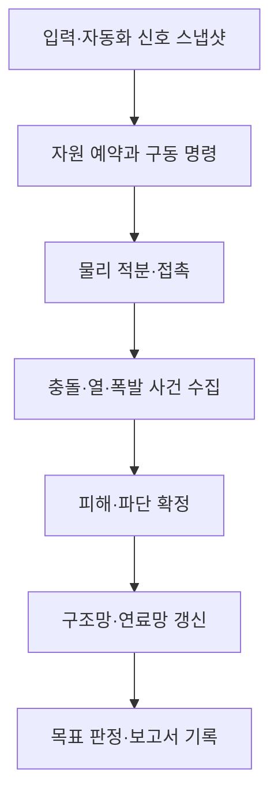

# 05. 무기·파손·자동화·연료의 규칙 복원

> 조사일 2026-11-18. `공식 문서`는 기능과 버전 경계를 확인한 것이며 원작 런타임 계측이 아니다. `제안`은 IRONWOOD 후속 구현 계약이다. 원작 탄약·재장전·힘·파단 수치가 확인되지 않으면 null을 유지한다.

## 1. 공격을 하나의 피해 숫자로 합치지 않는다

무기 조립의 의미를 살리려면 입력, 발사체, 반동, 자원, 충돌, 점화, 구조 파단을 나누어야 한다. 현재 IRONWOOD 대포의 반복 발사·공유 임무 탄약·고각·재장전 값은 독립 게임 규칙이다. 원작 대포의 동작 범위가 동일하다는 증거로 사용하지 않는다.

| 계층 | 필요한 상태 | 복원해야 할 질문 | 독립 구현의 기본 계약 |
|---|---|---|---|
| 입력 | held/rising/falling/toggle | 키 유지에 반복하는가? | 부품별 activation mode |
| 발사 | ready/firing/cooldown/empty | 발사 횟수와 재장전은? | 발사 성공 때만 자원 차감 |
| 탄체 | pose/velocity/collision/fuse | 플랫폼 운동을 상속하는가? | 총구에서 생성, 고속 통과 검사 |
| 반동 | impulse/force point | 차체 어느 지점으로 돌아가는가? | 탄체와 구동계 반응 분리 |
| 피해 | impact/heat/explosion | 부품 HP와 연결 중 무엇이 먼저 손상되는가? | 피해 원인과 대상 기록 |
| 결과 | part destroyed/joint broken | 한 번의 사건이 어떻게 전파되는가? | 중복 사건 방지·단일 파단 |

V1.26은 Cannon/Crossbow 발사 전 속도 동기화를 수정했다고 적었다. 이것은 플랫폼 운동 상속을 조사할 근거지만, 선속도만 쓰는지 총구의 각속도 항까지 쓰는지는 EXP-029에서 확인한다. [PHY-002 공식 변경 기록](https://store.steampowered.com/news/posts/?appids=346010&enddate=1715361118&feed=steam_community_announcements)

## 2. 버전 경계를 포함한 확인 데이터

| 공개 버전 | 확인한 기능 | 복원에서 피해야 할 해석 |
|---|---|---|
| V1.73-22995 | Grenade 도화선 지연, 화염에 의한 도화선 시작, 연속 충돌 | 모든 폭발물이 같은 기폭 상태기를 사용한다는 추정 |
| V1.73-22995 | Cannon 탄체 크기와 Chainshot 옵션 | 탄종별 질량·위력·재장전 숫자의 임의 생성 |
| V1.73-22995 | Joint Stress에서 충돌·파손 표시, Speedometer 각속도 모드 | 표시 색상을 실제 응력 단위 Pa로 환산 |
| V1.77-24433 | Cannon/Water Cannon 출력 상한 3배 | 3배를 N, 탄속3배, 피해3배로 일괄 해석 |
| V1.9 | Flamethrower가 연료 시스템 사용, 장갑이 화염 차폐 | 모든 금속 재질을 동일한 무적 방패로 처리 |
| V1.91-25490 | Fuel Pump, Fuel Gauge 상하한, 연료 공급에 따른 Booster 추력 제한 | 입력만 켜면 무조건 최대 추력이 나오는 모델 |

근거: [PHY-009 V1.73](https://store.steampowered.com/news/posts/?appgroupname=Besiege&appids=346010&enddate=1750957475&feed=steam_community_announcements), [PHY-008 V1.77](https://store.steampowered.com/news/posts/?appgroupname=Besiege&appids=346010&enddate=1778853723&feed=steam_community_announcements), [PHY-011/012 V1.9·V1.91](https://store.steampowered.com/oldnews/?appgroupname=Besiege&appids=346010&feed=steam_community_announcements&l=koreana).

새 플레이어 기본 키 체계도 V1.9에서 변경됐다. 과거 튜토리얼의 기본 키를 현재 데이터로 복사할 때에는 플랫폼·빌드·사용자 설정을 함께 확인해야 한다. 기본 키, 저장된 키, 사용자가 재지정한 키는 다른 값이다.

## 3. 무기군 확장의 순서 — 독립 설계안

| 단계 | 부품/기능 | 조립에 추가되는 선택 | 필수 대조 시험 |
|---|---|---|---|
| P0 | 기존 대포의 입력·탄약 계약 명시 | 발사 에지·중립·전탄 발사 | 긴 누름/탭/동시 포 2개 |
| P1 | 충격 무기·분리식 투하물 | 기체 속도와 타격 지점 | 같은 충격, 다른 지레팔 |
| P1 | 지연 기폭·폭발 | 발사와 기폭의 시간 분리 | 접촉/화염/입력 동시 발생 |
| P1 | 연속 화염과 점화 | 차폐·배치·연료 소모 | 장갑 앞/옆/후면 |
| P2 | Harpoon과 견인 | 명중 뒤 연결·장력·권상 | 고정 대상/움직이는 대상 |
| P2 | Chainshot·가변 탄체 | 탄종별 충돌 형태 | 작은 표적·가는 기둥 |

이 순서는 제품 기획이다. 실제 원작 모든 무기군을 구현한 결과가 아니다. UI에는 무기별 자원과 발사 조건을 표시하고, `canFire` 실패 원인을 empty/cooldown/noInput/destroyed/disabled로 구분한다. 원작의 분리 후 조작 가능 여부를 확인하기 전 “detached이면 발사 불가”를 보편 규칙으로 선언하지 않는다.

## 4. 피해·파단의 이벤트 계약 — 제안

### 4.1 피해 축의 분리

`PartDamage`는 부품의 생존을 바꾸고, `ConnectionDamage`는 연결의 강성·생존을 바꾼다. `HeatState`는 점화와 연소를 처리한다. `ResourceState`는 소모량과 질량에 영향을 준다. 같은 폭발이 이 네 층에 영향을 줄 수 있지만 하나의 HP 값으로 대체하지 않는다.

원작 Build Surface는 누적 피해와 파편화가 소개됐으며 재질에 따른 반응 차이가 있다. 이것은 모든 블록이 같은 HP 체계를 가진다는 증거가 아니다. [PHY-015 도입 설명](https://store.steampowered.com/news/posts/?appids=346010&enddate=1652972552&feed=steam_community_announcements)

### 4.2 한 스텝의 권장 처리 순서

이 순서는 IRONWOOD의 결정적 처리 제안이며 원작 내부 프레임 순서가 아니다. 사건은 즉시 재귀 실행하지 않고 큐로 수집한다. 동일 Grenade에 접촉과 화염이 동시에 도착해도 폭발이 두 번 발생하지 않아야 한다. 사라진 연결에 늦은 피해가 도착하면 폐기하고 원본 ID를 보고서에 남긴다.

일반적인 충격량·에너지 기반 피해식을 사용할 수 있지만 원작의 파손식으로 표시하지 않는다. 자동 검증에는 같은 접촉에서 질량·속도·지레팔을 각각 하나씩 바꾼 대조군을 포함한다. 파손을 재현하기 위해 HP를 강제로 낮춘 fixture와 자연 충돌로 파괴한 플레이 검증도 분리한다.

### 4.3 보고서 고도화

현행 V4 보고서는 최초 파단과 사건 목록을 보존한다. 후속 보고서에는 무기 발사 성공/거부, 연료 부족, 입력 에지, 타격점, 장갑 차폐를 더한다. 하중 표본 누락 때문에 정확한 최고값을 모르는 경우 `sampledPeak`라고 표시한다. 순간 하중, 누적 손상, 점화 상태를 한 색상에 합치지 않는다.

## 5. 자동화는 키 설정과 시간 의미를 함께 복원한다

V1.10은 키 대신 변수를 사용하는 자동화와 Binary Counter/SR Latch/D Latch/Random 모드를 추가했다. V1.26은 자동화의 프레임률 의존 문제를 수정했다. V1.77은 다중 키매퍼에서 마지막 선택을 기준으로 혼합값을 표시하고 같은 설정에 변경을 전파한다고 설명했다. [PHY-014](https://store.steampowered.com/news/posts/?appids=346010&enddate=1652972552&feed=steam_community_announcements), [PHY-002](https://store.steampowered.com/news/posts/?appids=346010&enddate=1715361118&feed=steam_community_announcements), [PHY-008](https://store.steampowered.com/news/posts/?appgroupname=Besiege&appids=346010&enddate=1778853723&feed=steam_community_announcements)

### 5.1 제안하는 신호 모델

| 종류 | 상태 | 사용 예 | 저장할 설정 |
|---|---|---|---|
| 지속 신호 | 현재 활성 여부 | 모터·화염 | 입력 이름·극성 |
| 상승 에지 | false→true 순간 | 단발·분리 | 발동 에지·재무장 조건 |
| 토글 | 누를 때 내부 상태 반전 | 스위치 | 초기 상태·리셋 정책 |
| 지연/펄스 | 시간 누적 | 순차 발사 | 지연·폭·반복 |
| 래치 | Set/Reset 상태 | 안전 해제 | 동시 S/R 우선순위 |
| 계측 비교 | 측정값과 범위 | 속도·각도·길이·연료 | 기준 좌표·상하한·히스테리시스 |

이 표는 구현 계약 예시다. 원작의 모든 논리 블록에 동일한 모드가 있다는 주장이 아니다. `SignalName`을 물리 키 코드와 분리하면 같은 명령에 키보드·터치·센서·실험 재생 입력을 연결할 수 있다.

권장 단계는 `외부 입력 스냅샷 → 센서 샘플 → 논리 평가 → 출력 전달`이다. 순환 신호는 무한 재귀 대신 한 틱 지연 또는 제한된 평가 횟수를 사용한다. 어느 방식을 선택했는지 데이터에 기록한다. 이것은 원작 네트워크나 실제 솔버 순서를 복원한 것이 아니다.

### 5.2 다중 편집 UX

부품 종류가 달라도 공유하는 설정만 일괄 편집한다. 선택에 없는 항목은 생략하고 혼합값은 빈 칸이나 0으로 바꾸지 않는다. 마지막으로 선택한 부품은 미리보기 기준이며, 사용자가 필드를 실제 변경하기 전에는 다른 값에 덮어쓰지 않는다. 단위·범위가 다른 이름의 필드는 별도 `parameterKey`로 관리한다.

매개변수 패널은 변경된 필드만 커밋하고 하나의 Undo 기록으로 남긴다. 입력창 편집 도중 선택 변경, 모달 닫기, 시뮬레이션 시작을 각각 테스트한다. 이것은 기존 그룹 편집에 다음으로 붙일 수 있는 작은 단위의 개선이다.

## 6. 연료망과 구조망의 분리

공식 우주 확장 설명은 인접 저장/소비 블록과 Hose로 공유 연료망을 만들고 Coupler로 망을 연결·분리하며 Gauge로 잔량에 따른 신호를 내도록 한다. 연료 소모는 저장 블록의 질량 감소와 연결된다. [PHY-010 공식 연료 소개](https://store.steampowered.com/oldnews/?appgroupname=Besiege&appids=346010&feed=steam_community_announcements&l=koreana)

출시 전 설명의 소비 수치는 원작 설치본의 현행값과 구별한다. 특히 Blaster 소비량은 원문이 재조정 가능성을 명시한다. 다른 출처의 값과 충돌하면 출처를 버리고 하나를 고르는 대신 버전별 레코드를 남긴다.

### 제안하는 처리

- 연료 포트가 연결될 때만 `FuelNetwork` 간선을 만든다.
- 구조 연결을 끊어도 다른 Hose가 남으면 연료망은 유지할 수 있다.
- 분리 전후 연료 총량을 보존한다.
- 소비 요청이 동시에 들어오면 비례 배분 또는 지정 우선순위를 프로필에 명시한다.
- 소비 뒤 질량과 관성/질량중심을 일관된 시점에 갱신한다.
- 펌프는 한 망에서 빼고 다른 망에 더하는 이송이며 연료 생성이 아니다.
- 망 병합·분리의 자원 보존과 이벤트 순서를 테스트한다.

마지막 두 소비·배분 정책의 상세는 독립 제안이다. V1.91의 공급량에 따른 Booster 추력 제한은 공개 사실이지만 정확한 연료율-추력 함수는 EXP-035가 필요하다. [PHY-012](https://store.steampowered.com/oldnews/?appgroupname=Besiege&appids=346010&feed=steam_community_announcements&l=koreana)

## 7. 기획 완료 조건

설계 문서의 완료는 “무기 이름을 모두 나열함”으로 판정하지 않는다. 각 부품이 어떤 입력 파형과 자원을 받고 어떤 물리·논리 사건을 만드는지 추적할 수 있어야 한다. 모르는 수치는 `null + 필요한 실험 + 출처 상태`로 남긴다.

구현 완료는 입력 유지/해제, 자원0, 결합/분리, 같은 틱의 복수 사건, 저장/로드, 반복 재시작을 검사한 뒤 판정한다. 자동화 프레임률 테스트는 렌더 FPS와 게임시간을 분리하며 원작 물리 업데이트 간격을 임의로 60Hz 또는 120Hz로 표기하지 않는다. 원작 확인에는 EXP-029~038을 사용한다.
