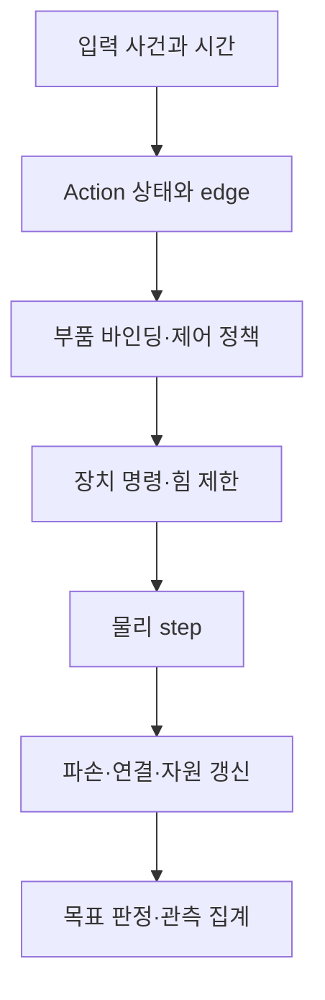

# 07. 시스템 고도화 기획과 실행 백로그

> 상태: **설계 완료, 구현 예정**. 기준 구현은 IRONWOOD 4.0.0, commit `af19c56113079416b4763ce2c0d4d2148ee1592f`.
> 이 문서의 타입·상태·수식·모듈 계약은 **독립 구현 제안**이다. Besiege 내부 코드 구조를 추출하거나 정확한 물리 계수를 복원한 것으로 읽지 않는다.

## 1. 우선순위 결정

목표는 부품 종류만 많아지는 게임보다 **무엇을 연결하고 어떤 입력을 주었기 때문에 움직였는지 설명할 수 있는 제작 게임**이다. 따라서 다음 순서로 구현한다.

1. 근거·튜닝값·스키마·솔버 단위와 실제 브라우저 검증 기준을 고정한다.
2. 끝점·로컬 프레임·부품별 입력으로 복합 장치를 만들 수 있게 한다.
3. 능동 추력·수동 공력·조종 보조를 구분하여 조립의 물리적 원인을 보존한다.
4. 현가·수중 부품·무기·목표 종류를 확장하고 시험 보고서로 비교한다.
5. 논리·열·자원·확장 환경은 앞 단계의 계약을 이용해 추가한다.

원작 데이터 복원 완료율을 부품 이름의 개수로 계산하지 않는다. `존재`, `작동 규칙`, `설정 범위`, `정확한 계수`, `구형 저장 예외`의 확보 상태가 각각 달라야 한다.

## 2. 단계별 결과물

| 단계 | 목표 | 포함 TASK | 종료 판단 |
|---|---|---|---|
| A. 기준 고정 | 출처·V1 호환·물리 단위·실기기 검사 | 001~003, 010 | 원작 미확인 숫자가 런타임에 자동 유입되지 않음; V1 동일 동작 유지 |
| B. 복합 기구 | 연결 포트·끝점 보강·부품별 입력·제어권 | 004~007, 011 | 두 기구를 독립 조작하고 연결 경로를 설명할 수 있음 |
| C. 힘의 원인 | 추진 타입·조종 정책·정밀 조립·현가·국소 매질 | 008~009, 012~015 | physical 모드에서 장치 없는 숨은 제어 토크가 없음 |
| D. 제작 과제 | 독립 무기·목표 그래프·모듈·시험 비교 | 016~020 | 제작→운반/회수/파괴→원인 분석→수정 흐름 완주 |
| E. 확장 | 자동화·재질 반응·점수 정책 | 021~023 | 데이터 기반 확장이 핵심 시뮬레이션 계약을 우회하지 않음 |

번호는 인덱스이며 병렬 수행은 `dependencies`를 따른다. S/M/L은 상대적인 구현 규모 추정이다. 날짜나 인일 확약이 아니며 측정과 기술 검토 후 조정한다.

## 3. 제어 정책 계약

### 3.1 사용자에게 보이는 차이

| 정책 | 입력 처리 | 힘을 만드는 위치 | 기존 저장 |
|---|---|---|---|
| `legacy_assisted` | 현재 전역 입력과 기존 보조 ON/OFF 의미 | 현재 코어 직접 토크 포함 | 모든 V1 설계의 기본 호환 정책 |
| `assisted` | 목표 자세·속도를 조종 장치 명령으로 변환 | 실제 장착된 구동기·조종면 | 새 설계에서 명시 선택 |
| `physical` | 부품 바인딩으로 지정한 직접 장치 명령 | 실제 장착된 구동기·조종면 | 새 설계에서 명시 선택 |

물리적 조종면이 없는 기체에는 `physical`을 선택해도 비행 능력이 자동으로 생기지 않는다. 장치가 없는 축은 인스펙터에 ‘조종 장치 없음’으로 표시한다. 자세 보조는 사용 가능한 장치의 출력·행정·연료 제한을 넘지 못한다. 보조의 존재 자체를 난이도 실패로 취급할 필요는 없지만, 비교 기록에는 정책 ID를 남긴다.

### 3.2 고정 step 처리 순서



- `hold`: 현재 눌림 상태를 각 step에서 읽는다.
- `press`: 상승 edge를 한 번 소비한다. 같은 렌더 프레임 안의 여러 substep에서 재소비하지 않는다.
- `toggle`: 상승 edge에서 저장 상태를 반전한다. 정지·재개에서 눌림이 복원되었다고 다시 토글하지 않는다.
- 물리 시간과 wall time을 분리한다. timer와 cooldown은 simulation time을 따른다.
- pause 중 명령 변경의 허용 여부를 UI에 명시하고 한 스텝은 지정된 입력 snapshot을 한 번 사용한다. V4의 ‘중립 한 스텝’은 기본 옵션으로 유지한다.
- 파손 후 다음 step의 명령 가능 여부를 구조·제어·자원 정책에서 재평가한다. 관측 보고서는 선택한 정책과 실제 적용 출력을 기록한다.

### 3.3 제안 인터페이스

```ts
type ActuatorCommand = {
  partId: string;
  actionId: string;
  mode: 'hold' | 'press' | 'toggle' | 'axis';
  value: number;
  source: 'player' | 'assist' | 'logic';
  tick: number;
};
type ControlPolicy = {
  id: 'legacy_assisted' | 'assisted' | 'physical';
  disconnectedBehavior: 'disable' | 'retain_local_state' | 'explicit_channel';
};
```

`disconnectedBehavior`는 원작 확정 사양이 아니라 구현 정책 후보다. 모든 부품에 같은 옵션이 필요한 것은 아니다. 연료·전원 공급 실패와 입력 신호 단절도 별도 상태로 유지한다.

## 4. 연결과 부품 데이터 계약

기본 격자 배치는 편한 조립 방법으로 남긴다. 내부에서는 다음 세 관계를 분리한다.

| 관계 | 의미 | 예시 |
|---|---|---|
| 충돌 관계 | 접촉을 계산하는 shape pair | 바퀴와 지면, 기구와 자기 프레임 |
| 구조 연결 | 운동을 제한하고 반력을 전달하는 link | 고정·회전·직선·끝점 보강 |
| 논리/자원 연결 | 조작 또는 공급 경로 | action 채널·센서 변수·후속 fuel graph |

```ts
type PortDefinition = {
  id: string;
  localPosition: [number, number, number];
  localRotation: [number, number, number, number];
  side: 'fixed' | 'moving' | 'either';
  allowedLinks: string[];
};
type LinkRecord = {
  id: string;
  kind: 'fixed' | 'hinge' | 'slider' | 'brace';
  a: { partId: string; portId: string; localAnchor: number[] };
  b: { partId: string; portId: string; localAnchor: number[] };
  profileId: string;
};
```

배치→미리보기에서는 예상 접점을 보여준다. 확정 전에는 편집 상태를 변경하지 않는다. link의 두 대상이 살아 있는지, 참조가 유효한지, 허용된 포트 조합인지, 의도한 가동부를 고정 경로로 우회하지 않는지 검사한다. 격자 auto-connect도 동일한 `LinkRecord`를 생성해야 한다.

복사와 추가 로드는 `oldPartId→newPartId`, `oldLinkId→newLinkId`, `oldActionId→newActionId` mapping을 먼저 만들고 전체 거래에 한 번 적용한다. 사용자 설정 이름과 ID는 구분한다. 문자열 접합만으로 ID를 생성해 충돌을 만들지 않는다.

## 5. 매개변수와 솔버 단위

`power` 하나에 속도·힘·면적을 모두 담는 방식은 기존 설계 호환용으로 유지한다. 새 카탈로그는 실제 조절 의미를 분리한다.

| 파트군 | 제안 설정 | 단위/범위 처리 |
|---|---|---|
| 회전 구동 | 목표 각속도, 토크 상한, 감속 모드 | rad/s, N·m, enum; 원작 수치 미확정 |
| 직선 구동 | 목표/행정, 속도, 힘 상한, 중립 모드 | m, m/s, N, hold/free enum |
| 공력면 | 면적, 설치각, 공력 프로필 | m², degree, profileId |
| 수중 장치 | 배수/부력 프로필, 저항 면적, 구동 규칙 | 단위가 명시된 독립 모델 |
| 무기 | 탄체 프로필, 발사 속도, cooldown, 소비량 | m/s, s, 해당 자원 단위 |
| 연결 | 선형 파단력, 회전 파단토크, 누적 손상 | N, N·m, normalized health |

원작의 무차원 배율을 SI 힘으로 임의 변환하지 않는다. 정확한 원작 수치가 없는 필드는 원작 데이터에서 `null`이고, 별도 독립 프로필에는 게임플레이에 필요한 튜닝값을 둘 수 있다. 두 값이 같은 레코드를 덮어쓰지 않도록 한다.

새 솔버 어댑터에서는 물리 의미가 있는 제한을 시간 스텝에 맞게 변환한다. 예를 들어 SI 힘 상한을 impulse 상한으로 넘기는 엔진이면 `maxImpulse = forceN × dt`이다. 회전도 같은 차원 분석을 적용하되, 엔진 API가 이미 변환하는지 vendor 코드를 먼저 확인한다. 검증 없이 이 변환을 두 번 적용하지 않는다.

## 6. 저장 호환성과 거부 규칙

현행 `normalizeBlueprint`는 version 1만 허용하고 known primitive fields만 복사한다. 모르는 부품·범위 오류는 거부하지만 추가 필드는 제거한다. 새 시스템에서는 다음 경로를 명시한다.

1. 입력의 format/version을 먼저 읽는다. 알 수 없는 버전은 추정하지 않고 중단한다.
2. V1은 기존 카탈로그·연결 규칙·전역 입력·legacy 제어 정책을 고정한 어댑터로 V2에 변환한다.
3. V2의 필수 참조·부품 종류·단위·유한 수치·한도를 검증한다.
4. 중요 unknown field는 거부하거나 ‘지원하지 않는 기능’으로 보류한다. 허용된 `extensions` namespace는 정책에 따라 보존하되 실행하지 않는다.
5. 모든 검증이 끝난 후에만 현재 작업을 교체한다. 실패는 현재 설계·시험·슬롯을 변경하지 않는다.
6. 변환본을 새 버전으로 저장하고 원본 V1을 백업한다. 새 필드를 조용히 지운 채 다시 V1이라고 내보내지 않는다.

프리셋 6개 외에도 실제 사용자가 만든 V1 JSON의 기본값 생략·혼합 설정·경계 위치·긴 ID·연결되지 않은 draft를 호환 fixture에 넣어야 한다. 알 수 없는 질량·자재 override를 가져와 카탈로그 권한을 우회하게 하지 않는다.

## 7. 목표와 실험을 분리한 콘텐츠 기획

다음 콘텐츠는 원작 레벨 복제가 아니라 새 시스템을 검증하고 익히는 독립 과제다.

| 과제 | 필요한 시스템 | 제작에서 배울 점 | 통과 조건 |
|---|---|---|---|
| 가변 교량 | 끝점 보강·힌지·개별 입력 | 보강 경로와 가동부 분리 | 화물을 반대편 구역으로 운반 |
| 요철 차륜 | 수동 바퀴·조향·현가 | 접지·댐핑·전복 | 지정 구간 완주와 화물 보존 |
| 기계식 추진기 | 구동축·수동 블레이드 | 동력원과 공력면의 차이 | 부하 조건에서 목표 추력 또는 이륙 |
| 분리 운반 | 제어권·명시 분리·목표 graph | 구조/신호/자원 단절 구분 | 분리 화물을 지정 영역으로 이동 |
| 수상 안정성 | 국소 매질·부력 프로필 | 무게중심·부력중심·형상 저항 | 같은 하중으로 항로와 복원 시험 통과 |
| 순차 기구 | timer·sensor·logic | 입력의 edge/hold와 상태 | 지정 순서를 반복해 동작 |

통과 수치·시간·적 배치·자재 한도는 원작 복원값으로 채우지 않는다. 최소 기구의 물리 검증 후 난이도 튜닝으로 정한다. 각 과제에는 ‘실험 계속’과 ‘설계 수정’을 제공하며, 실패한 기구의 파편을 바로 리셋하여 관찰 기회를 없애지 않는다.

## 8. 작업 목록

원본은 [backlog.json](../data/backlog.json)이다. 모든 행은 `planned` 상태이며 의존 관계를 포함한다.

### TASK-001 · 원작 근거와 런타임 카탈로그 분리

- 우선순위/상대 규모: **P0 / M**
- 선행 작업: 없음
- 관련 차이: GAP-001

**문제:** 검증되지 않은 원작 숫자와 현재 튜닝값이 섞일 수 있다.

**변경:** EvidenceRecord와 RuntimePartDefinition을 분리하고 field provenance/unit/profile을 추가한다.

**완료 조건:**

- 원작 레코드에 IRONWOOD 120N/35N/HP 등 튜닝값이 자동 복사되지 않는다.
- 모든 런타임 물리 계수는 단위·프로필·출처 유형과 함께 조회된다.
- 원작 내부 ID와 자체 record_id가 별도 필드다.

**호환 처리:** V1 수치는 legacy_v4 카탈로그에 그대로 고정한다.

### TASK-002 · 명시적 V1→V2 설계 마이그레이션

- 우선순위/상대 규모: **P0 / M**
- 선행 작업: TASK-001
- 관련 차이: GAP-019

**문제:** 새 포트·입력 필드가 V1 정규화에서 소실될 수 있다.

**변경:** schemaVersion, physicsProfile, controlPolicy, parts, links, actions를 정의하고 V1 어댑터를 작성한다.

**완료 조건:**

- 6개 V1 프리셋과 사용자 설계를 legacy profile로 무손실 변환한다.
- 알 수 없는 version을 V1로 추정하여 읽지 않는다.
- 지원하지 않는 중요한 필드는 조용히 버리지 않고 오류나 보류 상태를 반환한다.
- mass/cost override는 승인된 카탈로그 정책 없이 적용하지 않는다.

**호환 처리:** V1 저장과 원본 파일을 백업하고 변환은 새 버전에 기록한다.

### TASK-003 · SI 힘·토크와 솔버 파라미터 어댑터

- 우선순위/상대 규모: **P0 / M**
- 선행 작업: TASK-001
- 관련 차이: GAP-009

**문제:** motor limit과 파단 비교가 혼합 단위를 포함한다.

**변경:** solver boundary에서 force/torque를 impulse 단위로 변환하고 linear/angular load를 별도 수집한다.

**완료 조건:**

- 동일한 물리 하중에서 dt를 바꿔도 실효 force/torque 제한이 목표 범위에 든다.
- 선형력과 토크를 max로 직접 비교하지 않는다.
- 사용자에게 하중비를 Pa 단위 응력으로 표시하지 않는다.
- legacy 파단 튜닝을 새 SI 임계값으로 무검증 치환하지 않는다.

**호환 처리:** legacy_v4의 기존 숫자를 보존하며 새 profile에만 보정값을 적용한다.

### TASK-004 · 로컬 프레임을 가진 연결 포트

- 우선순위/상대 규모: **P0 / L**
- 선행 작업: TASK-002, TASK-003
- 관련 차이: GAP-003, GAP-004

**문제:** 격자 인접만으로는 비인접 보강과 기구 축을 표현할 수 없다.

**변경:** PortDefinition(localPose,kind,side)와 LinkRecord(anchorA,anchorB,type)를 도입한다.

**완료 조건:**

- 격자 자동 연결이 명시 link로 변환되어 기존 접합 수를 재현한다.
- 이동·복사·회전·삭제가 링크 참조를 원자적으로 갱신한다.
- 시각 접촉·collision pair·structural link를 별도 표시한다.

**호환 처리:** 기존 기체는 현재 getConnections의 결정 결과를 보존하는 어댑터로 변환한다.

### TASK-005 · 끝점 보강 도구와 연결 진단

- 우선순위/상대 규모: **P0 / M**
- 선행 작업: TASK-004
- 관련 차이: GAP-003

**문제:** 한 칸 강철 블록으로는 원거리 보강 기구를 만들 수 없다.

**변경:** endpoint_brace의 첫 점/둘째 점/미리보기/확정/취소와 가동부 우회 경고를 구현한다.

**완료 조건:**

- 두 블록 사이 비인접 보강을 만들고 취소할 수 있다.
- 끝점 대상 삭제 시 dangling link를 차단 또는 명시적으로 제거한다.
- 관절 우회 경로를 배치 전에 경고한다.
- 기존 brace의 cost/shape/strength를 변경하지 않는다.

**호환 처리:** 기존 brace는 reinforced_block 의미로 유지하고 UI 명칭을 분리한다.

### TASK-006 · 부품별 입력과 edge/hold/toggle 처리

- 우선순위/상대 규모: **P0 / L**
- 선행 작업: TASK-002
- 관련 차이: GAP-006

**문제:** 모든 기구가 같은 명령에 반응해 복합 장치 설계가 제한된다.

**변경:** ActionMap→PartBindings→ActuatorCommand 흐름과 키·터치 공통 입력 의미를 구현한다.

**완료 조건:**

- 피스톤 A를 확장하면서 B를 수축할 수 있다.
- 두 대포를 서로 다른 버튼으로 독립 발사한다.
- toggle은 물리 substep 수와 무관하게 press edge당 한 번 변경된다.
- 포커스 상실·모달·일시정지 후 held 입력이 남지 않는다.

**호환 처리:** V1 global 입력을 공통 actionId 집합으로 변환해 기존 조작을 유지한다.

### TASK-007 · 제어권·자원·구조 연결 정책 분리

- 우선순위/상대 규모: **P0 / M**
- 선행 작업: TASK-004, TASK-006
- 관련 차이: GAP-007

**문제:** core reachability 하나로 모든 작동 여부와 임무 실패를 결정한다.

**변경:** authorityPolicy, resourceGraph, structureGraph, missionSurvivalRule을 분리한다.

**완료 조건:**

- 단절 시 모터·패시브 부품·저장된 toggle 동작을 각각 정책으로 결정한다.
- 실험 sandbox에서 코어 손실 후 파편 관찰을 이어갈 수 있다.
- 캠페인 기존 코어 생존 규칙은 별도 policy로 동일하게 재현된다.

**호환 처리:** V1은 core_reachable 및 core_required policy를 유지한다.

### TASK-008 · 능동 추진기와 수동 블레이드 분리

- 우선순위/상대 규모: **P0 / L**
- 선행 작업: TASK-001, TASK-003, TASK-004, TASK-006
- 관련 차이: GAP-002

**문제:** 현재 propeller 이름이 힘 생성 원인을 구분하지 못한다.

**변경:** legacy_thruster, direct_thruster, aero_blade, aquatic_drive의 동작 타입을 정의한다.

**완료 조건:**

- V1 설계의 propeller는 동일한 legacy 물리 프로필로 실행된다.
- 수동 블레이드는 회전·상대 유동이 없으면 스스로 추력을 만들지 않는다.
- 팔레트 설명에서 힘 생성 원인과 필요한 구동 연결이 보인다.

**호환 처리:** V1 propeller는 legacy_thruster로 매핑한다. 기존 선박·비행기 성능을 자동 변경하지 않는다.

### TASK-009 · 조종 정책의 명시적 3단계 분리

- 우선순위/상대 규모: **P0 / L**
- 선행 작업: TASK-003, TASK-006, TASK-007, TASK-008
- 관련 차이: GAP-011

**문제:** 보조 OFF에서도 직접 코어 토크와 감쇠가 남아 물리 조종으로 오해할 수 있다.

**변경:** legacy_assisted는 기존 토크를 유지하고 assisted/physical은 장치 명령만 사용하도록 분리한다.

**완료 조건:**

- physical 모드에서 조종면/구동기 없는 강체에 방향키를 눌러도 제어 토크가 생기지 않는다.
- assisted는 action/actuator 명령을 보정하고 별도 숨은 코어 토크를 추가하지 않는다.
- 기존 저장은 legacy_assisted로 동일하게 복원한다.
- 보조 OFF가 자세 목표만 끄는 것인지 물리 조종으로 바꾸는 것인지 UI에서 명확하다.

**호환 처리:** 기존 기체는 legacy_assisted로 시작하고 새 정책 선택은 설계 사본으로 수행한다.

### TASK-010 · 실제 브라우저와 기기 기반 완료 게이트

- 우선순위/상대 규모: **P0 / M**
- 선행 작업: TASK-001
- 관련 차이: GAP-020

**문제:** CPU 통합 성공만으로 조립 조작과 GPU 화면을 보장할 수 없다.

**변경:** 대표 기체의 키보드·터치·render 확인 및 frame time 측정 조건을 고정한다.

**완료 조건:**

- GPU context 생성·실제 pointer/키보드/touch 조립→출격→재설계 흐름을 기록한다.
- 25/50/100부품, 물·공중·기구 fixture에서 평균뿐 아니라 p95를 기록한다.
- 부품 수 상한 상향은 계측 후 결정한다.
- 브라우저와 기기·해상도·quality 설정을 결과에 포함한다.

**호환 처리:** 저장·미션·UI 정책은 바꾸지 않는다.

### TASK-011 · 혼합값 다중 설정 편집

- 우선순위/상대 규모: **P1 / M**
- 선행 작업: TASK-001, TASK-002, TASK-006
- 관련 차이: GAP-005

**문제:** 묶음 선택 상태에서 공통 설정을 한 번에 바꾸기 어렵다.

**변경:** parameter schema 교집합과 mixed UI, 변경 필드만 atomic patch하는 command를 만든다.

**완료 조건:**

- 값이 다른 항목을 0 또는 기본값으로 표시하지 않는다.
- 한 필드 변경이 다른 혼합 필드를 덮어쓰지 않는다.
- 변경 전 유효성 검증을 완료하고 묶음 한 단계로 Undo 한다.

**호환 처리:** 기존 그룹 이동/복사 이력과 같은 command transaction에 포함한다.

### TASK-012 · 정밀 이동·회전과 로컬 축 조립

- 우선순위/상대 규모: **P1 / L**
- 선행 작업: TASK-004, TASK-005
- 관련 차이: GAP-004

**문제:** Y축 90도와 정수 격자만으로 작동 방향을 다양하게 만들 수 없다.

**변경:** snap grid/free transform 선택과 포트 정렬, 경계·충돌 검사를 제공한다.

**완료 조건:**

- 정밀 이동·회전이 강체와 시각 모델에 같은 transform을 사용한다.
- V1 rot에서 quaternion으로 변환할 때 기존 축이 변하지 않는다.
- 회전된 지지체에 부착한 관절·피스톤 축이 포트 프레임을 따른다.

**호환 처리:** 스케일은 별도 요구로 남기고 V1 격자 단위를 유지한다.

### TASK-013 · 수동 바퀴·조향·현가 부품

- 우선순위/상대 규모: **P1 / L**
- 선행 작업: TASK-003, TASK-004, TASK-006, TASK-012
- 관련 차이: GAP-008

**문제:** 차동 주행 외 조향·접지 설계를 시험할 수 없다.

**변경:** free wheel, steering joint, suspension의 독립 구동·감쇠·한계 모델과 예제를 추가한다.

**완료 조건:**

- 무입력 수동 바퀴는 구동 토크를 생성하지 않는다.
- 요철 fixture에서 현가 압축·복원·감쇠와 끝단 접촉이 관측된다.
- 같은 차체에 차동 조향과 전륜 조향을 각각 구성할 수 있다.

**호환 처리:** 기존 wheel은 같은 구동 프로필로 유지한다.

### TASK-014 · 부품별 유체 프로필과 국소 매질

- 우선순위/상대 규모: **P1 / L**
- 선행 작업: TASK-001, TASK-003, TASK-008
- 관련 차이: GAP-010

**문제:** 물 존재만으로 추진 계수가 바뀌고 부력은 float에만 있다.

**변경:** submerged fraction, 유체 상대 속도, 부품별 부력/저항, 젖음 상태 계약을 만든다.

**완료 조건:**

- float 없는 재질도 지정된 부력 프로필에 따라 반응한다.
- 수중 추진기는 실제 잠김에 따라 추력이 변한다.
- 선박 무게와 부력 중심 변화가 전복·복원 토크에 반영된다.
- 침수 실패 규칙을 꺼도 물리 부력·저항은 유지된다.

**호환 처리:** legacy_v4 water 모델을 보존하고 재구성 프로필에만 새 모델을 적용한다.

### TASK-015 · 실제 조종면과 조향 장치

- 우선순위/상대 규모: **P1 / L**
- 선행 작업: TASK-004, TASK-006, TASK-009, TASK-014
- 관련 차이: GAP-011

**문제:** 조종 입력에 대응하는 물리 장치가 없어 코어 직접 토크에 의존한다.

**변경:** 조종 관절·날개 각도·러더·차등 추진을 action 명령으로 제어한다.

**완료 조건:**

- 부품 제거 또는 연결 단절이 해당 조종축의 authority 손실로 이어진다.
- 물과 공기 상대 유속을 반영하고 정지 상태의 수동 조종면이 임의 추력을 만들지 않는다.
- assisted와 physical의 동일 조작을 비교해 원인 힘을 시각화한다.

**호환 처리:** 기존 비행/선박 프리셋은 별도 새 물리 설계로 제공한다.

### TASK-016 · 부품별 무기 상태와 발사체 판정

- 우선순위/상대 규모: **P1 / L**
- 선행 작업: TASK-003, TASK-006, TASK-007
- 관련 차이: GAP-012

**문제:** 탄약·재장전·사격 그룹이 전역이며 빠른 탄체 특성 검사가 제한적이다.

**변경:** WeaponState/ProjectileProfile을 분리하고 swept hit 또는 CCD 적용 조건을 정의한다.

**완료 조건:**

- 여러 포의 발사·탄약·cooldown이 독립적이다.
- 같은 입력을 여러 프레임 유지해도 press 무기는 중복 발사하지 않는다.
- 고속 작은 탄체가 얇은 정적 판을 통과하는 fixture를 검사한다.
- 총구 막힘·자기 기체 근접 충돌의 결과를 일관되게 정의한다.

**호환 처리:** 기존 임무 탄약은 공유 depot policy로 보존할 수 있게 한다.

### TASK-017 · 목표 그래프와 임의 방향 관문

- 우선순위/상대 규모: **P1 / L**
- 선행 작업: TASK-002, TASK-007
- 관련 차이: GAP-014

**문제:** 파괴·Z평면 통과만으로 제작 과제 다양성이 제한된다.

**변경:** ObjectiveNode와 사건 기반 진행, 운반·회수·정지 유지, OutcomeResolver를 구현한다.

**완료 조건:**

- 기존 6개 작전을 같은 결과로 표현한다.
- 임의 방향 관문을 고속으로 지나도 통과를 감지한다.
- 동일 step의 성공/실패 우선순위가 데이터로 명시된다.
- 운반 물체의 ID·영역 도달·유지 시간을 함께 판정한다.

**호환 처리:** 기존 6개 작전은 legacy objective adapter로 유지한다.

### TASK-018 · 관측 가능성을 높이는 시험 보고서

- 우선순위/상대 규모: **P1 / M**
- 선행 작업: TASK-003, TASK-006, TASK-009
- 관련 차이: GAP-016

**문제:** 표본 사이의 순간 최대값과 조작 원인을 추적하기 어렵다.

**변경:** step peak accumulator, 입력 ring buffer, 조건 hash, run comparison을 추가한다.

**완료 조건:**

- 12Hz 출력에서도 두 표본 사이 최대 하중을 놓치지 않는 집계가 있다.
- 사건 window가 잘려도 최초 파단 및 누계는 유지된다.
- 보고서에 반복 실행용 입력을 넣되 완전 결정론/상태 replay를 보장한다고 표시하지 않는다.
- 제어 정책·물리 프로필이 다른 기록은 조건 불일치로 표시한다.

**호환 처리:** 기존 JSON 보고서는 읽기 전용 호환을 제공하고 새 필드는 버전으로 구분한다.

### TASK-019 · 모듈 저장과 추가 로드

- 우선순위/상대 규모: **P1 / L**
- 선행 작업: TASK-002, TASK-004, TASK-006
- 관련 차이: GAP-017

**문제:** 모든 저장이 core 한 개의 완전 기체라는 가정을 가진다.

**변경:** assembly/module 형식, 선택 저장, preview 배치, 모든 참조 ID 재매핑을 구현한다.

**완료 조건:**

- 모듈에 core가 없어도 저장할 수 있으나 완전 기체 출격 규칙과 혼동하지 않는다.
- 추가 로드의 partId/linkId/actionId 충돌을 자동 재매핑한다.
- 한 번 Undo로 추가 로드를 모두 취소한다.
- 불완전 endpoint를 가진 모듈은 연결 필요 상태로 표시한다.

**호환 처리:** 기존 8개 설계 슬롯과 module 저장소를 구분한다.

### TASK-020 · 반복 가능한 실험 환경

- 우선순위/상대 규모: **P1 / M**
- 선행 작업: TASK-007, TASK-014, TASK-018
- 관련 차이: GAP-018

**문제:** 물·바람·하중별 fixture를 같은 조건으로 반복하기 어렵다.

**변경:** environmentPreset와 experimentFixture를 기체 blueprint와 별도로 저장하고 실패 후 관찰을 제공한다.

**완료 조건:**

- 임무 목표와 독립적으로 환경을 선택한다.
- 실험 fixture·시작 높이·질량·입력·스텝 설정을 저장한다.
- 부품 파괴 후에도 물리 관찰을 계속할 수 있다.
- 시험 조건 reset은 동일한 blueprint와 프로필로 시작한다.

**호환 처리:** 자유 제작의 기존 육상 환경을 기본 preset으로 유지한다.

### TASK-021 · 센서·타이머·논리 신호

- 우선순위/상대 규모: **P2 / L**
- 선행 작업: TASK-002, TASK-006, TASK-018
- 관련 차이: GAP-021

**문제:** 복합 기구를 입력 순서에 따라 자동 작동시킬 수 없다.

**변경:** 고정 tick 신호 평가, delay state, 논리 순환 검증, 변수 인스펙터를 추가한다.

**완료 조건:**

- 같은 step에 sensor→logic→actuator 명령의 평가 순서가 고정된다.
- 조합 논리 순환은 저장 시 거부하거나 명시적인 한 tick delay 노드가 필요하다.
- 일시정지에서 timer가 진행하지 않고 slow mode는 simulation time을 따른다.

**호환 처리:** 키 바인딩은 signal source 중 하나로 유지한다.

### TASK-022 · 재질·열·폭발·젖음 피해 모델

- 우선순위/상대 규모: **P2 / L**
- 선행 작업: TASK-003, TASK-014, TASK-016, TASK-018
- 관련 차이: GAP-013

**문제:** HP·연결 파단 외 물성 차이가 제한적이다.

**변경:** material response와 damage channel, 차폐/점화/소화 이벤트를 분리한다.

**완료 조건:**

- 부품 HP 손실과 연결 분리가 독립 사건으로 남는다.
- 열원이 꺼지거나 물에 닿았을 때 소화/냉각 정책이 시간 기반으로 적용된다.
- 차폐 유무가 판정과 보고서에 동일하게 반영된다.

**호환 처리:** legacy 충돌/폭발 규칙은 프로필로 유지한다.

### TASK-023 · 측정 지표와 점수 정책 버전

- 우선순위/상대 규모: **P2 / M**
- 선행 작업: TASK-001, TASK-017, TASK-018
- 관련 차이: GAP-015

**문제:** 독립 별 평가와 원작 지표를 구분하지 않으면 비교가 잘못된다.

**변경:** legacy stars와 원작 관찰 지표를 병행 표시하고 가중 산식은 근거 확보 후 반영한다.

**완료 조건:**

- 기존 별과 기록이 사라지지 않는다.
- 모르는 가중 점수를 수치 0으로 채우지 않는다.
- 점수 정책 버전이 달라진 기록을 같은 순위로 비교하지 않는다.

**호환 처리:** 기존 별/최고 기록은 기존 policy ID에 귀속해 보존한다.

## 9. 구현 완료 게이트

### 기능 게이트

- 기존 기체의 조립·저장·출격·결과·재설계를 보존한다.
- 직접 강체 위치/속도를 대입해 기구의 정상 작동처럼 보이게 하지 않는다.
- 각 구동·파손 현상이 장치·연결·입력·환경 중 무엇에서 발생했는지 관측 가능해야 한다.
- 같은 렌더 프레임의 substep 수가 입력 edge 개수·도화선·자동화 순서를 바꾸지 않는다.
- 설계 변경으로 과거 보고서와 현재 기체를 비교할 수 없으면 명확히 표시한다.

### 수치 게이트

- 원작 계측은 원작 설치본·플랫폼·빌드·save provenance와 함께 기록한다.
- 독립 물리 프로필은 dt·질량·부하를 바꾸는 대조 실험으로 force/torque 제한을 확인한다.
- 하중 출력은 선형력·토크·impulse·게임용 위험 비율을 구분한다.
- 물리 계수의 ‘원작 일치’는 설정 이름만 같다고 인정하지 않는다. 원작 관측 오차 범위와 독립 구현 오차를 따로 평가한다.

### 사용자 조작 게이트

현재 V4 기록의 CPU 검사와 별도로 실제 WebGL 초기화·키/포인터/터치 입력·패널 가림·모달 후 입력 해제·파일 저장/불러오기를 확인한다. 대표 기체와 25/50/100부품 시나리오에 대해 physics/render/frame 시간, p95, 화면 크기, 기기, 브라우저, 품질 모드를 기록한다. 이번 기획에는 측정되지 않은 FPS 목표 달성값을 넣지 않는다.

## 10. 후순위 경계

수중 확장과 우주 확장의 공개 사실은 원작 데이터로 계속 복원할 수 있지만, 기획 단계의 확인과 구현 완료는 다르다. 연료망·행성 중력·궤적 예측·열·다중 기체·멀티플레이를 한 번에 추가하지 않는다. 핵심 입력·연결·단위·관측 계약을 먼저 안정화한 다음 각각의 독립 시스템 제안으로 상세화한다. 원작의 전체 블록·레벨·세부 계수를 모두 복원했다는 완료 선언을 하지 않는다.
