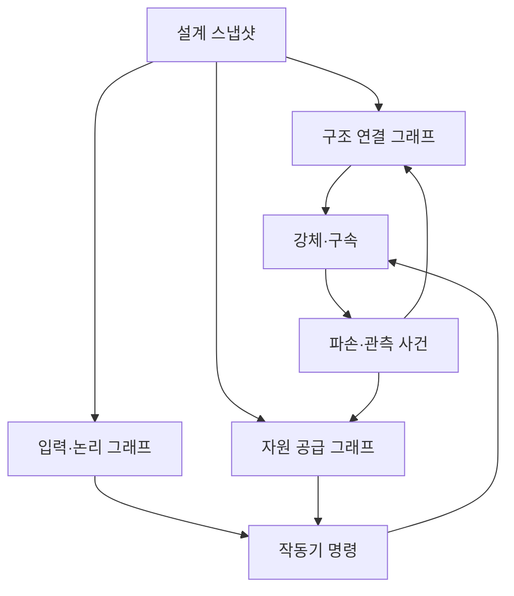

# 10. 데이터 구조·저장 이행·구현 연결 계약

> 이 문서와 `design_v2_proposal.schema.json`은 다음 버전 구현을 위한 제안이다. IRONWOOD 4.0 런타임은 현재 version 1만 읽는다. 이번 작업에서 게임의 저장 형식이나 동작을 변경하지 않았다.

## 1. 데이터 계층

| 파일 | 역할 | 런타임에 바로 적용 가능한가 |
|---|---|---|
| `original_parts.json` | 부품 명칭·범위·공개 동작·미확정 필드 | 참고 목록. 런타임 정의가 아님 |
| `original_parameters.json` | 값마다 버전·출처를 가진 문헌 원장 | 검증과 프로필 승인 후에만 |
| `campaign_facts.json` | 공식 콘텐츠 수·목표/평가 설명 | 원작 레벨 배열이 아님 |
| `public_geometry_candidates.json` | 연구 도구에서 가져온 근사 크기 후보 | 계측 fixture 후보만 허용 |
| `ironwood_v4_snapshot.json` | 현재 독립 구현의 실제 상수·부품·작전 | 기준 스냅샷, 자동 덮어쓰기 금지 |
| `system_gaps.json` | 현재 동작과 개선 요구의 차이 | 기획 입력 |
| `backlog.json` | 의존 관계와 완료 조건 | 구현 작업 목록 |
| `experiments.json` | 원작 미확정 규칙을 확인할 절차 | 전부 미실행 |
| `conflicts.json` | 서로 다른 원문 주장과 미결 범위 | 채택값 없음 |
| `sources.json` | 원문·조회일·지지하는 주장·한계 | 출처 색인 |

모든 파일은 UTF-8 JSON이다. 목록형 데이터는 같은 순서의 CSV도 제공한다. CSV의 배열/객체 셀은 JSON 문자열이며, `null`은 미확정 또는 명시된 적용 불가를 의미한다. 원작과 현재 게임의 데이터를 같은 `mass` 열만으로 조인하지 않는다.

## 2. 식별자

`bsg_*`는 이번 조사에서 부여한 외부 참조 ID이다. 게임의 내부 숫자 ID를 추출한 것이 아니다. `CAT-*`, `PHY-*`, `SRC-*`는 출처 식별자, `PAR-*`는 설정 원장, `GAP-*`와 `TASK-*`는 개선 추적용이다. 게임 부품 instance ID, 유형 ID, 출처 ID는 서로 대체할 수 없다.

원작 내부 ID가 필요하면 설치본 빌드·파일·저장 fixture와 함께 별도 `OriginalTypeMapping`을 작성한다. 외부 연구 데이터의 `18_1` 같은 키는 연구 도구의 변형 키일 수 있으므로 그대로 원작 정수 ID로 채택하지 않는다.

## 3. 설정 원장과 런타임 정의

원작 원장에는 과거 값을 지우지 않고 여러 행을 유지한다. 예를 들어 최대 출력이 바뀌면 `parameter_key`는 같아도 `version_scope`, `save_scope`, `source_ids`가 다른 레코드로 기록한다. 출처 충돌이 있으면 `conflict_group`으로 연결한다.

실행용 `RuntimePartDefinition`은 별도다. 물리 모듈에 필요한 값은 원작에서 알려진 범위와 독립 튜닝값을 각각 표시한다. `displayName`, `massKg`, `shapeProfile`, `ports`, `actuators`, `materialProfile`, `fluidProfile`은 카탈로그가 소유하고 임포트 설계의 임의 override로 바뀌지 않게 한다.

`power` 하나로 힘·속도·면적을 동시에 바꾸는 기존 동작은 `legacy_v4`에 남긴다. 새 프로필에서는 최대 힘, 목표 속도, 면적, 출력 배율을 분리한다. 실제 엔진 방정식의 multiplier를 UI에 표시할 때 힘·토크·impulse·정규화 하중 중 어떤 값인지 명시한다.

## 4. V2 제안의 구조

[JSON Schema](../data/design_v2_proposal.schema.json)와 [예제](../examples/design_v2_proposal.json)를 함께 제공한다. 최대 100부품은 현재 웹 제작 범위를 유지하는 제안값이며 원작 제한이 아니다. 자유 변형 지원과 무제한 부품 허용은 별개 과제다.

| 영역 | 필수 내용 |
|---|---|
| `profile` | 카탈로그·물리 revision, 제어 정책, 목표 정책 |
| `parts` | instance ID, type ID, 설계 좌표, quaternion, 허용 설정 |
| `connections` | 양 끝점, 포트, 로컬 anchor, 연결 종류, 연결 프로필 |
| `actions` | 채널 ID, 사용자 이름, bool/axis 자료형 |
| `bindings` | 채널에서 특정 부품 입력 포트로의 mapping |
| `moduleInterfaces` | 외부에 노출할 구조 포트와 입력 채널, 참조는 모듈 내부 대상을 가리킴 |
| `provenance` | 신규/기존 이행/모듈 가져오기와 원본 hash |
| `extensions` | 비실행 메타데이터. 크기·namespace 제한은 loader에서 적용 |

JSON Schema만으로 충분하지 않다. 별도 의미 검증은 ID 유일성, 참조 존재, 포트 호환, 연결 중복, 자기 연결, 쿼터니언 정규화, 파트별 설정 범위, action 자료형, 제어 정책을 확인한다. V1 instance ID가 한글·공백·구분자를 포함할 수 있으므로 part ID와 참조는 기존 비어 있지 않은 128자 문자열 규칙을 유지한다. 새 카탈로그·프로필 ID는 별도의 ASCII 식별 규칙을 사용한다. 설계에 보관하는 연결과 실행 중 새로 생기는 Grabber 연결을 구분한다.

## 5. 현재 V1의 실제 동작

현재 `dist/editor.js::normalizeBlueprint`는 `format=ironwood-design`, `version=1`과 부품 배열을 요구한다. 알려진 기본 필드만 복사하고 나머지 필드는 버린다. **추가 필드를 모두 오류로 처리하는 구현은 아니다.** 알 수 없는 부품 종류, 중복 ID, 범위 밖 값 등은 `validateDesign`에서 거부한다.

기본값이 생략되면 `rot=0`, `power=1`, `binding=all`, 부품별 기본 elevation과 piston stroke를 채운다. 구형 날개의 기본 elevation은 카탈로그의 6도이며 일반 부품은 0도다. 무조건 모든 생략 고각을 0으로 바꾸면 과거 비행기의 동작을 바꾼다. 설계 불러오기에서는 미연결 draft를 허용하고 출격에서는 연결을 요구한다.

이 동작은 원작 저장 형식과 무관한 IRONWOOD 코드 사실이다. 구체적 값·소스 지문은 [V4 스냅샷](../data/ironwood_v4_snapshot.json)을 사용한다.

## 6. V1 → V2 이행 절차

1. 원본 JSON bytes와 hash를 보관하고 수정하지 않는다.
2. V1의 기존 정규화 규칙을 동일하게 적용한다. 새로운 기본값으로 과거 생략 필드를 채우지 않는다.
3. `legacy_v4` 카탈로그·물리 revision 및 `legacy_assisted`를 지정한다.
4. 좌표 `(x,y,z)`는 설계 좌표 그대로 옮긴다. 기존 실행 시의 Y 오프셋 0.72m는 profile의 spawn frame에서 한 번만 적용한다.
5. yaw는 `rot × π/2`, quaternion은 `(0, sin(rot×π/4), 0, cos(rot×π/4))`로 옮긴다. 날개 설치각은 별도 부품 설정으로 남긴다.
6. 기존 `getConnections`가 선택한 구조 연결을 이행 시점에 명시 link로 캡처한다. 새 임의 거리 탐색으로 다른 지지를 고르지 않는다.
7. 바퀴의 all/left/right, 공통 포격·포탑·피스톤 입력을 legacy action group으로 표현한다.
8. 각 링크·채널·부품 참조를 검증한 뒤에만 새 저장본을 만든다. 결과는 V2로 표시한다.

이행 전후 최소 동등성은 구조 그래프, 부품 수·질량·자재, 입력 극성, 포신 방향, 초기 강체 transform, 기본 프리셋의 결과로 확인한다. 다른 solver/profile로 바꾸는 것은 데이터 이행과 별도 동작 변경이다.

### 이행 실패 원칙

검증 실패 시 현재 설계·슬롯·시험을 유지한다. 원본 파일을 잘못된 값으로 ‘고쳐서’ 덮어쓰지 않는다. 새 타입을 모른다는 이유로 해당 부품을 조용히 삭제하지 않는다. 지원하지 않는 부분이 있으면 목록을 보여주고 읽기 전용 미리보기 또는 가져오기 중단을 제공한다.

## 7. 구조·제어·자원 그래프

구조적으로 떨어져도 입력을 받을 수 있는지, 연료가 남아 동작하는지, 임무 실패인지에 대한 정책은 분리한다. 복수 기체·분리 장치·원격 신호·자동화를 같은 연결 여부 boolean으로 모두 처리하지 않는다.

연료망은 후속 확장이다. 저장량, 소비량, 펌프 방향·유량, 잔량에 따른 질량을 서로 다른 상태로 둔다. 원작의 공개 연료 숫자가 있더라도 내장 단위와 공급 처리 순서가 검증되지 않았으면 그대로 IRONWOOD의 kg/L에 넣지 않는다.

## 8. 시간과 사건의 계약

입력 수집 → action 상태/edge 생성 → 센서/논리 평가 → 장치 명령·자원 한도 → 물리 적분 → 파손/연결 갱신 → 목표 판정 → 보고서 집계를 고정한다. 어떤 단계에서 발생한 구조 변경이 같은 스텝의 다른 장치에 반영되는지 명시한다.

일시정지 때 실제 시간만 흐르고 시뮬레이션 timer는 멈춘다. 사용자 한 스텝은 기본적으로 중립 입력 snapshot을 사용한다. press는 렌더 프레임당이 아니라 입력 사건 ID당 한 번 소비한다. 네트워크·브라우저 프레임률이 바뀌어도 발사 횟수가 달라져서는 안 된다.

보고서에 입력 기록을 남겨도 다른 CPU·브라우저에서 비트 단위 결정론이나 완전 replay를 보장하지 않는다. 재현은 같은 조건에서 관측 결과를 비교하는 단계부터 시작한다.

## 9. 원작 저장 파일과의 경계

공식 V0.25는 XML 저장, 블록 GUID·스케일·키/토글/슬라이더와 custom data 저장을 설명한다. 이는 현재 모든 `.bsg` 버전의 완전 스키마를 제공하는 것은 아니다. [공식 역사 자료](https://store.steampowered.com/news/posts/?appids=346010&enddate=1463768803&feed=steam_community_announcements).

향후 원작 저장 파일 가져오기는 `원본 검사 → 버전/모드 식별 → 유형 mapping → 좌표계 변환 → 지원 가능한 파라미터 → 누락 보고 → 별도 저장` 순서를 따른다. .bsg를 현재 JSON으로 이름만 바꿔 읽게 만들지 않는다. 알 수 없는 플러그인 타입·표면 노드·연결을 제거한 채 정상 가져오기라고 보고하지 않는다.

좌표계 변환은 importer의 책임이다. handedness가 다르면 위치만 한 축 반전하고 quaternion을 그대로 쓰는 방식은 틀릴 수 있다. 좌표 변환 행렬 S에 대해 회전은 `R' = S R S^-1`로 변환하고, 대표 축과 포신·바퀴·가동부를 fixture로 확인한다. 이것은 일반적인 구현 제안이며 원작 좌표계를 이 문서만으로 확정하는 것이 아니다.

## 10. 데이터 승인 게이트

- 출처 ID와 문헌 버전이 없는 원작 수치는 적용 후보에서 제외한다.
- 현재값이 미확정인 기록을 0 또는 웹 기존값으로 보충하지 않는다.
- 부품 존재만 확인된 항목의 동작 요약을 확정 기능으로 승격하지 않는다.
- 불명·충돌·제안·실측을 서로 다른 상태로 유지한다.
- 단위·좌표계·초기 상태·기본값이 일치하지 않는 데이터를 자동 비교하지 않는다.
- V1 파일은 그대로 다시 열 수 있어야 하며, V2를 V1인 척 내보내지 않는다.
- 스키마 검증 통과와 게임 실행 검증 통과는 별도의 결과로 기록한다.
