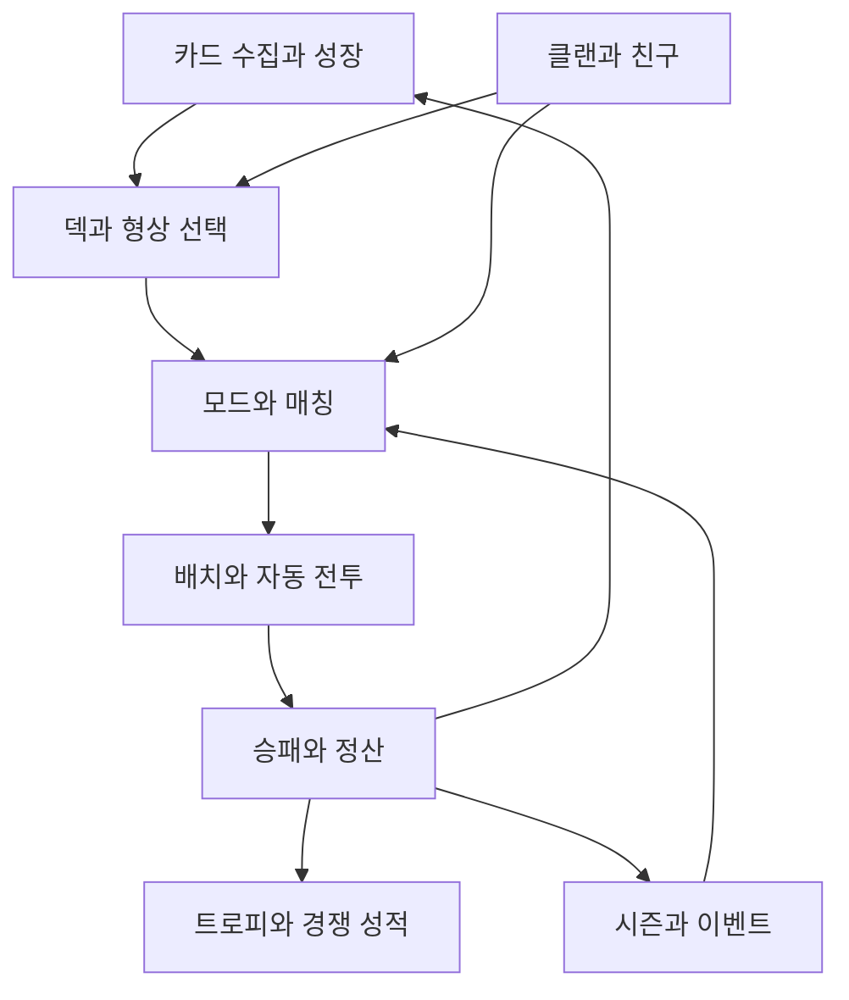

# 01. 게임 구조·핵심 루프·설계 의도

> **확장판 안내:** 초판2026-11-13에2026-11-17 공개 데이터 재구축을 추가했다. 최신 수치·충돌·미확정 값의 사용 범위는 [23번](23_data_reconstruction_overview.md)과 각 상세 데이터 문서를 함께 확인한다.

> 기준일: 2026-11-13 · 범위: 클래시 로얄의 시스템 역기획 · [확인] 공개 규칙 · [분석] 규칙이 만드는 경험에 대한 해석 · [재현 설계] 구현·검증용 제안. 카드별 전 수치 DB나 원본 코드 복원 문서는 아니다.

## 1. 제품을 한 문장으로 정의

**[확인]** 클래시 로얄은 카드 수집·성장과 실시간 대전을 결합하고, 상대 타워를 공격하는 경기 결과를 트로피와 보상으로 연결하는 게임이다. [R01](https://supercell.com/en/games/clashroyale/)

**[분석]** 플레이어의 핵심 행동은 소환한 유닛을 계속 조작하는 것이 아니라, **한정된 자원을 언제 어떤 카드에 쓰고 어디에 배치할지 결정하는 것**이다. 배치 이후 자동으로 진행되는 이동·공격이 예측 대상이 되고, 덱 회전과 상대 선택에 대한 기억이 다음 입력의 가치를 바꾼다.

| 설계 축 | 기능 | 만들어지는 선택 |
|---|---|---|
| 시간 | 짧은 경기와 국면 변화 | 지금 투자할지 기다릴지 |
| 자원 | 시간에 따라 회복하는 엘릭서 | 공격·방어·능력 중 어디에 쓸지 |
| 공간 | 양쪽 레인, 강, 타워와 배치 영역 | 수비 유도·분산·집중 |
| 덱 | 제한된 카드와 순환 손패 | 역할 구성과 회전 비용 |
| 정보 | 상대의 현재 손패·잔액을 직접 알 수 없음 | 사용 이력으로 다음 행동 추정 |
| 성장 | 카드·형상·타워와 모드별 레벨 정책 | 깊게 키울지 넓게 모을지 |
| 반복 | 보상·랭크·이벤트·클랜 | 다음 접속·다음 경기의 목표 |

정보 구조의 상세 공개 범위는 모드·관전 정책에 따라 다를 수 있다. 플레이 중 추론하는 정보와 관전·리플레이에 표시되는 정보를 같은 것으로 취급하지 않는다.

## 2. 시스템 경계

**[분석]** 전투, 성장, 경쟁, 사회적 활동은 서로 영향을 주지만 같은 상태를 공유하지는 않는다. 트로피와 컬렉션 레벨은 서로 다른 의미이며, 카드 보유 레벨이 항상 모든 모드의 전투 레벨이 되는 것도 아니다.



이 도식은 기능 의존도다. 실제 서버 서비스 분할이나 현재 앱 탭 구조를 나타내지 않는다. 하나의 전투 결과가 여러 보상 트랙을 진행시키더라도 지급 조건은 각 트랙에서 별도로 평가해야 한다.

## 3. 여러 시간 규모의 루프

| 루프 | 플레이어의 목표 | 주요 행동 | 피드백 |
|---|---|---|---|
| 교환 단위 | 적은 비용으로 위협 해결 | 배치·주문·능력 | 남은 유닛, 타워 피해, 잔액 |
| 경기 단위 | 승리 조건 달성 | 상대 관찰, 공격·수비 전환 | 크라운, 결과, 전적 |
| 세션 단위 | 일일·단기 목표 달성 | 재대전, 보상 수령, 덱 수정 | 진행 바, 다음 업그레이드 |
| 시즌 단위 | 경쟁 기록·한정 목표 | 랭크·대회·이벤트 | 시즌 보상과 기록 |
| 장기 단위 | 컬렉션·숙련도·사회적 위치 확대 | 해금, 성장, 전략 학습, 클랜 | 사용할 수 있는 선택지 증가 |

**[분석]** 빠른 전투 결과는 짧은 피드백을 주고, 성장과 경쟁 기록은 그 결과를 다음 경기의 준비로 전환한다. 패배해도 원인을 이해하고 다음 선택을 바꿀 수 있다면 학습 루프가 유지된다. 반대로 레벨 차·규칙 불명확·상성 문제가 섞여 패배 원인을 알 수 없으면 재대전 동기가 약해질 수 있다.

## 4. 핵심 재미를 만드는 다섯 가지 교환

### 4.1 자원과 시간

**[확인]** 표준 전투는 진행 시간에 따라 엘릭서 생성 배율을 바꾸며, 이벤트·2v2 등은 별도 규칙을 사용할 수 있다. [R11](https://support.clashroyale.com/hc/en-us/articles/49484936933403-Elixir)

**[분석]** 기다리면 자원이 생기지만 저장 한도 때문에 무한히 기다릴 수는 없다. 고비용 전개는 강한 전력을 만들지만 반대 레인이나 빠른 공격에 대응할 여유를 줄인다. 생성이 빨라지면 비싼 조합뿐 아니라 낮은 비용의 반복 회전도 빨라지므로, ‘더블 엘릭서에서는 무조건 무거운 덱이 유리’ 같은 단순 결론을 내릴 수 없다.

### 4.2 자원과 공간

수비 유닛을 어디에 놓는지에 따라 적 이동 거리와 타워의 공격 참여가 달라진다. 같은 카드로도 상대 유닛을 중앙으로 유도하거나 공격 방향을 바꾸어 다른 결과를 만들 수 있다. 유닛 성능을 카드 수치만으로 평가하면 이 공간적 가치를 놓친다.

### 4.3 현재 교환과 다음 교환

지금 가장 값싼 수비를 하더라도 핵심 대응 카드를 소모하면 다음 공격에 취약해질 수 있다. 덱 회전은 즉시 효율과 미래 대응력을 연결한다. 빠른 회전 덱의 가치는 평균 비용이 낮다는 사실 자체보다, 상대의 대응 카드가 돌아오기 전에 자신의 주요 위협을 다시 사용할 수 있다는 데 있다.

### 4.4 타워 체력과 공격 기회

모든 피해를 막는 것이 항상 최선은 아니다. 작은 피해를 허용하고 큰 반격을 준비하거나, 남은 시간에 맞춰 타워 체력을 방어 자원처럼 사용할 수 있다. 다만 어떤 타워의 파괴가 킹 활성화·배치 영역·즉시 승패에 영향을 주는지 함께 계산해야 한다.

### 4.5 컬렉션의 폭과 주력 덱의 깊이

수집 범위가 넓으면 모드·대회·특수 슬롯 요구에 유연하게 대응할 수 있고, 주력 카드의 레벨이 높으면 성장 영향을 받는 모드에서 유리하다. 두 목표를 동시에 만족시키기 어렵게 만드는 자원 배분이 장기 성장의 주요 선택이다. 2026년 컬렉션 성장 체계는 [09번](09_collection_and_card_progression.md), [10번](10_player_progression_trophy_and_ranked.md)에서 다룬다.

## 5. 교환 가치의 분석 모델

**[재현 설계]** 다음은 전투 판단을 설명하기 위한 개념식이다. 실제 매칭·AI·봇에서 쓰는 점수식이 아니다.

```text
교환 가치 = 상대 투자 제거 가치
          + 생존 전력의 다음 교환 가치
          + 타워 피해·공간·정보 이득
          - 내가 새로 투자한 자원
          - 회전·취약 시간·위치 위험
```

각 항목은 단위가 다르므로 실제로 단순 합산할 경우 별도 가중치 모델이 필요하다. 역기획 단계에서는 숫자 하나를 정답으로 만들기보다 **즉시 엘릭서 이득만으로 설명되지 않는 가치가 무엇인지** 찾는 데 사용한다.

### 5.1 가상 예시

상대가 5엘릭서 상당의 공격을 시작하고 내가 4엘릭서로 수비해 유닛 하나를 남겼다고 가정한다. 즉시 자원 교환은 +1이다. 그러나 남은 유닛 앞에 전열을 추가하면 다음 공격의 준비가 되었고, 반대로 수비에 쓴 카드가 유일한 대공 카드였다면 다음 공중 공격에 위험이 생겼다. ‘+1 교환’만으로 이후 행동을 결정할 수 없는 이유다.

이 예시는 비용 차이를 설명하기 위한 가상 상황이며 특정 카드 조합의 실제 결과나 승률을 의미하지 않는다.

## 6. 장르를 구성하는 결합 지점

| 결합 | 단순 결합과 다른 점 | 시스템이 요구하는 조건 |
|---|---|---|
| 카드 + 실시간 | 카드 순서와 행동 시각이 함께 중요 | 손패·비용·판정 시간의 명확성 |
| 자동 전투 + 직접 배치 | 결과를 예측하되 순간 개입은 제한 | 읽을 수 있는 타겟·이동·공격 |
| 수비 + 반격 | 생존 유닛이 다음 공격 자산 | 체력·위치·추가 비용의 의미 |
| 성장 + 경쟁 | 소유 자산과 실력이 함께 작동 | 모드별 레벨 정책을 명시 |
| 한 덱 + 여러 덱 대회 | 특정 숙련과 컬렉션 폭이 연결 | 카드 중복·덱 선택 규칙 |
| 일상 목표 + 시즌 | 짧은 진전이 장기 목표에 연결 | 보상 트랙의 중복·만료 관리 |

## 7. 최신 범위를 읽는 방법

**[확인]** 2025~2026 공지에는 보상 구조, 챔피언 회전, 특수 슬롯, 성장 체계의 큰 변경이 포함된다. 따라서 초기 출시 당시의 ‘상자 대기 → 오픈 → 업그레이드’만으로 현재 루프를 설명하면 부정확하다. 변경의 정확한 날짜와 적용 범위는 [22번](22_sources_versions_and_open_questions.md)의 버전 표와 원문을 따른다.

이번 패키지는 다음 범위를 나눈다.

- **핵심 1v1:** 승패·엘릭서·회전·배치·전투 판정.
- **현재 확장:** 진화·챔피언·히어로·타워 유닛·성장·경쟁 모드.
- **사회적 반복:** 친구·클랜·기부·거래·클랜전.
- **별도 실행 구조:** Merge Tactics.
- **운영과 재현:** UX·밸런스·데이터·네트워크 제안·검증 계획.

새 기능의 공식 발표와 모든 계정에서의 실제 활성화는 구분한다. 오늘 발표·배포되는 기능도 단말에서 확인하지 않았다면 ‘공식 공지 기반’으로 표시한다.

## 8. 유사 게임 기획에 옮길 때의 의사결정

**[재현 설계]** 같은 전투 문법을 참고하는 프로젝트라면 다음 선택을 먼저 고정한다.

| 질문 | 선택에 따라 바뀌는 시스템 |
|---|---|
| 유닛을 배치 후 직접 조작할 수 있는가? | 입력량, 경로, 예측 가능성, 네트워크 |
| 타워는 승리 조건인가, 자원 생산기인가? | 맵과 수비 가치 |
| 손패를 순환시키는가, 쿨다운 슬롯인가? | 상대 읽기, 덱 구성, HUD |
| 성장 수치가 PvP에 영향을 주는가? | 매칭, 모드, 경제, 신규 진입 |
| 두 레인을 유지하는가? | 반대 레인 압박과 이동 거리 |
| 능력을 별도 입력으로 넣는가? | 손패 외 자원 사용, 조작 복잡도 |
| 여러 덱 대회를 지원하는가? | 컬렉션 요구, 중복 검증, 정산 |

### 최소 재현 범위 제안

처음에는 두 진영·기본 타워·작은 카드 세트·배치·자동 이동·공격·손패·엘릭서·승패를 완성한다. 카드의 개수를 늘리기 전에 **같은 초기 상태와 명령에서 같은 결과가 나오는지**를 검증한다. 이후 상태 효과, 진화·능력, 모드별 규칙을 추가하고, 장기 성장·상점·클랜은 전투의 이해 가능성이 확보된 뒤 연결한다.

이는 원작의 개발 순서가 아니라 재현 프로젝트를 위한 의존성 순서다. MVP 단계의 카드·맵·수치·표현은 독자적으로 설계할 수 있으며 본 문서는 원본 에셋을 제공하지 않는다.

## 9. 후속 문서 읽기 순서

- 전투 기획: [02](02_battle_flow_and_victory.md) → [03](03_elixir_hand_and_cycle.md) → [04](04_arena_and_deployment.md) → [05](05_unit_ai_targeting_and_pathing.md) → [06](06_damage_and_status_effects.md).
- 성장·경제: [07](07_cards_and_deck_building.md) → [08](08_evolutions_champions_heroes_towers.md) → [09](09_collection_and_card_progression.md) → [10](10_player_progression_trophy_and_ranked.md) → [12](12_economy_rewards_and_monetization.md).
- 서비스 운영: [11](11_matchmaking_and_game_modes.md), [13](13_seasons_events_and_retention.md)~[18](18_live_balance_and_analytics.md).
- 구현 검토: [19](19_network_replay_and_architecture.md) → [20](20_data_model_and_configuration.md) → [21](21_qa_and_validation_plan.md).

## 출처

- R01. [Clash Royale 공식 소개](https://supercell.com/en/games/clashroyale/), 열람 2026-11-13.
- R11. [Supercell Support: Elixir](https://support.clashroyale.com/hc/en-us/articles/49484936933403-Elixir), 열람 2026-11-13.
- 변경 이력의 원문과 충돌 기록: [22. 출처·버전·미확정 사항](22_sources_versions_and_open_questions.md).

[전체 목차](00_README.md)

## 2026-11-17 확장: 데이터로 연결한 핵심 루프

전투·성장·보상·경쟁이 연결되는 설명은 [재구축 개요](23_data_reconstruction_overview.md)의 근거 층과 함께 읽는다. 이번 데이터는 거래의 실제 서버 구현을 복원한 것이 아니라 공개 규칙을 입력·상태·결과 계약으로 옮긴 것이다.
