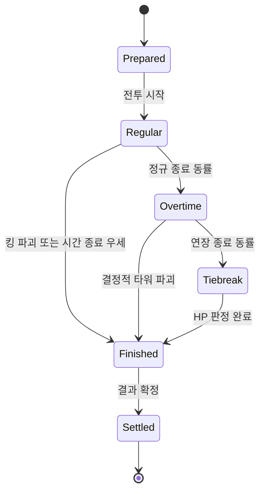

# 02. 전투 진행·승패·종료 처리

> **확장판 안내:** 초판2026-11-13에2026-11-17 공개 데이터 재구축을 추가했다. 최신 수치·충돌·미확정 값의 사용 범위는 [23번](23_data_reconstruction_overview.md)과 각 상세 데이터 문서를 함께 확인한다.

> 조사 기준일: 2026-11-13 · 주 대상: 일반 1대1 전투  
> **[확인]** 공식 공개 자료로 확인한 규칙, **[분석]** 규칙의 효과에 대한 해석, **[재현 설계]** 유사 동작을 구현하기 위한 제안, **[검증 필요]** 현재 클라이언트 실측이 필요한 항목을 구분한다. 내부 코드·서버·실제 리플레이를 분석한 문서는 아니다.

## 1. 시스템 목적과 범위

**[분석]** 전투는 제한된 시간 안에서 상대 타워를 파괴하는 실시간 자원 배분 문제다. 플레이어는 배치 이후 개별 유닛을 계속 조종하지 않으므로, 전략적 행동 단위는 `어떤 카드 / 어느 위치 / 어느 시점`의 조합이다. 승리 조건은 그 선택의 결과를 타워 파괴라는 읽기 쉬운 목표에 연결한다.

**[확인]** 공식 소개는 실시간 카드 전투, 카드 수집·강화, 상대 킹과 프린세스의 타워를 쓰러뜨리는 목표를 명시한다. 일반 전투에서 얻는 트로피와 크라운은 각각 트로피 진척과 패스 진척에 연결된다. 다만 전투의 승패 크라운과 보상 시스템에서 계산하는 지급량은 동일 필드로 취급하면 안 된다. [C01](https://supercell.com/en/games/clashroyale/) [C04](https://support.clashroyale.com/hc/en-us/articles/49484904683803-1v1-Battle)

| 구분 | 전투 시스템의 책임 | 다른 시스템에 전달할 결과 |
| --- | --- | --- |
| 준비 | 모드, 덱, 카드 레벨, 타워, 규칙 버전 확정 | 시작 스냅샷 |
| 진행 | 시간, 엘릭서, 배치, 자동 전투 | 전투 이벤트 |
| 승패 | 타워 파괴, 정규 시간, 연장, 타이브레이커 | 승자·무승부·종료 사유 |
| 정산 | 결과를 한 번 확정 | 보상/레이팅 시스템에 확정 결과 전달 |
| 복기 | 명령과 결과를 조회할 수 있게 제공 | 리플레이·통계·신고 근거 |

## 2. 표준 1대1 시간 구조

**[확인]** 2019-11-26 업데이트에서 정규 3분과 연장 2분, 최종 1분의 3배 엘릭서 구조가 정리되었다. 현재 엘릭서 지원 문서도 1~2분 1배, 3~4분 2배, 5분 3배를 안내한다. 이벤트나 특수 모드는 별도 규칙을 사용할 수 있다. [C02](https://supercell.com/en/games/clashroyale/blog/release-notes/november-update/) [C03](https://support.clashroyale.com/hc/en-us/articles/49484936933403-Elixir)

| 경과 시간 | 화면상 구간 | 엘릭서 생성 배수 | 주요 판단 |
| --- | --- | --- | --- |
| 0:00~2:00 | 정규 시간 앞 2분 | 1배 | 상대 덱 확인, 손패와 자원 보존 |
| 2:00~3:00 | 정규 시간 마지막 1분 | 2배 | 누적 병력 활용, 반대 라인 압박, 방어 전환 |
| 3:00~4:00 | 연장 첫 1분 | 2배 | 다음 타워 파괴가 결정적 승리 조건 |
| 4:00~5:00 | 연장 마지막 1분 | 3배 | 빠른 회전, 주문 피해와 타워 잔여 HP 비교 |
| 연장 종료 | 타이브레이커 | 전투 판정 종료 단계 | 남은 타워의 최저 HP 기준 비교 |

**[분석]** 시간이 흐를수록 자원 공급량을 늘리는 구성은 초반 선택의 무게와 후반 역전 가능성을 함께 만든다. 후반에 행동량이 증가해도 승패 목표는 바뀌지 않아, 플레이어는 신규 규칙 학습 없이 전투 밀도의 증가를 경험한다.

`5분`은 일반 전투의 정규·연장 타이머 합계다. 매칭, 시작 연출, 타이브레이커 연출, 결과 화면까지 포함한 사용자 체류 시간이 정확히 300초라는 뜻은 아니다.

## 3. 타워와 승리 규칙

### 3.1 기본 판정

일반 1대1의 기본 동작 모델은 양쪽의 킹 타워 1개와 측면 크라운 타워 2개를 전제로 한다. 측면 타워의 공격 역할은 선택한 타워 유닛에 따라 달라질 수 있으므로, 구조물 역할과 공격자를 분리해 기술한다.

| 사건 | 기본 결과 | 구현 시 구분할 값 |
| --- | --- | --- |
| 상대 측면 타워 파괴 | 파괴 크라운 1 증가 | `destroyedSideTowers` |
| 상대 킹 타워 파괴 | 즉시 3크라운 승리로 종료 | `kingDestroyed`, `resultCrowns=3` |
| 정규 시간 종료, 크라운 우세 | 우세한 플레이어 승리 | `endReason=RegularTimeLead` |
| 정규 시간 종료, 크라운 동률 | 연장 진입 | `phase=Overtime` |
| 연장에서 결정적 타워 파괴 | 해당 공격 측 승리 | `endReason=SuddenDeath` |
| 연장까지 크라운 동률 | 타이브레이커 | 남아 있는 타워 HP 비교 |

**[근거 범위]** 타워 파괴 목표와 시간 체계는 [C01]~[C03]에 근거한다. 위 표의 극단적 동시 파괴, 프레임 경계 우선순위, 타워 파괴 시각과 판정 시각의 일치는 공식 공개 자료만으로 완전히 확정되지 않아 9절의 실측 대상으로 남긴다. 표준 규칙을 특수 이벤트에 자동 적용하지 않는다.

### 3.2 타이브레이커

**[확인]** 공식 도입 문서는 종료 시점의 **단일 타워 중 최저 HP**를 기준으로 패배를 정한다고 설명한다. 전체 타워 HP 합계나 잔여 HP 비율을 비교하는 규칙으로 바꾸어 해석하면 안 된다. 도입 당시에는 일반 래더가 예외였다는 역사적 범위도 포함되어 있으므로, 2019년 공지의 적용 모드 목록을 현재 목록으로 재사용하지 않는다. [C05](https://supercell.com/en/games/clashroyale/blog/release-notes/the-party-button-update-2/)

**[분석 예시: 임의 HP]** 양쪽에 남은 타워 HP가 다음과 같다고 하자.

| 플레이어 | 남은 측면 타워 A | 남은 측면 타워 B | 킹 타워 | 최저 HP |
| --- | ---: | ---: | ---: | ---: |
| A | 700 | 2,000 | 3,000 | 700 |
| B | 750 | 800 | 1,000 | 750 |

A의 총 HP가 더 많아도 최저 단일 타워 HP는 B보다 낮다. 따라서 타이브레이커 관점에서 A가 불리하다. 실제 카드·레벨의 타워 HP를 사용한 예시는 아니다.

**[검증 필요]** 최저 HP가 양쪽에서 완전히 같은 경우, 같은 시뮬레이션 시각에 양쪽 킹 타워가 파괴되는 경우, 타이브레이커 연출 중 HP 차감 반올림은 현재 일반전과 대회 규칙을 각각 실측해야 한다. 특정 결투 모드의 추가 타이브레이크를 일반전에 그대로 적용하지 않는다.

## 4. 권장 상태 흐름

다음 다이어그램은 **[재현 설계]**다. 실제 Supercell 서버의 클래스나 상태 이름을 의미하지 않는다.



| 상태 | 허용 입력 | 핵심 불변식 |
| --- | --- | --- |
| Prepared | 전투 준비 응답 | 덱·레벨·규칙 버전이 양측에 동일하게 확정 |
| Regular | 카드 배치, 유효 능력 사용 | 종료 판정 이전에만 비용 지불 가능 |
| Overtime | 동일 | 타워 파괴 직후 종료 판정이 누락되지 않음 |
| Tiebreak | 전투 입력 비허용 | 새 유닛·주문·능력으로 결과를 바꾸지 않음 |
| Finished | 결과 확인 | 승자와 종료 사유 불변 |
| Settled | 복기·다음 전투 | 결과 정산 중복 없음 |

## 5. 종료 처리의 데이터 계약

**[재현 설계]** 전투는 보상량을 직접 계산하지 않고 아래와 같은 결과를 전달하는 편이 안전하다.

```json
{
  "battleId": "example_battle_001",
  "modeId": "standard_1v1",
  "rulesetVersion": "example_rules_v1",
  "outcome": "player_a_win",
  "endReason": "overtime_tower_destroyed",
  "elapsedMs": 228400,
  "crowns": {"a": 2, "b": 1},
  "remainingTowerHp": {
    "a": {"left": 0, "right": 860, "king": 3000},
    "b": {"left": 0, "right": 0, "king": 2200}
  },
  "resultRevision": 1
}
```

모든 값은 설명용 가상 데이터다. 이 결과에 보상 시스템이 `보상 대상 모드인가`, `오늘 보상 한도를 채웠는가`, `시즌 이벤트가 활성화됐는가`를 적용한다. 전투 승리와 패스 크라운 지급 조건을 분리하면 이벤트 보상 변경이 전투 판정에 영향을 주지 않는다.

## 6. 대표 전투 의사결정

**[분석 예시]** 정규 시간 40초를 남기고 A가 크라운 1:0으로 앞서지만, 남은 측면 타워 하나의 HP가 낮다고 하자.

1. A는 새로운 대규모 공격보다 상대 승리 조건에 대한 방어 카드를 보존할 유인이 크다.
2. B는 약한 타워를 파괴해 동점을 만들면 연장에 들어갈 수 있으므로 마지막 한 번의 공격에 자원을 집중할 수 있다.
3. A가 방어에 과투자하면 B의 반대 라인 공격 또는 직접 주문 피해에 취약해진다.
4. B가 동점을 만들었을 때는 다음 타워 파괴로 종료되므로 두 플레이어의 허용 위험 수준이 즉시 바뀐다.

이 예시에서 중요한 상태는 승패 수치 하나가 아니라 `현재 크라운`, `가장 약한 타워 HP`, `남은 시간`, `손패에 있는 방어 수단`, `곧 돌아올 상대 카드`다. 결과 화면만으로는 알기 어려운 판단 정보를 리플레이에서 확인할 수 있어야 한다.

## 7. 모드별 오염 방지

**[확인]** 엘릭서 지원 문서는 특수 이벤트 규칙과 2대2의 더 느린 기본 생성률을 별도로 안내한다. 표준 1대1 수치를 모든 전투에 하드코딩할 수 없다. [C03](https://support.clashroyale.com/hc/en-us/articles/49484936933403-Elixir)

**[재현 설계]** 다음을 `BattleRuleset`으로 분리한다.

| 설정 | 예시 필드 | 이유 |
| --- | --- | --- |
| 타워 구성 | `towerLayoutId` | 킹 없는 이벤트와 일반전 구분 |
| 정규·연장 시간 | `regularSeconds`, `overtimeSeconds` | 이벤트 길이 변경 |
| 크라운 승패 | `victoryRuleId` | 일반전·서든데스 구분 |
| 엘릭서 | `generationScheduleId` | 1배·3배·점증 모드 구분 |
| 레벨 제한 | `levelRuleId` | 트로피·랭크·도전 구분 |
| 손패 | `deckRuleId` | 일반 8장과 드래프트·특수 회전 구분 |
| 무승부 | `drawPolicyId` | 전투 결과와 레이팅 후처리 구분 |

특히 `modeId`를 보상 계산의 유일한 키로 쓰기보다, 시즌에 변경될 수 있는 규칙 버전을 시작 시점에 고정한다. 긴 경기 중 운영 데이터가 바뀌어도 경기 도중 승리 조건이 바뀌지 않아야 한다.

## 8. 설계상 장단점

**[분석]** 타워를 파괴하면 승리 점수와 전진 배치 이득이 함께 생기므로 첫 타워의 가치가 높다. 반면 상대 킹의 방어 활성화는 단순한 일방적 눈덩이 효과를 완화한다. 이미 앞선 플레이어가 무리하게 3크라운을 노릴 필요가 없기 때문에, 공격적인 카드 설계와 수비적인 승리 조건 사이에서 밸런스 긴장이 생긴다.

타이브레이커는 경기 시간을 제한하고 미세한 피해도 의미 있게 만들지만, 직접 타워를 타격하는 주문 회전의 가치를 높일 수 있다. 따라서 전투 시간만 조절해서 수비 메타를 해결하기보다, 공격 기회·주문 크라운 피해·타워 대응력을 함께 보아야 한다. 이는 설계 해석이며 실제 개발팀의 내부 의사결정 과정에 대한 주장은 아니다.

## 9. QA와 추가 실측

| ID | 시나리오 | 확인해야 할 결과 |
| --- | --- | --- |
| BF-01 | 정규 종료 시 1:0 | 연장 없이 승패 확정 |
| BF-02 | 정규 종료 시 1:1 | 연장 2분 진입, 현재 유닛·엘릭서 유지 |
| BF-03 | 2배 전환 직전 카드 사용 | 비용 이중 처리나 생성량 점프 없음 |
| BF-04 | 연장 첫 결정적 타워 파괴 | 후속 입력과 추가 피해의 종료 경계 일관성 |
| BF-05 | 주문 착탄과 정규 종료가 같은 시각 | 명시한 이벤트 순서대로 동일 결과 |
| BF-06 | 양쪽 타워 최저 HP가 같음 | 현재 모드의 무승부 규칙 실측 |
| BF-07 | 최저 HP 타워와 총 HP 우세가 다름 | 총합 대신 최저 단일 타워 기준 |
| BF-08 | 양쪽 킹 동시 파괴 | 서버 결과·연출·리플레이 일치 여부 실측 |
| BF-09 | 결과 응답 재수신 | 트로피·보상 중복 지급 없음 |
| BF-10 | 전투 중 재접속 | 경기 지속 여부·복원 상태를 실측하고 재현 구현의 정의된 단절 정책과 비교 |
| BF-11 | 타이브레이커 직전 능력 입력 | 입력 승인 여부와 비용 처리 일치 |
| BF-12 | 특수 모드로 바로 전환 | 직전 모드의 시간·배수·레벨 규칙 잔류 없음 |

네트워크 단절이 전투 시간을 멈추는지, 입력 지연이 어디까지 허용되는지, 종료된 경기의 늦은 입력을 어떻게 거절하는지는 공개 자료만으로 확정하지 않는다. 관련 재현 구조는 네트워크·리플레이 문서와 연결한다.

## 10. 근거와 연결 문서

- **C01** · Supercell, [Clash Royale 공식 소개](https://supercell.com/en/games/clashroyale/) · 발행일 미표기, 2026-11-13 확인
- **C02** · Supercell, [November Update](https://supercell.com/en/games/clashroyale/blog/release-notes/november-update/) · 2019-11-26 · 시간 구조 변경 이력
- **C03** · Supercell Support, [Elixir](https://support.clashroyale.com/hc/en-us/articles/49484936933403-Elixir) · 현행 지원 문서, 2026-11-13 확인
- **C04** · Supercell Support, [1v1 Battle](https://support.clashroyale.com/hc/en-us/articles/49484904683803-1v1-Battle) · 현행 지원 문서, 2026-11-13 확인
- **C05** · Supercell, [SEPTEMBER UPDATE!](https://supercell.com/en/games/clashroyale/blog/release-notes/the-party-button-update-2/) · 2019-09-30 · 타이브레이커 도입 이력

연결: [엘릭서·손패·회전](03_elixir_hand_and_cycle.md), [아레나·배치](04_arena_and_deployment.md), [피해·상태 효과](06_damage_and_status_effects.md).

## 11. 2026-11-17 고도화: 승패 판정의 복원 증거와 실험 경계

시간·배수·승패를 한 개의 `matchDuration` 설정으로 합치지 않는다. 이번 재구축은 정규 180초, 연장 120초와 배수 구간을 별도 행으로 기록했다. 공식 지원의 분 단위 설명은 [Elixir](https://support.clashroyale.com/hc/en-us/articles/49484936933403-Elixir)에서 재확인했다. [combat_rules.json](data/tables/combat_rules.json)의 `COMBAT_BATTLE_REGULAR_DURATION`, `COMBAT_BATTLE_OVERTIME_DURATION`, `COMBAT_ELIXIR_MULTIPLIER_SCHEDULE`가 해당한다.

타이브레이커의 단일 최저 HP 지표는 [2019 도입 공지](https://supercell.com/en/games/clashroyale/blog/release-notes/the-party-button-update-2/)의 사실이다. 그 공지의 당시 적용 모드 목록까지 2026년에 유효한 것으로 확정하지 않는다. `COMBAT_BATTLE_EQUAL_LOWEST_HP_RESOLUTION`과 `COMBAT_BATTLE_SIMULTANEOUS_KING_DESTRUCTION_ORDER`의 값은 `null`이다. 같은 HP에서 끝나는 일반전, 두 킹이 같은 시각에 파괴되는 경기, 타이머 경계 착탄을 원작에서 직접 계측한 결과가 없기 때문이다.

재현 구현에서는 승패 확정 전후 입력을 나누고, 종료 결과에는 당시 규칙 버전·남은 타워별 HP·마지막 승인 명령·결정적 피해 이벤트 ID를 보관한다. 이는 원작 내부 형식을 주장하는 것이 아니라 불일치 원인을 좁히기 위한 제안이다. [44개 실험 명세](data/tables/interaction_cases.json)는 모두 미실행 상태이며, 스키마 검증 통과와 원작 전투 일치를 구분한다. 자세한 계측 절차는 [24번](24_combat_rules_and_interaction_lab.md)을 참고한다.
