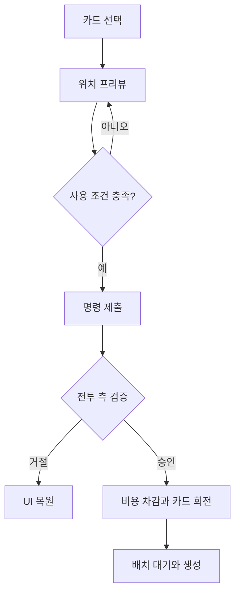

# 04. 아레나·배치 영역·공간 전략

> **확장판 안내:** 초판2026-11-13에2026-11-17 공개 데이터 재구축을 추가했다. 최신 수치·충돌·미확정 값의 사용 범위는 [23번](23_data_reconstruction_overview.md)과 각 상세 데이터 문서를 함께 확인한다.

> 조사 기준일: 2026-11-13 · 범위: 일반 1대1 지형과 카드 배치  
> **[확인]** 공식 공개 자료, **[분석]** 공간·UX 해석, **[재현 설계]** 구현 모델, **[검증 필요]** 좌표·프레임 실측 항목. 타일 크기나 실제 충돌체의 내부 수치를 추출한 문서는 아니다.

## 1. 공간 구조가 만드는 선택

**[분석]** 일반 아레나는 전방의 두 라인과 후방의 킹 타워를 통해 공격 목표를 분리한다. 중앙의 강과 두 다리는 지상 유닛의 이동을 제한하면서 배치 위치가 도착 시간과 타겟 선택에 영향을 주도록 한다. 같은 카드를 사용해도 후방 전개, 다리 앞 투입, 중앙 유인 배치는 서로 다른 행동이다.

| 공간 요소 | 기능 | 플레이어의 결정 |
| --- | --- | --- |
| 후방 영역 | 접촉 전 시간 확보 | 엘릭서를 다시 모아 병력을 누적할 것인가 |
| 다리 입구 | 적 진영까지의 시간 단축 | 준비되지 않은 상대를 빠르게 압박할 것인가 |
| 중앙 방어 영역 | 양쪽 라인에 대한 접근 가능성 | 적의 이동을 중앙으로 꺾을 것인가 |
| 측면 타워 주변 | 수비 화력·피해 분산 | 유닛과 타워의 어그로를 어떻게 나눌 것인가 |
| 킹 타워 주변 | 후방 방어와 활성화 | 피해를 허용해 이후 방어 이점을 얻을 것인가 |
| 파괴된 적 타워 근처 | 전진 배치 기회 | 병력 도착 시간을 줄여 추가 공격할 것인가 |

**[확인]** 공식 전투 안내도 후방 배치의 자원 회복 시간과 반대 라인 압박의 의미를 설명한다. 본 문서는 그 행동을 기하·시간 조건으로 해석한다. [C04](https://support.clashroyale.com/hc/en-us/articles/49484904683803-1v1-Battle)

## 2. 좌표계와 표현 분리

**[재현 설계]** 구현에서는 전투 세계 좌표와 각 플레이어의 화면 좌표를 분리한다. 플레이어에게 자신의 진영이 아래쪽에 보이더라도 서버는 하나의 공통 좌표를 사용할 수 있다.

```text
world_position → player_view_transform → screen_position
screen_input → inverse_view_transform → requested_world_position
```

예를 들어 재현 프로젝트에서 아레나의 폭·높이를 임의의 `W`, `H`로 정의하면 반대편 시점 변환은 `x'=W-x, y'=H-y`처럼 표현할 수 있다. 이는 180도 회전을 선택한 구현 예시이며 원작의 내부 좌표 변환이나 타일 개수를 확정한 정보가 아니다.

| 데이터 | 권장 역할 | 피해야 할 결합 |
| --- | --- | --- |
| 전투 좌표 | 이동·판정·재현의 기준 | 화면 해상도 의존 |
| 배치 좌표 | 승인된 생성 지점 | 터치 픽셀 자체 저장 |
| 표시 좌표 | 카메라·화면 방향 반영 | 판정 좌표를 직접 수정 |
| 배치 마스크 | 플레이어·카드·현재 타워 상태별 허용 영역 | 하나의 사각형으로 전 카드 처리 |
| 유닛 점유 영역 | 충돌·진로 조정 | 배치 마스크와 같은 크기라고 가정 |

**[검증 필요]** 실제 타일 격자, 타워 중심 좌표, 다리 폭, 반칸 배치, 타워 파괴 후 적 진영에서 허용되는 경계는 스크린샷의 픽셀만으로 확정하지 않는다. 화면 투영과 입력 보정 때문에 보이는 위치와 논리 좌표가 다를 수 있다.

## 3. 배치 가능 영역

### 3.1 카드별 정책

일반적인 동작을 아래 정책으로 분류한다. 정확한 모든 예외 목록은 카드별 데이터와 실제 배치 프리뷰로 검증해야 한다.

| 배치 정책 | 대표 동작 | 필요한 검사 |
| --- | --- | --- |
| 아군 영역 배치 | 일반 병력·건물 | 소유 진영 마스크, 타워·강과의 겹침 |
| 전장 지정 | 상대 진영도 지정 가능한 카드 | 카드별 전역 허용 영역 |
| 주문 영역 지정 | 범위 중심을 지정 | 허용 중심점과 실제 효과 반경 분리 |
| 특수 배치 | 지하 이동·통·소환 후 이동 등 | 목적지와 생성 위치를 별도 관리 |
| 파괴 후 확장 | 상대 측면 타워 파괴로 전진 배치 | 파괴된 타워와 연결된 동적 마스크 |

**[확인]** 공식 지원은 Miner와 Goblin Barrel이 전장 어느 위치에나 놓을 수 있다는 특성이 승리 조건으로 기능한다고 설명한다. 이 예외를 모든 유닛 카드에 일반화하지 않는다. [C04](https://support.clashroyale.com/hc/en-us/articles/49484904683803-1v1-Battle)

**[분석]** 배치 제한은 지상 유닛이 반드시 모든 거리를 걸어가게 하는 장치라기보다, 유닛마다 상대의 대응 시간을 다르게 보장하는 장치다. 상대 타워 가까이 직접 등장하는 카드도 날아오는 연출·출현 시간·방어 위치 읽기라는 대응 기회를 제공해야 한다.

### 3.2 전진 배치

측면 타워를 파괴한 쪽은 해당 지역으로 배치 가능 영역이 확장되는 일반 동작을 고려해야 한다. 다만 전체 상대 진영이 무조건 해금된다는 식으로 모델링하지 않는다.

**[재현 설계]** `deploy_mask = own_territory ∪ unlocked_forward_pockets` 형태로 표현하고, 각 전진 영역은 연결된 측면 타워의 파괴 이벤트가 확정될 때 갱신한다. 타워가 파괴되는 연출만 시작된 시점과 게임플레이상 파괴가 확정된 시점을 구분한다.

**[검증 필요]** 드래그 중 타워가 파괴될 때 프리뷰가 즉시 바뀌는지, 놓는 시점에만 허용 영역을 재검사하는지, 파괴 위치와 카드 크기에 따른 경계가 어떻게 되는지 측정해야 한다.

## 4. 배치 입력의 처리 흐름

다음은 **[재현 설계]**이며 원작 내부 프로토콜이 아니다.



| 단계 | 확인 사항 | 사용자 피드백 |
| --- | --- | --- |
| 선택 | 현재 손패의 유효 카드인가 | 카드 강조, 비용 |
| 프리뷰 | 지형·영역상 가능한가 | 생성 위치·반경·불가 영역 |
| 제출 | 아직 손패에 있고 엘릭서가 충분한가 | 승인 대기 표현 |
| 승인 | 같은 명령이 이미 처리됐는가 | 비용·손패 변경 |
| 생성 대기 | 배치 시간, 지연 생성, 다중 개체 간격 | 소환 표시·연출 |
| 활성 | 타겟 탐색·이동·공격 가능한가 | HP와 개체 표현 |

손가락을 놓은 시각과 유닛이 공격 가능한 시각을 같게 처리하면 반응형 방어의 난도가 달라진다. `입력 전달 지연`, `배치 대기`, `첫 공격 대기`, `투사체 이동`을 별개로 정의해야 한다.

## 5. 배치 시간과 첫 공격의 분리

**[확인]** 공식 자료는 First Hit Speed를 이동 또는 배치 이후 첫 공격까지 걸리는 시간으로 설명한다. 또 진화 박격포의 배치 이후 첫 공격 지연을 별도로 조정한 사례가 있다. 따라서 `Deploy Time`과 `First Hit Time`을 동일 값으로 보면 안 된다. [C12](https://supercell.com/en/games/clashroyale/blog/release-notes/season-16/) [C13](https://supercell.com/en/games/clashroyale/blog/release-notes/october-balance-changes/)

**[재현 설계]** 표준화한 계산 예시는 다음과 같다.

```text
위협 도달 시간 ≈ 명령 전달 + 배치 대기 + 이동 시간 + 첫 공격 대기 + 투사체 시간
```

이는 모든 카드에 그대로 합산하는 실제 공식이 아니다. 등장 시 피해, 즉시 주문, 점프·돌진, 지하 이동은 일부 단계를 생략하거나 별도 분기로 처리한다. 다중 병력 카드는 하나의 카드 승인에서 여러 개체가 각기 다른 생성 시각과 위치를 가질 수 있다.

## 6. 이동 분류와 강 건너기

**[확인]** 2020년 공식 패치는 Battle Healer와 Royal Ghost의 부유 이동을 설명하며, 강을 직접 건너는 특성과 공중 유닛을 공격하는 능력이 서로 다르다고 명시했다. 과거 변경 사례이므로 현재 개별 카드 전체 사양표로 사용하지 않는다. [C12](https://supercell.com/en/games/clashroyale/blog/release-notes/season-16/)

**[분석]** 다음 세 속성은 반드시 분리해서 이해해야 한다.

| 속성 | 질문 | 혼동 사례 |
| --- | --- | --- |
| 이동 경로 | 다리 없이 강을 건널 수 있는가 | 부유하므로 공중 유닛이라고 단정 |
| 피격 분류 | 지상 전용 공격에 맞는가 | 강을 건너므로 지상 공격 면역이라고 단정 |
| 공격 분류 | 공중을 때릴 수 있는가 | 공중 유닛은 모두 대공 공격 가능하다고 단정 |

**[재현 설계]** `movementMode`, `targetableLayer`, `attackTargetMask`를 개별 필드로 둔다. 점프는 지형 경계를 넘는 이동 기능이고, 점프 도중의 무적·피격 여부는 상태 효과 정책이다. 물리 시뮬레이션의 공중 높이 하나로 모든 판정을 대체하지 않는다.

## 7. 공간 전술의 정량 모델

### 7.1 중앙 유인

**[분석]** 중앙 방어 배치는 다음 세 효과를 조합한다.

- 공격 유닛의 원래 타워까지 이동 경로를 늘린다.
- 수비 유닛·건물과 타워의 공격 시간이 겹치게 한다.
- 적 근접·원거리 병력의 도착 시각을 다르게 만들어 한꺼번에 받는 피해를 줄인다.

**[재현 설계 예시]** 공격 유닛 속도를 `v`, 우회로가 늘리는 거리를 `Δd`로 두면 수비 측이 추가로 얻는 시간은 단순 근사로 `Δt=Δd/v`다. 실제로는 충돌·재탐색·돌진 속도가 개입하므로 경로 길이만으로 정확한 시간을 예측할 수 없다.

### 7.2 분산 배치

다중 병력을 중앙에 놓아 양쪽 라인으로 나누는 선택은 공격 화력의 집중을 줄이지만 상대의 광역 주문 효율을 낮출 수 있다. 어느 개체가 어느 다리를 선택하는지는 생성 오프셋과 타겟 선정 경계에 민감하다. UI가 단일 소환 중심만 보여 줘도 실제 개체는 동일한 좌표에서 출발하지 않을 수 있다.

### 7.3 킹 타워 활성화

**[확인]** 킹 타워 활성화는 공식 밸런스 문서에서도 별도로 다루는 상호작용이다. 예를 들어 Golden Knight의 돌진 종료 규칙 변경은 킹 타워 활성화 난도에 영향을 준다고 설명됐다. [C14](https://supercell.com/en/games/clashroyale/blog/release-notes/balance-changes-april-2022/)

일반 동작 모델은 킹 타워가 직접 피해를 받거나 자기 측면 타워가 파괴되면 방어 공격에 참여하는 것이다. **[분석]** 공격 경로를 킹 쪽으로 유도해 작은 피해를 일부러 받는 전술은 이후 전투에서 추가 수비 화력을 얻는 투자로 해석할 수 있다. 이때 킹 HP 감소는 실제 비용이므로 항상 유리하다고 단정하지 않는다.

**[검증 필요]** 활성화 프레임, 피해 없는 상태 효과만 받은 경우, 반사·지속 피해·소환 피해·대시 피해의 처리, 동시 측면 타워 파괴는 별도로 검증해야 한다.

## 8. 공간·시각 일관성 요구

**[재현 설계]** 사용자는 위치 선택을 핵심 실력 요소로 받아들이므로, 한 번 성공한 배치가 같은 조건에서 다른 결과를 만들면 예측 가능성이 크게 떨어진다.

| 요구 | 실패하면 생기는 문제 |
| --- | --- |
| 손가락 위치와 프리뷰의 일관성 | 맞게 놓았다고 생각한 카드가 다른 칸에 생성 |
| 프리뷰와 승인 좌표의 일치 | 중앙 유인이 실패하거나 주문이 빗나감 |
| 반대 시점 대칭성 | 플레이어 진영에 따른 전술 차이 |
| 카드 형태별 유효 범위 표시 | 진화·히어로 효과 범위 오해 |
| 다중 개체 오프셋의 안정성 | 병력 분산 결과를 학습할 수 없음 |
| 관전과 경기의 동일한 판정 표현 | 리플레이에서 다른 결과처럼 보임 |

## 9. QA 계획

| ID | 입력 상황 | 검증할 결과 |
| --- | --- | --- |
| AR-01 | 강 위에 일반 지상 카드 드롭 | 카드별 허용 정책에 맞게 거절·보정 |
| AR-02 | 상대 진영에 Miner·Goblin Barrel | 전역 배치 예외 적용 |
| AR-03 | 동일 위치에 큰 병력과 다중 병력 | 생성 오프셋·충돌 안정성 |
| AR-04 | 측면 타워 파괴 중 드래그 | 승인 시점 마스크와 프리뷰 일치 |
| AR-05 | 좌우 반전·상하 반대 시점 | 논리 배치 결과 대칭성 |
| AR-06 | 중앙 건물의 경계 위치 | 유인 가능 여부와 타겟 재선정 재현 |
| AR-07 | 다리 인근 점프·부유 유닛 | 이동과 피격·공격 분류 분리 |
| AR-08 | 킹 타워 근처 광역 피해 | 활성화와 위험 표시 검증 |
| AR-09 | 건물 파괴 직후 같은 위치 배치 | 점유 영역 해제 시점 일관성 |
| AR-10 | 한 프레임에 두 카드 입력 | 비용·손패·좌표·생성 순서 일관성 |
| AR-11 | 화면 종횡비·해상도 변경 | 허용 영역과 실제 전투 좌표 불변 |
| AR-12 | 동일 명령을 리플레이 | 같은 생성 지점·라인 분기 결과 |

## 10. 출처와 연결

- **C04** · Supercell Support, [1v1 Battle](https://support.clashroyale.com/hc/en-us/articles/49484904683803-1v1-Battle) · 현행 문서 확인 2026-11-13
- **C12** · Supercell, [New Cards, Pass Royale & Balance Changes](https://supercell.com/en/games/clashroyale/blog/release-notes/season-16/) · 2020-10-06 · 첫 공격·부유 이동의 공식 설명
- **C13** · Supercell, [October Balance Changes](https://supercell.com/en/games/clashroyale/blog/release-notes/october-balance-changes/) · 2024-10-08 · 첫 공격 지연·밀치기 조정 사례
- **C14** · Supercell, [Balance Changes April 2022](https://supercell.com/en/games/clashroyale/blog/release-notes/balance-changes-april-2022/) · 2022-04-04, 4월 8일 추가 변경 포함

연결: [전투 진행·승패](02_battle_flow_and_victory.md), [엘릭서·손패](03_elixir_hand_and_cycle.md), [유닛 AI](05_unit_ai_targeting_and_pathing.md).

## 11. 2026-11-17 고도화: 배치와 좌표의 데이터 계약

[공식 2025 경로 수정](https://supercell.com/en/games/clashroyale/blog/release-notes/april-update/)은 건물에 충돌하기 전에 회피하고 레인 의존을 줄인 움직임을 설명한다. 같은 문서는 여러 병력을 소환하는 대형의 양 진영 반전도 수정 대상으로 기록한다. 정확한 몸체 반경·소환 오프셋·NavMesh 구조를 공개한 자료는 아니므로, 관측 가능한 행동과 추정 알고리즘을 분리한다.

배치 로그의 최소 단위는 `(team, logical_position, card_id, form_id, level, request_time, activation_time)`이다. 2D/3D와 세로/가로 화면은 논리 좌표를 표시하는 변환이며 원작 수치의 단위를 바꾸지 않는다. 화면 픽셀을 원작 tile로 간주하지 않고, 데이터의 거리 단위와 렌더링 축척을 한 곳에서 변환한다.

대형 검증 `CASE_GROUP_MIRROR`는 같은 논리 배치의 좌표를 양쪽 진영에서 반전하여 소환 순서·간격·방향을 비교한다. 점프·부유·비행은 강을 건너는 경로와 공격 대상 마스크를 독립적으로 검사한다. `CASE_HOVER_TARGET_MASK`와 `CASE_MINION_GIANT_AXES`가 이 구분을 담는다. 실제 원작 실행 결과는 없으며 [24번 실험 명세](24_combat_rules_and_interaction_lab.md)에 조건을 적었다.
