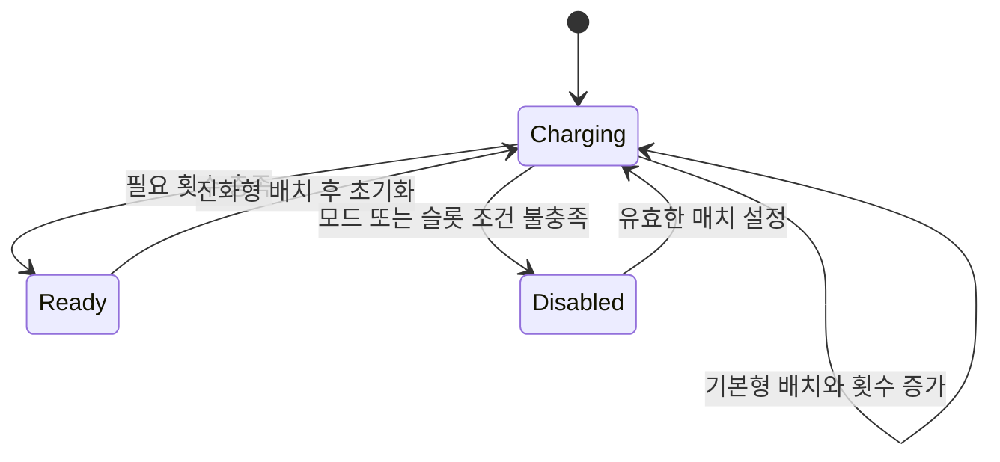

# 08. 진화·챔피언·히어로·타워 유닛

> **확장판 안내:** 초판2026-11-13에2026-11-17 공개 데이터 재구축을 추가했다. 최신 수치·충돌·미확정 값의 사용 범위는 [23번](23_data_reconstruction_overview.md)과 각 상세 데이터 문서를 함께 확인한다.

> 조사 기준: 2026-11-13. 특수 카드 형태와 덱 슬롯, 능력 발동, 타워 유닛을 다룬다. **[확인]**은 공식 공개 규칙, **[분석]**은 설계 해석, **[재현 설계]**는 구현 제안이다. 2025년 이전 챔피언 회전 및 초기 4개 특수 슬롯 규칙을 현재 규칙으로 사용하지 않는다.

## 1. 네 시스템의 차이

| 항목 | 카드와의 관계 | 전투 중 주요 결정 | 성장의 성격 |
| --- | --- | --- | --- |
| 진화 | 기존 카드의 해금 가능한 특수 형태 | 정해진 배치 횟수 후 강한 배치 타이밍 만들기 | 형태 해금과 기본 카드 레벨을 분리 |
| 히어로 | 기존 카드의 능동 능력을 가진 형태 | 배치 후 추가 엘릭서를 언제 능력에 사용할지 | 원하는 형태를 별도 해금 |
| 챔피언 | 독립 희귀도에 속하는 카드 | 유닛 운용과 능동 능력 시점 | 카드 자체 수집·레벨 성장 |
| 타워 유닛 | 덱의 별도 타워 방어 선택 | 시작 전 덱과 타워의 약점을 조합 | 타워 유닛 카드의 레벨 성장 |

**[확인]** 진화는 전투 중 사용 횟수를 채운 다음 배치에서 활성화되고, 효과는 자동으로 작동한다. 히어로는 적합한 슬롯에 넣은 뒤 배치하고 엘릭서를 사용해 능력을 활성화한다. 챔피언도 엘릭서를 쓰는 능력을 가진다. [E03](https://support.supercell.com/clash-royale/en/articles/card-evolution-8.html), [E04](https://support.clashroyale.com/hc/en-us/articles/49484957323163-Heroes), [E05](https://support.clashroyale.com/hc/en-us/articles/49484915467291-Champions)

**[분석]** 진화는 “카드를 몇 번 사용했는가”에 전술적 의미를 추가하고, 능동 능력은 “이미 배치된 개체에 자원을 더 투입할 것인가”를 묻는다. 타워 유닛은 양쪽 결정의 전제인 방어 환경을 바꾼다. 이 세 축이 결합하면서 같은 8장도 다른 경기 흐름을 만든다.

## 2. 현재 특별 슬롯 규칙

**[확인]** 2026-03-16 개편 및 현재 지원 문서 기준의 슬롯 구성은 다음과 같다. 기존의 진화 2칸+히어로 2칸을 그대로 전제하면 현재 덱을 잘못 재현한다. [E08](https://supercell.com/en/games/clashroyale/blog/news/mid-march-update/)

| 슬롯 | 수 | 허용 | 트로피 진척도 해금 |
| --- | ---: | --- | --- |
| 진화 슬롯 | 1 | 진화 형태 | 아레나 3 |
| 히어로 슬롯 | 1 | 히어로 또는 챔피언 | 아레나 5 |
| 와일드 슬롯 | 1 | 진화·히어로·챔피언 중 선택 | 아레나 10 |

**[확인]** 히어로와 챔피언을 위한 슬롯이 아레나 5에 열린다는 사실이 챔피언 카드 자체의 첫 해금도 아레나 5라는 뜻은 아니다. 현재 챔피언 지원 문서는 첫 챔피언 보상을 아레나 16, 시작 레벨을 11로 안내한다. 또한 히어로 슬롯과 와일드 슬롯을 이용하면 서로 다른 챔피언 두 장을 한 덱에 넣을 수 있다고 명시한다. [E05](https://support.clashroyale.com/hc/en-us/articles/49484915467291-Champions)

**[재현 설계]** 허용 조합 검증은 다음처럼 슬롯별로 수행한다.

| 진화 슬롯 | 히어로 슬롯 | 와일드 슬롯 | 조합 의미 |
| --- | --- | --- | --- |
| 진화 A | 히어로 B | 진화 C | 진화 2 + 히어로 1 |
| 진화 A | 챔피언 B | 진화 C | 진화 2 + 챔피언 1 |
| 진화 A | 히어로 B | 히어로 C | 진화 1 + 히어로 2 |
| 진화 A | 챔피언 B | 챔피언 C | 진화 1 + 챔피언 2 |
| 진화 A | 히어로 B | 챔피언 C | 진화 1 + 히어로 1 + 챔피언 1 |

표는 서로 다른 카드와 해금된 형태를 가정한다. 모든 특별 슬롯을 반드시 특수 카드로 채워야 한다는 규칙을 제안하는 것은 아니다. Draft나 시즌 이벤트는 개인 덱과 다른 슬롯 정책을 적용할 수 있다.

## 3. 진화의 순환 상태

**[확인]** 특정 카드의 진화 조각 6개로 형태를 해금한다. 해당 카드를 진화 또는 와일드 슬롯에 넣어야 전투에서 진화하며, 일반 슬롯에서는 기본형으로 동작한다. 필요한 기본형 배치 횟수는 카드별로 다르고, 진화 배치 뒤에는 다시 준비 과정을 거친다. [E03](https://support.supercell.com/clash-royale/en/articles/card-evolution-8.html)

**[재현 설계]** `requiredNormalDeployments`와 `normalDeploymentsSinceEvolution`을 사용하면 “1사이클 진화”와 “2사이클 진화”의 모호한 표현을 제거할 수 있다.

```text
예: requiredNormalDeployments = 2인 가상 카드
기본 배치 1회 → 준비 1/2
기본 배치 2회 → 준비 2/2, 다음 배치 진화 가능
진화 배치 1회 → 준비 0/2로 초기화
```



**[분석]** 상대 진화의 준비 상태는 단순 효과 예고를 넘어 “어떤 카드가 다음에 강해질지”를 추론하는 정보다. 일반 배치를 성급히 소비하면 상대 대응이 준비된 시점에 진화를 맞추게 될 수 있다. 반대로 약한 기본형을 사용해 미래의 강한 한 번을 준비하는 선택도 생긴다.

**[재현 설계]** 다음 항목은 명시적인 정책이 필요하다.

- 실제 서버가 승인한 배치만 횟수에 포함한다. 드래그 취소·자원 부족 입력은 제외한다.
- 진화 준비 상태는 경기 단위다. 다음 경기로 준비 횟수를 이월하지 않는다.
- 소환물·복제·반사와 플레이어가 직접 쓴 카드를 구분한다.
- Mirror처럼 원본 카드를 다시 만드는 효과는 원본의 순환 상태와 별도로 정의한다.
- 진화형의 모든 수치가 기본형보다 일괄 증가한다고 가정하지 않는다. 효과와 수치를 각각 데이터화한다.

## 4. 히어로 해금과 능동 능력

**[확인]** 현재 히어로는 Hero Coins 200개로 원하는 형태를 선택해 해금한다. 보유 한도는 200이며 초과 획득분은 코인당 1 Gem으로 전환된다. 중복 히어로 보상은 해당 카드 복제본과 Hero Coins 20개로 처리한다. 2025년 출시 당시의 무작위 소환·중복 보상 60개는 현행 규칙이 아니다. [E04](https://support.clashroyale.com/hc/en-us/articles/49484957323163-Heroes), [E10](https://supercell.com/en/games/clashroyale/blog/release-notes/december-update-2025/)

**[분석]** 진화의 횟수 준비와 달리 히어로는 “형태를 선택했을 때 매 배치에 능력 결정이 따라오는 구조”다. 배치 비용 외에 능력 예산을 남겨야 하므로, 화면에 보이는 유닛의 비용보다 실제 전술 투자가 커질 수 있다.

### 4.1 2026년 8월 능력 사용 규칙 변경

**[확인]** 2026-08-04 밸런스 공지는 히어로와 챔피언 능력을 쿨다운 반복 사용에서 **해당 개체의 배치당 한 번 사용** 방식으로 변경하며 Boss Bandit을 예외로 명시했다. 따라서 일반적인 능력 상태를 “쿨다운이 끝나면 계속 사용”으로 만들면 구버전 재현이 된다. 개별 능력의 횟수·조건·후속 예외는 카드별 규칙으로 둔다. [E07](https://supercell.com/en/games/clashroyale/blog/news/final-august-balance-changes-826/)

**[재현 설계]** 능력 상태는 `Ready / Pending / Active / Spent / Unavailable`로 구분한다. 버튼 비활성의 원인이 자원 부족인지, 유효 개체 부재인지, 사용 완료인지를 UI에 구별해 보여야 한다.

| 능력 요청 시점 | 검사 | 처리 제안 |
| --- | --- | --- |
| 버튼 누름 | 사용 권한 있는 개체가 존재하는가? | 없으면 요청 거절 |
| 실행 승인 전 | 해당 능력의 비용이 충분한가? | 부족하면 차감 없이 거절 |
| 실행 승인 | 사용 횟수와 개체 상태가 유효한가? | 비용 차감과 실행을 하나의 확정 처리로 묶음 |
| 발동 중 개체 사망 | 능력별 취소·지속·환불 정책 | 일괄 환불 규칙을 쓰지 않음 |
| 동일 요청 재전송 | 동일 행동 ID인가? | 비용과 효과 중복 적용 방지 |

가상 예시에서 배치 비용 4, 능력 비용 2인 카드를 사용할 계획이라면, 배치 시점의 “실제 약속한 지출”은 6으로 볼 수 있다. 다만 능력을 사용하지 않고 2를 다른 방어에 전환할 자유가 있으므로 6을 선차감하는 시스템은 아니다.

## 5. 챔피언 회전과 능력 소유 개체

**[확인]** 2025년 10월 업데이트에서 챔피언은 일반 카드처럼 순환하도록 바뀌었고, 동일 종류가 전장에 여러 개 존재할 수 있게 됐다. 최신 지원 문서에 따르면 같은 종류의 챔피언이 여러 개 있을 때 능력을 사용할 수 있는 것은 가장 최근 배치한 개체다. **살아 있는 챔피언을 덱에서 제외해 3장 순환을 만드는 설명은 현재 규칙이 아니다.** [E02](https://supercell.com/en/games/clashroyale/blog/release-notes/october-update-2025/), [E05](https://support.clashroyale.com/hc/en-us/articles/49484915467291-Champions)

**[재현 설계]** `abilityOwnerByChampionType`을 두고 동일 타입의 새 개체가 승인 배치될 때 능력 소유권을 이전한다. 이미 처리 중인 능력·채널링·투사체는 별도 정책으로 결정한다. 이전 개체가 살아 있다는 이유만으로 이전 버튼을 다시 활성화하지 않는다.

**[검증 필요]** 신규 개체가 즉시 죽었을 때 이전 개체로 능력 소유권이 자동 복귀하는지, 복사·복제된 개체의 능력 자격, 동일 프레임에 능력 입력과 재배치가 겹칠 때 순서는 공식 일반 설명만으로 모두 확정할 수 없다. 실제 빌드의 재현 테스트 항목으로 남긴다.

## 6. 타워 유닛을 덱의 일부로 취급하기

**[확인]** 타워 유닛은 별도 지원 카드이며 개인 덱을 사용하는 모드에 적용된다. 레벨은 킹 타워 레벨을 넘을 수 없고, 최대 16까지 성장한다. 기본 카드와 같은 계열의 업그레이드 자원을 사용한다. [E06](https://support.supercell.com/clash-royale/en/articles/tower-troops-4.html)

**[분석]** 타워 유닛의 의미는 “모든 덱이 공유하던 자동 방어의 기준점”을 선택 가능한 요소로 바꾸는 데 있다. 단일 고체력 대상과 다수 저체력 대상에 대한 효율이 달라지면, 덱이 보완해야 할 카드 역할도 달라진다.

| 타워 공격 속성 | 덱 구성에 미치는 영향 | 비교 시 확인할 항목 |
| --- | --- | --- |
| 강한 단일 타격 | 고체력 대상 방어를 일부 보조 | 작은 유닛에 생기는 과잉 피해 |
| 빠른 반복 사격 | 다수 대상 대응과 마무리 보조 | 큰 대상 상대 누적 피해 |
| 탄약·충전형 패턴 | 초기 방어와 장기 교전 성능 차이 | 재장전 중 취약 구간 |
| 아군 지원 효과 | 생존 병력의 역공 가치 증가 | 효과 대상 조건·발동 주기 |

이 표는 비교 변수의 분류다. 특정 타워 유닛의 현재 패치 수치를 대체하지 않는다. 같은 타워 레벨이어도 선택한 타워 유닛에 따라 전투 교환 결과가 달라질 수 있으므로 실험 보고서에 타워 선택을 반드시 기록한다.

## 7. 기본형·진화·히어로를 함께 가진 카드

**[재현 설계]** 한 카드의 `ownedForms`는 여러 개일 수 있어도, 덱 칸의 `selectedForm`은 하나로 표현한다. 슬롯과 모드의 허용 조건을 검사하고 기본형으로 되돌아가는 상황을 명시적으로 표시한다.

```json
{
  "cardId": "example_card",
  "ownedForms": ["base", "evolution", "hero"],
  "deckSlotType": "wild",
  "selectedForm": "hero",
  "ownedLevel": 14,
  "effectiveBattleLevel": 14
}
```

**[분석]** 이 분리는 “형태는 소유했는데 왜 효과가 없는가”라는 문제를 설명하는 데 중요하다. 컬렉션 소유, 덱 선택, 모드 허용, 전장 발동의 네 단계가 서로 다르다. 실제 구현에서는 이 단계를 한 개의 `isSpecial=true`로 합치지 않는 편이 안전하다.

## 8. 예외 설계 사례: 진화 Mirror

**[확인]** 2026년 11월 공지는 진화 Mirror가 직전 카드에 진화가 존재하면 그 진화 형태를 추가 1레벨 효과와 함께 복제하며, 원래 덱의 진화 슬롯 지정이나 해당 진화 소유 여부를 요구하지 않는다고 설명한다. 진화가 없는 카드는 기본 Mirror처럼 추가 1레벨 결과를 따른다. 미러 카드 레벨·모드 상한·부스트의 결합은 별도 검증 대상으로 둔다. 이는 일반적인 “소유한 진화만 사용” 규칙의 명시적 카드 예외다. [E24](https://supercell.com/en/games/clashroyale/blog/release-notes/new-season-king-vs-king/)

**[재현 설계]** 특수 효과를 처리하는 엔진은 “계정 소유권 검증”과 “전투 효과가 허용한 임시 생성”을 구분해야 한다. 진화 Mirror로 생성했다고 컬렉션에 형태를 영구 해금해서는 안 된다. 원본 데이터의 레벨 조정·폼 선택·일회성 능력 제한 역시 별도 효과 정책으로 적용한다.

## 9. 검증 목록

| ID | 조건 | 확인할 결과 |
| --- | --- | --- |
| FM-01 | 진화 조각 5→6 획득 | 정확히 한 번 형태 해금 |
| FM-02 | Hero Coins가 한도에 도달한 상태 | 현재 초과 전환 규칙 적용 |
| FM-03 | 한 카드에 진화와 히어로 모두 소유 | 선택 형태만 전투에 적용 |
| FM-04 | 진화 준비 마지막 기본 배치를 취소 | 준비 횟수 증가 없음 |
| FM-05 | 동일 챔피언 재배치 | 최신 개체의 능력 권한 표시 |
| FM-06 | 두 종류 챔피언을 두 특수 슬롯에 배치 | 슬롯별 권한·버튼 연결 정확 |
| FM-07 | 일반 능력 사용 후 반복 입력 | 추가 엘릭서 차감·재발동 없음 |
| FM-08 | Boss Bandit | 일반 1회 제한과 다른 카드별 규칙 적용 |
| FM-09 | 타워 유닛을 킹 타워보다 높게 강화 시도 | 성장 제한과 이유 표시 |
| FM-10 | 진화 Mirror로 미소유 진화 생성 | 전투 효과만 생성, 영구 소유 변화 없음 |
| FM-11 | 패치 전 리플레이 재생 | 해당 시점 슬롯·능력 규칙 버전 유지 |

## 10. 출처

- **E02** Supercell, [October Update 2025](https://supercell.com/en/games/clashroyale/blog/release-notes/october-update-2025/), 2025-09-25. 챔피언 순환 개편의 역사적 기준.
- **E03** Supercell Support, [Card Evolution](https://support.supercell.com/clash-royale/en/articles/card-evolution-8.html), 2026-11-13 조회.
- **E04** Supercell Support, [Heroes](https://support.clashroyale.com/hc/en-us/articles/49484957323163-Heroes), 2026-11-13 조회.
- **E05** Supercell Support, [Champions](https://support.clashroyale.com/hc/en-us/articles/49484915467291-Champions), 2026-11-13 조회.
- **E06** Supercell Support, [Tower Troops](https://support.supercell.com/clash-royale/en/articles/tower-troops-4.html), 2026-11-13 검색 본문 확인.
- **E07** Supercell, [August Balance Changes](https://supercell.com/en/games/clashroyale/blog/news/final-august-balance-changes-826/), 2026-08-04 공지, 08-26 내용 추가. 능력 규칙은 08-04 절.
- **E08** Supercell, [Mid-March Update](https://supercell.com/en/games/clashroyale/blog/news/mid-march-update/), 2026-03-16.
- **E10** Supercell, [December Update 2025](https://supercell.com/en/games/clashroyale/blog/release-notes/december-update-2025/), 2025-11-21. 히어로 출시 당시 규칙 비교용.
- **E24** Supercell, [New Season: King vs. King!](https://supercell.com/en/games/clashroyale/blog/release-notes/new-season-king-vs-king/), 2026-10-27.
- 관련: [덱 구성](07_cards_and_deck_building.md), [손패 순환](03_elixir_hand_and_cycle.md), [카드 성장](09_collection_and_card_progression.md).

## 2026-11-17 확장: 형상·능력 실행 계약 보강

현재 슬롯·챔피언 회전·능력 소유·배치당 사용 제한은 [25. 형상·능력](25_card_forms_and_ability_contracts.md)과 [combat_rules.json](data/tables/combat_rules.json)에서 출처별로 조회한다. 과거 공개 데이터의 is_evolved=false를 현재 진화 부재로 해석하지 않는다.
