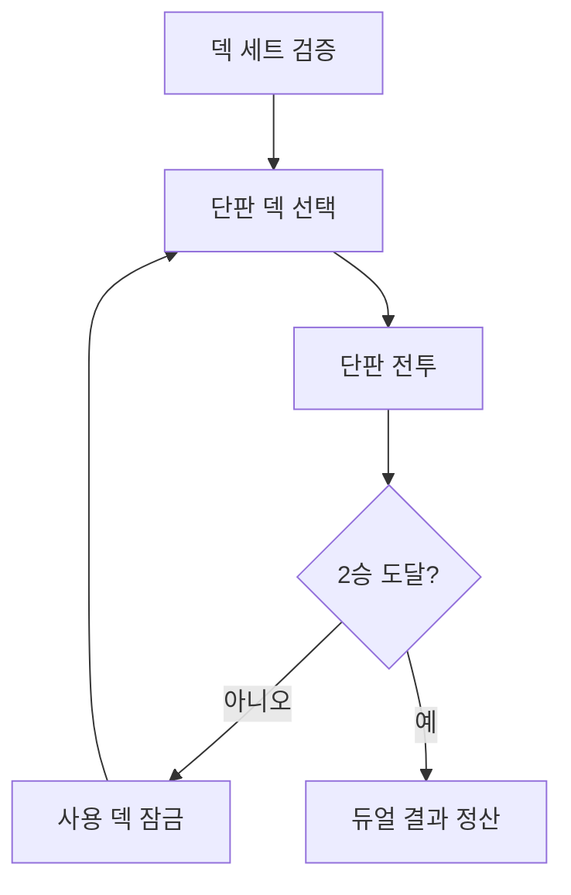

# 11. 매치메이킹과 게임 모드

> **확장판 안내:** 초판2026-11-13에2026-11-17 공개 데이터 재구축을 추가했다. 최신 수치·충돌·미확정 값의 사용 범위는 [23번](23_data_reconstruction_overview.md)과 각 상세 데이터 문서를 함께 확인한다.

> 조사 기준: 2026-11-13 · 범위: 일반 대전, 도전, 친선전, 듀얼, Crown Series의 진입·대전·정산 규칙.
> **[확인]**은 공식 문서에 공개된 규칙, **[분석]**은 그 규칙의 기획적 해석, **[재현 설계]**는 유사 게임을 만들기 위한 제안이다. 실제 서버 코드, 실력 점수 공식, 검색 큐는 확인하지 않았다.

## 1. 시스템의 역할

**[분석]** 여러 모드는 같은 전투 조작을 재사용하면서 플레이어에게 서로 다른 위험을 제시한다. 트로피 진척, 승수 도전, 친구와의 연습, 여러 덱의 숙련도를 한 가지 점수로 합치지 않는 것이 핵심이다. 모드별로 다음 다섯 항목을 반드시 분리해야 한다.

| 축 | 구분해야 하는 값 | 혼용하면 생기는 문제 |
| --- | --- | --- |
| 매칭 기준 | 트로피, 도전 승수, 리그 배치, 친선 상대 | 카드 레벨이 같은데 왜 다른 상대인가 설명할 수 없음 |
| 전투 규칙 | 1v1, 2v2, 드래프트, BO3 | 한 번의 승리가 어떤 단위의 승리인지 불명확 |
| 전력 정규화 | 보유 레벨, 상한 적용, 상향 보정 | 레벨 상한과 모든 카드 레벨 통일을 혼동 |
| 위험 | 트로피 감소, 패배 횟수, 시간 소모 | 연습과 경쟁의 심리적 비용이 같아짐 |
| 보상 단위 | 매 전투, 매 승리, 도전 종료, 시즌 종료 | 보상 중복 지급·누락 |

## 2. 모드 규칙 비교

**[확인]** 아래 표는 공식 지원 문서에 적힌 범위만 고정했다. 순환 모드의 현재 개방 여부, 세부 레벨 보정, 계정별 이벤트는 게임 내 화면 확인 대상이다.

| 모드 | 인원·형식 | 레벨 적용 | 승패·종료 단위 | 보상·진척 | 근거 |
| --- | --- | --- | --- | --- | --- |
| Trophy Road | 1v1 | 카드·킹 타워 별도 모드 상한 없음 | 단판 | 트로피·크라운 | [M01](https://support.clashroyale.com/hc/en-us/articles/49484904683803-1v1-Battle) |
| Ranked | 1v1 | 시즌·리그 설정 확인 | 단판 및 시즌 배치 | 리그/시즌 진척 | [10번 문서](10_player_progression_trophy_and_ranked.md) |
| Classic Challenge | 1v1 | 카드·타워 Lv11 상한 | 12승 또는 3패 | 승리마다 별도 보상 | [M03](https://support.clashroyale.com/hc/en-us/articles/49484955959067-Classic-Challenges) |
| Grand Challenge | 1v1 | 카드·타워 Lv11 상한 | 12승 또는 3패 | 승리마다 별도 보상 | M03 |
| Mega Draft Challenge | 드래프트 대전 | Lv11 상한 | 12승 또는 3패 | 승리마다 별도 보상 | M03 |
| Global Tournament | 대회 내 연속 단판 | 카드·타워 Lv11 상한 | 5패 또는 대회 종료 | 승수 순위·보상 | [M06](https://support.clashroyale.com/hc/en-us/articles/49484915041435-Global-Tournaments) |
| Friendly Battle | 1v1·2v2·순환 특별전 | 대회 상한까지 상향 보정 | 선택 모드 기준 | 트로피·골드·젬 없음 | [M04](https://support.clashroyale.com/hc/en-us/articles/49484891151259-Friendly-Battles) |
| Friendly Open Duel | 두 플레이어, BO3 | 친선 규칙 | 먼저 단판 2승 | 연습·소셜 | [M05](https://support.clashroyale.com/hc/en-us/articles/49484921196699-Duels) |
| Clan War Duel | 두 플레이어, BO3 | 보유 카드 레벨 | 먼저 단판 2승 | 클랜 메달·개인 보상 | [15번 문서](15_clan_wars.md) |
| Crown Series | 듀얼 대회 | 보유 레벨에 리그 상한 적용 | 주말 대회 | 종료·최종 순위 보상 | [M07](https://supercell.com/en/games/clashroyale/blog/news/crown-series/) |
| Merge Tactics | 4인 라운드전 | 별도 모드 전력 규칙 | 룰러 생존 순위 | Starsteel·관련 보상 | [16번 문서](16_merge_tactics.md) |

**[확인]** Classic/Grand/Mega Draft 참가비는 각각 10/100/50젬이며 Arena 3에서 해금된다. Classic과 Grand는 도전 자체의 시간제한 없이 이어 할 수 있다. 이 규칙을 모든 기간 한정 도전에 일반화하면 안 된다. [M03](https://support.clashroyale.com/hc/en-us/articles/49484955959067-Classic-Challenges)

## 3. 매칭에서 공개된 것과 공개되지 않은 것

| 대상 | 공개된 기준 | 이 문서에서 단정하지 않는 것 |
| --- | --- | --- |
| Trophy Road | 비슷한 트로피; 덱 구성·카드 레벨은 매칭 기준에 포함하지 않음 | 검색 범위 확장 주기, 봇 투입 조건, 연패 풀 |
| Challenges | 해당 도전의 승수 | 동일 승수 내 정렬, 대기시간별 범위 |
| Global Tournament | 대회 진척; 초반에는 Trophy Road 아레나 고려; 대기 시 조건 완화 | 비공개 가중치·정확한 구간 |
| 클랜 대 클랜 | 클랜 트로피 | 활동 인원 가중치, 시즌별 그룹 생성식 |
| 클랜전 개인 | 개인 트로피와 클랜전 성과; 대기 시 조건 완화 | 클랜전 숨은 점수 산식 |

**[확인]** 공개 기준은 [M01](https://support.clashroyale.com/hc/en-us/articles/49484904683803-1v1-Battle), [M02](https://support.clashroyale.com/hc/en-us/articles/49484912438811-Matchmaking), [M03](https://support.clashroyale.com/hc/en-us/articles/49484955959067-Classic-Challenges), [M06](https://support.clashroyale.com/hc/en-us/articles/49484915041435-Global-Tournaments)에 근거한다.

**[분석]** 어려운 상성을 연속으로 만났다는 경험만으로 상성 강제 매칭이나 유료 구매 유도용 승패 조작을 증명할 수 없다. 반대로 공개 문서에 없는 변수가 전혀 없다고 증명할 수도 없다. 역기획서는 검증 가능한 입력과 미공개 입력을 나누고, 플레이 결과만으로 서버 의도를 확정하지 않는다.

## 4. 듀얼의 전략 구조

**[확인]** Open Duel은 매 단판 시작 전에 덱을 고르고 사용한 덱을 다시 쓰지 않는 BO3다. 친선 듀얼은 최소 3개의 완성 덱이 필요하다. Ban & Pick은 상대 덱 2개를 금지한 뒤 남은 덱 중 하나로 단판을 진행한다. 타워 유닛은 여러 듀얼 덱에 반복해서 사용할 수 있다. 완전 동률도 최종적으로 동전 던지기로 승자를 정한다. [M05](https://support.clashroyale.com/hc/en-us/articles/49484921196699-Duels)

**[분석]** 덱 공유 금지는 강한 지원 카드 한 장을 어느 승리 조건에 배분할지 결정하게 한다. 첫 단판은 승패와 동시에 상대의 카드 자산을 공개한다. 두 번째 덱 선택에서 첫 번째 덱에 사용된 주문·수비 건물을 제외해 상대의 남은 대응을 추론할 수 있다.

**[재현 설계]** 일반 덱과 듀얼 덱 세트는 별도 객체로 저장한다. 덱을 선택하는 시점에 32장을 다시 읽으면 중간 편집으로 금지 규칙을 우회할 수 있으므로, 듀얼 시작 시 카드 집합과 레벨·폼을 스냅샷으로 잠근다.



## 5. 2026년 11월 신규 경쟁층: Crown Series

**[확인·발표 기준]** 11월 8일 공식 공지로 확인했다. Arena 17·6,000트로피부터 접근하며, 공식 발표를 요약한 초판에서는 3~4개 덱으로 정리했으나, 2026-11-17 현재 지원 문서는 4개 덱·32개 고유 카드를 요구한다. 일반 친선 듀얼의 최소3개와 구분한다. 13개 리그의 배치는 트로피 진척·Ranked/Ultimate Champion 최고 성적·기존 듀얼 결과를 참고한다. 아래는 핵심 파라미터만 요약한 것이다. 최초 오픈과 계정 반영은 실제 접속으로 확인하지 않았다. [M07](https://supercell.com/en/games/clashroyale/blog/news/crown-series/)

| 항목 | 공식 발표값 |
| --- | --- |
| 리그별 카드 상한 | 리그1~2:11 / 3~4:12 / 5~6:13 / 7:14 / 8:15 / 9~13:16 |
| 정기 운영 | 금요일 09:00 UTC~월요일 09:00 UTC, 72시간; 한국은 금18시~월18시 |
| 일반 Duel Weekend | 8승 또는 3패; 회차 종료 시 묶음 보상 |
| Grand Duel 하위1~8리그 | 12승 또는 4패 |
| Grand Duel King9~13리그 | 최대20 battles; 세부 카운트 단위는 UI 확인 필요 |
| 시즌 구조 | 일반 듀얼 주말들 → Grand Duel → 휴식 주말 |

**[분석]** 이 구조는 단판 순위와 다른 능력을 평가한다. 잘 키운 한 덱의 숙련도뿐 아니라 여러 덱으로 상대를 읽는 능력과 카드 자산의 폭이 중요해진다. 보유 레벨에 상한만 적용하는 방식은 상위 리그로 갈수록 성장 요구가 다시 커지는 구조다. 리그별 보상 격차를 평가할 때에는 승수보다 실제 듀얼 소요 시간과 카드 준비 비용도 함께 측정해야 한다.

**[검증 필요]** 공식 공지의 `battles`와 `matches` 표현은 문맥에 따라 단판 또는 듀얼 단위를 가리킬 수 있다. 서버 구현 시 `game_win`, `duel_win`, `run_win`을 별도 필드로 정의하고, King Grand Duel의 최대 횟수는 실제 UI·후속 공지로 확정해야 한다.

## 6. 레벨 상한과 레벨 정규화

**[재현 설계]** `cap`과 `normalize`를 같은 불리언으로 구현하지 않는다.

```text
CapOnly:    effectiveLevel = min(ownedLevel, modeCap)
Normalize:  effectiveLevel = modeLevel
Boosted:    effectiveLevel = min(max(ownedLevel, boostFloor), modeCap)
```

가상의 레벨9 카드를 상한11 경쟁전에 넣으면 `CapOnly`에서는 9다. 친선처럼 상향 보정하는 규칙에서는 11이다. 같은 레벨11 아이콘을 보고 두 경험을 같은 조건으로 이해하지 않도록 덱 화면에서 실제 적용 레벨을 표시한다. 타워 유닛·히어로·진화 활성 슬롯 제한은 카드 레벨과 별도 검증한다.

## 7. 재현용 매칭 상태와 데이터

**[재현 설계]** 아래는 실제 서비스의 내부 구현이 아니라, 위 규칙을 충족하는 최소 구조다.

| 데이터 | 필드 예 | 책임 |
| --- | --- | --- |
| ModeDefinition | modeId, rulesetVersion, teamSize, levelPolicy | 전투 규칙 고정 |
| Eligibility | arenaMin, deckSetSize, unlockedForms | 진입 검증 |
| QueueTicket | ticketId, playerId, modeId, createdAt, region | 한 플레이어의 중복 매칭 방지 |
| MatchContext | battleId, lockedDecks, ratingBefore, rewardPolicyId | 시작 이후 조건 변경 차단 |
| RunProgress | runId, gameWins, duelWins, losses, status | 도전·대회 경과 |
| ResultLedger | battleId, settlementVersion, receipts | 재접속·중복 결과 정산 |

상태는 `Eligible → Queued → Reserved → Loading → InBattle → ResultPending → Settled`로 구분한다. 매칭 취소와 예약 확정이 동시에 일어나면 서버가 하나의 순서를 확정해야 한다. `Queued` 취소는 즉시 가능하지만 확정된 전투는 포기 정책을 적용하도록 경계를 명시한다.

## 8. 사례: 하나의 승리가 세 계층에 반영되는 경우

**[재현 설계·가상 예시]** 듀얼 회차에서 A가 첫 단판을 이겼다. 이때 `gameWins=1`이지만 `duelWins=0`이다. 둘째 단판도 승리해야 `duelWins=1`이 된다. 일반 대회 승수 트랙이 듀얼 기준이면 이 시점에만 `runWins`를 1 증가시킨다. 단판별 크라운 보상과 회차 종료 보상은 서로 다른 지급 키를 사용한다.

이 구분 없이 단판 결과 이벤트를 모든 시스템에 전달하면 2승짜리 듀얼 한 회가 대회 2승으로 집계되거나, 중단한 듀얼에 최종 승리 보상이 지급될 수 있다.

## 9. 품질 검증

| 테스트 | 기대 조건 |
| --- | --- |
| 두 기기에서 동시에 매칭 | 한 계정에 유효한 예약은 하나 |
| 매칭 취소 직후 상대 확정 | 양쪽에 같은 최종 상태 전달 |
| 대전 중 덱 변경 | 잠긴 스냅샷 유지 |
| 레벨 상한 이하 카드 | 상한 적용과 상향 보정 정책을 구분 |
| 두 번째 듀얼에 사용 덱 재선택 | 거절 및 이유 표시 |
| 대회 종료 직전 시작한 게임 | 시작/종료 기준을 명확히 적용 |
| 결과 중복 수신 | 트로피·승수·보상 한 번만 적용 |
| 서버 재연결 | 같은 battleId로 복구, 새 참가비 부과 없음 |
| 대기자 수가 적은 리그 | 확장 대기시간·상대 격차 기록 |
| 특수모드 타워 종류 불일치 | mode policy로 허용/보정/차단 |

**[분석]** 성공 지표는 평균 대기시간만이 아니다. p95 대기시간, 레벨 차 분포, 예상 승률 구간, 최초 30초 이탈, 연속 동일 상대, 모드 간 이동률을 함께 봐야 한다. 균형을 평가할 때에는 트로피 구간·숙련도·카드 성장 수준을 나누어 집계한다.

## 10. 출처

모든 자료 열람일은 2026-11-13. 지원 페이지는 본문에 발행일이 없어 현재 열람본을 기준으로 한다.

- **M01** Supercell Support, [1v1 Battle](https://support.clashroyale.com/hc/en-us/articles/49484904683803-1v1-Battle).
- **M02** Supercell Support, [Matchmaking — Clan Wars](https://support.clashroyale.com/hc/en-us/articles/49484912438811-Matchmaking).
- **M03** Supercell Support, [Classic Challenges](https://support.clashroyale.com/hc/en-us/articles/49484955959067-Classic-Challenges).
- **M04** Supercell Support, [Friendly Battles](https://support.clashroyale.com/hc/en-us/articles/49484891151259-Friendly-Battles).
- **M05** Supercell Support, [Duels](https://support.clashroyale.com/hc/en-us/articles/49484921196699-Duels).
- **M06** Supercell Support, [Global Tournaments](https://support.clashroyale.com/hc/en-us/articles/49484915041435-Global-Tournaments).
- **M07** Supercell, [Crown Series!](https://supercell.com/en/games/clashroyale/blog/news/crown-series/), 2026-11-08.

관련 문서: [10 성장·랭크](10_player_progression_trophy_and_ranked.md) · [13 시즌·이벤트](13_seasons_events_and_retention.md) · [15 클랜전](15_clan_wars.md).


## 11. 2026-11-17 공개 데이터 재구축 보강

이번 재검증에서는 [현재 Crown Series 공식 지원](https://support.clashroyale.com/hc/en-us/articles/58566501950107-Crown-Series)의 **4덱·32개 고유 카드** 조건을 확인했다. 앞선 발표 요약의 3~4개 표현 대신 현재 지원 조건을 분리해 사용한다. Friendly Open Duel의 최소3덱 조건은 그대로 다른 모드에 속한다. Ranked는 현재 지원 문서에서 13,000트로피 또는 전 시즌 Champion, 7리그, 승수·리그 기반 매칭을 확인했다. 해당 페이지에 없는 현재 리그별 레벨 상한은 null로 보존했다. [Ranked 공식 지원](https://support.clashroyale.com/hc/en-us/articles/49484907381019-Ranked)

실제 구성 데이터는 [mode_rules.json](data/tables/mode_rules.json), 입장·전력·승수·지급을 연결한 상세 설계는 [27. 실행 계약](27_modes_matchmaking_social_contracts.md)에서 제공한다. 매칭 가중치, 확장 시간, 숨은 MMR은 공개 데이터로 확인되지 않아 복원 완료로 표시하지 않았다.

## v4 추가 조사: Ranked 진입 문서 충돌

2026-11-17 재조회에서도 지원 문서의 13,000과 7월 공지의 11월 14,000 일정이 함께 남아 있다. 앞 절의 13,000은 지원 문서가 제시한 값이며 현재 클라이언트의 단일 확정값으로 사용하지 않는다. 전 시즌 Champion 자격 경로와 신규 트로피 진입 경로를 분리하고, 두 문서의 날짜·적용 범위와 실제 계정 진입 화면을 비교한 뒤 설정을 선택한다. [42번 모드 조사](42_modes_rotation_and_conflicts_research.md)와 [mode_research_v4.json](data/tables/mode_research_v4.json)에 충돌을 구조화했다.
