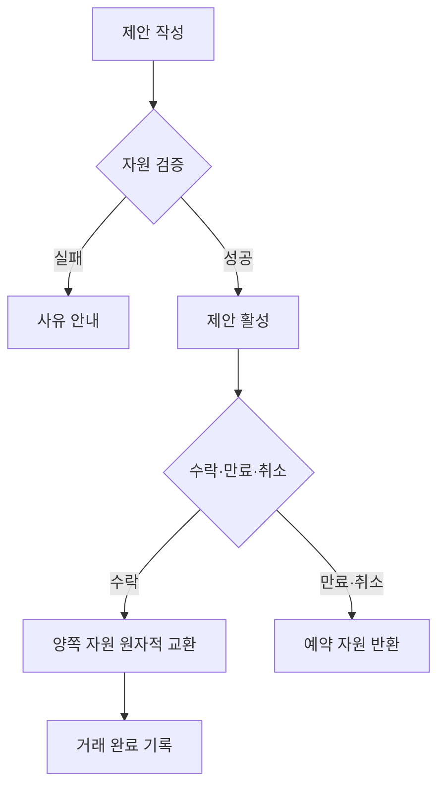

# 14. 클랜·카드 지원·교환·소셜

> **확장판 안내:** 초판2026-11-13에2026-11-17 공개 데이터 재구축을 추가했다. 최신 수치·충돌·미확정 값의 사용 범위는 [23번](23_data_reconstruction_overview.md)과 각 상세 데이터 문서를 함께 확인한다.

> 조사 기준: 2026-11-13 · 범위: 클랜 가입과 권한, 요청·기부, 토큰 교환, 친선전, 공동체 유지.
> **[확인]**은 공개 규칙, **[분석]**은 기획적 해석, **[재현 설계]**는 제안 데이터와 처리 절차다. 실제 소셜 서버·거래 데이터베이스는 확인하지 않았다.

## 1. 시스템의 목적과 연결

**[분석]** 클랜은 대화방이면서 카드 성장의 협력 경로이고 클랜전의 조직 단위다. 기부 요청은 접속 이유를 만들고, 친선전은 관계를 전투 학습으로 연결하며, 클랜전은 공동 목표를 만든다. 이 세 기능의 참여 강도가 다르므로 모두에게 같은 의무를 강요하지 않는 구조가 필요하다.

| 기능 | 개인에게 주는 가치 | 집단에게 주는 가치 |
| --- | --- | --- |
| 요청·기부 | 필요한 카드 확보·잉여 카드 활용 | 작은 상호 도움의 반복 |
| 토큰 교환 | 특정 카드의 성장 선택권 | 구성원 사이의 자원 재배분 |
| 친선전·듀얼 | 트로피 위험 없이 연습 | 덱 공유·코칭 |
| 클랜전 | 개인 보상·다중 덱 활용 | 순위·공동 진척 |
| 채팅·초대·역할 | 소속감·운영 참여 | 모집과 구성원 유지 |

## 2. 해금·가입·검색

**[확인]** 2026년 Collection Level 개편 공지는 클랜을 Arena 1, 기부를 Arena 2, 클랜전·교환을 Arena 3 해금으로 변경했다. 과거 King Level 조건을 현재 기준으로 복제하지 않는다. [M18](https://supercell.com/en/games/clashroyale/blog/news/new-collection-levels-and-mastery-changes/)

**[확인]** 클랜은 최대 50명이며 신규 가입 또는 재가입은 Member로 시작한다. 가입 방식은 Open·Invite Only·Closed이고 최소 트로피를 설정할 수 있다. 이름·태그·필터로 검색하며 고유 태그가 정확한 식별 수단이다. Family Friendly는 어린 이용자가 참여할 수 있는 추가 필터를 적용하고 일반 클랜으로 되돌릴 수 없다고 안내한다. [M13](https://support.clashroyale.com/hc/en-us/articles/49484887529371-Creating-or-Joining-a-Clan) [M14](https://support.clashroyale.com/hc/en-us/articles/49484954095771-Clan-Roles)

**[분석]** 이름은 사람이 읽기 위한 값이고 태그는 동명이인을 구분하는 값이다. 검색 결과에는 단순 트로피뿐 아니라 활동 시간·언어·기부·클랜전 참여 성향을 보여 주면 기대가 맞지 않는 가입을 줄일 수 있다. 이는 개선 제안이며 실제 추천 알고리즘이 이 정보를 모두 쓰는지는 공개되지 않았다.

## 3. 역할과 권한

**[확인]** 다음은 공식 지원 문서에서 확인되는 핵심 권한이다. 표에 없는 권한까지 추정해 부여하지 않는다. [M14](https://support.clashroyale.com/hc/en-us/articles/49484954095771-Clan-Roles)

| 역할 | 주요 권한 | 제한·책임 |
| --- | --- | --- |
| Member | 기본 클랜 활동 | 가입 시 기본 역할 |
| Elder | 초대·가입 승인·일반 멤버 추방 | 추방 20분 간격 |
| Co-leader | Elder 승격/강등, Co-leader 임명, 멤버·Elder 추방, 전체 메시지, 방어 제거 | 전체 메시지 12시간 간격 |
| Leader | 공동대표까지 승격/강등, 대표 이양, 전체 메시지, 방어 제거, 전투일 독려 | 최상위 운영 책임 |

**[재현 설계]** 권한은 역할 숫자의 대소만 비교하지 말고 `PermissionSet`으로 정의한다. 공동대표가 다른 공동대표를 강등할 수 있는지처럼 비대칭 관계가 있기 때문이다. 권한을 검사한 시점과 실행 시점 사이에 대상이 승격되는 경쟁 조건도 방지해야 한다.

**[분석]** 추방 쿨다운은 운영 권한을 없애지 않고 한 번의 실수나 악용이 전체 구성원에게 미치는 속도를 줄인다. 그러나 대표 이양은 즉각적인 집단 권력 변화를 일으키므로 확인 UI, 변경 기록, 새 대표 고지를 별도 설계해야 한다.

## 4. 요청과 기부 규칙

**[확인]** 일반·희귀 카드 요청은 7시간마다 가능하고 이미 해금한 카드만 요청할 수 있다. 영웅 희귀도(Epic; Hero 폼과 별개) 카드 요청은 일요일에 주 1회 가능하다. 요청량·건별 기부량·일일 기부량은 아레나별 제한을 갖는다. 기부 보상은 골드와 Star Points이며 XP를 지급하는 옛 규칙은 적용하지 않는다. [M15](https://support.clashroyale.com/hc/en-us/articles/49484955716891-Requesting-Donating-Cards) [M18](https://supercell.com/en/games/clashroyale/blog/news/new-collection-levels-and-mastery-changes/)

| 희귀도 | 일반 기부 1장당 골드 | Star Points | 조건 |
| --- | ---: | ---: | --- |
| Common | 5 | 1 | 최대 레벨 예외 별도 |
| Rare | 50 | 10 | 최대 레벨 예외 별도 |
| Epic | 500 | 100 | 요청 가능 요일 별도 |

**[출처 충돌·검증 필요]** 현재 기부 지원 문서는 최대 Lv16 카드 기부가 무료이므로 골드를 지급하지 않는다고 적는다. Collection Level 개편 공지는 최대 레벨 기부에도 골드·Star Points를 준다고 서술했다. 이 문서는 **현재 기부 지원 문서의 예외를 우선하는 재현 모델**을 제시하지만, 실제 계정에서 최대 레벨 기부 전후 골드 차이를 측정해야 확정할 수 있다. 지원 페이지의 아레나 표도 23까지만 제시되어 이후 구간의 값을 추정하지 않는다. [M15](https://support.clashroyale.com/hc/en-us/articles/49484955716891-Requesting-Donating-Cards) [M18](https://supercell.com/en/games/clashroyale/blog/news/new-collection-levels-and-mastery-changes/)

### 요청 객체의 상태

**[재현 설계]** `Requested → PartiallyFilled → Completed`가 기본이고 `Expired/Cancelled`는 별도 종료 상태다. 참여자 수와 요청 수량을 혼동하지 않는다. 예를 들어 가상 요청의 잔량이 2장일 때 세 명이 동시에 1장씩 기부하면, 두 건만 성공해야 한다.

```text
Donate(requestId, donorId, count):
  검증: 같은 클랜, 권한·해금, 잔량, 재고, 일일·건별 한도
  잠금: 요청 버전과 기부자 지갑 버전
  확정: 재고 차감 + 요청 채움 + 수령자 증가 + 기부 보상
  기록: transactionId를 한 번만 처리
```

이 순서는 데이터 설계 예시다. 실제 클래시 로얄의 저장소나 잠금 전략을 뜻하지 않는다.

## 5. 토큰 교환

**[확인]** 교환은 같은 희귀도의 카드를 주고받으며 양쪽 플레이어가 각각 해당 토큰 1개를 사용한다. 공식 단위는 Common 250장, Rare 50장, Epic 10장, Legendary 1장이다. Arena 3부터 클랜 내 교환에 접근한다. [M16](https://support.clashroyale.com/hc/en-us/articles/49484938455835-Trading-Cards)

**[분석]** 기부는 소액의 반복 지원이고 교환은 큰 묶음의 성장 방향 전환이다. 토큰은 특정 카드의 과도한 순환 교환을 제한하는 별도 병목이 된다. 양쪽 토큰을 소비하므로 상대가 원하는 카드를 가지고 있어도 토큰이 없으면 거래할 수 없다. UI는 “상대가 없음”과 “토큰 부족”을 구별해야 한다.

### 교환 제안의 설계

**[재현 설계]** 다음 상태 모델은 안전한 카드 교환 구현을 위한 제안이다. 실제 게임의 예치 시점·제안 만료 시간은 확인하지 않았으므로 설정값으로 둔다.



| 필드 | 의미 |
| --- | --- |
| tradeId / clanId | 제안·접근 범위 |
| proposerId / acceptedBy | 거래 당사자 |
| rarity / quantity | 토큰과 카드 수량의 정합성 |
| wantedCard / offeredCards | 수요·제공 선택지 |
| inventoryReservations | 예약 재고·토큰 |
| createdAt / expiresAt | 유효기간 |
| status / revision | 동시 수락 방지 |
| transactionId | 지급·차감의 멱등 키 |

**[재현 설계·가상 예시]** A의 Rare 50장과 B의 다른 Rare 50장을 교환한다. 수락 직전에 B가 카드를 업그레이드해 재고가 49장이 되었다면, 교환이 먼저 확정되지 않은 이상 거래를 거절해야 한다. A의 토큰만 차감되거나 카드 한쪽만 이동하는 부분 성공은 허용하지 않는다.

## 6. 친선전과 관계 유지

**[확인]** 친구 또는 클랜 채팅에서 친선전을 시작하고 Social 탭의 Quickplay QR로 가까운 사람과 연결할 수 있다. 2v2 친선은 클랜 채팅에서 제공된다. 친선전은 대회 레벨 상한에 맞춘 상향 보정을 적용하고 트로피·골드·젬을 지급하지 않는다. [M04](https://support.clashroyale.com/hc/en-us/articles/49484891151259-Friendly-Battles)

**[분석]** 보상에서 분리된 연습 환경은 승부를 반복해 자원을 만드는 행위를 막으면서 덱 실험을 허용한다. 친선전의 가치는 보상이 아니라 반복 가능한 상대, 설명 가능한 패배, 즉시 다시 시도할 수 있는 관계에 있다. 전투 이후 덱 공유·리플레이·재대결로 이어지는 동선을 함께 평가해야 한다.

## 7. 비활성 대표의 자동 교체

**[확인]** 대표가 21일 비활성이면 교체 절차를 안내하고, 총 35일 비활성이면 공동대표 또는 장로에게 대표 권한을 넘긴다고 지원 문서는 설명한다. 32일째에는 추가 안내가 있다. [M17](https://support.clashroyale.com/hc/en-us/articles/49484911201563-Automated-Leader-Rotation)

**[분석]** 이 기능은 창설자의 소유감과 남아 있는 구성원의 운영권을 조절한다. “대표가 잠깐 쉬는 것”과 “클랜을 더 이상 운영하지 않는 것”을 일정 기간으로 구분한다. 후보 선출의 정확한 우선순위가 문서에서 확인되지 않은 부분은 가입일·기부량 등을 실제 기준이라고 추정하지 않는다.

**[재현 설계]** 대기 기간 중 대표가 복귀하거나, 후보가 탈퇴·강등되거나, 모든 후보가 비활성인 경우를 상태 머신의 별도 분기로 둔다. 교체 예정 메시지와 실제 교체는 같은 작업이 아니며 최종 실행 직전 조건을 다시 확인한다.

## 8. 소셜 데이터와 악용 방지

**[재현 설계]** 필요한 데이터는 `ClanProfile`, `ClanMembership`, `RoleChangeLog`, `CardRequest`, `DonationLedger`, `TradeOffer`, `Invite`, `FriendlyMatchLobby`다. 채팅 메시지와 거래 객체는 분리한다. 메시지를 삭제해도 확정된 거래의 회계 기록이 사라지면 안 된다.

| 상황 | 설계 원칙 |
| --- | --- |
| 동명 클랜 | 표시명 대신 clanId·태그로 처리 |
| 탈퇴 후 재가입 | 예전 역할 자동 복원 금지 |
| 교환 활성 중 탈퇴 | 접근·취소·환급 정책을 일관되게 적용 |
| 무한 가입·기부 반복 | 계정 기준 일일 한도 유지 |
| 역할 변경 직후 권한 사용 | 최신 권한 재확인 |
| 잘못된 메시지 신고 | 메시지와 조치 기록 분리 |
| 미성년 참여 제한 | 서버 정책과 UI 필터를 함께 적용 |

## 9. 검증 항목과 지표

기능 검증은 동시 기부 잔량, 중복 교환 수락, 최대 레벨 예외, 초기화 시간, 탈퇴 중 거래, 초대 유효기간, 역할 강등 직후 작업, 대표 복귀 직전 자동 이양을 중심으로 수행한다.

**[분석]** 핵심 지표는 클랜 가입 후 7일 유지율, 요청 충족 시간, 기부자 편중도, 교환 성사율, 활동 구성원 비율, 대표 교체 후 회복률이다. 채팅 수만 높다고 건강한 클랜이라고 판단할 수 없다. 소수 인원의 기부 부담이나 매일 참여를 압박하는 운영은 전체 구성원 잔존과 함께 평가해야 한다.

## 10. 출처

열람일: 2026-11-13. 지원 문서 발행일은 미표기.

- **M13** Supercell Support, [Creating or Joining a Clan](https://support.clashroyale.com/hc/en-us/articles/49484887529371-Creating-or-Joining-a-Clan).
- **M14** Supercell Support, [Clan Roles](https://support.clashroyale.com/hc/en-us/articles/49484954095771-Clan-Roles).
- **M15** Supercell Support, [Requesting & Donating Cards](https://support.clashroyale.com/hc/en-us/articles/49484955716891-Requesting-Donating-Cards).
- **M16** Supercell Support, [Trading Cards](https://support.clashroyale.com/hc/en-us/articles/49484938455835-Trading-Cards).
- **M17** Supercell Support, [Automated Leader Rotation](https://support.clashroyale.com/hc/en-us/articles/49484911201563-Automated-Leader-Rotation).
- **M18** Supercell, [New Collection Levels & Mastery Changes](https://supercell.com/en/games/clashroyale/blog/news/new-collection-levels-and-mastery-changes/), 2026년 5월 게시; 6월 개편 관련.
- **M04** Supercell Support, [Friendly Battles](https://support.clashroyale.com/hc/en-us/articles/49484891151259-Friendly-Battles).

관련 문서: [09 카드 성장](09_collection_and_card_progression.md) · [12 경제](12_economy_rewards_and_monetization.md) · [15 클랜전](15_clan_wars.md).


## 11. 2026-11-17 기부·교환·권한 데이터 재구축

[소셜·클랜전 데이터](data/tables/social_clan_rules.json)에 아레나 구간별 요청/기부 한도, 희귀도별 기부 보상과 교환량, 역할 권한, 자동 대표 이양 일정을 수치와 조건으로 옮겼다. [27. 실행 계약](27_modes_matchmaking_social_contracts.md)에서는 요청 잔량과 기부자 한도를 분리하고, 교환 수락·취소의 동시성 및 탈퇴 시 참여 기록을 처리하는 재현 설계를 설명한다.

**추가로 명확히 한 공백:** 현 기부 지원 표는 Arena23에서 끝난다. Arena24 이상을 마지막 행의 값으로 자동 확장하지 않았다. Arena1 기부 행도 남아 있지만 5월 개편은 기부 해금을 Arena2로 명시하므로 기능 해금과 한도 표를 따로 검사해야 한다. 최대레벨 기부의 골드 지급 충돌은 두 출처의 레코드를 같은 conflict_group으로 연결했다. [기부 공식 지원](https://support.clashroyale.com/hc/en-us/articles/49484955716891-Requesting-Donating-Cards) · [기능 개편 공지](https://supercell.com/en/games/clashroyale/blog/news/new-collection-levels-and-mastery-changes/)
