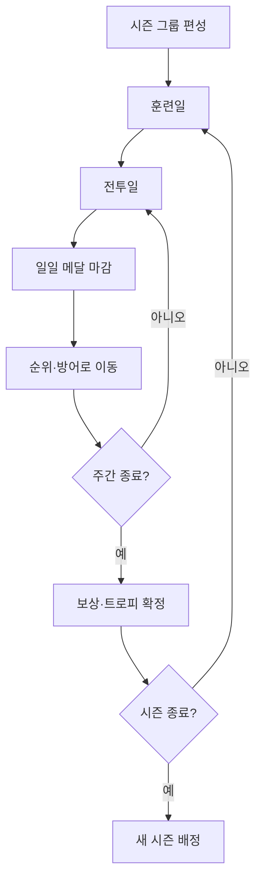

# 15. 클랜전: 전쟁 덱·강 경주·선박 방어

> **확장판 안내:** 초판2026-11-13에2026-11-17 공개 데이터 재구축을 추가했다. 최신 수치·충돌·미확정 값의 사용 범위는 [23번](23_data_reconstruction_overview.md)과 각 상세 데이터 문서를 함께 확인한다.

> 조사 기준: 2026-11-13 · 범위: 현재 공식 지원 문서의 Clan Wars/강 경주 구조.
> **[확인]** 공개 규칙 · **[분석]** 설계 의도 추론 · **[재현 설계]** 구현 제안. 전쟁 메달의 세부 수량·방어 편성 슬롯·리그별 보상 전표는 게임 내 설정 확인 전까지 고정하지 않는다.

## 1. 기능 목적

**[분석]** 일반 대전이 한 덱의 숙련도를 축적한다면 클랜전은 여러 덱의 성장과 구성원 참여를 요구한다. 클랜이 얻는 성과는 강한 한 명의 연승만으로 설명되지 않는다. 참여 가능한 인원, 사용 가능한 덱, 전투 선택, 방어 유지가 공동 진척에 영향을 준다.

| 설계 축 | 플레이어의 선택 | 연결 시스템 |
| --- | --- | --- |
| 다중 덱 | 희소한 지원 카드를 어느 덱에 줄 것인가 | 카드 수집·성장 |
| 활동량 | 오늘 남은 전쟁 덱을 사용할 것인가 | 일일 접속 |
| 전투 선택 | 개인 PvP·듀얼·선박 공격 중 무엇인가 | 위험 대비 보상 |
| 집단 목표 | 우리 점수를 높일지 상대 방어를 줄일지 | 클랜 협력 |
| 시즌 누적 | 이번 주 성과를 다음 리그로 연결할지 | 장기 경쟁 |

## 2. 참가와 시간 구조

**[확인]** Arena 3에 도달한 플레이어가 참가할 수 있고, 10명 이상 클랜은 자동으로 전쟁에 배정된다. 한 주는 훈련일 3일과 전투일 4일이며, 전쟁 시즌은 4~5주다. 동일 시즌 동안 같은 클랜들과 경쟁하고 하루 고유 참여자는 최대 50명이다. 강의 거리는 리그와 관계없이 10,000이며 배는 전투일 종료에 함께 이동한다. [M19](https://support.clashroyale.com/hc/en-us/articles/49484904148891-About-Clan-Wars)

| 단계 | 플레이 가능한 일 | 점수 반영 | 기획상 역할 |
| --- | --- | --- | --- |
| 훈련일 | 전쟁 덱 연습·방어 준비 | 강 경주 점수에 미반영 | 시행착오의 부담 완화 |
| 전투일 | 메달 획득·선박 공격 | 일일 순위와 이동 | 구성원 협동 |
| 주간 종료 | 보상·트로피 정산 | 주간 성과 확정 | 다음 주 목표 |
| 시즌 마지막 주 | Colosseum | 강 경주 대신 메달 경쟁 | 시즌 결말 강화 |

**[확인]** 마지막 주에는 강 경주와 선박전이 없고 Colosseum을 진행한다. 이때도 3일 훈련·4일 전투 구분은 유지한다. [M19](https://support.clashroyale.com/hc/en-us/articles/49484904148891-About-Clan-Wars)

## 3. 전쟁 덱

**[확인]** 보유 카드로 4개 전쟁 덱을 구성하고, 덱 사이에 카드를 중복할 수 없어 전체 32개의 서로 다른 카드가 필요하다. 전쟁 덱은 보유 레벨을 사용한다. 사용한 덱은 다음 전쟁일까지 재사용할 수 없으며, 시즌 시작 이후 전역 쿨다운은 24시간마다 초기화된다. [M20](https://support.clashroyale.com/hc/en-us/articles/49484904440987-War-Decks)

**[분석]** 단일 덱 성장에 집중하면 다른 세 덱이 약해질 수 있다. 전쟁은 컬렉션의 폭을 성장시키는 이유를 주지만, 적은 수의 카드만 키운 이용자에게 부담을 만든다. 따라서 덱별 평균 레벨만으로 전력을 평가하면 안 된다. 주력 승리 조건, 주문 임계값, 수비 역할의 빈칸을 함께 봐야 한다.

### 덱 배분 사례

**[재현 설계·가상 예시]** 네 덱이 모두 같은 소형 주문과 수비 건물을 원한다고 가정한다. 가장 강한 덱에 두 카드를 모두 주면 나머지 덱의 최소 대응 능력이 무너질 수 있다. 전쟁 덱 추천기는 각 덱의 최대 예상 승률 합계뿐 아니라 가장 약한 덱의 승률·공중 대응·평균 비용도 평가해야 한다.

| 평가 기준 | 의미 |
| --- | --- |
| 역할 충족 | 모든 덱에 타워 피해 수단·수비·공중 대응이 있는가 |
| 카드 중복 | 기본 카드와 폼이 같은 카드 자산을 공유하는가 |
| 전력 균형 | 한 덱에 성장 자원을 과도하게 몰았는가 |
| 듀얼 다양성 | 상대가 첫 덱을 보고 남은 전략을 쉽게 예측하는가 |
| 사용 가능성 | 쿨다운 덱을 참가 가능 덱으로 계산했는가 |

## 4. 전투 종류와 선택의 의미

**[확인]** 공식 지원은 선박전·듀얼·1v1·주간 순환 모드를 나열한다. 메달은 전투 종류와 승패에 따라 달라진다. 듀얼은 최소 3개의 전쟁 덱이 필요한 BO3이며 타이브레이커로도 승자를 못 정하면 동전 던지기로 결정한다. [M21](https://support.clashroyale.com/hc/en-us/articles/49484937752603-River-Battle-s)

| 종류 | 직접 대결 대상 | 주요 판단 | 구현에서 분리할 부분 |
| --- | --- | --- | --- |
| 1v1 | 실시간 플레이어 | 한 덱의 매치업 | 단판 결과 |
| Duel | 실시간 플레이어 | 여러 덱의 배분·상대 정보 | game 결과와 duel 결과 |
| 순환 모드 | 모드별 상대 | 규칙에 유리한 덱 | 주차 ruleset |
| Boat Battle | 상대가 설정한 방어를 조종하는 AI | 상대의 추가 이동 감소 | PvE 방어 상태 |

**[분석]** 선박 공격은 개인 승리 보상 외에 상대가 받을 이동량을 줄이는 간접 가치가 있다. 최적 선택은 우리 클랜의 순위, 상대 방어 생존, 남은 시간에 따라 달라진다. 따라서 “선박 공격은 항상 손해” 또는 “항상 먼저 해야 한다”는 규칙을 정답으로 쓰면 안 된다.

## 5. 선박 방어의 지속 상태

**[확인]** 선박전은 상대 구성원이 만든 방어를 공격하는 PvE다. 전투일마다 살아남은 방어의 가치 합계가 추가 이동에 기여하고, 파괴된 방어는 다음 전쟁 주가 시작될 때까지 사용할 수 없다. 공격 종료 때 파괴하지 못한 방어 타워는 전체 체력의 1/4에 해당하는 회복 구간을 갖는다. [M21](https://support.clashroyale.com/hc/en-us/articles/49484937752603-River-Battle-s)

**[재현 설계]** 공격마다 방어 객체를 복제해 싸우더라도 전투 종료 후 지속 체력과 파괴 상태를 원본에 반영해야 한다. 두 공격이 같은 방어를 동시에 점유하는 경우에는 예약을 걸거나 결과 충돌을 처리해야 한다. 공격 도중 다른 멤버가 방어를 제거·교체할 수 있는지도 명시한다.

```text
BoatDefense:
  defenseId, clanId, ownerId
  configurationVersion
  persistentHpByTower
  destroyedForWarWeek
  survivalMovementValue
  reservationBattleId
  lastSettlementId
```

**[검증 필요]** 회복 1/4을 잔여 HP에 더하는지, 회복 보장 하한으로 적용하는지, 복수 타워에 어떤 순서로 적용하는지는 문구만으로 내부 공식을 확정하지 않는다. 실제 전투 전후 체력 기록이 필요하다. 문서의 1/4 안내를 임의의 서버 수식으로 바꾸지 않는다.

## 6. 메달·이동·트로피는 다른 값이다

**[확인]** 일일 메달 순위가 배의 이동량에 영향을 주고, 살아남은 방어가 추가 이동을 제공한다. 주간 순위는 전체 이동을 기준으로 하며 여러 배가 결승선을 넘으면 경주 누적 메달로 비교한다. 최상위 두 순위는 클랜 트로피를 얻고, 상위 리그에서는 3~5위가 잃을 수 있다. Colosseum은 메달을 얻을 때 순위표가 갱신된다. [M19](https://support.clashroyale.com/hc/en-us/articles/49484904148891-About-Clan-Wars) [M23](https://support.clashroyale.com/hc/en-us/articles/49484912127643-Clan-War-Results)

**[재현 설계]** 다음 기호는 계산 구조를 표현하며 실제 수량 테이블이 아니다.

```text
dailyMedals[c] = 오늘 확정된 유효 전투 메달 합계
dailyRank[c] = Rank(dailyMedals)
movement[c] += movementByRank[dailyRank[c]]
movement[c] += Sum(survivingDefenseMovementValues[c])
weeklyRank = Rank(movement, finishLineTieBreak)
clanTrophyDelta = table[league, weeklyRank, weekType]
```

이 세 변수를 하나의 `score`로 저장하면 일일 순위가 높은데 주간 순위가 낮은 상황을 설명하기 어렵고, 방어 이동을 메달로 중복 환산할 수 있다.

## 7. 보상과 최소 참여 조건

**[확인]** 주간 종료 또는 결승선 통과 시 해당 주 참가자에게 River War Chest를 지급하며, 내용은 클랜 리그에 따라 달라진다. 클랜이 최소 사용 덱 수 80을 채우지 못하면 보상이 적은 Boot를 받는다. Colosseum은 승패 모두 골드를 지급하되 리그·결과에 따라 양이 달라진다. [M22](https://support.clashroyale.com/hc/en-us/articles/49484889742363-Clan-War-Rewards)

**[분석]** 최소 참여 기준은 한두 명의 활동으로 전체 클랜이 높은 보상을 받는 구조를 제한한다. 그러나 미참여 멤버를 얼마나 적극적으로 정리해야 하는지에 대한 사회적 압박도 만든다. UI에서 현재 누적 사용 덱 수와 보상 자격을 알려 주면 마지막 날의 불필요한 갈등을 줄일 수 있다.

**[재현 설계·가상 예시]** 40명이 하루에 4개 전쟁 덱을 모두 사용할 수 있다고 단순 가정하면 하루 160개, 전투일 4일 동안 최대 640개 사용 기회다. 이는 참여 용량의 계산이고 실제 메달 기대치가 아니다. 듀얼은 한 회에 여러 덱을 소모하므로 “160개의 듀얼”로 읽으면 안 된다.

## 8. 매칭

**[확인]** 클랜 간 배정은 클랜 트로피를 사용한다. 개인 전투는 비슷한 개인 트로피를 우선하며 클랜전 성과도 참고하고, 찾는 시간이 길어지면 검색 조건을 넓힌다. 상대 클랜의 리그가 같아야 개인끼리 만나는 구조는 아니라고 지원 문서는 설명한다. [M02](https://support.clashroyale.com/hc/en-us/articles/49484912438811-Matchmaking)

**[분석]** 클랜 간 경쟁과 개인 매칭은 서로 다른 층이다. 클랜 리그가 비슷하다고 카드 레벨까지 비슷한 상대를 보장하지 않는다. 불만을 분석할 때에는 개인의 레벨 차와 클랜 전체의 활동량 차를 구분해야 원인을 찾을 수 있다.

## 9. 상태 전이와 동시성

**[재현 설계]** 전쟁 데이터를 `Season → WarWeek → WarDay → Battle` 계층으로 둔다. 보상 권리는 당시 참가 클랜과 해당 주의 참여 기록으로 확정하고, 현재 가입 클랜만 보고 소급 판단하지 않는다.



Colosseum 주는 위 흐름의 이동 계산을 대체하는 별도 `weekType`으로 처리한다. 선박전 버튼만 숨기는 방식이면 남은 방어 보너스가 잘못 반영될 수 있다.

## 10. 검증 체크리스트

| 항목 | 기대 조건 |
| --- | --- |
| 4개 덱의 동일 카드 중복 | 세트 전체 검증으로 차단 |
| 마지막 사용 가능 덱으로 두 번 참가 | 한 전투만 예약 |
| 사용 중 날짜 초기화 | 시작 시점·종료 시점 정책에 따라 정확히 처리 |
| 두 명이 같은 방어 공격 | HP·파괴 결과 유실 없음 |
| 여러 배가 같은 날 결승선 통과 | 누적 메달 타이브레이커 |
| 훈련일 전투 결과 | 골드와 강 경주 메달 분리 |
| 79→80 사용 덱 경계 | 최소 보상 자격 정확히 변경 |
| 탈퇴·가입 반복 | 하루50명 제한·보상 참여 이력 일관 |
| Colosseum 전환 | 선박 공격·방어 이동 잔존 없음 |
| 종료 후 결과 재전송 | 메달·트로피·상자 중복 지급 없음 |

**[분석]** 운영 지표는 클랜별 실제 활동 인원, 일일 덱 소모율, 네 번째 덱의 레벨·승률 격차, 최소 보상 미달률, 방어 공격 선택률, 전쟁 때문에 발생한 탈퇴율을 포함해야 한다. 참여량만 늘고 구성원의 유지가 악화되면 협력 목표가 의무 노동으로 바뀌고 있는지 확인한다.

## 11. 출처

열람일: 2026-11-13. 지원 문서 발행일은 미표기.

- **M19** Supercell Support, [About Clan Wars](https://support.clashroyale.com/hc/en-us/articles/49484904148891-About-Clan-Wars).
- **M20** Supercell Support, [War Decks](https://support.clashroyale.com/hc/en-us/articles/49484904440987-War-Decks).
- **M21** Supercell Support, [River Battle(s)](https://support.clashroyale.com/hc/en-us/articles/49484937752603-River-Battle-s).
- **M22** Supercell Support, [Clan War Rewards](https://support.clashroyale.com/hc/en-us/articles/49484889742363-Clan-War-Rewards).
- **M23** Supercell Support, [Clan War Results](https://support.clashroyale.com/hc/en-us/articles/49484912127643-Clan-War-Results).
- **M02** Supercell Support, [Matchmaking](https://support.clashroyale.com/hc/en-us/articles/49484912438811-Matchmaking).

관련 문서: [11 모드·매칭](11_matchmaking_and_game_modes.md) · [14 클랜·교환](14_clans_trading_and_social.md).


## 12. 2026-11-17 클랜전 데이터 계약 보강

[소셜·클랜전 데이터](data/tables/social_clan_rules.json)는 하루 고유 참가자50명, 덱4개/32개 고유 카드,24시간 재사용 초기화,3훈련일+4전투일, 주간 상자의80덱 조건, 미파괴 방어타워 최대HP의25% 회복을 별도 규칙으로 보존한다. **현재 클랜 인원 제한과 전쟁일 고유 참가자 제한은 다른 장부다.**

[27. 실행 계약](27_modes_matchmaking_social_contracts.md)에 일일 덱 소모·주간 참가 권리·결과 재전송의 검증 시나리오를 추가했다. 이번에 열어 본 공식 지원은 전투 종류에 따라 메달이 달라진다고 설명하지만 상세 숫자 표는 제공하지 않으므로, 메달의 모드별 수치는 null로 남겼다. 오래된100/200 등의 숫자를 기억만으로 현재 표에 채우지 않았다. [About Clan Wars](https://support.clashroyale.com/hc/en-us/articles/49484904148891-About-Clan-Wars) · [War Decks](https://support.clashroyale.com/hc/en-us/articles/49484904440987-War-Decks) · [River Battles](https://support.clashroyale.com/hc/en-us/articles/49484937752603-River-Battle-s)
