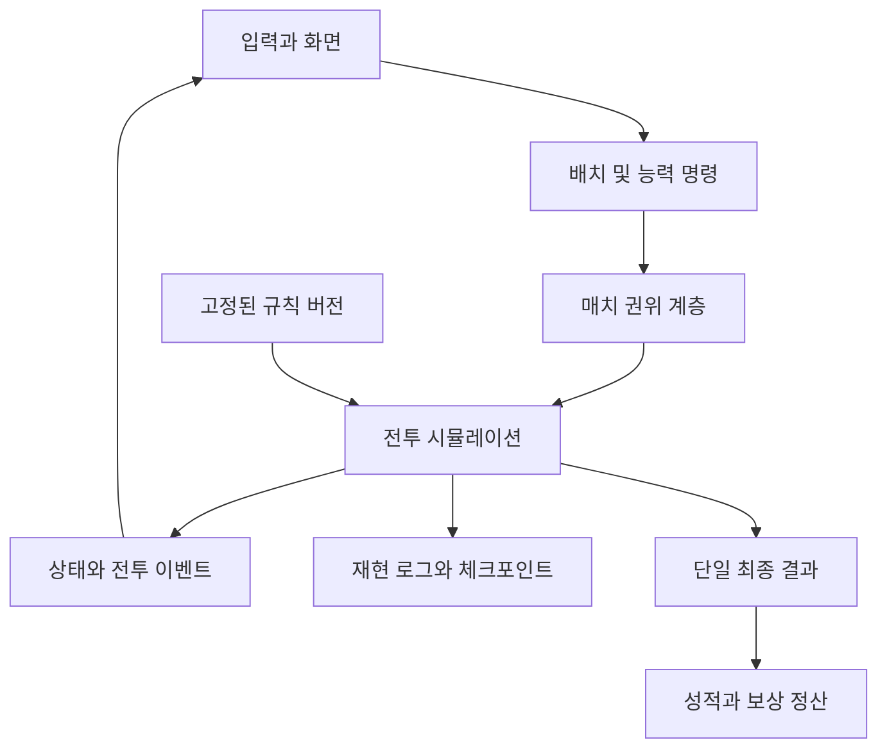

# 19. 네트워크·리플레이·전투 실행 구조

> **확장판 안내:** 초판2026-11-13에2026-11-17 공개 데이터 재구축을 추가했다. 최신 수치·충돌·미확정 값의 사용 범위는 [23번](23_data_reconstruction_overview.md)과 각 상세 데이터 문서를 함께 확인한다.

> 기준일: 2026-11-13 · **이 문서의 아키텍처는 모두 [재현 설계]이다.** 공식적으로 확인한 외부 동작을 구현할 수 있는 한 가지 구조이며, Supercell의 소스 코드·서버 구성·프로토콜·tick rate를 복원했다는 뜻이 아니다.

## 1. 공개 동작으로부터 필요한 조건 도출

**[확인]** 게임은 실시간 대전을 제공하고, 공식 업데이트에는 전투 다시보기와 그 제어 기능이 등장한다. 이것만으로 실제 구현이 완전한 결정론적 lockstep인지, 상태 동기화인지, 어떤 혼합인지 판정할 수 없다. [R01](https://supercell.com/en/games/clashroyale/), [R10](https://supercell.com/en/games/clashroyale/blog/release-notes/summer-update-is-here-2/)

| 외부에서 필요한 결과 | 재현 구현이 충족할 계약 | 공개되지 않은 것 |
|---|---|---|
| 같은 타워 피해와 승패 | 하나의 권위 있는 판정 | 실제 서버 배치 구조 |
| 양쪽의 배치 재현 | 승인된 명령과 순서의 일치 | 입력 전송 주기·패킷 형식 |
| 엘릭서 비용 검증 | 잔액과 손패 검증의 원자성 | 내부 수치 표현 |
| 다시보기 | 과거 매치를 재현할 충분한 정보 | 실제 저장 파일 형식 |
| 재접속 | 현재 상태와 이후 사건 복구 | 허용 중단 시간·보관 정책 |
| 패치 이후 일관성 | 경기별 규칙 버전 고정 | 실제 버전 호환 정책 |

## 2. 권장하는 책임 분리

**[재현 설계]** 유닛을 사용자가 계속 조종하지 않고 주로 카드 배치·능력 사용을 입력하는 구조는, 입력 명령과 자동 시뮬레이션의 경계를 명확히 만들기 좋다. 전투 로직, 표시, 계정 정산을 분리한다.



중요한 경계는 승패가 화면 연출에서 생성되지 않는다는 점이다. 킹 타워 파괴 연출이 끝나기 전에 승패가 확정될 수 있고, 재접속한 클라이언트는 연출 전체를 다시 보지 않고도 이미 확정된 결과를 받아야 한다.

## 3. 입력 명령 계약

**[재현 설계]** 다음은 네트워크 패킷 원본이 아닌 논리적 메시지 예시다.

```json
{
  "matchId": "example_match_001",
  "playerSlot": 0,
  "commandId": 1042,
  "clientObservedSequence": 830,
  "kind": "DeployCard",
  "cardInstanceId": "deck_slot_3",
  "arenaPosition": {"x": 4000, "y": 12000},
  "deckRevision": 7
}
```

좌표 숫자는 가상 정수 좌표이며 원본의 타일 크기나 좌표 정밀도를 의미하지 않는다. 명령에서 받은 비용·공격력·진화 가능 여부를 그대로 믿지 않고, 매치 시작 시 고정한 덱과 규칙에서 계산한다.

### 3.1 검증 순서

1. 매치가 진행 중이며 요청자가 해당 슬롯의 플레이어인지 확인한다.
2. `commandId`가 이미 처리되었으면 기존 결과를 반환한다.
3. 명령이 현재 손패·카드 인스턴스·능력 소유자와 일치하는지 확인한다.
4. 비용, 생성 대기, 현재 상태, 배치 영역을 검증한다.
5. 명령 적용 순서에 편입하고 자원 차감·손패 회전·소환 예약을 하나의 논리적 거래로 확정한다.
6. 승인 또는 거절 사유와 최신 상태 식별자를 반환한다.

두 번 전송된 카드 한 장이 두 유닛이 되거나, 카드만 회전하고 유닛은 나오지 않거나, 실패한 능력에 비용만 나가는 상태를 방지해야 한다. 특정 능력의 발사 후 사망·환불 여부는 카드별 정책으로 정의한다.

## 4. 시뮬레이션의 실행 순서

**[재현 설계]** 실제 게임의 세부 처리 순서는 비공개다. 재현 프로젝트는 아래와 같은 순서를 먼저 계약으로 정하고, 관찰 사례와 맞지 않는 부분을 명시적으로 수정해야 한다.

| 단계 | 작업 | 보존해야 할 성질 |
|---|---|---|
| A | 시간·입력·예약 이벤트 수집 | 같은 시점의 이벤트 순서가 안정적 |
| B | 엘릭서·수명·상태 시간 갱신 | UI 프레임률과 무관 |
| C | 타겟 유효성·이동 의도 계산 | 유효하지 않은 대상 제거 |
| D | 이동·공간 제약 해결 | 양쪽 진영에 같은 규칙 적용 |
| E | 공격·능력·투사체 이벤트 생성 | 연출과 실제 타격 시점 분리 |
| F | 피해·보호막·치유·사망 해결 | 같은 시점 사건의 정책 명시 |
| G | 소환·죽음 효과·추가 이벤트 처리 | 무한 연쇄 방지와 순서 보존 |
| H | 타워·승패 검사 | 동일 시점 양쪽 파괴 검사 가능 |
| I | 상태 발행·로그 저장 | 판정과 로그의 내용 일치 |

‘각 유닛이 업데이트되자마자 상대를 죽인다’는 구현은 컨테이너 순서 때문에 한쪽이 항상 먼저 때리는 편향을 만들 수 있다. 동시 타격을 지원하려면 같은 시각에 예약된 공격을 모아 처리하는 정책과, 사망 전에 생성된 공격이 유효한지에 대한 정책이 필요하다. 정확한 원작 순서는 [21번](21_qa_and_validation_plan.md)의 실측 대상으로 남긴다.

## 5. 동기화 대안과 선택

**[재현 설계]** 아래 비교는 일반적인 구현 대안이며 원작의 방식에 대한 단정이 아니다.

| 방식 | 장점 | 비용·위험 | 적합한 검증 조건 |
|---|---|---|---|
| 승인 명령 기반 결정론 재현 | 적은 명령량, 로그 재생에 유리 | 모든 플랫폼 계산 일치 필요 | 동일 seed·명령의 상태 hash 비교 |
| 서버 상태 중심 동기화 | 서버 단일 판정, 클라이언트 구현 자유 | 상태 전송·보간·복구 설계 필요 | 지연과 손실에서 표시 안정성 |
| 명령과 체크포인트 혼합 | 재현 효율과 복구 가능성 결합 | 두 데이터의 버전·순서 관리 | 체크포인트 이후 재실행 일치 |

초기 재현 프로젝트에는 서버 또는 단일 권위 시뮬레이터가 결과를 결정하고, 로그와 주기적 체크포인트를 함께 두는 구성이 관리하기 쉽다. 주기·tick rate·대역폭은 유닛 밀도와 실측 지연에 맞춰 정하며 ‘원작이 20Hz/30Hz/60Hz’라고 근거 없이 쓰지 않는다.

### 5.1 수치 결정성

- 난수는 매치 seed와 명시적 난수 스트림에서만 소비한다.
- 컨테이너 순회·동점 타겟·동시 이벤트의 순서를 고정한다.
- 정수·고정소수점 또는 검증된 수치 경로 중 하나를 선택한다.
- 렌더 프레임의 `deltaTime`을 곧바로 전투 규칙 시간으로 쓰지 않는다.
- 난수 추출 횟수를 VFX·사운드 재생 여부와 공유하지 않는다.
- 타겟 검색 최적화 전후에도 동일한 후보·동점 정책을 보존한다.

## 6. 좌표계와 두 플레이어의 시점

**[재현 설계]** 서버의 논리 아레나는 고정 좌표를 사용하고, 각 클라이언트가 자신의 진영을 아래쪽으로 보는 시점 변환만 적용한다. 플레이어 2의 화면 좌표는 입력 전에 논리 좌표로 역변환한다.

가상 아레나 폭 `W`, 높이 `H`에서 180도 회전 시점의 예:

```text
viewX = W - worldX
viewY = H - worldY
worldInput = inverse(viewTransform) * screenToArena(pointer)
```

유닛의 경로 탐색, 공격 방향, 상대 영역 검사는 논리 좌표계에서 수행한다. 화면상 ‘왼쪽 레인’과 서버의 물리적인 레인 ID를 같은 문자열로 저장하지 않는다. 리플레이·관전자도 동일한 사건을 시점만 바꾸어 볼 수 있다.

## 7. 리플레이 데이터 설계

**[재현 설계]** 완전한 전투 영상 파일이 없어도 재현은 가능하지만, 원작이 어떤 방식을 쓰는지는 여기서 확정하지 않는다. 제안하는 로그 구성은 다음과 같다.

| 데이터 | 필요 이유 |
|---|---|
| 매치·모드·규칙 버전 | 어떤 승패·카드 규칙인지 식별 |
| 시뮬레이션 버전 | 판정 로직의 코드 차이 구별 |
| 초기 덱·타워·실효 레벨 | 시작 상태 복원 |
| 난수 seed·초기 순서 | 무작위 요소 복원 |
| 승인 명령·적용 시각·순서 | 카드·능력 사용 재현 |
| 체크포인트 | 중간 탐색과 재접속 가속 |
| 핵심 사건·최종 hash | 재현 불일치 탐지 |
| 결과 확정 ID | 계정 정산과 연결 |

### 7.1 중간 시점 탐색

목표 시각 이전의 체크포인트를 읽고, 이후 명령을 빠르게 실행해 원하는 시점까지 도달한다. 화면 연출은 생략할 수 있지만 논리 결과는 생략할 수 없다. 체크포인트에 체력만 저장하고 공격 준비 시간·현재 타겟·진화 카운터를 빠뜨리면 같은 위치에서 재생을 시작해도 결과가 달라진다.

### 7.2 패치 호환

전투 규칙이 바뀐 뒤 이전 로그를 최신 규칙으로 재생하면 다른 결과가 나올 수 있다. 제안 선택지는 과거 실행 버전 보관, 호환 어댑터, 상태 기반 기록 확대, 지원 기간 제한이다. 어떤 선택이든 UI가 재생 불가와 패배 판정을 혼동하지 않도록 해야 한다.

## 8. 재접속과 결과 정산

**[재현 설계]** 재접속은 새 전투 시작이 아니다. 기존 매치 ID, 플레이어 슬롯, 마지막 승인 명령, 현재 스냅샷을 복구한다. 연결이 끊긴 동안 상대 명령과 자동 전투가 진행될 수 있으므로 로컬 시계만으로 현재 상태를 재구성하지 않는다.

결과 정산에는 `matchId + playerId + settlementVersion` 같은 멱등 키를 사용한다. 게임 결과, 트로피, 이벤트 진행, 일일 보상, 클랜전 점수는 각각 여러 번 재시도될 수 있어도 논리적으로 한 번만 반영되어야 한다. 정산 일부가 늦어지면 전투 결과까지 바꾸지 말고 지급 상태를 추적한다.

## 9. 엔진 적용 경계

**[재현 설계]** 특정 엔진을 사용하더라도 전투 규칙을 화면 객체 수명과 분리한다.

| 논리 영역 | 엔진 표현 예 | 피해야 할 결합 |
|---|---|---|
| 유닛 상태 | C++ 구조체·데이터 중심 저장 | Actor 생성 성공이 논리 소환 성공을 결정 |
| 위치·경로 | 독립 아레나 좌표와 경로 질의 | 카메라 회전 때문에 경로가 변함 |
| 타격 | 예약된 게임 이벤트 | 애니메이션 프레임 드롭으로 피해 누락 |
| 충돌·밀치기 | 명시적 게임 규칙 또는 검증된 물리 경로 | 비결정적 잔해 물리가 핵심 타겟을 바꿈 |
| 표현 | Actor/Component·VFX·오디오 | 표현 개체 제거가 생존 판정을 바꿈 |

Unreal 구현이라면 월드·Actor는 표현 계층으로 활용하고, 반복 실행 가능한 전투 모델을 별도 모듈에 두는 방식이 가능하다. 이는 엔진 선택 제안이며 클래시 로얄이 Unreal을 사용한다는 뜻이 아니다.

## 10. 우선 구현 순서와 종료 기준

1. 한 프로세스에서 두 플레이어 명령으로 동일 전투를 끝낼 수 있게 한다.
2. 저장된 명령을 다시 실행해 타워 HP·승패가 일치하는지 확인한다.
3. 권위 계층을 분리하고 지연·중복·순서 역전 입력을 시험한다.
4. 체크포인트 재접속과 중간 재생을 추가한다.
5. 계정 보상은 전투 결과 ID로 한 번만 지급한다.

프로토타입 종료 기준은 ‘화면이 비슷하다’가 아니라 **동일한 초기 상태와 승인 명령에서 같은 결과가 재현되고, 양쪽 플레이어·재접속·리플레이가 그 결과에 합의한다**는 것이다.

## 출처와 한계

- R01. [Clash Royale 공식 소개](https://supercell.com/en/games/clashroyale/), 열람 2026-11-13.
- R10. [Summer Update Info!](https://supercell.com/en/games/clashroyale/blog/release-notes/summer-update-is-here-2/), 2021년 공개 업데이트 — 다시보기 기능의 존재 근거. 현재 보관 기간·데이터 형식의 근거로 사용하지 않음.
- 세부 프로토콜, 서버 tick rate, 실제 난수·AI·경로 알고리즘은 미확인이다.

[전체 목차](00_README.md) · [20. 데이터 모델](20_data_model_and_configuration.md) · [21. 검증 계획](21_qa_and_validation_plan.md)

## 2026-11-17 확장: 재구축 데이터의 실행 경계

데이터 프로필·규칙 버전·명령 해석기를 리플레이와 함께 고정하는 방안을 [30번](30_patch_history_and_version_boundaries.md)에 보강했다. 원작의 내부 tick·프로토콜·권위 판정 코드를 확인한 것은 아니며, 미공개 사건 순서는 [33번](33_observation_protocol_and_reconstruction_backlog.md)의 관측 과제로 남긴다.
