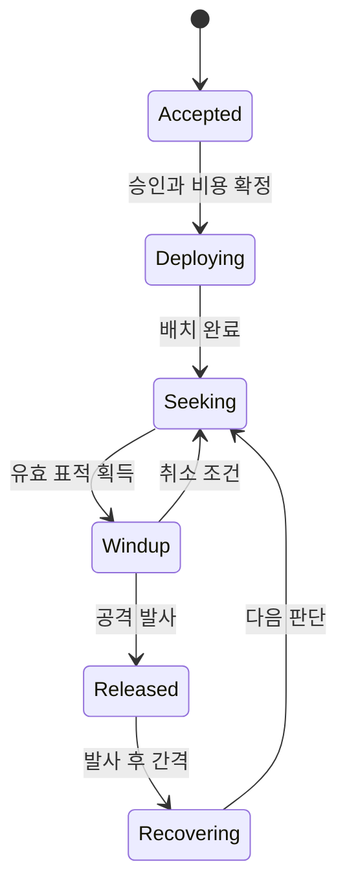

# 24. 원작 전투 규칙 복원과 상호작용 실험 명세

> **v4 추가 조사 안내:** 아래 본문과 개수는 해당 v2/v3 작성 당시의 범위를 설명한다. 현재 통합 자료, 추가 복원, 레벨 미기재 값의 처리와 실행 명령은 [39번 개요](39_research_reconstruction_v4_overview.md), [44번 근거 조정](44_sources_and_level_reconciliation.md), [최신 검증 보고서](reports/validation_report.md)를 기준으로 한다.

> 추가 조사 기준: **2026-11-17**. 공개 문서가 확인하는 동작과 수치를 데이터로 옮겼다. 원작 클라이언트 실행·패킷 분석·내부 소스 추출은 수행하지 않았다. 아래 실험은 **미실행 검증 명세**이며 통과 결과가 아니다.

## 1. 이번 복원의 단위

전투를 똑같아 보이게 만드는 것과 같은 결과를 내게 만드는 것은 다르다. HP·공격력만 일치시켜도 첫 타격 지연, 탐지 범위, 방패 파괴 순서, 카드 회전이 다르면 교환 결과가 바뀐다. 따라서 한 카드의 수치 행과 한 상호작용의 규칙 행을 따로 관리한다.

| 파일 | 용도 | 사용 시 주의 |
|---|---|---|
| [combat_rules.json](data/tables/combat_rules.json) | 전투·회전·형상·상태·타워의 규칙 63개 | `evidence_status`, `scope`, `version_note`를 함께 읽음 |
| [interaction_cases.json](data/tables/interaction_cases.json) | 원작 대조용 실험 44개 | 모든 행의 `observed=false`, `test_status=not_run` |
| [combat_sources.json](data/sources/combat_sources.json) | 직접 확인한 공식 자료 20개 | 게시일과 본문 안 변경 적용일을 구분 |
| [25. 형상·능력 계약](25_card_forms_and_ability_contracts.md) | 챔피언·진화·히어로·타워의 재현 모델 | 제안 필드명은 Supercell 내부 스키마가 아님 |

`official_confirmed`는 **그 공개 문서에 적힌 사실을 확인했다**는 뜻이다. 오래된 패치 수치가 2026년의 실제 빌드와 일치한다는 뜻은 아니다. `scope=patch_snapshot_level_11`은 특정 날짜의 레벨 11 패치 값이다. `effective_to=null`은 끝나는 날짜를 모른다는 뜻이며, 현재까지 유효하다는 자동 판정이 아니다.

이번 작업의 데이터에는 다음 세 종류의 공백이 있다. 첫째, 공식 문서가 숫자를 싣지 않은 기본 생성 간격. 둘째, 공개 자료가 현상만 설명한 경로 탐색 내부 구현. 셋째, 같은 순간에 서로 죽는 극단 조건의 이벤트 우선순위다. 이 공백을 임의 수치로 메우지 않고 `null`과 실험 조건으로 남겼다.

## 2. 과거 설명을 그대로 구현하면 달라지는 부분

| 분야 | 구버전 자료에서 발견되는 규칙 | 이번 재확인에서 적용할 분기 |
|---|---|---|
| 챔피언 회전 | 챔피언 생존 중 카드가 회전에서 빠짐 | 2025년 개편 후 일반 카드처럼 순환; 자료 버전 고정 [CS07] |
| 특수 슬롯 | 진화·히어로 슬롯 수가 서로 다른 과거 구성 | 2026-03-16 기준 Evo 1 / Hero 1 / Wild 1 [CS10] |
| 능력 사용 | 쿨다운이 차면 같은 개체가 다시 발동 | 2026-08-04의 기본 규칙은 배치당 1회; Boss Bandit 예외 [CS06] |
| 타워 | 모든 타워를 하나의 레벨로 계산 | 킹과 타워 유닛 레벨을 분리; 타워 유닛 성장에 킹 레벨 상한 [CS19][CS20] |
| 주문 | 단일 크라운 피해 비율로 모든 주문 환산 | 패치의 카드별 크라운 피해를 독립 필드로 복원 [CS13] |

여기서 ‘최신 개체만 능력 보유’와 ‘배치당 1회 사용’은 서로 다른 제약이다. 하나는 **누가** 입력을 받을 수 있는지를, 다른 하나는 **그 개체가 몇 번** 발동할 수 있는지를 제한한다. 이를 같은 `cooldown` 값으로 처리하면 오래된 개체가 다시 버튼을 얻거나 이미 소진한 능력이 부활할 수 있다.

## 3. 경기 시간과 엘릭서

공식 지원은 일반전 앞 두 분, 다음 두 분, 마지막 한 분을 각각 1배·2배·3배로 안내한다. 2019년 변경 공지는 연장 2분을 명시한다. 이벤트와 2v2에는 별도 정책이 존재한다. [CS01][CS08]

| 경과 시간 | 전투 구간 | 생성 배수 | 데이터상의 구간 |
|---|---|---:|---|
| 0~120초 | 정규전 초반 | 1 | `[0,120)` |
| 120~180초 | 정규전 후반 | 2 | `[120,180)` |
| 180~240초 | 연장 전반 | 2 | `[180,240)` |
| 240~300초 | 연장 후반 | 3 | `[240,300)` |

대괄호·소괄호는 재구축 자료의 시간 구간 표기다. 원작의 내부 프레임 순서까지 공개되었다는 뜻은 아니다. 타이브레이커 화면의 연출 시간, 시작 카운트다운, 결과 대기시간은 300초와 따로 계측한다.

### 3.1 공식 확인값과 재현 기준값

| 항목 | 확인된 값 | 이번 미확인 값의 처리 |
|---|---|---|
| 배수 일정 | 1 / 2 / 3배 | 공개 자료로 확정 |
| 2v2 기본 생성률 | 일반전보다 느림 | 정확한 배율은 `null` |
| 시작 엘릭서 | 이번 직접 근거로 미확정 | 기존 재현값 5를 `reference_value`로만 보관 |
| 엘릭서 상한 | 이번 직접 근거로 미확정 | 기존 재현값 10을 `reference_value`로만 보관 |
| 기본 1 엘릭서 생성시간 | 이번 직접 근거로 미확정 | 2.8초는 `reference_value`; 확정값 아님 |

널리 알려진 값을 모른다는 뜻이 아니라, **이번 데이터의 증거 수준을 구분한 것**이다. 현행 빌드 영상에서 생성량과 경과 시간을 반복 계측하면 `unverified` 행에 관측 출처를 추가할 수 있다. UI가 정수로 보이는 시간과 내부에서 사용 가능한 부분 엘릭서가 달라 보일 수 있어 프레임마다 숫자 하나만 읽는 실험으로 충분하지 않을 수 있다.

### 3.2 보존식으로 검사하는 방법 — 재현 설계

`E(t)`를 보유 자원, `G`를 생성량, `C`를 승인된 비용, `R`을 환불량, `L`을 상한 초과로 소실된 생성 기회라 하면 다음을 검사한다.

```text
E_end = E_start + G - C + R - L
```

실험 로그에는 `cost_requested`와 `cost_committed`를 구분한다. 부족한 엘릭서로 시도한 배치, 취소된 드래그, 이미 사망한 능력 소유자에 대한 입력은 실제 승인 비용으로 합산하지 않는다. 생성·차감이 같은 시각일 때 어떤 순서를 따르는지는 원작 실측 항목이며, 재현 엔진은 선택한 순서를 규칙 버전과 함께 고정한다.

## 4. 손패와 회전 복원

원작 지원 문서는 사용한 카드가 다른 카드 네 번 사용 뒤 돌아온다고 설명한다. 챔피언도 2025년 개편에서 일반 순환에 들어왔다. 타워 지원 카드는 원래 8장 덱 슬롯과 별개다. [CS02][CS07][CS19]

다음은 8장 덱·4장 손패를 사용하는 **설명용 재현 큐**다. A~H는 실제 카드명이 아니다. 손패 4장이라는 재현 기준의 직접 근거 보강은 데이터상 미확인으로 남겨 둔다.

| 단계 | 낸 카드 | 손패 슬롯 1~4 | 대기열 앞→뒤 |
|---|---|---|---|
| 시작 | — | A, B, C, D | E, F, G, H |
| 1 | A | E, B, C, D | F, G, H, A |
| 2 | B | E, F, C, D | G, H, A, B |
| 3 | C | E, F, G, D | H, A, B, C |
| 4 | D | E, F, G, H | A, B, C, D |
| 5 | E | A, F, G, H | B, C, D, E |

카드 A가 다시 들어오려면 **A 이후** B·C·D·E를 사용한다. “네 장짜리 대기열”과 “네 번 추가 사용”은 같은 설명을 다른 관점에서 표현한 것이다. 능력 버튼 입력을 카드 사용 횟수로 세는지는 카드 순환 규칙과 별도 테스트해야 하며, 임의로 카드를 회전시키지 않는다.

초기 셔플, 첫 손패 제외 규칙, Mirror가 복제할 직전 카드의 유효성, 복제 이후 원래 카드의 진화 카운터를 변화시키는지는 공개된 일반 회전 설명만으로 확정되지 않는다. 각 항목은 `CardSelectionPolicy`, `CopySourcePolicy`, `EvolutionProgressPolicy`로 나누어 검증한다.

## 5. 배치·공격·피해를 분리하는 이유

공식 설명에서 첫 공격 지연은 걷거나 배치된 뒤 첫 타격까지의 시간이다. 반복 공격 간격과 같은 필드가 아니다. 2026년 9월 패치에는 Wizard의 첫 공격 0.5초가 개별 항목으로 기록되어 있다. [CS14][CS13]



이 상태 이름과 연결은 **재현 설계**다. 실제 공격자의 상태와 이미 발사된 투사체의 상태를 분리해야, 공격자가 사망한 후 날아가는 투사체나 능력 발사 전후 환불을 표현할 수 있다.

| 시간 필드 | 시작·끝 | 혼동하면 생기는 오류 |
|---|---|---|
| `deploy_delay` | 배치 승인→전장 활성화 | 배치 중 공격·충돌을 잘못 허용 |
| `first_attack_delay` | 표적 획득/이동 정지→첫 발사 또는 첫 타격 | 이동 후 첫 공격이 즉시 발생 |
| `repeat_interval` | 연속 공격 사이 | 첫 타 지연을 매번 중복 적용 |
| `projectile_travel` | 발사→도달 | 원거리 피해가 즉시 발생 |
| `effect_interval` | 지속 효과의 연속 적용 사이 | Poison류를 한 번의 피해로 처리 |
| `ability_cast_time` | 능력 승인→효과 실행 | 사망 환불 경계를 표현하지 못함 |

‘첫 발사’와 ‘첫 피해’ 중 공식 수치가 어느 쪽의 관측값에 대응하는지도 개별 카드에 기록한다. 투사체가 있는 카드의 첫 피해 시간에서 거리/속도를 빼서 내부 첫 공격 지연을 단정하면, 발사 애니메이션과 표적 재획득 지연이 함께 섞일 수 있다.

## 6. 이동·탐지·공격 대상의 독립 축

Minion Giant의 공식 소개는 비행 이동, 건물/타워 대상, 원거리 공격을 동시에 명시한다. 부유 이동은 강을 건널 수 있게 해도 대공 공격 능력을 부여하지 않는다는 과거 공식 설명도 있다. [CS12][CS14]

| 축 | 분리할 상태 | 대표 검증 질문 |
|---|---|---|
| 이동 공간 | 지상 / 비행 / 부유 / 특수 이동 | 다리 우회·강 횡단이 가능한가? |
| 대상 마스크 | 지상 / 공중 / 건물 / 타워 | 눈앞 병력을 무시하는 이유가 마스크인가? |
| 탐지 | 후보 반경·Sight Clipping·우선순위 | 건물이 보이지만 끌리지 않는 조건은? |
| 공격 | 실제 사거리·첫 타·반복·범위 | 목표는 잡혔지만 왜 공격하지 않는가? |
| 물리 | 몸체 반경·질량·밀림·상태 | 목표까지 직선 경로가 막혔는가? |

2025년 경로 개선은 건물과 충돌하기 전에 움직임을 조정하고, 먼저 수평으로 레인 정렬한 뒤 전진하던 움직임을 줄였다는 수준까지 확인된다. 이 설명만으로 A*, NavMesh, RVO 또는 Flow Field 사용을 확정할 수 없다. [CS17]

재현 엔진의 좌표계는 임의의 논리 단위로 정할 수 있지만, 원작 데이터의 `tiles`를 화면 픽셀에 직접 더하면 안 된다. `1 tile = N simulation units` 변환을 한 곳에 두고, 사거리·충돌 반경·투사체 속도·배치 좌표가 같은 축척을 사용하게 한다. 원작의 정확한 아레나 치수와 세부 소환 오프셋은 별도 계측 자료가 없으면 `unknown`으로 둔다.

## 7. 피해와 상태를 복원할 때의 계약

### 7.1 수치 자체와 수치의 해석

```text
nominal_DPS = one_attack_damage / repeat_interval
hits_to_kill = ceil(target_HP / one_attack_damage)
ideal_TTK = first_hit_delay + (hits_to_kill - 1) × repeat_interval
```

위 수식은 분석용이다. 방패, 탄약, 사망 소환, 이동, 공격 취소, 투사체 도달, 피해 감소가 없고 고정 피해를 주는 단일 대상의 경우만 설명한다. 예를 들어 **가상** HP 500, 피해 100, 반복 1초, 첫 타 0.4초라면 5타·4.4초다. HP가 501로 바뀌면 6타·5.4초가 되어, HP 0.2% 차이가 이 조건에서는 처치 시간을 1초 늘린다. 실제 특정 카드의 성능 주장이나 실측 승률이 아니다.

크라운 피해는 독립 입력이다. 9월 8일 Fireball의 레벨 11 크라운 피해 159라는 사실에서 다른 주문의 크라운 배율까지 추정할 수 없다. 피해 입력은 `targetClass=troop/building/crown`과 `effectId`를 함께 참조해야 한다. [CS13]

### 7.2 방패·변형·사망

Cannon Cart는 방패와 본체 수치를 분리하는 공식 사례다. 하지만 ‘분리된 두 풀이 있다’는 사실만으로 초과 피해가 전달되는지, 변형 시 공격 타이머가 유지되는지까지 알 수는 없다. [CS16]

재현 설계는 다음을 서로 다른 이벤트로 기록한다.

1. `damage_resolved`: 공격·파동의 표적별 피해가 계산됨.
2. `shield_broken`: 보호막 풀이 0이 됨.
3. `form_transition`: 몸체나 행동 형상이 변경됨.
4. `entity_died`: 개체 사망을 확정함.
5. `death_effect`: 사망 폭발·후속 병력·상태를 생성함.

같은 공격에서 2~5가 모두 일어날 수도 있고 일부만 일어날 수도 있다. 이벤트 ID를 구분하면 방패 파괴를 개체 사망으로 착각해 영혼·회복·사망 소환을 이중 지급하는 문제를 검출할 수 있다.

### 7.3 카드별 상호작용은 범용 면역으로 치환하지 않는다

| 공개된 조건 | 복원할 최소 규칙 | 자동으로 확장하면 안 되는 것 |
|---|---|---|
| Lightning/Vines HP 비교 | 방패를 고려하고, 같은 HP는 주문 중심 가까운 후보 우선 [CS07][CS12] | 모든 AI에 동일 정렬 적용 |
| 특정 3종의 대시 중 Zap/Freeze | 해당 상태에서 중단되지 않음 [CS12] | 모든 돌진·점프가 상태 면역 |
| 진화 Battle Ram 재돌격 준비 | 뒤로 밀리는 구간에서 Zap에 중단 [CS15] | Bandit의 대시 규칙 재사용 |
| 진화 Wall Breakers가 당겨짐 | 사망 피해가 누락되지 않음 [CS15] | 이동 제어 중 모든 사망 효과 금지 |
| Hero Ice Wizard가 적중 전 사망 | 해당 능력의 엘릭서 환불 [CS15] | 모든 능력의 일괄 사망 환불 |

## 8. 재현 가능한 실험 프로토콜

실험 단위는 `빌드/모드/카드형상/레벨/타워유닛/배치좌표/배치시각/입력순서`의 묶음이다. 비교할 때 이 중 두 개 이상을 바꾸면 차이의 원인을 분리하기 어렵다. 반복 1회로 경계 동작을 확정하지 않고 같은 조건을 여러 번 수행한 뒤 결과 변동을 기록한다.

| 단계 | 기록 항목 | 목적 |
|---|---|---|
| 준비 | 앱 빌드, 날짜, 모드, 덱, 모든 형상·레벨 | 패치와 모드 혼입 방지 |
| 배치 | 논리 좌표, 원본 영상 프레임, 승인/활성화 추정 시점 | 입력 지연과 전장 지연 분리 |
| 교전 | 첫 타, 각 피해, 타겟, 상태, 위치 | 교환 결과의 원인 추적 |
| 종료 | 타워 HP·승패·소환잔존·환불 | 중복 처리·판정 경계 확인 |
| 판정 | 일치/불일치/관측 불가, 오차 범위, 증거 경로 | 미관측을 실패나 성공으로 오인하지 않음 |

초 단위 값은 프레임레이트와 오차 구간을 함께 적는다. 60fps 영상의 한 프레임 차이를 원작 서버 tick 16.67ms라고 단정하면 안 된다. 영상은 표시 프레임이며 시뮬레이션 tick과 다를 수 있다.

`CASE_SHIELD_OVERFLOW`, `CASE_CHAMPION_OWNER_DEAD`, `CASE_GIANT_REHEAL`, `CASE_MIRROR_LEVEL_CAP`, `CASE_VICTORY_SIMULTANEOUS`는 확정 정답이 없는 우선 실험이다. JSON의 `expected=null`을 보존하고 관측 후 별도 `observations`에 결과를 추가한다. 기대값 자체를 관측값으로 복사하지 않는다.

## 9. 데이터 사용과 완료 기준

본 자료는 엔진 테스트 실행 결과를 포함하지 않는다. 완성도를 판단하는 단계는 다음과 같다.

- **근거 단계:** 공식 원문 또는 공개 스냅샷에서 값과 범위를 확인했다.
- **정규화 단계:** 단위·형상·적용 시점을 명시해 JSON에 저장했다.
- **정적 검증 단계:** ID·참조·범위·단위·타입이 일관된다.
- **원작 대조 단계:** 실제 클라이언트에서 동일 조건을 관측했다.
- **재현 일치 단계:** 구현이 같은 입력에서 같은 결과 또는 정의된 허용 오차를 냈다.

이 장은 첫 두 단계와 다음 검증을 위한 명세를 제공한다. 파일 스키마 검증 성공은 원작 전투 일치 성공이 아니다. 관련 세부 규칙은 [02](02_battle_flow_and_victory.md), [03](03_elixir_hand_and_cycle.md), [04](04_arena_and_deployment.md), [05](05_unit_ai_targeting_and_pathing.md), [06](06_damage_and_status_effects.md)을 함께 읽는다.

## 출처 링크

[CS01]: https://support.clashroyale.com/hc/en-us/articles/49484936933403-Elixir "Elixir"
[CS02]: https://support.clashroyale.com/hc/en-us/articles/49484904683803-1v1-Battle "1v1 Battle"
[CS03]: https://support.clashroyale.com/hc/en-us/articles/49484915467291-Champions "Champions"
[CS04]: https://support.clashroyale.com/hc/en-us/articles/49484957323163-Heroes "Heroes"
[CS05]: https://support.clashroyale.com/hc/en-us/articles/49484923993883-Card-Evolution "Card Evolution"
[CS06]: https://supercell.com/en/games/clashroyale/blog/news/final-august-balance-changes-826/ "August Balance Changes"
[CS07]: https://supercell.com/en/games/clashroyale/blog/release-notes/october-update-2025/ "October Update 2025"
[CS08]: https://supercell.com/en/games/clashroyale/blog/release-notes/november-update/ "November Update"
[CS09]: https://supercell.com/en/games/clashroyale/blog/release-notes/the-party-button-update-2/ "SEPTEMBER UPDATE!"
[CS10]: https://supercell.com/en/games/clashroyale/blog/news/mid-march-update/ "Mid-March Update"
[CS11]: https://support.clashroyale.com/hc/en-us/articles/57579150651419-What-s-New-November-2026 "What's New? - November 2026"
[CS12]: https://supercell.com/en/games/clashroyale/blog/release-notes/new-season-minion-academy/ "New Season: Minion Academy!"
[CS13]: https://supercell.com/en/games/clashroyale/blog/release-notes/september-balance-changes-2027/ "September Balance Changes"
[CS14]: https://supercell.com/en/games/clashroyale/blog/release-notes/season-16/ "New Cards, Pass Royale & Balance Changes"
[CS15]: https://supercell.com/en/games/clashroyale/blog/release-notes/new-season-king-vs-king/ "New Season: King vs. King!"
[CS16]: https://supercell.com/en/games/clashroyale/blog/release-notes/january-balance-changes-2/ "January Balance Changes"
[CS17]: https://supercell.com/en/games/clashroyale/blog/release-notes/april-update/ "APRIL UPDATE!"
[CS18]: https://support.clashroyale.com/hc/en-us/articles/49484924205595-Cards-Decks "Cards & Decks"
[CS19]: https://support.clashroyale.com/hc/en-us/articles/49484890719515-Tower-Troops "Tower Troops"
[CS20]: https://supercell.com/en/games/clashroyale/blog/release-notes/game-update-december-13/ "GAME UPDATE - DECEMBER 13"
