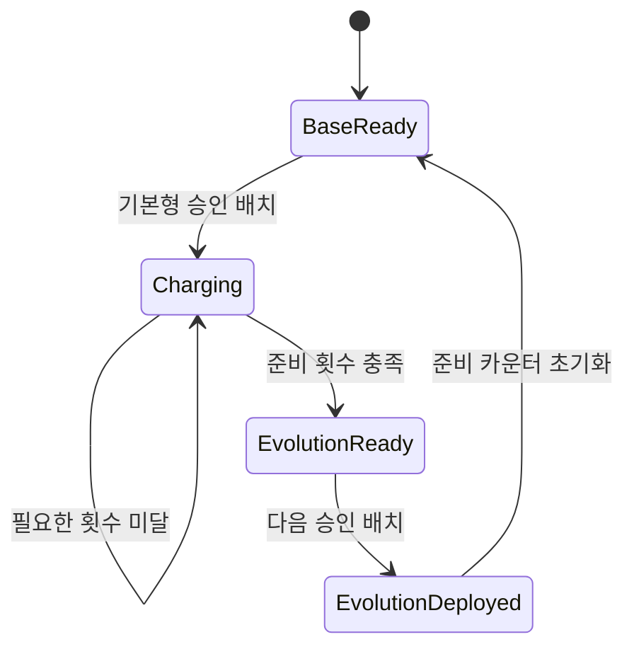

# 25. 카드 형상·능력·타워 유닛의 재구축 계약

> **v4 추가 조사 안내:** 아래 본문과 개수는 해당 v2/v3 작성 당시의 범위를 설명한다. 현재 통합 자료, 추가 복원, 레벨 미기재 값의 처리와 실행 명령은 [39번 개요](39_research_reconstruction_v4_overview.md), [44번 근거 조정](44_sources_and_level_reconciliation.md), [최신 검증 보고서](reports/validation_report.md)를 기준으로 한다.

> 2026-11-17 공식 문서 재검토. **공개 규칙**과 **재현 설계**를 분리한다. 이 문서의 ID, 자료구조, 상태 이름은 제안이며 원작 내부 테이블 이름이 아니다. 밀집 보병은 본 프로젝트의 자체 추가 카드다.

## 1. 카드 하나와 전장 개체 하나는 같지 않다

한 카드는 병력 여러 명을 만들 수 있고, 건물을 만들거나 주문을 실행할 수도 있다. 생성된 개체는 사망·변형·능력 발동으로 추가 개체를 만들 수 있다. 기본 카드, 진화형, 히어로형, 능력 소유자와 UI 버튼을 같은 정수 ID 하나로 표현하면 중복 배치와 사망 후속 효과에서 연결이 끊긴다.

다음 층을 분리하는 것이 재구축의 출발점이다.

| 층 | 예시 필드 | 고정되는 시점 |
|---|---|---|
| 카드 정체성 | `card_id`, `rarity`, `kind` | 콘텐츠 버전 |
| 형상 정의 | `form_id`, `base_card_id`, `ability_policy_id` | 콘텐츠 버전 |
| 소유권 | `owned_level`, `unlocked_forms` | 계정 상태 |
| 덱 의도 | `slot_kind`, `requested_form_id` | 덱 저장 |
| 전투 허용 | `ruleset_id`, `resolved_form_id`, `battle_level` | 경기 시작·배치 |
| 배치 인스턴스 | `deployment_id`, `spawned_entity_ids` | 카드 사용 승인 |
| 능력 권한 | `ability_owner_id`, `uses_remaining` | 배치·사용·사망 |
| 결과 기록 | `command_id`, `effect_id`, `damage_event_id` | 실행 중 |

같은 원작 카드의 기본형과 진화형을 서로 무관한 카드로 세면 덱 중복 규칙을 우회할 수 있다. 반대로 모든 형상을 한 행에 덮어쓰면 진화형 방패나 히어로 능력만 바뀐 패치가 기본형까지 바뀐다. 안정적 기본 카드 키와 형상 키를 별개로 보관해야 한다.

## 2. 현재 확인한 형상 사용 규칙

2026-03-16 슬롯 개편은 세 특수 슬롯과 허용 범주를 정리했다. 현재 공식 지원은 같은 구성을 안내한다. [CS10][CS18]

| 슬롯 | 개수 | 허용 형태 | Trophy Road 해금 |
|---|---:|---|---:|
| Evolution | 1 | 진화 | Arena 3 |
| Hero | 1 | 히어로 또는 챔피언 | Arena 5 |
| Wild | 1 | 진화·히어로·챔피언 | Arena 10 |

이 표는 슬롯의 **자격**이다. 해당 카드를 소유했는지, 형상을 해금했는지, 현재 이벤트에서 허용하는지는 별도의 조건이다. 기본 카드 하나에 진화·히어로가 모두 있더라도 덱에서 요청한 형상 하나를 명시하고 UI에서 전환한다. 일반 슬롯에 넣은 진화·히어로 카드는 기본형으로 작동한다. [CS04][CS05]

재현 구현에서는 실패 이유를 `form_not_owned`, `slot_disallows_form`, `slot_not_unlocked`, `mode_disallows_form`처럼 분리한다. 원작의 실제 오류 문자열을 복제한 목록이 아니라, 테스트에서 어떤 검증 단계가 실패했는지 알 수 있게 하는 제안이다.

### 2.1 슬롯과 전투 효과의 예외

덱 슬롯 검사는 플레이어가 경기 시작 전에 선택한 형상에 적용한다. 전투 효과가 임시로 만드는 형상까지 계정 소유권으로 막으면 진화 Mirror를 재현할 수 없다. 생성 경로를 `deck_deploy`, `copy_effect`, `death_spawn`, `ability_spawn`으로 나누고 각각 허용된 정책을 적용한다.

이 경로 구분은 계정 권한을 생략하자는 뜻이 아니다. 임시 생성은 원래 효과의 범위 안에서만 허용하고 컬렉션의 영구 해금 데이터에는 쓰지 않는다. 결과 저장에도 `created_by_effect_id`를 남겨 정상적인 복제와 무단 형상 주입을 구별한다.

## 3. 진화의 준비·발동·소진

공식 지원은 카드별로 정해진 기본 배치 횟수를 채운 **다음 배치**에서 진화형이 나오고, 발동 뒤 준비 과정이 다시 반복된다고 설명한다. 진화 능력은 해당 배치에서 자동으로 수행된다. [CS05]



위 도식은 **재현 상태 모델**이다. 한 번의 cycle을 전체 덱이 정확히 한 바퀴 돈 시간으로 저장하지 않고, 해당 카드의 준비 진행을 나타내는 정수로 둔다. 카드 회전은 언제 다시 배치할 기회가 생기는지 결정하고, 진화 준비 횟수는 그 기회가 기본형인지 진화형인지 결정한다.

| 데이터 항목 | 의미 | 값이 없는 경우 |
|---|---|---|
| `required_base_plays` | 진화 전 필요한 기본 배치 수 | 카드별 근거가 없으면 `null` |
| `counter_owner` | 플레이어·카드·슬롯 중 어느 단위인지 | 미확인 정책으로 분리 |
| `advance_on` | 승인 배치인지 실제 생성인지 | 취소/실패 배치 실험 필요 |
| `reset_on` | 진화 배치 승인 또는 생성 시점 | 이벤트 경계 실험 필요 |
| `copy_interaction` | Mirror로 카운터가 변하는지 | 일반 진화 규칙만으로 추정 금지 |

### 3.1 2026년 11월의 두 사례

| 형상 | 공개 확인된 값·동작 | 미확인 세부 |
|---|---|---|
| Giant 진화 | 준비 1 cycle, HP 50% 임계의 분노와 Rage 흔적 [CS11] | 정확한 비교 연산자, 회복 후 재발동, 버프 수치 |
| Mirror 진화 | 준비 2 cycles, 직전 카드의 진화가 있으면 그 형태 생성 [CS11] | 중간 능력 입력의 직전 카드 판정, 불가 대상 목록 |
| Mirror의 복제 레벨 | 원문은 추가 1레벨 효과를 설명 [CS15] | 모드 상한·부스트·임시 레벨 상승의 계산 순서 |
| Mirror 소유권 예외 | 복제 진화를 소유하거나 Evo 슬롯에 두지 않아도 됨 [CS11][CS15] | 영구 소유권으로 전환되지 않도록 재현 데이터 분리 |

HP 임계 변형을 표현하려면 단순 `is_evolved` 외에 전장 인스턴스의 `enrage_triggered`와 효과 출처가 필요하다. 체력 회복으로 50% 위로 돌아갈 때 분노가 해제되는지는 공개 설명만으로 고정하지 않는다. `threshold`는 복원 가능한 값이고 `rearm_policy`는 남아 있는 조사 항목이다.

## 4. 챔피언의 회전과 능력 소유자

2025년 개편은 전장에 같은 챔피언이 여러 개 존재할 수 있게 하고 일반 카드와 같은 회전을 적용했다. 현행 지원 문서도 동종 중 가장 최근 배치한 챔피언만 능력 권한을 가진다고 설명한다. [CS07][CS03]

개체 식별 예시는 다음과 같다. 모든 ID는 가상이다.

```json
{
  "team_id": "A",
  "champion_card_id": "example_champion",
  "deployments": [
    {"deployment_id": "d101", "entity_id": "e501", "alive": true},
    {"deployment_id": "d108", "entity_id": "e612", "alive": true}
  ],
  "ability_owner_entity_id": "e612",
  "rule_version": "example_2026_single_use"
}
```

사용자에게 보이는 카드 버튼과 실제 능력 소유자는 다른 개체다. 버튼 클릭 순간에 연결된 `entity_id`가 살아 있는지, 그 배치가 가장 최근의 권한 소유자인지, 사용 예산이 남아 있는지 다시 확인한다. 화면을 그렸던 지난 프레임의 참조만 사용하면 새 배치 직후 옛 개체가 발동할 수 있다.

같은 카드의 최신 개체가 사망했을 때 이전 개체로 권한이 되돌아가는지는 이번 공식 설명에서 명확히 확인하지 못했다. 따라서 `CASE_CHAMPION_OWNER_DEAD`에 실험을 남겼다. ‘가장 최근 살아 있는 개체’라고 임의로 구현하면 ‘가장 최근 배치된 개체’와 결과가 달라질 수 있다.

## 5. 능력 1회 사용과 예외 카드

2026-08-04 공식 변경은 Hero·Champion 능력의 기본 정책을 쿨다운 재사용에서 1회 사용으로 바꾸었다. Boss Bandit은 해당 변경의 예외로 명시되어 있다. [CS06]

| 상태 | 최소 조건 | 입력 처리 제안 |
|---|---|---|
| 비소유 | 능력 권한이 다른 개체에 있음 | 거절, 비용 차감 없음 |
| 준비 | 소유자 생존, 예산·엘릭서 충족 | 요청 승인 후 캐스팅 진입 |
| 캐스팅 | 효과 실행 전 지연 | 취소·사망 정책을 해당 카드에서 조회 |
| 실행 | 능력 효과 생성 | 승인된 입력 한 건에 하나의 효과 ID |
| 소진 | 일반 1회 예산 사용 완료 | 같은 배치의 추가 입력 거절 |
| 예외 재사용 | Boss Bandit 등 카드별 정책 | 재사용 횟수·조건·시간을 별도 조회 |

이 표의 상태 이름은 원작 코드가 아니다. 다만 공개된 1회 규칙을 데이터로 표현하려면 최소한 `uses_remaining` 또는 동등한 소진 상태가 필요하다. `cooldown=Infinity` 하나로 대체하면 저장/불러오기, 발동 전 실패, 비용 환불, 새 개체로 권한 이동을 설명하기 어렵다.

### 5.1 비용·캐스팅·환불 계약

배치 비용과 능력 비용은 별개다. 공식 지원은 능력 버튼에 엘릭서 비용이 표시된다고 설명한다. 10월 27일 수정은 Hero Ice Wizard가 능력 투사체 적중 전에 처치되면 엘릭서를 돌려주는 경우를 명시한다. [CS04][CS15]

```text
AbilityRequest
 → ValidateOwnerAndBudget
 → CommitCost
 → PendingCast
 → EffectCreated
 → Completed

PendingCast/EffectCreated에서 사망
 → 카드별 cancel/refund 정책 조회
 → 허용된 경우 한 번만 Refund
```

이는 재현 처리 제안이다. 모든 카드의 사망 환불을 통일하지 않고 `refund_window`, `refund_amount_policy`, `consume_use_on_cancel`을 분리한다. 출처가 확인되지 않은 필드는 `null`로 두고 실측 뒤 채운다. 환불이 일어났다는 사실만으로 능력 사용 예산까지 복구됐다고 가정하지 않는다.

## 6. 여러 개체로 구성된 카드

카드 정의에는 자신이 생성하는 개체와 각 개체의 역할을 나열한다. 개체마다 공격, 이동, 수명, 사망 효과가 다를 수 있으므로 카드 레벨의 단일 `damage` 값만으로 모두 계산하지 않는다.

| 역할 | 예시 데이터 계약 | 검증 질문 |
|---|---|---|
| 주 개체 | `primary_entity` | 카드 정보창 HP가 어느 개체의 것인가? |
| 동반 개체 | `attached_entities[]` | 부모가 죽으면 함께 사라지는가? |
| 능력 소유자 | `ability_owner_policy` | 여러 개체 중 누가 버튼을 유지하는가? |
| 사망 생성물 | `death_spawn_profile` | 사망 시 정확히 한 번 생성되는가? |
| 지속 효과 | `persistent_effect` | 원본 사망 뒤에도 남는가? |
| 연결 효과 | `linked_endpoints[]` | 한쪽 사망/이동 시 즉시 해제되는가? |

공식 2025년 개편의 Skeleton King 영혼 초기화는 **배치 인스턴스의 축적 상태**가 새 개체에 자동 상속되지 않는 사례다. 반면 원작의 모든 소환물 HP·레벨 전파 규칙을 이 사례로 결정할 수는 없다. 레벨 전파, 강화 효과 전파, 소환 원점, 진영, 형상 전파를 별도 필드로 둔다. [CS07]

## 7. 타워 유닛을 일반 카드와 연결하는 방법

타워 유닛은 기존 8장에 더해지는 지원 카드이고, 자신의 덱을 사용하는 모드에 적용된다. 타워 유닛 레벨은 킹 타워 레벨을 넘을 수 없다. 2023년 도입 공지는 킹 타워와 측면 타워 유닛의 레벨 진행을 분리했다. [CS19][CS20]

| 개념 | 데이터 책임 | 잘못 합치면 생기는 오류 |
|---|---|---|
| 킹 타워 | 킹 HP·활성화·공격·계정 성장 | 측면 유닛 선택이 킹 공격까지 변경 |
| 측면 타워 구조 | 위치·진영·파괴·전진 배치 영역 | 타워 유닛 변경 때 파괴 상태가 초기화 |
| 타워 유닛 | 공격 프로필·레벨·고유 메커니즘 | 모든 측면 타워가 같은 공격 간격 사용 |
| 덱 슬롯 | 타워 지원 카드의 선택 | 일반 8장 중 하나를 소모 |
| 모드 정책 | 레벨 고정·상한·제공 카드 | 계정 레벨을 특수 모드에 그대로 적용 |

타워 선택이 다른 두 전투의 카드 교환을 직접 비교하면 카드 밸런스가 바뀐 것처럼 보일 수 있다. 상호작용 실험에는 타워 유닛 ID·레벨·탄약/충전 초기 상태를 반드시 기록한다. 공지에서 공개되지 않은 타워 AI의 표적 동률 규칙은 일반 병력 AI와 같다고 가정하지 않는다.

## 8. 원작 데이터와 밀집 보병의 경계

현재 Crownfall Arena의 **밀집 보병**은 사용자가 요청해 추가한 자체 설계다. 방진의 높은 피해 감소, 방진 중 공격 금지, 스킬로 대형 해제 후 돌격하는 정책은 원작 카드 표에서 추출한 것이 아니다. 따라서 원작 Royal Recruits 또는 그 진화의 별칭으로 연결하지 않는다.

| 구분 | 원작 재구축 영역 | 자체 설계 영역 |
|---|---|---|
| 식별자 | 공개 카드 ID·원문 키 | 별도 `custom:` 접두사 권장 |
| 수치 출처 | 공식 문서·공개 스냅샷·실측 기록 | 사용자 요구·구현 버전 |
| 상호작용 | 원작 증거와 실험을 비교 | 자체 기획의 기대 동작 검증 |
| 통계 | 원작 카드 총수와 메타 표본 | 자체 카드와 테스트 세션 통계 |
| 리플레이 | 원작 규칙 시점 | Crownfall의 규칙 버전 |

방진 방어력을 원작의 공통 방어 스탯으로 역추정하거나, 자체 스킬 쿨다운을 현행 Champion 능력 정책으로 옮기면 출처가 뒤섞인다. JSON의 `COMBAT_CUSTOM_PHALANX`와 `CASE_PHALANX_ISOLATION`은 이 혼입을 막기 위한 데이터 경계다.

## 9. 구현자가 사용할 수 있는 승인 조건

다음은 원작 코드의 테스트 결과가 아닌 **재현 설계의 승인 조건**이다.

1. 한 경기의 카드·형상·효과 정의는 한 데이터 버전에 고정된다.
2. 기본 카드와 형상 ID가 연결되어 중복 덱과 임시 생성의 자격을 다르게 판정한다.
3. 카드 사용, 능력 사용, 효과 발생은 다른 명령·이벤트로 기록된다.
4. 새 챔피언의 배치가 능력 소유자를 바꾸되, 옛 개체의 일반 공격 상태를 임의로 초기화하지 않는다.
5. 능력의 단일 사용·캐스팅·사망 환불·재사용 예외가 서로 다른 정책 필드다.
6. 진화 준비 카운터와 일반 덱 회전이 분리되어, 테스트에서 각각의 변화 원인을 추적할 수 있다.
7. 미확인 복제·방패·동시 사건의 규칙을 확정값으로 채우지 않고 실험 결과를 연결한다.
8. 모드 레벨 정책과 계정 소유권, 전장 임시 생성 레벨이 분리된다.
9. 형상·타워를 바꿔도 상대 진영·화면 방향이 데이터 의미를 바꾸지 않는다.
10. 자체 카드의 변경은 원작 데이터 파일의 행 수·원작 출처 신뢰도를 변화시키지 않는다.

실험 원본은 [24. 전투 실험](24_combat_rules_and_interaction_lab.md), 형상 설명의 기존 맥락은 [08. 진화·챔피언·히어로·타워](08_evolutions_champions_heroes_towers.md), 전체 데이터 계약은 [20. 데이터 모델](20_data_model_and_configuration.md)을 참고한다.

## 출처 링크

[CS01]: https://support.clashroyale.com/hc/en-us/articles/49484936933403-Elixir "Elixir"
[CS02]: https://support.clashroyale.com/hc/en-us/articles/49484904683803-1v1-Battle "1v1 Battle"
[CS03]: https://support.clashroyale.com/hc/en-us/articles/49484915467291-Champions "Champions"
[CS04]: https://support.clashroyale.com/hc/en-us/articles/49484957323163-Heroes "Heroes"
[CS05]: https://support.clashroyale.com/hc/en-us/articles/49484923993883-Card-Evolution "Card Evolution"
[CS06]: https://supercell.com/en/games/clashroyale/blog/news/final-august-balance-changes-826/ "August Balance Changes"
[CS07]: https://supercell.com/en/games/clashroyale/blog/release-notes/october-update-2025/ "October Update 2025"
[CS08]: https://supercell.com/en/games/clashroyale/blog/release-notes/november-update/ "November Update"
[CS09]: https://supercell.com/en/games/clashroyale/blog/release-notes/the-party-button-update-2/ "SEPTEMBER UPDATE!"
[CS10]: https://supercell.com/en/games/clashroyale/blog/news/mid-march-update/ "Mid-March Update"
[CS11]: https://support.clashroyale.com/hc/en-us/articles/57579150651419-What-s-New-November-2026 "What's New? - November 2026"
[CS12]: https://supercell.com/en/games/clashroyale/blog/release-notes/new-season-minion-academy/ "New Season: Minion Academy!"
[CS13]: https://supercell.com/en/games/clashroyale/blog/release-notes/september-balance-changes-2027/ "September Balance Changes"
[CS14]: https://supercell.com/en/games/clashroyale/blog/release-notes/season-16/ "New Cards, Pass Royale & Balance Changes"
[CS15]: https://supercell.com/en/games/clashroyale/blog/release-notes/new-season-king-vs-king/ "New Season: King vs. King!"
[CS16]: https://supercell.com/en/games/clashroyale/blog/release-notes/january-balance-changes-2/ "January Balance Changes"
[CS17]: https://supercell.com/en/games/clashroyale/blog/release-notes/april-update/ "APRIL UPDATE!"
[CS18]: https://support.clashroyale.com/hc/en-us/articles/49484924205595-Cards-Decks "Cards & Decks"
[CS19]: https://support.clashroyale.com/hc/en-us/articles/49484890719515-Tower-Troops "Tower Troops"
[CS20]: https://supercell.com/en/games/clashroyale/blog/release-notes/game-update-december-13/ "GAME UPDATE - DECEMBER 13"
