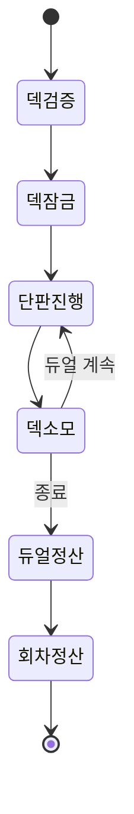

# 27. 대전 모드·매칭·클랜의 실행 계약 재구축

> **v4 추가 조사 안내:** 아래 본문과 개수는 해당 v2/v3 작성 당시의 범위를 설명한다. 현재 통합 자료, 추가 복원, 레벨 미기재 값의 처리와 실행 명령은 [39번 개요](39_research_reconstruction_v4_overview.md), [44번 근거 조정](44_sources_and_level_reconciliation.md), [최신 검증 보고서](reports/validation_report.md)를 기준으로 한다.

> 재구축 기준: **2026-11-17**. 공개 규칙은 공식 지원 페이지를 다시 열어 확인했다. 아래 데이터는 공개 사실을 정규화한 것이며, 서버의 MMR·검색 큐·거래 구현을 추출한 자료가 아니다. 해당 게임 계정으로 직접 진입하거나 실험한 결과도 아니다.

## 1. 이번 고도화에서 바뀐 점

기존 11·14·15번은 각 시스템의 목적과 흐름을 설명했다. 이번에는 같은 규칙을 **입장 검증 → 전력 확정 → 경기 실행 → 집계 → 지급**의 경계별로 나누어 구현·검증에 사용할 수 있는 레코드로 만들었다. 공개되지 않은 수치를 빈칸으로 남기는 방식도 계약에 포함했다.

| 파일 | 역할 | 이번 재구축 범위 |
|---|---|---|
| [mode_rules.json](data/tables/mode_rules.json) | 대전·레벨·매칭 조건 | 45개 규칙 레코드 |
| [social_clan_rules.json](data/tables/social_clan_rules.json) | 클랜·기부·교환·클랜전 | 49개 규칙 레코드 |
| [modes_sources.json](data/sources/modes_sources.json) | 모드·소셜·Merge Tactics 공통 출처 | 공식 자료 26개, 날짜·범위·주의점 포함 |

가장 중요한 정정은 Crown Series의 덱 수다. 일반 Friendly Duel은 완성 덱이 최소 3개이면 참가할 수 있지만, **현재 Crown Series 지원 문서는 4덱·32개 고유 카드를 요구**한다. 기존 11번의 3~4개 표기는 이 차이를 흐리므로 두 모드의 입장 검증을 분리했다. [공식 듀얼 규칙](https://support.clashroyale.com/hc/en-us/articles/49484921196699-Duels) · [공식 Crown Series](https://support.clashroyale.com/hc/en-us/articles/58566501950107-Crown-Series)

## 2. 모드별 정규화 정책

| 모드 | 카드 전력의 기준 | 입장/종료에서 중요한 조건 | 데이터에 남긴 미확정 부분 |
|---|---|---|---|
| Trophy Road | 보유 레벨, 모드 별도 상한 없음 | 개인 트로피 비교 | 검색창 폭·봇·숨은 가중치 |
| Ranked | 현재 리그 설정 별도 확인 | 지원 문구 13,000 / 11월 공지 일정 14,000 충돌; 전 시즌 Champion 경로 별도, 7리그 | 이번 지원 문서에 없는 리그별 레벨 상한 |
| Classic / Grand / Mega Draft | 카드·타워 최대11 | 참가비10/100/50젬, 12승 또는3패 | 낮은 보유레벨의 세부 보정은 별도 확인 |
| Global Tournament | 카드·타워 최대11 | 5패 또는 시간 종료 | 실제 회차 기간·보너스 가격 |
| Friendly | 대회 상한까지 상향 보정 | 트로피·골드·젬 보상 없음 | 해당 순환 모드의 숫자 상한 |
| War Duel | 보유 레벨 | 최소3덱, 사용 덱 잠금 | 메달 상세 숫자 |
| Crown Series | 리그별 상한 | 4덱·32고유카드 | King Grand의 `battles` 카운트 의미 |

각 행의 근거는 [1v1](https://support.clashroyale.com/hc/en-us/articles/49484904683803-1v1-Battle), [Ranked](https://support.clashroyale.com/hc/en-us/articles/49484907381019-Ranked), [Challenges](https://support.clashroyale.com/hc/en-us/articles/49484955959067-Classic-Challenges), [Global Tournament](https://support.clashroyale.com/hc/en-us/articles/49484915041435-Global-Tournaments), [Friendly](https://support.clashroyale.com/hc/en-us/articles/49484891151259-Friendly-Battles), [War Decks](https://support.clashroyale.com/hc/en-us/articles/49484904440987-War-Decks), [Crown Series](https://support.clashroyale.com/hc/en-us/articles/58566501950107-Crown-Series)다.

**[재현 설계]** 숫자 `11` 하나를 공통 모드 설정에 넣지 않는다. `level_policy.kind`를 먼저 선택한 다음 숫자 값을 읽어야 한다.

```text
owned_uncapped  → 보유 전력 그대로, 별도 모드 cap 없음
cap_only       → min(보유레벨, cap)
normalize      → 지정 레벨로 통일
provided_pool  → 모드가 제공한 카드/형상 프로필 사용
unverified     → 자동 생성·배포 대상에서 제외
```

예를 들어 레벨9 카드를 레벨11 제한 모드에 넣는다고 할 때, `cap_only`에서는9, `normalize`에서는11이다. 이 예시는 정책 차이를 설명하기 위한 가상 입력이며 특정 도전의 낮은 레벨 보정을 실측한 결과가 아니다. 같은 방식으로 `null`은 정책과 함께 읽는다. `owned_uncapped`의 `card_cap:null`은 모드 상한 없음이고, `evidence_status:unverified`의 `value:null`은 값을 모른다는 뜻이다.

## 3. 매칭에서 복원할 수 있는 경계

공개 문서가 알려주는 것은 대체로 **어떤 종류의 신호를 참조하는가**다. 신호의 정확한 가중치·탐색 창·반복 상대 억제·봇 투입 조건까지 알려주는 것은 아니다.

| 큐 | 공개 입력 | 공개하지 않은 부분 | 설계/분석에 미치는 영향 |
|---|---|---|---|
| Trophy Road | 트로피; 덱·카드 레벨은 제외 | 트로피 범위 확대 곡선 | 레벨 불균형이 곧 매칭 버그라는 결론은 불가 |
| Ranked | 승수·현재 리그 | 승수의 내부 집계 범위·점수식 | 리그별 표본 분리 필요 |
| Challenge | 회차 승수 | 패배수 보조변수 여부·정렬 | 회차 ID와 승수를 함께 기록 |
| Global Tournament | 대회 진척, 초반 아레나 | 초반의 정확한 정의·가중치 | 대회 초반/후반을 분리 분석 |
| 클랜 대 클랜 | 클랜 트로피 | 활동량 가중치·그룹 확정식 | 집단 매칭과 개인 매칭 분리 |
| 클랜전 개인 | 개인 트로피·클랜전 성과 | 성과 점수 공식·시간별 확장폭 | 개인 트로피만 맞춘 복제는 완전 재현 아님 |

근거: [1v1](https://support.clashroyale.com/hc/en-us/articles/49484904683803-1v1-Battle), [Ranked](https://support.clashroyale.com/hc/en-us/articles/49484907381019-Ranked), [Challenges](https://support.clashroyale.com/hc/en-us/articles/49484955959067-Classic-Challenges), [Global](https://support.clashroyale.com/hc/en-us/articles/49484915041435-Global-Tournaments), [클랜전 매칭](https://support.clashroyale.com/hc/en-us/articles/49484912438811-Matchmaking).

**[분석]** 상성이 나쁜 상대를 연속으로 만난 로그는 매칭의 결과 자료다. 그것만으로 상성 강제 배정, 결제 유도, 연패 보호 등 특정 내부 목표를 식별할 수 없다. 그 가설을 비교하려면 시간대·대기시간·실력구간·덱 채택률 같은 교란 요인을 먼저 통제해야 한다. 데이터 파일의 `MODE_MMR_UNKNOWN`은 이 공백을 숨기지 않기 위한 행이다.

## 4. 듀얼의 세 집계 단위

**[재현 설계]** `game`, `duel`, `run`을 분리한다. 단판 두 번을 이겨 듀얼 한 번을 이겼는데 회차 승수가2 증가하면 보상·랭킹·재접속 처리가 동시에 오염된다.

| 엔터티 | 시작 시 고정할 값 | 종료 결과 | 중복 방지 키 |
|---|---|---|---|
| `DuelRun` | 리그·시즌·회차 종료 조건·보상 버전 | 회차 승패·종료 이유 | `run_id` |
| `DuelMatch` | 덱 세트·사용 가능 목록·전력 정책 | 듀얼 승자·사용한 덱 | `duel_id` |
| `BattleGame` | 선택 덱·타워·형상·RNG·전투 규칙 | 단판 승패·크라운 | `battle_id` |
| `RewardReceipt` | 지급 대상·결과 revision | 실제 지급 내역 | `run_id + reward_revision` |



일반 Open Duel의 사용 덱 재선택 금지와 BO3는 공식 규칙이다. 위 잠금·키·서버 상태는 그 규칙을 재현하기 위한 제안이다. 실제 Supercell 서버의 데이터 구조로 주장하지 않는다. [Duels](https://support.clashroyale.com/hc/en-us/articles/49484921196699-Duels)

Crown Series의 일반 주말은 8승/3패, 하위 리그 Grand는12승/4패이며 주말은 금요일09:00UTC부터72시간이다. 한국 시간은 금요일18:00~월요일18:00이다. King Grand의20 `battles`는 숫자만 공개대로 보존하고 `counting_unit:null`로 두었다. `20단판` 또는 `20듀얼` 중 하나로 추정해 데이터에 넣지 않는다. [Crown Series](https://support.clashroyale.com/hc/en-us/articles/58566501950107-Crown-Series)

## 5. 소셜 데이터의 실제 분리 단위

### 5.1 클랜 역할은 단순 숫자 비교로 충분하지 않다

공식 권한을 기준으로 `actor_role → action → target_role` 매트릭스를 만든다. Elder가 Member를 내보낼 수 있다는 사실은 Elder가 다른 Elder도 내보낼 수 있음을 뜻하지 않는다. 승격된 대상을 오래된 UI에서 추방하려는 경우, 실행 시점의 역할을 다시 검사해야 한다. 정적 권한 조회와 실행 시의 버전 비교를 함께 두는 이유다.

`SOCIAL_ELDER_KICK`의20분, `SOCIAL_MAIL`의12시간은 서로 다른 행위의 제한이다. 하나의 `clan_action_cooldown`으로 합치면 기부·승격·메시지 같은 무관한 행동을 막는 오류가 생긴다. 클랜은50명, 재가입은Member 시작이라는 규칙도 독립적으로 저장했다. [Clan Roles](https://support.clashroyale.com/hc/en-us/articles/49484954095771-Clan-Roles)

### 5.2 요청과 기부의 수량 차원

요청에는 `requested_count`, `remaining_count`, `received_count`가 있다. 기부자에는 `per_request_limit`, `daily_budget`, `inventory_available`가 있다. 요청자가 아레나를 올리는 동안 남아 있는 요청의 한도를 바꿀 것인지도 별도 정책이다. 이 처리 순서는 미공개이므로 구현 제안으로만 다룬다.

공식 지원의 공개 표를 아레나 구간별5행으로 옮겼다. 현재 표는23에서 끝나므로24이상 값은null이다. Arena1 행은 남아 있지만 5월 기능 개편은 기부 해금을Arena2로 명시한다. **표의 행이 존재한다는 사실과 계정이 그 기능을 쓸 수 있다는 사실을 구별**해야 한다. [기부 표](https://support.clashroyale.com/hc/en-us/articles/49484955716891-Requesting-Donating-Cards) · [기능 해금 변경](https://supercell.com/en/games/clashroyale/blog/news/new-collection-levels-and-mastery-changes/)

최대레벨 기부의 골드는 현 지원과 발표 자료가 충돌한다. 파일에는0골드 지원값과 골드·Star Points 지급 발표를 모두 남겼다. `conflict_group=max_level_donation_gold`로 묶어 자동 합산하지 않도록 했다. 실제 계정의 Lv16 카드 기부 전후 원장 관측 전에는 완전 확정으로 처리하지 않는다.

### 5.3 교환의 단위

공개 교환량은 Common250, Rare50, Epic10, Legendary1이며 양쪽에서 각각 토큰1개를 소모한다. [Trading Cards](https://support.clashroyale.com/hc/en-us/articles/49484938455835-Trading-Cards)

**[재현 설계]** 교환의 한쪽 재고만 먼저 줄이고 나중에 상대방을 갱신하면 수락·취소 동시 입력에서 손실이 생긴다. 거래ID, 제안revision, 양측 재고와 토큰을 하나의 원자적 정산으로 잠근다. 요청 취소 후 늦게 도착한 수락, 두 명의 동시 수락, 수락 직전 탈퇴를 각각 다른 실패 이유로 반환해야 한다. 성공 이벤트 재전송은 같은 지급 영수증을 돌려주도록 한다.

## 6. 클랜전은 일일 자원과 주간 정산을 분리한다

공식 규칙의 기본 단위는4개의 고유 덱, 다음 전쟁일 재사용, 주간3훈련일+4전투일이다. 하루 참가자50명 제한과 클랜 구성원50명 제한은 숫자가 같아도 별도 제약이다. 전자는 탈퇴·교체를 포함한24시간 참여 이력, 후자는 현재 멤버십이다. [War Decks](https://support.clashroyale.com/hc/en-us/articles/49484904440987-War-Decks) · [About Clan Wars](https://support.clashroyale.com/hc/en-us/articles/49484904148891-About-Clan-Wars)

| 집계 | 대상 | 키 제안 | 경계 조건 |
|---|---|---|---|
| 멤버십 | 현재 가입 상태 | `clan_id, player_id` | 탈퇴 후 과거 참여 삭제 금지 |
| 일일 참가 | 해당 날 참가한 고유 계정 | `war_day_id, player_id` | 교체 멤버가51번째인가 |
| 덱 소모 | 한 계정의 덱 사용 | `war_day_id, player_id, slot` | 매칭 중 날짜 경계 |
| 방어 생존 | 파괴되지 않은 방어 | `war_week_id, defense_id` | 동시 공격 결과 순서 |
| 주간 상자 | 주간 참가 권리 | `war_week_id, player_id` | 현재 클랜만 보고 소급 지급 금지 |

**[분석·파생]** 활동인원10명, 각자 하루4덱, 전투일4일이면 최대160번의 덱 사용 기회다. 이는 듀얼160회나 실제 획득 메달을 뜻하지 않는다. 듀얼이 여러 덱을 쓸 수 있으므로 전투 유형별 덱 소비를 따로 합산해야 한다. 공식 최소 상자 조건80은 클랜 전체의 주간 사용 덱 수다. [보상 기준](https://support.clashroyale.com/hc/en-us/articles/49484889742363-Clan-War-Rewards)

선박 방어를 완전히 파괴하지 못했을 때 회복되는 부분은 최대HP의1/4이다. 현재HP의1/4 증가나 무조건 전부 회복으로 해석하지 않는다. 선박 이동은 일일 마감 단위이고, 여러 배가 결승에 도달하면 누적 메달을 비교한다. [선박전](https://support.clashroyale.com/hc/en-us/articles/49484937752603-River-Battle-s) · [전쟁 결과](https://support.clashroyale.com/hc/en-us/articles/49484912127643-Clan-War-Results)

## 7. 실행 전 확인해야 할 데이터 경계

아래 시나리오는 **미실행 검증 계획**이다. 정적 데이터 검증과 실제 클라이언트/서버 재현 검증을 구분한다.

| ID | 입력·상황 | 기대/관찰할 내용 | 근거 수준 |
|---|---|---|---|
| MD-01 | 덱3개로 Crown Series 진입 | 4개 계약과 다른 입력 거절 | 공식 계약 |
| MD-02 | 덱3개로 Friendly Open Duel | 최소3개 조건 통과 | 공식 계약 |
| MD-03 | 듀얼2단판 승리 | game2, duel1로 구분 | 재현 설계 |
| MD-04 | Lv9 카드를 상한11 프로필로 평가 | cap/normalize에 따른 서로 다른값 | 재현 설계 |
| MD-05 | King Grand에20 입력 완료 |20의 단위를 인게임 표기로 확정 | 검증 필요 |
| SC-01 | 잔량1 요청에 동시2명기부 |1건만정산, 실패자재고유지 | 재현 설계 |
| SC-02 | 최대레벨 기부 | 골드0/지급충돌해소 | 검증 필요 |
| SC-03 | Arena24의 기부창 | 공개표밖 실제한도기록 | 검증 필요 |
| SC-04 | 교환수락2건동시 |1건정산, 양측토큰한번씩 | 재현 설계 |
| CW-01 | 하루50명참가후 새멤버진입 |51번째고유참가제한확인 | 공식 계약 |
| CW-02 | 주간79→80사용덱 |Boot/상자조건경계확인 | 공식 계약 |
| CW-03 | 듀얼중전쟁일초기화 |덱소모귀속일을관찰 | 검증 필요 |
| CW-04 | Colosseum전환 |선박전/이동/방어보너스제외 | 공식 계약 |
| CW-05 | 탈퇴후주간종료 |기여클랜과지급권리관측 | 검증 필요 |

## 8. 이후 업데이트를 받아들이는 방법

`record_id`를 안정적으로 유지하고 새 사실은 적용일과 출처revision을 붙여 추가한다. 현재 덱·승수·메달 상태에 새 규칙을 즉시 덮어쓰지 말고, 매치 또는 회차 시작 때 선택한 규칙 버전을 끝까지 유지하는 것이 재현용 권고다. 실제 운영 서버가 이 방식이라는 주장은 아니다.

검증 파이프라인에서는 출처 누락, 중복ID, 잘못된 타입, 음수 참가비, 리그구간 누락, 충돌값 동시 활성화부터 잡는다. 이후 실측으로 의미를 확정할 항목은 `unverified`를 유지한다. 데이터가 많아져도 미확정 필드가 자동으로 확정값으로 승격되지 않도록 하는 것이 이 재구축의 핵심이다.

관련 문서: [11 모드](11_matchmaking_and_game_modes.md) · [14 소셜](14_clans_trading_and_social.md) · [15 클랜전](15_clan_wars.md) · [28 Merge Tactics 데이터](28_merge_tactics_reconstructed_tables.md).
