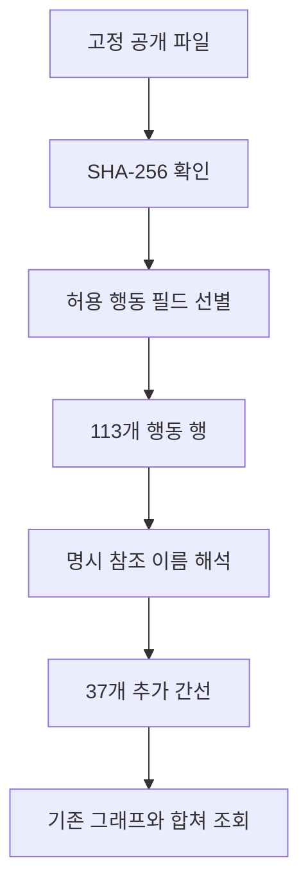

# 43. 2023 역사 행동 필드와 개체 참조의 추가 복원

> v4.0.0 · 조사 기준일 2026-11-17 · 공개 자료의 누락된 변환 항목을 복원했다. 2026 현재 클라이언트의 행동을 실측한 결과가 아니다.

## 1. 무엇을 복원했는가

v2의 원시 자료 선별기는 카드 메타데이터, 기본 전투 수치, 레벨별 배열과 대표적인 소환·투사체 참조를 보존했다. 그러나 원본 공개 파일에는 `target_buff`, `spawn_area_object`, `override_projectile` 같은 추가 행동 필드가 있었다. 이 필드들이 선별 목록에 없으면 원본에 존재하는 관계도 조회 그래프에서 나타나지 않는다.

이번 작업은 동일한 고정 파일을 다시 읽어 **113개 개체의 행동 필드 묶음**과 **37개 명시 참조**를 추가로 추출했다. 숫자 113은 새 카드 113종 또는 신규 현재 수치 113개를 뜻하지 않는다. 하나의 행이 한 개체의 여러 필드를 담고 있으며, 37개 참조는 그 필드에서 파생한 별도 연결 표다. 두 표를 독립적인 발견 횟수로 더해서 해석하면 안 된다.

| 자료 | v3 | v4 | 해석 |
|---|---:|---:|---|
| 역사 카드 카탈로그 | 120 | 120 | 이벤트·숨김 카드를 포함한 당시 공개 행 |
| 기본 개체 정의 | 532 | 532 | 이름 없는 6개 격리 포함 |
| 레벨별 수치 배열 | 4,956 | 4,956 | 기존 공개 배열과 레벨 매핑 유지 |
| 기존 개체 참조 | 428 | 428 | 기존 변환 결과 유지 |
| 추가 행동 묶음 | 0 | 113 | 원본에 존재하던 선택 필드 복원 |
| 추가 명시 참조 | 0 | 37 | 원본 이름과 대상 범주로 연결 |
| 합친 참조 그래프 | 428 | 465 | 기존·추가 참조를 함께 탐색 |
| 카드 루트 연결 누락 | 10 | 10 | 유사한 이름으로 메우지 않음 |

## 2. 원본 식별과 재현 조건

원본 출처는 [RoyaleAPI 공개 저장소의 고정 cards_stats.json](https://raw.githubusercontent.com/RoyaleAPI/cr-api-data/d5461b0a59bff33c4da2fc845b07275b66b2d6ff/docs/json/cards_stats.json)이다. 출처 레코드 `ARCHIVE_STATS`와 기존 [스냅샷 manifest](data/snapshot_manifest.json)를 재사용한다.

| 항목 | 값 |
|---|---|
| 스냅샷 날짜 | 2023-10-18 |
| 고정 커밋 | `d5461b0a59bff33c4da2fc845b07275b66b2d6ff` |
| 원본 바이트 | 3,501,243 |
| 원본 SHA-256 | `664c35ac1f8717f8ed4331fa1a3af1216bb6d45832487ab0917c30799016fbc7` |
| 선별 사실 파일 | [archive_behavior_2023_facts.json](data/raw/archive_behavior_2023_facts.json) |
| 선별 manifest | [archive_extension_manifest.json](data/archive_extension_manifest.json) |
| 복원기 | [reconstruct_extensions.py](scripts/reconstruct_extensions.py) |

기본 실행은 패키지에 동봉한 선별 사실 파일만 사용한다. `--source`를 지정하는 개발자 재추출 모드에서는 먼저 원본 SHA-256을 확인하며, 다른 파일은 거부한다. 파일명이 같아도 내용이 다른 최신 자료를 2023 자료로 처리하지 않는다.

```bash
python scripts/reconstruct_extensions.py
python scripts/reconstruct_extensions.py --check
```

추가 네트워크 접근이나 게임 설치 없이 재생성할 수 있다. 전체 공개 원본, 이미지, 카드 설명문 또는 비공개 리소스는 동봉하지 않는다. 선택한 사실과 식별자만 담는다.

## 3. 선별 규칙과 값 보존

허용 필드 집합은 manifest에 31개로 고정되어 있다. 이름이 있는 개체 중 추가 필드에 적어도 하나의 실질 값이 있는 개체를 선택한다. 선택 조건에서 빈 문자열·`null`·`0`·`false`만 있는 개체는 제외한다. **일단 선택한 개체에서는 존재하는 모든 허용 필드를 그대로 보존한다.** 따라서 선택 조건을 적용했다고 해서 내부의 `false`나 `0`이 제거되는 것은 아니다.

| 필드 군 | 예 | 다룰 때의 주의 |
|---|---|---|
| 대상 상태 효과 | `target_buff`, `apply_buff_before_damage` | 이름이 있어도 실제 실행 순서·틱은 별도 검증 필요 |
| 투사체 전환·생성 | `spawn_projectile`, `override_projectile` | 시작 투사체와 후속 투사체의 역할 분리 |
| 배치·사망 생성 | `spawn_area_object`, `death_spawn`, `death_spawn_character3` | 기존 소환 필드와 구별되는 원본 관계 |
| 대상 필터 | `maximum_targets`, `hit_biggest_targets`, `ignore_buildings` | 최종 타겟 선정 규칙 전체를 확보한 것은 아님 |
| 접근성·상태 | `affects_hidden`, `can_be_targeted`, `shield` | 부울·식별자·수치의 원래 타입 유지 |
| 원시 기하·이동 | `projectile_range`, `projectile_radius`, `deflect_radius`, `fly_direct_paths` | 게임 타일 단위로 임의 환산하지 않음 |
| 시간·생산 | `hide_time_ms`, `elixir_production_stop_time`, `spawn_limit` | 이름만으로 모든 필드의 단위를 통일하지 않음 |

예를 들어 추가 Tesla 행에는 `hide_time_ms`와 함께 여러 `false`, `0`, `null` 값이 들어 있다. 이 값은 같은 의미가 아니다. `false`는 공개 필드의 비활성 값, `0`은 수치 0, `null`은 공개 자료의 비지정 값이다. 누락된 필드는 개체가 그 속성을 가진다는 주장 자체가 없다.

행에는 `entity_id`, `source_row_index`, `base_entity_record_id`가 포함된다. 복원기는 기존 기본 개체의 위치와 ID가 맞는지 확인하므로 동명이지만 다른 범주의 개체를 잘못 덮어쓰지 않는다.

## 4. 참조 복원 방식

| 원본 참조 필드 | 대상 범주 | 복원한 참조 수 |
|---|---|---:|
| `target_buff` | `character_buff` | 14 |
| `spawn_projectile` | `projectile` | 4 |
| `override_projectile` | `projectile` | 6 |
| `spawn_area_object` | `spell` | 4 |
| `death_spawn_character3` | `characters` 또는 `building` | 1 |
| `death_spawn` | `characters` 또는 `building` | 8 |
| 합계 | | 37 |

원본에 기록된 이름을 해당 범주에서 정확히 찾는다. 후보가 하나면 `resolved`, 여럿이면 `ambiguous`, 없으면 `missing`으로 분류한다. 이번 37개 참조는 모두 하나의 대상으로 해석되었다. 이는 추가 참조의 해석 결과이지 모든 카드의 루트 연결이 완성되었다는 뜻은 아니다.

각 참조는 `field_origin: explicit_publisher_reference`와 행동 행을 가리키는 `extension_record_id`를 가진다. 이름 유사도, 영문 번역, 접미사 제거, 역할 추정으로 만든 간선은 포함하지 않는다.



## 5. 실제로 다시 드러난 관계

| 출발 개체 | 복원 필드 | 대상 | 분석상 의미 |
|---|---|---|---|
| `projectile:ice_wizardProjectile` | `target_buff` | `character_buff:IceWizardSlowDown` | 투사체가 적용하는 감속 효과를 그래프에서 추적 |
| `projectile:SnowballSpell` | `target_buff` | `character_buff:IceWizardSlowDown` | 같은 효과 정의를 참조한다는 역사 관계 보존 |
| `projectile:LighningSpell` | `target_buff` | `character_buff:ZapFreeze` | 원본 식별자의 철자도 변경하지 않음 |
| `projectile:LogProjectile` | `spawn_projectile` | `projectile:LogProjectileRolling` | 초기·구르는 투사체 관계 복원 |
| `projectile:BarbLogProjectile` | `spawn_projectile` | `projectile:BarbLogProjectileRolling` | 통나무 계열을 임의로 같은 정의로 합치지 않음 |
| `characters:IceWizard` | `spawn_area_object` | `spell:IceWizardCold` | 배치 시 생성되는 효과 정의 연결 |
| `characters:ElectroWizard` | `spawn_area_object` | `spell:ElectroWizardZap` | 기본 공격과 배치 효과 분리 |
| `characters:BattleHealer` | `spawn_area_object` | `spell:BattleHealerSpawnHeal` | 배치 효과와 다른 회복 행동의 구분 |

정확한 행과 원시 값은 [추가 참조 JSON](data/tables/archive_reference_extensions_2023.json) 및 [추가 행동 JSON](data/tables/archive_behavior_extensions_2023.json)에서 확인한다. 표에 관계가 보인다고 해서 현재 전투의 효과 지속 시간이나 충돌 순서까지 확정되는 것은 아니다.

## 6. 여전히 복원하지 못한 카드 루트

다음 10개 카드는 카탈로그 key에서 기본 개체 정의로 가는 정확한 공개 연결이 없다.

`arrows`, `barbarian-barrel`, `elixir-collector`, `fireball`, `giant-snowball`, `goblin-barrel`, `mirror`, `party-rocket`, `rocket`, `the-log`

추가 참조의 대상에 통나무·화염구와 관련된 개체가 존재하더라도 카드에서 그 개체를 가리키는 명시적 링크가 확보되지 않으면 카드 그래프의 루트로 삼지 않는다. 예를 들어 `FireballSpell`이라는 투사체가 존재한다는 사실과 `fireball` 카드의 정확한 실행 루트를 공개 파일에서 확인했다는 주장은 다르다. 현재 그래프는 확인 가능한 지점에서 멈춘다.

복원율을 높이려면 이름 추정 대신 같은 버전의 명시 매핑, 원본 생성기의 공개 계약, 또는 버전·카드 ID를 포함한 실제 관측이 필요하다. 관측 전까지 `missing_public_key`를 유지한다.

## 7. 조회와 구현 연결

[오프라인 연구 도구](ROYALE_DATA_LAB.html)의 `2023 공개 아카이브` 범위에서 얼음 마법사 등을 선택하면 기존 간선과 추가 간선이 한 그래프에 나타난다. 하단의 추가 행동 필드 표는 기본 수치 표와 별도로 제공한다. 원본 레코드 버튼에서 출처·스냅샷 날짜·원시 타입을 확인할 수 있다.

명령행 조회도 같은 간선을 사용한다.

```bash
python scripts/query_data.py card ice-wizard --scope archive-2023 --level 11
```

출력에는 레벨별 수치, `behavior_extensions`, `reference_edges`가 들어 있다. 이 결과를 게임 설정으로 자동 가져오지 않는다. 원시 필드를 자체 엔진에 연결하려면 좌표 단위, 적용 시점, 상태 효과 중첩, 생성 순서, 사망 처리와 게임 버전의 일치를 먼저 정의해야 한다. Crownfall v4.4.0의 카드·밀집보병 수치는 이번 복원으로 바뀌지 않는다.

## 8. 수용 기준

- 선별 사실 파일의 SHA-256이 manifest와 일치한다.
- 기존 기본 개체 ID와 행 인덱스를 유지한다.
- 모든 추가 참조의 출발·대상 ID가 존재한다.
- 원시 `0`, `false`, `null`을 혼합하지 않는다.
- 공개 이름으로 해결되지 않는 카드를 자동 연결하지 않는다.
- 역사 행은 `community_snapshot`과 `is_current_live_client: false`를 유지한다.
- 실제 원작 클라이언트 관측은 여전히 미실행으로 남긴다.

검증 실행 결과는 [릴리스 보고서](reports/release_validation.md), 전체 자료 범위는 [품질 보고서](reports/quality_report.md)를 따른다.
