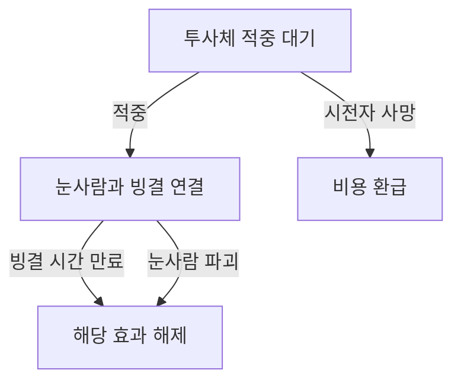

# 45. 신규 카드·형상 행동 계약과 버전 경계

> 조사 기준일: **2026-11-17**. 공식 발표·지원 본문을 직접 열람하고 기존 전투·경제·모드·패치 표와 대조했다. 본 문서는 데이터와 구현 요구사항을 보강한다. 원작 클라이언트를 실행하거나 Crownfall 게임 코드를 변경하지 않았다.

## 1. 추가 조사 결과

[카드 행동 조사표](data/tables/card_behavior_research_v4.json)에 **32행**을 추가했다. 분류는 신규 사실 **24행**, 기존 주장 재확인 **3행**, 미해결 계약 **5행**이다. 새 공식 출처는 [출처 레지스트리](data/sources/card_behavior_research_sources.json)의 **4개**이며, 이미 등록된 `COMBAT_SRC_07`, `COMBAT_SRC_12`, `COMBAT_SRC_15`, `OFFICIAL_PATCH_2026_09`는 그대로 참조한다. 동일 페이지를 새로운 출처 ID로 다시 만들지 않았다.

| 구분 | 이번에 확보한 범위 | 확보했다고 표현하지 않는 범위 |
|---|---|---|
| Minion Giant | Rare·Troop·4비용, 이동/공격/대상 축, 넉백 면역 | 완전한 현재 HP·사거리·투사체 프로필 |
| Hero Ice Wizard | 능력2비용, 눈사람 생성 기준, 해제 조건, 환급 경계 | 눈사람 수치·범위·서버 이벤트 순서 |
| Vines | Epic 주문, 최고HP3대상, 접지·스턴·피해, 대상 선택 보정 | 2026년11월 전체 주문 구성 |
| Baby Dragon 진화 | 이동하는 오라, 아군/적 이동속도 변화 | 공격속도 변화, 현재 오라 수치 전부 |
| Spirit Empress | 2025년 두 형상의 비용·공격/이동 분류 | 현재 형상 선택 알고리즘 |
| Skeleton Barrel 진화 | 2025년 통2개와 조건별 낙하 계약 | 현재 소환수·낙하 간격·전체 형상 프로필 |

공식 근거는 각각 [S01], [B12], [S02], [S03], [S04]다. 후속 패치와 함께 읽더라도 전체 프로필을 자동 완성하는 자료로 취급하지 않는다.

모든 행에 다음을 명시했다.

```json
{
  "original_client_observed": false,
  "full_current_card_profile": false,
  "current_build_verified": false,
  "observed_at_semantics": "official_document_access_date_not_client_observation"
}
```

`observed_at`는 공식 문서를 읽은 날짜다. 실제 전투를 관찰했다는 뜻이 아니다. `card_key`와 `form`은 필수로 분리했다. 동일 카드 이름에 기본형·진화형·Hero형·공중형·지상형의 행동을 섞지 않는다.

## 2. 기존 데이터와 겹치는 부분은 신규 성과로 세지 않는다

기준 [combat_rules.json](data/tables/combat_rules.json) 63행에는 이미 Minion Giant의 비행/원거리/건물 대상 분리, Vines·Lightning의 방패 고려와 같은HP 거리 판정, Hero Ice Wizard의 투사체 적중 전 환급이 있었다. 이번 세 재확인 행은 해당 ID에 연결되며 신규 사실24행에 포함되지 않는다.

[verified_patch_fields_2026.json](data/tables/verified_patch_fields_2026.json)과 [추가 패치 원장](data/tables/official_patch_expansion_2026.json)에 있는 부분 수치는 신규 카드 기본 스탯으로 다시 복제하지 않았다. 대신 미해결 프로필과 `related_record_ids`로 연결한다. 경제·모드 표에는 이번에 추출한 일반전의 새 행동 계약과 동일한 행이 없었다. Merge Tactics의 같은 이름 유닛도 일반전 카드와 별개다.

자료의 목적은 이름을 더 많이 나열하는 것이 아니다. 카드가 어떤 입력을 받고, 어떤 상태를 바꾸며, 어디까지 공식 근거가 있는지 연결해야 실제 구현의 누락을 줄일 수 있다.

## 3. Minion Giant: 세 가지 축과 면역을 분리

2026년9월 지원은 Minion Giant를 **Rare Troop, 4 Elixir**로 소개하고 넉백되지 않는다고 설명한다. 시즌 공지와 함께 비행 이동·원거리 공격·건물/타워 대상을 재확인했다. [S01][B12]

이동 분류, 공격 방식, 대상 마스크는 서로 다른 축이다. 비행 유닛이라는 이유로 모든 공중 유닛을 공격하게 하거나, 원거리라는 이유로 적 병력을 유인 대상으로 삼으면 공개 계약과 어긋난다.

| 엔진 요소 | 필요한 분리 | 아직 필요한 자료 |
|---|---|---|
| 이동 | 비행 경로와 지상 충돌 | 이동 속도·충돌 반경 |
| 탐색 | 건물/타워만 공격 후보로 선택 | 시야 범위·재탐색 주기 |
| 공격 | 원거리 발사·적중 | 사거리·발사체 속도·공격 영역 |
| 제어 효과 | 넉백 면역 | 끌어당김·접지·순간이동별 개별 판정 |

표의 마지막 열은 미확인 필드이며, 임의 숫자를 제안한 것이 아니다. `CURRENT_PATCH_038`, `CURRENT_PATCH_039`가 피해와 공격 간격을 제공하더라도 나머지 필드를 알려주지는 않는다. 다른 Minion이나 Giant의 이름을 근거로 수치를 가져오지 않는다.

넉백 면역을 모든 제어 효과 면역으로 구현하는 것도 피해야 한다. 효과 종류마다 적용 가능 여부를 분리해 두면, 나중에 확인된 상호작용 하나를 추가하기 위해 전체 이동 상태를 다시 설계할 필요가 줄어든다.

## 4. Hero Ice Wizard: 상태 의존 능력과 파괴 가능한 해제 수단

Frosty Fella는 **2 Elixir** 능력이다. 가까운 감속 대상 뒤에 눈사람을 만들고 주변 병력을 얼리는 설명이 있으며, 빙결은 시간이 지나거나 눈사람이 파괴되면 해제된다. [S01][B12]

단순히 원형 영역의 모든 적에게 고정시간 디버프를 주는 함수만으로는 이 계약을 충분히 표현하지 못한다. 능력은 기존 감속 상태를 후보 선택에 사용하며, 해제 조건에는 별도 개체인 눈사람이 참여한다.

### 4.1 구현에서 보관할 연결

| 연결 | 역할 |
|---|---|
| 시전자 → 선택된 감속 대상 | 생성 위치의 기준 |
| 능력 인스턴스 → 눈사람 | 파괴 이벤트와 효과 해제를 연결 |
| 능력 인스턴스 → 빙결 대상 집합 | 해당 효과가 해제할 대상 식별 |
| 능력 예약 → 환급 경계 | 적중 전 사망 시 비용 처리 |

이 구조는 재구축을 위한 제안이다. 원작의 내부 클래스나 네트워크 메시지를 복원한 것이 아니다. 같은 대상이 다른 Freeze 효과도 받고 있다면 눈사람 하나가 파괴되었다고 모든 빙결 상태를 지워서는 안 되는 등, 효과 소유권을 구분할 필요가 있다. 중첩 우선순위는 아직 공식 수치로 확보되지 않았다.

### 4.2 환급과 효과 적용을 같은 시점으로 두지 않기

10월27일 공지는 능력 투사체가 맞기 전에 Hero Ice Wizard가 쓰러지면 엘릭서를 돌려주는 수정 결과를 설명한다. 이는 기존 전투표의 재확인이다. [B15]

아래는 공개된 경계를 유지하기 위한 **구현용 모델**이다. 원작 서버의 정확한 처리 순서나 데이터 구조를 나타내지 않는다.



눈사람의 HP, 생성 거리, 범위, 동률 대상 선택은 미확인이다. 빙결5초는 기존 9월16일 패치에서 확인한 별도 필드이며, 초기 소개문이나 형상 이름만으로 결정한 값이 아니다. [P09]

## 5. Vines: 대상 선정·제어·피해를 나누기

2025년 소개의 Vines는 Epic 주문이며 영역 내 최고HP 병력 또는 건물 **3개**를 묶고 스턴·피해를 주며 공중 병력을 지상으로 내린다. 여기서3은 대상 수이며 비용이 아니다. [S02]

후속 공지는 HP 비교에서 방패를 고려하고, HP가 같으면 주문 중심에 더 가까운 대상을 고르는 규칙을 제공한다. 기존 두 행을 재확인했으며 방패 고려 규칙과 거리 동률 규칙의 시점을 분리했다. [B07][B12]

이 자료를 구현 계약으로 옮기면 다음 질문이 분리된다.

| 단계 | 확보한 규칙 | 남은 질문 |
|---|---|---|
| 후보 생성 | 영역 내 병력·건물 | 영역 반경과 경계 포함 판정 |
| 우선순위 | 높은HP, 방패 고려 | 현재HP/최대HP 기준과 정확한 방패 계산 |
| 동률 | 주문 중심 거리 | 완전 동거리의 추가 기준 |
| 선택 | 최대3대상 | 대상 소멸 시 대체 선정 여부 |
| 효과 | 스턴·피해·공중 대상 접지 | 지속시간·틱·접지 후 대상 마스크 |

방패를 “고려”한다는 공식 문구가 항상 본체HP와 방패HP를 단순 합산한다는 공식은 아니다. 접지도 모든 지상 전용 공격이 즉시 대상을 잡을 수 있다는 뜻까지 자동으로 포함하지 않는다. 해당 식과 판정은 `null`로 남겼다.

공개 패치의 왕관 피해 필드가 존재해도 전체 피해, 반경, 비용, 제어 지속시간이 자동 복원되지는 않는다. 재구축에서는 선택된 대상 집합과 효과 인스턴스를 분리해 두고, 미확정 구성값이 채워져야 동일 버전 프로필로 실행하도록 하는 편이 정확하다.

## 6. Baby Dragon 진화: 이동속도 오라

2025년 소개에서 진화 Baby Dragon의 바람은 시전자를 따라다니며 아군을 빠르게, 적을 느리게 만든다. 적용 축은 **이동속도**이며 공격속도는 바꾸지 않는다. [S02]

일반적인 “속도 버프” 한 필드에 이동·공격을 함께 연결하면 이 카드를 잘못 구현할 수 있다. 오라는 효과 중심의 이동, 진입·이탈 대상 집합, 아군/적 분류, 적용 스탯을 각각 알아야 한다. 반경, 배율, 이탈 뒤 잔여 지속시간, 중첩 계산, 진화 사이클 수는 이번 소개 본문만으로 복원되지 않았다.

Merge Tactics의 Baby Dragon은 별도 게임 모드의 특수 능력이다. 같은 카드 그림이나 이름을 사용한다는 이유로 그 모드의 공격속도 버프를 본편 진화형에 옮기지 않는다. 데이터 키에는 최소한 게임 모드와 형상을 함께 포함해야 이런 결합을 막을 수 있다.

## 7. Spirit Empress: 출시 계약과 현재 선택 규칙

2025년6월·7월 공지는 Legendary Spirit Empress를 지상 근접 **3 Elixir**, 비행 원거리 **6 Elixir**의 두 형상으로 설명하고 7월7일 출시를 예고한다. [S03][S04]

2026년9월 패치도 6 Elixir라는 표현을 쓰지만, 이는 두 형상의 모든 현재 비용과 선택 알고리즘을 확정하는 표가 아니다. [P09]

이번 조사표는 2025년 비용과 형상 분류를 보존하며 아래 항목은 미확정으로 남긴다.

- 보유 엘릭서에 따른 자동 선택 임계값
- 사용자가 직접 형상을 고를 수 있는지
- 배치 명령의 어느 시점에 형상이 확정되는지
- 전투 중 형상을 전환하는지
- 2026년11월을 명시한 두 형상의 완전 비용 계약

검토한 2026년 패치 원장에는 두 형상의 비용 변경 행이 없었다. 이것은 **제공된 원장 범위에서 변경 기록을 찾지 못했다**는 의미다. 모든 업데이트를 확인해 비용이 유지되었음을 증명한 것은 아니다.

구현에서는 카드 식별자와 실제 소환 형상을 분리해야 한다. 같은 카드의 두 형상은 비용·이동·공격과 패치 필드를 각각 가질 수 있다. `form: base`인 메타 행은 두 형상 공통의 카드 정의이며, 제3의 전투 형상이 존재한다는 뜻이 아니다. 재구축의 선택 UI를 임의로 만들 경우 그 부분은 별도 설계값으로 표시해야 한다.

## 8. Skeleton Barrel 진화: 여러 낙하 사건

2025년 공개 계약에는 통 **2개**, 피해를 받을 때 첫 통의 조기 낙하, 만HP로 타워에 도달하면 두 통 낙하가 명시되어 있다. 낙하에는 사망 피해와 Skeleton 소환이 연결된다. [S03][S04]

이를 일반 Skeleton Barrel의 수치 두 배로만 구현하면 사건 구조를 잃는다. 상태는 남아 있는 통의 수, 첫 낙하 여부, 두 번째 낙하의 예약 여부, 각 소환의 소유권 등을 구분할 수 있어야 한다. 통이 떨어졌다는 사건을 개체 전체의 사망과 항상 같게 처리해서도 안 된다.

통마다 소환되는 Skeleton 수, 두 번째 통의 지연, HP 풀 분할, 현재 진화 사이클은 아직 미확인이다. 후속 패치에서 일반형과 진화형의 사망 피해가 같은 값으로 표시되어도 이러한 구조가 같아졌다는 뜻은 아니다. 관련 기존 행은 `CURRENT_PATCH_046`, `CURRENT_PATCH_047`로 연결했다.

## 9. 2026년9월 수정에서 추출한 추가 행동 계약

Minion Academy 공지의 하단은 게시일9월7일과 별개로 **9월1일07:00 UTC**, **9월3일13:00 UTC**의 수정 절을 구분한다. 데이터에는 이 절의 날짜·시간을 보존했다. [B12]

| 계열 | 데이터에 반영한 변경 | 구현상 주의점 |
|---|---|---|
| Hero Tombstone | 이전 Tomb Queen 생존 중에도 새 능력 버튼 존재 | 소환 개체와 새 능력 소유자를 구분 |
| Hero Barbarian Barrel·Berserker | 발동 전 사망 시 비용 환급 | 입력과 효과 확정을 분리 |
| Little Prince | 능력 사용이 공격속도 버프를 초기화하지 않음 | 능력 상태 전이에서 버프를 보존 |
| Bandit·Boss Bandit | 돌진 무적 증가량50ms | 총 무적시간50ms로 오독 금지 |
| Rage·Earthquake 감속·진화 Princess 감속 | 비피해 영역 효과의 즉시 적용 | 피해파동과 상태 적용 시각을 분리 |
| Hero Valkyrie | 은신 Archer Queen에게 능력 피해 적용 | 은신과 모든 피해 면역을 분리 |
| Clone·Freeze | 클론 재복제 금지, 클론에 Freeze 적용 | 생성 태그와 상태 면역을 분리 |
| Earthquake |3파동 모두 피해 적용 | 파동 간격·틱별 피해는 미확인 |
| 진화 Wall Breakers | 근접한 통 폭발의 추가 타워 피해 오류 수정 | Fisherman 당김 중 사망 효과와 다른 경계 |

위 표는 원문 수정 결과를 구현 요구사항에 연결한 것이다. 실제 원작에서 모두 시험한 결과가 아니다. 이미 있는 돌진 중 Zap·Freeze 중단 방지 규칙이나 Vines 동률 규칙을 다시 새 사실로 복제하지 않았다.

특히 증가량, 총량, 조건부 적용을 구분해야 한다.50ms 증가는 이전 총량 없이는 최종 무적시간을 만들 수 없다.3파동은 전체 피해를 단순히3으로 나눠 각 파동에 배정하라는 뜻이 아니다. “즉시 적용”도 서버 틱이나 지연보정이0이라는 네트워크 규칙을 공개한 것이 아니다.

## 10. 버전별 결합을 허용하는 조건

새로운 자료를 기존 데이터와 연결할 때는 다음 세 경계를 유지한다.

| 경계 | 허용되는 결합 | 피해야 할 결합 |
|---|---|---|
| 형상 | 같은 카드·형상·구성요소의 계보 연결 | 공중 피해를 지상 공격 간격으로 덮어쓰기 |
| 시점 | 날짜가 식별된 소개와 후속 변경을 나란히 보관 | 2025년 소개를2026년11월 전체값으로 승격 |
| 모드 | 일반전 안에서 대상·효과 계약 연결 | Merge 특성을 본편 진화에 적용 |

또한 개념 설명과 실행 가능 설정을 나눈다. “주변”이라는 표현은 반경이 아니고, “가장 가까운”이라는 표현은 거리 측정 좌표나 동률 처리 전체가 아니다. 문서에 그런 단어가 있다고 임의의 숫자를 채워 넣으면 읽기 쉬운 문서는 만들 수 있어도 정확한 복원은 되지 않는다.

이번 표에는 출처가 확인된 부분과 미확인 부분을 한 계약 안에 함께 보존한 행이 있다. `official_confirmed`는 공개된 부분을 뜻하며, 그 행의 중첩 `null`까지 확인되었다는 의미가 아니다. 실행 프로필을 만들 때는 필수 필드의 결측 검사도 필요하다.

## 11. 후속 검증의 구체적 완료 조건

| 대상 | 자료 확인만으로 완료할 수 있는 부분 | 실제 표시·관측이 필요한 부분 |
|---|---|---|
| Minion Giant | Rare/비용/대상 축/넉백 면역 계약 | 범위·발사체·다른 제어와 상호작용 |
| Hero Ice Wizard | 능력비용·감속 앵커·해제·환급 경계 | 눈사람 구성·빙결 중첩·후보 없음 |
| Vines | 대상 수·방패 고려·HP 동률 거리 | 정확한HP식·경계·완전 동률·접지 대상성 |
| Baby Dragon 진화 | 이동속도만 변경 | 반경·배율·이탈·중첩 |
| Spirit Empress | 출시 두 형상 계약 | 현행 선택 시점·비용·명령 확정 |
| Skeleton Barrel 진화 | 출시 낙하 사건 계약 | 현재 소환수·HP 분할·낙하 지연 |

이 항목은 관측 계획이지 실행한 테스트 목록이 아니다. 이후 재구축 코드를 작성하더라도 로컬 단위검사 통과를 원작 일치 판정으로 바꾸지 않는다. 현재 완료 범위는 공식 본문에 기반한 데이터 추출, 기존 기록과의 대조, 결측·시간 경계의 명시다.

## 12. 출처

새 출처4개는 `V4_CARD_SRC_01~04`로 등록했다. 기존 출처는 그 ID를 그대로 사용하며 별도 중복 행을 만들지 않았다.

| 표기 | 레지스트리 ID | 문서 |
|---|---|---|
| S01 | `V4_CARD_SRC_01` | [What’s New? — September 2026][S01] |
| S02 | `V4_CARD_SRC_02` | [New Season: Back to Drool!][S02] |
| S03 | `V4_CARD_SRC_03` | [New Season: Dress to Empress!][S03] |
| S04 | `V4_CARD_SRC_04` | [June Update 2025][S04] |
| B07 | `COMBAT_SRC_07` | [October Update 2025][B07] |
| B12 | `COMBAT_SRC_12` | [New Season: Minion Academy!][B12] |
| B15 | `COMBAT_SRC_15` | [New Season: King vs. King!][B15] |
| P09 | `OFFICIAL_PATCH_2026_09` | [September Balance Changes][P09] |

[S01]: https://support.clashroyale.com/hc/en-us/articles/54836231287963-What-s-New-September-2026
[S02]: https://supercell.com/en/games/clashroyale/blog/release-notes/new-season-back-to-drool/
[S03]: https://supercell.com/en/games/clashroyale/blog/news/new-season-dress-to-empress/
[S04]: https://supercell.com/en/games/clashroyale/blog/release-notes/june-update-2025/
[B07]: https://supercell.com/en/games/clashroyale/blog/release-notes/october-update-2025/
[B12]: https://supercell.com/en/games/clashroyale/blog/release-notes/new-season-minion-academy/
[B15]: https://supercell.com/en/games/clashroyale/blog/release-notes/new-season-king-vs-king/
[P09]: https://supercell.com/en/games/clashroyale/blog/release-notes/september-balance-changes-2027/
