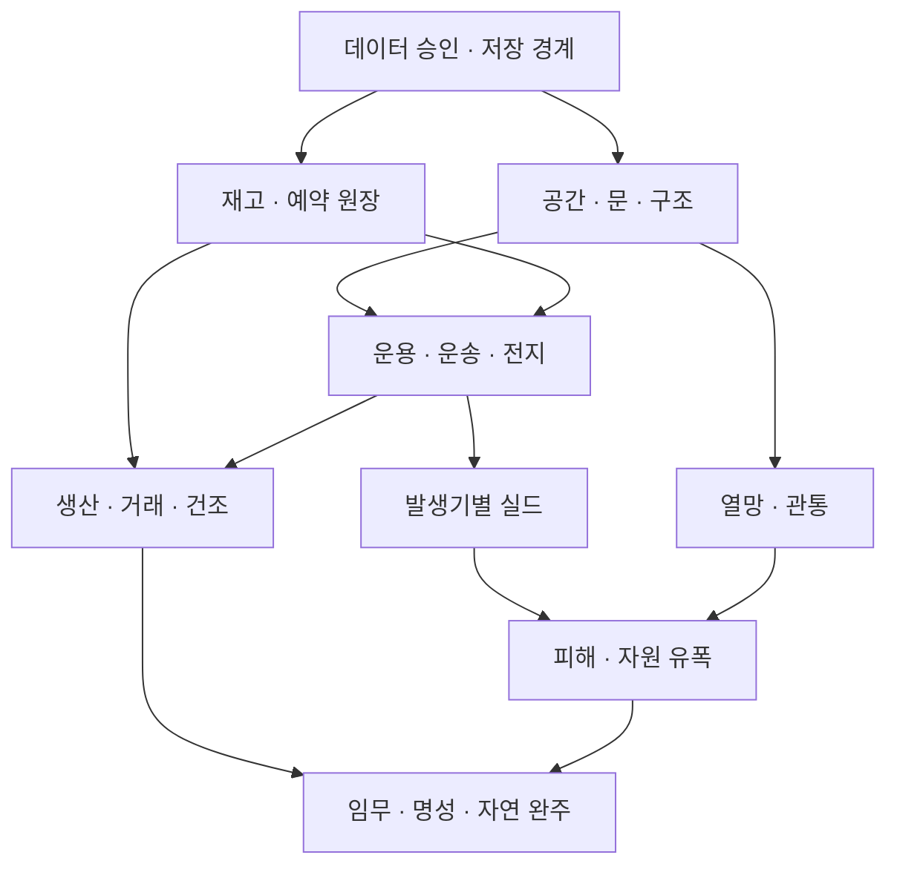

# 구현 순서와 수용 명세

모든 항목은 **다음 구현 제안**이다. 이번 데이터 개정에서 해당 게임 기능을 구현하거나 수용 사례를 실행했다고 주장하지 않는다. 기획 ID·의존성과 테스트 명세는 JSON으로도 제공한다.

## 순서와 의존성

P0는 수치가 손실 없이 이동할 기반, P1은 플레이어가 공간·인력의 효과를 확인할 첫 수직 단면, P2는 열·파괴·재료 경제의 확장, P3는 지속 진행과 밸런스 검증이다. 날짜나 개발 인일은 추정하지 않았다. 각 단계가 앞 단계의 수용 조건을 통과한 뒤 진행한다.

## 요구사항

| ID | 우선 | 내용 | 선행 | 수용 사례 |
| --- | --- | --- | --- | --- |
| DATA-01 | P0 | [데이터 승인과 단위 계약](07_Architecture_and_Save_Migration.md) | 없음 | AC-001, AC-002 |
| GEO-01 | P0 | [다칸 점유·회전·배치금지](01_Ship_Geometry_and_Connectivity.md) | DATA-01 | AC-003, AC-004, AC-005 |
| GEO-02 | P0 | [구조·문·통행 분리](01_Ship_Geometry_and_Connectivity.md) | GEO-01 | AC-006, AC-007 |
| LOG-01 | P0 | [물류 예약·취소 원장](02_Crew_Logistics_and_Power.md) | DATA-01 | AC-008, AC-009 |
| CREW-01 | P1 | [역할·운용 슬롯·시간 경로](02_Crew_Logistics_and_Power.md) | GEO-02, LOG-01 | AC-010, AC-011 |
| PWR-01 | P1 | [전지 크기·축전기 중계](02_Crew_Logistics_and_Power.md) | LOG-01, CREW-01 | AC-012 |
| CMB-01 | P1 | [발생기별 방향성 실드](03_Weapons_Shields_and_Destruction.md) | GEO-01, PWR-01 | AC-013, AC-014, AC-015 |
| CMB-02 | P2 | [관통·저항·충돌 사건](03_Weapons_Shields_and_Destruction.md) | GEO-01, CMB-01 | AC-016 |
| HEAT-01 | P2 | [열 포트·선체 열 분리](04_Heat_Cooling_and_Overclocking.md) | GEO-01 | AC-017, AC-018 |
| DMG-01 | P2 | [재고 기반 유폭·화재](03_Weapons_Shields_and_Destruction.md) | LOG-01, CMB-02, HEAT-01 | AC-019, AC-020, AC-021 |
| ECO-01 | P1 | [유한 재고·타일 용량](05_Resources_Production_and_Trade.md) | LOG-01 | AC-022 |
| ECO-02 | P2 | [레시피·생산 진행](05_Resources_Production_and_Trade.md) | ECO-01, PWR-01 | AC-023, AC-024 |
| ECO-03 | P2 | [정거장 거래·건조 원장](05_Resources_Production_and_Trade.md) | ECO-01, GEO-02 | AC-025, AC-026, AC-027 |
| CAREER-01 | P3 | [명성·고용·진영](06_Career_Fame_and_Roadmap.md) | ECO-03 | AC-028 |
| CAREER-02 | P3 | [임무 상태·보상 청구](06_Career_Fame_and_Roadmap.md) | CAREER-01, ECO-02 | AC-029, AC-030 |
| SAVE-01 | P0 | [구 규칙 저장과 원자 전환](07_Architecture_and_Save_Migration.md) | DATA-01, GEO-01, LOG-01 | AC-031, AC-032 |
| UX-01 | P1 | [원인 표시·오버레이](10_Balance_and_UX.md) | CREW-01, CMB-01, ECO-01 | AC-033 |
| BAL-01 | P3 | [자연 플레이 밸런스](10_Balance_and_UX.md) | CMB-02, DMG-01, ECO-02, CAREER-02, UX-01, SAVE-01 | AC-034 |

## 수용 사례 — 실행 전 명세

| ID | 요구사항 | 입력·조작 | 기대 결과 |
| --- | --- | --- | --- |
| AC-001 | DATA-01 · null과0분리 | {"field": "large_shield_generator.power_per_1000_damage", "value": null} → numeric adapter로 읽기 | {"result": "reject_unverified", "fallback_zero": false} |
| AC-002 | DATA-01 · 단위오류 차단 | {"original_unit": "degree", "requested_unit": "radian"} → 변환 규칙 없이 적용 | {"result": "reject_unit_mismatch"} |
| AC-003 | GEO-01 · 회전 좌표 | {"width": 2, "height": 3, "cell": [1, 2], "rotation": 1} → 시계 방향 90도 회전 | {"size": [3, 2], "cell": [0, 1]} |
| AC-004 | GEO-01 · 점유 중첩 원자 거부 | {"occupied_square": [0, 0, 2, 2], "new_anchor": [1, 1]} → 1x1 부품 설치 | {"result": "reject_overlap", "credits_delta": 0, "serial_delta": 0} |
| AC-005 | GEO-01 · 배기 금지 양방향 | {"clearance_intersection": true} → 추진기·장갑 설치 순서를 바꿔 시도 | {"same_result": true, "result": "reject_clearance"} |
| AC-006 | GEO-02 · 문과구조 분리 | {"adjacent_walled_rooms": 2, "doors": 1} → 연결문 제거 | {"structural_components": 1, "walk_components": 2} |
| AC-007 | GEO-02 · 통로 벽 예외 | {"parts": ["corridor", "moving_walkway"], "doors": 0} → 변 공유 통행 조회 | {"reachable": true} |
| AC-008 | LOG-01 · 목적지 파괴 | {"cargo": 8, "phase": "delivery"} → 목적 포트 파괴 | {"cargo_after": 8, "destination_increment": 0, "reservation": "released_or_rerouted_once"} |
| AC-009 | LOG-01 · 취소 멱등성 | {"reservation": "r1", "amount": 4} → 같은 취소 ID 두 번 요청 | {"released_quantity": 4, "negative_reserved": false} |
| AC-010 | CREW-01 · 조작 인력 중복 금지 | {"workstations": 1, "crew_candidates": 2} → 운용 및 배송 작업 배정 | {"max_station_occupants": 1, "simultaneous_operate_and_haul": false} |
| AC-011 | CREW-01 · 방향 비용 경로 | {"pathA": {"cells": 4, "speed": 0.8}, "pathB": {"cells": 6, "speed": 3.2}} → 최소시간 경로 선택 | {"selected": "pathB", "cost_seconds": 1.875} |
| AC-012 | PWR-01 · 축전기 순환 | {"routes": ["source>A", "A>B", "B>A"]} → 중계망 승인 | {"cycle_detected": true, "meaningless_loop_transfers": 0} |
| AC-013 | CMB-01 · 실드 완충 재가동 | {"phase": "recharging", "reserve_fraction": 0.99} → 1% 추가 충전 전후 확인 | {"before_online": false, "after_online": true} |
| AC-014 | CMB-01 · 실드 각도 경계 | {"half_arc_deg": 45, "intersection_bearings": [44.9, 45.1]} → 같은 피해 탄체 충돌 | {"absorbed": [true, false]} |
| AC-015 | CMB-01 · 발생기 독립 | {"generator_reserves": [0, 6]} → 두 호에 탄체 입력 | {"first_active": false, "second_active": true} |
| AC-016 | CMB-02 · 안정된 충돌 순서 | {"same_seed": true, "reverse_part_array": true} → 동일 선분·교차 집합 재생 | {"same_event_hash": true, "same_damage": true} |
| AC-017 | HEAT-01 · 열망 분리 총량 | {"stored_energy": [80, 20], "unit": "prototype_energy"} → 연결 절단 | {"total_after": 100, "duplicated_energy": 0} |
| AC-018 | HEAT-01 · 열교환 범위 | {"tiles": 6, "covered_tiles": 3} → 범위 냉각 실행 | {"uncovered_auto_cooled": 0} |
| AC-019 | DMG-01 · 재고없는 공장 폭발 | {"stored_munition": 0, "bespoke_explosion_enabled": false} → 공장 파괴 | {"munition_explosion_events": 0} |
| AC-020 | DMG-01 · 완성 미사일만 집계 | {"completed_missiles": 1, "incomplete_missiles": 1} → 탄약 유폭 계산 | {"munition_count_input": 1} |
| AC-021 | DMG-01 · 소모 재고 재폭발 금지 | {"scorched_then_destroyed": true} → 중간 저장·불러오기 삽입 | {"same_resource_consumed_twice": false} |
| AC-022 | ECO-01 · 공유 마지막 타일 예약 | {"free_tiles": 1, "distinct_resource_orders": 2} → 동시 예약 | {"successes": 1, "overbooked_slots": 0} |
| AC-023 | ECO-02 · 제작중 저장 왕복 | {"sulfur_debited": 1, "progress": 0.4, "prototype_batch_output": 20} → 저장·재개·완료 | {"ammo_total_created": 20, "sulfur_created": 0} |
| AC-024 | ECO-02 · 출력 만재 | {"output_slots_free": 0, "finished_batch": true} → 출력 커밋 | {"result": "blocked_output", "lost_products": 0, "capacity_exceeded": false} |
| AC-025 | ECO-03 · 부분 구매 | {"requested": 10, "seller_stock": 6, "policy": "partial", "budget_sufficient": true, "space_sufficient": true} → 구매 | {"filled": 6, "charged_quantity": 6} |
| AC-026 | ECO-03 · 거래 재시도 | {"order_id": "o1", "filled": 6} → 동일주문 두 번 커밋 | {"charged_transactions": 1, "resource_transfer_count": 1} |
| AC-027 | ECO-03 · 건조 실패 롤백 | {"recipe_A_available": true, "recipe_B_available": false, "policy": "all_or_none"} → 청사진 확정 | {"built_parts": 0, "credits_delta": 0, "resources_delta": 0} |
| AC-028 | CAREER-01 · 고립인원 중복 고용 방지 | {"crew_on_ship": 8, "stranded_crew": 2, "fame_cap": 10, "free_beds": 5} → 고용 견적 | {"available_hires": 0} |
| AC-029 | CAREER-02 · 보상 청구 멱등성 | {"mission_id": "m1", "state": "completed"} → 같은 보상 두 번 청구 | {"reward_events": 1} |
| AC-030 | CAREER-02 · 정지 중 기한 불변 | {"paused": true, "remaining_sim_seconds": 60} → 실시간 10초 경과 | {"remaining_sim_seconds": 60} |
| AC-031 | SAVE-01 · v4 원본 보존 | {"legacy_single_cell": true, "conversion_causes_overlap": true} → 다칸 변환 시도 | {"result": "reject_staged_conversion", "source_hash_unchanged": true} |
| AC-032 | SAVE-01 · 불량 저장 원자 거부 | {"unknown_part_id": true} → 불러오기 | {"result": "reject", "active_world_unchanged": true} |
| AC-033 | UX-01 · 정지 원인 표시 | {"operator_present": true, "reachable": true, "power": 0, "ammo": 10} → 장치 상태 렌더 | {"reason": "power_shortage", "render_mutates_state": false} |
| AC-034 | BAL-01 · 유료 보급 자연 완주 | {"campaign_sectors": 3, "resource_injection": false, "enemy_hp_override": false} → 전투·회수·유료보급·개조로 진행 | {"report": ["win_rate", "time_to_kill", "crew_busy_by_job", "supply_wait", "net_credits", "defeat_recovery"], "gameplay_test_status": "not_executed_this_revision"} |

## 단계별 종료 조건

기반 단계는 같은 quote의 재적용·취소·저장 왕복에서 원장과 ID가 변하지 않아야 끝난다. 첫 플레이 단계는 문·통로·조작자·전지 때문에 실제 장치 가동률이 변하고 그 원인을 화면이 설명할 수 있어야 끝난다. 확장 단계는 열망 분리·탄약 유폭·거래 취소와 정상 귀환이 같은 저장 파일에서 재현되어야 끝난다. 마지막 단계는 유료 보급을 포함한 자연 전투·패배 회복 경로를 측정한 뒤 종료한다.

이미 제공된 v4 자연 완주 결과를 새 규칙 세트의 성공 결과로 대신 쓰지 않는다. 멀티플레이·다중 섹터·동적 시장·고급 함대 AI는 이 수직 단면의 종료 조건에 포함하지 않았다. 이들은 로드맵·기능 의존성·원작 자료 확보에 맞춰 후속 범위를 결정한다.

[요구사항 JSON](../planning/implementation_backlog.json) · [수용 명세 JSON](../planning/acceptance_cases.json) · [계약 예제](../fixtures/runtime_contract_example.json)
