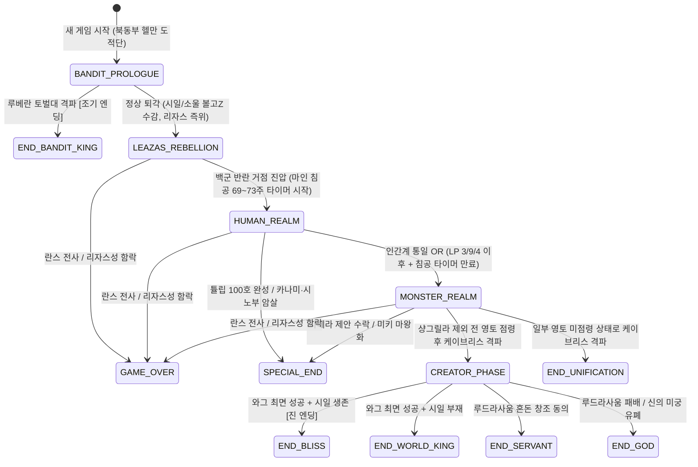
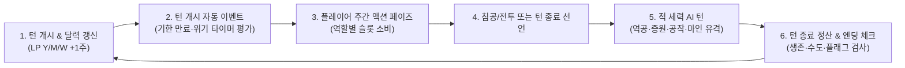

# 01. 코어 루프 및 캠페인 상태 머신

## 1. 5단계 매크로 캠페인 상태 머신 (Campaign Phase FSM)

『귀축왕 란스』는 자유도 높은 대륙 정복을 제공하면서도, **서사적 위기 에스컬레이션**을 보장하기 위해 5개의 명시적 매크로 페이즈로 캠페인을 분할한다 `[확인]`.

### 각 페이즈별 규칙 요약 `[확인]`

1. **`BANDIT_PROLOGUE` (도적 프롤로그)**:
   - 북동부 헬만 국경에서 소규모 도적단을 이끄는 튜토리얼 페이즈.
   - 여기서 헬만 유적 경비대(루베란)를 격파하면 즉시 **`end_bandit_king`(도적왕 엔딩)**으로 게임이 종료된다.
   - 정상 흐름대로 퇴각하면 시일(`chr_sill`)과 소울(`chr_soul`)이 헬만 `ter_volgo_z`(볼고 Z)에 수감되고, 란스가 리자스 여왕 리아(`chr_lia`)와 혼인해 국왕으로 즉위하면서 본편이 시작된다.

2. **`LEAZAS_REBELLION` (리자스 내란 진압 페이즈)**:
   - 국왕 찬탈에 반발한 백군 장군 엑스(`chr_ex`)의 반란(`fac_ex_rebellion`)을 진압하기 전까지는 타국 침공이 잠겨 있다.
   - `ter_leazas_white_fort`를 점령해 반란을 진압하는 순간 **`HUMAN_REALM` 자유 정복 페이즈**가 열리며, 동시에 **마인군 대침공 카운트다운(69~73주, 샹그릴라 상태에 따라 변동)**이 가동된다.

3. **`HUMAN_REALM` (인간계 자유 정복 페이즈)**:
   - 자유도시연합(`fac_free_cities`), 헬만 제국(`fac_helman`), 제스 왕국(`fac_zeth`), AL교(`fac_al_church`), JAPAN(`fac_japan`)을 **원하는 순서대로 공략**할 수 있는 핵심 샌드박스 구간.
   - 단, **볼고 Z 구출 기한**(소울 `LP 3/08/3`, 시일 `LP 4/01/3`), **제스 개전 5주 시즈카 결투**, **헬만 개전 후 프레이야 공작**, **사사호 알루미늄 도끼 불가역 선택** 등 캐릭터 시나리오 기한이 비선형 전략과 맞물린다.

4. **`MONSTER_REALM` (마계 전면전 페이즈)**:
   - 최단 `LP 3/9/4` 이후 케이브리스(`chr_kayblis`)가 호넷파(`fac_demon_hornet`)를 제압하고 마계를 통일하면 개전 조건이 열린다.
   - 플레이어가 선공하지 않더라도 반란 진압 후 69~73주 경과 시 카밀라 선봉을 필두로 한 마인군 대침공이 강제 발동(헬만 방치 시 헬만 최우선 침공).
   - 마인 1체 격파 시 해당 지역 마군 병력이 반감되고, 연속 2체 격파 시 2/3 감소하는 전략적 약화 규칙이 작동한다 `[확인]`.

5. **`CREATOR_PHASE` (창조신 에필로그 페이즈)**:
   - **`ter_shangri_la`(샹그릴라)를 제외한 모든 영토를 점령한 상태**에서 `ter_sulphur_forest`의 케이브리스(`chr_kayblis`)를 격파하면 해금된다.
   - `ter_rudrasaum_ruins` 진입 후 천사기사 및 창조신 루드라사움(`chr_rudrasaum`)과의 대면에서 와그(`chr_warg`)의 최면, 시일(`chr_sill`) 생존 여부, 신상(神像) 및 카오스 보유 여부에 따라 최종 엔딩이 분기한다.

---

## 2. 주간 턴 실행 파이프라인 (1 Turn = 1 Week)

매 턴은 `LP Year / Month / Week` 달력 1주가 경과하며 아래 6단계 서브페이즈로 실행된다 `[확인]` `[해석]`.

### 단계별 상세 처리 `[확인]` `[해석]`

| 단계 | 처리 내용 | 인터럽트 조건 |
|---|---|---|
| **1. 달력 갱신** | 주(Week) +1. 월/년 올림(4주=1개월 기준 달력 표기 `[검증 필요]`). 주간 액션 슬롯 전체 리셋. | — |
| **2. 턴 개시 이벤트 평가** | `scenario_events_and_timers.json`의 달력 기한(`3/08/3`, `4/01/3`, `3/9/4`), 상대 주수 타이머(제스 개전 5주, 마인 침공 69~73주), 프레이야 자금 유출 등을 일괄 평가. | 조건 충족 시 즉시 강제 이벤트/엔딩 분기 |
| **3. 플레이어 액션 페이즈** | 유형별 슬롯을 임의 순서로 실행: **도시(1) · 하렘(1) · 대화(1) · 증원/보충(택1) · 건설(1) · 미궁 탐색(1) · 닌자 공작(닌자당 5)** + 자유 조회(장비/편성). | 튤립 100호 완성, 사테라 제안, 카나미 암살 등 즉시 엔딩 가능 |
| **4. 침공 액션** | 인접 적 영토에 최대 4부대 출격. **도시 점령에 성공하면 해당 턴의 추가 침공은 종료**된다 `[확인]`. | 란스 지휘관 HP 0 → 즉시 `end_death`; 케이브리스 격파 → `CREATOR_PHASE` 또는 `end_unification` |
| **5. 적 AI 페이즈** | 교전 중인 인간 국가 및 활성화된 마인군이 아군 인접 영토를 공격하거나(방어전 발생), 첩보/공작(프레이야 등)을 수행. | 리자스성(`ter_leazas_castle`) 방어 실패 → 즉시 `end_defeat` |
| **6. 턴 종료 정산** | 영토 자동 수입(있을 경우) 및 부대 상태 정리, 다음 턴 예고 플래그 갱신. | — |

---

## 3. 즉시 종료 인터럽트 우선순위 (Interrupt Priority) `[해석]` `[재구성안]`

전략 시뮬레이션과 캐릭터 시나리오가 충돌할 때 엔진이 결정론적으로 동작하도록 아래 우선순위를 강제한다.

1. **P0 (치명적 패배)**: `chr_rance` 지휘관 HP 0 (`end_death`) > `ter_leazas_castle` 함락 (`end_defeat`).
2. **P1 (즉시 강제 분기 엔딩)**: 도적 프롤로그 루베란 격파 (`end_bandit_king`) / 카나미·시노부 암살 (`end_assassinated`) / 미키·사테라 마왕화 (`end_demon_king_1`, `end_demon_king_2`) / 튤립 100호 발사 (`end_to_outer_space`).
3. **P2 (캠페인 페이즈 전환)**: 엑스 반란 진압 → `HUMAN_REALM`, 마계 통일/타이머 만료 → `MONSTER_REALM`, 케이브리스 격파 → `CREATOR_PHASE` 또는 `end_unification`.
4. **P3 (창조신 결말)**: `end_bliss` / `end_world_king` / `end_servant` / `end_god` 평가 후 **132개 캐릭터 운명(행복/불행) 결산 화면** 진입.
