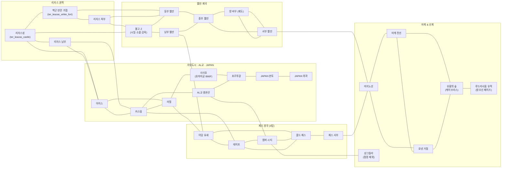

# 02. 전략 맵, 주간 액션 슬롯 및 국가 경제

## 1. 유형별 주간 액션 슬롯 시스템 (Typed Weekly Action Slots)

후속작 『전국 란스』가 범용 행동 횟수(AP 2~3)를 소비하는 것과 달리, 『귀축왕 란스』는 **매 주(1턴)마다 기능별로 분리된 전용 슬롯**을 제공한다 `[확인]`.

| 액션 슬롯 | 턴당 횟수 | 주요 기능 | 시나리오·전략 연계 | 등급 |
|---|---:|---|---|---|
| **도시 액션 (City Action)** | 1회 | 점령 도시 선택 → 강제 징세(자금·아이템 획득), 지역 특수 이벤트, 프레이야 저지 방문 | 징세 패널티 없음; 라질 징세로 `알루미늄 도끼` 획득 등 이벤트 트리거 겸용 | `[확인]` |
| **하렘 액션 (Harem Action)** | 1회 | 궁정 여성 캐릭터와 교류(시나리오 이벤트 ID로 추상화) | 소량 경험치(EXP) 획득 및 캐릭터 개별 호감도/행복·불행 플래그 갱신 | `[확인]` |
| **부하 대화 (Talk Action)** | 1회 | 보유 부하(지휘관) 1명과 개별 대화 이벤트 실행 | 영입 후속 체인, 전용 능력/이벤트 해금, 캐릭터 서사 분기 진행 | `[확인]` |
| **병력 증원 / 보충 (Troop Action)** | 택 1 (1회) | **최대 병력 확장(증원)** 또는 **손실 병력 보충** 중 한 가지만 선택 | 자금 규모와 직결. 보충 vs 최대치 확장 간 경제 트레이드오프 형성 | `[확인]` |
| **건설 (Building Action)** | 1회 | 수도(리자스성) 등에 국가 시설 건설/확장 | 병원, 마법연구소, 마리아연구소(튤립 100호), 도서관(바운드 영입 선행) | `[확인]` |
| **탐색 / 원정 (Expedition)** | 1회 | 대륙 내 미궁(던전) 또는 특수 지점에 부대 파견 | 보물/신상/아이템(카오스 등) 회수, 레벨업, 하니와 킹(사사호 B66F) 영입 | `[확인]` |
| **침공 (Combat / Invasion)** | 점령 시 종료 | 인접 적 영토 공격(최대 4부대 출격). 점령에 성공하면 해당 턴 추가 침공 불가 | 영토 확장 및 국경선 갱신, 적 세력 붕괴 조건 달성 | `[확인]` |
| **닌자 공작 (Ninja Maneuvers)** | 닌자당 5회 | 보유 닌자 1인당 턴 최대 5회 **정보 수집** 또는 **파괴 공작** 실행 | 정보 수집은 실패·포획률 극저; 파괴 공작은 ~50% 실패 및 닌자 포획 위험 | `[확인]` |

> **설계 통찰 `[해석]`**: 유형별 슬롯 분리 구조는 "전쟁에 모든 AP를 쏟느라 캐릭터 이벤트를 놓치는 문제"를 원천 차단한다. 매 턴 전쟁(침공)과 내정(도시·건설·징병)과 서사(대화·하렘·탐색)가 **병렬로 맞물려 돌아가도록 강제**함으로써, SLG와 캐릭터 시나리오의 통합을 시스템 레벨에서 구현했다.

---

## 2. 대륙 전략 맵 토폴로지 (29개 거점 그래프)

원작 루드라사움 대륙의 7대 권역(리자스, 자유도시연합, AL교, JAPAN, 헬만 제국, 제스 왕국, 마계 + 특수/신계)을 본 역기획서 `verified_data/territories.json`에서는 **29개 거점, 100% 대칭 무방향 연결 그래프**로 정규화했다 `[확인]` `[재구성안]`.

### 권역별 전략 규칙 `[확인]`

1. **헬만 전선 (초반 기한 압박)**:
   - `ter_leazas_castle`에서 북서쪽으로 인접한 `ter_volgo_z`(볼고 Z)는 **소울(`3/08/3`)·시일(`4/01/3`) 구출 시한**이 걸려 있어 초반 전략의 최우선 목표가 된다.
   - 헬만 개전 직후에는 흑익 수장 `chr_freya`(프레이야)의 독살·군자금 유출 공작이 발동하므로, 목표 도시 방문(도시 액션) 또는 `닌자 접착제(Ninja Glue)` 구매로 대응해야 한다.
2. **자유도시·AL교·JAPAN 전선 (인재·특수 자원 허브)**:
   - `ter_custom` 병합 시 `chr_maria`·`chr_shizuka`·`chr_miru` 등 핵심 인재가 일괄 합류한다.
   - `ter_radil` 징세 → `알루미늄 도끼` → `ter_sasa_lake` 지하 66층은 비밀 유닛 `chr_haniwa_king` 해금 경로다.
   - `ter_portugal`은 동방 섬나라 `ter_japan_main`으로 향하는 유일한 해상 관문이다.
3. **제스 전선 (4탑 일괄 붕괴 규칙)**:
   - 화·빙·뇌·광 4개 탑 거점(`ter_adam_stronghold`, `ter_tape`, `ter_amber_city`, `ter_old_zeth`)의 사천왕을 모두 격파하면 **제스의 남은 모든 영토가 자동으로 리자스군에 편입**된다 `[확인]`.
   - 단, `ter_adam_stronghold` 점령 여부와 `ter_tape` 공략 시점, 제스 개전 후 5주 타이머가 `chr_shizuka`·`chr_nagi`의 생사/운명에 직결된다.
4. **마계·샹그릴라·창조신 전선**:
   - `ter_maginot_line` 너머 마계는 케이브리스의 마계 통일(`LP 3/9/4` 이후) 전까지 전면전이 잠겨 있다.
   - `ter_shangri_la`는 **창조신 페이즈 해금을 위한 전 영토 정복 판정에서 제외**되지만, 점령 상태가 마인 침공 유예 주수(69~73주)에 영향을 준다 `[확인]`.

---

## 3. 국가 경제, 무패널티 징세, 건설 및 닌자 공작

### 3.1 무패널티 강제 징세 (Zero-Penalty Taxation) `[확인]`
- 일반적인 SLG(민심·치안 하락)와 달리, 『귀축왕 란스』에서는 점령 도시에 **도시 액션으로 징세를 실행해도 민도 저하나 반란 패널티가 전혀 없다**.
- 자금은 도시 규모(경제력)에 비례해 회수되며, 특정 도시 징세 시 **고유 아이템(`알루미늄 도끼` 등)이나 지역 이벤트 플래그**가 함께 발동한다.
- 따라서 행동할 특수 도시 이벤트가 없는 턴에는 고소득 도시에서 매 주 징세하는 것이 경제 최적화의 기본이다.

### 3.2 국가 시설 건설 (Capital Construction) `[확인]`
`ter_leazas_castle` 등 본거지 건설 슬롯(주 1회)에 건설하는 핵심 시설은 단순 수치 보너스를 넘어 **캐릭터 영입·엔딩 해금 게이트** 역할을 한다.

| 시설명 | 기능 및 전략·시나리오 효과 | 등급 |
|---|---|---|
| **병원 (Hospital)** | 부대/지휘관 회복 및 전투 지속력 지원 | `[확인]` |
| **마법연구소 (Magic Research Building)** | 마법 유닛 강화 및 마법 계열 연구 해금 | `[확인]` |
| **마리아 연구소 (Maria's Research Building)** | 커스텀 병합 후 해금. `튤립 100호` 프로젝트 진행 → 완성 시 `end_to_outer_space` | `[확인]` |
| **도서관 (Library)** | 소울 구출(`ter_volgo_z`) 이후 `바운드(Bound)` 영입 체인의 필수 선행 시설 | `[확인]` |

### 3.3 병력 증원 vs 보충 비용 구조 `[확인]` `[해석]`
- 1턴에 **증원(최대 병력 상한 확대)** 또는 **보충(손실 병력 회복)** 중 택1만 가능하다.
- 병과 등급에 따라 단가가 크게 다르며(예: `cls_leazas_knights` 고급 스케일링 11,300K GOLD급 `[확인]`), 따라서 코르도바처럼 초기 병력 1,000을 보유한 저손실 방벽 탱커로 피해를 흡수해 **보충 턴과 자금을 절약**하는 운용이 핵심이다.

### 3.4 닌자 첩보 및 파괴 공작 `[확인]`
- **정보 수집(Scouting)**: 실패율과 발각·포획률이 극히 낮아, 적 영토의 주둔 지휘관·병력·전투역을 사전 정찰하는 데 필수.
- **파괴 공작(Sabotage)**: 성공 시 적 방어력/병력에 타격을 주지만 **약 50% 확률로 실패하며 닌자가 포획**될 위험이 있다. 대타(일회용 보험) 아이템은 비용 대비 효율이 낮다 `[확인]`.

---

## 4. 적 세력 AI 행동 규칙 `[확인]` `[해석]` `[재구성안]`

| 세력 유형 | AI 행동 패턴 | 등급 |
|---|---|---|
| **초기 반란군 (`fac_ex_rebellion`)** | 리자스 본토 방어 위주, 진압 시 해체 | `[확인]` |
| **인간 대국 (`fac_helman`, `fac_zeth`)** | 교전 개시 전에는 수동/국경 유지. 교전 후 인접 아군 영토 반격, 헬만은 프레이야 특수 공작 병행 | `[확인]` `[해석]` |
| **중립/소국 (`fac_free_cities`, `fac_al_church`, `fac_japan`)** | 기본적으로 비선공 방어·외교/병합 이벤트 대응 | `[해석]` |
| **마인군 (`fac_demon_kayblis`)** | 마계 통일 후 타이머(69~73주) 만료 시 **헬만 최우선 돌파 → 대륙 전역 유격·침공**. 마인 격파 시 해당 권역 병력 1/2(연속 2체 시 2/3) 급감 규칙 적용 | `[확인]` |
