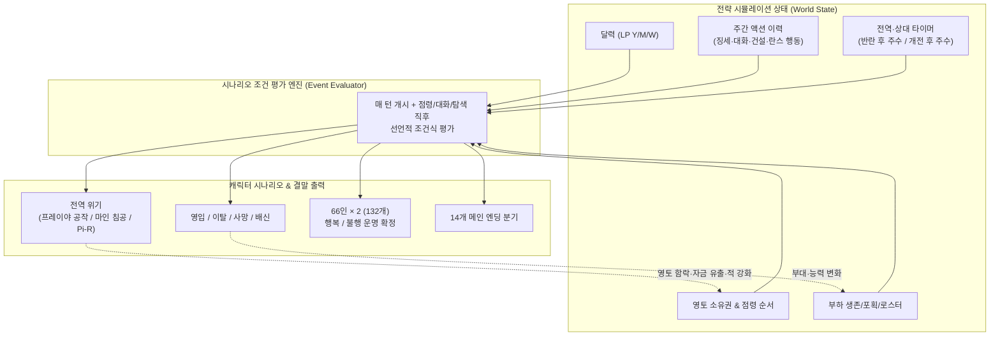

# 04. 캐릭터 시나리오 통합 및 전역 위기 타이머

> **이 문서의 핵심 질문**: 『귀축왕 란스』는 어떻게 "땅따먹기 전략 시뮬레이션"과 "다수의 개별 캐릭터 시나리오"를 서로 끊어지지 않는 단일 시스템으로 묶었는가?

---

## 1. 전략 상태 ↔ 캐릭터 시나리오 강결합 구조 `[확인]` `[해석]`

일반적인 전략 RPG가 "전투 스테이지 → 선형 비주얼 노벨 컷신"을 직렬 배치하는 것과 달리, 『귀축왕 란스』에서는 **전략 맵의 모든 상태 변수**가 곧 **캐릭터 시나리오 조건식(Predicate)**의 입력이 된다.

---

## 2. 4대 시간·순서 제약 메커니즘 (verified_data/scenario_events_and_timers.json) `[확인]`

### 2.1 절대 달력 기한 (Absolute Calendar Deadlines)
플레이어가 자유 정복 페이즈에서 어디를 먼저 공격할지 결정할 때, **절대 달력 시한**이 전략적 우선순위를 강제한다 `[확인]`.

| 이벤트 ID | 대상 영토/인물 | 절대 기한 | 성공 시 효과 | 실패(기한 초과) 시 파급 |
|---|---|---|---|---|
| `evt_volgo_z_soul_deadline` | `ter_volgo_z` / `chr_soul` | **LP 3/08/3** | 소울 구출·합류 + 도서관 건설 연계 바운드 영입 체인 해금 | 소울 상실, 바운드 영입 영구 봉인 |
| `evt_volgo_z_sill_deadline` | `ter_volgo_z` / `chr_sill` | **LP 4/01/3** | 시일 구출·합류, `end_bliss` 해금, 시즈카/나기 정상 체인 유지 | 시일 사망(`MISFORTUNE`), 진 엔딩(`end_bliss`) 영구 잠금 → `end_world_king` 분기 |
| `evt_kayblis_monster_realm_unification` | 마계 전체 / `chr_kayblis` | **최단 LP 3/9/4** | 마계 통일 가능 시점 개방 (조기 마계 공략 상한선) | 이전에는 마계 전면 개전 불가 |

### 2.2 상대 주수 타이머 (Relative Offset Timers)
특정 전략 행동(반란 진압, 특정 국가와의 개전)이 방아쇠가 되어 **N주 뒤 자동 폭발하는 시한폭탄**을 건다 `[확인]`.

| 이벤트 ID | 트리거 방아쇠 | 경과 주수 | 발동 내용 및 대응책 |
|---|---|---|---|
| `evt_ex_rebellion_suppression` → `evt_kayblis_monster_realm_unification` | `ter_leazas_white_fort` 반란 진압 | **69~73주** (`ter_shangri_la` 상태에 따라 변동) | 마인군(카밀라 선봉 등) 인간계 대침공 강제 발동. 헬만 방치 시 헬만 최우선 붕괴. |
| `evt_zeth_shizuka_duel_timer` | 제스(`fac_zeth`) 개전 | **개전 후 5주** | 시즈카 결투·납치 시퀀스 발동. 시일 생존 및 란스의 직전 턴 행동 완료 여부가 나기 영입·시즈카 안전에 개입 `[확인]`. |
| `evt_helman_freya_sabotage` | 헬만(`fac_helman`) 개전 | **개전 직후 수 주** | `chr_freya`의 식량 독살·자금 유출 공작 개시. 표적 도시 방문(도시 액션) 또는 `닌자 접착제` 구매로 저지·포획. |

### 2.3 영토 점령 순서 & 상호 배타 선택 (Conquest-Order & Mutual Exclusion) `[확인]`
단순히 "모든 땅을 먹으면 끝"이 아니라 **어떤 영토를 어떤 순서로 점령·방문했는가**가 캐릭터의 운명을 영구히 갈라놓는다.

1. **아담 요새 vs 테이프 점령 순서 (`evt_zeth_shizuka_duel_timer`)**:
   - `ter_adam_stronghold`가 점령된 상태에서 특정 타이밍에 `ter_tape`를 공략하면 `chr_shizuka`의 실종·불행 플래그가 작동한다 `[확인]`.
2. **라질 징세 → 사사호 알루미늄 도끼 선택 (`evt_lake_sasa_haniwa_king`)**:
   - 조건: 괴수왕자 **미영입** + 줄리아 생존 + `ter_radil` 징세로 `알루미늄 도끼` 획득 + 장비 부대로 `ter_sasa_lake` 방문.
   - 선택지 분기: `금도끼` 선택 시 보물은 얻지만 **호저미궁 영구 폐쇄**; `알루미늄 도끼` 선택 시 지하 66층 개방 → 2회 방문 및 줄리아 양도로 `chr_haniwa_king` 합류 `[확인]`.
3. **케이브리스 격파 시점의 잔여 영토 수 (`evt_creator_phase_unlock`)**:
   - `ter_shangri_la`를 제외한 모든 영토를 먼저 점령한 뒤 `ter_sulphur_forest`의 `chr_kayblis`를 격파 → **`CREATOR_PHASE` 해금**.
   - 단 한 곳이라도(샹그릴라 제외) 미점령 상태에서 `chr_kayblis`를 먼저 격파 → 즉시 **`end_unification`(대륙 통일 엔딩)**으로 종료 `[확인]`.

### 2.4 캐릭터 관리 누적·금기 트리거 (Behavioral Hazard Triggers) `[확인]`
- **카나미 혹사 누적 (`evt_kanami_shinobu_assassination`)**: 닌자 카나미(`chr_kanami`)에게 지속적으로 가혹한 처우를 누적하거나 시노부 암살을 막지 못하면, 암살자 코드(Code)/시노부가 출현해 즉시 **`end_assassinated`**로 게임 오버.
- **미키(리틀 프린세스) 금기 및 Pi-R 방치 (`evt_miki_kentarou_demon_king_crisis`)**:
  - 미키(`chr_miki`)에게 금기 행동 실행 시 즉시 **`end_demon_king_2`**(마왕 리틀 프린세스 엔딩).
  - Pi-R 장치로부터 미키를 지키지 못해 포획되면 **`chr_kayblis`가 격파 불가능한 무적 마왕 형태로 변모**해 사실상 캠페인 파탄 `[확인]`.
- **사테라 제안 (`evt_satella_proposal`)**: 제안 수락 시 즉시 **`end_demon_king_1`**, 거절 및 연계 시 미키 호위 아군으로 합류.
- **마리아 튤립 100호 (`evt_maria_tulip_100`)**: `ter_custom` 병합 → 마리아 연구소 건설 → 로켓 개발 완성 시 대륙 정복을 끝내지 않고도 **`end_to_outer_space`** 엔딩 달성.

---

## 3. 132개 캐릭터 운명(행복/불행)의 상호 배타성 설계 `[확인]` `[해석]`

- 원작은 주요 여성 캐릭터 **66명** 각각에 대해 **`행복(Fortune)`**과 **`불행(Misfortune)`** 2종, 총 **132개**의 개별 운명 로그를 클리어 시점에 결산한다 `[확인]`.
- **단일 회차 전원 행복 불가 원칙**: 특정 캐릭터의 행복 조건(예: 특정 도시 양보/보호, 특정 장수 양도, 특정 세력 조기 합병)이 다른 캐릭터의 행복 조건이나 기한과 의도적으로 충돌하도록 설계되어 있다 `[확인]`.
- **리플레이 가치 창출 `[해석]`**: 이 상호 배타성 덕분에 플레이어는 1회차 "대륙 통일" 이후에도 "시일 생존 + 진 엔딩(Bliss)", "특정 히로인 행복 컴플리트", "하니와 킹 vs 괴수왕자 루트", "도적왕/마리아/마왕 특수 엔딩"을 목표로 다회차 전략 루트 최적화를 반복하게 된다.
