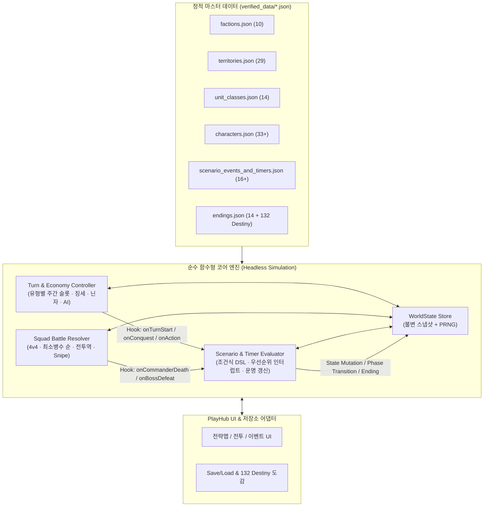

# 07. 데이터 스키마 및 PlayHub 하이브리드 엔진 아키텍처

> **핵심 아키텍처 목표**: PlayHub 런타임(TypeScript / Web 또는 Godot 포팅)에서 **전략 시뮬레이션 상태 머신(SLG Core)**과 **선언적 캐릭터 시나리오 엔진(Scenario Graph Engine)**을 깔끔하게 결합·분리하여 데이터 주도(Data-Driven)로 구동한다 `[재구성안]`.

---

## 1. 하이브리드 아키텍처 다이어그램 `[재구성안]`



---

## 2. 핵심 TypeScript 도메인 스키마 `[재구성안]`

```ts
export type EvidenceLevel =
  | "VERIFIED"
  | "INTERPRETED"
  | "RECONSTRUCTED"
  | "NEEDS_VERIFICATION";

export type CampaignPhase =
  | "BANDIT_PROLOGUE"
  | "LEAZAS_REBELLION"
  | "HUMAN_REALM"
  | "MONSTER_REALM"
  | "CREATOR_PHASE";

export type AttackType =
  | "DIRECT"
  | "RANGED_BOW"
  | "MAGIC"
  | "RANGED_SIEGE"
  | "MAGIC_SUPPORT"
  | "SUPPORT_NINJA"
  | "SPECIAL_MAGIC"
  | "DEMON_HYBRID";

export interface TerritoryDef {
  id: string;
  nameKr: string;
  nameJp: string;
  nameEn: string;
  region: string;
  initialOwnerFactionId: string;
  strategicType: string;
  countsForCreatorConquest: boolean; // ter_shangri_la & ter_rudrasaum_ruins = false
  adjacentIds: string[];             // undirected symmetric graph
  evidenceLevel: EvidenceLevel;
}

export interface UnitClassDef {
  id: string;
  nameKr: string;
  attackType: AttackType;
  preferredRow: "FRONT" | "BACK";
  canAttackFromBack: boolean;
  triggersRetaliation: boolean;
  role: string;
  evidenceLevel: EvidenceLevel;
}

export interface BattleSlotUnit {
  characterId: string;
  side: "PLAYER" | "ENEMY";
  slotIndex: 0 | 1 | 2 | 3;          // 0,1 = FRONT; 2,3 = BACK
  commanderHp: number;
  maxCommanderHp: number;
  troops: number;
  maxTroops: number;
  atk: number;
  def: number;
  mag: number;
  strikes: number;
  battleLv: number;
  isWaitingForSpecial: boolean;      // 대기 커맨드 상태
  isDefending: boolean;              // 방어 커맨드 상태
  assignedNinjaAlive: boolean;       // 닌자 추격(+1 고정, 마인 면역)
}

export interface ScenarioEventDef {
  id: string;
  category: string;
  phase: CampaignPhase | "ANY";
  timerSpec: {
    type:
      | "PHASE_LOCKED"
      | "STARTS_COUNTDOWN"
      | "ABSOLUTE_CALENDAR"
      | "RELATIVE_WEEKS"
      | "CONDITION_DRIVEN"
      | "PROGRESS_COUNTER"
      | "IRREVERSIBLE_CHOICE"
      | "THRESHOLD_COUNTER"
      | "STATE_HAZARD"
      | "CHOICE_GATE"
      | "EARLIEST_DATE_AND_OFFSET"
      | "QUEST_CHAIN"
      | "CONQUEST_CHECK";
    deadline?: string | null;
    offsetWeeks?: string;
  };
  triggerCondition: string;
  relatedTerritoryIds: string[];
  relatedCharacterIds: string[];
  relatedFactionIds: string[];
  stateMutations: string[];
  unlockedEndingIds: string[];
  evidenceLevel: EvidenceLevel;
}
```

---

## 3. 핵심 알고리즘 명세 (Engine Contracts) `[확인]` `[재구성안]`

### 3.1 전투 행동순 결정 알고리즘 (`selectNextActor`) `[확인]`
```ts
export function selectNextActor(
  units: BattleSlotUnit[],
  actedThisRound: Set<string>
): BattleSlotUnit | null {
  const candidates = units.filter(
    (u) => u.commanderHp > 0 && !actedThisRound.has(u.characterId)
  );
  if (candidates.length === 0) return null;

  candidates.sort((a, b) => {
    // 1순위: 현재 병수 오름차순 (적은 부대가 먼저 행동)
    if (a.troops !== b.troops) return a.troops - b.troops;
    // 2순위: 동률 시 아군 우선
    if (a.side !== b.side) return a.side === "PLAYER" ? -1 : 1;
    // 3순위: 슬롯 번호 오름차순 (1 -> 2 -> 3 -> 4)
    return a.slotIndex - b.slotIndex;
  });
  return candidates[0];
}
```

### 3.2 Snipe 필살기 피해 산출 (`resolveSnipeDamage`) `[확인]`
```ts
export function resolveSnipeDamage(
  attacker: BattleSlotUnit,
  rngFloat: () => number, // [0, 1)
  hardCap = 6
): number {
  const maxRoll = Math.min(hardCap, Math.floor(attacker.strikes / 5));
  return Math.floor(rngFloat() * (maxRoll + 1)); // 0..maxRoll 균등 정수
}
```

### 3.3 창조신 페이즈 해금 판정 (`checkCreatorPhaseUnlock`) `[확인]`
```ts
export function checkCreatorPhaseUnlock(
  territories: TerritoryDef[],
  owners: Record<string, string>,
  kayblisDefeated: boolean
): "CREATOR_PHASE" | "END_UNIFICATION" | "CONTINUE" {
  if (!kayblisDefeated) return "CONTINUE";

  const allRequiredOwned = territories
    .filter((t) => t.countsForCreatorConquest) // ter_shangri_la & ter_rudrasaum_ruins 제외
    .every((t) => owners[t.id] === "fac_leazas");

  return allRequiredOwned ? "CREATOR_PHASE" : "END_UNIFICATION";
}
```

---

## 4. 이벤트 훅 결합 지점 (SLG ↔ Scenario Hooks) `[재구성안]`

엔진은 아래 6개의 명시적 라이프사이클 훅에서만 시나리오 평가기(`ScenarioEvaluator`)를 호출해 부작용을 통제한다.

1. `onTurnStart(state)` — 달력 기한 만료(`3/08/3`, `4/01/3`), 상대 주수 타이머(`제스 5주`, `마인 69~73주`), 프레이야 자금 유출 평가.
2. `onTerritoryConquered(state, territoryId, previousOwner)` — 반란 진압, 볼고 Z 구출, 커스텀 일괄 영입, 제스 4탑 붕괴 자동 병합, 아담/테이프 순서 체크, 케이브리스 격파 분기.
3. `onCityAction(state, territoryId, actionType)` — 라질 징세(`알루미늄 도끼`), 프레이야 저지 방문.
4. `onBuildingCompleted(state, buildingId)` — 도서관(바운드 선행), 마리아 연구소(튤립 100호 트랙).
5. `onCharacterInteraction(state, characterId, choiceId)` — 사사호 도끼 선택, 사테라 제안, 미키 금기, 카나미 처우 누적.
6. `onBattleEnded(state, result)` — 란스 HP 0(`end_death`), 리자스성 방어 실패(`end_defeat`), 마인 격파 시 해당 권역 마군 반감(연속 2체 2/3 감소).
