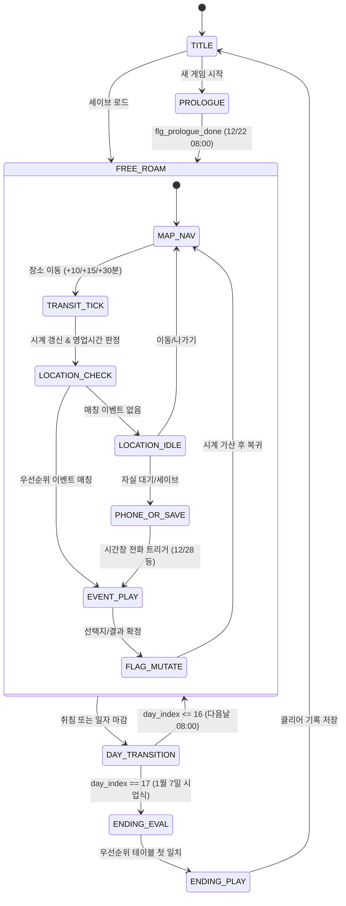

# 01. 코어 게임 루프 및 상태 머신 (Core Loop & FSM)

## 1. 게임플레이 정체성

《동급생 2》의 코어 재미는 **"제한된 16일 겨울방학의 시계 위에서, 15명의 히로인이 각자의 일정표대로 움직이는 마을을 탐색하고, 단 한 번의 놓침이 루트 봉쇄로 이어지는 시간 창(Time Window)을 퍼즐처럼 맞춰 나가는 스케줄링 어드벤처"**에 있다. `[해석]`

전작 《동급생》(1992)과 비교할 때 다음과 같은 구조적 진화가 확인된다: `[확인]`
1. **자금·아르바이트 비중 축소**: 전작의 여름방학 전반부 아르바이트 강제 루프가 사실상 축소·간소화되고, 맵 습득 소지금·퀴즈왕 등 보조 요소만 남아 **일정·동선·플래그 공략**에 집중한다.
2. **외길 집중형 마크로 분기 강화**: 12월 28일 동지온천 분기 및 12/29~30 일정 충돌로 인해 다수 히로인 동시 공략(문어발)이 구조적으로 강하게 제한된다.

## 2. 이중 루프 구조 (Macro / Micro Loop)

### 2.1 마크로 루프 (17일 캠페인: 12/22 ~ 1/7) `[확인]`
1. **프롤로그 (종업식 → 12/22 AM 08:00)**: 텐도 교사와의 지각 내기 프롤로그를 거쳐 주인공 자실에서 자유행동 개시.
2. **초반 탐색기 (12/22 ~ 12/27)**: 목표 히로인의 초기 조우 플래그 확보 및 12/22~23 아키라·요코 중재 이벤트(온천 선행 조건) 수행.
3. **최대 마크로 분기점 (12/28 AM 10:00 ~ PM 09:00)**: 주인공 자실에서 아키라의 온천 당첨 전화 수신 → **동지온천 참가(파트너: 유이 / 토모미 / 이즈미)** 또는 **마을 잔류** 결정.
4. **이원화 구간 (12/29 ~ 12/30)**:
   - *온천 분기*: `touji_onsen` 격리 맵 체류(사치코·쿠미코·미사토·이즈미 필수 플래그).
   - *마을 잔류 분기*: 야소하치·키사라기 마을 체류(타나카 미사 12/29 09:00 테니스 승부 vs 카토 미노리 12/29 10:30~17:00 고백 목격·구출, 미레이 연말 연계).
5. **연말·신년 급전개기 (12/31 ~ 1/5)**: 섣달그믐(사쿠라코 22:00 / 미레이 17:00), 설날(유이 첫참배 / 사쿠라코 오인 / 미사코 심야 욕실), 1/4~5 오해 해소(토모미 사진부실, 미노리 키사라기역).
6. **최종 행동일 (1/6) 및 판정일 (1/7)**: 1/6 마지막 관계 확정 마일스톤 수행(온천 연계 루트는 1/6 자택 귀가 주의) → 1/7 3학기 시업식 강제 귀환 및 엔딩 판정.

### 2.2 마이크로 루프 (1일 자유행동 사이클) `[확인]` `[해석]`
1. **기상 & 시간 확인**: 기본 AM 08:00(480분) 기상, 현재 날짜·시각·보유 플래그 기반 활성 존 확인.
2. **이동 선택**:
   - 동일 존 시설 진입 (`+15분`)
   - 건물/학교 내부 구획 이동 (`+10분`)
   - 전철 탑승 (`+30분`, 역 진입 포함 편도 `+45분`)
3. **장소 도착 → NPC/이벤트 리졸브**: 현재 `(day, minute, location_id, flags)`에 일치하는 최우선 스케줄 및 이벤트 조회.
4. **인터랙션 실행**:
   - *이벤트 발생*: 대화·선택지·미니게임 수행 → 플래그 변경(`sets_flags`) + 이벤트 소요 시간 가산(`time_cost_minutes`).
   - *조우 없음/일반 대화*: 제자리 조사(`0분`) 또는 대기/이동 결정.
5. **하루 종료 / 수면 전이**: 자실 복귀 후 취침 또는 심야 특수 이벤트(예: 1/6 02:00) 경유 후 `day_index + 1`로 이행.

## 3. 게임 상태 머신 (FSM) `[재구성안]`

## 4. 핵심 불변식 (State Machine Invariants) `[재구성안]`

1. **단조 시계 증가**: 동일 `day_index` 내에서 시계 `current_minute`는 절대 역행하지 않는다(단, 취침 후 다음 날 `08:00` 또는 예약된 심야 이벤트 `02:00` 진입 시 `day_index`가 `+1` 증가하며 리셋).
2. **단일 활성 이벤트**: 한 시점에는 최대 1개의 이벤트만 실행되며, 이벤트 실행 중에는 맵 이동 입력이 잠긴다.
3. **상호 배타 일관성**: `mutually_exclusive_groups`에 속한 플래그 중 2개 이상이 동시에 `true`가 되는 상태는 엔진 레벨에서 차단한다.
4. **결정론적 재현성**: 동일한 초기 상태, 데이터 번들, 플레이어 입력 시퀀스는 항상 동일한 시계·NPC 위치·플래그·엔딩을 산출한다.
