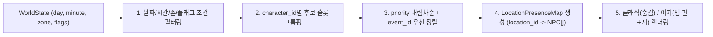

# 02. 시간·캘린더 및 데이터 기반 NPC 일정 엔진

본 문서는 사용자 핵심 요구사항인 **"NPC 일정·동선, 시간 진행, 관계 이벤트를 데이터 기반으로 구성"**의 첫 번째 축인 **시간·캘린더 시뮬레이터와 NPC 스케줄 리졸버**를 상세 설계합니다.

## 1. 시간 진행 모델 (5-Minute Quantum Clock) `[확인]` `[해석]`

### 1.1 시계 기본 사양 (`verified_data/calendar_days.json`)
- **시계 양자 (Base Quantum)**: `5분` 단위(`0 <= minute <= 1440`). 모든 이동 비용과 이벤트 시간 창(`start_minute`, `end_minute`)은 5의 배수로 정렬된다.
- **표준 일과 구간**:
  - 기본 기상 시각: `AM 08:00` (`480분`) `[확인]`
  - 야간 마감 기준: `PM 12:00 / 24:00` (`1440분`)
  - 심야 특수 이벤트: 1월 6일 `AM 02:00` (`day_index: 16`, `120~180분`, 나루사와 미사코 거실 이벤트)처럼 자정 이후 예약 트리거는 다음 일자의 `00:00~03:00` 슬롯으로 표현한다. `[확인]` `[재구성안]`
- **강제 통금(門限) 여부**: 전작 일부 구간과 달리 본편 자유행동 중 강제 귀가 게임오버는 없으며, 대신 **시간 경과로 인해 특정 이벤트 시간 창을 놓치는 소프트 락(기회 상실)**이 핵심 긴장 요소로 작동한다. `[확인]`

### 1.2 행동별 시간 소비 규칙 `[확인]`
| 행동 유형 | 소비 시간 | 비고 |
|---|---:|---|
| 마을 전체 맵에서 시설 진입 (`town_map`) | **+15분** | 야소하치 마을/키사라기 마을 외부 이동 기본값 |
| 자택·학교 내부 구획/층간 이동 (`indoor_step`, `school_step`) | **+10분** | 거실↔방, 교문↔교실/도서실/운동장 이동. 일부 자료에서 5분 표기 혼재(`DATA_GAPS.md` 참조) |
| 전철 탑승 (`train`) | **+30분** | 야소하치역↔키사라기역 탑승 시간(역 진입 15분 포함 편도 **45분**) |
| 동일 장소 내 조사·대화 반복 | **0분** | 장소를 이동하지 않고 조사할 때는 시간 비소비 `[확인]` |
| 스크립트 이벤트 실행 | **가변 (15~150분)** | 각 이벤트 JSON의 `time_cost_minutes` 필드 기반 |

> **원작 시간 미세조정 테크닉 반영**: `+15분`과 `+10분` 이동을 조합하면 5분 단위의 미세 시간 맞춤이 가능하여(`+15 + 15 = 30`, `+10 + 10 + 10 = 30`, `+15 + 10 = 25`), 예를 들어 `12:45` 키사라기역 약속(타나카 미사 12/30)처럼 정확한 분 단위 시각에 도착하는 전략이 성립한다. `[확인]` `[해석]`

## 2. 17일 겨울방학 캘린더 구조 (`12/22 ~ 1/7`) `[확인]`

| Day | 날짜 | 구분 | 핵심 글로벌/분기 이벤트 |
|---:|---|---|---|
| 1 | 12/22 | 겨울방학 개시일 | AM 08:00 자실 시작, 사쿠라코(병원 14~17시)·코즈에(도서실)·카렌(자택 11~13시)·이즈미(자택 앞)·아키라/요코 사전 플래그 시작 |
| 2 | 12/23 | 휴일 | 아키라·요코 중재 사전 플래그 마감, 미사토 여행사 방문 루프 |
| 3 | 12/24 | 크리스마스 이브 | 14:00 찻집 개구리 아저씨(미사코), 14~17시 병원 사쿠라코 질문, 20:00 거실 유이 외투, 23:00 거실 미사코 |
| 4 | 12/25 | 크리스마스 | 10:00 코즈에 약속, 타나카 미사 야소하치역 첫 충돌 개시, 카렌 방송국/라이브 |
| 5 | 12/26 | 평일 | 14~20시 3-B 교실 카렌 교복, 자택 앞 요시키 사진 거절, 보육원 아즈미-텐도 연적 개시 |
| 6 | 12/27 | 준비일 | 3-B 미노리 화병 사전 이벤트 마감, 온천 분기 직전 세이브 권장일 |
| 7 | 12/28 | **최대 마크로 분기** | **10:00~21:00 자실 아키라 온천 당첨 전화** (참가 여부 + 유이/토모미/이즈미 파트너 선택). 이즈미 선택은 당일 사전 데이트 선행 필요 |
| 8 | 12/29 | **이원화 1일차** | *온천*: `touji_onsen` 나가시마 료칸·노천온천 진입 / *마을*: 미사 09:00 테니스 승부 **OR** 미노리 10:30 교정 고백·13:00 시라헤가이케 공원 구출 |
| 9 | 12/30 | **이원화 2일차** | *온천*: 료칸 2일차 후 귀환 / *마을*: 미사 12:45 키사라기역→유원지→호텔 데이트 |
| 10 | 12/31 | 섣달그믐 | 15:00 사이온지 정보 → 17:00 스테이션 호텔 미레이 위로, 22:00 시민병원 사쿠라코 야간 데이트 |
| 11 | 01/01 | 설날(하츠모데) | 08:00 거실 유이 신사 첫참배, 14:00 시민병원 사쿠라코 사망 오인 충격, 심야 욕실 미사코 자동 이벤트 |
| 12~13 | 01/02~03 | 신년 연휴 | 쿠미코 상경 합류, 후반 순회·데이트 전개 |
| 14~15 | 01/04~05 | 후반 전환기 | 1/4 이후 토모미 사진부실 진상 규명, 1/4~5 미노리 영화·키사라기역 약속 |
| 16 | 01/06 | **자유행동 최종일** | 02:00 거실 미사코 고백, 오후 사쿠라코 역→해안, 밤 유이 방. **온천 연계 루트는 당일 자택 귀가 금지** |
| 17 | 01/07 | **3학기 시업식** | 자유행동 종료·강제 귀환, 우선순위 테이블 기반 최종 엔딩 판정 |

## 3. NPC 3대 출현 패턴 분류 `[확인]`

원작 공략 체계(`myst-site.com` 등)에서 검증된 15인 히로인의 출현·동선 유형은 엔진에서 `spawn_pattern` 메타데이터로 직접 표현된다:

1. **고정 출현 타입 (`fixed` — 8인)**: 미사코, 카렌, 사쿠라코, 미레이, 미노리, 아즈미, 미사토, 미사
   - 특정 거점(시민병원, 하나조노 보육원, 뉴바이 여행사, 세븐마트, 교무실 등)에 높은 빈도로 출현하여 반복 방문과 시간 창 일치로 루트가 진전된다.
2. **아치코치 순회 타입 (`roaming` — 5인)**: 유이, 토모미, 요코, 사치코, 쿠미코
   - 무작위(Random)가 아니라 **결정론적 다중 거점 일정표**를 따라 이동한다. 플레이어가 현재 플래그 단계에 맞는 거점을 추적해야 하므로 클래식 모드에서 최고 난이도를 형성한다.
3. **복합 전환 타입 (`hybrid` — 2인)**: 코즈에, 이즈미
   - 전반부에는 고정 거점(도서실·테니스 코트 / 자택 앞·궁도장)에 출현하다가, 핵심 플래그(`flg_kozue_xmas_date`, `flg_izumi_pre_onsen_date`) 이후 후반부에는 키사라기 마을 데이트 스폿이나 온천으로 동선이 전환된다.

## 4. 데이터 기반 스케줄 리졸버 알고리즘 `[재구성안]`

엔진은 하드코딩된 `if (day === 3 && hour === 20)` 분기를 배제하고, `npc_schedules.json`의 57개 선언적 슬롯을 순수 함수로 평가한다:

### 리졸브 규칙 (Deterministic Resolution Rules)
1. **활성 조건 검사**: `day_start <= day <= day_end` AND `start_minute <= minute < end_minute` AND 모든 `required_flags`가 `true` AND 모든 `blocked_by_flags`가 `false`.
2. **존 격리 검사**: `day === 8 || day === 9`이고 `flg_onsen_trip_joined === true`인 경우, `touji_onsen` 존에 속한 위치의 스케줄만 플레이어 도달 가능 후보로 활성화한다.
3. **충돌 해소**: 한 캐릭터가 동일 시각에 여러 슬롯(예: 일상 루틴 `priority: 10`과 특별 이벤트 `priority: 90`)에 매칭되면 `priority`가 가장 높은 슬롯 1개만 채택한다. 완료된 이벤트는 `sets_flags`가 `blocked_by_flags`에 포함되므로 재발동하지 않고 자연스럽게 하위 일상 슬롯으로 폴백(Fallback)된다.
4. **이지 모드 힌트 투영**: 2024년 리메이크의 이지 모드에 해당하는 기능은 **별도 로직 없이** 위 `LocationPresenceMap`의 `event_id !== null` 항목을 맵 핀 아이콘으로 시각화하기만 하면 100% 정합하게 동작한다.
