# 03. 마을 맵 및 내비게이션 그래프 (Town Map & Navigation Graph)

## 1. 4개 존(Zone) · 41개 장소 계층 구조 `[확인]`

《동급생 2》의 공간 구조는 **4개의 상위 존**과 그 하위 **41개 상호작용 장소(`verified_data/locations.json`)**로 구성된다.

```mermaid
graph TD
    subgraph Z1["八十八町 (야소하치 마을 - 20장소)"]
        HF["자택 앞 (허브)"] --> HL["자택 거실"]
        HL --> HR["주인공 방"]
        HL --> HY["유이 방"]
        HL --> HB["욕실"]
        HL --> HC["1층 찻집"]
        HF --> YS["야소하치 역"]
        YS --> NT["뉴바이 여행사"]
        HF --> HOSP["시민병원"]
        HF --> NURS["하나조노 보육원"]
        HF --> CONV["세븐마트"]
        HF --> PARKS["야소하치/시라헤가이케 공원·해안"]
        HF --> HOUSES["토모미·이즈미·카렌·요코·아키라·사이온지 자택"]
    end

    subgraph Z2["八十八学園 (야소하치 학원 - 9장소)"]
        SG["교문"] --> SY["운동장"]
        SY --> TEN["테니스 코트"]
        SY --> KYU["궁도장"]
        SY --> GYM["체육관 뒤"]
        SG --> C3B["3-B 교실"]
        SG --> STF["교무실"]
        SG --> LIB["도서실"]
        C3B --> PHO["사진부 부실"]
    end

    subgraph Z3["如月町 (키사라기 마을 - 9장소)"]
        KS["키사라기 역"] --> ATARU["스튜디오 ATARU"]
        KS --> HOTEL["스테이션 호텔"]
        KS --> ARC["게임센터"]
        KS --> VIP["프로덕션 VIP"]
        KS --> TV["TV국"]
        KS --> SHR["키사라기 신사"]
        KS --> TAK["언덕 전망대"]
        KS --> WORK["공사현장"]
    end

    subgraph Z4["冬至温泉 (동지온천 - 3장소, 12/29~30 격리)"]
        RYO["나가시마 료칸"] --> BATH["노천온천"]
        RYO --> SKI["스키 슬로프"]
    end

    HF -- "+15분 (town_map)" --> SG
    YS -- "+30분 (train)" --> KS
    YS -. "12/29 스크립트 버스" .-> RYO
```

## 2. 이동 시간 가중치 모델 `[확인]` `[해석]`

| 간선 유형 (`mode`) | 시간 가중치 | 적용 구간 | 설계 의의 |
|---|---:|---|---|
| `town_map` | **15분** | 마을 전체 맵에서 각 시설·자택 진입 | 장거리 탐색 비용 형성, 무분별한 순회 억제 |
| `indoor_step` | **10분** | 자택 내부(거실↔방/욕실/찻집), 역↔여행사, 료칸↔노천온천 | 15분과 조합해 5분 단위 미세 시계 조정 가능 |
| `school_step` | **10분** | 야소하치 학원 교문↔운동장/교실/교무실/도서실/부실 | 학교 탐색 시 층·구역 이동 누적 시간 계산 |
| `train` | **30분** | 야소하치역 ↔ 키사라기역 | 역 진입(+15분) 포함 편도 45분, 왕복 90분 소비로 키사라기 원정 의사결정 압박 |

> **검증 노트**: 공개 공략 자료 다수는 실내 이동을 `10분`으로 명시하나, 일부 요약 자료에서는 `5분` 표기도 확인된다. 본 데이터셋은 다수 원작 공략 기준(`10분`)을 기본값으로 채택하고, 이 차이는 `DATA_GAPS.md`에 기록한다. `[검증 필요]`

## 3. 영업시간 및 접근 가시성 규칙 `[확인]` `[재구성안]`

### 3.1 영업시간 필터 (`open_minute` ~ `close_minute`)
- **24시간 개방**: 자택 구획, 공원 2곳, 야소하치 해안, 세븐마트, 스테이션 호텔, 키사라기 신사, 언덕 전망대, 나가시마 료칸·노천온천.
- **제한 운영 시설**:
  - 야소하치 학원 (`07:30~20:00`, 교무실·부실·테니스·궁도장 `08:00~19:00`, 도서실 `08:00~18:00`) `[해석]`
  - 성 하나조노 보육원 (`08:00~18:00`), 뉴바이 여행사 (`08:00~19:00`), 시민병원 (`09:00~23:00`, 12/31 22:00 야간 이벤트 수용) `[확인]` `[해석]`
  - 스튜디오 ATARU (`10:00~22:00`), 게임센터 (`10:00~23:00`), 프로덕션 VIP (`09:00~21:00`), 방송국 (`09:00~22:00`) `[해석]`
- 영업 종료 시설 선택 시 이동을 차단하고 안내 메시지를 출력(시간 비소비)하거나, 특정 스크립트 이벤트가 열려 있을 때만 예외 진입을 허용한다. `[재구성안]`

### 3.2 존 격리 및 특수 제약
1. **동지온천 격리 (`day 8~9` & `flg_onsen_trip_joined`)**: 플레이어의 맵 전환을 `touji_onsen` 3장소로 한정하며, 12/30 밤 종료 시 자동으로 야소하치 마을로 복귀한다.
2. **1월 6일 자택 귀가 경고 규칙**: `flg_onsen_trip_joined === true`이면서 온천 연계 히로인(요코·이즈미·쿠미코·사치코·미사토) 루트가 활성인 상태에서 `day_index === 16`에 `loc_home_living`/`loc_home_room`으로 복귀하면 `flg_onsen_jan6_home_broken`이 설정되는 원작 주의 기믹을 데이터 규칙으로 모델링한다. `[확인]` `[재구성안]`

## 4. 경로 탐색 및 예상 도착 시각 계산 `[재구성안]`

웹 엔진의 내비게이션 서비스는 다익스트라(Dijkstra) 최단 시간 경로를 통해 현재 위치 `u`에서 목표 위치 `v`까지의 최소 소요 시간 `travelMinutes(u, v)`와 도착 예정 시각 `currentMinute + travelMinutes(u, v)`를 계산한다.
- **클래식 모드**: 인접 구획 단위로 한 단계씩 이동하며 플레이어가 직접 시간을 계산.
- **이지 모드**: 맵 UI에서 목표 시설에 마우스를 올리면 최단 이동 시간(예: `자택 방 → 야소하치역 → 키사라기역 → 스튜디오 ATARU = +70분`)과 도착 예정 시각을 미리 표시해 준다.
