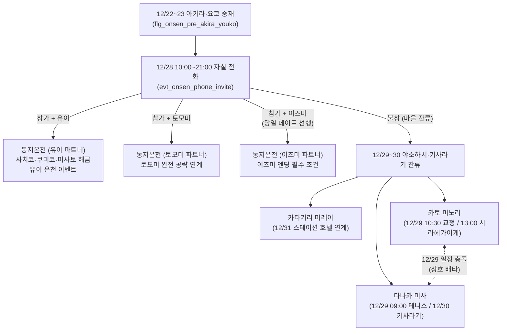

# 04. 관계 플래그, 이벤트 체인 DAG 및 상호 배타 규칙

본 문서는 《동급생 2》의 서사 진행을 통제하는 **60개 불리언 플래그, 51개 이벤트 노드(DAG), 3개 상호 배타 그룹(`verified_data/events_and_flags.json`)**의 구조를 분석합니다.

## 1. 이벤트 그래프의 핵심 특징 `[확인]` `[해석]`

1. **선형 호감도보다 플래그 체인이 지배적**: 수치 호감도를 천천히 쌓는 육성형 시뮬레이션이 아니라, **특정 날짜·특정 시간 창·특정 장소에서 선행 플래그를 순서대로 점등**해야 다음 단계가 열리는 **비순환 방향 그래프(DAG)** 구조다.
2. **시간 창 만료(Time-Window Expiry)**: 각 이벤트는 `[day_start..day_end]`와 `[start_minute..end_minute]`를 가진다. `current_day > day_end`가 되는 순간 해당 이벤트와 그 후속 서브트리 전체가 영구적으로 도달 불가능(Soft-Lock) 상태가 된다.
3. **성인 씬의 추상화**: 원작의 후반 관계 확정 장면은 본 설계에서 `scene_type: "milestone_abstracted"`로 표준화되어, 서사적 결실과 엔딩 플래그(`flg_*_route_complete`) 전이만을 담당한다.

## 2. 최대 마크로 분기: 12월 28일 동지온천 분기 `[확인]`

전체 15인 히로인 중 절반 이상에 직접 영향을 미치는 《동급생 2》 최대의 구조적 분기점이다.

### 분기별 공략 가능/불가 매트릭스 `[확인]`
| 분기 선택 | 필수/해금 대상 | 봉쇄/완전공략 불가 대상 |
|---|---|---|
| **온천 참가 + 유이** | 사치코, 쿠미코, 미사토, 유이 | 미레이, 미노리, 미사, 이즈미 |
| **온천 참가 + 토모미** | 토모미 | 미레이, 미노리, 미사, 이즈미, 사치코, 쿠미코, 미사토 |
| **온천 참가 + 이즈미** | 이즈미 | 미레이, 미노리, 미사, 사치코, 쿠미코, 미사토 |
| **온천 불참 (마을 잔류)** | 미레이, (미노리 **OR** 미사) | 이즈미, 사치코, 쿠미코, 미사토 (및 유이·토모미·요코 온천 씬 누락) |
| **온천 무관 독립 루트** | 미사코, 카렌, 사쿠라코, 코즈에, 아즈미 | *(단, 12/29~30 일정과 겹치는 일일 루프 주의)* |

## 3. 3대 상호 배타 그룹 및 특수 함정 규칙 `[확인]`

1. **`mx_onsen_trip_decision` (온천 참가 vs 마을 잔류)**:
   - `flg_onsen_trip_joined`와 `flg_onsen_trip_declined`는 절대 공존할 수 없다.
2. **`mx_onsen_partner` (온천 파트너 3택)**:
   - `flg_onsen_partner_yui`, `flg_onsen_partner_tomomi`, `flg_onsen_partner_izumi` 중 최대 1개만 활성화.
3. **`mx_dec29_minori_vs_misa` (12/29 마을 잔류 충돌)**:
   - 12/29 오전~오후에 타나카 미사(`09:00` 테니스→찻집)와 카토 미노리(`10:30` 교정 고백→`13:00` 시라헤가이케 구출)가 시간적으로 충돌하여 동시 공략 불가.
4. **교차 히로인 연동 의존성 (`사쿠라코 → 미사코`)**:
   - 1월 1일 `14:00` 시민병원 사쿠라코 사망 오인 이벤트(`evt_sakurako_jan1_misunderstanding`)가 `evt_misako_jan1_bath`(1월 1일 심야 욕실 미사코 이벤트)의 선행 조건으로 연결되어 있다. `[확인]`
5. **미나미카와 요코 엔딩 우선권 트랩 (`flg_youko_ending_override_active`)**:
   - 요코의 관계 플래그를 끝까지 활성화하면 `endings.json`의 `evaluation_priority: 1000` 규칙에 의해 타 히로인 루트를 완주했더라도 1월 7일 요코 엔딩이 강제 덮어쓰기 된다. `[확인]`
6. **1월 6일 자택 귀가 금지 제약 (`flg_onsen_jan6_home_broken`)**:
   - 요코·이즈미·쿠미코·사치코·미사토 등 온천 연계 루트 진행 중 1월 6일에 자택으로 귀가하면 플래그가 파손되는 함정을 명시적 실패 플래그로 모델링한다. `[확인]`

## 4. 전화·힌트 및 보조 정보 수집 시스템 `[확인]` `[해석]`

- **전화 이벤트 (`phone_macro_branch`)**: 주인공 자실(`loc_home_room`)에서 특정 시간 창에 대기하거나 진입할 때 트리거된다(대표: 12/28 `10:00~21:00` 아키라 온천 전화).
- **NPC 정보 중계**: 사이온지 아리토모가 12/31 `15:00` 야소하치역에서 미레이의 스테이션 호텔행을 알려주듯(`sch_aritomo_nye_tip`), 조연·라이벌 NPC가 다음 시간 창/장소의 서사적 힌트를 제공한다.
- **소지금·퀴즈왕 보조 요소**: 맵 곳곳의 습득 소지금 및 퀴즈왕 이벤트는 전작 대비 필수 압박이 크게 완화된 보조 시스템으로 위치하며, 세부 출현 조건은 `DATA_GAPS.md`에 검증 과제로 분리 기록한다. `[확인]` `[검증 필요]`
