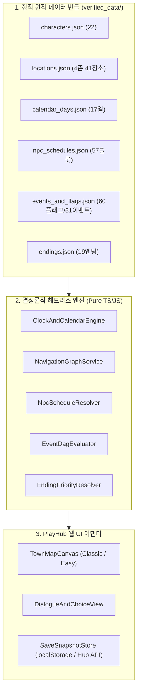

# 07. 데이터 스키마 및 결정론적 엔진 아키텍처

본 문서는 `verified_data/*.json` 번들을 직접 소비하여 PlayHub 웹 런타임(ES Module / TypeScript)에서 구동할 **순수 데이터 기반 시뮬레이션 엔진 계약**을 정의합니다. `[재구성안]`

## 1. 아키텍처 레이어 분리



**핵심 설계 원칙**:
- **하드코딩 제로**: 캐릭터 이름, 이동 시간, 출현 창, 분기 조건, 엔딩 우선순위는 100% JSON 데이터에서 로드하며 엔진 코드에 특정 히로인 ID를 하드코딩하지 않는다.
- **순수 함수 상태 전이 (`reduce(state, action) -> nextState`)**: 시뮬레이션 엔진은 DOM·네트워크·`Date.now()`에 의존하지 않으므로 Node.js 단위 테스트 및 15인 완주 자동 봇 검증을 100ms 이내에 실행할 수 있다.

## 2. TypeScript 데이터 계약 (Core Contracts)

```ts
export type EvidenceLevel = '[확인]' | '[해석]' | '[재구성안]' | '[검증 필요]';
export type SpawnPattern = 'player' | 'fixed' | 'roaming' | 'hybrid' | 'scripted';
export type TravelMode = 'town_map' | 'indoor_step' | 'school_step' | 'train';

export interface CharacterDef {
  id: string;
  name_ja: string;
  reading_ja: string;
  name_ko: string;
  name_en: string;
  role: 'protagonist' | 'heroine' | 'supporting' | 'rival' | 'utility';
  romanceable: boolean;
  affiliation: string;
  age: number | null;
  blood_type: string | null;
  height_cm: number | null;
  birthday: string | null;
  spawn_pattern: SpawnPattern;
  home_location_id: string;
  onsen_dependency: string;
  evidence_level: EvidenceLevel;
}

export interface LocationEdge {
  target_id: string;
  travel_minutes: number; // 5분 양자 배수 (10, 15, 30)
  mode: TravelMode;
}

export interface LocationDef {
  id: string;
  zone_id: 'yasohachi_town' | 'yasohachi_gakuen' | 'kisaragi_town' | 'touji_onsen';
  name_ja: string;
  name_ko: string;
  category: string;
  indoor: boolean;
  open_minute: number;
  close_minute: number;
  connected_to: LocationEdge[];
  evidence_level: EvidenceLevel;
}

export interface NpcScheduleSlot {
  id: string;
  character_id: string;
  day_start: number; // 1..17
  day_end: number;   // 1..17
  start_minute: number; // 0..1440, % 5 === 0
  end_minute: number;   // 0..1440, % 5 === 0
  location_id: string;
  spawn_pattern: SpawnPattern;
  required_flags: string[];
  blocked_by_flags: string[];
  event_id: string | null;
  priority: number;
  evidence_level: EvidenceLevel;
}

export interface EventDef {
  id: string;
  title_ko: string;
  character_id: string;
  location_id: string;
  day_start: number;
  day_end: number;
  start_minute: number;
  end_minute: number;
  scene_type:
    | 'story_scripted'
    | 'story_branch'
    | 'phone_macro_branch'
    | 'relationship_beat'
    | 'rival_check'
    | 'minigame_event'
    | 'milestone_abstracted';
  prerequisite_events: string[];
  required_flags: string[];
  blocked_by_flags: string[];
  sets_flags: string[];
  branch_flag_options?: Array<{
    choice_ko: string;
    requires_flags?: string[];
    sets_flags: string[];
  }>;
  time_cost_minutes: number;
  evidence_level: EvidenceLevel;
}

export interface WorldState {
  day_index: number;
  current_minute: number;
  current_location_id: string;
  active_flags: ReadonlySet<string>;
  completed_events: ReadonlySet<string>;
}
```

## 3. 핵심 엔진 연산 계약

1. **`resolvePresence(state: WorldState, bundle: GameDataBundle)`**:
   - 현재 일자·시각·존 제약·플래그 조건을 통과한 `NpcScheduleSlot`을 `character_id`별로 그룹화하고 `priority` 최상위 1개씩 반환.
2. **`computeShortestTravel(fromId: string, toId: string, state: WorldState)`**:
   - 현재 활성 존(`activeZones(state)`) 내 간선만 허용하여 다익스트라 최단 시간과 경유 경로를 산출. 목적지 도착 시각이 `open_minute..close_minute` 밖이면 `{ reachable: false, reason: 'CLOSED' }` 반환.
3. **`triggerLocationEvent(state: WorldState, locationId: string, choiceIndex?: number)`**:
   - 해당 위치에 배치된 NPC 중 `event_id !== null`이면서 `prerequisite_events`가 모두 `completed_events`에 포함된 최우선 이벤트를 실행하고, 상호 배타 그룹 위반이 없는지 검증한 뒤 `sets_flags` 및 `time_cost_minutes`를 원자적으로 반영.
4. **`evaluateEnding(state: WorldState, endings: EndingDef[])`**:
   - `state.day_index === 17` 도달 시 `evaluation_priority` 내림차순으로 스캔하여 첫 일치 엔딩 ID 반환(최후 폴백: `end_solo_normal`).
