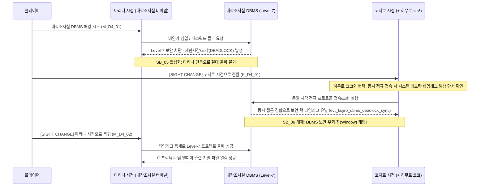

# 02. 멀티 사이트 시스템과 동기화 장벽 엔진 (핵심 아키텍처 ①)

> 본 문서는 《EVE burst error》의 가장 독창적인 메커니즘인 **멀티 사이트(Multi-Sight) 시점 전환**과 **교차 시간축 동기화 장벽(Cross-Protagonist Synchronization Barrier)**을 형식적으로 정의하고, 교착 상태(Deadlock)가 절대 발생하지 않음을 보장하는 엔진 설계를 제시한다.

## 1. 멀티 사이트 시스템의 4가지 핵심 원리 `[확인]` `[해석]`

1. **비대칭 개시 시차 (Staggered Start: Day 0 vs Day 1)** `[확인]`
   - **호죠 마리나**는 **12월 2일(Day 0)**부터 이야기를 시작한다(내각조사실 소환, 미도 마야코 경호 임무 수령, 예일 외국인학교 답사 및 강사 신분증 확보).
   - **아마기 코지로**는 하루 늦은 **12월 3일(Day 1)**에 시바타 아카네가 가져온 '이슬람 문양 회화 수색 의뢰'로 이야기를 시작한다.
   - 따라서 Day 0 구간에서는 시점 전환이 잠겨 있으며, 마리나가 12월 2일 밤을 넘겨 12월 3일에 진입하는 시점(`SB_01`)에서 코지로 시점이 해금된다. `[확인]` `[재구성안]`

2. **단일 공유 세계 시계 vs 독립 로컬 커서 (Shared World Clock + Dual Cursors)** `[해석]` `[재구성안]`
   - 두 주인공은 각자의 위치(`locationId`), 현재 씬(`sceneId`), 소지품(`inventory`), 대화 소진 상태(`dialogueCounters`)를 독립적으로 유지한다.
   - 그러나 두 사람은 **같은 도쿄(항구 창고 거리, 예일 외국인학교, 엘디아 대사관, 프린세스 호텔, 트리스탄호)와 같은 달력(12월 2일~8일)** 위에 존재한다.
   - 마리나가 예일 외국인학교 디렉터룸을 조사하거나 대사관 경비 상태를 변화시키면, 같은 날짜·이후 시간대의 코지로 세계 상태(`WorldEventFlags`)가 즉각 반영된다.

3. **자유 전환(Free Switch)과 강제/유도 전환(Forced/Gated Switch)** `[확인]` `[해석]`
   - **자유 전환**: `ACTIVE_INVESTIGATION` 상태의 일반 커맨드 대기 화면에서는 언제든 `SIGHT CHANGE`를 선택해 코지로 ⇄ 마리나를 오갈 수 있다. 이때 떠나온 주인공의 씬, 대사 진행 플래그, 위치, 인벤토리는 손실 없이 동결(Suspend)된다.
   - **강제 전환 / 잠금**:
     - Day 0 프롤로그(`M_D0_01`~`M_D0_02`): 마리나 단독 고정(전환 불가).
     - 치명적 액션 시퀀스·컷신 도중: 씬 종료 시까지 전환 일시 잠금.
     - 동기화 장벽 도달 시: 현재 주인공은 더 이상 다음 씬으로 넘어갈 수 없으며, 상대 주인공으로 전환해 선행 이벤트를 완료해야만 잠금이 풀린다.
     - 최종 합류(`C_D6_01`, 12월 8일 트리스탄호 선창): 두 시점이 하나의 물리적 공간과 단일 시점으로 영구 통합되어 `SIGHT CHANGE`가 종료된다.

4. **교차 인과(Cross-Causality)의 3가지 유형** `[해석]`
   - **유형 A — 시간선 동기화(Temporal Pacing Lock)**: 한쪽이 다음 날로 넘어가기 전에 다른 한쪽도 같은 날짜의 핵심 사건을 소화하도록 강제(예: `SB_01`, `SB_02`).
   - **유형 B — 세계 상태 변형(World-State Mutation)**: 한쪽의 조사·사건 발각이 공용 장소의 NPC 배치나 경계 수위를 변경해 상대측에 새 단서/이동지를 개방(예: `SB_03`, `SB_04`, `SB_07`).
   - **유형 C — 실시간 동시 협공(Concurrent Co-Execution Exploit)**: 두 주인공이 **같은 시각에 서로 다른 위치에서 시스템에 동시 개입**해야만 돌파되는 기믹. 본작 최고의 명장면인 **12월 6일 내각조사실 DBMS 데드락 해킹(`SB_05` → `SB_06`)**이 대표적이다. `[확인]`

## 2. 대표 시그니처 기믹 심층 해부: 12월 6일 DBMS 데드락 해킹 `[확인]` `[해석]`

본작에서 멀티 사이트 시스템이 단순한 "시점 번갈아 읽기"를 넘어 **게임플레이 퍼즐 메커니즘**으로 승화되는 정점이 12월 6일(Day 4) 내각조사실 데이터베이스(DBMS) 침입 시퀀스다. `[확인]`



- **설계적 의의** `[해석]`:
  - 마리나와 코지로는 이 순간 서로 전화로 지시를 주고받는 것이 아니라, 각자의 목적을 위해 동일 데이터베이스를 노리다 **플레이어의 Sight Change 개입**으로 우연이자 필연적인 동시 접속 교착(Deadlock)을 일으킨다.
  - 플레이어가 "마리나 측 패스워드/선택지를 아무리 총당(Brute Force)해도 풀리지 않음"을 깨닫고 코지로 측으로 시점을 돌리는 순간, **시스템 UI 자체가 추리의 도구**가 된다.

## 3. 정규 동기화 장벽 8종 매트릭스 (`verified_data/sync_barriers.json` 연동) `[확인]` `[해석]` `[재구성안]`

| 장벽 ID | 봉쇄 주인공 | 봉쇄 씬 | 해제 주인공 | 해제 이벤트 ID | 유형 | 교차 인과 메커니즘 | 근거 |
| --- | --- | --- | --- | --- | --- | --- | --- |
| `SB_01` | `kojiro` | `K_D1_01` | `marina` | `evt_marina_day0_setup` | 시간선 동기화 | 마리나가 12/2(Day 0) 임무 수령 및 학교 답사를 마쳐야 12/3 코지로 편 진입 가능 | `[확인]` |
| `SB_02` | `marina` | `M_D1_01` | `kojiro` | `evt_kojiro_fake_stollman_commission` | 시간선·인과 | 코지로가 12/3 가짜 스트르만(디브)의 회화 의뢰를 수주하고 저택을 방문해야 학교/대사관 경계 국면 전개 | `[해석]` `[재구성안]` |
| `SB_03` | `kojiro` | `K_D2_01` | `marina` | `evt_marina_director_room_seal_clue` | 세계 상태 변형 | 마리나가 12/4 디렉터룸·스즈키 접촉을 진행해야 코지로의 학교 도서관·카츠라기 사무소 단서가 국새 실마리와 연결 | `[확인]` `[해석]` |
| `SB_04` | `marina` | `M_D3_01` | `kojiro` | `evt_kojiro_fake_kou_exposed` | 세계 상태 변형 | 12/5 진 스트르만 피살·니카이도 지명수배 및 사칭 폭로가 코지로 측에 확인되어야 마리나 측 대사관·히무로 공조 심화 | `[확인]` `[해석]` |
| `SB_05` | `kojiro` | `K_D4_01` | `marina` | `evt_marina_dbms_lock_triggered` | 동시 협공 선행 | 12/6 마리나가 내각조사실 DBMS Level-7 보안 장벽에 부딪혀야 코지로·히무로의 동시 접속 국면이 점화 | `[확인]` |
| `SB_06` | `marina` | `M_D4_02` | `kojiro` | `evt_kojiro_dbms_deadlock_sync` | **동시 협공 돌파** | 코지로 측이 정규 접속으로 DBMS 데드락/타임래그를 유발해야 마리나의 해킹이 성공하고 C 프로젝트 파일 확보 | `[확인]` |
| `SB_07` | `kojiro` | `K_D4_02` | `marina` | `evt_marina_c_project_leaked` | 세계 상태 변형 | 마리나의 C 프로젝트 열람·도청기 발각·본부장 인질 탈출 여파가 엘디아 측을 자극해 코지로 측 푸딩 재회·디브 습격 촉발 | `[확인]` `[해석]` |
| `SB_08` | `both` | `C_D6_01` | `both` | `evt_tristan_dual_convergence` | 최종 합류 관문 | 12/7 코지로(`K_D5_01`)의 선창 고립과 마리나(`M_D5_01`)의 프리시아 호위 승선이 모두 완료되어야 12/8 트리스탄호 합류 개방 | `[확인]` |

## 4. 데드락(영구 교착) 방지 수학적 조건 및 검증 알고리즘 `[재구성안]`

복수 주인공 교차 잠금 시스템을 설계할 때 가장 치명적인 결함은 **상호 순환 대기(Circular Wait)**다. 예컨대 코지로 씬 $K_i$가 마리나 씬 $M_j$를 기다리는데, $M_j$가 다시 $K_i$ 이후의 이벤트를 기다리면 게임은 영구 불능(Deadlock)에 빠진다.

### 4.1 형식적 무교착 불변식 (Deadlock-Free Invariant)
전체 시나리오를 유향 그래프 $G = (V, E)$로 정의한다.
- 정점 집합 $V$: 코지로 씬 집합 $V_K$, 마리나 씬 집합 $V_M$, 합류 씬 집합 $V_C$의 합집합.
- 간선 집합 $E = E_{\text{intra}} \cup E_{\text{sync}}$:
  - $E_{\text{intra}}$: 동일 주인공 내부의 시간 순서 선행 간선 $(u \to v)$.
  - $E_{\text{sync}}$: `sync_barriers.json`이 정의하는 교차 주인공 해제 간선 $(u_{\text{unlocking}} \to v_{\text{blocked}})$.

엔진은 다음 3가지 불변식을 **빌드 타임 및 CI(`validate_data.mjs`)에서 무조건 검증**한다:
1. **비순환성 (DAG)**: $G$에는 어떤 유향 사이클도 존재하지 않는다(Kahn 위상 정렬 방문 정점 수 $= |V|$).
2. **단일 기점 도달성 (Reachability)**: 초기 기점 `M_D0_01`로부터 모든 씬 $v \in V$가 도달 가능하며, 최종 합류 씬 `C_D6_01`의 모든 선행 의존성이 충족 가능하다.
3. **활성 진행 보장 (Progress Guarantee)**: `C_D6_01`에 도달하기 전 어느 도달 가능 상태 $(s_K, s_M, F)$에서도, 코지로와 마리나 중 **최소 한 명 이상은 반드시 장벽에 막히지 않고 다음 씬 또는 해제 이벤트를 실행할 수 있어야 한다**.

### 4.2 런타임 장벽 평가 의사코드 `[재구성안]`
```ts
export function canAdvanceScene(
  state: MultiSightState,
  targetScene: TimelineScene,
  barriers: SyncBarrier[]
): { allowed: boolean; blockedBy?: SyncBarrier } {
  // 1) 동일 주인공 선행 씬 완료 여부
  for (const prevId of targetScene.prev_scene_ids) {
    if (!state.completedScenes.has(prevId)) {
      return { allowed: false };
    }
  }
  // 2) 교차 동기화 장벽 검사
  const relevantBarriers = barriers.filter((b) => b.blocked_scene === targetScene.id);
  for (const barrier of relevantBarriers) {
    const unlocked = barrier.required_event_ids.every((evt) =>
      state.worldEvents.has(evt)
    );
    if (!unlocked) {
      return { allowed: false, blockedBy: barrier };
    }
  }
  return { allowed: true };
}
```

이 구조 덕분에 플레이어는 "막혔을 때 상대 주인공으로 전환하면 반드시 풀린다"는 멀티 사이트의 황금률을 100% 신뢰할 수 있으며, 개발자는 새 씬이나 장벽을 추가할 때마다 `validate_data.mjs`로 교착 위험을 즉시 차단할 수 있다.
