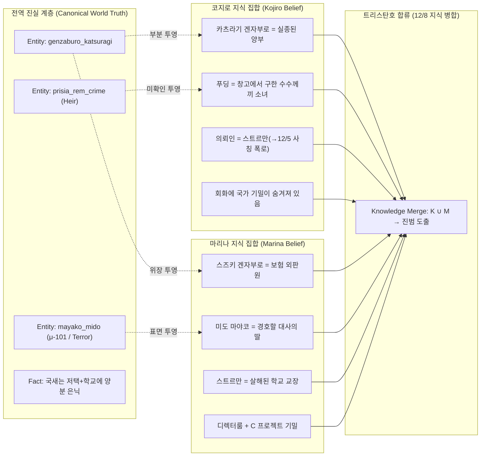

# 03. 정보 비대칭과 이중 지식 모델 (핵심 아키텍처 ②)

> 《EVE burst error》가 추리 게임사에 남긴 최대의 성취는 **"주인공 A는 모르고 주인공 B도 모르지만, 두 시점을 모두 보는 플레이어만 먼저 소름 끼치는 진실에 도달하는"** 구조화된 **정보 비대칭(Information Asymmetry)** 설계다. `[해석]`

## 1. 4계층 정보 비대칭 아키텍처 `[해석]` `[재구성안]`

단순히 두 주인공이 각자 다른 이벤트를 겪는 것을 넘어, 엔진은 정보 상태를 **4개의 독립된 비대칭 계층**으로 모델링한다.

| 비대칭 계층 | 코지로 시점 (`Kojiro`) | 마리나 시점 (`Marina`) | 플레이어 메타 인지 (`Player`) |
| --- | --- | --- | --- |
| **1. 공간 비대칭 (Spatial)** | 항구 창고, 아마기/카츠라기 사무소, 스트르만 저택, 샷 바 등 **뒷세계·민간 동선** `[확인]` | 내각조사실 본부, 엘디아 대사관, 예일 학교 디렉터룸 등 **공권력·외교 동선** `[확인]` | 두 사람이 불과 몇 시간 차이로 같은 예일 학교와 대사관 주변을 엇갈려 지나감을 목격 |
| **2. 인벤토리 비대칭 (Physical)** | 이슬람 문양 회화 관련 단서, 사립탐정 메모, 푸딩의 유류품 등 **사건 현장 물증** `[확인]` | 내각조사실 신분증, 권총(애칭 '이쿠이쿠'), 교내 조사 기록, DBMS 기밀 파일 등 **공적 장비·기밀** `[확인]` | 국새(国璽)의 두 조각이 저택(코지로)과 학교(마리나)에 각각 나뉘어 숨겨져 있음을 통합 인지 `[확인]` |
| **3. 단서·지식 비대칭 (Epistemic)** | "가짜 스트르만에게 속았다", "푸딩은 엘디아와 관련된 위험한 추격을 받는다", "야요이의 아버지 카츠라기 겐자부로는 실종/사망했다" `[확인]` | "미도 마야코는 대사의 순진한 딸이다", "보험 외판원 스즈키 겐자부로는 수상하지만 협조적이다", "C 프로젝트라는 기밀이 존재한다" `[확인]` | **스즈키 = 카츠라기 겐자부로**, **푸딩 = 프리시아 공주**, **마야코 = 프리시아 유전자 클론 μ-101**이라는 등식을 주인공보다 먼저 조립 `[해석]` |
| **4. 인물·별칭 비대칭 (Alias & Belief)** | 아쿠아 = 샷 바의 수수께끼 미녀 / 디브 = 회화 의뢰인 '스트르만=코우' / 시리아 = 수상한 아랍어 강사 `[확인]` | 아쿠아 = 엘디아 공화국 수상 / 스트르만 = 살해된 예일 학교 교장 / 스즈키 = 보험회사 세일즈맨 `[확인]` | 동일 인물이 양측에서 완전히 다른 가면을 쓰고 있음을 간파 (극적 아이러니 극대화) `[해석]` |

## 2. 5대 핵심 극적 아이러니(Dramatic Irony) 구조 분석 `[확인]` `[해석]`

플레이어가 시점을 교차할 때마다 인지 불협화음과 카타르시스를 일으키는 핵심 비대칭 축 5가지를 정식화한다.

### 2.1 스즈키 겐자부로 ⇄ 카츠라기 겐자부로 (동일인 별칭 비대칭) `[확인]`
- **마리나의 인지**: 예일 학교 주변에 나타나는 정체불명의 **보험회사 세일즈맨 '스즈키 겐자부로'**.
- **코지로의 인지**: 행방불명·사망한 것으로 알려진 은사이자 양부, 카츠라기 탐정사무소 초대 소장 **'카츠라기 겐자부로'** (야요이의 친부).
- **진실**: 동일 인물이며, 과거 엘디아 정보국 실행부대 '테러'를 이끌고 C 프로젝트에 관여했던 인물. 스스로의 과거를 청산하기 위해 위장 신분으로 잠입했다. `[확인]`

### 2.2 푸딩(프리시아) ⇄ 미도 마야코 (대칭적 보호 대상 비대칭) `[확인]`
- **코지로의 인지**: 창고 거리에서 구해준 정체불명의 금발·갈색 피부·오드아이 소녀 **'푸딩'**. 정체를 모른 채 사무소에 보호.
- **마리나의 인지**: 주일 엘디아 대사 로스=미도의 딸 **'미도 마야코'**. 테러리스트로부터 지켜야 할 순진한 경호 대상.
- **진실**: 푸딩이 진짜 엘디아 왕위 계승자 **프리시아 렘 크라임**이며, 마리나가 목숨 걸고 지키던 마야코는 프리시아의 유전자로 만들어진 **유기 휴머노이드 클론(μ-101)**이자 전 국왕의 인격이 이식된 **연쇄 살인범 '테러'**였다! `[확인]`

### 2.3 가짜 스트르만(디브) ⇄ 진짜 스트르만=코우 (사칭 비대칭) `[확인]`
- **코지로의 인지**: 12월 3일 회화 수색을 의뢰한 장본인이 '스트르만=코우'라고 믿고 조사 착수 → 12월 5일 신문 보도("예일 학교 교장 스트르만 피살")를 보고서야 **자신이 만난 의뢰인이 가짜(디브)**였음을 깨달음.
- **마리나의 인지**: 예일 외국인학교의 교장이자 엘디아 천재 과학자인 **진본 스트르만=코우**와 그의 죽음을 학교·대사관 축에서 목격.
- **진실**: 엘디아 정보부 간부 디브가 진본 스트르만을 고문·살해하고, 국새가 숨겨진 회화를 찾기 위해 스트르만을 사칭해 코지로를 이용했다. `[확인]`

### 2.4 샷 바의 미녀 ⇄ 엘디아 공화국 수상 (신분 격차 비대칭) `[확인]`
- **코지로의 인지**: 시내 샷 바에서 우연히 만나 묘한 매력을 느낀 **정체불명의 미녀 '아쿠아'**.
- **마리나의 인지**: 엘디아의 민주화 개혁을 추진하는 젊은 최고 권력자 **'아쿠아=스틸=로이드 수상'**.
- **진실**: 전 국왕의 서녀이자 로스=미도의 의붓딸. 처음에는 로스=미도와 결탁했으나 종반 프리시아 즉위를 인정하려다 마야코(테러)에게 살해된다. `[확인]`

### 2.5 쪼개진 국새(国璽)의 양분 은닉 (공간·물증 비대칭) `[확인]`
- **코지로의 조각**: 회화 수색 의뢰 → 스트르만 저택과 미술품에 감춰진 국새의 단서 추적.
- **마리나의 조각**: 예일 외국인학교 디렉터룸 조사 → 학교 내부에 은닉된 국새의 또 다른 절반 추적.
- **진실**: 스트르만=코우가 구 정보부의 탈취를 막기 위해 국새를 **둘로 나누어 저택과 예일 외국인학교에 분산 은닉**했다. 어느 한쪽의 수사만으로는 국새의 실체와 행방이 완성되지 않는다. `[확인]`

## 3. 주인공별 지식 그래프 모델 (`EpistemicGraph`) `[재구성안]`

PlayHub 재현 엔진은 전역 진실(`CanonicalTruth`)과 각 주인공이 현재 믿고 있는 사실(`BeliefState`)을 명확히 분리하여 저장한다.

### 3.1 엔진 레벨의 정보 격리 규칙 (Epistemic Isolation Rules) `[재구성안]`
1. **대화/추리 필터링**: 코지로의 `TALK`/`THINK` 커맨드는 오직 `kojiro.knownClueIds`에 존재하는 단서만 참조한다. 마리나가 `M_D2_01`에서 "스즈키 겐자부로"를 만났더라도, 코지로는 합류 전까지 스즈키라는 이름을 언급할 수 없다.
2. **인벤토리 격리**: `kojiro.inventory`와 `marina.inventory`는 `C_D6_01` 이전까지 완전히 분리된 배열이며, 아이템의 물리적 이동은 명시적인 **교차 전달 이벤트(Handoff Event)** 없이 불가능하다.
3. **인물 표기 동적 치환(Dynamic Alias Resolution)**: UI의 인물 이름표·대화 화자명은 `character.known_to_kojiro.alias` / `character.known_to_marina.alias`를 현재 활성 주인공과 `revealedAliasFlags`에 따라 동적으로 표시한다(예: 코지로 화면에서 `스트르만?` → `디브`, `푸딩` → `프리시아`).
4. **합류 시점 지식 병합 (`mergeKnowledgeAtConvergence`)**: 12월 8일 트리스탄호 선창 합류(`C_D6_01`) 순간, `Kojiro.knownClueIds ∪ Marina.knownClueIds`가 통합되고 모든 비대칭 단서의 `true_meaning`이 해금되면서 최후의 **범인 이름 입력(`御堂真弥子`)**을 위한 논리적 근거가 완성된다.
