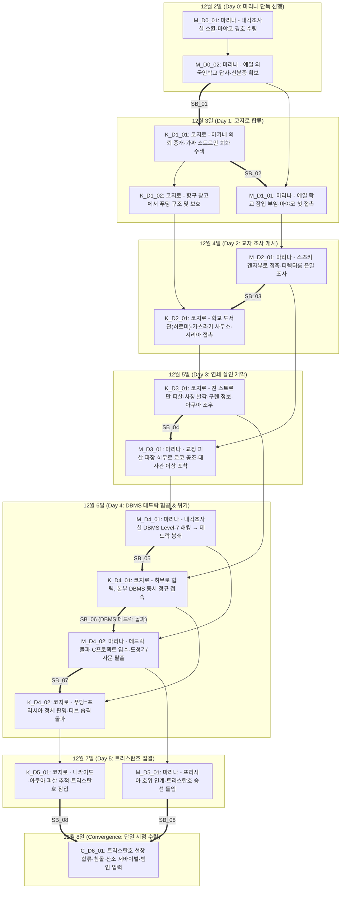

# 04. 병렬 타임라인 및 시나리오 수렴 구조

## 1. 전체 시간축 구조 (12월 2일 ~ 12월 8일) `[확인]`

《EVE burst error》의 시나리오는 **12월 2일(Day 0)** 마리나의 단독 도입으로 시작해, **12월 3일(Day 1)** 코지로의 합류 이후 **12월 7일(Day 5)**까지 5일간 두 주인공이 교차 진행한 뒤, **12월 8일(Convergence / 최종 합류·테러 해결편)** 호화 여객선 **트리스탄호**에서 단일 시점으로 수렴한다. `[확인]`

> 범례: 실선(`-->`)은 동일 주인공 내부 시간선(`prev_scene_ids`), 이중선(`==>`)은 `sync_barriers.json`의 교차 주인공 동기화 장벽을 나타낸다.

## 2. 일자별 교차 인과 매트릭스 `[확인]` `[해석]`

| 날짜 | 코지로 사건선 (탐정·뒷세계) | 마리나 사건선 (정보기관·외교) | 핵심 교차 인과 및 정보 비대칭 포인트 |
| --- | --- | --- | --- |
| **12월 2일 (Day 0)** | 아직 미개시 (`locked`) | 코노 본부장 지령 수령, 로스=미도 대사 면담, 예일 외국인학교 답사 및 전속 강사 위장 준비 (`M_D0_01`~`M_D0_02`) `[확인]` | 마리나가 학교·대사관 축의 무대를 먼저 구축한 뒤 12/3 코지로 개방 (`SB_01`) |
| **12월 3일 (Day 1)** | 시바타 아카네가 회화 수색 의뢰 중개, 가짜 스트르만(디브) 면담 및 코우 저택 조사 (`K_D1_01`). 창고 거리에서 불량배에게 쫓기던 소녀 '푸딩' 구조 (`K_D1_02`) `[확인]` | 예일 외국인학교 잠입 부임, 경호 대상 미도 마야코와 첫 대면(거부 반응) (`M_D1_01`) `[확인]` | **대칭 보호 구조 성립**: 코지로는 진짜 왕녀(푸딩)를, 마리나는 클론/테러(마야코)를 각각 정체 모른 채 보호 개시 |
| **12월 4일 (Day 2)** | 예일 학교 도서관에서 마츠노 히로미와 미술사 조사, 카츠라기 사무소(야요이·니카이도) 및 아랍어 강사 시리아 플랫과 접촉 (`K_D2_01`) `[확인]` | 학교 내에서 보험 외판원 '스즈키 겐자부로'와 접촉, 학교 뒤편 디렉터룸 은밀 조사로 국새/기밀 단서 포착 (`M_D2_01`) `[확인]` | 두 사람이 같은 날 같은 학교(도서관 vs 디렉터룸)에서 활동. 마리나가 만난 스즈키가 코지로의 은사 카츠라기 겐자부로임이 암시됨 (`SB_03`) |
| **12월 5일 (Day 3)** | 조간·아카네 정보로 예일 교장 스트르만 피살 및 니카이도 지명수배 확인 → 자신이 만난 '코우'가 사칭범임을 자각. 구렌에게 암살자 정보 수집, 샷 바에서 미녀 아쿠아 조우 (`K_D3_01`) `[확인]` | 교장 피살 여파 속 교육감시기구 요원 히무로 쿄코와 공조, 엘디아 대사관과 구 정보부 그림자 추적 (`M_D3_01`) `[확인]` | 코지로 측 사칭 폭로와 마리나 측 대사관 경비 이상이 연결 (`SB_04`). 코지로는 바의 미녀를 일반인으로, 마리나는 아쿠아를 수상으로 인지 |
| **12월 6일 (Day 4)** | 히무로 쿄코 협력 하에 본부 DBMS에 동시 정규 접속 실행(`K_D4_01`) → 마리나의 해킹 돌파 성공 후 푸딩과 재회해 **엘디아 공주 프리시아** 정체 판명, 가짜 코우(디브) 습격 격퇴 (`K_D4_02`) `[확인]` | 내각조사실 DBMS Level-7 침입 시도 중 데드락 봉쇄(`M_D4_01`) → 코지로 동시 접속 덕에 돌파(`SB_06`), **C 프로젝트** 기밀 입수, 도청기 발견 및 내무감사(카가와)·사문 위기에서 본부장 인질극으로 탈출 (`M_D4_02`) `[확인]` | **멀티 사이트 정점 (`SB_05` → `SB_06`)**: 두 주인공이 서로 모른 채 실시간 DBMS 데드락을 협공해 돌파. 직후 양측 위기가 동시 폭발 (`SB_07`) |
| **12월 7일 (Day 5)** | 니카이도·아쿠아 등 연쇄 살인 사건과 디브의 행적을 추적해 호화 여객선 트리스탄호에 잠입, 소란 중 부상 입고 마야코와 선창에 고립 (`K_D5_01`) `[확인]` | 프리시아 호위 및 엘디아 쿠데타 저지를 위해 트리스탄호 승선, 선내 수색 개시 (`M_D5_01`) `[확인]` | **보호 대상 교차(Swap)**: 코지로 곁에 마야코가, 마리나 곁에 프리시아가 배치된 채 트리스탄호로 집결 (`SB_08`) |
| **12월 8일 (Convergence)** | **통합 시점 (`C_D6_01`)**: 선창에서 코지로+마야코와 마리나+프리시아 물리적 합류 → 폭발로 트리스탄호 해저 침몰 → 제한된 산소통 서바이벌 속에서 모든 단서 통합, 진범(`御堂真弥子 / 테러`) 이름 입력 → 로스=미도 파멸·카츠라기 겐자부로의 결착·생환 `[확인]` | ← 통합됨 | 모든 정보 비대칭이 일시에 해소되며 단일 진엔딩(True Ending)으로 완결 |

## 3. 수렴점(Convergence) 설계의 추리적 완결성 `[해석]`

트리스탄호 선창 합류(`C_D6_01`)가 탁월한 이유는 단순한 '두 주인공의 만남'이 아니라 **3가지 비대칭의 동시 반전**을 일으키기 때문이다.
1. **보호 대상의 반전**: 5일간 마리나가 지키던 마야코가 코지로와 갇혀 있고, 코지로가 지키던 푸딩(프리시아)을 마리나가 데려오면서 두 소녀의 외모·유전자·기억의 대칭성이 한 화면에 겹쳐진다.
2. **물증과 기밀의 합체**: 코지로의 현장 추리(회화, 사칭범 디브, 니카이도·아쿠아 살해 현장)와 마리나의 국가 기밀(C 프로젝트, μ-101 유기 휴머노이드, 전 국왕의 위장 암살)이 비로소 하나의 방정식으로 결합한다.
3. **플레이어 검증 관문(Culprit Input)**: 최종적으로 플레이어가 직접 연쇄 살인의 진범(`御堂真弥子 / 미도 마야코`)을 입력하도록 요구함으로써, 5일간 양측 시점에서 수집한 정보를 플레이어 스스로 종합했는지 검증한다. `[확인]`
