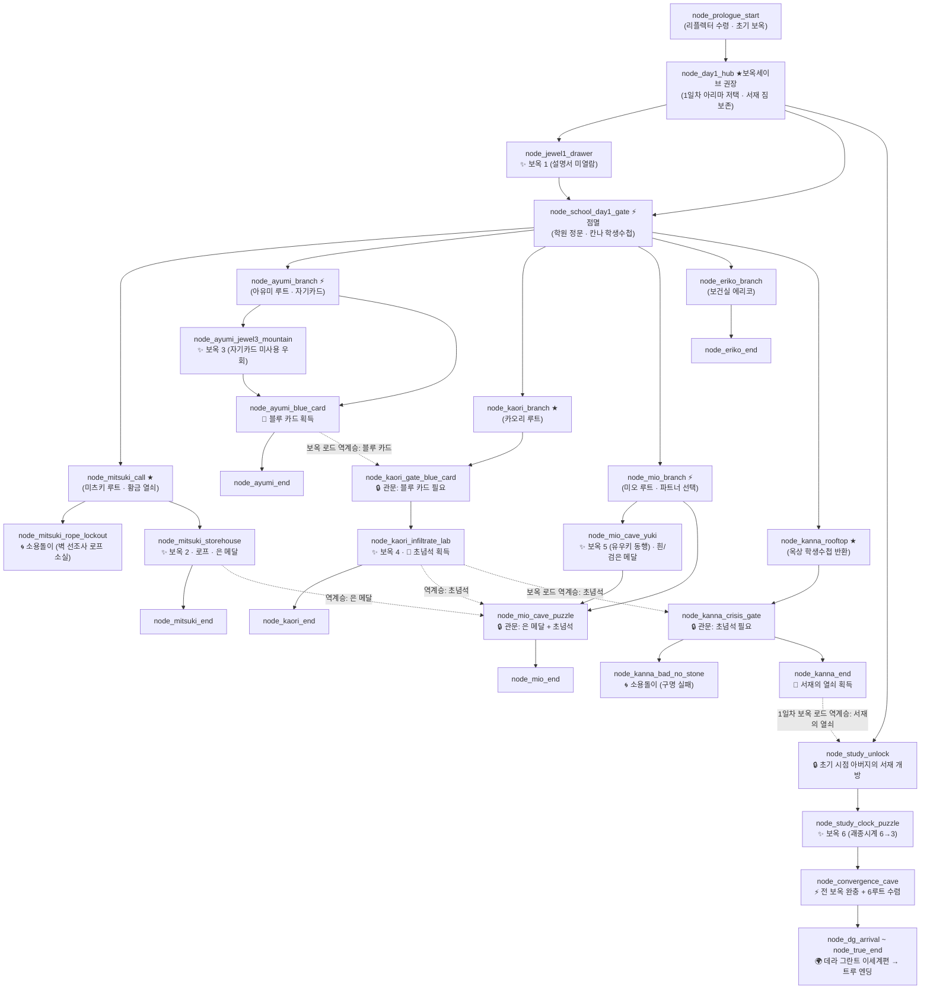

# 02. A.D.M.S. 병렬 분기 그래프 & 리플렉터 보옥 경제학

## 1. A.D.M.S. (Auto Diverge Mapping System)의 본질 `[확인]` `[해석]`
일반 비주얼 노벨의 플로우차트가 단순한 "열람·점프용 편의 UI"인 반면, 『HORIZON』의 **A.D.M.S.**는 **세계관 내부의 물리 장치(리플렉터 디바이스)와 유한 자원(보옥)에 직결된 게임플레이 그래프**이다. `[확인]`

- **탐색 기반 가시화**: 처음에는 시작 노드(`node_prologue_start`)만 보이며, 플레이어가 실제로 분기를 밟거나 이동할 때마다 트리가 동적으로 뻗어나가며 지도에 기록된다. `[확인]`
- **시각 마커 5종** `[확인]`:
  1. **현재 위치 커서**: 현재 활성 시간축의 노드.
  2. **보옥 마커 (Jewel Marker)**: 플레이어가 보옥 1개를 소비해 앵커를 설치한 노드. 언제든 보옥 로드 가능.
  3. **광점 (光点 / Shining Point)**: 아직 회수하지 못한 추가 보옥 6개 중 하나가 숨겨진 노드·분기 영역 표시.
  4. **소용돌이 (うず巻き / Whirlpool)**: 배드엔드·막다른 길·치명적 순서 함정이 발생한 분기 종단.
  5. **루트 클리어 표식**: 개별 히로인 엔딩 도달 완료 노드.

## 2. 그래프 토폴로지 및 노드 분류 (`adms_nodes.json` 기준) `[확인]` `[재구성안]`
PlayHub 복원 데이터([adms_nodes.json](verified_data/adms_nodes.json))는 원작의 방대한 마이크로 씬 트리를 핵심 분기·보옥·계승 관문 중심의 **35개 정규화 노드**로 모델링한다.

| 노드 타입 (`node_type`) | 개수 | 역할 | 대표 노드 ID |
|---|---:|---|---|
| `root` | 1 | A.D.M.S. 최상위 기원 | `node_prologue_start` |
| `checkpoint_recommended` | 4 | 보옥 세이브 설치 강력 권장 앵커 | `node_day1_hub`, `node_mitsuki_call`, `node_kaori_branch`, `node_kanna_rooftop` |
| `divergence` | 3 | 주요 평행세계 갈림길 (하단 보옥 점멸) | `node_school_day1_gate`, `node_ayumi_branch`, `node_mio_branch` |
| `shining_point` | 6 | 추가 보옥 1~6 획득 광점 | `node_jewel1_drawer` .. `node_study_clock_puzzle` |
| `event` | 2 | 중간 핵심 이벤트 / 아이템 획득 | `node_ayumi_blue_card`, `node_eriko_branch` |
| `lock_gate` | 4 | 타 루트 아이템·글로벌 플래그 검증 관문 | `node_kaori_gate_blue_card`, `node_mio_cave_puzzle`, `node_kanna_crisis_gate`, `node_study_unlock` |
| `whirlpool` | 2 | 대표 소용돌이(로프 미회수 / 칸나 구명 실패) | `node_mitsuki_rope_lockout`, `node_kanna_bad_no_stone` |
| `route_end` | 6 | 현세편 6대 히로인 개별 엔딩 | `node_mitsuki_end` .. `node_kanna_end` |
| `convergence` | 1 | 전 보옥·전 루트 수렴(삼각산 동굴 전이) | `node_convergence_cave` |
| `isekai_stage` | 5 | 데라 그란트 선형 5개 스테이지 | `node_dg_arrival` .. `node_dg_sanctuary_climax` |
| `true_end` | 1 | 최종 진엔딩 (사상의 틈새) | `node_true_end` |

### 2.1 핵심 A.D.M.S. 병렬 분기·수렴 그래프 시각화

## 3. 리플렉터 디바이스 & 보옥(宝玉) 경제학 `[확인]` `[해석]`

### 3.1 보옥 수량 불변식 (PC-98 vs SS/리메이크) `[확인]`
- **PC-9801 원작 (1996)**: 초기 장착 **2개** + 추가 발견 **6개** = **총 8개**.
- **세가새턴(1997) / 풀 리메이크(2017)**: 초기 장착 **4개** + 추가 발견 **6개** = **총 10개**.
- **공통 규칙**: 두 버전 모두 게임 내에서 플레이어가 직접 분기를 공략해 회수해야 하는 **추가 발견 보옥의 개수와 위치는 6개**로 동일하다. `[확인]`

### 3.2 추가 발견 보옥 6개 완전 목록 `[확인]`
| ID | PC-98 슬롯 | 획득 로케이션 | 소속 루트 | 정확한 획득 조건 |
|---|---:|---|---|---|
| `jewel_found_1` | 3 | `loc_arima_room` (타쿠야의 방) | `route_prologue` | 본편 개시 후 귀가 → 자실 서랍 설명서를 **'읽지 않는다'** 선택 |
| `jewel_found_2` | 4 | `loc_ryuzoji_storehouse` (류조지 토장) | `route_mitsuki` | 미츠키 전화 후 저택 방문 → 토장 감금 이벤트 중 안쪽 방 기계 옆 조사 |
| `jewel_found_3` | 5 | `loc_triangle_mountain` (삼각산·쌍둥이 바위) | `route_ayumi` | 회사 방문 시 여경비원에게 **자기카드를 사용하지 않고** 사당/삼각산 쪽으로 류조지 수색 |
| `jewel_found_4` | 6 | `loc_geo_technics` (지오테크닉스 사옥) | `route_kaori` | 블루 카드 계승 후 사옥 코다이 연구실 잠입 → **프로젝터 뒤** 조사 |
| `jewel_found_5` | 7 | `loc_shrine_cave` (사당 지하 동굴) | `route_mio` | 동굴 탐사 파트너로 **유우키 마사카츠** 선택 → 흰/검은 메달 구역 격자 앞 웅덩이 조사 |
| `jewel_found_6` | 8 | `loc_arima_study` (아버지의 서재) | `route_convergence` | 칸나 루트 **서재의 열쇠**를 1일차 초기 시점으로 역계승 → 서재 괘종시계 **`6 → 3`** 입력 |

### 3.3 보옥 자원 순환 연산 (Save / Load / Blink) `[확인]` `[해석]`
리플렉터 상태를 `(totalJewels, placedMap)`으로 정의할 때, 가용 보옥 수는 항상 다음 불변식을 만족한다.

$$availableJewels = totalJewels - |placedMap|, \quad 0 \le availableJewels \le totalJewels$$

1. **보옥 세이브 (`placeJewel(nodeId)`)**:
   - 전제 조건: `availableJewels >= 1` 및 `nodeId`가 이세계편 노드가 아님.
   - 동작: 현재 로컬 스냅샷을 `placedMap[nodeId]`에 저장하고 `availableJewels`를 1 감소시킨다. (동일 노드에 덮어쓰기 시 추가 보옥 소모 없음 `[재구성안]`).
2. **보옥 로드 (`jumpToJewel(nodeId)`)**:
   - 전제 조건: `nodeId ∈ placedMap`.
   - 동작:
     1. `placedMap`에서 `nodeId`를 제거하여 **보옥 1개를 리플렉터로 즉시 회수** (`availableJewels += 1`). `[확인]`
     2. 로컬 상태(위치·장면·로컬 플래그·해당 시점 미획득 오브젝트 상태)를 스냅샷으로 복원. `[확인]`
     3. 글로벌 상태(현재 인벤토리 소지/소비 상태, 누적 보옥, 맵 탐색 기록, 글로벌 플래그)는 **유지(역계승)**. `[확인]`
   - **재배치 원칙**: 1일차 거점(`node_day1_hub`)처럼 반복 귀환해야 하는 영구 허브 노드는 **점프 직후 즉시 보옥 1개를 다시 심어야** 영구 상실(초기 시점 재진입 불가)을 방지할 수 있다. `[확인]` `[해석]`
3. **분기 예고 점멸등 (`reflector_blinks`)**:
   - 현재 노드의 `reflector_blinks === true`이면 리플렉터 하단 중앙 보옥이 점멸하여 "여기서 보옥 세이브를 깔아두라"는 비언어적 신호를 제공한다. `[확인]`
   - 특히 PC-98 원작(초기 2개)에서는 1개를 `node_day1_hub`에 영구 고정해 두고 나머지 1개로 탐색하다가, 보옥 1~5를 점진적으로 확보하면서 동시 앵커 수를 늘려가는 **자원 성장형 탐색 곡선**을 체감하게 된다. `[해석]`
