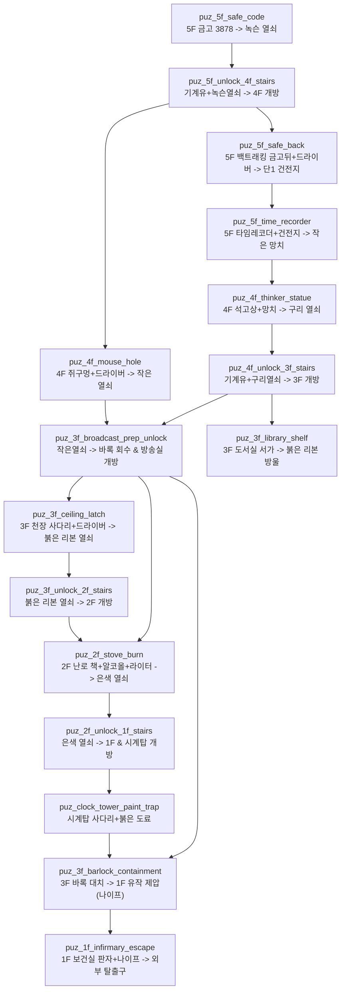

# 03. 아이템 인벤토리 및 퍼즐 의존성 엔진

## 1. 아이템 분류 체계 (총 23종, `verified_data/items.json`)

| 분류 (`category`) | 개수 | 대표 아이템 | 소모 여부 |
|---|---:|---|---|
| **열쇠 (`key`)** | 5 | 녹슨 철제 열쇠, 작은 열쇠, 구리 열쇠, 붉은 리본 열쇠, 은색 열쇠 | 사용 시 소모 (`consumable: true`) |
| **다용도 공구 (`tool`)** | 8 | 기계유, 드라이버, 작은 망치, 바 록, 목제 사다리, 라이터, 유작의 나이프, 붉은 수성 도료 | 도료 제외 비소모 (`consumable: false`) |
| **퍼즐 재료 (`puzzle_material`)** | 3 | 갈색 표지 책, 단1 건전지, 알코올 병 | 퍼즐 투입 시 소모 |
| **단서 문서 (`clue`)** | 4 | 호출 편지, 3-2 교실 메모, 골격 표본 메모, 난수표 | 비소모 (열람 가능) |
| **캐릭터 키 아이템 (`character_key_item`)** | 2 | 아케미의 수첩, 붉은 리본 방울 | 대상 전달 시 소모 |
| **사건 지표 (`incident_artifact`)** | 1 | 증거 비디오테이프 | 실패 분기 한정 출현 (해피 루트 불요) |

## 2. 핵심 아이템 상호작용 패턴 5종

1. **단일 핫스팟 사용 (`item_on_hotspot` / `tool_on_hotspot`)**: 드라이버로 쥐구멍·금고 뒷면 분해, 건전지를 타임 레코더에 삽입, 작은 망치로 석고상 파괴, 나이프로 보건실 판자 제거. `[확인]`
2. **순서 강제 윤활 해정 (`ordered_item_use`)**: 5F→4F 및 4F→3F 계단 문은 반드시 `item_machine_oil`(기계유) 선적용 후 열쇠(`item_rusted_key`, `item_copper_key`)를 사용해야 한다. `[확인]`
3. **다중 도구 연계 (`multi_tool_sequence`)**: 3F 막다른 복도 천장 손잡이는 `item_wooden_ladder`로 발판을 확보한 뒤 `item_screwdriver`로 분해한다. `[확인]`
4. **다중 재료 현장 조합 (`multi_item_combine_on_hotspot`)**: 2F 급식실 난로에 `item_brown_book`(5F 습득) + `item_alcohol_bottle`(2F 화장실)을 투입하고 `item_lighter`(3F 방송실)로 점화해 `item_silver_key`를 획득한다. `[확인]`
5. **회수 후 역이용(Re-use Mechanic)**: 3F 방송실 창고 문에 걸려 있던 `item_bar_lock`을 `item_small_key`로 분리해 인벤토리에 넣은 뒤, 종반에는 반대로 배신 위험 인물을 방송 준비실에 격리하는 장치로 재사용한다. `[확인]`

## 3. 전체 퍼즐 의존성 DAG (16개 퍼즐)

`validate_data.mjs`의 Kahn 위상 정렬 및 정방향 시뮬레이션으로 비순환(Acyclic)과 완주 가능성이 증명된 전체 퍼즐 그래프다.

## 4. 원작 하드락 위험과 현대 엔진 소프트락 방지 규칙

원작(1995 PC-98)은 당시 하드코어 어드벤처 특성상 진행 불능("詰み") 구간이 존재했다. `[확인]` 재구현 엔진은 원작의 추리 재미는 유지하되 불합리한 영구 진행 불능을 아래와 같이 차단한다. `[재구성안]`

| 원작 위험 지점 | 원작 동작 `[확인]` | 재구현 엔진 소프트락 방지 규칙 `[재구성안]` |
|---|---|---|
| 기계유 없이 녹슨 열쇠 강행 | 자물쇠에 무리하게 돌리면 열쇠가 부러져 영구 진행 불가 가능 | 열쇠 사용 시 `oilApplied` 미충족이면 "자물쇠가 심하게 녹슬어 부러질 것 같다" 경고 출력 후 아이템 보존 (원작 하드모드 옵션에서만 파손 허용) |
| 5F 갈색 표지 책 미회수 후 2F 도달 | 2F 급식실 난로 재료 부족으로 진행 정체 | 모든 상행 계단(`2F->3F->4F->5F`) 영구 개방 유지로 언제든 회수 가능 |
| 3F 바 록 분리 후 미회수 | 종반 격리 이벤트 실패 | `puz_3f_broadcast_prep_unlock` 해결 시 `grantsItems: ["item_bar_lock"]`를 원자적 지급 |
| 1F 현관문 오인 | 열쇠 없는 정문에서 무한 배회 | 현관문 조사 시 "열쇠 구멍 자체가 봉쇄되어 있다 — 다른 탈출구나 상층 단서를 찾아야 한다" 로그 기록 |
| 필수 도구 오소모 | 다회성 공구 소실 위험 | `machine_oil`, `screwdriver`, `small_hammer`, `bar_lock`, `wooden_ladder`, `lighter`, `isaku_knife`는 `consumable: false`로 스키마 강제 |
