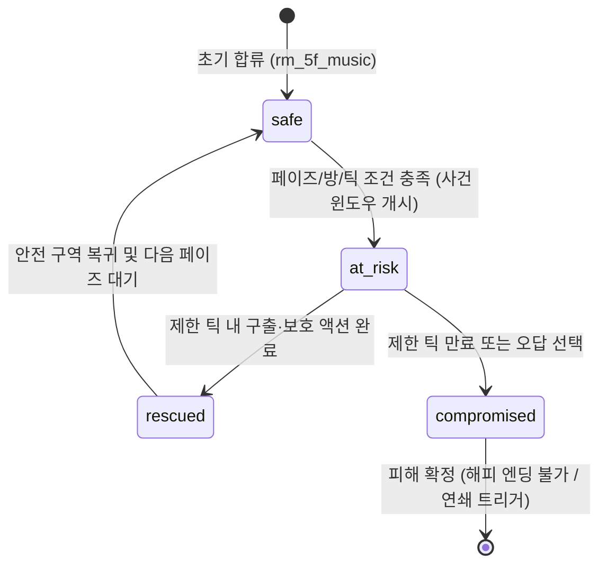

# 04. 사건 스케줄러 및 생존·엔딩 분기 엔진

## 1. 시간/행동 기반 사건 스케줄러 원리

*유작*의 가장 독창적인 게임 메커니즘은 **탐색 지연과 오판이 동료의 실종·피해 상태로 직결되는 사건 스케줄러(Incident Scheduler)**다. `[확인]`

- **이중 트리거 구조**: 사건은 단순히 고정된 시계 시각에만 터지는 것이 아니라, `(현재 탐색 페이즈 + 특정 방 진입/이탈 + 행동 틱 경과 + 선행 인물 상태)`의 결합 조건으로 발동한다. `[확인]` `[해석]`
- **구출 vs 피해 딜레마**: 해피 엔딩(전원 생환)을 달성하려면 8개의 위기 윈도우 중 단 하나도 `compromised` 상태로 넘기지 않아야 한다. 반대로 한 명이라도 `compromised`가 되면 화장실 등에 `item_evidence_tape`(증거 비디오테이프)가 출현하며, 이후 탈출에 성공하더라도 해피 엔딩이 봉인되고 노멀 엔딩으로 강등된다. `[확인]`

## 2. 캐릭터 생존 상태 전이 머신



> **콘텐츠 안전 추상화**: 본 엔진에서는 피해 발생 시 자극적 연출 대신 사건 상태 전이(`compromised`), 실종 알림 로그, 그리고 조건부 증거 아이템(`flg_evidence_tape_spawned`) 생성으로만 분기를 기록한다.

## 3. 8대 사건 윈도우 및 연쇄 전파 규칙 (`verified_data/incidents_and_endings.json`)

| 사건 ID | 대상 인물 | 발동 페이즈 / 방 | 허용 틱 `[재구성안]` | 구출 조건 `[확인]` | 실패 결과 & 연쇄 전파 `[확인]` |
|---|---|---|---:|---|---|
| `inc_kumi_restroom` | 타카시마 쿠미 (`char_kumi`) | Phase 1 / `rm_5f_restroom_f` | 6 | 화장실 입구 대기·동행 선택 | `compromised` + 증거 테이프 + **`inc_rika_isolation` 연쇄 가속** |
| `inc_rika_isolation` | 아카가와 리카 (`char_rika`) | Phase 2 / `rm_4f_hall` | 5 | 돌발 단독 행동 시 즉각 진정·합류 | `compromised` + 증거 테이프 (쿠미 피해 시 위험 대폭 상승) |
| `inc_akemi_panel` | 미키하라 아케미 (`char_akemi`) | Phase 2 / `rm_4f_electrical` | 4 | 수첩 회수·반환 + 배전반 패닉 즉각 제지 | **`end_bad_akemi_fire` 즉시 배드 엔딩** (미오 연쇄 위험) |
| `inc_mio_separation` | 세리자와 미오 (`char_mio`) | Phase 3 / `rm_3f_hall` | 5 | 아케미 안정 유지 + 3F 복도 합류 회수 | `compromised` + 증거 테이프 |
| `inc_soga_reckless` | 소가 무네미츠 (`char_soga`) | Phase 3 / `rm_3f_broadcast` | 6 | 3F 방송실 바 록 해제 후 구속 발견·구출 | `compromised` (내부 혼란 확대) |
| `inc_kotomi_trust` | 아사카와 코토미 (`char_kotomi`) | Phase 3 / `rm_4f_av` | 6 | 3F 도서실 `붉은 리본 방울`을 4F 시청각실 전달 | `compromised` + 증거 테이프 |
| `inc_miyuki_clock_tower` | 사카키 미유키 (`char_miyuki`) | Phase 5 / `rm_clock_tower` | 4 | 시계탑 미유키 확인 + 사다리 `붉은 수성 도료` 도포 | **`end_bad_isaku_total_loss` 즉시 배드 엔딩** |
| `inc_jinpachi_betrayal` | 시마다 진파치 (`char_jinpachi`) | Phase 5 / `rm_3f_broadcast_prep` | 4 | 3F 도서실 대화 확보 + 방송실 창고 `바 록` 격리·대치 | **`end_bad_isaku_total_loss` 즉시 배드 엔딩** |

### 연쇄 피해(Cascade) 수식 `[재구성안]`
선행 사건 `inc_kumi_restroom`이 실패하면 후속 사건 `inc_rika_isolation`의 유예 시간(`windowTicks`)이 축소되거나 자동 실패 판정으로 전환된다. `[확인]`
```ts
const effectiveWindow = hasFlag(state, "flg_inc_kumi_compromised")
  ? Math.max(1, incident.windowTicks - 3)
  : incident.windowTicks;
```

## 4. 5종 엔딩 평가기 (Ending Evaluator)

엔딩 판정기는 매 틱 종료 시(즉시 배드 엔딩) 및 `rm_escape_exit` 진입 시(탈출 엔딩) **우선순위(`priority`) 오름차순**으로 평가한다. `[확인]`

| 우선순위 | Ending ID | 계층 | 결정 조건 | 결말 요약 |
|---:|---|---|---|---|
| 1 | `end_happy_miyuki` | Happy | `rm_escape_exit` 도달 + `compromisedCount === 0` + `affinities.miyuki >= 3` | 전원 생환, 1년 전 사건 해결, 미유키와 이어지는 진 해피 엔딩 |
| 2 | `end_happy_kotomi` | Happy | `rm_escape_exit` 도달 + `compromisedCount === 0` + `affinities.miyuki <= 2` | 전원 생환, 코토미와 이어지는 해피 엔딩 |
| 3 | `end_normal_survivor_escape` | Normal | `rm_escape_exit` 도달 + `compromisedCount >= 1` | 일부 피해 발생 상태로 잔존 인원 탈출, 후일 불온한 편지 재도착 |
| 4 | `end_bad_akemi_fire` | Bad | `flg_inc_akemi_fire_trigger` 발동 (즉시 종료) | 아케미 배전반 조작 스파크가 기름에 인화되어 구교사 화재 전멸 |
| 5 | `end_bad_isaku_total_loss` | Bad | `flg_inc_miyuki_compromised` 또는 `flg_inc_jinpachi_betrayed` 발동 (즉시 종료) | 유작의 증거 인멸 방화 및 비밀 통로 도주, 일행 전멸 |
