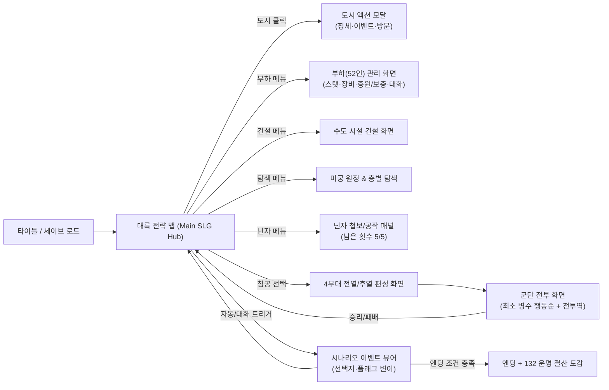

# 06. UI/UX 아키텍처 및 세이브 데이터 설계

## 1. 핵심 화면 전환 흐름 (Screen State Graph) `[해석]` `[재구성안]`



---

## 2. 4대 핵심 UI 화면 레이아웃 명세 `[확인]` `[재구성안]`

### 2.1 대륙 전략 맵 화면 (Strategy Map HUD)
- **상단 정보 바**:
  - 현재 달력 (`LP Y/M/W`, 경과 주수), 국고 자금(`GOLD`), 현재 캠페인 페이즈 배지, **남은 주간 슬롯 인디케이터** (도시 `1/1`, 하렘 `1/1`, 대화 `1/1`, 증원/보충 `1/1`, 건설 `1/1`, 탐색 `1/1`, 닌자 `5×N`, 침공 `가용/완료`) `[확인]` `[재구성안]`.
- **중앙 대륙 맵**:
  - 29개 거점 노드와 인접 연결선, 세력별 국기/색상 오버레이 `[확인]`.
  - **시나리오/타이머 알림 핀** `[재구성안]`: 원작의 불친절한 숨겨진 기한(예: 볼고 Z 소울 `3/08/3`, 시일 `4/01/3`, 제스 개전 5주)을 현대 PlayHub UX에서는 옵션으로 "경고 배지(임박 기한 / 특수 이벤트 예고)" 토글 제공.
- **우측 커맨드 독**:
  - 도시 / 하렘 / 부하 / 건설 / 탐색 / 닌자 / 침공 / 턴 종료 버튼. 이미 소비한 주간 슬롯은 비활성화 + 체크마크 표시.

### 2.2 부하 관리 및 시나리오 이벤트 목록 UI (Subordinates & Event Log) `[확인]` `[재구성안]`
- 부하 목록(최대 52인): 초상화, 병종 아이콘, 현재 병수/최대 병수, 지휘관 HP, ATK/DEF/MAG/Strikes, 장비 슬롯, **대화 가능(!) 뱃지**.
- **운명/시나리오 트래커 (옵션 도감)**: 회차 간 누적 달성한 14개 엔딩 및 132개 행복/불행 운명(Destiny) 수집 현황을 시각화 `[재구성안]`.

### 2.3 군단 전투 화면 (4 vs 4 Squad Battle UI) `[확인]` `[재구성안]`
- **중앙 전장**: 좌측 아군 4슬롯(후열 2 + 전열 2) vs 우측 적군 4슬롯(전열 2 + 후열 2), 중앙 상단에 **현재 지형 및 전투역(`戦闘域`) 수치** 상시 표시.
- **행동순 큐 바(Turn Order Bar)** `[재구성안]`: 원작의 핵심 규칙인 **"현재 병수 오름차순(동률 시 아군 1~4 → 적군 1~4)"** 다음 행동 예정자를 실시간 미리보기로 표시해 전략적 판단 가독성을 극대화.
- **하단 커맨드 패널**:
  - `[직접 공격]` (전열 시), `[궁/마법 공격]` (해당 병종 시), `[대기 (필살기 준비)]`, `[방어]`, `[필살기 (대기 완료 시 활성화)]`.
  - 대상 적 부대 호버 시 예상 반격 여부, 닌자 추격 가능 여부(마인 면역 표시), Snipe 직격 여부(병사 무시 표시) 툴팁 제공.

---

## 3. 세이브 데이터 & 결정론적 리플레이 아키텍처 `[재구성안]`

전략 시뮬레이션 + 장기 분기 시나리오 게임은 수십~백여 턴의 상태를 무손실 저장해야 하므로, **단일 정규화 JSON 스냅샷 + 이벤트 로그** 구조를 채택한다.

```json
{
  "saveVersion": "1.0.0",
  "gameId": "kichikuou-rance",
  "savedAt": "2026-11-22T00:00:00Z",
  "rngSeed": 987654321,
  "rngCallCount": 1420,
  "calendar": { "year": 3, "month": 7, "week": 2, "totalWeeks": 26 },
  "campaignPhase": "HUMAN_REALM",
  "turnSlots": {
    "city": 1,
    "harem": 1,
    "talk": 0,
    "troop": 1,
    "building": 1,
    "expedition": 1,
    "invasionLocked": false,
    "ninjaOpsRemaining": { "chr_kanami": 3 }
  },
  "economy": {
    "gold": 48500,
    "buildings": ["hospital", "library"],
    "items": ["aluminum_axe", "ninja_glue"]
  },
  "territoryOwners": { "ter_leazas_castle": "fac_leazas", "ter_volgo_z": "fac_helman" },
  "roster": {
    "chr_rance": { "status": "ACTIVE", "commanderHp": 18, "troops": 450, "maxTroops": 600, "lv": 14 }
  },
  "timers": {
    "monster_realm_invasion": { "active": true, "remainingWeeks": 54 },
    "zeth_war_weeks": { "active": false, "elapsedWeeks": 0 }
  },
  "flags": { "sill_alive": true, "soul_rescued": false },
  "destinies": { "chr_sill": "PENDING" },
  "triggeredEvents": ["evt_ex_rebellion_suppression"]
}
```

### 세이브 무결성 원칙 `[재구성안]`
1. **원자적 턴 경계 자동저장(Auto-Save)**: 매 턴 개시 시점과 침공 전투 돌입 직전에 롤링 슬롯 자동저장.
2. **결정론적 PRNG 시드(`rngSeed`, `rngCallCount`)**: 전투 Snipe 난수·닌자 공작 50% 판정을 재현 가능하게 보존해 자동 QA와 버그 리포팅에 활용.
3. **글로벌 메타 세이브 분리**: 회차별 캠페인 세이브와 별도로 **14개 엔딩 달성 이력 + 132개 운명 도감 해금 상태**를 영구 프로필에 저장.
