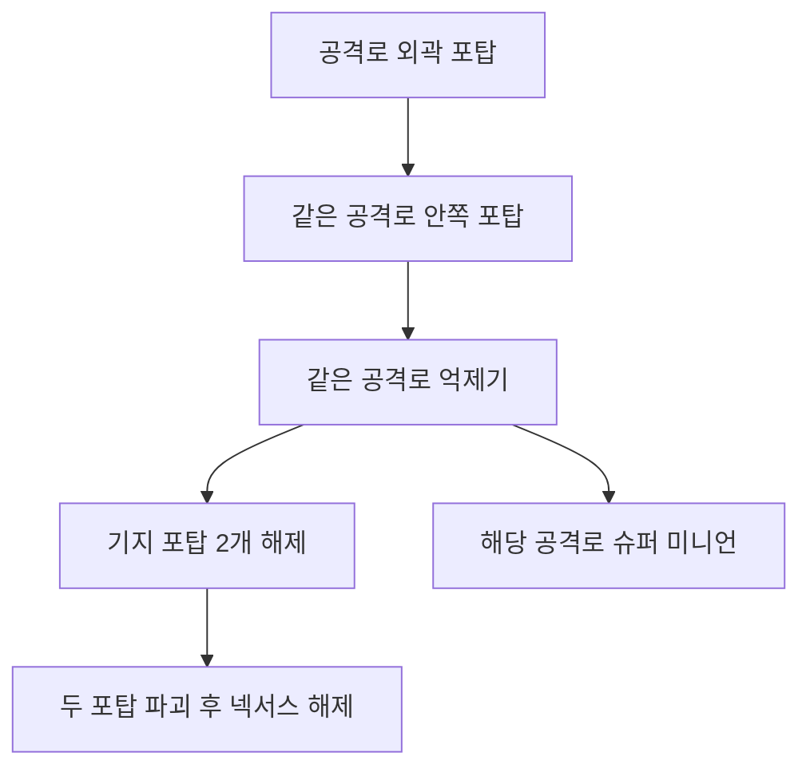

# 넥서스 전선 · 게임 규칙과 튜닝 가이드

이 문서는 저장소에 구현된 **Nexus Front 9.0.0**의 동작을 설명합니다. 기존 독자 영웅 프로필 `nexus-v7`과 복원 챔피언 프로필 `lol16.22`를 구분합니다. **4절의 기존 3명 스킬표·성장 배율과 8절의 기존 8개 아이템 표는 기존 영웅 전용**입니다. 복원 6명·24개 스킬·25개 아이템의 공식 수치와 실제 지원 동작은 [RESTORED_ROSTER.md](docs/RESTORED_ROSTER.md)에 상세히 기록했습니다. 원본 정적 값은 Data Dragon 16.22.1에 고정하며 피해·기하·패시브·재시전 등은 웹 재구성 규칙입니다. 전체 도감 173명·692개 QWER·863개 아이템이 모두 실행 콘텐츠라는 뜻은 아닙니다. 실제 동작의 기준은 [restored-data.js](dist/restored-data.js), [restored-gameplay.js](dist/restored-gameplay.js), [vision.js](dist/vision.js), [tactical-ai.js](dist/tactical-ai.js), [game.js](dist/game.js), [navigation.js](dist/navigation.js), [controls.js](dist/controls.js), [app.js](dist/app.js), [history.js](dist/history.js), [checkpoint.js](dist/checkpoint.js), [coach.js](dist/coach.js)입니다. 실행·키 안내는 [README.md](README.md), 버전 간 변경 사항은 [CHANGELOG.md](CHANGELOG.md)를 참고합니다.

## 현재 v9에서 달라진 플레이

v8의 복원 콘텐츠를 유지하며 **전투 계산과 화면의 예상 피해**, **실제 상태와 팀이 관측한 정보**, **성장과 안전한 구매 귀환**을 연결했습니다. 자세한 변경 이유와 출처는 [v9 분석→구현 기록](docs/v9-integration.md), 지형 차폐·관측 기억은 [v9 시야 계약](docs/v9-vision.md), 전투 계산과 리 신 표식 소유권은 [v9 전투 계약](docs/v9-combat.md)에 있습니다.

| 영역 | 현재 동작 |
|---|---|
| 시야 | 정글 벽과 통행 가능한 고지대 4곳이 일반 시야를 차단. 수풀 확인도 같은 시야 제공자의 거리·차폐 조건을 함께 사용. |
| 관측 기억 | 탐색한 건물의 HP·생존·보호 상태를 시야 밖에서 보관. 숨은 변경은 재탐색 때 갱신하고 기억된 건물을 좌클릭해 확인. |
| 공격 위치 | 보이지 않는 위치에서 피해·보호막 흡수를 받으면 공격 당시 좌표에 1.5초 단서. 공격자의 현재 위치나 자동 조준 권한은 주지 않음. |
| 전투 안내 | 기본 공격의 HP 피해 최소~최대 범위와 보호막 흡수를 표시. 최소 피해로 처치 가능한 미니언만 금색 막타 표시. |
| 목표·AI | 미확인 목표물은 둥지 정찰, 보이는 생존 목표물은 공략. 마나 15% 미만과 실제 장비 구매 기회에 안전 귀환. |
| 저장 | 기존·복원 경기 모두 v9로 저장. 이전 v4~v8 입력과 길잡이 진행을 유지하고 관측 기억·탐색·공격 단서를 복원. |

언덕 시야와 맵 배율·배속, 짧은 경기용 AI 문턱은 사용자 요청에 따른 프로젝트 규칙입니다. 원작 LoL의 동일한 규칙으로 간주하지 않습니다. 이하 상세 설명은 현재 구현을 기준으로 하며 마지막 검증 절에는 이전 버전에서 추가한 검사 기록을 보존했습니다.

## 1. 수치를 읽는 기준

- `L`: 현재 영웅 레벨. `AD`: 장비와 레벨 성장을 포함한 공격력. `AP`: 주문력. `H`: 최대 체력입니다.
- 피해식은 방어력, 드래곤 강화, 난이도, 구조물 보정, 보호막을 적용하기 전의 값입니다.
- 기존 3명 스킬 표의 피해·재사용 대기시간은 **스킬 1랭크 기준**입니다. 기존 영웅에만 4절의 일괄 랭크 배율을 적용합니다. 복원 챔피언은 원본 랭크별 배열과 챔피언별 실행 계산을 사용합니다.
- 초는 게임 내부 시간입니다. 선택한 0.5배·0.75배·1배·1.5배 속도가 이동, 전투, 웨이브, 귀환, 재사용 대기시간, 부활에 함께 적용됩니다. 1.5배에서는 같은 현실 시간 동안 처리할 게임 시간을 기본보다 1.5배로 계산합니다. 프레임 처리량 제한 때문에 항상 그 비율의 실시간 진행을 보장하지는 않습니다.
- 거리는 월드의 좌표 단위입니다. 선택한 맵은 1600 × 1600, 2400 × 2400, 3200 × 3200이며 같은 스킬의 사거리 수치는 세 맵에서 같습니다. 화면 픽셀과 같지 않으며 카메라 확대 비율에 따라 화면상의 크기가 변합니다.
- 원형 근접 검색은 대상의 몸체 반경도 고려합니다. 예를 들어 반경 150의 광역 효과는 대상 중심이 정확히 150 이내인 경우만 판정하는 방식이 아닙니다.
- 기존 영웅의 일반 시전은 즉시 마나를 소비하고 쿨다운을 시작합니다. 복원 챔피언은 마나·기력·무자원을 구분하고 첫 시전·재시전·충전을 따로 처리합니다. 예를 들어 리 신 재시전은 기력 30, 아리 R·럭스 E 재시전은 비용 0이며 기존 쿨다운을 다시 시작하지 않습니다.

## 2. 경기 구성과 승리

청록 팀은 좌하단, 산호 팀은 우상단에 기지를 둡니다. 플레이어는 청록 팀의 중앙 공격로 영웅입니다. 아군 AI는 상단 전사, 정글 전사, 하단 원거리 영웅, 하단 지원 마도사로 배치됩니다. 상대도 중앙 마도사를 포함한 다섯 AI로 구성됩니다.

준비 화면에서 복원 챔피언 아리·애쉬·가렌·럭스·리 신·진 또는 기존 영웅 리아·브란·키라를 선택합니다. 복원 프로필의 아군 AI는 가렌·리 신·애쉬·럭스, 적 AI는 아리·가렌·리 신·진·럭스입니다. 같은 프로필 안에서 플레이어를 바꾸어도 AI 구성은 유지합니다. 기존 프로필은 기존 AI 구성을 유지합니다. 영웅은 1레벨, 600골드, 빈 장비칸으로 생성되고 **출전 전에 선택한 장비의 실제 가격을 지불**합니다. 기본 추천은 리아의 별빛 수정 500골드, 브란의 새벽의 검 420골드, 키라의 폭풍 활 550골드이며 각각 100·180·50골드를 남깁니다. 이 추천과 여섯 기본 아이템은 기존 영웅 기준입니다. 복원 프로필은 현재 지원하는 25종 중 재료가 없고 600G 이하인 장비를 선택합니다. 마법사는 증폭의 고서 400G, 전사·원거리는 롱소드 350G가 기본 추천입니다. 두 프로필 모두 장비 없이 600G를 보유한 채 출전할 수 있습니다.

플레이어의 출발 지점은 중앙 공격로의 `(560 × 맵 배율, 1040 × 맵 배율)`입니다. `prepareItem()`은 시작 전 준비 구매에만 사용되며 경기 시작 후에는 거절됩니다. 출전 후 추가 구매·조합·판매에는 기지 또는 사망 중 거래 규칙을 그대로 적용합니다. 준비 선택은 무료 장비 지급이나 출전 후 원격 상점이 아닙니다.

경기 시작과 동시에 첫 미니언 웨이브가 나옵니다. 성장·교전·장비 구매·목표물 확보를 거쳐 적 구조물을 순서대로 파괴합니다. 적 넥서스의 체력이 0이 되는 순간 승리가 확정되고 `over`가 참이 됩니다. 이후 엔진의 시간 진행이 중지됩니다. 처치 수 우위나 특정 경기 시간이 별도의 승리를 발생시키지는 않습니다.

일시정지 창에서 접힌 **경기 종료**를 펼친 뒤 **항복하고 결과 보기**를 선택하면 패배로 경기를 완료합니다. 항복은 넥서스 체력을 임의로 0으로 바꾸지 않고 종료 사유를 `surrender`로 남기며, 지시·예고 공격·진행 중 명령을 정리합니다. 넥서스 파괴의 종료 사유는 `nexus`입니다. 두 종료 방식 모두 결과와 전투 보고서·최근 기록을 만듭니다. 영웅 선택으로 돌아가기나 중도 새로고침은 완료 기록을 만들지 않습니다.

### 맵 크기 선택과 이동 거리

준비 화면에서 **1배·1.5배·2배**를 선택합니다. 이는 가로·세로 길이의 배율이며 경기 시작 후에는 변경하지 않습니다. 이어하기에서는 저장한 경기의 맵을 사용합니다.

| 선택 | 월드 크기 | 기본 대비 면적 | 플레이어 초기 위치 |
|---|---|---:|---|
| 1배 | 1600 × 1600 | 1배 | `(560,1040)` |
| 1.5배 | 2400 × 2400 | 2.25배 | `(840,1560)` |
| 2배 | 3200 × 3200 | 4배 | `(1120,2080)` |

기지·공격로 경유점·구조물·캠프·수풀·정글 벽·고지대 4곳의 위치를 같은 비율로 확장합니다. 벽·수풀·고지대의 반경도 확대합니다. 영웅·미니언·구조물의 몸체 크기와 체력·피해·이동 속도, 공격·스킬·시야 사거리는 공통입니다. 귀환·웨이브·부활·목표물 등장 같은 게임 시간 규칙도 맵 크기로 늘리지 않습니다. 따라서 큰 맵에서 이동·합류의 부담은 커지지만 경기 시간이 정확히 1.5배·2배가 되는 규칙은 아닙니다.

기본 1배 배치는 `MAP`에 있고, 현재 경기의 실제 기지 좌표·공격로·수풀·캠프·벽은 `game.map`에 있습니다. `createMap()`으로 경기별 지형을 만들기 때문에 다른 경기의 크기를 바꾸지 않습니다. 세 공격로는 미니언의 이동 기준이며 플레이어는 공격로 밖으로도 이동할 수 있습니다. 정글에는 `navigation.js`의 `WALLS`에서 확장한 원형 바위벽 12개가 있습니다. 세 공격로와 기지·캠프 진입 지점은 통과할 수 있게 배치했습니다.

목표까지 직선 이동이 막히면 `40 × 맵 배율` 단위 격자 A*로 우회 경로를 찾습니다. 셀 간격은 1배에서 40, 1.5배에서 60, 2배에서 80이므로 맵이 넓어져도 기본 탐색 격자 수는 유지합니다. 대각선 모서리 통과를 막고, 대상 몸체 반경을 포함하여 각 구간을 검사한 뒤 안전한 직선 구간으로 경로를 줄입니다. 통과한 점은 `navPath`에서 제거하며, 플레이어의 남은 우회 경로를 전장과 미니맵에 점선으로 표시합니다. 방향키·조이스틱은 자동 우회 대신 벽 충돌과 접선 슬라이드를 사용합니다.

일반 이동은 정글 벽과 **살아 있는 모든 구조물**을 같은 이동 제약으로 처리합니다. 별도 이동용 Navigation이 A* 경로·연속 이동 충돌·안전 위치 보정에 같은 장애물 집합을 사용하며, 구조물 파괴 시 갱신합니다. 여러 구조물에서 순서대로 밀어내다가 다른 구조물 안으로 다시 들어가 멈추던 문제를 이 방식으로 수정했습니다. 공개 `game.navigation`과 `game.map.obstacles`는 현재 맵의 정글 벽을, `MAP.obstacles`는 기본 1배 배치를 나타냅니다.

안전 위치 보정은 원 하나 안에 있는 점을 원 밖으로 직접 투영한 뒤 다른 장애물·지도 경계까지 통과하면 바로 반환합니다. 겹친 원이나 막힌 투영점은 기존의 유한 후보 탐색으로 처리합니다.

브란의 돌진·키라의 구르기는 벽 충돌을 적용합니다. 점멸은 도착점을 통행 가능한 위치로 보정하여 즉시 이동하므로 벽을 넘을 수 있습니다. 벽 안으로 클릭하거나 와드를 설치할 때도 안전한 지점을 계산합니다. 바위벽은 v9부터 일반 시야도 차단하며, 투사체 충돌 규칙은 스킬별 기존 처리를 따릅니다. 고지대는 이동을 막는 벽이 아니라 시야 높이를 제공하는 원형 영역으로, 전장과 미니맵에서 확인할 수 있습니다.

**근거:** [navigation.js](dist/navigation.js)의 `WALLS`, `Navigation`; [game.js](dist/game.js)의 `MAP`, `MAP_SCALES`, `createMap`, `_refreshMovementNavigation`, `_movementPoint`, `_routeTarget`, `_move`, `_resolvePosition`, `_dash`, `_safePoint`, `prepareItem`, `start`, `killEntity`; [app.js](dist/app.js)의 맵 선택·`resetGame`; [coach.js](dist/coach.js)의 `starter`.

## 3. 입력, 조준과 기본 공격

방향키나 조이스틱 입력은 진행 중인 클릭 이동 및 명시적 추적 공격 대상을 취소합니다. 아래의 **영웅 타깃 고정**은 별도로 유지합니다. 방향 입력이 0으로 돌아오는 것만으로 새 클릭 목적지를 지우지는 않으므로, 클릭 이동은 키를 누르지 않아도 목적지까지 계속됩니다. 전장의 빈 곳을 클릭하면 이동, 살아 있고 보이는 적을 클릭하면 추적 공격을 명령합니다.

명시적 공격 대상을 선택하면 사거리까지 접근한 뒤 멈추어 발사 준비를 시작합니다. 대상이 죽거나 보이지 않게 되거나 보호 상태가 되면 해당 명령을 해제합니다. 자동 공격은 별도로 켜져 있으며, 멈춘 상태에서 범위 안의 보이는 적을 거리와 유형 가중치로 골라 공격합니다. 방향키·조이스틱을 누르는 동안이나 일반 클릭 이동의 목적지에 도착하기 전에는 자동 공격 때문에 이동을 멈추거나 새 발사 준비를 시작하지 않습니다. Space는 자동 대상 탐색을 전환하고, 자동 공격으로만 시작한 미발사 공격을 끌 때 함께 취소합니다. 이미 클릭한 적을 공격하거나 공격 이동으로 교전하는 명령은 유지합니다.

**A → 좌클릭** 또는 공격 이동 버튼으로 목적지를 고르면, 이동 중 주변의 보이는 적군을 탐색해 접근·공격합니다. 적을 잃으면 원래 목적지로 다시 이동합니다. 공격 이동 자체의 탐색은 자동 공격 토글과 별개이며, 중립 몬스터와 와드를 우선 추적하는 명령은 아닙니다. **S**는 이동·공격 대상·공격 이동·타깃 고정·귀환을 취소합니다. 자동 공격 설정은 유지하므로 켜진 상태에서는 정지한 뒤 사거리 안의 적을 다시 공격할 수 있습니다.

QWER·D·F·4를 키보드로 누르면 현재 커서의 월드 위치로 시전합니다. 커서가 전장 밖에 있으면 스킬 사거리 안의 고정 영웅을 먼저 검토하고, 해당 대상이 없으면 주변의 보이는 적을 자동 조준합니다. 적이 없으면 영웅이 바라보는 방향을 사용합니다. 커서 위치나 드래그로 직접 지정한 조준점이 있으면 타깃 고정보다 그 좌표를 우선합니다. 지점·돌진 목적지는 해당 스킬의 최대 사거리와 맵 범위로 제한됩니다.

데스크톱에서 방향·지점 스킬 버튼을 누르면 조준 모드를 켜고 좌클릭으로 확정합니다. 자기 자신 대상 스킬은 버튼을 누르면 바로 시전됩니다. 미니맵은 일반 상태에서 이동, 명령 위치 선택 중에는 공격 이동·집결 목적지를 확정합니다. Esc는 스킬·명령 조준, 전술 패널, 열린 창 순으로 닫고 이후 일시정지를 엽니다.

### 터치 스킬 조준

터치·펜 입력, 거친 포인터 환경 또는 화면 폭 700px 이하에서는 방향·지점·돌진 스킬 버튼을 누른 채 끌어서 조준하고 **손을 놓을 때 한 번 시전**합니다. QWER뿐 아니라 점멸과 와드에도 적용합니다. 자기 자신에게 쓰는 보호막·강화·회복 기술은 탭 시전을 유지합니다.

| 입력 | 동작 |
|---|---|
| 버튼을 짧게 탭 | 이동량이 12 화면 픽셀 미만이면 자동 조준 요청. |
| 12px 이상 끌기 | 드래그 조준으로 전환. 버튼을 처음 누른 위치에서의 방향을 사용. |
| 직선 탄환 | 드래그 방향으로 스킬의 전체 사거리를 조준. |
| 지점·돌진 | 드래그 거리 / 72px 비율로 시전 거리를 조절하고 72px 이상에서 최대 사거리. |
| 점멸 / 와드 | 각각 최대 300 / 450 월드 거리. 실제 도착·설치 위치에는 엔진의 지형 보정 적용. |
| 취소 영역에 끌어 놓기 | 시전하지 않고 조준 해제. 취소 영역을 다시 벗어나면 조준을 계속할 수 있음. |
| Esc·창 열기·초점 이탈·화면 크기 변경·플레이어 사망 | 진행 중인 조준을 버리고 시전하지 않음. `pointercancel`·포인터 캡처 상실도 동일. |

전장에 사거리와 실제 조준 방향·지점을 표시하고 사용할 수 없는 상태 또는 취소 영역에서는 붉은 표시를 사용합니다. 누르고 끄는 과정은 마나나 재사용 대기시간을 소비하지 않습니다. 손을 놓았을 때 엔진이 생존·학습·마나·쿨다운·기절 등을 다시 검사하며, 성공한 시전에서만 비용을 적용합니다.

한 번 12px 이상 끈 뒤 버튼 중심으로 돌아와 놓으면 자동 조준 탭으로 바뀌지 않습니다. 지점·돌진 기술은 자신의 위치를 향하는 짧은 시전으로 처리합니다. 완전히 취소하려면 취소 영역이나 Esc를 사용합니다. 지점·돌진의 목적지는 같은 방향으로 지도 경계까지 제한합니다. 직선 탄환의 입력 좌표는 목적지가 아니라 방향을 나타내므로 지도 밖으로도 뻗을 수 있습니다. 이렇게 해야 지도 끝에서 바깥쪽으로 조준해도 입력 각도가 영웅의 이전 방향으로 바뀌지 않습니다.

이동 조이스틱과 스킬 조준은 서로 다른 포인터 ID를 사용합니다. 왼손으로 이동하면서 오른손으로 조준할 수 있으며 조준점은 이동 중인 영웅의 현재 위치를 기준으로 갱신합니다. 다른 손가락이 스킬 조준을 빼앗거나 대신 확정하지 않습니다. 동시에 두 스킬을 드래그하는 기능은 제공하지 않습니다.

### 영웅 타깃 고정

**Z** 또는 **타깃 전환** 버튼으로 플레이어 중심 900 거리 안의, 살아 있고 현재 보이는 적 영웅을 순환 선택합니다. 후보는 거리와 ID로 안정적으로 정렬하며 하나뿐이면 같은 대상을 유지합니다. 전장에서 적 영웅을 직접 클릭해 추적 공격할 때도 조건에 맞으면 그 영웅을 고정합니다. 고정 대상에는 금빛 이중 고리·모서리 표식·**고정** 이름표와 대상 패널을 표시합니다.

타깃 고정은 조준 우선순위입니다. 방향키·조이스틱·빈 땅 이동 뒤에도 유지하며, 기본 공격 사거리 안에 있을 때 자동 공격 우선 대상으로 사용합니다. 사거리 밖의 고정 영웅을 향해 이동을 강제하지 않습니다. A 영웅을 클릭해 추격하다가 다른 B 영웅으로 고정하면 A의 직접 추적과 그 경로를 해제하고, 다른 영웅을 향해 준비 중인 공격도 취소합니다. 같은 영웅을 재고정하면 추격과 준비를 유지합니다. 방향 입력·클릭 이동·A 공격 이동의 목적지는 바꾸지 않으며, 영웅 이외 대상의 직접 공격이나 공격 이동이 이미 확보한 공격 대상은 해당 명령을 따릅니다. 스킬 자동 조준은 그 스킬의 사거리 안에 있는 고정 영웅만 우선하며, 직접 조준한 스킬의 좌표를 바꾸지 않습니다.

패널의 해제 버튼, S 정지, 귀환 시작, 영웅이 아닌 대상 공격 명령은 고정을 해제합니다. 대상 사망·시야 상실·900 거리 이탈·플레이어 사망에도 해제하고 숨겨진 적의 현재 위치를 추적하지 않습니다. 범위는 영웅 중심 사이 거리로 계산하며 타깃 고정만으로 추가 시야나 공격 사거리를 얻지 않습니다.

### 기본 공격의 준비·발사·재공격 대기

영웅의 기본 공격은 **발사 준비 → 실제 타격 또는 투사체 생성 → 재공격 대기**로 진행합니다. 유효 공격 속도를 `AS`라 할 때 전체 공격 주기는 `1 / AS`초이고, 준비 시간은 `clamp(0.25 / AS, 0.10, 0.32)`초입니다. 전체 주기와 준비 시간은 공격을 시작할 때 확정합니다. 준비 중 공격 속도 강화가 끝나거나 능력치가 달라져도 그 한 번의 주기를 다시 계산하지 않습니다. 남은 준비 시간이 0에 도달하는 시뮬레이션 스텝에서 발사하며, 주기는 **발사 준비를 시작한 시각**부터 셉니다. 따라서 준비 시간을 기존 공격 간격 뒤에 추가하지 않습니다.

발사 준비 중에는 영웅이 제자리에 서서 대상을 바라봅니다. 시작과 발사 직전 모두 대상이 살아 있는 적인지, 보호된 구조물인지, 현재 보이는지, 중심 간 거리가 `공격자 사거리 + 대상 몸체 반경 + 8` 이내인지 검사합니다. 조건을 잃으면 발사하지 않습니다. 사거리가 145보다 긴 공격자는 실제 발사 시 유도 투사체를 만들고, 근접 공격자는 그 시점에 물리 피해를 적용합니다. 미니언·포탑·몬스터의 일반 공격에는 영웅의 준비 단계를 추가하지 않았습니다.

| 준비 중 행동·상태 | 처리 |
|---|---|
| 방향키·조이스틱 이동, 빈 땅 이동, 새 공격 이동, S 정지, 귀환 시작 | 아직 발사하지 않은 공격 취소. |
| 다른 대상을 직접 공격 | 기존 준비 취소 후 새 명령 수행. 같은 대상 반복 클릭은 준비를 다시 시작하지 않음. |
| 다른 영웅으로 타깃 고정 변경 | 앞선 영웅을 향한 준비 공격 취소. 같은 영웅 재고정이나 고정 해제만으로는 취소하지 않음. |
| 성공한 Q·W·E·R·D | 자기 강화 스킬을 포함해 준비 취소 후 스킬 실행. |
| F 회복·와드 설치 | 준비 중인 기본 공격 유지. |
| 마나 부족·미학습·쿨다운 등으로 거절된 시전 | 준비·강화 공격·마나를 변경하지 않음. |
| 공격자 기절·사망, 대상 사망·시야 상실·사거리 이탈·보호 상태 | 준비 취소. |
| 일시정지 | 남은 준비 시간과 재공격 대기시간 동결. 재개하면 이어서 처리. |

**취소한 준비는 피해나 투사체를 만들지 않고**, 기본 공격 대기시간을 0으로 되돌립니다. 키라 E의 다음 공격 추가 피해도 보존합니다. 이 초기화는 미발사 준비가 있을 때만 적용됩니다. 이미 발사한 뒤 이동·정지·일반 스킬을 사용한다고 남은 재공격 대기시간이 없어지지는 않습니다. 키라 E가 기본 공격 대기시간을 초기화하는 고유 효과는 그대로 유지합니다. 실제 발사 시 피해를 계산하고 다음 공격 추가 피해를 한 번 소비합니다. S는 현재 공격을 취소하지만 자동 공격 설정을 보존하므로, 범위 안의 적을 향해 다음 스텝에 다시 준비할 수 있습니다. 정지 후 계속 공격하지 않으려면 Space로 자동 공격을 끕니다.

발사 뒤에는 이동하면서 재공격 대기시간을 보낼 수 있습니다. 다음 공격은 다시 멈추거나 공격 명령으로 접근한 뒤 준비합니다. 이미 생성된 유도 투사체는 이동·준비 취소·발사자의 사망으로 사라지지 않습니다. 대상 사망·투사체 수명 종료·지도 이탈에는 제거되며, 비행 중인 투사체가 도착할 때 기존 피해 계산을 적용합니다.

영웅 상태창은 **공격 가능·발사 준비·재공격 대기**와 해당 단계의 남은 초를 표시하고, 행동 불가 상태에는 부활 대기·귀환 중·기절 등을 표시합니다. 플레이어 발밑의 청록색 원호는 준비 완료·재공격 대기를, 주황색 원호는 발사 준비를 나타냅니다. 다른 보이는 영웅은 준비 원호만 작게 표시합니다. 금색 타깃 고정 표식과는 별개이며, 준비 중 연결 점선도 현재 보이는 대상에만 표시합니다.

**V** 또는 **공격 범위** 버튼으로 기본 공격 거리 표시를 켜고 끕니다. A 공격 이동 목적지를 고르는 동안에도 표시합니다. 원의 반경은 `플레이어 사거리 + 8`이고, 실제 적중 가능 거리는 여기에 대상 몸체 반경을 더합니다. 원에 적 몸체가 닿는 정도로 판단할 수 있으며 모든 대상 중심이 원 안에 있어야 하는 규칙은 아닙니다. 스킬 조준 중에는 해당 스킬 표시를 우선하고 기본 공격 원을 숨깁니다. 범위 표시 선택은 브라우저의 `nexus-front-prefs`에 보관하며, 켜는 행위 자체는 공격 명령을 내리지 않습니다.

### 금색 막타 표식

플레이어가 기본 공격 한 번의 **최소 피해로 처치할 수 있는**, 보이고 사거리 안에 있는 적 미니언에는 체력바의 금색 테두리와 작은 다이아몬드를 표시합니다. `canLastHit`는 `getBasicAttackPreview()`의 확정 처치 결과를 사용합니다. 실제 공격과 공유한 계산에 방어력·마법 저항력·보호막·드래곤 강화·키라 강화 공격, 복원 가렌 Q·애쉬 기본 공격 변화·진 네 번째 탄환·시전자 자신의 럭스 광채를 반영합니다.

대상 패널은 현재 보이는 적의 **예상 HP 피해 최소~최대**와 보호막 흡수를 표시합니다. 일반 치명타처럼 확률이 남아 있으면 두 끝값을 계산하고, 진의 네 번째 탄환처럼 확정된 효과는 확정 조건으로 처리합니다. 치명타가 나와야만 죽는 경우 금색 막타 표시를 켜지 않습니다. 예측 조회는 난수를 소비하지 않고 탄약·집중·표식·강화 상태도 소모하지 않습니다.

이 표식은 공격을 자동 실행하지 않으며 기본 공격의 남은 준비·대기시간을 검사하지 않습니다. 준비와 투사체 비행 중 다른 미니언의 공격으로 상황이 바뀔 수 있으므로, **현재 조건에서 한 번의 피해로 처치 가능한지**를 알려 주는 보조 표시입니다.

**근거:** [controls.js](dist/controls.js)의 `AimGesture`; [app.js](dist/app.js)의 `bindTouchAim`, `castAt`, `setCommand`, `issueAt`, `updateAttackUI`, `toggleAttackRange`, 키·포인터 이벤트; [game.js](dist/game.js)의 `commandMove`, `commandAttackMove`, `stop`, `attackTarget`, `setAutoAttack`, `setFocusTarget`, `getFocusTarget`, `cycleFocusTarget`, `_updatePlayer`, `_aim`, `_attack`, `_advanceAttack`, `_cancelAttack`, `_releaseAttack`, `getAttackState`, `canLastHit`; [renderer.js](dist/renderer.js)의 `_drawAttackCue`, `_drawAttackRange`와 조준·고정·막타 표식.

### 전장 길잡이

**G** 또는 **길잡이** 버튼으로 전장 길잡이를 엽니다. 이 창은 경기를 일시정지하며 닫으면 열기 전 상태로 돌아갑니다. 화면의 전투 팁과 길잡이 창은 같은 상황 판정을 사용합니다. 행동 버튼은 스킬 추천 배분, 상점 열기, 귀환 또는 팀 공략 지시로 연결되고, 단순히 조언을 읽는 것만으로 명령이 실행되지는 않습니다.

| 확인 항목 | 실제 완료 조건 |
|---|---|
| 출전 장비 | 플레이어 장비칸에 아이템이 하나 이상 존재. 시작 준비 구매도 포함. |
| 전장 탐색 | 경기 시작 후 살아 있는 플레이어가 처음 기록한 위치에서 100 이상 떨어짐. 누적 걸음 거리가 아니며 점멸·귀환 같은 위치 이동도 포함. |
| 스킬 사용 | 기존 영웅은 실제 QWER 쿨다운을 관측. 복원 챔피언은 성공 시전 횟수 `castCount`로 쿨다운 0인 애쉬 Q도 기록. 학습만 하거나 실패한 입력으로 완료하지 않음. |
| 첫 CS | 미니언 또는 일반 정글 캠프의 마지막 타격으로 플레이어 CS가 1 이상. |
| 스킬 성장 | QWER 학습 랭크의 합이 시작값 1을 초과. 레벨 상승이나 남은 포인트만으로 완료되지 않음. |
| 첫 구조물 | 적 포탑·억제기·넥서스 중 하나가 파괴됨. 팀 공통 성과이며 개인 마지막 타격을 요구하지 않음. |

완료한 항목은 이후 사망·아이템 판매로 취소하지 않고 같은 경기의 저장·이어하기에도 유지합니다. 출발 위치는 현재 맵 경계로 검증하므로 큰 맵의 1600을 넘는 좌표도 보관합니다. 상점 접근·기지 방어 조언은 해당 경기의 실제 기지 위치를 사용합니다. 여섯 항목을 모두 완료해도 추가 능력치나 골드를 지급하지 않으며, 이는 조작과 성장 과정을 확인하는 안내입니다.

조언은 현재 플레이어를 위협하는 광역 공격 예고와 실제 포탑 조준을 먼저 알립니다. 이어 부활·귀환 상태, 저체력 후퇴·귀환, 기지 침입, 사용하지 않은 스킬 포인트, 장비 구매 기회, 진행 중 팀 지시와 목표물 공략·공성 목표를 안내합니다. 저체력에서 귀환 버튼을 제안하는 조건은 가까운 **보이는** 적이 없고 마지막 피해에서 3.2초가 지났을 때입니다. 안개 속 적이 없다는 보장은 아니므로 문구에서도 안전한 위치를 직접 확인하도록 안내합니다.

에픽 목표물은 플레이어 체력 65% 이상, 드래곤 4레벨·심연 거인 9레벨 이상, 둥지와의 거리 900 이내, 둥지 900 이내의 살아 있고 체력 50% 이상인 비후퇴 아군이 있을 때 합류 지시를 제안합니다. 이 기준은 길잡이의 추천 조건이며 실제 스킬·팀 지시 버튼의 사용 제한이 아닙니다. 보이지 않는 적의 현재 위치·체력·수는 조언에 사용하지 않습니다. `coach.js`는 조회만 수행하며 전투 상태와 경제를 변경하지 않습니다.

**근거:** [coach.js](dist/coach.js)의 `read`, `updateJourney`, `battleAdvice`; [tests/coach.test.cjs](tests/coach.test.cjs).

## 4. 기존 영웅 능력치·스킬과 복원 프로필

아래 표와 4.1~4.3의 스킬 수치는 **기존 독자 영웅 3명 전용**이며 장비 없는 1레벨 기준입니다. 세 영웅의 주문력 시작값은 0입니다. 스킬 포인트·최대 랭크·해금 레벨은 두 프로필이 공유합니다.

| 영웅 | 체력 | 마나 | AD | 방어력 | 이동 속도 | 기본 공격 사거리 | 초당 기본 공격 |
|---|---:|---:|---:|---:|---:|---:|---:|
| 리아 · 별빛 마도사 | 780 | 460 | 45 | 12 | 167 | 285 | 0.86 |
| 브란 · 강철 선봉 | 1060 | 360 | 64 | 27 | 177 | 82 | 0.90 |
| 키라 · 바람 추적자 | 750 | 380 | 57 | 10 | 184 | 320 | 1.12 |

시작 상태는 **Q 1랭크, W·E·R 0랭크, 미사용 포인트 0**입니다. 레벨이 오를 때마다 포인트 1개를 얻습니다. 성장 바의 스킬 버튼 또는 Shift+QWER로 투자할 수 있으며, 배우지 않은 스킬은 사용할 수 없습니다. 포인트는 사용하지 않고 보관하거나 사망 중에도 투자할 수 있습니다.

| 구분 | 최대 랭크 | 랭크별 최소 영웅 레벨 |
|---|---:|---|
| Q·W·E | 5 | 1 / 3 / 5 / 7 / 9, 즉 n랭크는 `2n - 1`레벨 이상 |
| R | 3 | 6 / 11 / 16 |

R은 6레벨에 자동으로 배우는 것이 아니라 **해당 레벨부터 포인트를 투자할 수 있습니다.** 기존 영웅의 n랭크 직접 피해·강화 공격 추가 피해 배율은 `1 + 0.12 × (n - 1)`, 재사용 대기시간은 `기본 대기시간 × (1 - 0.04 × (n - 1))`입니다. 예를 들어 Q 5랭크는 표의 피해 1.48배·대기시간 0.84배입니다. 배율을 랭크마다 연속으로 곱하지 않습니다.

기존 영웅의 마나 비용, 보호막 양, 회복량, 가속·둔화·기절 수치는 랭크로 증가하지 않습니다. 복원 챔피언은 해당 랭크 배열과 개별 스킬 계산을 적용합니다. 이미 진행 중인 재사용 대기시간을 투자 순간 초기화하지도 않습니다. 성장 바의 **추천 배분**은 사용 가능한 포인트를 실제로 소비합니다. R 우선, 미습득 W·E 해금, 이후 전사는 Q→E→W, 나머지는 Q→W→E의 가능한 순서를 따릅니다. AI는 레벨 상승 시 이 규칙으로 자동 배분합니다.

### 4.1 리아: 마법 피해와 지점 통제

| 키 / 이름 | 대기 / 마나 | 사거리·범위 | 실제 효과 |
|---|---|---|---|
| Q 별빛 탄환 | 5초 / 35 | 비행 거리 620, 탄환 반경 18 | 첫 적에게 `115 + 9L + 0.82AP` 마법 피해. 이동 속도 30% 감소, 1.5초. 탄환 속도 710. |
| W 서리 고리 | 10초 / 55 | 시전 거리 430, 반경 150 | 0.4초 후 `100 + 8L + 0.70AP` 마법 피해. 이동 속도 52% 감소, 2.5초. |
| E 빛의 장막 | 12초 / 45 | 자신 | `120 + 0.70AP` 보호막과 이동 속도 25% 증가를 4초 동안 적용. |
| R 천공 낙하 | 28초 / 90 | 시전 거리 660, 반경 200 | 0.65초 후 `280 + 12L + 1.10AP` 마법 피해와 1.05초 기절. |

리아는 접근하는 적의 경로에 W나 R을 놓는 것이 중요합니다. 두 기술은 지연 후 현재 영역 안의 적을 판정하므로, 시전 순간 조준점에 있었다는 이유만으로 명중하지는 않습니다. E는 피해를 주지 않으며 짧은 방어·거리 조절 수단입니다.

### 4.2 브란: 돌진과 근접 교전

| 키 / 이름 | 대기 / 마나 | 사거리·범위 | 실제 효과 |
|---|---|---|---|
| Q 쇄도 베기 | 7초 / 35 | 최대 260 돌진 | 이동 경로 근처의 적에게 `85 + 1.00AD` 물리 피해. 구조물이 아닌 적은 0.35초 기절. |
| W 수호 태세 | 13초 / 45 | 자신 | `150 + 0.16H` 보호막과 방어력 26 증가를 4초 동안 적용. |
| E 회전 타격 | 7초 / 45 | 자신 중심 반경 170 | `75 + 1.15AD` 물리 피해. 이동 속도 38% 감소, 2초. |
| R 철벽 강습 | 32초 / 90 | 최대 430 돌진, 도착점 반경 190 | 4초간 `180 + 18L` 보호막. 도착 후 0.12초 뒤 `190 + 1.30AD` 물리 피해와 1.25초 기절. |

Q의 실제 경로 판정은 이동 선분에서 `60 + 대상 몸체 반경`보다 가까운지 검사합니다. 메타데이터의 반경 95는 효과 표시와 관련된 값이며 판정 폭을 직접 결정하지 않습니다. 돌진은 프레임별 이동 애니메이션을 기다리는 기술이 아니라 벽 충돌을 반영한 도착점으로 위치를 바꾸는 방식입니다.

### 4.3 키라: 기본 공격과 거리 유지

| 키 / 이름 | 대기 / 마나 | 사거리·범위 | 실제 효과 |
|---|---|---|---|
| Q 관통 화살 | 5초 / 30 | 비행 거리 720, 탄환 반경 16 | 최대 세 대상에게 `75 + 1.25AD` 물리 피해. 명중할 때마다 다음 피해가 직전 값의 85%가 됨. 탄환 속도 870. |
| W 연사 태세 | 13초 / 45 | 자신 | 4.5초 동안 유효 기본 공격 속도 1.7배. |
| E 바람 구르기 | 8초 / 35 | 최대 260 이동 | 기본 공격 대기시간을 0으로 만들고 다음 기본 공격에 `50 + 0.60AD` 추가 피해. |
| R 화살비 | 30초 / 85 | 시전 거리 700, 반경 200 | 0.25초부터 0.45초 간격으로 6회. 매회 `38 + 0.42AD` 물리 피해와 0.7초간 이동 속도 33% 감소. |

R의 여섯 타격은 같은 지점에 예약됩니다. 적이 영역을 떠나면 이후 타격을 피할 수 있습니다. Q는 이미 맞힌 대상의 ID를 기록하므로 같은 탄환으로 한 대상을 반복 명중시키지 않습니다. E 강화 공격은 다음 기본 공격에서 소비되며 별도의 시간 만료 조건은 없습니다.

**근거:** [game.js](dist/game.js)의 `HEROES`, `getSkillInfo`, `upgradeSkill`, `_autoAllocateSkills`, `_cast`, `_skillProjectile`, `_updateProjectiles`, `_scheduleArea`, `_resolveArea`.

### 4.4 복원 챔피언: 데이터 배열과 고유 상태

복원 ID는 `lol_ahri/lol_ashe/lol_garen/lol_lux/lol_leesin/lol_jhin`입니다. 기본 능력치와 QWER의 쿨다운·첫 비용·사거리 배열은 Data Dragon 16.22.1에서 가져오고, 피해·충전 재생·충돌 기하는 `restored-gameplay.js`의 명시된 재구성값입니다. `rangeByRank`는 원본 단위, 실행 `range/speed`는 원본의 0.5배입니다. 애쉬 E/R·진 R의 원본 25000 표시는 별도의 실행 거리 정책을 사용합니다.

| 챔피언 | 고유한 전투 흐름 |
|---|---|
| 아리 | Q 왕복의 서로 다른 피해 종류, W 세 불꽃·가속, E 매혹, R 첫 시전+두 재시전, 미니언·몬스터 9처치와 챔피언 처치 관여 회복 |
| 애쉬 | 서리·집중 4중첩, 중복 적중 없는 W, 두 충전의 이동 정찰, 챔피언 충돌 장거리 R |
| 가렌 | 무자원, 다음 공격 강화·침묵, 보호막·피해 감소, 중지 가능한 주기 회전, 잃은 체력 고정 피해 |
| 럭스 | 두 대상 속박, 왕복 보호막, 유지·재폭발하는 E 구역, 지연 광선과 광채 표식 소모 |
| 리 신 | 기력·질풍격, Q 표식 돌진, W 아군·와드 이동/재흡혈, E 표식 재둔화, R 넉백 충돌 |
| 진 | 네 발·재장전·네 번째 강화, 네 대상 튕김, 표식 속박, 두 충전 함정, 부채꼴 안 네 발 채널 사격 |

첫 시전과 재시전은 같은 슬롯을 사용합니다. 조건을 통과한 실제 시전만 자원을 소비하고 `castCount`를 늘립니다. 애쉬 Q의 원본 쿨다운 0은 집중 없이 사용 가능하다는 뜻이 아닙니다. 진 R 첫 입력은 채널 시작, 이후 R 입력이 사격이며 이동·S로 채널을 취소할 수 있습니다. 아리 R 처치 추가 충전, 진의 원작 전체 AD 전환, 가렌 W 영구 방어 중첩 등 정밀 미지원 범위는 [복원 안내](docs/RESTORED_ROSTER.md)에 명시했습니다.

## 5. 공통 행동: 점멸, 회복, 와드

| 행동 | 재사용 대기시간 | 규칙 |
|---|---:|---|
| D 점멸 | 32초 | 최대 300 거리로 제한한 조준점을 통행 가능 지점으로 보정해 이동. 벽을 넘을 수 있으며 도착 위치의 벽·구조물 충돌을 보정. 마나 비용 없음. |
| F 회복 | 28초 | 자신에게 `220 + 0.08H`, 주변 240 범위의 아군 영웅에게 `150 + 10L` 회복. 자신에게 1.6초간 이동 속도 25% 증가. 마나 비용 없음. |
| 4 시야 와드 | 22초 | 최대 450 거리 설치, 체력 60, 수명 50초, 시야 반경 480. 소유자당 살아 있는 와드 최대 2개. |

세 번째 와드를 설치하면 가장 오래된 살아 있는 와드를 제거합니다. 수명 종료 또는 파괴 후에는 시야를 제공하지 않습니다. 적의 보이는 와드를 선택해 기본 공격할 수 있습니다. 일반 지점 광역 효과와 직선 스킬 투사체는 와드를 대상 목록에서 제외합니다.

기절 중에는 F만 사용할 수 있습니다. 나머지 스킬, 점멸, 와드는 거절됩니다. 모든 성공한 스킬 사용은 진행 중인 귀환을 취소합니다. 재사용 대기 중이거나 마나가 부족해 실패한 시전은 마나·재사용 대기시간을 추가 변경하지 않습니다.

**근거:** [game.js](dist/game.js)의 `_cast`, `_updateHero`, `isVisible`.

## 6. 피해, 방어와 상태 효과

일반적인 피해 처리 순서는 다음과 같습니다.

1. 대상 생존 여부, 양수 피해, 아군 공격 여부, 구조물 보호 상태를 검증합니다.
2. 물리 피해는 방어력을 사용합니다. 기존 프로필의 마법 피해는 방어력의 72%를 사용하고, 복원 프로필은 별도 마법 저항력을 사용합니다. 복원 프로필의 MR 없는 몬스터는 20, 다른 개체는 0을 대체값으로 사용합니다. 기존 브란의 수호 태세는 방어력 26을 더합니다.
3. 고정 피해가 아니면 `원시 피해 × 100 / (100 + max(-40, 저항값))`를 적용합니다. 복원 프로필의 음수 저항은 `원시 피해 × (2 - 100 / (100 - 저항값))`를 사용합니다. 복원 가렌 W의 피해 감소는 고정 피해에 적용하지 않습니다.
4. 공격 팀의 드래곤 중첩 배율과 적 영웅에 대한 난이도 배율을 적용합니다.
5. 경기 360초 전의 구조물 단독 공성 조건을 적용합니다.
6. 보호막이 먼저 흡수하고 남은 피해를 체력에 적용합니다. 체력이 0이면 사망·파괴 보상을 처리합니다.

예를 들어 방어력 25를 가진 대상이 원시 물리 피해 100을 받으면 다른 보정이 없을 때 80 피해를 받습니다. 기존 프로필에서 동일 방어력에 대한 마법 피해는 저항값 18을 사용하므로 약 84.75입니다. 복원 프로필은 별도 MR·치명타·기본 공격 흡혈·스킬 가속을 지원합니다. 애쉬 서리 피해와 진 네 번째 탄환은 별도 재구성 계산을 사용하며, 원작의 전체 치명타·공격 속도 변환이나 방어 관통 장비는 지원 범위에 포함하지 않습니다.

공통 `_shield()`는 일반적으로 보호막을 합산하지 않습니다. 복원 럭스 W의 왕복 적중은 기존 잔여량을 더해 이 함수에 전달하는 별도 정책을 사용합니다. 기존 잔여 보호막과 새 보호막 중 큰 값을 채택하고 만료 시각은 더 늦은 값을 유지합니다. 피해가 전부 보호막에 흡수되어 체력 감소가 0이어도 귀환은 취소됩니다.

둔화는 이동 속도의 배율로 저장합니다. 중첩 중에는 더 강한 둔화와 더 늦은 만료 시각을 유지하며 여러 둔화를 계속 곱하지 않습니다. 기절 중에는 이동과 기본 공격이 중지됩니다. 이미 생성된 투사체와 예약된 지점 효과는 시전자의 사망 후에도 처리될 수 있습니다.

기존 영웅의 방향 스킬 투사체가 구조물을 맞히면 원시 피해에 0.4를, 지점 광역 효과와 브란 Q는 0.35를 먼저 곱합니다. 이후 구조물 방어력·단독 공성 감쇠 등을 추가 적용합니다. 복원 챔피언의 이번 QWER는 구조물·와드를 일반 피해 대상에서 제외하며 공성은 기본 공격으로 수행합니다. 구조물 보호 잠금은 피해량을 줄이는 효과가 아니라 피해 자체를 거절하는 조건입니다.

**근거:** [game.js](dist/game.js)의 `damage`, `_shield`, `_slow`, `_attackSpeed`, `_updateProjectiles`, `_resolveArea`.

## 7. 성장과 경제

### 7.1 레벨

최대 레벨은 18입니다. 현재 레벨이 L일 때 다음 레벨에 필요한 경험치는 `110 + 35 × (L - 1)`입니다. 한 번에 많은 경험치를 얻으면 남은 경험치를 이월하여 여러 번 레벨을 올릴 수 있습니다. 18레벨이 되면 현재 경험치와 다음 필요 경험치를 0으로 표시합니다.

다음 성장량 표와 공격 속도 계산식은 **기존 영웅 전용**입니다. 복원 챔피언은 원본 `originalStats`의 성장 필드와 웹 성장 계수 `(L-1) × (0.7025 + 0.0175 × (L-1))`를 사용합니다. 공개 파일의 성장값 0도 보존하며, 이를 원작 실제 성장 부재의 확정 증거로 해석하지 않습니다.

| 능력치 | 리아 | 브란 | 키라 |
|---|---:|---:|---:|
| 최대 체력 / 레벨 | +66 | +90 | +66 |
| 최대 마나 / 레벨 | +28 | +28 | +28 |
| AD / 레벨 | +4.1 | +5.2 | +4.1 |
| 방어력 / 레벨 | +1.8 | +1.8 | +1.8 |
| AP / 레벨 | +7 | +2 | +2 |

공격 속도는 `기본 공격 속도 × (1 + 0.022 × (L - 1) + 아이템 공격 속도 보너스 합)`으로 계산하고 3.1로 제한합니다. 키라 W의 1.7배는 그 뒤 적용하므로 강화 중 실제 공격 속도는 3.1을 넘을 수 있습니다. 기본 이동 속도와 아이템 이동 속도의 합은 325로 제한하며, 일시 가속·둔화는 이후 적용합니다.

살아 있는 영웅은 레벨 상승 시 최대 체력 증가량에 45를 더한 체력, 최대 마나 증가량에 25를 더한 마나를 즉시 얻습니다. 각각 최대치까지만 회복됩니다. 기본 공격 사거리는 레벨에 따라 증가하지 않습니다.

### 7.2 수입과 경험치 획득

| 사건 | 보상 및 수령 조건 |
|---|---|
| 자연 수입 | 모든 영웅에게 매초 3골드. 사망 중에도 지급. 살아 있는 영웅은 매초 2.4 경험치도 획득. |
| 미니언 마지막 타격 | 처치한 영웅에게 유형별 골드와 CS +1. 주변에 있었다는 이유만으로 마지막 타격 골드를 나누지 않음. |
| 미니언 경험치 | 처치된 미니언 주변 555 검색 범위의 살아 있는 적 팀 영웅들이 수령. 각자 `미니언 경험치 / √수령 인원` 획득. |
| 영웅 처치 | 처치자에게 `185 + 피해자 레벨 × 8 + min(피해자 연속 처치, 5) × 35` 골드와 `135 + 피해자 레벨 × 12` 경험치. |
| 도움 | 최근 10초 내 피해 기여 기록이 있는 다른 아군 영웅에게 각 70골드와 70 경험치. |
| 일반 정글 캠프 | 처치 영웅에게 68골드, 100 경험치, 체력 70 회복, CS +1. |
| 포탑·넥서스 파괴 | 공격 팀 영웅 각 50골드와 65 경험치. 영웅이 마지막 공격을 했다면 해당 영웅에게 추가 85골드. |
| 억제기 파괴 | 공격 팀 영웅 각 65골드와 65 경험치. 마지막 공격 영웅에게 추가 85골드. |

미니언·포탑 등이 영웅을 처치한 경우에도 최근 10초 이내에 해당 대상을 공격한 영웅 기록이 있으면 처치 기여를 그 영웅에게 돌릴 수 있습니다. 드래곤·심연 거인과 구조물의 팀 보상은 사망 중인 팀원도 받습니다. 구조물 보상과 영웅 처치 보상은 각각 사망·파괴 전환에서 한 번 처리합니다.

**근거:** [game.js](dist/game.js)의 `_step`, `_recalculate`, `gainXp`, `killEntity`.

## 8. 아이템과 상점

경기 중 살아 있을 때는 아군 기지 중심으로부터 180 이내에서 구매·조합·판매할 수 있습니다. 사망 중에는 위치와 관계없이 거래할 수 있습니다. 상점 창은 어디에서든 열 수 있지만 거래 조건은 엔진에서도 검사합니다. 골드 부족, 조합 재료 소비 후에도 6칸을 초과하는 구매, 잘못된 아이템, 경기 종료 상태에서는 구매를 거절합니다. 시작 전 선택 장비 구매는 2절의 별도 준비 단계에서 처리합니다.

아래 8종 가격·효과·조합·70% 내림 판매 규칙은 **기존 영웅 전용**입니다. 복원 상점은 별도 25종을 제공하며, 원본 판매가·중복 수량을 유지한 재료·고유 그룹·가속·치명타·흡혈·총 AP 증가를 적용합니다. 복원 전체 목록과 조합 예시는 [RESTORED_ROSTER.md 5절](docs/RESTORED_ROSTER.md#5-구매-가능한-아이템-25개)을 참고합니다. 다른 프로필의 장비는 엔진에서 구매를 거절합니다.

| 아이템 ID / 이름 | 가격 | 효과 |
|---|---:|---|
| `blade` 새벽의 검 | 420 | AD +20 |
| `focus` 별빛 수정 | 500 | AP +50, 최대 마나 +100 |
| `bow` 폭풍 활 | 550 | 공격 속도 보너스 +0.40, AD +9 |
| `heart` 거인의 심장 | 480 | 최대 체력 +300 |
| `plate` 강철 갑주 | 520 | 방어력 +25, 최대 체력 +100 |
| `boots` 바람 장화 | 400 | 이동 속도 +32, 공격 속도 보너스 +0.10 |
| `crown` 황혼의 관 | 740 | AP +85, 최대 체력 +120, 최대 마나 +100 |
| `edge` 선봉의 칼날 | 720 | AD +34, 최대 체력 +180 |

기존 영웅은 같은 아이템을 여러 개 살 수 있습니다. 복원 상점은 신발·무한의 대검·라바돈의 고유 그룹 제한을 적용합니다. 기본 구매는 한 칸을 차지하고 조합은 보유 재료를 소비한 뒤 완성 아이템을 넣습니다. 공격 속도 보너스는 위 성장 공식 안에서 더해지는 값이므로 아이템마다 최종 공격 속도를 연속으로 1.4배 하는 방식이 아닙니다.

| 완성 아이템 | 소비하는 보유 재료 | 재료 보유 시 추가 지불 |
|---|---|---:|
| 선봉의 칼날 | 새벽의 검 1개, 420골드 가치 | 300골드 |
| 황혼의 관 | 별빛 수정 1개, 500골드 가치 | 240골드 |

재료가 없으면 표의 총가격을 내고 완성 아이템을 직접 살 수 있습니다. 재료가 있으면 자동으로 그 재료 하나를 소비하고 차액만 지불합니다. 따라서 6칸이 모두 찬 상태에서도 해당 재료가 있으면 완성품으로 바꿀 수 있습니다. 황혼의 관은 재료의 최대 마나 100을 유지하며 최종 주문력은 85입니다. 재료와 완성품 능력치를 합산하지 않습니다.

기존 영웅 인벤토리의 아이템을 판매하면 **아이템 총가격의 70%를 내림한 골드**를 받습니다. 복원 아이템은 공식 개별 `sell` 값을 사용하므로 곡괭이의 환급은 613G입니다. 예를 들어 선봉의 칼날은 504골드, 황혼의 관은 518골드입니다. 차액만 내고 조합했더라도 판매가는 완성품 총가격을 기준으로 합니다. 판매 후 능력치를 다시 계산하고 현재 체력·마나를 새 최대치 이하로 제한합니다. 판매는 구매 취소가 아니며 손실분을 되돌리는 별도 기능은 없습니다.

구매 성공 시 골드 차감·재료 제거·완성품 추가를 한 번에 적용하고 능력치를 다시 계산합니다. 실패한 거래는 골드나 재료를 소비하지 않습니다. 살아 있는 영웅은 증가한 최대 체력·최대 마나만큼 현재 체력·마나도 증가합니다. 예를 들어 체력 500/780에서 거인의 심장을 구입하면 800/1080이 됩니다. 사망 중 구매한 장비는 부활 시에도 보존됩니다.

### 영웅별 추천 장비

상점은 현재 장비와 골드에 맞는 다음 핵심 아이템 하나를 제안합니다. 가격·구매 가능 여부는 엔진의 `getPurchaseInfo()` 결과를 사용하므로, 재료를 보유한 황혼의 관은 240골드, 선봉의 칼날은 300골드로 표시합니다. 추천 카드에서 실제 가격과 이유를 확인한 뒤 직접 구매합니다.

| 영웅 | 핵심 완성품 순서 |
|---|---|
| 리아 | 황혼의 관 → 바람 장화 → 거인의 심장 → 강철 갑주 |
| 브란 | 선봉의 칼날 → 바람 장화 → 강철 갑주 → 거인의 심장 |
| 키라 | 폭풍 활 → 바람 장화 → 선봉의 칼날 → 거인의 심장 → 강철 갑주 |

완성품이 아직 없고 재료도 없다면 먼저 해당 재료를 추천합니다. 이미 완성한 장비의 재료를 다시 추천하지 않습니다. 장비칸이 여섯 개로 가득 찬 경우에는 현재 재료를 소모해 성립하는 조합을 우선 찾고, 가능한 조합이 없으면 판매·조합으로 공간을 마련하라는 안내를 제공합니다. 핵심 빌드 완성은 표의 4~5개 장비를 갖췄다는 뜻이며 남은 슬롯을 자동으로 채우거나 같은 아이템을 반복 구매하지 않습니다. 다른 장비 선택과 직접 완성품 구매는 계속 가능합니다.

**근거:** [game.js](dist/game.js)의 `ITEMS`, `getPurchaseInfo`, `_purchaseInfo`, `_buy`, `sell`, `_recalculate`, `_autoBuy`; [coach.js](dist/coach.js)의 `recommend`; [app.js](dist/app.js)의 `updateShop`, 인벤토리·판매 이벤트.

## 9. 귀환, 회복과 부활

B를 누르면 4초 귀환을 시작하고 다시 누르면 취소합니다. 귀환 시작 시 이동·공격 대상·영웅 타깃 고정을 지웁니다. 방향 입력, 새 이동·공격 명령, 성공한 스킬 사용, 피해는 귀환을 취소합니다. 완료하면 아군 기지 중심 근처로 이동합니다. 귀환 자체가 즉시 체력·마나를 가득 채우는 기능은 아니며 도착 후 기지 회복을 받습니다.

아래 기지 회복은 마나 영웅이 공유하며 기지 밖 고정식은 **기존 영웅 전용**입니다. 복원 챔피언은 원본 5초당 재생 값을 성장 적용 후 5로 나누어 초당 재생으로 사용합니다. 리 신 기력은 초당 10을 회복하고 마나 장비로 늘어나지 않으며, 가렌은 자원을 사용하지 않습니다.

| 위치 | 초당 체력 회복 | 초당 마나 회복 |
|---|---:|---:|
| 아군 기지 중심 155 이내 | 최대 체력의 18% | 최대 마나의 24% |
| 그 밖 | `2 + 0.16L` | `4.5 + 0.35L` |

구매 반경 180과 고속 회복 반경 155는 서로 다릅니다. 상점을 사용할 수 있는 위치라도 기지 고속 회복 범위 바깥일 수 있습니다.

영웅 사망 후 대기시간은 `clamp(7 + 0.65L + 경기 시간 / 80, 7, 22)`초입니다. 부활하면 기지에서 최대 체력·마나로 돌아오며 레벨·골드·아이템을 보존합니다. 보호막과 기절·둔화·공격 대상 등은 정리합니다. 스킬 재사용 대기시간은 사망 중에도 감소하며 부활했다고 모두 초기화하지 않습니다.

### 사망 분석

C, 부활 대기 배너 또는 점수판의 **사망 분석** 버튼으로 가장 최근 사망 전 10초의 피해를 확인합니다. 실제 체력이 감소한 양과 보호막이 흡수한 양을 따로 표시하며, 공격원별 타격 수와 물리·마법·고정 피해를 구분합니다. 체력을 초과한 과잉 피해를 실제 받은 체력 피해로 더하지 않습니다.

엔진은 최근 피해 사건을 최대 256개 유지하고 사망 순간 분석을 확정합니다. 공격원이 12개보다 많으면 피해와 흡수 합계가 큰 11개를 남기고 나머지를 **기타 피해**로 합칩니다. 부활하면 진행 중 피해 수집은 비우지만 마지막 사망 분석은 다음 사망까지 유지합니다. 첫 사망 전에는 분석 기록이 없습니다.

사망 분석 창은 경기를 멈추지 않으므로 부활 대기시간도 계속 흐릅니다. 표시는 기록을 복사해 읽으며 전투 상태를 변경하지 않습니다. 사망 분석은 해당 경기 안에서 제공하고 최근 경기의 전체 보고서와는 별도로 취급합니다.

**근거:** [game.js](dist/game.js)의 `recall`, `_updateHero`, `damage`, `killEntity`, `_respawnHero`, `_recordPlayerDamage`, `_captureDeathRecap`, `getDeathRecap`; [app.js](dist/app.js)의 `openRecap`, `renderRecap`.

## 10. 웨이브와 미니언

시작 즉시 첫 웨이브가 생성되고 이후 18초마다 양 팀의 세 공격로에서 생성됩니다. 기본 구성은 근접 3기와 원거리 2기입니다. 세 번째 웨이브마다 공성 미니언 1기를 추가하고, 경기 270초부터는 모든 웨이브에 공성 미니언을 추가합니다.

상대의 해당 공격로 억제기가 파괴되어 있으면 그 공격로의 아군 웨이브에 슈퍼 미니언을 추가합니다. 같은 팀·공격로의 살아 있는 미니언이 이미 28기보다 많으면 해당 웨이브의 추가 생성을 건너뜁니다. 미니언은 생성 후 180초가 지나면 일반적인 처치 보상 없이 제거됩니다.

소환 위치는 같은 공격로 출구와 연결되는지 확인합니다. 연결되지 않을 때만 진행 방향으로 40단위씩 **최대 12개 후보**를 검사하며, 모두 실패하면 출구의 안전 위치를 사용합니다. 비전투 전진 목표도 65단위 앞부터 80단위 간격으로 **최대 5개 후보**를 살펴 구조물 내부·아군 구조물 바로 옆에 목표가 고정되는 것을 피합니다. 웨이브 구성·생성 간격·능력치 수치는 유지합니다.

| 유형 | 기본 체력 | 기본 AD | 사거리 | 공격 속도 | 방어력 | 골드 | 경험치 |
|---|---:|---:|---:|---:|---:|---:|---:|
| 근접 | 270 | 23 | 48 | 1.04 | 3 | 23 | 34 |
| 원거리 | 170 | 26 | 205 | 0.95 | 3 | 21 | 30 |
| 공성 | 530 | 56 | 240 | 0.70 | 3 | 48 | 54 |
| 슈퍼 | 770 | 68 | 65 | 0.85 | 15 | 38 | 45 |

생성 시각을 t라고 할 때 체력은 기본값에 `1 + t / 200`, 공격력은 `1 + t / 125`를 곱합니다. 이동 속도는 `175 + min(0.08t, 40)`입니다. 이미 생성된 미니언의 체력·공격력을 매초 계속 올리는 방식은 아닙니다.

미니언은 공격로 경로를 따라 전진하다가 주변 적을 공격합니다. 대상 점수에 미니언·영웅·구조물별 가중치를 주므로 거리만으로 항상 선택하지는 않습니다. 잠긴 구조물과 와드는 신규 공격 대상에서 제외합니다. 공성·슈퍼 미니언은 구조물에 대한 기본 공격 피해가 추가로 1.6배입니다.

플레이 관점에서는 아군 미니언을 먼저 보내 포탑의 공격을 받게 하고 자신은 안전한 거리에서 공격하는 흐름이 유리합니다. 공성 미니언 합류·억제기 파괴·심연 거인 강화가 미니언의 공성 능력에 서로 다른 방식으로 영향을 줍니다.

**근거:** [game.js](dist/game.js)의 `_spawnWave`, `_laneSpawnPoint`, `_updateMinion`, `_attack`, `_step`.

## 11. 구조물 순서와 공성

팀당 세 공격로에 외곽 포탑 1개, 안쪽 포탑 1개, 억제기 1개가 있으며 기지 포탑 2개와 넥서스 1개가 있습니다. 전체 전장에는 포탑 16개, 억제기 6개, 넥서스 2개가 존재합니다.

| 구조물 | 체력 | 방어력 | 기본 공격 피해 / 사거리 / 공격 속도 | 공격 가능 조건 |
|---|---:|---:|---|---|
| 외곽 포탑 | 2200 | 24 | 94 / 340 / 0.82 | 처음부터 가능 |
| 안쪽 포탑 | 3000 | 24 | 108 / 340 / 0.82 | 같은 공격로의 외곽 포탑 파괴 |
| 억제기 | 1500 | 8 | 공격하지 않음 | 같은 공격로의 외곽·안쪽 포탑 파괴 |
| 기지 수호 포탑, 각 1개 | 3200 | 20 | 116 / 345 / 0.86 | 해당 진영의 억제기 중 하나 이상 파괴 |
| 넥서스 | 5500 | 10 | 공격하지 않음 | 억제기 하나 이상 파괴와 기지 포탑 두 개 모두 파괴 |

다른 공격로 포탑이 남아 있어도 한 공격로의 억제기를 열면 기지 단계로 진행할 수 있습니다. 보호 상태의 포탑은 공격받지 않으며 자체 공격 갱신도 건너뜁니다. 억제기와 포탑은 경기 중 재생성하지 않습니다.

경기 시간 360초 전에는 구조물 주변 430 검색 범위에 공격 팀 미니언이 하나도 없을 경우 받는 피해를 20%로 줄입니다. 360초 이후 이 단독 공성 감쇠는 사라집니다. **구조물 순서 잠금은 시간과 무관하게 계속 적용됩니다.**

포탑은 기존 유효 대상을 유지하고 새로 고를 때는 가까운 미니언을 우선하는 가중치를 사용합니다. 포탑 사거리 안의 영웅이 해당 포탑 팀 영웅에게 피해를 주면 공격자에게 3초간 우선 공격 기록을 설정합니다. 아군 미니언이 있더라도 포탑 아래 적 영웅을 공격하면 자신이 포탑의 대상이 될 수 있습니다.

같은 영웅에게 연속 발사하면 첫 공격은 기본 피해, 다음부터 **+22% → +44% → +66%**로 증가합니다. 배율은 `1 + 0.22 × 단계`이고 최대 3단계입니다. 4초간 발사하지 않거나 대상이 바뀌면 초기화하며 미니언 등 영웅이 아닌 대상 공격도 단계를 초기화합니다. 배율은 투사체 발사 때 확정하므로 이후 대상이 바뀌어도 이미 날아가는 탄의 피해가 소급 변경되지 않습니다.

근처 적 포탑에는 사거리 원을 표시합니다. 플레이어를 조준하면 붉은 연결선·원과 위험 표시를 강조합니다. 화면의 연속 공격 단계는 `rampStacks`, 즉 **가장 최근 영웅 공격에 적용한 단계**이며 다음 탄의 피해를 미리 확정한 값은 아닙니다. 잠긴 포탑은 이 위험 표시의 대상에서 제외합니다.

**근거:** [game.js](dist/game.js)의 `_buildStructures`, `isProtected`, `_updateTower`, `_attack`, `_basicAttackDamage`, `damage`, `killEntity`; [renderer.js](dist/renderer.js)의 `_drawTowerDanger`.

## 12. 정글과 에픽 목표물

일반 캠프는 네 곳이며 드래곤은 남동쪽 `(1080, 1080)`, 심연 거인은 북서쪽 `(520, 520)`에 위치합니다. 중립 몬스터는 공격을 받으면 대응하고, 타깃이 유효하지 않거나 너무 멀리 나가면 원위치로 돌아가면서 체력을 회복합니다.

| 구분 | 최초 등장 | 사망 후 재등장 | 기본 체력 | 방어력 | AD / 사거리 / 공격 속도 |
|---|---|---|---:|---:|---|
| 일반 캠프 | 경기 시작 | 38초 | 390 | 8 | 30 / 70 / 0.90 |
| 폭풍 드래곤 | 45초 | 85초 | 1550 | 16 | 67 / 155 / 0.90 |
| 심연 거인 | 120초 | 150초 | 2450 | 22 | 100 / 200 / 0.80 |

표의 체력은 템플릿 기본값입니다. 죽어 있던 몬스터가 등장·재등장할 때 일반 캠프는 `기본 체력 × (1 + t / 330)`, 에픽 몬스터는 `기본 체력 × (1 + t / 700)`으로 최대 체력을 계산합니다. 따라서 드래곤과 심연 거인의 첫 실제 등장 체력도 표의 기본값보다 높습니다.

일반 캠프의 이탈 반경은 260, 에픽 몬스터는 330입니다. 몬스터가 자신의 이탈 반경을 벗어나거나 공격 대상이 유효하지 않으면 복귀합니다. 대상이 둥지에서 `이탈 반경 + 200`보다 멀어져도 타깃을 잃습니다. 복귀 중에는 최대 체력의 12%를 매초 회복합니다.

### 지상 광역 공격 예고

드래곤과 심연 거인은 일반 공격과 별개로 아래 공격을 사용합니다. 유효한 전투에 들어간 뒤 1.4초 후 첫 예고를 시작하며, 시전 순간 대상이 있던 위치를 중심으로 원을 고정합니다. 대상이 이동해도 원은 따라가지 않습니다. 표의 `t`는 예고를 시작한 경기 시각(초)이며 피해값은 방어·보호막 적용 전입니다.

| 목표물 / 공격 | 반경 | 예고부터 타격까지 | 다음 예고 시작 간격 | 원시 피해 |
|---|---:|---:|---:|---|
| 폭풍 드래곤 · 폭풍 강타 | 125 | 1.05초 | 7초 | `150 + 0.06t` 마법 |
| 심연 거인 · 심연 붕괴 | 160 | 1.2초 | 6초 | `230 + 0.08t` 물리 |

타격 순간 영역에 남아 있는 양 팀의 영웅·미니언을 판정하며, 구조물·와드를 이 공격의 대상으로 삼지 않습니다. 몬스터 사망, 전투 이탈·복귀, 유효한 공격 대상 상실은 남은 예고를 취소합니다. 이 취소 조건은 시전자 사망 후에도 남을 수 있는 일반 영웅 투사체와 다릅니다.

전장에는 주황·붉은 외곽선, 충전 부채꼴과 남은 시간·공격명을 표시하고 타격 시 짧은 파동을 그립니다. 현재 보이는 지면에서 위험을 표현하며, 엔진은 원의 일부가 보이거나 플레이어를 위협하는 예고도 제공하므로 중심이 안개라는 이유만으로 가까운 위험을 숨기지 않습니다. AI 영웅은 위험 원 바깥으로 이동하려고 하지만 플레이어의 회피는 직접 조작해야 합니다.

### 팀 보상

- **폭풍 드래곤:** 팀원 각 90골드·150 경험치. 살아 있는 팀원은 최대 체력 18% 회복. 팀 피해량이 중첩당 6.5% 영구 증가하며 최대 4중첩입니다. 배율은 `1 + 0.065 × 중첩`이므로 최대 1.26배입니다.
- **심연 거인:** 팀원 각 145골드·195 경험치. 살아 있는 팀원은 최대 체력 18% 회복. 70초 동안 아군 영웅 주변 650 검색 범위의 아군 미니언이 강화됩니다. 강화 미니언의 공격 피해는 1.4배, 이동 속도는 1.1배입니다.

심연 거인 강화는 팀 타이머와 영웅 근처 조건을 모두 확인합니다. 강화 기간이라도 아군 영웅이 없는 먼 공격로의 미니언은 강화되지 않습니다. 영웅 자신의 공격력을 같은 이유로 1.4배 올리는 효과도 아닙니다. 드래곤 중첩은 팀에서 가한 피해에 적용되므로 미니언과 구조물의 팀 피해에도 반영됩니다.

**근거:** [game.js](dist/game.js)의 `MAP.camps`, `_buildMonsters`, `_updateMonster`, `_startMonsterHazard`, `_updateHazards`, `getHazards`, `_evadeHazard`, `_updateMinion`, `damage`, `killEntity`; [renderer.js](dist/renderer.js)의 지상 예고·충전·타격 표시.

## 13. 시야, 수풀과 공개 정보

v8까지의 거리 중심 판정에 v9의 **지형 차폐와 팀별 관측 기억**을 추가했습니다. 일반 시야는 시야 제공자의 거리 안에서 벽·고지대·수풀 조건을 통과해야 생깁니다. 기지도 중심 반경 450의 시야 제공자이며 일반 지형 차폐를 적용합니다. 아래 시야 반경은 세 맵에서 같고, 큰 맵이라고 시야도 함께 확대하지 않습니다.

| 시야 제공자 | 반경 |
|---|---:|
| 영웅 | 420 |
| 포탑 | 420 |
| 넥서스 | 450 |
| 억제기 | 270 |
| 미니언 등 일반 아군 유닛 | 250 |
| 와드 | 480 |
| 복원 애쉬 E 정찰체·도착 시야 | 220 |

일반 시야는 시야 제공자와 대상 사이의 선분이 원형 바위벽 내부를 가로지르면 차단됩니다. 낮은 지형에서 더 높은 영역 안을 볼 수 없고, 더 높은 영역을 관통한 뒤편도 볼 수 없습니다. 같은 높이나 높은 곳에서 낮은 곳을 볼 때도 벽 차폐는 유지합니다. `game.map.highGrounds`의 4개 고지대는 높이 등급 1이며 좌표·반경만 맵 크기에 맞춰 확장됩니다. 이 규칙은 원작 지형의 자동 복원이 아닌 프로젝트의 2D 높이 규칙입니다.

복원 애쉬 E의 이동 정찰체와 도착 지역은 효과가 유효한 동안 추가 시야를 제공합니다. **공중 정찰은 자신의 시야 반경 안에서 벽·고지대 차폐와 수풀 은신을 확인하는 예외**입니다. 일반 와드에는 이 예외를 적용하지 않습니다.

적 영웅이 수풀 안에 있으면 거리 안에 들어온 것만으로는 표시하지 않습니다. 같은 시야 제공자가 거리·지형 차폐를 통과하면서 적 영웅으로부터 95보다 가까이 있거나 같은 수풀 원 내부에 있어야 합니다. 벽 너머 아군의 수풀 조건과 다른 아군의 거리 조건을 섞어 공개하지 않습니다. 이 수풀 은신 판정은 영웅에게만 적용합니다.

기본 공격의 **실제 발사·근접 타격**은 공격자를 1.5초, 영웅이 피해를 가하면 1.8초, 와드 이외 스킬 시전은 1.2초 동안 노출 상태로 만듭니다. 준비를 시작한 것만으로 기본 공격 노출 시간을 갱신하지는 않습니다. 노출은 수풀 은신 조건을 건너뛰게 하지만, 팀의 기본 시야 범위 밖에 있는 영웅까지 전역에 공개하지는 않습니다.

아군 개체는 같은 팀에 공개됩니다. 적 영웅·미니언·몬스터·와드는 살아 있고 현재 팀 시야 조건을 만족해야 보입니다. 경기 중 점수판도 시야 밖 적 영웅의 현재 HP와 레벨을 표시하지 않습니다. 종료 보고서는 최종 경기 결과를 제공합니다.

### 마지막 관측 건물과 목표물

포탑·억제기·넥서스는 처음 관측한 뒤 `id/type/team/x/y/hp/maxHp/alive/protected/observedAt` 등을 복사해 기억합니다. 미탐색 적 건물은 기억 목록에 없습니다. 시야를 잃으면 마지막 실루엣·HP와 생존·보호 상태를 유지하고, 숨은 피해·파괴·억제기 재생성·보호 해제는 갱신하지 않습니다. 건물의 고정 위치를 다시 관측하면 현재 상태로 바꿉니다. 자기 팀 구조물은 항상 최신 정보입니다.

전장·미니맵·전황 목표·길잡이는 같은 관측 스냅샷을 사용합니다. 기억 속 건물을 **좌클릭하면 이동·공격 명령을 내리지 않고** 대상 패널에 마지막 HP·관측 시각·파괴 확인 여부를 표시합니다. 시야 밖 구조물 파괴만으로 길잡이의 첫 구조물 항목을 완료하거나 다음 공성 대상을 바꾸지 않습니다. 이미 정상적으로 완료한 길잡이 기록은 이후 시야가 사라져도 유지합니다.

중립 목표물의 이름과 둥지 좌표는 공개된 지도 정보입니다. 실제 생존·재생성 시각은 관측 기록으로 구분합니다. 현재 보이는 생존 목표는 공략, 미확인 또는 시야 밖 목표는 정찰 안내를 표시합니다. 관측한 사망의 재생성 시각까지는 관측 기준 대기를 표시하며, 시각이 지나도 재관측하기 전에는 현재 생존을 확정하지 않습니다. 숨은 처치·재생성으로 버튼이나 안내가 바뀌지 않도록 처리합니다.

### 시야 밖 공격 발생 위치

적의 보이지 않는 공격 출발점에서 **실제 HP 피해 또는 보호막 흡수**가 발생하면 피해 팀에 그 위치의 반경 76 단서를 **1.5게임초** 제공합니다. 투사체는 발사 시점의 출발 좌표를 사용하므로 이후 이동한 공격자를 따라가지 않습니다. 단서는 전장과 미니맵에 표시하고 만료되면 제거합니다.

이 단서는 일반 유닛 시야·자동 조준·타깃 고정·영구 탐색 흔적을 제공하지 않습니다. 앞의 수풀 노출 타이머와도 다른 기능입니다. 현재 안 보이는 적의 신원·현재 위치를 그대로 공개하는 동작으로 해석하지 않습니다.

현재 시야·탐색 흔적은 월드 20단위 셀의 팀별 마스크로 관리하며 0.1게임초 간격으로 갱신합니다. 시야 제공자 반경에 걸리는 셀만 검사하고 이미 공개된 셀의 중복 차폐 검사를 줄입니다. 렌더러는 변경된 마스크와 관측 복사본을 읽고, 유닛의 현재 공개 여부는 정밀한 `isVisible()`로 검사합니다. 탐색한 지역이라는 이유로 현재 적 위치를 계속 보여 주지 않습니다. 모든 상태가 한 브라우저에 존재하는 싱글 플레이의 정보 규칙이며 서버 보안 경계는 아닙니다.

에픽 공격 예고는 `getHazards(0)`이 공개를 허용한 원 정보를 읽습니다. 중심·둘레의 현재 팀 시야 또는 플레이어 위협 여부를 검사하며, 숨겨진 시전자의 위치를 별도로 전달하지 않습니다. 렌더러는 공개된 경고라도 현재 보이는 지면만 그려 이전에 탐색한 지역 전체가 위험 원으로 새로 공개되지 않게 합니다.

**근거:** [vision.js](dist/vision.js)의 `Vision`, 시야·관측·공격 단서 상태; [game.js](dist/game.js)의 `visibilityAt`, `isVisible`, `getStructureObservations`, `getObjectiveObservation`, `getAttackOriginReveals`; [renderer.js](dist/renderer.js)와 [app.js](dist/app.js)의 관측 기반 표시·클릭 검사.

## 14. AI와 난이도

AI는 약 0.22~0.35초 간격으로 상황을 다시 판단하는 규칙 기반 로직입니다. 역할·주변 대상·체력·미니언 전선·재사용 대기시간과 플레이어의 팀 지시를 사용합니다. 장기 전략을 학습한 모델이나 팀 음성 명령은 없습니다.

| 상황 | AI 행동 |
|---|---|
| 체력 38% 미만 | F가 준비되어 있으면 회복 사용 시도. |
| 체력 24% 미만 | 후퇴 상태 진입. |
| 마나 15% 미만 | 마나 사용 AI는 안전 조건을 통과하면 기존 후퇴·귀환 흐름으로 재정비. 가렌의 무자원·리 신의 기력에는 적용하지 않음. |
| 유효한 구매 기회 | 다음 빌드의 실제 결제액·재료·슬롯을 감당하고 경기 단계별 보유 골드 문턱을 넘으면 안전 귀환. |
| 후퇴 중 충분히 회복 | 체력 88% 초과이고 자원을 쓰는 영웅은 현재 자원도 45% 초과이면 전선 복귀. 가렌처럼 최대 자원이 0인 영웅은 체력 조건만 검사. |
| 안전한 후퇴 구간 | 기지에서 340보다 멀고 최근 3.2초 피해가 없으며 주변 460에 적 영웅이 없으면 귀환 시작. |
| 가까운 적 영웅 | 보이는 적을 우선 검토하되 위험한 포탑 진입은 피하려고 함. |
| 정글 역할 | 일반 캠프를 사냥하며 드래곤 4레벨·심연 거인 9레벨부터 자율 공략 계획. 자신의 체력 55% 이상과 지원 가능한 건강한 아군 조건을 확인. |
| 지원 역할 | 체력 45% 이상일 때 정글러가 합류·공격 중인 에픽 목표물을 도움. |
| 에픽 목표물 교전 | 목표 주변의 실제 합류 인원과 체력을 확인한 뒤 시작. 지원이 부족하면 기지 방향의 대기 지점으로 이동. |
| 예고 공격 범위 안 | 원 밖의 안전 지점을 찾아 이동. 귀환을 취소하고 회피를 우선하며 이후 역할·지시 판단으로 복귀. |
| 공격로 진행 | 아군 미니언 전선을 따르고, 미니언 동행이 없는 적 구조물 앞에서는 멈추는 지점 계산. |
| 원거리 영웅의 근접 위협 | 적 영웅이 160보다 가까우면 뒤로 이동하여 거리 확보 시도. |

포탑 진입 판단은 대상의 위치만 보지 않고 **기본 공격을 하기 위해 이동할 예상 위치**를 검사합니다. 예상 공격 위치는 `영웅 사거리 + 대상 반경 - 10`만큼 대상에서 떨어진 지점이며, 이미 공격 거리 안에 있다면 현재 위치입니다. 이 지점이 활성 적 포탑의 `사거리 + 영웅 반경 + 16` 안에 들어갈 때, 실제 포탑 공격 범위 안의 살아 있는 아군 미니언이 없거나 포탑이 자신을 조준 중이면 진입하지 않습니다. 포탑 범위 밖에서 가능한 원거리 견제는 허용합니다.

미니언 동행은 포탑과의 거리가 `포탑 사거리 + 미니언 반경` 이내인지 확인합니다. 단지 근처에 미니언이 있다는 이유로 안전한 진입으로 간주하지 않습니다. 억제기·넥서스 등 공격하지 않는 구조물의 동행 판정은 기존 415 거리를 사용합니다. 현재 영웅이 `포탑 사거리 + 영웅 반경 + 24` 안에 있고 동행이 사라지거나 포탑의 공격 대상이 되면 공격 명령을 버리고 포탑 중심에서 `사거리 + 영웅 반경 + 90` 바깥 지점을 향해 후퇴합니다. 아군 미니언이 있어도 포탑이 자신을 겨누면 후퇴 조건이 성립합니다.

이 판단은 일반 적 영웅 선택, 공격로의 다른 대상 선택, 실제 매 프레임 추적에도 적용합니다. 미니언 없는 포탑 안으로 집결을 지시해도 AI의 도착점을 안전한 쪽으로 보정합니다. 한 번 선택한 적 영웅이 보이지 않게 되면 매 프레임 공격 실행에서 타깃·추적 경로를 지우고 다시 판단하며, 숨겨진 영웅의 새 좌표를 따라가지 않습니다.

AI 영웅도 기본 공격 준비 중에는 일반적인 목표 재판단·거리 벌리기·자동 스킬 사용을 잠시 멈춥니다. 공격을 시작하자마자 이동 판단이 다시 취소하는 현상을 막기 위한 규칙입니다. 예고 공격 회피, 포탑 위험, 이미 후퇴 중이거나 체력 24% 미만인 상태, 기절은 준비보다 우선합니다. 이때 준비를 버리고 기존 회피·후퇴 행동을 수행하며, 발사한 투사체는 유지합니다.

실제 전략 전체를 보장하는 규칙은 아니므로 여러 AI가 같은 위치에 모이거나 불리한 교전이 이어질 수 있습니다. 정글 목표 선택은 현재 팀의 관측과 공개된 둥지를 사용하며, 시야 밖 실제 생존 상태만으로 목표를 교체하지 않습니다. 미관측 일반 캠프는 정찰할 수 있고 에픽 자율 정찰은 드래곤 45초·거인 120초 이후의 공개 경기 시간 조건과 기존 협동 계획 조건을 따릅니다. 현재 빈 둥지를 보거나 빈 상태를 관측한 지 10초가 지나지 않았다면 자율 AI는 같은 빈 캠프를 즉시 다시 선택하지 않습니다.

새 마나·구매 귀환 정책은 45게임초 이후, 기지에서 200보다 멀고 최근 5초 피해가 없으며 시야에 보이는 공격 위협이 없는 경우에 적용합니다. 위험 반경은 최소 460이고 적 사거리가 길면 `적 사거리+자신 반경+40`까지 늘립니다. 구매 귀환은 다음 아이템의 실제 조합 차액을 낼 수 있어야 하며, 보유 골드도 **45~120초 450G / 120~300초 650G / 300초 이후 850G** 이상이어야 합니다. 이미 귀환·후퇴·공격 준비·기절 중이면 새 요청을 만들지 않습니다. 피격으로 귀환이 끊기면 안전 대기를 다시 검사하고, 마나 후퇴는 기지 회복 후 기존 복귀 조건을 사용합니다. 이 문턱들은 원작 AI의 데이터가 아니라 짧은 경기용 프로젝트 튜닝입니다.

에픽 목표물에 실제 공격을 시작하려면 자신 체력이 48% 이상이고, 둥지 주변 550 안에 체력 42% 이상·후퇴/귀환 중이 아닌 아군이 자신을 포함해 2명 이상 있어야 합니다. 이 인원은 해당 목표물에 실제 합류 중인 AI와 플레이어를 계산하므로 단순히 지나가는 공격로 AI를 지원으로 세지 않습니다. 아군 수가 같은 범위의 **보이는** 적 영웅 수 이상이어야 합니다. 조건이 부족하면 둥지에서 자기 기지 방향으로 약 345 떨어진 곳에서 기다리며, 체력 40% 미만이면 후퇴로 전환합니다. 아직 보이지 않는 목표물은 알려진 둥지로 접근하되 숨겨진 실시간 위치를 추적 공격하지 않습니다.

AI는 기지 또는 사망 중 약 2초마다 정해진 빌드의 다음 장비 구매를 시도합니다. 기존 마도사는 별빛 수정→장화→황혼의 관, 전사는 새벽의 검→거인의 심장→장화, 원거리 영웅은 폭풍 활→장화→새벽의 검으로 시작합니다. 복원 프로필은 복원 장비 빌드를 사용합니다. `tactical-ai.js`의 구매 계획을 견적과 실제 자동 구매가 공유하며, 중복 재료 수량·조합 후 6칸·고유 그룹을 계산하고 기지 도착 후 거래를 다시 검증합니다.

### 팀 전술 지시

T 또는 전술 버튼으로 패널을 열 수 있습니다. 지시는 아군 AI 네 명에게 적용되고 플레이어를 자동 이동시키지 않습니다. 하나의 지시가 25초 동안 유지되며 새 지시는 이전 것을 대체합니다. 전술 패널에서 해제하면 AI가 각자의 역할 판단으로 돌아갑니다.

| 지시 | 행동 |
|---|---|
| 집결 | 전장 또는 미니맵에서 고른 위치로 이동하고 근처의 보이는 적군과 교전. |
| 중앙 압박 | 중앙 아군 웨이브를 따라 전진하고, 미니언 동행이 없는 구조물 앞에서는 기다리도록 목표를 계산. |
| 기지 방어 | 아군 기지를 향하며 기지 주변 650 이내의 보이는 적 영웅·미니언 위협에 대응. |
| 드래곤 정찰·공략 | 공개된 폭풍 드래곤 둥지에 합류. 현재 생존을 확인한 뒤 위 협동 인원·체력·주변 적 조건을 적용해 공략. |
| 거인 정찰·공략 | 공개된 심연 거인 둥지에 합류. 관측과 같은 협동 조건을 적용해 공략. |

정찰·공략 지시는 전술 패널 또는 화면 상단 목표물 버튼으로 내립니다. 관측에서 확인한 재생성 대기 시간이 남으면 거절하며, 미관측·시야 밖 또는 관측 대기 시간이 지난 목표는 둥지를 다시 확인할 수 있습니다. 지시 중 숨은 처치만으로 명령을 취소하지 않고 사망한 목표물의 위치를 현재 시야로 확인하면 해제합니다. 지시는 자율 정글 계획의 4·9레벨 조건을 요구하지 않지만 협동 인원과 체력 조건은 그대로 확인합니다. 전장·미니맵은 드래곤을 금빛, 거인을 보라색 아이콘으로 구분하고 HUD에는 25초 중 남은 시간을 표시합니다.

예고 공격 회피와 저체력 후퇴는 지시 수행보다 우선합니다. 지시 중에도 포탑 위험 판단과 스킬 사용 조건을 적용합니다. 집결은 지정 위치로 모이는 명령이며 몬스터 전용 공략은 별도 버튼을 사용합니다. AI가 모든 적·구조물을 무조건 추격하거나 위험 범위에서 처치를 끝낼 때까지 머물도록 강제하지 않습니다.

사용자 화면은 **훈련(easy)**과 **표준(normal)**을 제공합니다. 훈련은 적 영웅의 피해를 0.8배로 하고 AI 스킬 사용 기회를 낮춥니다. 표준은 피해 1배입니다. 엔진에는 `hard`도 정의되어 적 영웅 피해 1.12배와 더 높은 스킬 사용 빈도를 적용하지만 현재 준비 화면의 선택지에는 노출하지 않습니다. 아군 AI에 같은 적군 난이도 피해 배율을 적용하지 않습니다.

**근거:** [game.js](dist/game.js)의 `_thinkHero`, `_thinkTeamOrder`, `setTeamOrder`, `_validateObjectiveOrder`, `_canPlanEpic`, `_approachEpic`, `_evadeHazard`, `_unsafeDive`, `_performAI`, `_autoCast`, `_autoBuy`, `damage`; [app.js](dist/app.js)의 `toggleTactics`, `issueAt`, 목표물 지시·난이도 선택.

## 15. 시간 진행, 화면과 저장

브라우저 앱은 `requestAnimationFrame`에서 누적 시간을 처리하고 엔진을 1/60초 간격으로 호출합니다. 긴 프레임에서 한꺼번에 지나치게 진행하지 않도록 프레임 시간과 누적량을 제한합니다. 엔진의 `step`도 큰 입력 시간을 최대 1/30초 단위로 나누어 처리합니다. 벽시계 시간과 경기 시간이 모든 성능 환경에서 완전히 같음을 보장하는 방식은 아닙니다.

### 진행 속도 선택

준비 화면, 경기 HUD, 일시정지 창에서 **0.5배·0.75배·1배·1.5배**를 선택합니다. 속도 변경은 이후 프레임의 누적 게임 시간에 반영하고, 고정 스텝 자체는 계속 1/60초를 사용합니다. 플레이어와 AI, 이동·공격·스킬·웨이브·귀환·부활이 함께 빨라지거나 느려지며 HUD의 경기 시간과 남은 시간은 게임 초입니다. 렌더링과 입력은 계속 브라우저 프레임으로 처리합니다.

경기 중 속도를 바꾸면 환경설정과 진행 저장을 즉시 시도합니다. 일시정지 중 변경해도 정지 상태를 유지합니다. 새 경기 준비는 최근 선택을, 이어하기는 해당 저장본의 속도를 사용합니다. 예전 환경설정·체크포인트의 2배는 1.5배로 변환하고, 지원하지 않는 값은 1배로 정규화합니다. 완료 기록에는 경기 도중 바뀔 수 있는 속도 대신 맵 배율과 실제 게임 시간을 보관합니다.

일시정지·도움말·전장 길잡이·도감은 `paused`를 켜며 닫을 때 이전 상태를 복원합니다. 상점·점수판·사망 분석·전술 패널은 시뮬레이션을 계속 진행합니다. 숨겨진 브라우저 탭에서는 프레임을 누적 진행하지 않고, 복귀 시 오래 지난 시간을 한꺼번에 따라잡지 않습니다.

`navigation.js`는 정적 벽과 이동 계산, `vision.js`는 시야·관측 기억·탐색, `tactical-ai.js`는 구매 계획과 안전 귀환 정책, `game.js`는 상태와 규칙, `controls.js`는 포인터별 스킬 드래그 계산, `renderer.js`는 그림과 좌표 변환, `history.js`는 완료 기록, `checkpoint.js`는 진행 경기 저장, `coach.js`는 관측 기반 장비·상황 조언, `app.js`는 입력 이벤트와 HUD를 담당합니다. 복원 데이터·스킬 실행·도감은 각각 `restored-data.js`, `restored-gameplay.js`, `catalog.js`가 담당합니다. 렌더러는 벽을 포함한 맵을 오프스크린 캐시에 그려 재사용하며 캐시의 긴 변은 최대 2048픽셀, DPR은 최대 2로 제한합니다. 안개 격자는 월드 20단위당 한 셀로 1배·1.5배·2배에서 각각 80×80·120×120·160×160입니다. 조준·타깃 고정·예고·포탑 위험·막타 표식과 효과는 엔진 상태를 읽는 시각적 피드백이며 렌더러에서 전투 판정을 변경하지 않습니다.

### 종료 결과와 전투 보고서

종료 화면은 경기 시간·KDA·CS·최종 레벨·가한 피해·파괴한 적 구조물 수를 보여 줍니다. 피해량은 영웅·미니언·몬스터·구조물·와드 등 모든 피해 대상에 가한 **실제 체력 감소**의 누적입니다. 적 영웅 대상 피해만을 뜻하지 않고 보호막 흡수량은 포함하지 않습니다. 구조물 수는 종료 시 파괴된 적 포탑·억제기·넥서스의 **팀 합계**이며 플레이어의 마지막 타격 수와 다릅니다.

**전투 보고서**에는 맵 크기와 양 팀 10명의 영웅·최종 레벨·KDA·CS·가한 피해·장비를 표시합니다. 팀별 처치 수와 드래곤 중첩, 팀 전체 피해 비교도 제공합니다. 보고서의 장비는 종료 시 인벤토리이며 구매 이력을 재생한 목록이 아닙니다. 경기 전체의 이동·스킬 사용을 되돌려 보는 리플레이 기능은 없습니다.

### 최근 경기와 저장 실패 처리

영웅 선택·난이도·맵 크기·속도·소리·출전 장비·공격 범위 표시 설정과 최근 완료 경기 5개를 `localStorage`에 저장합니다. 넥서스 파괴 또는 항복 뒤 종료 화면을 열 때 기록을 만듭니다. 최근 경기 창에는 승리·패배·항복, 영웅·난이도·맵 배율·날짜·시간·KDA를 표시하고 v3·v4 상세 항목을 누르면 그 경기의 보고서를 엽니다. 중도 새로고침·영웅 선택 복귀는 완료 기록이 아닙니다.

| 기록 처리 | 구현 규칙 |
|---|---|
| 복원 v4 저장 내용 | v3 상세 내용에 실제 챔피언 식별자·이름·`ruleset=lol16.22`·`dataVersion=16.22.1`을 보존. 미지원 `lol_` ID를 기존 마법사로 바꾸어 표시하지 않음. |
| 기존 v3 저장 내용 | 맵 배율, 플레이어 요약·최종 레벨·팀 구조물 파괴 수, 양 팀 10인 통계와 장비, 드래곤 중첩·거인 강화 잔여 시간, 종료 사유. |
| v2 기록 호환 | 기존 공통 항목을 읽고 보존. 당시 없던 10인 상세 데이터를 만들어 채우지 않으며 해당 항목은 요약으로 표시. |
| 이전 기록의 맵 크기 | `mapScale`이 없거나 1·1.5·2 중 하나가 아니면 1배로 정규화. 기존 v2·v3와 복원 v4 기록을 계속 읽음. |
| 최근 5개 제한 | 기록 시각 내림차순으로 정리하며 ID 중복을 제거한 뒤 최대 5개 유지. |
| 중복 종료 처리 | 같은 완료 경기 객체에서 생성한 기록은 같은 ID를 사용. 같은 ID를 다시 추가해도 최초 저장 결과를 유지. |
| 잘못된 저장값 | 읽기·JSON 오류와 유효하지 않은 경기 레코드를 처리하고 숫자·문자·장비 배열의 범위를 제한. |
| 저장 불가·용량 초과 | 결과와 기록을 현재 세션 메모리에서 제공하고 저장 실패 안내. 재로드 뒤 보존은 보장하지 않음. |

`history.js`는 브라우저 전역과 CommonJS에서 사용할 수 있는 UMD 모듈입니다. `read`, `makeRecord`, `append`를 제공하며 입력과 반환 기록을 정규화·복사하여 경기 객체를 변경하지 않습니다. 저장 키는 `nexus-front-history`이고 `makeRecord`는 종료되지 않은 경기로 완료 레코드를 만들지 않습니다.

### 진행 경기 저장과 이어하기

진행 중인 경기는 **8게임초 간격**으로 자동 저장하고, 브라우저 탭을 숨기거나 페이지를 떠나는 이벤트에서도 저장을 시도합니다. 일시정지 창에서 저장 후 준비 화면으로 돌아갈 수 있으며, 준비 화면의 이어하기로 보관한 경기를 복원합니다. 이어하기는 일시정지 상태에서 시작하여 플레이어가 화면과 상황을 확인한 뒤 재개하도록 합니다. 같은 브라우저 저장소에 진행 경기 하나를 보관하며, 새 경기를 시작하면 이전 진행 저장이 대체됩니다. 완료한 경기의 상세 기록은 최근 경기 기능에서 별도로 유지합니다.

저장에는 맵 배율·경기 시간·랜덤 상태·골드·장비·성장·개체·투사체·예약된 스킬 효과·중립 몬스터 공격 예고·AI·웨이브·사망 분석·팀 지시를 포함합니다. 길잡이의 완료 항목·출발 위치와 배속도 함께 보관합니다. 맵 배율로 같은 지형을 다시 만들고 해당 경계 안의 상태를 검증합니다. 복원할 때 화면이 숨겨져 있었던 현실 시간을 게임에 추가하지 않으며, 누르고 있던 방향 입력은 해제합니다. 쿨다운과 부활 대기시간은 저장한 게임 시각에서 이어집니다.

저장 키는 `nexus-front-checkpoint`이고 저장 파일 래퍼와 엔진 데이터의 형식 버전은 1, 새로 쓰는 엔진 버전은 **복원·기존 경기 모두 9**입니다. 복원 경기는 `ruleset=lol16.22`, `dataVersion=16.22.1`과 고유 상태·지속 효과를 함께 보관하고, 다른 데이터 버전·프로필 혼용을 거절합니다. v7~v9에는 숫자형 `state.mapScale`이 반드시 있으며 1·1.5·2만 허용합니다. 영웅별 발사 준비 대상·남은 준비 시간·확정한 공격 주기와 재공격 대기시간도 함께 보관합니다. 준비 중 저장해도 복원만으로 발사하지 않으며, 일시정지를 해제한 뒤 남은 준비와 유효성 검사를 이어갑니다. 이미 비행 중인 공격도 그대로 복원합니다.

v9는 `state._visionState.profile='terrain-memory-v1'`과 팀별 탐색 영역·건물 및 목표물 관측 스냅샷·공격 위치 단서·다음 시야 갱신 시각을 저장합니다. 시야 밖 마지막 HP와 생존·보호 상태도 복원하고 숨은 실제 상태를 기억에 덮어쓰지 않습니다. 현재 시야 마스크는 복원된 유닛과 지형에서 다시 계산합니다.

읽기는 **엔진 버전 4·5·6·7·8·9를 지원**합니다. v4·v5·v6에는 맵 배율이 없거나 숫자 1이어야 하며 기존 1배 맵으로 복원합니다. v4·v5의 기본 공격은 이미 즉시 발사되었으므로 준비 중 공격을 새로 만들지 않고 남은 대기시간과 비행 중 투사체를 보존합니다. v4에 없던 영웅 타깃 고정은 `null`로 시작합니다. v5 이후의 고정 대상 ID는 검증하여 보관하고 복원 시 현재의 생존·시야·거리 조건을 다시 적용합니다. 이전 v4~v7 경기는 기존 영웅 프로필, 복원 v8은 자신의 데이터 프로필과 고유 상태로 재개하며 다음 저장은 모두 v9입니다. 예전 저장에 없던 과거 탐색·건물 관측은 만들어내지 않고 로드 당시 현재 관측에서 시작합니다. 이전 2배 속도는 1.5배가 됩니다. 누르고 있던 드래그 조준과 화면 포인터 상태는 저장하지 않으므로 이어하기만으로 스킬이 발사되지 않습니다.

UTF-8 기준 2MiB를 넘는 데이터, 호환되지 않는 버전, 지원하지 않는 맵 배율, 선택한 월드 경계를 벗어나는 개체·경로·명령, 유한하지 않은 값, 필수 개체 누락 등 손상된 상태는 복원을 거절합니다. 발사 준비에는 대상 ID와 시간 범위·공격 주기 간 일관성도 검사합니다. 새로 저장할 때도 실제 엔진 복원 검증을 통과해야 한 번의 저장 연산으로 기존 슬롯을 교체하므로, JSON 형식만 맞고 경기로 복원할 수 없는 상태가 기존 유효 저장을 덮어쓰지 않습니다. 이전 저장 데이터가 잘못되었다고 자동으로 삭제하지는 않습니다. 복원은 깊은 복사본에서 검증하고 공간 인덱스·이동 캐시는 다시 만듭니다.

저장소 접근 제한·용량 초과·손상된 데이터는 처리 결과로 안내하며 실패한 쓰기를 저장 성공으로 표시하지 않습니다. 저장 쓰기가 실패하면 이전 슬롯은 유지하고 현재 경기는 메모리에서 계속 진행할 수 있습니다. **저장 후 나가기**에 실패하면 경기를 닫지 않습니다. 브라우저 저장소를 지우거나 다른 브라우저·기기로 이동하면 자동 동기화되지 않습니다. 이 기능은 현재 시점에서 플레이를 이어 하는 저장이며, 과거의 모든 입력을 되감는 리플레이가 아닙니다.

`NexusFront.snapshot()`은 맵 배율·월드 크기, 스킬 랭크·포인트, 남은 경로, 팀 지시와 고정 대상 ID를 포함한 개발용 복사본을 반환하며 실제 경기 객체를 직접 반환하지 않습니다. `NexusFront.settings()`는 현재 `{mapScale,speed}`를 반환합니다. 복원용 데이터는 `Game.exportState()`와 `Game.fromState()`가 별도로 처리합니다. 이 진단·복원 데이터는 공개 시야로 필터링한 온라인 관전 API가 아닙니다.

**근거:** [app.js](dist/app.js)의 프레임·모달·저장·이어하기 처리; [history.js](dist/history.js)의 `read`, `makeRecord`, `append`; [checkpoint.js](dist/checkpoint.js); [coach.js](dist/coach.js); [game.js](dist/game.js)의 `damage`, `surrender`, `getSnapshot`, `exportState`, `fromState`; [renderer.js](dist/renderer.js).

## 16. 튜닝 지점과 수정 시 주의점

아래 표는 설정 도구가 아니라 실제 코드의 수정 위치입니다. 수치를 바꾼 뒤에는 표시·판정·AI 조건의 일치를 함께 확인합니다.

| 바꾸려는 요소 | 주된 코드 위치 | 함께 확인할 항목 |
|---|---|---|
| 맵 크기·지형 배율 | `MAP_SCALES`, `normalizeMapScale`, `createMap`, Game 생성자; `app.js`의 맵 선택 | 가로·세로 배율과 면적의 차이, 독립된 `game.map`, 구조물·캠프·고지대 위치, 공통 능력치·사거리, 시작 후 변경 금지, v7~v9 저장 경계. |
| 진행 속도 | `checkpoint.js`의 `SPEEDS`, `normalizeSpeed`; `app.js`의 `setGameSpeed`, 고정 시간 루프 | 0.5·0.75·1·1.5, 이전 2→1.5 변환, 세 선택 UI 동기화, 일시정지 유지, 속도 변경 저장, 게임 초와 현실 시각 구분. |
| 영웅 시작 능력치 | 기존 `game.js`의 `HEROES`; 복원 `scripts/import-restored-data.py`·`data/restored-input.json` | 원본 정적 수치와 재구성값 구분, 시작 카드, 성장·단위, 모듈 재생성. |
| 스킬 비용·대기·표시 사거리 | `HEROES.skills`, 복원 `getSkillInfo`·원본 랭크 배열 | 재시전 비용, 가속, 원본 거리와 월드 거리, `ready/disabledReason`, 조준 표시. |
| 스킬 랭크·투자·추천 순서 | `getSkillInfo`, `_skillUpgradeReason`, `_autoAllocateSkills` | 1레벨 Q 시작, 레벨당 1포인트, 랭크별 피해·대기 배율, 성장 바·툴팁. |
| 피해·보호막·광역 반경·지연 | 기존 `_cast`, `_skillProjectile`, `_scheduleArea`; 복원 `restored-gameplay.js`의 `TUNING`·시전·효과 처리 | 일부 사거리·반경이 메타데이터와 효과 코드 양쪽에 존재. 한쪽만 바꾸면 표시와 판정 불일치 가능. |
| 아이템 가격·수치·조합·판매 | `ITEMS`, `_purchaseInfo`, `_buy`, `sell` | 재료 소비와 차액, 6칸에서의 조합, 기존 70% 내림/복원 공식 판매가, 고유 그룹·프로필 제한, 최대 체력·마나 보정, AI 빌드 진행. |
| 레벨과 성장 속도 | `gainXp`, `_recalculate`, `_step`, `killEntity` | R 해금 6레벨, 최대 18레벨, HUD 진행률. |
| 웨이브 간격·구성·시간 강화 | `start`, `_step`, `_spawnWave` | 첫 웨이브와 다음 웨이브 시각, 270초 공성 전환, 유닛 수와 성능. |
| 구조물 체력·피해·순서 | `_buildStructures`, `isProtected`, `_updateTower` | 양 팀 동일 의존성, 넥서스 조기 공격 방지, 보호 포탑의 공격 여부. |
| 포탑 연속 피해·위험 표시 | `_updateTower`, `_attack`, `_basicAttackDamage`; `renderer.js`의 `_drawTowerDanger` | 22%×최대 3단계, 4초·대상 변경 초기화, 발사 시 피해 확정, 표시가 최근 발사 단계인지 확인. |
| 막타·기본 공격 피해 예상 | `getBasicAttackPreview`, `canLastHit`; `restored-gameplay.js`의 공유 공격 계산; `renderer.js`의 `_lastHitReady` | 현재 시야·사거리·물리/마법 방어·보호막·표식·강화 공격·확정/확률 치명타. 조회의 무변경·난수 불소비와 실제 공격의 일치. |
| 단독 공성 감쇠 | `damage`의 360초·430범위·0.2배 조건 | 스킬 구조물 배율, 미니언 존재, AI의 별도 포탑 사거리·비포탑 415범위 동행 판단. |
| 캠프·에픽 시각과 보상 | `_buildMonsters`, `_updateMonster`, `killEntity` | 첫 등장 체력 성장, 처치 후 재등장, 팀 보상과 버프 만료. |
| 에픽 예고 공격·AI 회피 | `_startMonsterHazard`, `_updateHazards`, `getHazards`, `_evadeHazard` | 고정 중심·반경·예고 시간·주기·피해 유형, 취소 조건, 공개 시야, 안전한 회피 목적지. |
| 사망 분석 | `_recordPlayerDamage`, `_captureDeathRecap`, `getDeathRecap`; `app.js`의 `renderRecap` | 10초·256사건·최대 12공격원, 체력 피해와 흡수 분리, 부활 후 마지막 기록 유지. |
| 기지 회복·구매·귀환 | `_updateHero`, `_buy`, `recall`; `app.js`의 `canShop` | 회복155·구매180의 차이, 귀환 표시의 4초 기준. |
| 시야·수풀·와드·고지대 | `vision.js`의 `Vision`; `visibilityAt`, `isVisible`, `_cast` | 같은 시야 제공자의 거리·차폐·수풀 조건, 공중 정찰 예외, 팀별 탐색 마스크. |
| 관측 건물·목표물 | `getStructureObservations`, `getObjectiveObservation`; `renderer.js`, `app.js`, `coach.js` | 미탐색 미공개, 기억 HP·생존·보호 고정, 재탐색 갱신, 클릭 조회, 정찰/공략, 숨은 변경의 비노출. |
| AI 마나·구매 귀환 | `tactical-ai.js`의 `plannedPurchase`, `getRetreatReason`; `_thinkHero`, `_autoBuy` | 보이는 위험만 사용, 기력·무자원 예외, 단계별 골드·조합·슬롯·고유 그룹, 귀환 취소·회복 복귀. |
| 맵·벽·우회 이동 | `navigation.js`의 `WALLS`, `Navigation`; `game.js`의 `_refreshMovementNavigation`, `_routeTarget`, `_move`, `_dash` | `40 × mapScale` 격자, 벽·살아 있는 구조물의 동일한 이동 제약, 파괴 시 갱신, 반경별 통행성, 기지·공격로·캠프 연결, 캐시, 직접 입력과 돌진·점멸의 차이. |
| 공격 이동·정지 | `commandAttackMove`, `stop`, `_updatePlayer`; `app.js`의 `setCommand` | 탐색 대상·거리, 목표 재개, S가 자동 공격 설정을 바꾸지 않는지 확인. |
| 팀 전술 지시·협동 공략 | `setTeamOrder`, `_thinkTeamOrder`, `_validateObjectiveOrder`, `_approachEpic` | 25초 만료, 목표 사망 시 해제, 실제 합류자·체력·적 수, 회피·후퇴 우선, 미니맵 위치 입력. |
| AI 성향 | `_thinkHero`, `_autoCast`, `_performAI` | 체력 임계값, 목표 가중치, 포탑 진입, 구매 순서, 자연 경기 진행. |
| 화면·입력·반응형 | `app.js`, `controls.js`, `style.css`, `renderer.js` | 현재 맵의 커서·미니맵 좌표 변환, 지형 캐시 최대 2048, 안개 20단위 셀, 터치/700px 분기, 12px 드래그·72px 최대 거리, 포인터 소유권·취소, 창 초점, 작은 화면 HUD. |
| 영웅 타깃 고정 | `setFocusTarget`, `getFocusTarget`, `cycleFocusTarget`, `_aim`, `_updatePlayer` | 현재 시야·생존·900 거리, 이동과 고정의 분리, 준비 중 다른 영웅으로 변경, 수동 조준 우선, v4~v9 복원. |
| 영웅 기본 공격 단계 | `_attack`, `_advanceAttack`, `_cancelAttack`, `_releaseAttack`, `getAttackState` | 준비 시간 25%·최소 0.10·최대 0.32초, 시작 시 주기 고정, 이동 취소·자원 보존·AI 안전 회피·저장 중 재개. |
| 공격 단계·범위 표시 | `updateAttackUI`, `toggleAttackRange`, `_drawAttackCue`, `_drawAttackRange` | 단계별 남은 시간, 시뮬레이션 시계, V 설정 저장, 스킬 조준 우선, 대상 몸체 반경을 포함한 실제 판정과 원 표시의 차이. |
| 최근 경기·보고서 | `history.js`의 `read`, `makeRecord`, `append`; `app.js`의 `showEnd`, `renderHistory`, `renderReport` | 넥서스·항복 종료, v2·v3 호환, 맵 크기와 이전 기록의 1배 기본값, 10인 통계·장비, ID 중복 제거, 최근 5개 제한, 저장 실패 시 세션 유지. |
| 시작 장비·추천 빌드 | `game.js`의 `prepareItem`; `coach.js`의 `starter`, `recommend` | 준비 구매는 실제 골드 지불, 경기 중 원격 구매 금지, 조합 차액은 엔진 조회, 가득 찬 슬롯에서도 가능한 조합 제시. |
| 전장 길잡이 | `coach.js`의 `read`, `updateJourney`; `app.js`의 길잡이 모달·행동 버튼 | 여섯 항목 실제 관측, 큰 맵의 출발 좌표·기지 위치, 저장 시 완료 유지, 안개 속 적을 드러내지 않음, 조언 자체는 경기 상태를 변경하지 않음. |
| 진행 경기 저장 | `game.js`의 `exportState`, `fromState`; `vision.js`; `checkpoint.js`; `app.js`의 자동 저장·이어하기 | v4~v9 읽기·새 저장 모두 v9, 맵 크기·배속·RNG·예약 공격·적중 기록·관측 기억·탐색 보존, 잘못된 맵·경계·데이터 거절, 복원 일시정지·입력 해제, 저장 실패 후 경기를 닫지 않음. |

기본 공격 속도는 능력치 재계산과 버프를 거쳐 결정됩니다. 스킬 대기시간은 영웅 메타데이터에, D·F·와드의 대기시간은 엔진과 UI 설명에 따로 존재합니다. 귀환 시간 역시 엔진의 4초와 HUD 진행률 계산을 함께 수정해야 합니다. 통합 설정 객체로 정리하지 않은 상수는 관련 위치를 검색한 후 변경하는 편이 안전합니다.

수정 후 `npm test` 또는 `node --test tests/*.test.cjs`로 엔진·조준·길찾기·기록을 검증합니다. 스킬·공성·성장 값을 바꾼 경우 개별 판정뿐 아니라 AI가 실제로 웨이브를 밀고 경기를 진행하는지도 확인합니다. 화면과 입력 변경은 브라우저에서 별도 확인합니다. 마지막으로 `npm run build:offline`을 실행합니다. 생성 HTML은 `navigation → restored-data → restored-gameplay → vision → tactical-ai → game → renderer → history → checkpoint → coach → controls → catalog → app` 게임 스크립트 13개와 다운로드 보조 1개, 총 14개 인라인 스크립트를 사용합니다. 공식 PNG 31개도 데이터 URL로 포함합니다.

## 17. 검증과 구현 경계

자동 테스트는 기본 경기와 복수 시드 AI 진행, 성장·거래·명령·길찾기, v3 예고 타격·회피·협동 공략·포탑 연속 피해·사망 분석·막타·항복, 최근 기록의 정규화·호환·중복·저장 오류를 다룹니다. v4에는 준비 구매, 진행 상태의 직렬화·결정적 재개, 저장소 실패와 손상 상태, 추천 조합과 슬롯 조건, 실제 관측에 따른 길잡이 완료와 시야 제한을 추가했습니다. v5에는 포인터별 드래그·최종 놓기 좌표·취소·지도 경계 조준, 영웅 타깃 고정, 시야 상실과 포탑 교전 판단, 실제 v4 저장의 마이그레이션을 추가했습니다. v6은 준비 후 단일 발사, 이동·스킬·기절·대상 변경 취소, 강화 피해 보존, AI의 준비와 안전 판단, 준비·발사 후 저장 재개와 실제 v5 저장 호환, 렌더링의 상태 불변·시야 제한, 복원 불가능한 저장의 쓰기 거절을 확인합니다.

v7 검사는 세 맵의 독립된 지형·이동·경계와 저장 복원, 네 속도의 UI·체크포인트 연동, 실제 v4·v5·v6 저장의 1배 맵 복원과 이전 2배 속도 변환, 큰 맵의 길잡이·상점·기지 조언·완료 기록, 렌더러의 맵 교체·좌표 변환·자원 상한을 다룹니다. 검증 조건은 [tests/](tests/)의 각 테스트 파일에 있으며 최종 실행 결과와 브라우저 확인 범위는 [QA.md](QA.md)를 참고합니다. 경기 시간이나 승률, 특정 기기의 FPS를 고정으로 약속하는 테스트는 아닙니다.

v3는 구조물 체력·영웅 스킬·아이템 수치를 v2에서 유지하면서 목표물 예고와 협동 판단, 포탑 연속 피해를 추가했습니다. 따라서 이전 버전의 자연 경기 종료 시간을 현행 보장값으로 사용하지 않습니다. 개별 시드 실행의 종료 시각·최대 개체 수 등 관측 결과는 검증 당시 버전과 조건을 붙여 QA 문서에서 확인합니다.

기존 1배 맵의 구조물 이동 교착 수정 후 표준 난이도·seed 97에서 실제 사망→부활→`commandMove(1080, 1080)`을 재현했습니다. 드래곤 지점 12단위 이내까지 리아 6.30초, 브란 5.93초, 키라 5.72초에 모두 생존한 채 도달했습니다. 이는 당시 재현 조건의 경기 시간이며, v7의 모든 맵·출발점·목적지에 적용되는 이동 시간은 아닙니다.

이 구현은 실제 플레이할 수 있는 싱글 플레이 코어 게임입니다. 같은 브라우저의 진행 저장·이어하기는 지원하지만 네트워크 대전·서버 권한 판정·계정·랭크 매칭·온라인 서버 재접속은 없습니다. 정적 바위벽·경로 탐색·2D 고지대 차폐·관측 기억, 스킬 랭크, 조합·판매는 구현했습니다. 원작 전체 지형·모든 예외 규칙·정교한 역할별 장기 전략이나 언리얼 실행 프로젝트는 포함하지 않습니다. 하나의 브라우저 안에서 준비·성장·교전·시야·공성·승패와 중단 후 재개를 연결하는 것이 현재 구현의 목적입니다.

v8은 `restored-data`, `restored-combat`, `restored-persistence` 테스트로 고정 원본 수치·단위·재료 수량·자산 해시, 24개 스킬의 적중·상태·거절 시 자원 보존, 25개 장비 효과·AI 구매, 복원 상태의 재개·프로필 거절·기존 저장 호환을 검사합니다. 원작 피해 공식 전체나 모든 챔피언 조합의 동일성을 보증하는 검사는 아닙니다.

v9는 `v9-vision`, [v9-renderer.test.cjs](tests/v9-renderer.test.cjs), `v9-app-observation`, `v9-combat`, `v9-coach-tactics` 검사를 추가했습니다. 벽·고지대·동일 시야 제공자·공중 정찰, 숨은 건물 변경의 비노출과 재탐색, 고정 공격 위치 단서, 관측 기반 렌더링·UI·AI·길잡이, 실제 공격과 피해 예상의 일치, 복수 리 신의 재시전 소유권, 구매 귀환·피격 취소·마나 회복 복귀를 확인합니다. 실제 이전 v8 소스로 생성한 저장 fixture와 기존 v4·v5·v6 fixture를 이어 읽고, 중간 상태의 저장 후 재개를 비교합니다. 최종 통과 수와 실제 화면 확인은 [QA.md](QA.md)에 있습니다.

## 코드 근거 목록

- [restored-data.js](dist/restored-data.js), [restored-gameplay.js](dist/restored-gameplay.js): 고정 공식 데이터와 별도 재구성 전투 구현.
- [RESTORED_ROSTER.md](docs/RESTORED_ROSTER.md), [데이터 계약](docs/restored-data-contract.md): 6명·24개 스킬·25개 장비, 도감 범위, 증거와 재현 절차.

- [dist/navigation.js](dist/navigation.js): 원형 벽 배치, 통행 가능 지점, 경로 탐색, 연속 이동 충돌.
- [dist/game.js](dist/game.js): 실제 월드 상태, 모든 전투·경제·AI·승리 규칙.
- [dist/app.js](dist/app.js): 입력, HUD, 모달, 시뮬레이션 배속, 설정 저장.
- [dist/history.js](dist/history.js): 완료 경기 레코드, v2·v3 호환, 최근 5개 제한, 중복·저장 실패 처리.
- [dist/checkpoint.js](dist/checkpoint.js): 진행 경기 하나의 검증·보관·복원·저장 실패 처리.
- [dist/coach.js](dist/coach.js): 시작 장비, 현재 인벤토리에 맞는 추천 빌드, 길잡이 관측과 조언.
- [dist/renderer.js](dist/renderer.js): 카메라, 전장·유닛·미니맵·안개·효과 렌더링.
- [dist/style.css](dist/style.css): 화면 폭·입력 환경에 따른 UI 배치.
- [tests/](tests/): 경기·성장·거래·명령·경로·완료 기록·진행 저장·길잡이 검증.
- [scripts/build-offline.cjs](scripts/build-offline.cjs): 단일 HTML 생성 방식.
