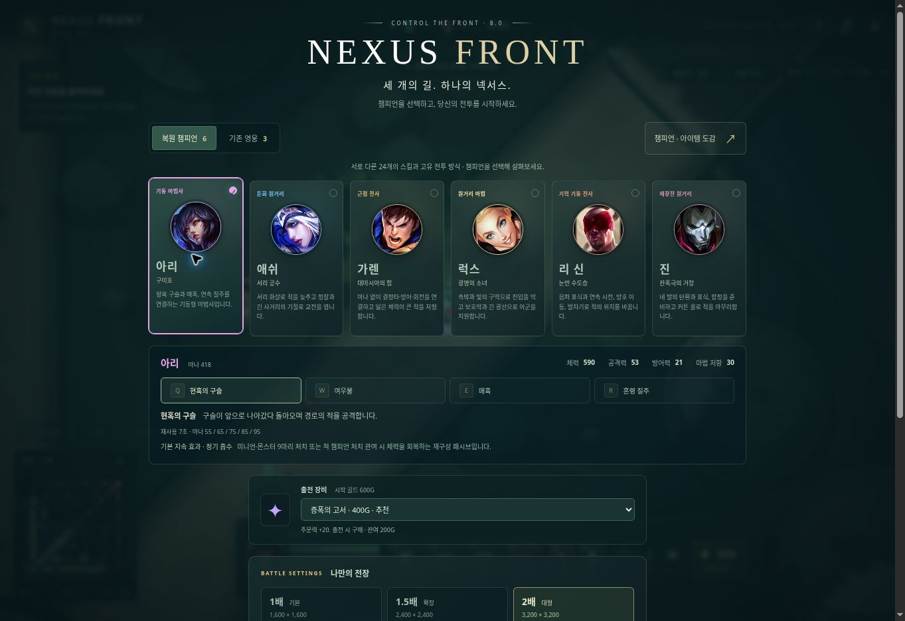

# 넥서스 전선 · Nexus Front

브라우저에서 바로 실행하는 **싱글 플레이 5 대 5 MOBA 코어 게임**입니다. 플레이어 1명과 아군 AI 4명이 적 AI 5명과 싸웁니다. 세 개의 공격로를 밀고, 성장과 장비 구매를 거쳐 적 넥서스를 파괴하면 승리합니다.

League of Legends의 공격로·성장·시야·공성 구조를 참고한 JavaScript 프로토타입에 **공식 공개 데이터 기반 복원 콘텐츠**를 연결했습니다. Data Dragon **16.22.1 / 공개 패치 26.22**의 정적 능력치·스킬 랭크 배열·아이템 가격과 재료를 사용합니다. 피해 계수·충돌·재시전 등 전투 동작은 이 프로젝트의 재구성이며, 원작 내부 코드나 현행 밸런스 전체를 동일하게 재현한 것은 아닙니다. 온라인 멀티플레이 연결은 없습니다. 데이터 근거와 구현 경계는 [복원 챔피언·장비 안내](docs/RESTORED_ROSTER.md)에 있습니다.

**v9**는 복원된 전투 데이터에 **벽·고지대 시야 차단, 마지막 관측 건물 기억, 관측에 따른 정찰·공성 안내, 실제 기본 공격 계산을 공유하는 피해 예상·막타 표시, AI의 마나·장비 구매 귀환**을 연결합니다. 안개 밖 건물의 HP·파괴·재생성·보호 상태는 마지막 확인값으로 유지하고 재탐색할 때 갱신합니다. 시야 밖에서 맞으면 공격 발생 지점에 1.5초 동안 단서를 표시합니다. 적용한 분석 규칙과 프로젝트 고유 튜닝은 [v9 분석→구현 기록](docs/v9-integration.md), 시야·관측·성능 설계는 [v9 시야 계약](docs/v9-vision.md), 공격 예측과 표식 소유권 변경은 [v9 전투 계약](docs/v9-combat.md)에 있습니다.

v8에서 연결한 **아리·애쉬·가렌·럭스·리 신·진 6명, QWER 24개, 구매 장비 25개**의 실행 범위는 유지합니다. 왕복 구슬·매혹·충전 정찰·무자원 회전·왕복 보호막·기력 재시전·네 발 장전·채널 사격을 각 챔피언의 고유 상태로 처리합니다. **173명·692개 QWER·863개 아이템 도감**은 검색·원본 수치 조회를 제공하며, 도감 수록과 플레이 가능 여부를 구분합니다. 기존 독자 영웅 3명도 선택할 수 있습니다.

출전 전 **1배·1.5배·2배 맵**, 준비·경기·일시정지 화면의 **0.5배·0.75배·1배·1.5배 속도** 선택을 유지합니다. 새 진행 저장은 두 영웅 프로필 모두 **v9**이고 **이전 v4~v8 진행 저장도 읽습니다.** 이전 2배 속도는 1.5배로 옮깁니다. 세부 변경 사항은 [CHANGELOG.md](CHANGELOG.md), 확인 결과는 [QA.md](QA.md)에 있습니다.

**[온라인에서 실행하기](https://nexus-front-c9774f.taru00.chatgpt.site)**



아래 화면 자료는 해당 버전에서 촬영한 기록입니다. v7 화면: [맵·속도 출전 준비](docs/v7-lobby.jpg) · [2배 맵·0.5배 속도로 이어하기](docs/v7-resume.jpg)

v6 화면: [공격 범위와 실제 전투](docs/v6-gameplay.jpg) · [390px 전투 HUD](docs/v6-mobile.jpg)

v5 화면: [타깃 고정](docs/v5-focus.jpg) · [390px 전투 HUD](docs/v5-mobile.jpg)

v4 화면: [전장 길잡이](docs/v4-guide.jpg) · [실제 전투](docs/v4-gameplay.jpg) · [모바일 준비](docs/v4-mobile-lobby.jpg) · [모바일 길잡이](docs/v4-mobile-guide.jpg)

전투 기능 화면: [사망 분석](docs/recap.jpg) · [전투 보고서](docs/report.jpg) · [모바일 전투](docs/mobile.jpg) · [모바일 보고서](docs/mobile-report.jpg)

## 바로 실행하기

### 오프라인 단일 HTML

[dist/nexus-front-offline.html](dist/nexus-front-offline.html)을 브라우저로 엽니다. HTML 안에 스타일·JavaScript·복원 데이터·지원 초상화와 아이콘이 포함되어 파일 하나로 실행됩니다. 게임 화면의 다운로드 버튼으로 받는 파일 이름은 `nexus-front.html`입니다.

### 소스 폴더에서 실행

[dist/index.html](dist/index.html)을 브라우저로 직접 엽니다. 이 방식에서는 같은 폴더의 `style.css`, 아래 코드 구조의 **13개 게임 JavaScript 파일**, `assets/` 폴더를 함께 유지해야 합니다.

플레이할 때 Node.js나 패키지 설치는 필요하지 않습니다. 게임은 Canvas 2D와 브라우저 JavaScript로 작동합니다. 공식 CDN에서 고정 버전으로 받은 **챔피언 초상화 6개·아이템 아이콘 25개**를 로컬로 포함하므로 플레이 중 원격 이미지·CDN·게임 API를 요청하지 않습니다. 소리는 브라우저의 Web Audio로 합성하며 소리 버튼으로 끌 수 있습니다.

로컬 HTTP 서버로 확인하려면 프로젝트 루트에서 다음 명령을 실행하고 `http://localhost:8080`을 엽니다. 이 방법은 Python 3가 설치되어 있을 때 사용할 수 있습니다.

```sh
python3 -m http.server 8080 --directory dist
```

## 첫 경기 안내

1. **복원 챔피언 6 / 기존 영웅 3**에서 출전 명단을 선택하고 영웅·**훈련 / 표준** 난이도·**맵 크기·진행 속도**·출전 장비를 고릅니다. 복원 마법사는 증폭의 고서, 원거리·전사는 롱소드를 기본 추천합니다. 선택한 프로필의 600G 이하 기본 장비 또는 장비 없이 시작하기를 고를 수 있습니다. **장비를 갖추고 출전**을 누르면 장비 가격을 600골드에서 차감합니다.
2. 방향키·조이스틱 또는 전장 클릭으로 이동합니다. 적을 클릭하면 추적하여 기본 공격합니다. **Z / 타깃 전환**은 근처에 보이는 적 영웅을 고정합니다. 고정만으로 먼 적을 추격하지는 않습니다.
3. 처음에는 Q를 배운 상태입니다. 레벨이 오르면 성장 바 또는 Shift+QWER로 스킬을 습득·강화합니다. R은 6레벨부터 포인트를 투자합니다. 애쉬 Q는 기본 공격으로 집중 4중첩을 쌓아야 사용할 수 있으며, 재시전·충전·장전 상태는 스킬 버튼과 챔피언 상태 표시에서 확인합니다.
4. 위험할 때 F로 회복하거나 D로 짧게 이동합니다. 안전한 곳에서 B를 누르고 4초 동안 귀환할 수 있습니다.
5. G 또는 **전장 길잡이**에서 이동·스킬·첫 CS(미니언·정글 처치)·성장·장비·구조물 진행을 확인합니다. 아군 기지에서 P를 눌러 장비를 구입·조합·판매하며, 추천 카드는 현재 보유 장비를 반영한 다음 구매와 실제 조합 차액을 보여줍니다. 사망 후 부활을 기다리는 중에도 거래할 수 있습니다.
6. T로 집결·중앙 압박·기지 방어 또는 드래곤·심연 거인의 정찰·공략을 지시합니다. 현재 보이는 생존 목표는 공략하고, 미확인·시야 밖 목표는 알려진 둥지로 이동해 확인합니다. 관측한 재생성 대기 시간이 남으면 지시할 수 없습니다. 지시는 25초 동안 유지됩니다. 직접 합류하고 주황색 공격 예고 원을 벗어나세요. AI는 체력과 합류 인원을 확인하고 위험 영역에서 회피합니다.
7. 같은 공격로의 외곽 포탑 → 안쪽 포탑 → 억제기를 파괴합니다. 억제기 하나를 파괴한 뒤 기지 포탑 두 개를 없애면 넥서스를 공격할 수 있습니다.
8. 사망 후 C로 최근 10초의 피해를 확인합니다. 경기 종료 화면의 **전투 보고서**에서는 양 팀 10명의 성장·전투 결과를 비교할 수 있습니다.

플레이어는 **1레벨, 600골드에서 선택한 출전 장비 가격을 차감한 잔액**으로 중앙 공격로의 아군 진영에서 시작합니다. 장비 없이 출전하면 600골드를 그대로 보유합니다. 출전 준비에서만 시작 장비를 미리 구매할 수 있으며, 경기 중 상점 거래는 기존처럼 기지 또는 부활 대기 중에 가능합니다. 상대 넥서스 파괴는 승리, 아군 넥서스 파괴는 패배입니다. 처치 수 자체는 승리 조건이 아닙니다. 경기를 끝내려면 일시정지 창에서 **경기 종료**를 펼치고 **항복하고 결과 보기**를 선택할 수 있습니다. 항복은 패배로 기록되며 결과와 보고서를 제공합니다.

## 맵 크기와 진행 속도

맵 크기는 **가로와 세로 길이의 배율**입니다. 준비 화면에서만 선택하며, 출전한 경기의 크기는 바꾸지 않습니다.

| 맵 선택 | 월드 가로 × 세로 | 기본 맵 대비 면적 |
|---|---:|---:|
| 1배 기본 | 1,600 × 1,600 | 1배 |
| 1.5배 확장 | 2,400 × 2,400 | 2.25배 |
| 2배 대형 | 3,200 × 3,200 | 4배 |

기지·공격로·포탑·캠프·수풀·정글 벽·고지대 4곳의 배치를 같은 비율로 확장합니다. 수풀·벽·고지대의 반경도 확대하지만 영웅·미니언·구조물의 몸체 크기, 이동 속도, 공격·스킬·시야 사거리, 체력과 피해 수치는 공통입니다. 큰 맵에서는 같은 게임 시간 동안 이동할 수 있는 거리는 같고, 다른 공격로와 목표물까지 이동·합류하는 데 더 오래 걸립니다. 경기 전체의 종료 시간이 맵 배율과 정확히 비례한다는 뜻은 아닙니다.

진행 속도는 **0.5배 / 0.75배 / 1배 / 1.5배** 중 고릅니다. 준비 화면, 경기 HUD의 속도 선택, 일시정지 창이 같은 값을 사용합니다. 이동·전투·재사용 대기·미니언 웨이브·귀환·부활·경기 시계가 함께 조절됩니다. 일시정지 중에 바꿔도 경기는 자동으로 재개되지 않습니다. 표시되는 시간은 게임 시간이며 프레임 처리 한계로 현실 시간과의 비율이 항상 정확히 일치하지는 않습니다.

맵과 속도 선택은 같은 브라우저의 다음 경기 준비에도 유지합니다. 이어하기는 저장된 경기의 맵과 속도를 복원합니다. 예전 설정·진행 저장의 2배 속도는 현재 최대인 1.5배로 변환합니다.

## 조작

| 입력 | 동작 |
|---|---|
| 방향키 ↑ ↓ ← → | 직접 이동. 대각선 이동 속도는 정규화됩니다. |
| 전장 좌클릭 또는 우클릭 | 빈 지점이면 이동, 보이는 적이면 추적 및 기본 공격. 시야 밖의 기억된 건물을 좌클릭하면 마지막 관측 정보를 확인하며 공격·이동을 명령하지 않습니다. |
| A → 전장 좌클릭 / 미니맵 클릭 | 공격 이동. 목적지로 가며 주변의 보이는 적군을 만나면 공격합니다. |
| S | 현재 이동·공격 대상·공격 이동·타깃 고정·귀환을 취소합니다. 자동 공격 설정은 유지합니다. |
| V / 공격 범위 | 기본 공격 사거리 원을 표시하거나 숨깁니다. 표시 설정은 같은 브라우저에 보관합니다. A 목적지 선택 중에도 범위를 임시 표시합니다. |
| Z / 타깃 전환 | 900 거리 안에 보이는 적 영웅을 가까운 순서로 순환 고정합니다. 대상 패널의 ×로 해제합니다. |
| Q / W / E / R | 해당 스킬을 즉시 시전. 마우스가 전장 위에 있으면 커서 위치를 사용합니다. |
| Shift + Q / W / E / R | 포인트와 레벨 조건을 만족하면 해당 스킬을 습득·강화합니다. 성장 바의 버튼이나 추천 배분도 사용할 수 있습니다. |
| 스킬 버튼 클릭 | 데스크톱의 방향·지점 스킬은 조준 모드에 들어가며, 전장을 좌클릭해 시전합니다. 자기 자신 대상 스킬과 회복은 즉시 사용합니다. |
| D | 점멸. 조준 방향으로 최대 300 거리 이동. |
| F | 회복. 자신과 가까운 아군 영웅을 회복하고 자신에게 잠깐 이동 속도 증가. |
| 4 | 시야 와드 설치. 소유자당 최대 2개. |
| B | 4초 귀환. 이동, 성공한 스킬 사용, 피해 등으로 취소됩니다. |
| P | 상점 열기·닫기. 기지 또는 부활 대기 중에 구매·조합·판매할 수 있습니다. |
| T | 전술 패널 열기·닫기. 집결은 전장·미니맵에서 위치 선택. 중앙 압박·기지 방어·목표물 정찰·공략은 바로 지시합니다. 관측한 목표물의 재생성 대기 시간이 남으면 해당 지시는 잠깁니다. |
| C | 최근 사망 분석 열기·닫기. 부활 후에도 마지막 사망 기록을 확인할 수 있습니다. |
| G | 전장 길잡이 열기·닫기. 여섯 진행 항목과 현재 상황에 맞는 다음 행동을 확인합니다. 길잡이를 보는 동안 경기를 일시정지합니다. |
| Space | 자동 공격 대상 탐색 켜기·끄기. 이미 클릭한 공격 대상에 대한 명령은 별개입니다. |
| Tab 누르기 / 떼기 | 경기 중 점수판 보기 / 닫기. 창 안에서는 키보드 초점 이동에 사용됩니다. |
| Esc | 스킬·명령 조준 취소 → 전술 패널 닫기 → 열린 창 닫기 → 일시정지 순으로 처리합니다. |
| 미니맵 클릭 | 일반 상태에서는 이동. 공격 이동 또는 집결 위치 선택 중이면 해당 명령을 확정합니다. |
| 추적 버튼 | 카메라를 플레이어 추적 상태로 돌립니다. |
| 속도 선택 | 0.5배·0.75배·1배·1.5배 중 전체 시뮬레이션의 진행 속도를 선택합니다. |

W는 스킬 키입니다. 키보드 이동에는 방향키를 사용합니다. 마우스가 전장 밖에 있을 때 키로 스킬을 쓰면 엔진의 자동 조준이 적용됩니다. 해당 스킬 사거리 안의 고정 영웅을 우선하며, 직접 지정한 커서·드래그 조준은 고정 대상보다 우선합니다. 적이 없으면 영웅이 바라보는 방향을 사용합니다.

터치 입력 환경 또는 화면 폭이 700px 이하인 환경에서는 조이스틱과 터치형 HUD를 제공합니다. 전장을 눌러 이동하거나 적을 선택할 수도 있습니다.

- **짧게 탭:** 자동 조준으로 시전합니다. 자기 자신 대상 스킬과 회복도 탭으로 사용합니다.
- **스킬 버튼을 끌어서 놓기:** 12px 이상 움직이면 직접 조준으로 전환합니다. 직선 탄환은 방향을, 지점·돌진 스킬은 방향과 거리를 지정합니다. 72px에서 최대 사거리에 도달하며 점멸·와드도 직접 조준할 수 있습니다.
- **× 취소 영역에 놓기:** 마나·쿨다운을 소비하지 않고 취소합니다. Esc, 모달 열기, 초점 이탈, 화면 크기 변경, 사망, 포인터 취소도 조준을 끝냅니다.
- **이동하며 조준:** 이동 조이스틱과 스킬 버튼은 각자의 포인터를 사용합니다. 놓는 순간의 영웅 위치를 기준으로 발사합니다. 조준을 시작하는 것만으로 진행 중 이동을 중단하지 않습니다.

타깃 고정은 시야를 추가하지 않습니다. 대상 사망·시야 상실·900 거리 초과·플레이어 사망, S 정지·귀환·영웅이 아닌 대상 공격 시 고정이 풀립니다. 기본 공격은 실제 공격 사거리 안에 들어온 대상에게만 가능합니다.

일시정지·도움말·전장 길잡이·도감은 시간을 멈춥니다. **상점·점수판·사망 분석·전술 패널은 경기를 멈추지 않습니다.** 상점·점수판·사망 분석 창이 열리면 새 이동·스킬 입력은 막히지만 기존 명령, AI, 부활 대기와 재사용 대기시간은 계속 진행할 수 있습니다. 전술 패널은 명령을 고르는 동안에도 전투가 이어집니다. 브라우저 탭이 보이지 않는 동안에는 시뮬레이션을 누적 진행하지 않으며, 일반적인 경기 화면에서 탭을 벗어나면 일시정지 창을 엽니다.

## 기본 공격과 이동 타이밍

영웅은 `공격 가능 → 발사 준비 → 재공격 대기` 순서로 기본 공격을 합니다. 준비 시간은 공격 속도에 따라 **0.10~0.32초**이며, 전체 공격 주기는 준비를 시작한 시점부터 계산합니다. 체력·마나 아래의 게이지와 플레이어 주변 원호가 현재 단계를 표시합니다.

| 상황 | 실제 동작 |
|---|---|
| 방향키·조이스틱·일반 클릭 이동 | 준비 중 공격을 취소합니다. 이동 중에는 자동 기본 공격을 새로 시작하지 않습니다. |
| 적 클릭·A 공격 이동 | 사거리까지 접근하고 멈춰 준비한 뒤 발사합니다. 같은 적을 다시 클릭해도 준비가 처음부터 시작되지 않습니다. |
| 준비 중 QWER·D 성공 | 준비를 취소하고 스킬을 사용합니다. 실패한 스킬 입력은 준비를 유지합니다. |
| F 회복·와드 | 준비를 끊지 않습니다. |
| 발사 후 이동·S | 이미 발사된 공격과 재공격 대기 시간을 유지합니다. 이동으로 공격 주기를 초기화할 수 없습니다. |
| 사망·기절·귀환·대상 소실 | 남은 준비를 취소합니다. 발사 전에 취소한 키라의 강화 기본 공격은 소모하지 않습니다. |
| 일시정지·이어하기 | 준비와 대기 시간을 정지·복원합니다. 재개 후 남은 준비를 마치고 한 번 발사합니다. |

키라로 **정지하여 발사 → 방향키로 거리 확보 → 키를 놓고 재공격**을 반복해 볼 수 있습니다. S는 현재 명령과 준비를 취소하지만 자동 공격 설정을 끄지 않습니다. 사거리 안에서 계속 공격을 멈추려면 **Space / 자동 공격**을 끄세요. V로 표시하는 원은 영웅의 기본 사거리와 작은 판정 여유를 보여 주며, 실제 판정에는 상대의 반경도 더합니다. 벽 너머 시야나 추가 사거리를 제공하지 않습니다.

대상 패널의 **기본 공격 예상 HP 피해**는 방어·보호막과 복원 챔피언의 강화 공격·표식을 반영한 현재 수치입니다. 일반 치명타는 최소~최대 범위로, 진의 네 번째 탄환처럼 확정된 효과는 확정 피해로 계산합니다. 금색 미니언 막타 표식은 **최소 피해로도 처치할 수 있을 때** 켜집니다. 조회는 난수나 탄환·표식을 소모하지 않으며, 공격 대기 완료나 투사체 도착 전까지의 미래 체력을 보장하지는 않습니다.

## 전장의 안개와 관측 정보

고지대 4곳은 전장과 미니맵에 표시합니다. 일반 시야는 거리·벽 차폐·높이·수풀 조건을 함께 검사하며 낮은 지형에서는 고지대 안이나 그 너머를 볼 수 없습니다. 높은 곳에서도 바위벽은 시야를 가립니다. 애쉬 E의 공중 정찰은 유효한 범위 안에서 벽·고지대와 수풀 은신을 확인하는 예외입니다. 이 높이 규칙은 사용자 요청에 맞춘 프로젝트 규칙입니다.

한 번 확인한 적 건물은 시야를 잃어도 마지막 HP와 생존·보호 상태를 흐린 실루엣으로 남깁니다. 기억된 건물을 좌클릭하면 대상 패널에서 관측 시각과 HP를 확인합니다. 시야 밖의 피해·파괴·재생성은 표시·미니맵·길잡이에 즉시 반영하지 않고 다시 관측할 때 갱신합니다. 미탐색 적 건물은 기억 정보가 없습니다.

시야 밖 공격에 맞으면 **공격 당시 위치**를 1.5초 동안 원과 표식으로 보여 줍니다. 이 단서는 이동한 공격자를 따라가지 않으며 자동 조준·타깃 고정·영구 탐색 시야를 주지 않습니다. 목표물 패널도 마지막 관측과 현재 확인을 구분하고, 경기 중 점수판은 시야 밖 적의 현재 HP·레벨을 숨깁니다. 종료 보고서에서는 최종 결과를 확인할 수 있습니다. 자세한 판정은 [게임 규칙 13절](GAMEPLAY.md#13-시야-수풀과-공개-정보)에 있습니다.

## 경기 저장과 이어하기

진행 중 경기 **1개**를 현재 브라우저의 로컬 저장소에 보관합니다. 경기 시간 8초마다, 일시정지 메뉴를 열 때, 장비 구매·스킬 배분·진행 속도 변경 뒤, 탭을 숨기거나 페이지를 벗어날 때 저장을 시도합니다. 브라우저를 강제 종료하는 순간에는 마지막 이벤트가 전달되지 않을 수 있으므로 마지막으로 성공한 저장 시점에서 이어집니다.

- 일시정지 메뉴의 **지금 저장**은 현재 경기를 저장합니다. **저장하고 나가기**는 저장 성공 후 준비 화면으로 돌아갑니다. 쓰기에 실패하면 경기 화면을 유지하며 이유를 표시합니다.
- 준비 화면의 **이어서 전투** 카드에서 저장한 영웅, 맵 크기·진행 속도, 경기 시간, 레벨, KDA, 저장 시각을 확인하고 복원합니다. 복원은 일시정지 상태이며 **계속하기 ▷**를 눌러 재개합니다. 눌린 키·조이스틱 입력은 초기화하지만 클릭 이동·공격 목적지는 유지합니다.
- 체력·마나·장비·성장·쿨다운뿐 아니라 양 팀 AI, 미니언 웨이브, 투사체, 이미 예약된 스킬·목표물 공격, 시야·와드, 귀환·부활 대기, 전술 지시와 난수 상태를 보관합니다. 맵 크기·속도 설정과 길잡이 진행도, 팀별 탐색 영역·건물·목표물 관측 기록·남은 공격 위치 단서도 함께 복원합니다.
- 저장이 있을 때 **새 경기 시작**은 기존 진행 중 경기 슬롯을 새 경기로 대체합니다. 준비 화면에서 이를 안내합니다. 넥서스 파괴·항복으로 경기가 끝나면 진행 중 슬롯을 지우고 완료 경기 기록을 별도로 남깁니다.
- v4·v5·v6·v7·v8·v9 엔진 저장을 읽고 새 저장은 두 프로필 모두 v9로 기록합니다. 복원 챔피언의 데이터 버전·프로필·재시전·충전·표식·장전·지속 효과를 보존합니다. v4·v5·v6의 맵은 기존 1배로 복원합니다. v4·v5에서 이미 발사된 공격·남은 대기 시간은 유지하고 없던 발사 준비를 새로 만들지 않으며, v4의 고정 대상은 비워 둡니다. v6 이후의 준비 중 공격은 대상·남은 시간까지 보관합니다. 구버전에 없던 과거 탐색 기록은 만들어내지 않고 로드 당시 현재 시야에서 시작합니다. 누르던 조준 동작은 복원하지 않습니다.
- 저장 직전에 내보낸 상태를 실제 엔진으로 복원 검증합니다. 숫자·참조·공격 타이머 관계가 잘못되면 이전 슬롯을 보존합니다. 손상되었거나 지원하지 않는 형식은 이어하기 대상으로 제공하지 않습니다. 저장소 접근 제한·용량 부족은 성공으로 표시하지 않으며, 실패한 쓰기 전에 이전 정상 저장을 지우지 않습니다.

이 저장은 같은 브라우저·같은 사이트 주소의 로컬 데이터입니다. 온라인 사이트와 다운로드한 HTML, 다른 기기·브라우저의 저장소는 서로 동기화되지 않습니다. 오프라인 파일의 저장 허용 여부와 파일별 저장소 구분은 브라우저에 따라 다르며, 저장소 사용이 불가능해도 현재 경기는 계속 플레이할 수 있습니다.

## 구현된 시스템

| 시스템 | 포함된 기능 |
|---|---|
| 경기 설정 | 출전 전 1배·1.5배·2배 맵 선택, 준비·전투·일시정지의 0.5배·0.75배·1배·1.5배 속도 선택, 설정 보관과 저장 경기 복원. |
| 영웅과 전투 | 복원 챔피언 6명·24개 QWER와 기존 독자 영웅 3종. 마나·기력·무자원, 재시전·충전·장전·채널, 매혹·속박·침묵, 재사용 대기시간, 투사체, 광역 공격, 보호막, 둔화, 기절, 준비·발사·재공격 대기와 취소가 있는 기본 공격, 공격 이동·정지, 공격 상태 HUD·범위 표시, 드래그 조준·취소, 시야와 거리에 제한된 영웅 타깃 고정. |
| 팀과 AI | 총 10명. 공격로 역할, 관측에 따른 정글 정찰·공략, 후퇴·회복·귀환, 마나와 실제 구매 가능 장비를 고려한 안전 귀환, 구조물 공격 판단, 25초 전술 지시, 목표물 합류와 예고 회피, 포탑 안전 거리·동행·조준에 따른 접근과 이탈, 시야를 잃은 적 추적 해제. |
| 성장과 장비 | 출전 장비 선택·실제 골드 차감, 최대 18레벨, 스킬 포인트·랭크·추천 배분, 미니언 마지막 타격 보상과 금색 가능 표식, 복원 아이템 25종의 조합·공식 판매가·가속·치명타·흡혈·마법 저항력·주문력 증폭, 6칸 인벤토리와 역할별 추천. 기존 영웅은 기존 8종·조합 2종·70% 내림 판매 규칙 유지. |
| 지형과 이동 | 선택한 크기의 공격로·기지·수풀·캠프·원형 정글 바위벽 12개·통행 가능한 고지대 4곳, 살아 있는 구조물을 함께 고려한 A* 우회·충돌·슬라이드, 경로 점선 표시. |
| 공격로와 공성 | 3개 공격로, 18초 웨이브, 근접·원거리·공성·슈퍼 미니언, 구조물 순서 잠금, 포탑 연속 영웅 공격 최대 +66%와 위험 표시. |
| 정글과 목표물 | 일반 캠프 4개, 폭풍 드래곤, 심연 거인, 고정 지점 광역 공격 예고, 팀 보상과 공성 강화. |
| 시야 | 거리·벽·고지대·수풀 조건, 와드와 애쉬 공중 정찰, 팀별 탐색 흔적, 마지막 관측 건물 HP·생존·보호 상태, 재탐색 갱신, 고정된 공격 발생 위치 단서. |
| 귀환과 사망 | 4초 귀환, 기지 회복, 사망·부활 대기, 장비와 성장 보존, 최근 10초 사망 분석과 피해 유형·보호막 흡수 구분. |
| 화면과 기록 | 검색 가능한 173명·863개 도감, 로컬 공식 이미지 31개, Canvas 전장·미니맵, 목표물·집결 알림, 점수판, 상점, 여섯 항목 전장 길잡이와 상황 조언, 항복·결과 화면, 10인 전투 보고서, 맵 크기를 포함한 최근 완료 경기 5개와 상세 조회. |
| 경기 이어하기 | 진행 중 경기 1개, 자동·수동 저장, 전체 전투 상태 복원, 복원 후 일시정지, 손상·형식·저장소 오류 처리. |

### 복원 챔피언 6명

| 챔피언 | 핵심 동작 |
|---|---|
| 아리 | 왕복 구슬, 여우불·이동 가속, 매혹, 세 번의 질주, 처치·관여 회복 |
| 애쉬 | 서리 기본 공격, 집중 4중첩, 부채꼴 화살, 충전 정찰, 장거리 기절 |
| 가렌 | 무자원, 강화 침묵, 보호막·피해 감소, 회전, 잃은 체력 궁극기 |
| 럭스 | 두 대상 속박, 왕복 보호막, 구역 재폭발, 광채와 지연 광선 |
| 리 신 | 기력·질풍격, Q/W/E 재시전, 아군·와드 이동, 넉백 충돌 |
| 진 | 네 발·재장전, 튕김, 표식 속박, 충전 함정, 네 발 채널 사격 |

원본 수치·아이템 25개·실제 지원 동작·원작 정밀 재현의 제한은 [RESTORED_ROSTER.md](docs/RESTORED_ROSTER.md)에 있습니다. 도감의 나머지 챔피언·아이템은 조회용이며 선택·구매할 수 없습니다.

### 기존 독자 영웅 3명

| 영웅 | 역할 | 핵심 행동 |
|---|---|---|
| 리아 · 별빛 마도사 | 원거리 마법 | 직선 탄환과 지점 광역 공격으로 진입 경로를 압박하고, 장막으로 버팁니다. |
| 브란 · 강철 선봉 | 근접 전사 | 돌진·보호막으로 접근한 뒤 회전 공격과 기절로 근접전을 이어갑니다. |
| 키라 · 바람 추적자 | 원거리 공격 | 연사와 관통 화살로 공격하고 구르기로 거리를 조절합니다. |

기존 영웅의 스킬 피해식과 공통 목표물 시각·구조물 잠금·시야 판정 등 상세 규칙은 [GAMEPLAY.md](GAMEPLAY.md)에 있습니다.

## 코드 구조

| 파일 | 책임 |
|---|---|
| [dist/navigation.js](dist/navigation.js) | 고정 벽 배치, 통행 판정, 안전 좌표 보정, A* 경로와 직접 이동 충돌·슬라이드. |
| [dist/restored-data.js](dist/restored-data.js) | 공식 정적 도감 173명·863개와 실행 챔피언 6명·아이템 25개, 원본 랭크 배열·출처·증거 구분. |
| [dist/restored-gameplay.js](dist/restored-gameplay.js) | 복원 챔피언의 고유 기본 공격·패시브·24개 스킬·충전·재시전·지속 효과·저장 상태 검증. |
| [dist/vision.js](dist/vision.js) | 팀 시야·지형 차폐, 탐색 마스크, 건물·목표물 관측 기억, 공격 위치 단서와 저장 검증. |
| [dist/tactical-ai.js](dist/tactical-ai.js) | 프로필별 구매 계획, 실제 조합 견적과 보이는 위협·마나·경기 단계에 따른 순수 귀환 판단. |
| [dist/game.js](dist/game.js) | DOM에 의존하지 않는 게임 상태와 시뮬레이션. `Game`, 기본 `MAP`, `MAP_SCALES`, `normalizeMapScale`, `createMap`, `HEROES`, `ITEMS`와 경기별 `game.map`을 제공합니다. |
| [dist/renderer.js](dist/renderer.js) | 선택한 월드의 Canvas 전장·유닛·효과·안개·미니맵·카메라·좌표 변환. 지형 캐시의 긴 변은 최대 2,048픽셀입니다. |
| [dist/history.js](dist/history.js) | DOM에 의존하지 않는 UMD 기록 모듈. 맵 크기·복원 프로필 보관, v2·v3·v4 기록 정규화, 최근 5개 제한, 중복 방지, 저장 오류 처리. |
| [dist/checkpoint.js](dist/checkpoint.js) | 진행 중 경기 슬롯 읽기·쓰기·복원·삭제. 2 MiB 상한, v4~v9 엔진 검증, 저장소 실패 처리, 선택한 맵 경계 내 길잡이 좌표와 배속 정규화. |
| [dist/coach.js](dist/coach.js) | 출전·성장 장비 추천, 여섯 진행 목표, 현재 맵의 기지 위치와 관측 가능한 상황에 따른 행동 조언. |
| [dist/controls.js](dist/controls.js) | DOM과 엔진에 의존하지 않는 포인터 조준 상태. 임계값·사거리·지도 경계·취소·최종 놓기 좌표를 계산합니다. |
| [dist/catalog.js](dist/catalog.js) | 이름·ID 검색, 지원 범위 필터, 24개 단위 페이지, 원본 수치·출처와 선택 가능 여부 표시. |
| [dist/app.js](dist/app.js) | 입력, 출전 준비·성장·전술·상점·길잡이 HUD, 사망 분석·전투 보고서·최근 경기 화면, 저장·복원 흐름, Web Audio, 고정 간격 게임 루프. |
| [dist/index.html](dist/index.html), [dist/style.css](dist/style.css) | 화면 구조, 접근 가능한 버튼·창, 반응형 배치. |
| [scripts/build-offline.cjs](scripts/build-offline.cjs) | CSS와 `navigation → restored-data → restored-gameplay → vision → tactical-ai → game → renderer → history → checkpoint → coach → controls → catalog → app` 순서의 게임 스크립트 13개와 PNG 31개를 포함. 다운로드 보조까지 인라인 스크립트 총 14개. |
| [tests/engine.test.cjs](tests/engine.test.cjs), [tests/core-v2.test.cjs](tests/core-v2.test.cjs), [tests/navigation.test.cjs](tests/navigation.test.cjs), [tests/core-v3.test.cjs](tests/core-v3.test.cjs), [tests/history.test.cjs](tests/history.test.cjs) | 경기·성장·거래·길찾기, 예고·협동·포탑·사망 분석·막타·항복, 기록 호환·중복·저장 실패 회귀 테스트. |
| [tests/checkpoint-engine.test.cjs](tests/checkpoint-engine.test.cjs), [tests/checkpoint-store.test.cjs](tests/checkpoint-store.test.cjs), [tests/coach.test.cjs](tests/coach.test.cjs) | 전투 상태 저장·복원과 연속성, 출전 구매, 저장소 실패·형식·크기 한계, 길잡이·장비 추천 회귀 검사. |
| [tests/combat-v5.test.cjs](tests/combat-v5.test.cjs), [tests/controls.test.cjs](tests/controls.test.cjs), [tests/checkpoint-v5.test.cjs](tests/checkpoint-v5.test.cjs) | 타깃·시야·공격 우선순위·포탑 판단, 드래그·취소·포인터 소유권, 이전 커밋에서 만든 실제 v4 저장의 호환과 재개. |
| [tests/combat-v6.test.cjs](tests/combat-v6.test.cjs), [tests/checkpoint-v6.test.cjs](tests/checkpoint-v6.test.cjs), [tests/renderer-v6.test.cjs](tests/renderer-v6.test.cjs) | 준비·발사·취소·재공격 주기·AI 회피, 실제 v5 저장 이행·준비 중 저장과 단일 발사·손상 쓰기 보호, 렌더링의 상태 불변·시야 경계. |
| [tests/app-controls.test.cjs](tests/app-controls.test.cjs) | 실제 앱 이벤트를 엔진과 연결해 합성 클릭·취소·PC 전환·두 포인터·사망·저장 입력 해제·V 범위·공격 단계 HUD·일시정지 후 단일 발사를 확인합니다. DOM과 그리기는 대역을 사용합니다. |
| [tests/v7-map.test.cjs](tests/v7-map.test.cjs), [tests/v7-app-settings.test.cjs](tests/v7-app-settings.test.cjs), [tests/v7-persistence.test.cjs](tests/v7-persistence.test.cjs), [tests/v7-renderer.test.cjs](tests/v7-renderer.test.cjs) | 맵별 지형·이동·좌표·복원, 설정 UI와 배속, 구버전·큰 맵 저장·기록·길잡이, 맵 교체와 렌더링 자원 한도를 검사합니다. 최종 실행 결과는 QA 문서를 참고합니다. |
| [tests/restored-data.test.cjs](tests/restored-data.test.cjs), [tests/restored-combat.test.cjs](tests/restored-combat.test.cjs), [tests/restored-persistence.test.cjs](tests/restored-persistence.test.cjs) | 원본 수치·단위·조합·이미지 해시, 24개 스킬의 상태와 적중, 지원 장비 효과·AI·프로필 저장·구버전 호환 검사. |
| [tests/v9-vision.test.cjs](tests/v9-vision.test.cjs), [tests/v9-renderer.test.cjs](tests/v9-renderer.test.cjs), [tests/v9-app-observation.test.cjs](tests/v9-app-observation.test.cjs), [tests/v9-combat.test.cjs](tests/v9-combat.test.cjs), [tests/v9-coach-tactics.test.cjs](tests/v9-coach-tactics.test.cjs) | 지형 시야·관측 기억·렌더링·숨은 상태 비노출, 실제 기본 공격과 예측의 일치·복수 리 신 표식, 귀환·거래·관측 안내·이전 저장 호환. 최종 검사 범위는 QA 문서 참조. |
| [scripts/import-restored-data.py](scripts/import-restored-data.py) | 동봉 입력에서 복원 데이터 모듈 재생성. 절차는 [데이터 계약](docs/restored-data-contract.md) 참조. |
| [IMPLEMENTATION.md](IMPLEMENTATION.md) | 현재 모듈 경계와 공개 API, 전투·저장 상태 계약. |

외부 라이브러리나 실행 중 원격 에셋 다운로드 없이 실행됩니다. 전장·챔피언 실루엣·지속 효과는 Canvas로 그립니다. 기존 영웅 카드는 인라인 SVG, 복원 챔피언과 지원 아이템은 동봉한 공식 PNG를 사용합니다. 엔진의 상태 변경과 렌더링을 분리하여 엔진 테스트를 브라우저 없이 실행할 수 있습니다.

## 개발과 검증

자동 테스트와 실제 브라우저 확인 결과는 [QA.md](QA.md)에 기록되어 있습니다.

개발 명령에는 Node.js 18 이상을 사용합니다. 외부 npm 의존성이 없어 별도 패키지 설치 단계가 없습니다.

```sh
npm test
```

위 명령은 다음 명령과 같습니다.

```sh
node --test tests/*.test.cjs
```

오프라인 HTML을 다시 만들려면 다음 명령을 실행합니다.

```sh
npm run build:offline
```

직접 실행 명령은 `node scripts/build-offline.cjs`입니다. 출력은 `dist/nexus-front-offline.html`이며, 소스 HTML·CSS·JavaScript를 수정한 뒤 다시 빌드해야 단일 HTML에 변경 사항이 반영됩니다.

테스트는 기본 경기 규칙에 더해 스킬 투자 조건, 조합·판매, 공격 이동·정지, 팀 전술 지시, 벽 우회·충돌·슬라이드, 기록의 호환·중복·저장 실패 처리를 검사합니다. 구조물 사이에서 멈추던 문제를 수정하고 기존 세 영웅 모두 실제 사망·부활 후 기지를 벗어나 드래곤 지점에 도달하는 회귀도 확인했습니다. 상세 조건과 버전별 자동·브라우저 확인 결과는 [QA.md](QA.md)를 기준으로 확인합니다. 자동 테스트는 모든 브라우저·기기 성능이나 게임 밸런스의 완성도를 보증하는 것은 아닙니다.

브라우저 콘솔의 `NexusFront.snapshot()`은 맵 배율·월드 크기를 포함한 현재 경기의 복사된 진단 상태를 반환합니다. `NexusFront.settings()`는 `{mapScale,speed}`, `NexusFront.coverage()`는 도감·플레이 가능 콘텐츠 개수를 반환합니다. 이 정보는 개발용이며 화면의 팀 시야 제한으로 필터링한 관전 API가 아닙니다.

## 현재 구현 범위

- 한 브라우저에서 진행되는 싱글 플레이입니다. 서버, 네트워크 동기화, 실제 플레이어 대전, 계정, 랭크 매칭은 포함하지 않습니다.
- 전장은 정적 원형 벽 12개와 격자 A* 경로 탐색, 별도 높이 등급을 가진 고지대 4곳을 사용합니다. 살아 있는 구조물의 원형 충돌도 이동 경로·슬라이드에 함께 반영하고 파괴되면 갱신합니다. 벽과 고지대는 시야를 가리며 고지대 자체는 통행할 수 있습니다. 원작 지형 전체를 옮긴 3D 맵이나 언리얼 실행 프로젝트는 아닙니다.
- 시야 밖 적 건물은 마지막 관측 HP·생존·보호 상태로 남고, 다시 관측할 때 갱신합니다. 공격 위치 단서는 짧은 공간 표식이며 현재의 적 개체를 공개하지 않습니다. 이동·피해의 실제 판정과 화면·길잡이에 제공하는 관측 정보를 구분합니다.
- 복원 프로필은 25개 지원 장비의 수치·조합·효과를 연결했습니다. 기존 영웅 프로필의 조합은 선봉의 칼날·황혼의 관 두 가지입니다. 아리 R 처치 추가 충전, 진의 원작 AD 전환, 가렌 W 영구 방어 중첩 등 미지원 세부 규칙은 [복원 안내](docs/RESTORED_ROSTER.md)에 명시했습니다. 원작 전체 챔피언·아이템·룬·정글 규칙을 포함하지 않습니다.
- 영웅 선택·난이도·맵 크기·속도·소리·출전 장비·공격 범위 표시 설정, 최근 완료 경기 5개, 진행 중 경기 1개를 `localStorage`에 저장합니다. 완료 기록은 복원 v4와 기존 v3 상세·v2 요약 형식을 이어 읽고, 맵 크기 정보가 없는 이전 기록은 1배로 표시합니다. v2 기록에서 당시 저장하지 않은 상세 정보를 새로 만들어 표시하지 않습니다.
- 넥서스 파괴와 항복은 완료 기록을 만듭니다. 저장하고 나가기·새로고침은 완료 기록을 만들지 않으며 준비 화면의 이어하기로 마지막 저장을 복원합니다. 기기 간 동기화나 서버 저장은 없습니다.
- 브라우저가 오디오나 로컬 저장소 사용을 제한해도 게임 본체는 계속 실행하도록 처리했습니다. 결과 저장이 실패하면 해당 세션에서 보고서와 기록을 제공하고 저장 불가를 안내합니다. 이 경우 재로드 뒤 보존을 약속하지 않습니다.

복원 수치와 자산의 공식 출처는 [데이터 계약](docs/restored-data-contract.md), 실행 범위는 [복원 챔피언·장비 안내](docs/RESTORED_ROSTER.md)를 참고합니다. 분석 자료에서 이번 구현으로 연결한 핵심 규칙은 [v9 분석→구현 기록](docs/v9-integration.md)에 요약해 소스 패키지 안에서 읽을 수 있습니다. 이 문서의 기능 설명은 [restored-data.js](dist/restored-data.js), [restored-gameplay.js](dist/restored-gameplay.js), [vision.js](dist/vision.js), [tactical-ai.js](dist/tactical-ai.js), [catalog.js](dist/catalog.js), [navigation.js](dist/navigation.js), [game.js](dist/game.js), [app.js](dist/app.js), [renderer.js](dist/renderer.js), [history.js](dist/history.js), [checkpoint.js](dist/checkpoint.js), [coach.js](dist/coach.js), [controls.js](dist/controls.js), [빌드 스크립트](scripts/build-offline.cjs), 저장소 테스트의 구현을 근거로 작성했습니다.
