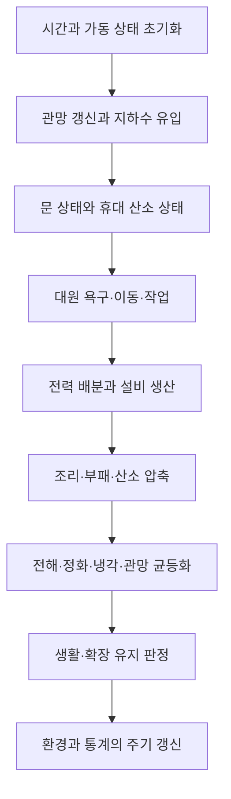

# 숨 4.0 현 구현 감사와 원작 데이터 적용 준비

## 1. 감사 범위와 결론

이 문서는 **현재 웹 게임 코드에서 직접 확인한 사실**과 **다음 구현을 위한 제안**을 구분한다. 원작 Oxygen Not Included의 수치를 추정하거나 현행 웹 수치를 원작 값으로 간주하지 않는다. 원작 대비 최종 차이표는 별도의 출처가 붙은 원작 데이터와 이 감사 데이터를 `entity_id` 수준에서 매핑해 작성해야 한다.

감사 기준은 `breath-colony` 4.0.0, 소스 커밋 `bb78805aef453cae4a79bed91daf88dfdf3535b3`이다. 2026-11-18에 작업 트리가 깨끗한 상태임을 확인했다. 게임 소스를 수정하지 않았다. 파일별 SHA-256 및 줄 수는 [source_manifest.json](../current-v4/source_manifest.json)에 있고, 실제 줄 번호는 각 데이터 행의 `provenance`에 들어 있다.

**가장 먼저 필요한 개선은 수치 교체가 아니라 단위와 데이터 프로파일의 분리다.** 현행 산소·CO₂·수소·고체·식품 수치는 각각의 게임 단위이며, 물의 표시 단위 L과 직접 같은 질량식으로 합산할 수 없다. 열 역시 칸의 온도를 직접 가감하는 모델이어서, 원작 설비의 열 출력 수치만 삽입해도 같은 동작이 되지 않는다.

현행 구현에는 실제 채굴·운반·생산·생활·방 효과·충전 흐름이 연결되어 있다. 이 연결을 유지하며 원작 데이터 적용을 진행하려면 다음 순서가 적합하다.

1. 기존 동작을 `legacy_web_v4` 프로파일로 고정한다.
2. 원작 출처 데이터의 값·단위·버전·조건을 독립 테이블로 보관한다.
3. 질량·에너지·열량의 입출력 장부와 트랜잭션 실행을 먼저 도입한다.
4. 그 위에 설비 크기, 배관 포트, 작물·음식, 연구 트리, 대원 사기 규칙을 단계적으로 적용한다.
5. 모든 기존 저장을 새 수치로 자동 재해석하지 않고 프로파일별로 불러온다.

이 순서는 **제안**이며 이번 감사에서 구현한 런타임 변경은 없다.

## 2. 산출 데이터와 검증 방법

| 파일 | 범위 | 항목 수 |
|---|---|---:|
| [current_rules.json](../current-v4/current_rules.json), [current_rules.csv](../current-v4/current_rules.csv) | 시간·단위·생존·기체·물·열·전력·음식·노동·방·장비·기술·저장 규칙 | 168 |
| [current_buildings.json](../current-v4/current_buildings.json), [current_buildings.csv](../current-v4/current_buildings.csv) | 건설 가능한 설비의 비용·전력·해금 | 24 |
| [current_materials.json](../current-v4/current_materials.json), [current_materials.csv](../current-v4/current_materials.csv) | 채굴 지형의 작업계수·자원 종류·산출량 | 8 |
| [current_objectives.json](../current-v4/current_objectives.json), [current_objectives.csv](../current-v4/current_objectives.csv) | 현행 5단계 목표 | 20 |
| [current_initial_state_summary.json](../current-v4/current_initial_state_summary.json) | `new Game(73)`의 자원·필드·개체 구성 | 상태 요약 |
| [audit_probe_results.json](../current-v4/audit_probe_results.json) | 결정론·재개·경계조건 진단 | 6개 사례 |
| [upgrade_backlog.json](../current-v4/upgrade_backlog.json) | P0–P2 개선 항목과 수용 기준 | 16 |

총 **220개의 현 구현 데이터 행**을 추출했다. `null`은 값이 0이라는 뜻이 아니다. 예를 들어 전선의 최대 허용 전력, 병원체 상태, 기술의 사기 요구량, 저장의 밸런스 프로파일은 현재 대응 필드가 정의되어 있지 않아 `null`과 설명으로 기록했다.

JSON/CSV의 `value`는 수치·배열·객체·수식 중 하나일 수 있다. `unit`, `meaning_ko`, `evidence_status`, `scope`, `provenance`를 함께 읽어야 한다. 설비의 전력 열은 소비와 발전을 분리했으며, 건설 비용의 물 이외 값은 kg로 변환하지 않았다.

### 코드 출처 약어

| 출처 ID | 파일 | 확인한 범위 |
|---|---|---|
| `A_ENGINE` | `dist/engine.js` | 월드·시뮬레이션·채굴·전력·가스·기본 생존 |
| `A_UTILITIES` | `dist/utilities.js` | 청수·오수·전해·수소·냉각·위생·기본 자립 |
| `A_COMMUNITY` | `dist/community.js` | 운반·조리·냉장·교대·정착 |
| `A_FRONTIER` | `dist/frontier.js` | 방·문·휴대 산소·기술·확장 |
| `A_APP` | `dist/app.js` | 프레임 누산·저장·가져오기 |

이 문서의 `파일:줄` 표기는 위 커밋에만 적용된다. 이후 코드를 편집하면 SHA-256을 다시 확인해야 한다.

## 3. 현재 데이터 모델과 단위

| 시스템 | 실제 저장값·단위 | 현 구현의 의미 | 코드 근거 |
|---|---|---|---|
| 시간 | 시뮬레이션 초, 120초/주기 | 브라우저 속도 선택과 게임 시간 구분 | `engine.js:5,239`, `app.js:658–663` |
| 산소 | `oxygen` 게임 단위/칸 | `.8`을 UI 100%로 표시, 각 칸 최대3 | `engine.js:228,232` |
| 이산화탄소 | `co2` 게임 단위/칸 | 산소와 같은 칸에서 별도로 존재·확산 | `engine.js:64,227–228` |
| 수소 | `resources.hydrogen` 게임 단위 | 위치 없는 공용 저장고, 최대40 | `utilities.js:108,119,169` |
| 지형 물 | 0–1 수위 비율 | 취수 때 비율1을 표시12L로 전환 | `utilities.js:113` |
| 관 물 | 표시 L | 관 한 칸1L, 청수·오수 독립 레이어 | `utilities.js:24,59–76` |
| 고체 | 게임 자원 수량 | 암석·금속·조류·석탄 공용비축, 지역 더미와 운반 화물 | `community.js:15,47–49,73–78` |
| 식품 | 원물 식량/조리식 단위 | 종류별 kcal나 개별 부패 시계 없음 | `community.js:20,30,81,88–89` |
| 전력 | W, J | `발전W×dt + 저장J − 소비W×dt` | `engine.js:209–217` |
| 열 | 표시 °C | 질량·비열·열량 없이 온도 직접 가감 | `engine.js:227–228`, `utilities.js:120` |
| 생존 | 0–100 게이지 | 건강·포만·기력·스트레스·호흡·위생·용변 | `engine.js:88,176–180`, `utilities.js:46,95` |

### 원작 데이터 적용 시 금지할 매핑

- `oxygen=1`을 근거 없이 산소 1kg으로 선언하지 않는다.
- 수소·CO₂의 현재 저장값을 산소와 동일한 질량 단위로 가정하지 않는다.
- 식량1을 일정 kcal로 해석한 뒤 조리식1에도 같은 환산을 적용하지 않는다. 현재 포만 회복은 원물24, 조리식30이다.
- `temp += 0.06 × dt`를 열 출력 0.06kDTU/s로 취급하지 않는다.
- 현행 `hardness`를 원작의 광물 경도 등급으로 옮기지 않는다. 현재는 작업 진척의 시간 분모다.
- 청수망·오수망을 단순히 원작 관 종류로 이름만 바꾸지 않는다. 현재 구조는 두 개의 독립 공용망이며 패킷의 종·온도·방향이 없다.

이 문제들은 원작 복원 정확도의 선행조건이다. 기존 웹판의 빠른 진행을 의도한 밸런스 자체를 오류로 규정하는 것은 아니다.

## 4. 실행 순서와 시스템 결합

`Game.step(dt)`는 내부적으로 최대0.1초로 분할한다. 한 하위 단계의 순서는 다음과 같다. (`engine.js:239`)



대원 작업이 `workerId`를 설정한 후 설비가 전력을 배분받는다. 조리는 그 다음 단계에서 진척하고, 전해와 수소 잔량의 갱신은 전력 배분보다 뒤에 있다. 같은 틱 안에서 어떤 자원이 먼저 소비되는지는 이 순서와 설비 배열 순서의 영향을 받는다. 새 레시피 엔진을 도입할 때 이 순서를 무심코 바꾸면 생산량·목표 타이밍·세이브 재현성이 변한다.

설비는 현재 모두 한 칸을 차지하며 한 칸에 설비 하나만 허용한다. 원작의 다중 칸 크기·별도 입력/출력 포트를 도입하면 경로, 가구 판정, 건설 가능 여부, 전력/유체 연결, 렌더링, 저장 검증을 함께 바꿔야 한다. (`engine.js:89,107–108,201`, `frontier.js:61–74`)

## 5. 시스템별 차이 분석을 위한 현재 규칙

### 5.1 기체와 호흡

산소 확산기는 조류0.025/s와 전력12W로 산소0.35/s를 만든다. 대원은 호흡 가능 상태에서 주변 칸의 산소0.055/s를 소모하고, 그 양의0.65를 CO₂ 값에 더한다. 산소>.16 및 물<.7이 호흡 가능 조건이다. 산소 확산은 쌍별 차이×.32×dt, CO₂는 차이×.30×dt와 추가 하강 항을 사용한다. (`engine.js:177–179,221,227`)

여러 기체 종류의 질량비, 원소별 밀도·확산·온도·상변화 데이터는 현재 없다. 산소0.8을 100%로 나타내는 지표는 대기 중 산소 농도나 물리적 압력과 구분해야 한다. 기체 조성이 확장되면 UI도 `호흡 적합도`, `산소 질량`, `총압력`을 독립 항목으로 다루는 것이 적절하다.

현재 채굴은 새 빈 칸에 산소.06·CO₂.02를 직접 생성한다. 타일 완공은 기존 기체와 물을0으로 만든다. 원작의 질량 기반 모델을 목표로 할 때는 각각 `진공 생성 후 유입` 또는 `의도된 외부 공급`, `주변 밀어내기 또는 건설 대기` 중 정책을 명시해야 한다. (`engine.js:165–166`)

### 5.2 유체와 생산 설비

청수·오수 각각의 연결망은 관과 탱크의 저장 슬롯으로 구성된다. 생산과 소비는 연결망 어느 슬롯에서도 물을 즉시 가져올 수 있고, 매 하위 단계가 끝나면 **각 슬롯의 용량 비율대로 전체 물을 재분배**한다. 관 길이, 압력차, 유속, 일방향 포트, 교차·브리지 우선권, 온도 전달은 구현하지 않았다. (`utilities.js:59–76,122`)

| 설비 | 현재 레시피 | 해석 시 유의점 |
|---|---|---|
| 취수 | 지형 물→청수 최대.4L/s | 4방향 인접 칸에서만 취수 |
| 지하수 유입구 | 최대.3L/s | 외부 무한 공급이며 별도 생산 누계 존재 |
| 정화 | 오수.16L/s, 입력당 고체.05 → 청수95% | 폐기물/증발 분량 장부가 없음 |
| 전해 | 청수.18L/s → 산소.30/s + 수소.055/s | 서로 다른 게임 단위이므로 질량 합산 불가 |
| 화장실 | 청수2L → 오수2.2L, 4초 | .2L 증분은 명시적 생체 수입 항으로 다룰 필요 |
| 세면대 | 청수.65L → 오수.65L, 2.5초 | 세균 수치와 무관한 위생 게이지 회복 |
| 냉각기 | 청수.025L/s → 오수 같은 양 | 냉각수의 열량 상승은 저장하지 않음 |

근거는 `utilities.js:93–120`이다. 실제 필드별 링크는 데이터 테이블에 있다.

### 5.3 열과 전력

전력은 W와 J 관계를 사용한다. 축전지 용량은1,200J이고, 수동·석탄·수소 발전은 각각45·60·70W다. 소비 설비 중 산소 확산기를 먼저 처리하고, 이후 순서대로 틱 전체 필요 전력이 있을 때만 가동한다. 회로 과부하, 전선 등급, 변압기, 축전지 누수는 없다. (`engine.js:24–25,31,207–217`)

열 모델은 재질별 열용량 없이 인접 온도를 섞는다. 열전달은 문이 닫혀 있거나 고체가 있어도 온도 차에 동일 계수.025를 적용한다. 냉각기는9×7 범위의 빈 칸을 초당.1°C씩 내려23°C를 하한으로 한다. 이 과정에 대응하는 외부 열 수신체는 없다. (`engine.js:227`, `utilities.js:120`)

따라서 원작의 열 출력, 열전도율, 비열을 도입할 때는 `cell.temperature`만 확장할 것이 아니라 `mass_kg`, `specific_heat`, `energy_J` 또는 이에 상응하는 일관된 열량 표현이 필요하다. 외부 공급·열 삭제를 게임 규칙으로 허용할 경우에도 처리량을 별도 장부에 남겨야 한다.

### 5.4 농업·음식·생활

현재 작물은 한 종류다. 성장120초, 청수.012L/s, 온도12–35°C, 산소 최소.12, 수위 최대.5 조건을 쓴다. 완전히 자란 뒤 기본3초의 수확 작업으로 식량1.5를 얻는다. 온실의 성장 배율1.2는 같은 초당 관수량을 유지하므로 한 번 성장에 드는 물을1.44L에서1.20L로 줄이는 효과도 있다. (`engine.js:197,219`, `frontier.js:195`)

조리대는 원물2+청수.3L+전력10W+기본6초 노동으로 조리식3을 만든다. 원물1은 포만24, 조리식1은 포만30을 회복한다. 식품 부패는 전체 남은 수량에 비례해 원물.00015/s, 조리식.00030/s로 진행하고, 가동 중 냉장고 한 대가 공용 전체 식품의 부패를80% 낮춘다. (`community.js:20,30,81,88–89`)

원작 작물·음식 표를 적용할 때는 원물과 조리식 두 변수에서 `food_type`, 질량/개수, kcal, 품질, 신선도, 보관 위치의 구조로 옮겨야 한다. UI의 현재 식량 지속값은 `(raw+cooked)/생존대원수`이므로 서로 다른 영양가·부패율을 반영한 일수는 아니다.

교대는 자율·주간·엇교대·야간 프리셋이며, 주기의66% 작업·18% 여가·16% 수면이다. 위생은 게이지이고 병원체·감염·질병이 없다. 역할은 작업 점수와 일부 속도에 영향을 주지만 개별 숙련·흥미·특성·사기 요구를 가진 직업 트리는 아니다. (`community.js:17–25,61–65`, `utilities.js:95–101`, `frontier.js:189–200`)

### 5.5 방·휴대 산소·기술

방은 탐사한 빈 칸의 연결요소를 실제로 계산한다. 모든 전문 방은6–64칸이며 완공된 문을 요구한다. 침실·식당·온실 세 종류이고, 문이 열린 상태여도 구조적 방 경계로 계산한다. 기체 통과는 실제 문 열림 상태로 별도 처리된다. 금지 가구는 꺼져 있어도 완공된 구조물로 판정한다. (`frontier.js:39–76,120–127`)

휴대통6, 충전소18의 산소는 실제 주변 산소를 이동시킨다. 압축.08/s, 방문 충전1.5/s, 휴대 호흡.055/s다. 이 부분은 저장·이동·소비 수지를 검증한다. 반면 휴대 호흡 분기는 일반 호흡의 CO₂ 배출을 수행하지 않고, 열·슈트 손상·운동 능력 페널티는 없다. (`frontier.js:138–185,239–242`, `engine.js:177–179`)

기술은 생산 작업시간 기반 경험60마다 레벨이 오르고, 최대6레벨·기술별3단계다. 굴착20%, 건설·철거·조리·수확15%, 연구10%/단계의 작업 속도 효과다. 사기 비용·흥미 일치·선행 기술은 없다. 이러한 데이터를 원작 스킬 목록과 동일시하지 않고 별도 프로파일로 유지해야 한다.

## 6. 현행 밸런스의 계산 예

아래는 위 코드에서 도출한 **웹판의 이상적인 연속 가동값**이다. 이동·작업 중단·부패·압력 대기·전력 부족·작업자 경쟁은 제외하며 원작 결과가 아니다. 계산식은 [audit_probe_results.json](../current-v4/audit_probe_results.json)에 기계 판독 형태로 들어 있다.

| 항목 | 계산 | 결과 |
|---|---|---:|
| 대원1명 산소/주기 | .055×120 | 6.6 산소 단위 |
| 확산기 산소/주기 | .35×120 | 42 산소 단위 |
| 확산기 조류/주기 | .025×120 | 3 조류 단위 |
| 확산기 명목 지원 인원 | .35/.055 | 약6.36명 |
| 전해장치 청수/주기 | .18×120 | 21.6L |
| 전해 산소·수소/주기 | .30×120 / .055×120 | 36 / 6.6 각 게임 단위 |
| 수소 발전1대 연료·에너지/주기 | .04×120 / 70×120 | 4.8 수소 단위 / 8,400J |
| 대원1명 원물 소비/주기 | .20×120/24 | 1 식량 단위 |
| 대원1명 조리식 소비/주기 | .20×120/30 | .8 조리식 단위 |
| 농장1회 성장 관수 | .012×120 | 1.44L |
| 온실 농장1회 성장 관수 | .012×120/1.2 | 1.20L |
| 완충 휴대통 호흡시간 | 6/.055 | 약109.09초 |
| 빈 충전소 완충시간 | 18/.08 | 225초 |

현행 한 주기120초는 데이터 전체의 분모다. 원작 기준 주기 길이를 적용할 경우 단순한 배속 조절인지, 시뮬레이션의 초당 생산량 변경인지 먼저 결정해야 한다. 화면의1×·2×·4×와 규칙의 시간 단위는 분리해야 한다.

## 7. 직접 실행한 경계조건 진단

다음은 이번 감사에서 **임시 메모리의 Game 인스턴스**로 실행한 진단이다. 정상 플레이 승리 검증과 구분한다. 파일 세이브나 게임 소스를 수정하지 않았다. 재현 코드: [probe-current.mjs](../current-v4/probe-current.mjs).

| 진단 | 관찰 결과 | 해석과 개선 방향 |
|---|---|---|
| 동일시드·동일명령·동일0.1초 틱300회 | 직렬화 상태가 정확히 동일 | 현재의 고정 호출 경로에서는 재생 가능성 확보 |
| 30초 상태 저장 후10초 재개 | 중단 없는 진행과 정확히 동일 | 해당 사례의 저장/재개 일치 확인 |
| 동일 명목12초를 .06×200 / .1×120으로 호출 | 산소합175.921 / 175.935, 대원 위치도 차이 | 외부 dt 분할과 무관한 결정론은 현재 계약이 아님 |
| 전해 산소가2.999인 칸에 .1초 생산 | 누계+.03, 칸 증가+.001, 차이.029 | 포화 손실을 별도 기록하지 않음 |
| 산소.9·CO₂.1·수위.4가 있는 칸의 타일 완공 | 세 값 모두0 | 건설 시 유체 밀어내기/건설 차단 필요 |
| 석탄 잔여.001, .1초 발전 | 필요연료.0025보다 적지만60W·6J 생산 | 마지막 부분 연료를 실제 작업 가능 시간으로 나눌 필요 |

마지막 세 항목은 의도적인 내부 경계조건 배치다. 이 결과만으로 일반 플레이에서 쉽게 악용된다거나 큰 밸런스 오류라고 단정하지 않는다. 원작 기반 질량·에너지 수지 모델을 도입할 때 그대로 두면 검산을 방해하는 구체적 차이라는 의미다.

**시간 분할 진단의 실제 노출 범위:** 브라우저는 이미 누산기를 통해 `game.step(.1)`만 호출한다. 따라서 `.06`과 `.1` 비교 결과가 현재 웹 화면의 프레임레이트 차이에 따른 문제를 곧바로 입증하는 것은 아니다. 외부 `Game.step` 호출, 진단 도구, 자동 진행, 향후 리플레이 시스템이 서로 다른 dt를 넘길 때의 계약을 명확히 해야 한다는 의미다. 제안 작업은 `AUD-P0-04`다.

**세 경계조건의 제안 계약:** 포화 산소 사례는 실제 출력 공간만큼 처리하거나 배출량을 별도 기록한다(`AUD-P0-02`, `AUD-P0-05`). 타일 건설은 기존 물질을 주변으로 옮기거나 건설을 기다린다(`AUD-P0-03`, `AUD-P0-05`). 석탄 잔여.001은 소모율.025/s에서.04초만 발전할 수 있으므로60W×.04초=2.4J를 생성한다(`AUD-P0-02`, `AUD-P0-05`). 이 기대값은 **제안한 v5 보존 계약**의 값이며, 현행v4 코드가 이미 이 계약을 약속한다고 표현하지 않는다. JSON에는 각 사례의 setup·observed·expected·severity·backlog 연결을 따로 넣었다.

## 8. 고도화 데이터 계약 제안

### 8.1 원작 근거와 웹 밸런스 분리

현재 `BUILDINGS`는 가격·전력·해금·UI 문구가 섞여 있고 레시피 수치가 실행 함수 안에 분산되어 있다. 다음 네 계층으로 분리한다.

| 계층 | 보유 데이터 | 금지 사항 |
|---|---|---|
| 출처 레지스트리 | URL, 조회일, 게임/DLC 범위, 버전, 근거 위치, 확신 상태 | 출처 없는 값을 확인된 값으로 승격 |
| 원작 재구성 테이블 | 설비·원소·레시피·작물·음식·방·연구의 원 단위 값 | 웹 밸런스 값을 덮어써 원작 복원이라고 표기 |
| 적용 프로파일 | 원작 ID 매핑, 활성 기능, 시간/맵 조정, 명시적 오버라이드 | 임의 숫자에 숨은 스케일 적용 |
| 런타임 상태 | 현재 재고·작업·경로·유체 패킷·온도·대원 상태 | UI 표시용 값을 진실 원장으로 사용 |

예시 계약은 다음과 같다. **새로 제안하는 데이터 구조이며 현재 런타임에서 읽지 않는다.**

```json
{
  "model_schema_version": 5,
  "profile_id": "oni_reconstruction_v1",
  "profile_revision": 1,
  "content_digest": "sha256-of-canonical-validated-data",
  "rules": {
    "time_unit": "simulation_second",
    "mass_unit": "kg",
    "energy_unit": "J",
    "thermal_state": "mass_specific_heat_temperature"
  },
  "overrides": [],
  "unresolved_source_fields": []
}
```

확인되지 않은 원작 필드는 `null`과 조사 상태를 보관한다. 해당 필드를 필요로 하는 기능은 프로파일 컴파일 단계에서 비활성 또는 명시된 임시값으로 처리하고, 임시값에는 별도 `design_override` 표식을 붙인다.

### 8.2 원자적 생산 실행

레시피 한 틱의 실행량을 먼저 결정한다.

\[
\Delta t_{run}=\min(\Delta t,\;\min_i M_i/r_i,\;\min_j C_j/o_j,\;E_{available}/P)
\]

입력 재고, 출력 저장 공간, 공급 전력, 작업자의 이용 가능 시간이 허용하는 만큼만 실행한다. 입력 차감·출력 생성·발열·경험치·생산 통계는 같은 `Δt_run`을 공유한다. 입력만 차감하거나, 자원이 모자란 마지막 틱에 정격 생산량을 전부 지급하는 처리를 없앤다.

배치 조리처럼 완료 순간 자원을 바꾸는 레시피에는 `reservation`과 `work_progress`를 분리한다. 작업 중 취소·사망·도달 불가·부패가 생길 때 원재료를 어디로 반환할지 정의한다. 현재 조리의 `recipeProgress`를 그대로 쓰면서 원작 재료들을 즉시 소비시키면 중단 복구 정책이 모호해질 수 있다.

### 8.3 수지와 외부 공급

원작 모델의 목표는 모든 게임 시스템이 현실의 폐쇄계라고 주장하는 것이 아니다. 외부 공급원, 보급, 특정 반응의 설계된 삭제를 **명시적인 항**으로 다룬다.

\[
M_{after}=M_{before}+M_{external\,in}-M_{external\,out}+M_{reaction\,net}
\]

\[
E_{stored,after}=E_{stored,before}+E_{generated}-E_{consumed}-E_{loss}-E_{discarded}
\]

기체 방출, 탱크 철거, 음식 부패, 시체의 장비 잔량, 광물 채굴, 보급 목표 보상, 지하수 유입은 각각 적절한 항으로 기록한다. 원소별 질량 보존을 검사할지 반응 총질량을 검사할지는 확인된 레시피의 설계에 따른다. 질량 단위가 없는 기존 프로파일에는 동일 kg 검사를 적용하지 않는다.

## 9. P0–P2 구현 우선순위

전체 목록과 수용 기준은 [upgrade_backlog.json](../current-v4/upgrade_backlog.json)에 있다.

### P0 — 원작 데이터 적용 전 기반

1. **프로파일·단위 계약**: 기존v4와 원작 재구성 값을 독립 보관. 프로파일 컴파일 시 단위와 필수 근거 검사.
2. **생산 트랜잭션**: 입력·전력·출력 공간이 허용하는 부분 틱만 실행. 산소 포화와 마지막 연료 수지 재현 사례를 회귀 항목으로 전환.
3. **유체 변위 정책**: 타일 건설 때 유체 밀어내기 또는 대기. 채굴 초기 기체 공급은 프로파일 정책으로 선언.
4. **정수 틱 계약**: 시뮬레이션 입력을 고정 틱으로 누적하고, 잔여 시간은 저장 가능한 누산기에 보관. 환경/통계 갱신을 틱 배수로 처리.
5. **실제 생산 장부**: 명목 요청량·실제 처리량·버린 양·부족분을 구분. 전력 및 물질 회귀 오차 상한을 정의.
6. **저장 프로파일 마이그레이션**: `model_schema_version`, `profile_id`, `profile_revision`, `content_digest`를 저장. 이전 파일을 다른 단위로 조용히 해석하지 않기.

### P1 — 시스템 정확도

7. 방향과 입출력 포트를 가진 **유체·기체 패킷망**.
8. 질량·비열·열전도·상변화에 대응하는 **열 모델**.
9. 다중 칸 크기와 건설 현장 자재 배송을 포함한 **건설·운반 작업**.
10. 개별 작물의 공급·환경 조건과 품질·영양·부패를 가진 **음식 체계**.
11. 스킬 요구와 연결되는 **사기·흥미·생활 효과**.
12. 포인트 종류·선행 관계·해금 대상을 가진 **연구 그래프**.
13. 전선 등급과 센서·논리를 가진 **전력·자동화**.

### P2 — 규모·운영·콘텐츠

14. 공간 인덱스, 다중 대원 경로 캐시, 변경 구역만 계산하는 업데이트로 **규모 확장 준비**.
15. 단위·수지·병목·데이터 출처를 볼 수 있는 **개발자 진단 도구**.
16. DLC/버전 별 커버리지와 확신도를 관리하는 **콘텐츠 확대 절차**.

후속 구현을 한 번에 모두 적용하는 것은 권장하지 않는다. P0 완료 후 동일 게임에서 작은 폐쇄 실험실 맵을 먼저 검산하고, 다음으로3명 생존 기지의 10–50주기 장기 동작을 확인한 뒤 콘텐츠 범위를 넓히는 것이 적절하다.

## 10. 성능과 결정론 설계

현재 지도48×28은1,344칸이고 정상 모집 상한은4명이다. 배관·전력망은 변경 플래그로 재구성하고 방도 구조가 바뀔 때 재계산한다. 반면 대원 찾기·설비 찾기에는 배열 순회가 반복되며, 길찾기 캐시는 시작칸과 네비게이션 리비전에 따른 **단일 캐시**다. 생활/확장 상태는 각0.1초 단계에서 방·설비 접근성을 검사한다. (`engine.js:89–92,129–142,199–202`, `utilities.js:60–68`, `frontier.js:114–117,203–206`)

개선 방향은 다음과 같다.

- `buildingByCell`, `buildingById`, 대원·작업 예약 인덱스로 반복 검색을 줄인다.
- 네비게이션 리비전별 다중 시작점 캐시 또는 연결요소 접근성 캐시를 둔다.
- 방·관망·회로는 영향받은 연결요소만 재계산하되 분리/병합 시 정확성을 우선한다.
- 환경용 배열은 미리 할당하고 활성 칸 청크를 구분한다. 현재 환경 업데이트는 매번3개의 `Float64Array`를 만든다.
- 화면 렌더링, 대원 AI 판단, 환경 계산, 관망 전달을 각각 계측한다.
- 난수 시드·명령 틱·안정된 개체 처리 순서를 기록하여 재생 가능한 원인 분석을 지원한다.

이번에는 확대 지도나 모바일 장시간 성능 벤치마크를 실행하지 않았다. 성능 목표는 기기와 콘텐츠 규모를 지정한 뒤 확정해야 한다. 제안 측정 세트는 현행1,344칸/3명, 확대5,376칸/12명, 고밀도 작업·관망 스트레스 세트다. 확대 세트는 현재 지도 크기 고정 계약 변경 후에만 실행할 수 있다.

기록할 지표는 하위 단계 p50/p95/p99, AI·기체·액체·열·렌더링 각각의 시간, 프레임 드롭, 장기 메모리 증가, 초당 재할당량이다. 측정 결과 없이 최적화 완료나 특정 FPS를 주장하지 않는다.

## 11. 저장과 회귀 검증 수용 기준

현재는 v1→v2→v3→v4 변환을 지원하고, 방 구조·운반 화물·관 저장량·산소 장비 합계를 다시 계산해 검증한다. 이 강점을 보존해야 한다. (`utilities.js:143–179`, `community.js:120–149`, `frontier.js:221–247`)

새 프로파일 저장의 수용 기준은 다음과 같다.

- 정상v1·v2·v3·v4 파일은 `legacy_web_v4`로 식별되어 기존 진행이 보존된다.
- 필수 변환계수가 확인되지 않은 값은 자동 단위 변환하지 않는다. 기존 프로파일로 불러온다.
- 데이터 테이블을 수정해도 저장된 프로파일 리비전의 규칙이 바뀌지 않는다.
- 실패한 마이그레이션은 현재 게임·입력 JSON·기존 저장 파일을 수정하지 않는다.
- 진행 중 운반·조리·건설·충전·배관 패킷을 저장한 뒤 재개하면 동일 명령의 연속 진행과 일치한다.
- 원작 데이터 프로파일에서만 질량·열량·kcal·압력 수지 검사를 적용한다.
- 알 수 없는 원소/레시피/버전은 구체적 오류로 보고하고 값을0으로 묵살하지 않는다.
- UI의 식량 지속일수, 산소 생산량, 열량 누계가 실제 기록과 같아야 한다.

기존 QA 보고서가 기록한71개 테스트는 이전 구현 검증 결과다. 이번 감사는 이를 전부 재실행했다고 주장하지 않으며, 위6개의 진단과 데이터 추출/검증을 추가 수행했다.

## 12. 재현 방법

Node.js가 있는 환경에서, 프로젝트 경로를 인수로 넣는다. 출력은 스크립트 폴더 또는 두 번째 인수로 준 감사 폴더에만 생성된다.

```sh
node extract-current.mjs /path/to/breath-colony
node probe-current.mjs /path/to/breath-colony
node verify-audit.mjs /path/to/breath-colony
```

`extract-current.mjs`는 코드 앵커를 찾지 못하면 중단한다. 이는 코드가 바뀌었는데 오래된 줄 번호와 수치가 조용히 재사용되는 것을 막기 위한 것이다. 그래도 수식 의미를 분석하는 사람의 재검토를 대신하지는 않는다. `verify-audit.mjs`는 데이터 구조·고유 ID·단위·출처 ID·행 범위·SHA-256을 확인하며 원작 수치의 정확성을 판정하지 않는다.
