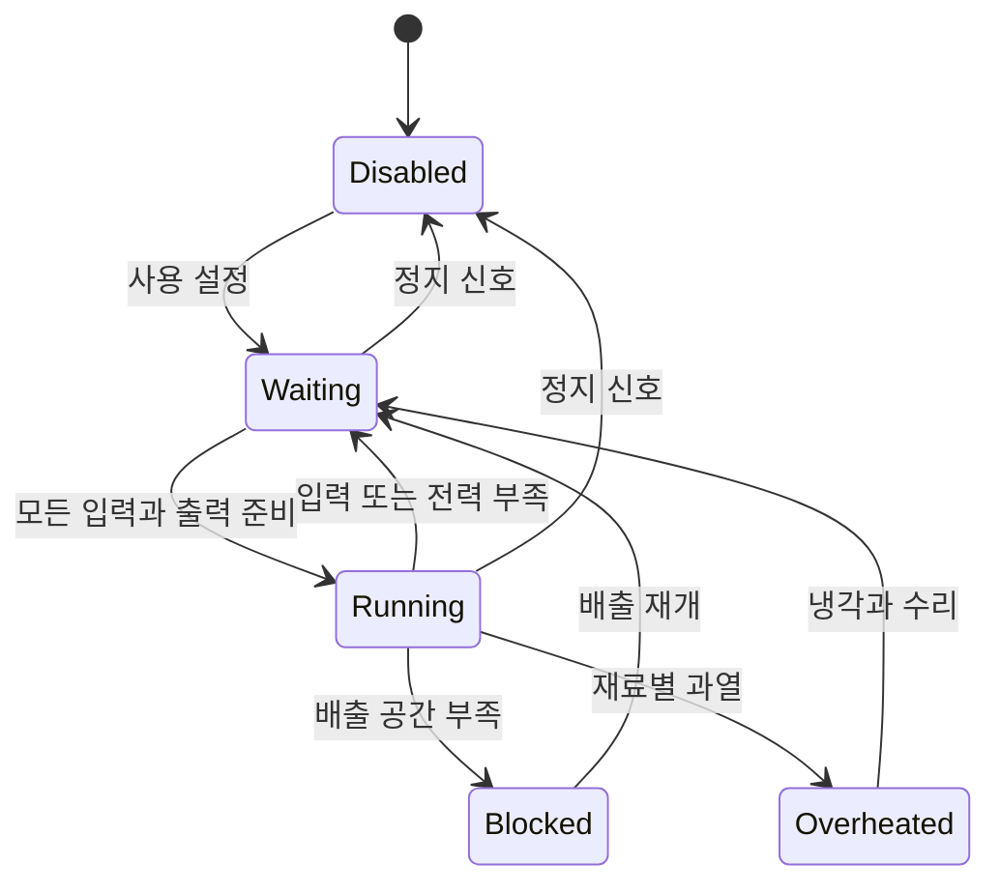

# 산소·전력·물·열 계통 고도화 설계

## 1. 현행4.0과 원작 참조의 경계

검토한 현행 소스는 `dist/engine.js`, `dist/utilities.js`, `dist/community.js`다. 아래 웹판 값은 원작 값이 아니라 현재 구현의 파라미터다. 특히 물은L, 기체는 칸 내부 수치와 공용 재고를 사용하므로 원작kg와 바로 더하거나 나누지 않는다.

| 항목 | 현행 숨4.0 | 원작 참조 | 고도화 방향 |
|---|---|---|---|
| 주기 | 120 게임초 | 600 게임초 기준의 원작 자료 | 시뮬레이션 단위와 화면 속도 분리 |
| 수동 발전 | 45 W | 400 W | 원작 규칙 선택 시 노동·소비전체를 함께 조정 |
| 석탄 발전 | 60 W, coal0.025/s | 600 W, 석탄1 kg/s | 연료kg·열·CO₂ 배출 레시피화 |
| 수소 발전 | 70 W, 공용수소0.04/s | 800 W, 수소0.1 kg/s | 실제기체포트·저장·잘못된기체 입력 처리 |
| 전해 | 물0.18L/s, 산소0.30칸단위/s, 수소0.055단위/s | 물1→산소0.888+수소0.112 kg/s | kg 기반 반응과 배출 원장 도입 |
| 정화 | 오수0.16L/s, 95%청수회수, rock5%소모 | 오수5+여과재1→물5+오염흙0.2 kg/s | 여과재·오염흙·세균 분리 |
| 급수망 | 연결망 전체에 저장량 비례 재분배 | 방향 포트를 통한 패킷 운반 | 국소유량·이동지연·혼합·역류불가 표현 |
| 냉각 | 청수소모 후 주변칸 온도 직접하강 | 유체−14°C의 열을 장치로 전달 | 열 운반재와 열 배출처 필요 |
| 축전지 | 1200 J | 소형10000J·대형40000J·스마트20000J | 누설·신호·전선부하 분리 |

현행 구현의 전해 출력비는 단순한 원작의 일정 배율이 아니다. 따라서 원작 전해조 숫자만 바꾸는 변경은 생활·작업·급수·저장 한계를 함께 무너뜨릴 수 있다. 차기 저장에 `rulesetId`, `unitSchemaVersion`, `referenceSnapshotId`를 추가하고 기존4.0은 별도 규칙으로 계속 읽는 설계를 권한다. 현행 소스 비교와 원작 출처는 [설비 데이터 문서](04_Facilities_Reactions.md)를 함께 본다.

## 2. 핵심 데이터 계약

```text
ElementState = { elementId, massKg, temperatureC, germsByType }
Port = { medium, direction, localTile, acceptedElements, packetCapacityKg }
Machine = { recipeId, inputBuffers, outputBuffers, state, workProgress }
LedgerEntry = { tick, machineId, elementId, inputKg, outputKg,
                explicitSinkKg, explicitSourceKg, ruleId }
```

전력J, 질량kg, 열DTU를 같은 `resources` 숫자에 혼합하지 않는다. 전력은 `W×dt`, 연속 반응은 `kg/s×activeDt`, 배치 반응은 완성 시 예약된kg로 계산한다. 한꺼번에 큰dt가 들어와도 내부 고정 단계로 나누며, 마지막 불완전 단계에서는 자원이 허용하는 활성 시간만 가동한다.

배출 공간을 먼저 예약한 뒤 입력과 전력을 차감한다. 일부만 처리할 수 있으면 모든 입력·출력·에너지·경험치에 동일한 가동 비율을 적용한다. 출력을 최대치로 잘라 버리는 `min(capacity,current+produced)`는 원장의 명시적 소멸 규칙과 무관한 손실을 만들기 때문에 사용하지 않는다.

## 3. 설비 상태 기계



`Waiting`의 이유는 출력공간·연료·원소종류·유체질량·전력·작업자·작업예약을 구분한다. UI는 최우선 차단 이유와 그 위치를 보여 준다. 실제 출력이 없는 `Waiting`에서는 전력·연료·경험치를 소비/획득하지 않는다. 원작의 기체 펌프처럼 적은 질량을 펌핑해도 가동 중 정격 전력을 쓰는 장치는 별도 전력 정책을 둔다. [기체 펌프](https://oxygennotincluded.wiki.gg/wiki/Gas_Pump)

## 4. 전해 시스템 수지: 정격만 보고 자립 판정하지 않기

아래는 문헌 수치에서 계산한 이상적 모델이다. 기본 호흡 수요0.1 kg/s/명과1주기600초를 전제로 한다. 실제 배치의 공기 혼합, 과압, 대원 활동, 저장 부족, 기동전력, 열관리, 필터는 별도다. 계산 결과는 [balance-scenarios.json](../data/balance-scenarios.json)에도 제공한다.

### 4.1 전해조1대의 이론 출력

```text
물 = 1 × 600 = 600 kg/주기
산소 = 0.888 × 600 = 532.8 kg/주기
수소 = 0.112 × 600 = 67.2 kg/주기
기본 호흡 기준 지원량 = 0.888 / 0.1 = 8.88명
```

8명의 소비는480 kg/주기이며 산소 여유52.8 kg/주기다. 이 여유는 가동 정지에 대한 여유이지, 무조건8명을 안전하게 공급한다는 보장은 아니다. 필요한 가동률은`480/532.8=90.09009%`이고, 같은 비율의 물은540.54054 kg/주기다. 원작 숫자가 반올림되어 있으므로 근사값112.5g/명/s를 다시 입력 데이터로 사용하지 않고 원래0.888 비율에서 계산한다. [전해조](https://oxygennotincluded.wiki.gg/wiki/Electrolyzer)

### 4.2 산소와 수소를 모두 펌프로 운반하는 경우

| 항목 | 계산 | 평균W |
|---|---|---:|
| 산소 펌핑 | 0.888 / 0.5 × 240 | 426.24 |
| 수소 펌핑 | 0.112 / 0.5 × 240 | 53.76 |
| 물 펌핑 | 1 / 10 × 240 | 24 |
| 전해조 | 정격 가동 | 120 |
| 합계 | 이상적인 꽉 찬 패킷 가정 | 624 |

산소 펌프2대와 수소 펌프1대가 충분한 질량이 모였을 때만 켜지고 출력이 막히지 않는 이상적 가정을 썼다. 실제 제어가 이 조건을 달성하지 못하면 소비전력이 증가할 수 있다. [액체 펌프](https://oxygennotincluded.wiki.gg/wiki/Liquid_Pump), [기체 펌프](https://oxygennotincluded.wiki.gg/wiki/Gas_Pump)

수소 전부를 태우는 이론 발전은`0.112/0.1×800=896W`다. 하지만 수소 발전기1대의 상한은800W이므로 **896W는 발전기 여러 대 또는 다른 시간대 버퍼 운전까지 포함한 시스템 평균 후보**다. 1대만 두면 수소0.012kg/s, 즉7.2kg/주기가 계속 남는다. 두 조건을 혼합해 전력 흑자와 무한 수소 수용을 동시에 주장하지 않는다. [수소 발전기](https://oxygennotincluded.wiki.gg/wiki/Hydrogen_Generator)

발전기가 충분하면 이상적 순전력은272W,1대만 지속 가동하면176W와 수소 누적이 함께 발생한다. 여기에 기체 필터1개가 계속 가동하면120W, 배터리 누설과 기타 부하가 추가된다. 따라서 최종 목표는 '전해조+발전기 존재'가 아니라 **산소 수지·수소 저장 여유·전력 수지·열 상승률을 함께 만족**하는 상태로 판정한다. [기체 필터](https://oxygennotincluded.wiki.gg/wiki/Gas_Filter)

## 5. 탄소 제거와 물 정화의 폐회로

탄소 스키머1대는 물1kg/s를 오염수1kg/s로 바꾸고 CO₂0.3kg/s를 제거한다. 물 정화기의 처리율은5kg/s이므로 정화기는 평균20%만 작동하면 된다. 결과적으로:

```text
물의 순소비 = 0 kg/s (기동 물량과 누수 제외)
여과재 소비 = 1 × 0.2 = 0.2 kg/s
오염흙 생산 = 0.2 × 0.2 = 0.04 kg/s
평균전력 = 120 + 120 × 0.2 = 144 W
고정발열 = 1 + 4 × 0.2 = 1.8 kDTU/s
```

이는 무자원 순환이 아니다. 여과재 보급과 오염흙 반출이 막히면 순환은 중단된다. 물을 다시 펌프로 꺼내지 않는 직접 배관 회로를 가정했으며, 새 펌핑이나 높은 누설이 있으면 비용을 더한다. 병원체 살균도 이 계산에 포함되지 않는다. [탄소 스키머](https://oxygennotincluded.wiki.gg/wiki/Carbon_Skimmer), [물 정화기](https://oxygennotincluded.wiki.gg/wiki/Water_Sieve)

## 6. 냉각 설계와 열 원장

냉각기를 주변 온도 감소 효과로 표현하면 폐열과 재료 비열이 플레이에서 사라진다. 차기 구현은 다음 순서로 처리한다.

1. 입력 패킷의 질량·원소·온도를 읽는다.
2. 목표 출력온도를14°C 낮춘다.
3. `Q = massKg × specificHeatDTUPerKgC × 14`로 전달 열을 계산한다.
4. 패킷 열량을 줄이고 동일량을 냉각기 본체 열량에 더한다.
5. 본체와 주변 물질 사이에서 열전도한다.
6. 상변화와 과열 조건을 판단한다.

물 비열4.179 kDTU/(kg·°C), 유량10kg/s이면 액체 냉각기는585.06kDTU/s를 옮긴다. 소비전력1200W가 그만큼의 현실적 열로 변환된다는 가정을 추가하지 않는다. 원작 게임 단위와 규칙을 그대로 재현하는 모드와 물리보존 실험 모드를 구분한다. [액체 냉각기](https://oxygennotincluded.wiki.gg/wiki/Thermo_Aquatuner)

증기 터빈은 입력증기에서95°C 물이 되었을 때 사라지는 열량과, 본체에 돌려주는 열량을 따로 계산한다. 증기2kg/s가200°C일 때 입력과 출력의 열차는877.59kDTU/s, 본체로 돌아오는 열은91.759kDTU/s이며 문헌 출력 상한은850W다. 이 값은 터빈 본체 냉각 비용을 포함한 완성 냉각 플랜트의 순수지가 아니다. [증기 터빈](https://oxygennotincluded.wiki.gg/wiki/Steam_Turbine)

설비의 출력 최저온도 때문에 추가되는 열도 `thermalSource` 원장으로 남긴다. 저장고나 배관 제거 시에는 저장 질량과 열을 환경 또는 병에 넘겨야 한다. 질량만 보존하고 온도를22°C로 재생성하면 냉각 치트가 된다.

## 7. 차기 구현 우선순위

| 단계 | 변경 | 완료 조건 |
|---|---|---|
| P0 | 단위 정의, 출처 데이터와 웹 조정값 분리 | 모든 수치가 규칙 집합·단위·근거를 가진다 |
| P1 | 물질별 질량·열·저장 원장 | 전해·정화·발전의 수지 검산 통과 |
| P2 | 방향 포트, 기체/액체 패킷 | 단절·분기·출력 막힘·잘못된 원소 테스트 통과 |
| P3 | 실제 수소 수집·저장·발전 | 공용 수소 생성 없이 정착 목표 달성 |
| P4 | 여과재·오염흙·금속 제련 | 보급/반출/냉각액 대기 원인이 UI에 표시 |
| P5 | 냉각기·터빈·재료 전도 | 폐열 처리 없이 영구 냉각 불가, 출력온도 원장 일치 |
| P6 | 데이터 편집·시나리오 검증 | 동일 seed와명령으로 재현, 기존 저장 규칙 유지 |

한 단계가 끝날 때마다 새기지3명으로 정상 진행 경로를 검증한다. 원작 수치를 적용한 뒤 목표 시간만 완화해 통과시키지 않고, 지형 매장량·노동시간·배관 처리율·건설 비용을 함께 재평가한다. 이 우선순위는 구현 제안이며 현재4.0의 완료 기능 목록은 아니다.

## 8. 수용 테스트 제안

| ID | 상황 | 기대 결과 |
|---|---|---|
| FLOW-01 | 전해조 입력1kg, 출력 공간 충분 | 산소0.888kg+수소0.112kg, 소비120J/활성초 |
| FLOW-02 | 수소 출력 저장이 가득 참 | 입력·전력 차감 없이 차단 또는 정해진 부분 가동 |
| FLOW-03 | 전해조0.3초 후 저장/복원 | 질량·열·전력·가동시간이 연속실행과 일치 |
| FLOW-04 | 3개의 작은dt와합친dt | 고정 단계 정책 안에서 같은 수지 |
| FLOW-05 | 중간 관 제거 | 양쪽 연결망과방향 재계산, 물질 소실 없음 |
| FLOW-06 | 정화기 여과재 고갈 | 물을 공짜로 정화하지 않음 |
| FLOW-07 | 정화기에세균 있는오염수 | 정화된 물의 물질종과 세균상태를 분리 |
| FLOW-08 | 기체 펌프에적은기체 | 실제이동량은 적어도정책상정격전력은유지 |
| POWER-01 | 수소0.112kg/s, 발전기1대 |800W상한, 잔여0.012kg/s누적 |
| POWER-02 | 부하없는발전·만충배터리 | 잉여에너지를명시폐기하거나제어정지, 연료정책일치 |
| HEAT-01 | 물10kg 패킷−14°C |패킷에서빠진열과본체에더한열일치 |
| HEAT-02 | 터빈몸체100°C이상 |과열피해온도와별개로운전정지 |
| HEAT-03 | 뜨거운탱크철거 |질량과열을배출물에넘김 |
| DATA-01 | 필드null |0으로강제변환하지않고미확정으로표시 |
| DATA-02 | 원작비보존반응 | 명시sink를제외한오차만실패로처리 |
| SAVE-01 |4.0저장불러오기 |기존ruleset유지, 수치일괄변환금지 |

UI의 산소·물·전력 패널은 단순 재고 숫자와 별도로 최근1주기 유입·소비·잉여·고갈 예상시간을 보여 주는 것이 좋다. 예측은 최근 가동률을 사용하고, '명목 최대'와 '최근 평균'을 구별한다. 경보는 대원 수가 아니라 실제 소비율, 도달 가능한 산소, 생산 설비의 막힘 상태를 바탕으로 표시한다.
